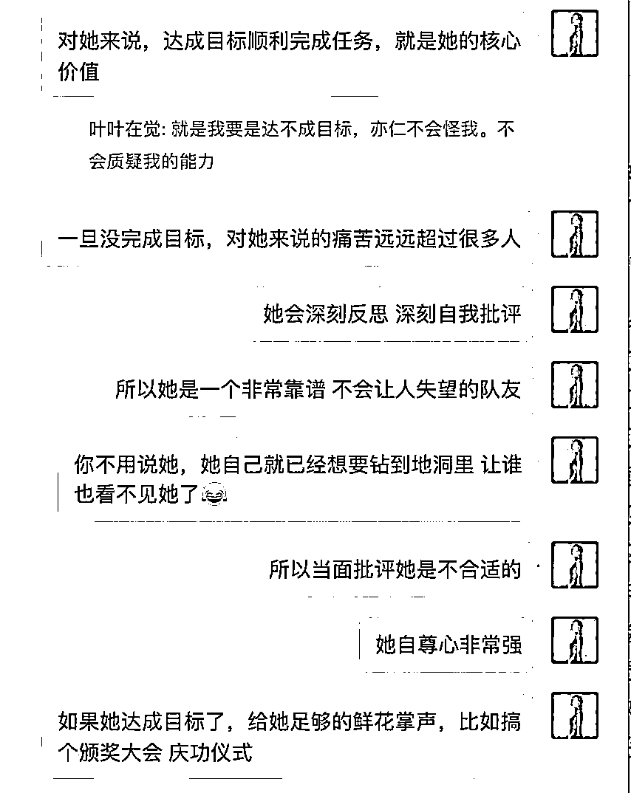
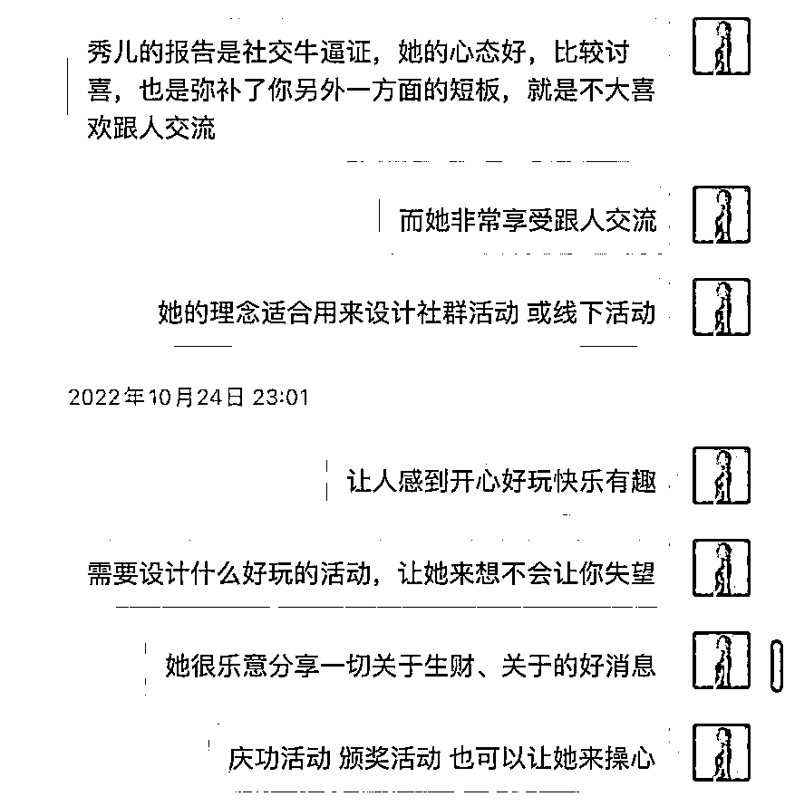
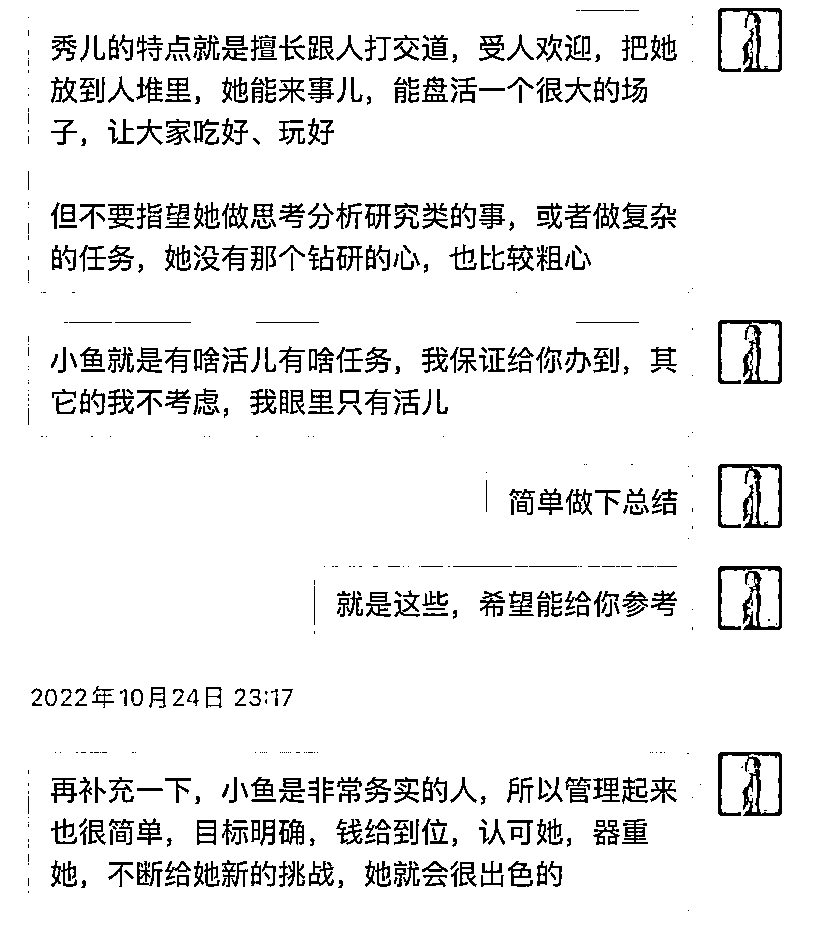
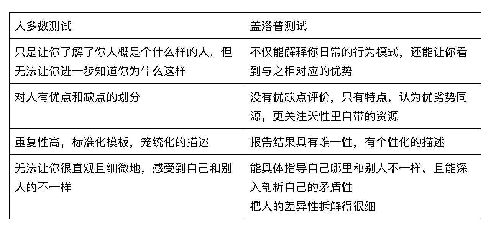
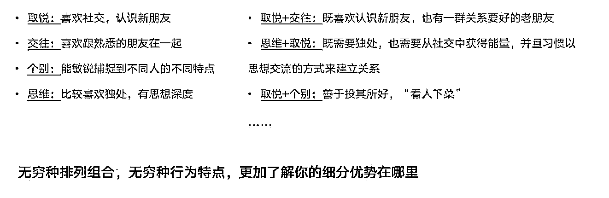

# 盖洛普，测量的到底是什么？

先说明这篇科普的缘起：小刀姐在生财全国见面大会上安利了盖洛普，让不少人第一次认识到这个工具。我答应写篇文章，把它是什么、有什么用、和别的测评有什么不一样讲清楚。

一、盖洛普到底在测什么？

它研究的不是你的学历、能力或性格倾向，而是一套与生俱来的反应方式。举几个直观的例子：
如果有人总是想把日程填满，一件事刚完就急着找下一件，似乎停下来就会不安，盖洛普把这种状态命名为“成就”；
如果有人报了很多课、买了很多书，重要的不是真正看完，而是享受“正在学”的感觉，这叫“学习”；
如果遇到分歧首先想到的是退一步、求同，不希望气氛变僵，这是“和谐”；
如果脑子里经常冒出各种奇怪灵感，别人没想到的你能想到，这是“理念”；
如果做事前习惯把可能出现的麻烦都预演一遍，确认无误才动手，这是“审慎”；
如果喜欢刨根问底，总想弄清一件事背后的运行规律，这是“思维”；
如果进入陌生环境不但不怯场，反而觉得兴奋，能与初次见面的人迅速聊开，这是“取悦”；
如果更喜欢待在熟悉的小圈子里，只有和老朋友在一起才最松弛，这是“交往”；
如果拿到任何消息都不会马上采信，而是先核对数据、验证来源，这是“分析”。

这套测评由美国盖洛普咨询公司开发，考察的是一个人最天然的心智模式，通俗讲，就是你在大多数场景下会怎样想、怎样做，更像是一套帮助你认识自身的底层认知框架。目前全球有超过2900万人体验过，生财有术团队内部也测过，对它的科学性和准确度表示认可。

在盖洛普的优势语言中，人身上共有34种可被识别的天赋优势，也就是通常说的“才干”。才干不是后天练成的技能，而是不假思索就会呈现的行为与思维方式。它像一种底层驱动力，也在向你透露内心的需求。如果你能有意识地把这些天性往合适的方向训练，往往能收到事半功倍的效果，也更容易获得持续的正向反馈。

每个人的34种才干在排列顺序和组合方式上都不同，所以盖洛普能精确呈现个体的独特之处。一个常被用到的类比是钢琴：琴键总共只有88个，可不同的排列组合却可以创作出数不清的旋律。

二、做完测试并且请人解读，能带来什么改变？

最直接的一点是：你会看清自己过往行为背后的逻辑，知道哪些是别人不具备的天赋，哪些又成了限制你的思维盲点。对职业教练来说，一份报告相当于拿到了客户的操作系统说明，问题出在哪里、要顺着什么去沟通，都变得更清晰，而不是拿些放之四海皆准的正确废话去指点。

生活中常有这样的体验：找朋友倾诉自己的困境，对方的确给出了合理的建议，自己也觉得有道理，就是执行不下去。这不一定是意志力的问题，而是你们的底层系统不一样：在乎的东西不同，痛苦的阈值也不同。譬如有人需要把目标说出来、被人盯着，才有执行力；有人却觉得被人围观是巨大的压力，宁可先做出成绩再坦荡地讲。再譬如面对外界眼光，有人可以说“我不在乎”，有人却天生敏感。让后者“别太把自己当回事”，非但不能帮到他，反而增加一层自责：为什么我就是做不到不在乎？针对这类人，我的做法是帮他把外界的看法转化成前进的动力——与其消灭负面评价，不如努力积攒正面认同，当认同感的体量远超杂音，那些评判自然就不再有杀伤力。

以下是我服务过的几个真实案例（均已获得案主许可公开）。

1、提前避开不合适的岗位与工作方式，减少试错和内耗
有个校招进银行的应届生，工作不到半年就觉得压抑得不行。测评结果里，“理念”排第一。理念型的人天生爱开脑洞、不喜欢一成不变，银行那些重复而严密的流程，恰好和他的天赋拧着来。想明白这一点后，他辞了职去做文案策划，整个人都活了过来。他后来跟我说，要是大学时早些做盖洛普，毕业那年就不会盲目随大流。

一位商务岗位的来访者，“取悦”排在倒数第二。取悦不等于讨好，它指的是从陌生人社交中获得能量的能力，而这位伙伴恰恰在这件事上天生耗电。可他的工作偏偏是每天对接渠道商，打电话、约局、维护客情，样样都在磨他。以他的禀赋，更适合退到幕后，做广告策划或产品经理这类重思考、少应酬的岗位。
有人或许会反驳：社恐也能通过练习变成社交高手。我的回应有两点：首先，每个人社恐的严重程度不同，练习所承受的消耗也不同；其次，后天硬练出来的应对能力和天生享受社交的状态，在效率和续航上存在本质区别——前者是充电，后者是放电，每次结束都需要恢复。逼自己用最弱的短板去拼，励志是真的，但对职业发展未必明智。真正的竞争力，是用更低的成本拿到更好的结果；拿短板硬刚，等于主动跑去别人的主场挨打。

2、定位内耗和行动力不足的根源
小强想做短视频自媒体，学习了整整一年，课买了、器材备了、脚本写了，拍摄剪辑也都上手试过，可一条视频都没发出来。原因只有一个：总觉得不够好。报告显示，他的“学习”排第一，“完美”排第二。他一直在学怎么把视频做好，又总想等到足够完美才发布——这两股力量拉锯，行动自然被拖垮。当他把焦点转向“先让作品落地，再慢慢打磨”，心里的石头才算放下。

阿杰是一名内容运营，他常苦恼自己看不准什么内容会爆，想出的选题总是被领导打回。别人告诉他，多刷热搜就有了，于是他每天大量浏览，可还是抓不住要领。原因不在于他不努力，而在于视角不同：他的“专注”和“学习”两项才干靠前，让他只对自己目标相关的事感兴趣，对大众情绪的流动缺乏觉察。但他擅长抽象和总结规律，于是我建议他放弃硬刷热门，改为建立自己的爆款规律库，用结构化的数据去提升判断力。这个思路让他重拾信心，也不再怀疑自己是不是入错了行。

3、定位亲密关系里的相处障碍
一对青梅竹马的情侣来见我，女生纠结于男朋友为什么总是不看好她的想法。两人认识二十年，感情很深，却常常吵到心累——她想做小红书，觉得能让简历更有竞争力，男友却泼冷水说小心被人网暴。看了盖洛普报告，男生“排难”第一，凡事先看见风险；女生“积极”靠前，凡事先看见机会。解读中，男生说出了心里话：他很清楚女友很在意别人的目光，担心她做了小红书收到恶评会难过，于是故意把后果说得严重些，想让她想清楚再行动。女生听完之后非常感动——原来那不是打击，而是以他的方式在保护她。这让我想起自己的大学时代，我也曾因为误解前任的表达方式而分手，直到接触盖洛普才读懂那种行为逻辑。真的希望相爱的人，不要因为“频道不一致”就轻易放手；讲透对方的思维方式，很多误会就能消解。

4、定位团队管理里的内耗卡点
有位团队主管问我，可不可以辞退一位绩效垫底的员工。这名员工多次犯错、提醒无效，整个团队的绩效和士气都受到拖累。主管却迟迟下不了手，总觉得对方再给一次机会就会变好，也担心辞退会让对方失去信心。她的盖洛普结果里，“和谐”和“审慎”格外突出——和谐让她不愿意在关系中当“坏人”，审慎又让她不断放大可能的坏结果。看清这个循环之后，她终于松了口：让一个人早点离开不合适的赛道，反而给了他更早去做真正喜欢的事情的机会。

一位微商团长来咨询时很纳闷：我每天精力旺盛，为什么团员就是“卷”不动？她的“学习”和“成就”双高，自己跑起来毫不费力，便不自觉地以为别人不努力。可实际上，有些下属的精力上限就那么高，有些人对赚钱的欲望也没有她那么强烈。我给她的建议，一是筛选和自己同频的人，把队伍培养成“卷王联盟”；二是学会接纳差异，去发现每个人的动力开关在哪里，用对方在意的奖励去激发。想通了这一点，她不再内耗，团队反而走得更稳。亦仁也曾在星球分享才干如何影响他的团队管理，链接在此：https://t.zsxq.com/0cHEoq5DE

5、知道自己的动力来源，学会给自己充电
为什么会觉得上班没劲？盖洛普认为，这往往是一些内在需求落空了。34种才干，每一种背后都对应着一个需求：比如“追求”需要来自外界的崇拜和即时反馈；“竞争”需要一个势均力敌的对手；“适应”需要环境不断给出新变量。需求一旦被喂饱，你自然会有一种想冲锋的感觉。举个例子，“交往”才干突出的人，必须定期和几位交心的朋友见面、深聊，才能获得能量补给；他们适合经营一对一或小圈子的深度关系，因此更适合做高客单产品，靠转介绍稳步积累。

6、找到适合自己建立影响力和获取流量的方式
在建立个人影响力的路径上，天性同样重要。擅长连接的人，适合以社群为基础做深度信任；不善社交或不喜欢跟用户走得太近，就去公域平台做内容，靠作品吸引同频的人。内容形式也各有匹配。有位客户说自己写不出深刻文章，总觉得开不了口，但聊了几次我发现，她特别乐于挖掘提升生活品质的好物，天生适合走实用测评路线；另一位朋友聊起天来滔滔不绝，我便建议她做一档和朋友对话的音频节目，话题一期一个，反而成了她的特色。

7、定位团队成员的独特优势，学会激励下属
之前亦仁请我为他团队成员分析报告，下面摘录几份：  
了解成员各自的才干之后，就可以据此分配合适的任务，用他们真正在意的反馈方式来激励，团队配合会更顺。当然，盖洛普+解读能处理的问题远不止这些，比如冒牌者综合症、反复陷入相似的人生困境……这里就不再展开了。

三、测过的人是怎么评价的？

许多人的第一反应是：“感觉被它看穿了。”有体验者反馈，过去许多行为自己说不清来由，报告给了它们清晰的解释，也让人看到优势用在哪里，盲点藏在哪里。还有人在面临学业、创业、择偶等多重选择时，通过报告增加了新的判断维度——比如自己更擅长什么、在哪些事上更容易坚持、和什么样的人相处更顺畅、采用哪种休息方式更高效、什么样的伴侣模式更适合自己。这就像原本模糊的自我，终于有了一个可视的轮廓，选路时也会更笃定。

四、盖洛普与其他测评的区别在哪里？

盖洛普是积极心理学脉络下的产物。它并不把人划分为优劣，而是认为每个人身上都只是“特点”，每种特点都有它的双面性。比如有些测评会指出“你习惯回避冲突”，在盖洛普的语言里，这会被描述为“和谐”才干。当你知道自己的“和谐”排第一，你就会明白自己为什么本能地躲开冲突，同时也会看到它在协作中带来的价值。
盖洛普的另一个特点是分辨率极高。多数测评像手机随手拍，只能给个大致轮廓；盖洛普则更接近专业设备，能把34个才干的细节呈现出来。同样是擅长人际交往，在盖洛普体系里，不同人的表现方式完全不一样：
之所以能区分得这么细，是因为结果由34个才干排列组合而成——每个结果都有像身份证号一样的唯一性，且人与人即便拥有相似的单项才干，组合方式不同，最终呈现的行为和结果也千差万别。
此外，盖洛普测量的是一个人的本能和稳定模式，不是后天习得的技能，所以它不太会随时间频繁变化。环境可以改变人的部分行为，但底色和天性很难扭转。跟MBTI相比，盖洛普更像高清特写，MBTI则相当于全身照；两者可以互补，但如果你希望深挖自己的优势，盖洛普是更合适的起点。

五、这套工具是怎么诞生的？

主导研发的是美国优势心理学之父、盖洛普前董事长唐纳德·克里夫顿。他带领团队用了不下三十年时间，访谈了来自不同国家和行业的优秀人物，试图探寻他们成为卓越者的路径。最终，他们在海量资料中找到了那些成功者共通的思维线索，并把这些模式提炼、命名为34项天赋才干主题。完整的演变历史可以查看官方页面：https://www.gallup.com/cliftonstrengths/zh/253745/克利夫顿优势历史.aspx

六、人有自我欺骗倾向，如何确定测出的是真实自我？

人是多面的，会戴着社会化面具。盖洛普没法做到百分之百精确，但它的信效度——两次测试的一致性——约为70%，已经超过绝大多数测评工具，具备参考意义。更重要的是，它捕捉的是你来不及思考的自动反应，而不是深思熟虑后的“理想答案”。
为了保证结果不被主观意识污染，盖洛普在设计题目时做了不少防伪处理。它不像许多测试那样让你给自己打分，也没有明显的“政治正确”选项。全卷177道题，各题之间暗中交叉验证：同一个才干会被拆分到多道题目里，答题者很难察觉它们测的是同一维度。以“积极”为例，它可以表现为你经常笑、总能发现事情好的一面、喜欢夸别人、情绪日常饱满……这些描述与你的符合度越高，对应的才干就越靠前；符合度一般则落在中段；不太符合就排在末位。
顺带提一句：如果你已经熟悉了这套体系的原理，重复作答的意义就不大了，因为当你清楚每一题在探查什么，结果就不太可靠了。
 
万一测完觉得不像自己，也可以找专业教练做一次解读，在对话中去分辨哪些部分属于天性与本能，哪些是社会教化的结果。

七、在哪里可以做测试？

盖洛普是一项专业测试，需要付费。官方的定价为445元，找盖洛普优势认证教练购买通常有折扣，我和醒醒、苏姐都可以提供。不太建议省这笔钱去做免费版——曾有对比显示，免费版与正版的排序相差很远，反而容易带来误导。另外，如果你买了《盖洛普优势识别器》这本书，里面的测试码只能解锁前5项才干，属于体验性质；想拿到完整34项，仍然需要在官网或教练处付费开通。

关于盖洛普的入门介绍就先写到这，希望解答你的一部分好奇。想知道怎么借助它去寻找适合的主业或副业，可以看这篇：https://articles.zsxq.com/id_em3hjst8wmvh.html。我此前对亦仁盖洛普报告的完整解读，见：https://t.zsxq.com/0c94jdfSp；想和我本人交流，也欢迎添加微信：sunkiss66。