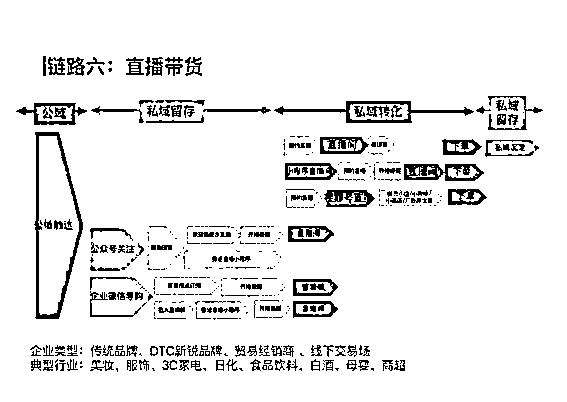
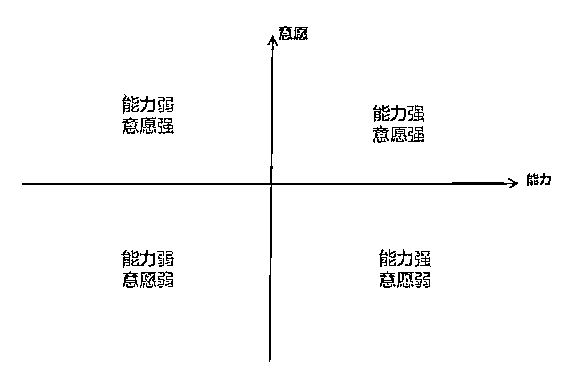
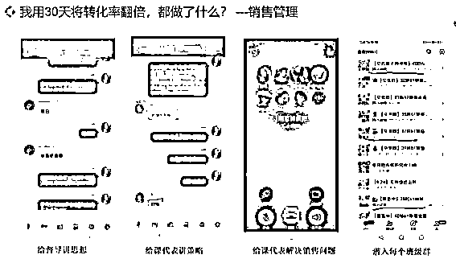
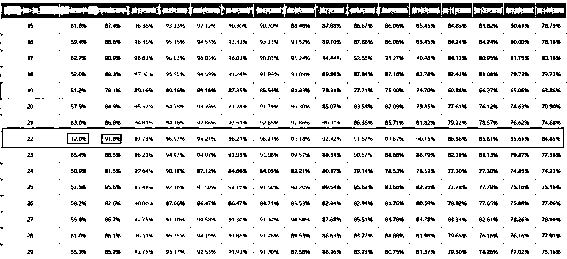
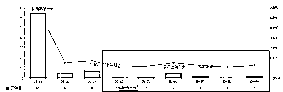

# 七个月，复购率20%到57%：销售团队转化打法

大家好，我是奶茶。进生财不到半年，受圈友照顾不少，心里一直惦记着回馈一篇实战总结。年底看到不少会议都在聊私域，我在这个行业摸爬多年，觉得该把踩过的坑和跑通的方法整理出来。这篇内容得到@数列、@杨爽、@卡卡、@敏敏的帮助，先谢过。

先放一张图：

腾讯官方梳理的十条营销链路中，直播配合私域成交，已经成了不少公司的常规工具。私域转化团队的能力画像很特别：既要能讲，又要能卖。所以，销售队伍怎么搭、转化率怎么提，是个绕不开的问题。我既带过四十人的全职销售队伍，也管过上千人的兼职团队，两次把纯运营班底改造成销售班底，整个过程我都经历过。最终把业绩做到千万级起步，也冲过亿级盘子。弯路踩过，办法也攒下了。下面直接上干货。

## -01- 销售队伍怎么搭？先抓住三个关键动作

### 1. 选人：模型不对，硬拧只会双输
这些年见过不少老板，总想改掉团队原有习惯，把运营型队伍掰成销售型队伍。可现实是：一个人如果和目标能力模型不匹配，很难靠硬扭转改变，双方都会很痛苦。真正能加成的，是意愿。选人环节可参考销售人才模型（我最初不知道市面上已有类似模型，后来带团队跑成型再总结，发现思路很接近）。

一句话：人没选对，努力很容易打水漂。转型初期，团队里能力强、意愿也强的人属于撞大运；多数情况是意愿强但能力弱。没关系，只要方向正确，这种人可以培养。先让第一批相信我们的人赚到钱，资源要向他们倾斜。

拿刚启动项目那阵子来说，周六我会在群里给骨干销售拆运营策略。

### 2. 宣讲大会：把人心聚起来
宣讲前要把PPT等准备做足。现场角色要清楚：主持人、听众、领导都在；该表彰的嘉宾、奖状证书奖品和发言稿，一个都不能少。

等首期实验数据出来，就开宣讲大会。用数据讲清这次实验的意义和价值，不只盯结果，还要讲它代表什么。给首批参与者实打实的物质激励，比如薪酬上给前几名500—2000元不等的奖励。

### 3. 绩效改革：改结构，不降薪
绩效改革这块我有些心得。我不是人力出身，但业务做久了，知道绩效必须贴着业务走，人力通常也会多听业务意见。运营转销售，大致会经历几个版本。

举例：员工原先做运营，月薪一万六。
第一版工资结构：固定八K加绩效八K。转销售后第二版改为：底薪八K加提成八K。总包仍在一万六附近，变的是结构，刚改革时一定别降总薪。
员工适应两个月左右，业绩可能已经跑起来，甚至超过公司支出成本，这时再调整。
第三版：底薪加阶梯式提成。阶梯提成的最高上限，就是公司能接受的提成比例，比如10%、20%。同时守住二八法则：先让一部分人跑出高收入，贡献少的人提成低，每个月既要有高绩效，也允许低绩效存在，整体别失衡。

小结：销售型团队打造，核心是意愿和能力匹配，按人岗适配去试用；同时不断用大会做奖罚表彰，再配上绩效改革，才有机会长成有战斗力的销售组织。一旦决定干，就尽量干到透。

## -02- 从20%到57%：转化率提升的五个阶段

社群销售我操盘过近百场。一个能打的社群，推进有节奏，成交也有集中爆发窗口。下面这套打法，更适配从公域导到私域、客单价偏高的产品：三千元往上，单群产出效率约两百的精细打法。整套动作前后约七个月，复购转化从20%走到57%。我是怎么一步步做到的？

### 1. 起步期：先选对品
零到两成这个区间，最关键的一步是选品，它决定模式能否跑通。当时那个产品让三端都受益：用户马上拿到实惠；销售推它，本质是在教人赚钱；公司这边毛利高，交付成本又低于实体。三端都有收益，顺着人性，也更贴合当时的环境。

### 2. 20%—30%打磨期：把SOP磨出来
这一程要把团队SOP磨出来。我们当时跑十四天训练营，没现成参照，就用最小可行实验去试销售时点。四天、八天、十天、十二天四个节点都测过：八天和十天差不多，四天偏早，十二天偏晚。再结合课程安排，最终把开卖日定在第十天。前提是前九天得把用户教会，否则很容易招来反感。怎么让用户按节奏学？我们盯住一个指标：听课率。每天督学、提醒上课，既保住体验，又跟成交目标挂上钩。第一阶段两个月跑到三成，转化提了十个百分点。

### 3. 30%—40%成长期：用听课率撬动转化
指标定了，接下来拼执行。可执行不是一声令下，先得把认知拉齐，这要花时间；策略层和执行层看问题的角度本来就不同。我们靠宣讲、拿数据说话、树标杆，把听课率从五成推到七成，转化也跟着多了约一成。听课这个动作，权重确实高。

只有听了，才算学了。用户学完，我们再叠加超出预期的交付：买音频课的人，能得到手把手实操答疑、加餐分享和直播答疑课。我们费这么大劲，就为确保用户第九天学会、第十天进入成交环节。还能怎么往上推？调研未成交用户后，发现不少人的卡点是内容量太大、来不及消化；用户里中老年居多，吸收速度确实慢。于是我们决定把学习周期拉长，配套延长内容，说干就干。策略能落地，背后得有强执行团队；这支队伍怎么搭，前面第一部分已经拆过，这里不赘述。

### 4. 40%—50%冲刺期：延长学习周期
这一程靠的是把学习周期再拉长。时间给够，消化面变大，成交面自然更宽。不过多给七天很耗人力。花七天，能换来约一成效益，ROI算得过来就值得做。多这七天，大概能多一成转化。

### 5. 50%以上活动追击期：活动是最后加分项
到这一步，销售端能做的动作基本做满，再叠活动最划算。它更适合小而美的公司。大厂可以一开始就砸预算做活动，中小企业没那么多弹药，得先把转化模型磨成型，活动才属于附加项。

活动我们迭代了很多版，最早是抽奖。头奖设为免单，这里有个设计题：让已购用户抽，还是全场都能抽？测下来，全场抽对公司不划算，万一被薅羊毛呢？后来改成只让已购用户参与，在群里把胃口吊起来，借气氛推购买。效果不错，还能把首日复购再往上抬一截。

小结：运营这活儿很细，用户一进门，服务就已经开始。过去用户还能接受图文，现在短视频、直播兴起，私域运营还要配上直播和短视频，做得生动有趣。有位前辈说过：让用户连续三次感到超出预期，他就会变成你自己人。仔细品，好服务往往不止三次。

## -03- 怎么打造销售团队的“团队感”？

如果销售队伍各打各的，没有团队意识，组织就像散沙，公司也会丢了魂。大家只有把劲往一处使，围着业绩目标一起冲，公司营收才会上去；营收上去后，才有余力把用户服务得更好。这是一个闭环。那“团队感”从哪里来？

### 1. 使命意义：钱之外，还要有共同奔赴的理由
这首先是对负责人的要求。带着大家干一件事，钱之外得有更高价值。
对用户，帮他们掌握靠谱的理财方法，让保障能覆盖看病需求。
对团队成员，表面在帮用户，实际也在帮自己：赚到钱后，成家、置业、带父母旅行、看世界，这些梦想才有落地可能；而它们都建立在帮用户、给公司创造价值之后。
对公司，利润让企业活下来，有现金流运转，也能给员工更大平台和成长空间。三边都受益，才会成为底层驱动力，推着大家往更好的方向走。

### 2. 场景布置：让办公环境成为销售场
工位怎么摆、办公室怎么设，都是在造销售“场”。一个场造得好，人推门进来就能感到该进入战斗状态。当然，场要长久，最好靠制度运转，而不是靠人盯人。

### 3. 广而告之：把优秀大声讲出来
这点要学保险公司。我在保险公司待过，看他们怎么对冠军、优秀标兵：
1）每月大会高调表彰，让获奖者上台发言；
2）把冠军照片做成易拉宝，摆在入口最抢眼的位置；
3）桌上放刻名奖杯和证书；
4）冲年底业绩时，把冲刺规则打印上墙，头部拿重奖，例如期权、旅行名额。
另外，先把伙伴们要拿的奖品采购到位，摆在桌面醒目位置造势。

### 4. 帮扶弱小：团队感不止看冠军
销售团队按二八法则，永远有优秀、中等和不及格倒数。看一个团队有没有团队感，不只看怎么表彰优秀，还要看对弱小的同学有没有培训、一对一帮扶、主管指导、激励政策。这是体现团队情怀和格局的地方。没人愿意垫底，往往只是缺方法，这时团队要给帮助和鼓励。你帮他提升、有进步，他会为你代言，“团队感”又多一层。如果所有办法都用了还没进步，就好聚好散；旁人看得见，这也显出负责人的胸怀。

说到团队感，应该学保险和微商。先别急着看不上，人家能出结果，就一定有可学之处。我从业时接触过保险团队的带团队方法，学来用到自己团队里，收益很多，真本事都是干出来的。欢迎你直接拿去实践；若你能从中拿走一两个可用动作，这篇就没白写。谢谢生财伙伴的捧场；转化率、团队管理的问题，欢迎随时来聊。