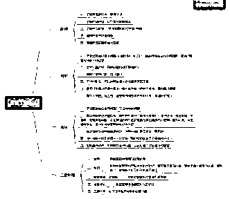
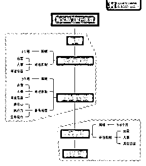

# 从百万到千万，他的秘诀是把公司交给制度

商业圈流传着一种说法：管人是最低段位，靠规则是中间段位，最高段位是让文化驱动一群人。文化管理太远，人盯人又太累，绝大多数老板真正能抓住的，其实是中间那层——制度。

今天要聊的这位创业者叫盗坤，93年出生，管着一家四十多人的公司，主营电商，也做电商相关的知识付费，现在每月净利润稳定在50万以上。他走过的路，对很多同样从小团队做起来的老板很有参考性。

很多人其实都有类似的剧本：抓住一个机会，拼命干，运气也不错，于是赚到了钱；业务越滚越大，团队从两三人变成了几十上百人。但问题也随之而来——没在大公司带过队，管理经验几乎为零。公司没有清晰的架构，人事和财务流程基本靠临时决定，日常全靠哥们义气撑着，与其说是一支队伍，不如说是一群兄弟搭伙。这种状态走到后面，路越来越窄。

他也试过从外面挖人，找过大厂出来的经理、有MBA头衔的“人才”，结果两边始终合不来。对方的体系太精良，自家这口锅太小，硬凑在一起，化学反应几乎没有。小公司资源有限，大厂高管带来的那套系统和成本，就像给一辆破驴车装飞机引擎，油门一踩，先散架的是车身。

那他是怎么走出来的？又靠什么从一年一百万冲到了一年一千万？以下是他总结的干货。

## 冲刺百万，他做对的三件事

**第一件事：先活下来，再谈其他。**

刚创业的人，最容易犯的错就是好大喜功：一分钱没赚到，先大手大脚花起来；总觉得自己是天选之子，会是最特别的那个。他的建议是：开局就承认自己是普通人，老老实实过日子。

他自己发过一条朋友圈，大意是：事情要从小处起步，别一上来就奔着大企业去；这世界不缺漂亮的理念，缺的是扎扎实实做出来的成绩。他的公司直到现在都没有前台，也没请秘书，一直挤在民房里办公，直到最近人实在坐不下了，才搬进写字楼。

他第一次做淘宝时，没经验、没方向，脑袋一热就要做一个有情怀的淘品牌。那会儿不想赚钱的事，满脑子都是怎么把产品做得有调性。结果很现实：调性没做出来，钱倒是亏了一整年。

后来他彻底想明白：活着才有一切可能。选品不再看自己喜不喜欢，只看好不好做、对手强不强。刚起步的时候，少玩虚的，多干实事。

**第二件事：深耕一块自己的地盘。**

小北老师是他特别佩服的前辈。小北在一篇文章里提到，这些年接触过很多富人，那些能一直赚钱的人，没一个不是死磕一件事的。盗坤对此深表赞同。

拿龙哥盟里的人举例：老胡深耕淘客，小北深耕跨境，黄亮深耕快手短视频，龙哥深耕龙哥盟，而他则守着淘宝上的蓝海市场不动摇。

多元化不是不行，但前提是先有一块站稳的地盘，再顺着自己的领域往外长。等你在某个行当里攒够了资源、资金、团队和经验，再去想扩张也不迟。而那通常是集团和巨头才有资格玩的游戏。对还没站稳脚跟的队伍来说，最好的策略是钻进一个足够细分的领域，长期守住，持续积累。真正扎下根之后，很多机会自己会找上门，扩张也是顺水推舟的事。

就拿龙哥来说，他在龙哥盟站稳之后，才一步步做出大航海、训练营、私董会。赚钱以后还能长出更多东西，但前提是这个基本盘先立住了。他自己后来能延伸出知识付费，靠的也是在淘宝这个领域泡了多年的底子。用他的话讲：“我现在能吹这些牛，是因为前面攒了好几年的内容。你换个没做过淘宝的人来卖淘宝课，看谁会买？”

这些年，他遇过的诱惑不少，线上线下的项目都碰过，学费也交了不少。真正常年带来大利润、撑起整家公司的，到头来还是淘宝。龙哥盟这个圈子，内容量极大，好东西也多，但需要自己去分辨、筛选、深挖。他提醒自己和大家：把心沉下来，别被外头的热闹带跑。千万不要做那种一觉醒来就换赛道的人——昨天还在研究淘宝，今天又想搞短视频，明天瞄上了淘客。找到适合自己的路，然后坚定走下去。

他现在打开赚钱，基本只看星主的帖子和精华帖，偶尔翻翻别的，目的也不是找项目、求暴富，而是想开思路、长见识。

**第三件事：耐得住，不轻言放弃。**

以他自己不算多的经历来看，创业想要速成，几乎不可能。大多数生意都藏在细节里，而这些细节，只能靠一次次试错和时间去磨。赚钱的路，很少是一马平川的，心态摆正，见招拆招。

他自己做淘宝也踩过无数坑，但他很清楚：光抱怨解决不了问题。真想赚这份钱，唯一的办法就是面对它、搞定它。别因为一点小坎就撤，总想着躺着收钱——就算真能躺着收钱，那也得有点“姿色”才行。

## 靠制度，把上限顶到千万

接下来是重点，他关于制度建设的反思和总结。

**1. 用阿米巴小组制，把公司拆活。**

他的公司运营模式，大致走了六个版本。

最开始，所有环节都压在他一个人身上：选品、找货源、做图、上架、运营、客服、发货、做报表，一个人顶八个角色，撑死开三家店。

后来招了美工、客服、财务，但核心事情还在自己手上，十家店就到头了。

再后来，他试着把一些优秀客服培养成运营，把找货源、代放单、填报表这些事交出去，自己只管选品。工作量确实减了，能干到四五十家店，可内部管理开始乱套。

转折点，是引入阿米巴模式。公司被拆成一个个小组，独立核算、独立考核、独立制定计划。每个小组以运营组长为核心，可以由组长自己去招人、带队伍。组长最初就是一个人加一个店，等第一家店跑出利润，就可以申请配客服，然后继续开第二家、第三家、第四家店；客服再被培养成运营助理，再招新客服。发货和财务由他统一调配，美工也由他统一调度。这套模式跑起来后，他几乎从日常事务里抽身了，而它的极限，大约是一百个店。

现在他正在推第五个版本：培养一位电商总监，把整个电商部门交给对方，让其独立决策，负责统筹各小组，协调运营、客服、美工、财务的人员配置。如果跑通，上限可以摸到一两百家店。眼下，他正在对部门里的运营人员做为期三个月的考核，考察合适的总监人选。

再往后，他计划按业务线拆分，成立电商一部、二部、三部，甚至花钱做内部孵化，把同样的玩法复制到京东、拼多多、跨境等平台，到那时就会有淘宝部、京东部、拼多多部。这样算下来，数百家甚至上千家店，也不是不可能。

**2. 制度要趁早立，而且创始人必须亲自抓。**

刚创业那阵子，他喜欢拉朋友入伙，公司上下一团和气，全靠熟人面子撑着。岗位怎么设、钱怎么发、上下班怎么打卡、财务怎么走账，全都没有规矩，想到哪算哪。他原本也认为，公司还小的时候谈制度太奢侈，那是有规模之后才需要操心的事，复杂的人事体系更是大厂的标配。

但现在他的看法彻底变了，想对所有创业者说一句：别管公司多小，制度必须跟上去。

他给公司规划了一张组织架构图，不少关键岗位还空着，比如电商总监、知识付费的市场负责人、HR负责人；另外，不少人是一个萝卜多个坑，行政那边同时还要兼着招聘和考勤。岗位可以暂时没人，人可以同时管几摊事，但制度不能缺席。制度不立，公平和纪律就无从谈起，这支队伍也走不了太远。

他特别爱举当年的红军、八路军做例子：装备那么差，靠着简陋的武器怎么一步步打出来的？原因很多，但有一条很关键——把制度建设放在首位。这正是他们与旧式军阀最大的不同：一支有纪律、有组织的队伍，才有战斗力。

所以他的建议是：公司开业那天，就把制度建设提上日程，而不是等规模变大之后才补课。他坦言自己的架构还称不上完美，但他最有底气的一点是：每个岗位背后都有一套底层的制度在托底。这也是他敢说公司未来还能再上一个台阶的原因。

而搭这套制度的人，必须是创始人本人。外人再专业，也没有你了解公司的业务和团队的脾性，这也是为什么空降高管总是“水土不服”。一家还弱小的公司，扛不起大厂那套需要大量资源喂养的体系和营销打法。所以，别指望花高价请个人来帮你解决所有问题，制度这事，得亲手一点点搭起来。

还有一句忠告：制度是帮手，不是枷锁。设计制度，要从公司的实际需要出发，解决真实问题，而不是为了仪式感搞一堆流程，把大家绑死。

**3. 摆脱个人英雄主义，信任团队。**

制度是大家一起定的，定了就照做。接下来，考验的是老板敢不敢放手。

他一个人的上限，大概是一年一百万；有了制度和团队，他敢把淘宝部门的上限定到几千万。老板要学着给自己松绑，给团队加码。别把权力和事务都死死攥在自己手里，也别对下属处处设防。你要做的，是把资源、机会和能量交出去，让他们去发挥、去落地、去拿结果。

衡量一个老板有没有进阶，就看他拿结果的方式有没有变化：过去是靠自己拼，现在是靠规则和队伍去赢。制度搭好之后，老板要做的不是盯梢，而是在可控范围内允许团队试错，同时也在心里给自己划一条承受底线。

事情交出去了，就忍一忍，别插手。后面一切按制度走。做得好坏，不用老板亲自当坏人——该罚钱罚钱，该降职降职，该走人走人，这些都是制度在执行它的功能。信任归信任，规则归规则。赏罚不是个人恩怨，而是制度在起作用：提拔你的是制度，淘汰你的也是制度。

只有把个人英雄主义卸下来，老板才能真正腾出手，去想那些更难、更值得想的问题。

 

评论区：

阿狸：后生可畏，太有才了[社会社会][社会社会]

冰蓝色：写得真好

无双：这篇文章值回票价了！对准备创业或正在创业的朋友肯定有帮助。我自己的管理也很薄弱，以后难免要带几十上百人的队伍，现在正好是打地基的时候。感谢分享。

钟南：不管团队大小，都得有规矩。制度执行到位，就算带的是绵羊也能打仗。

alan：三流公司做产品，二流公司做方案，一流公司定标准。

维她：希望出个续篇，想给员工赋能，首先得招到对的人。

郑小焦：感谢坤哥分享。认识几个月下来，不管是他做的淘宝蓝海赛道，还是他做事的风格魅力，都让人心服口服。格局够大，受教了[抱拳][抱拳]

偶本帅帅：讲得不错，不过我觉得得加个前提——制度得适合自己公司才行。