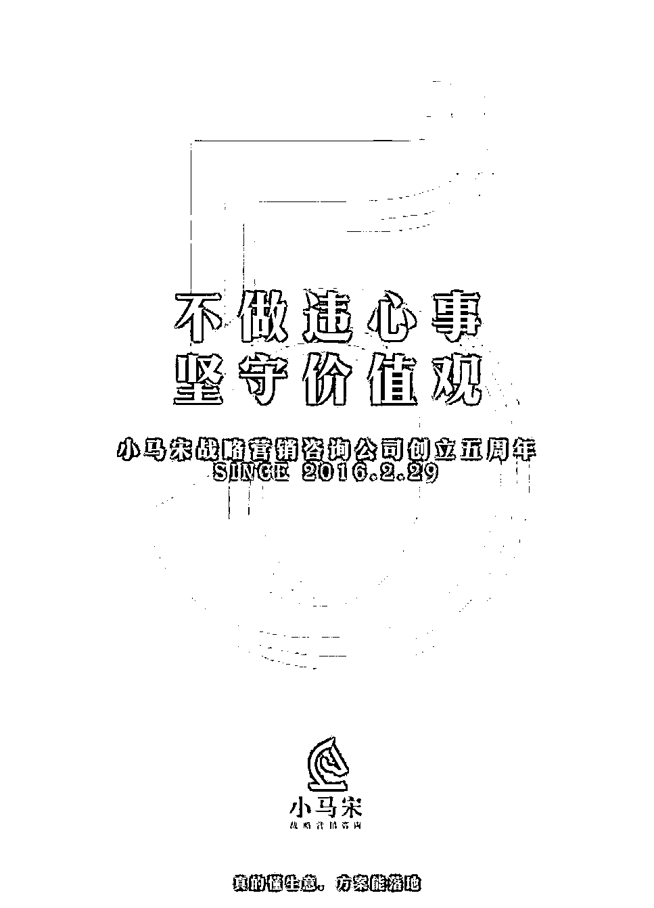
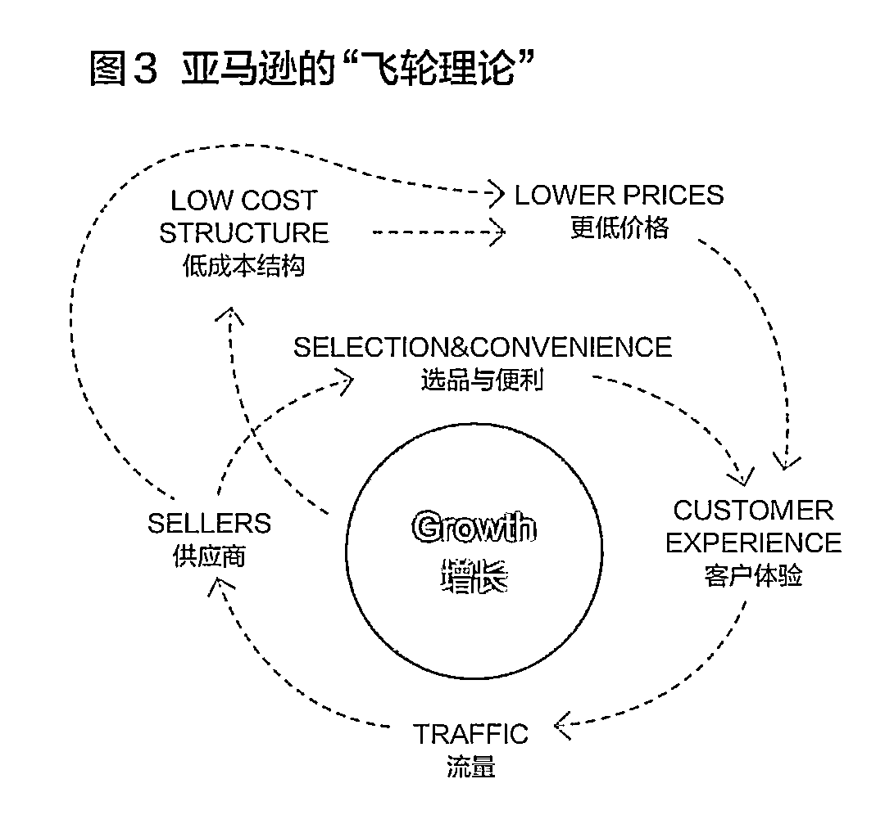
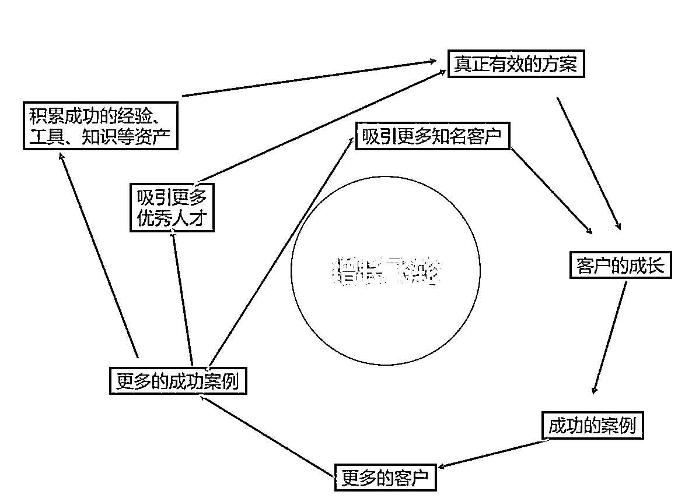

# 咨询五年：七条不随大流的经营法

五周年的节点，落在 2021 年 2 月末；再往前追，起点是 2016 年那个闰日。每到此时，我都会把一年来的经营体会整理成文字。

公众号红利期，一位做自媒体的朋友替我算过账：名气不小，变现却少，似乎吃了亏。他说的并非没有依据。那时确实有不少大 V 靠多种方式挣钱，而我几乎没有碰。原因并不复杂：收费社群我不熟；新媒体培训我认为价值不足；公众号广告在我看来后劲有限，平台趋势已经在往下走，我也没本事逆势做大。

于是 2016 年，我把重心挪到企业咨询。为何选这条路？一是有存量，之前用顾问身份服务过几家企业，起步有抓手。二是行业寿命长。从个人顾问形态算起，咨询存在了上千年，未来百年大概率仍在；平台可能退场，咨询更耐周期。既然耐周期，就值得慢做，试着留下一个能活很久的组织。三是经营形态合我脾气：它不依赖极强运营和极致效率，不必像外卖那样把时间抠到分钟，也不必像制造业管大量工人、像餐饮处理琐碎杂事。不是别行不好，是我不擅长。四是缺点我能接受：难迅速规模化，优秀顾问稀缺。那就慢做、细找、留住人。行业选择没有标准答案，匹配自己才重要。

2020 年对咨询、广告、公关都不友好，我们受影响有限。北京封控到 5 月，实际营业约七个月，仍增长五成以上。前提是个人顾问业务清零：2019 年我个人顾问占公司三成，2020 年全为企业营销咨询。

名气有跃升吗？没有。微信指数里“小马宋”变化不大，公众号阅读稳中略降，抖音攒下的二十多万粉丝也停了半年更新。对外声量没大突破，业务却逆势上行，也没有倒卖口罩。

年会上我讲过：体量仍小，但飞轮找到了。飞轮的起点不是声量，而是交付质量。客户因有效方案而成长，成长后的客户成为可被引用的样本；样本招来新客户，新客户继续贡献新样本。项目越多，方法论、工具和行业认知越厚，下一次交付的胜率越高。样本还会带来两类资源：更强的品牌客户与更优秀的人才，二者继续加固交付能力。如此循环，新一轮转动开始。

道理不复杂，做起来很难，跟管住嘴、迈开腿一样，知道的人多，做到的人少。我们相信这条路正确、可行、通向必然，于是所有经营动作都围绕它展开，也做了七件看起来不太合群的事。

其一，把客户的结果摆在最前面。能力不够、人力不够时，利润再好也不接，前三年抵住过不少诱惑。

其二，招人宁缺毋滥。哪怕没人做业务，宁愿推掉客户，也不松标准，因为人是好方案的根本。新人试用期重点看思考力、主动性和协作力；不合适就补偿一个月薪水请走。

其三，新项目先判断胜率。成功概率很低时，诚实告诉客户别做，免得浪费钱。过去一年约四分之一上门的客户被劝退，甚至放弃项目。主动不要业务，图的是客户以后有需求还会想到我们。

其四，人员只配咨询师和设计师，不设客服、销售。产出靠咨询师，不靠客勤和拉单。很多公司把主力放在跑业务，我们反过来，把主力放在服务现有客户，让口碑带来新单。省下的人力成本，用来雇更强的人。

其五，不参与比稿，哪怕处境最差也不去。几家公司争一个项目，准备提案极耗精力，而调研与提案恰是咨询里最重的活。把精力押在不确定项目上不划算，不如全投给现有客户。我们也不送贿赂、不给回扣；比稿、回扣都是成本，我们靠工作换报酬。

其六，对接必须有决策权，最好一把手。首次提案就请其到场，并主要由高层拍板。有些广告公司全年忙，回看产出少，症结就是层层提意见、反复返工。我们避开这种内耗，把省下精力投入交付。

其七，培训舍得投入，也请外部顾问辅导；员工成长是公司天花板。新技术不忽视，大数据、AI 等都可能重塑营销，我们保持跟踪，并试着用于咨询。

七条之外还有底线：不造假。案例数据水分常见，甚至有甲乙双方合谋刷量应付考核。我的态度是，结果差也认，销售为零、阅读为零都接受，复盘重做，不买水军不糊弄。真诚，是信任的前提。

细节不展开。核心只有一句：所有资源压到“帮客户拿到有效结果”上，砍掉多余动作和无效消耗。

诱惑常在：客户上门却没人做，是否降低招人门槛？一旦松口，交付质量下滑，口碑受损，客源萎缩，飞轮倒转。我见过同行在名气高时来者不拒，后来长期消耗一个老案例，再难出新样本。

2020 年增长，不是当年突然变强，而是前三年口碑在起作用。2020 年做的案例还在落地，不便公开，有些客户需要时间成功。所以当年的好，是在给未来铺路。今天的结果来自昨天做对的事；明天的结果，取决于今天。

这些是一年经营咨询的体会，愿对你有用。

