# (精华帖)(206 赞)年利润千万到亏掉1000W，我用十年踩遍所有坑

作者： vma

日期：2023-01-03

【**1**】大二那年，我靠卖“时间”赚到人生第一个30万

2010年高考完的那个暑假，整天窝在家里，对即将开始的大学生活充满想象。当时就琢磨着，能不能在网上搞点零花钱。误打误撞在淘宝开了家充话费的店——没挣到什么钱，但跟淘宝的缘分算是结下了。

后来进了211读计算机。大一那年特别想学门技术，报了校外的Java培训班，学费交了，课没上完，但那次经历反而让我看清了：自己不是当程序员的料。算是提前给自己排了个雷。

真正转机出现在大二。那年大家集体抛弃诺基亚换智能机，可宿舍晚上10点断电，手机流量又贵得吓人，根本不舍得刷。全国高校都一个样，熄灯＝断网，痛点明摆着。

我发现大部分学校都有移动cmcc和联通Chinanet的无线信号。于是在🐧群里找了个广东渠道，搞来一大批手机卡——每张卡自带32小时免费上网时长。当时淘宝上卖这种账号的店屈指可数，我定价9.9元一个，卖得还行。

但卖着卖着发现问题了：大多数学生根本用不完32小时，基本玩一两小时就睡。我马上调整策略，把账号拆成1小时卡、2小时卡、3小时卡和天卡来卖，价格便宜，算是淘宝首创。首创的好处，谁先做谁吃肉。

算笔账吧：32小时拆开卖，利润直接翻两三倍。很多生意的机会，就是把原来的东西稍微改一改、变一变，有了差异化，就有了赢面。

后来还花了500块请学长写了个软件，自动查时长、自动改密码，时间一到密码就换，紧接着卖给下一个买家。放到今天说就是信息化，效率直接起飞。做抖音、视频号带货也一样，有没有趁手的工具，利润就差一大截。吴晓波今年跨年演讲说得对：越是卷的生意，越要靠工具迭代破局。

所以不管你懂不懂技术，至少脑子里要有这根弦——能不能做个软件替代某个环节、省下人力、提效？有这个意识，很多事就豁然开朗了。

这项业务让我在大二就赚到了30多万。从那时候起，学费和生活费再没跟家里伸过手，还反手给家里打了10万块。经济独立了，放假还能全国各地旅游。淘宝店也做到了2皇冠，外加好几家钻店。

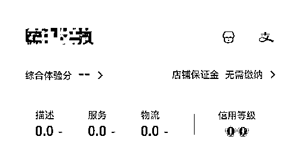

回过头看，我跟别人比也没什么特别，只是多了点好奇心，多往前走了一步，多试了一个地方，多想了一层。但日积月累，这些小小的“多一点”会长进你的认知里，成为潜意识的一部分。稻盛和夫说过，灵感来自潜意识，而潜意识需要强烈而持久的思考来喂养。

【**2**】毕业第一年，赚到人生第一个100万

2014年大四下学期去实习，进了家电信旗下的软件公司。做运营，写B端PPT，后来又转产品岗，画原型图、协调开发，完整跑了一遍软件从0到1的流程。算是把产品经理的活儿摸透了。

毕业转正后，家里帮首付买了套房，月供4千多，家里接着还。我拿着5千的工资，心里清楚，这样下去不是个事。于是边上班边琢磨副业。

有一天想到了“猪八戒”这个平台——上面有软件外包、APP开发、建站、设计等各种任务。我上班空余时间就在研究，但本职工作一点没耽误。猪八戒的模式跟淘宝很像，只是卖的是虚拟服务和企业服务，开店流程也大同小异。

先看结果：两年多的时间，我的店铺累计成交了1200万。

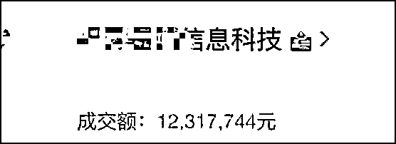

虽然当时毕业没多久，但我已经会做产品策划、产品设计，也懂整个开发流程。我分析了一圈同行，比较产品、价格、服务，最终切入APP开发这个类目。花几百块装修店铺、上架商品，基本就是把淘宝那套打法复制过来。

事实证明，淘宝的经验在这里同样管用，甚至能快速弯道超车。会刷搜索词、会优化权重，店铺很快就有了自然流量。今天大家玩抖音、快手、视频号，说白了商业底层逻辑都一样。

2014年10月，我记得特别清楚，第一单谈成了。3万块，山西客户，做一个学校APP，功能很简单——新闻、帖子和公告。当时电话打了两个小时，我给他讲产品规划，科普APP知识，大概是这种认真劲儿打动了他，顺利签约收款。

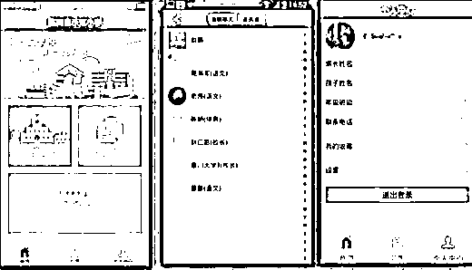

接下来我花了两周用Axure画原型图，花1000块在线上找了美工出UI图，再拉上公司3个同事兼职开发，我自己负责测试。前后一个半月交付，付掉给技术同事的1.5万，自己到手1.4万。当时特别有成就感，比卖淘宝卡爽多了——觉得这钱有含金量。当然，现在不这么认为了，电商多香啊！

店铺就我一个人从头扛到尾：当客服、做运营、搞售前、出方案。

别人家就是简单跟进，我给每一个咨询客户画方案图、画思维导图。到了11月、12月，每个月都能签几万的单子，预付款加尾款，早超过工资好几倍了。

2015年1月，正式辞职，专职做猪八戒。利润从每月3万变5万、5万变10万——没办公室成本、没广告费、没员工固定工资，这利润率能不高么？

这不就是现在大家常说的“超级个体”么？那些主播、自媒体，包括在赚钱的朋友们，本质上都是超级个体。在这种不确定的大环境下，超级个体也许就是最舒服的组织形态。

我在2700块租的单身公寓里谈单子，在对面的星巴克见客户，一个人把公司开起来了，赚到了第一个100万。买了辆途观，生活自由惬意。前前后后合作过的兼职技术人员有30多个——同学的同学、同学的同事、同事的同学。

【**3**】从“辛苦钱”到“系统钱”：一次关键的商业模式升级

2016年我开始琢磨，怎么才能赚更多、成本更低？定制开发软件说到底是个苦活，非标品、甲方需求来回拉扯，每一单都不一样——哪怕都是做个家政APP，客户的要求也千奇百怪，兼职开发们常常在写大量重复的代码。

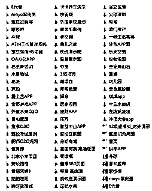

于是我去研究同行。同行就是最好的老师。我发现有一种软件公司，直接卖成品软件或者模板，这给了我极大的启发——要想降成本，先得换思路。

基于之前做过的项目，我选了幼儿园APP这个赛道，做家校互通产品。把原来开发过的产品完善升级，做成标准化软件来卖。做了产品官网，设置了不同的套餐，客户来咨询，就用远低于定制开发的价格引导他们买成熟产品。有新需求，就开发到最新版，同步给所有客户。

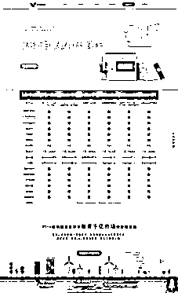

顺着这个思路，我们又做了当时很火的夺宝系统、拼团系统，一套卖几万块。很快我就不需要养那么多兼职技术员了，也不干软件外包这“辛苦活”了。

标准化软件产品的销售模式，让营业额和利润都往前跃了一大步。

增长是硬道理。但猪八戒的流量池就那么大，我开始碰百度广告。百度对我的意义不只是一个流量渠道，它把我带进了付费广告的逻辑里，也为后来上百人的团队埋了伏笔。都说自然流的尽头是付费——想想也是，平台要赚钱，付费才能长期共赢。

2016年就这么过去了。换了个商业模式，开了条付费流量的线，年底一算，营收翻倍，利润翻倍。换了辆保时捷Macan，招了个全职助手，其余还是以兼职为主。

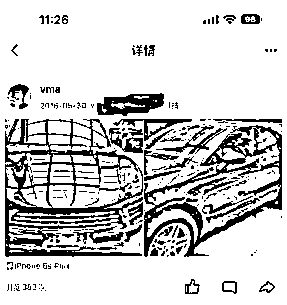

【**4**】价格战与“全网最低”：赢过，也输过

销售圈的万能公式是：流量×转化率×客单价×复购率。但我想聊的是“全网最低”。一把掀翻原有的价格体系，大多数时候确实管用。但背后的前提是：你的产品和服务质量得跟得上，这就倒逼你极致地压缩成本。

2016年除了卖软件，我还做了个副业。当时花398块在猪八戒上找人设计logo，2个方案改到满意，设计得还真不错，一直用到现在。我逛了一圈，398块基本是那个类目最低价了。

于是我冒了个想法：上架199块的logo设计，3个方案改到满意。价格更低，服务更多。然后就爆单了——慢慢爆。从一天一两单到一天十几二十单。我找兼职设计师，从淘宝找、🐧群找，甚至直接去猪八戒上找其他店铺帮我做，一单抽100块差价。算是把极致利用兼职这招玩明白了。

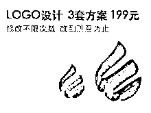

那段时间表弟在家做客服、对接设计师。半年做了3000多个logo，净赚近40万，销量冲到类目第一。

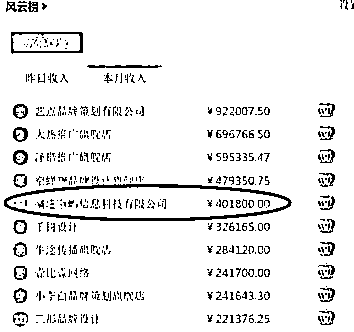

但半年后，99块的logo出现了。也是3个方案改到满意。我们还是被“全网最低”反杀了。99块什么概念？基本就是大学生拿来做社会实践，质量嘛，呵呵。

这件事让我悟到一个道理：你可以革别人的命，但哪天别人革到你头上的时候，你可能还困在自己的认知和判断里，根本想不通该怎么变。这就是思维局限吧。

后来听说隔壁公司也有做设计类目的，几个合伙人都是广告公司出身。现在他们猪八戒早不做了，但当年积累的4000多个客户，全沉淀在5个🛰️号里，一年轻轻松松赚小几百万。

私域是真的香。把有机会复购的客户都沉淀下来，时间会给你惊喜。这个逻辑现在依然有效——新的一年，大家一定要想做一件事：自己的业务能不能做私域？不管用企业🛰️还是别的工具，先迈出第一步。

如果让我回到2016年，我不会轻易砍掉那个业务。我会去拆解竞品，去挖掘学生资源、对接校企合作。99块既然有人卖，说明一定有利润空间。我缺的不是流量，而是一个能补我短板的合伙人——懂广告、懂设计的人来打理业务。logo做完还有海报需求、VI需求，流量我已经搞定了，后续服务和二次复购需要专业的人来统筹。毕竟对一个行业认知不够深，做决策就跟不上。

【**5**】风口怎么抓？靠信息量，也靠判断力

怎么发现风口？说白了就一个问题：怎么高效获得新信息，大量新信息。会赚钱的人，一定善于获取信息、筛选有效信息、把信息变成商机。

我平时喜欢看新闻和创业报道，每天在头条、👸号上花两三个小时。一个月看不出变化，半年、一年积累下来，量变引发质变。另外，之前卖软件的客户遍布全国，都是各行业的人，这些跨地域、跨行业、带不同视角的信息，更容易刺激出新的想法。龙哥盟提供的就是这样一个环境，你可以在里面第一时间获取各种跟钱有关的信息。

2017年我租了第一个办公室，300多平，装修就花了30多万。之前几个兼职技术干脆跟我一起干了，不发固定工资，按项目比例分红——他们拿到的通常比正常上班多两到三倍。

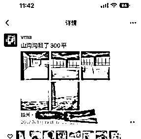

17年9月，在线抓娃娃APP突然火了：真机加摄像头，远程操控抓娃娃，抓到了直接快递到家。我在朋友圈看到有人分享，眼前一亮。把商场娃娃机搬进手机，体验居然不输线下。于是我立刻去搜索，App Store上两款产品都下载了试玩，还翻到了背后的融资报道。

直觉告诉我这是风口——在国内，但凡沾上概率博弈属性的东西，都会火。9月底我们全力开始研发，没日没夜加班。在公司和工厂之间连轴转，现在回想起来，简单又充实。

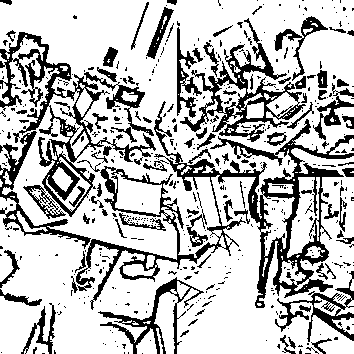

我们是第一个在百度推广抓娃娃软件的。10月上线广告，第二天就有咨询。第四天，一个北京客户直接飞过来，当时我们APP还是个demo版本——依然当天签约，一套25万，先打了10万预付款。

到17年12月，三个月时间卖了几十套出去。App Store上的抓娃娃APP，将近一半出自我们团队。但风口来得快去得也快，同类产品越来越多，用户手上有几十个APP天天免费玩，付费率崩了。到18年2月，基本没人买了。

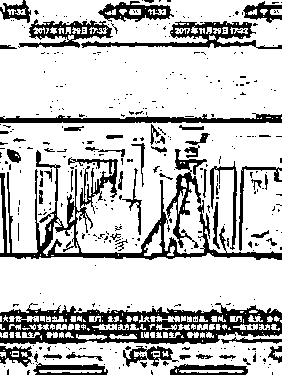

17年就这么过去了。团队13个人，营收利润继续翻倍。那一年，我真正有了公司的感觉——有团队了，不再是工作室了。

【**6**】连续踩中风口的那些年，利润破了千万

抓娃娃只做了三个月就戛然而止，让我意识到移动互联网的红利期快到头了。于是17年底定了个大方向：不做C端APP，转做企业服务软件，转向web端。

企业服务赛道这么多，从哪切？当你满脑子都是这个问题的时候，信息自然会靠过来。17年12月，一个做金融电销的朋友跟我提到“电话机器人”——代替人工打电话，听着很神。但我当时的反应是：这技术门槛太高，碰不了。连产品公司名字都没多问。

先入为主、想当然、畏难情绪，这大概就是普通人的通病吧。

结果半个月后，又有一个做钉钉服务商的朋友来聊天，说南京有家公司AI电话机器人做得特别火。这一次我警觉了——短时间内两个人提同一个东西，那一定不简单。当晚我在书房研究竞品官网，翻同类公司。

第二天直接买了动车票，以做代理的名义跑了杭州和南京去考察，摸清了价格和行情。回来就开干：买一套软件回来拆解、体验，然后自己写。18年春节大年初二，团队就开始写代码了。

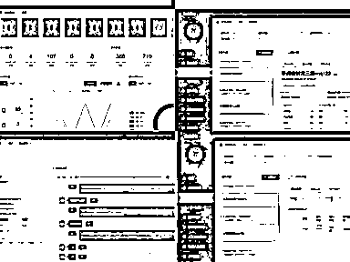

系统开发了将近4个月，18年年中上线。依然是百度投放，当时全国做这个广告的只有5家公司。我们去调研的那两家，都融了几千万，团队成员不是阿里出来就是百度出来的，是真厉害。

我们的策略依然是极致价格。业内管我们叫“搅屎棍”。竞品的SaaS坐席一年1万左右，城市代理25万。我们直接把SaaS价格打到3000块一年。更狠的是，出了个私有部署方案：无限开坐席、无限开代理，25万一套，对着干。

25万买一套我们的系统，你也能像那家头部公司一样自己收代理、自己卖SaaS。18年7月，我自己接百度来的电话，外省客户一波接一波来公司，基本当天就签。一个月我一个人干了200万的业绩。

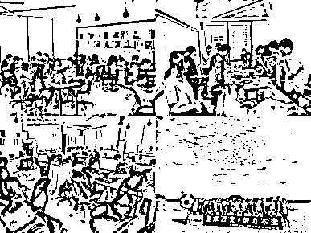

18年一整年，团队从几个人扩张到50多人。从发现商机、市场调研、判断可行性，到拆解项目、组织人手开干，就是一个字——快。在我这个二线中下的城市，拼速度、拼成本，把自己的优势放大。当然，只打价格战也不行，产品得说得过去，市场能力也得跟上。
后来的事，历史总是惊人相似——卷起来了。500块一年满天飞，销量一路下滑，我们自然又去找新的赛道了。再看那家南京和杭州的竞品，创始人出身好、融资上亿、产品不断迭代，一路领先，甚至打进了银行、物流行业，做出细分赛道的电话机器人解决方案。2022年南京那家还推出了数字克隆人，再次领先全国，听说已经在准备上市了。我们也在跟进数字人——有兴趣的技术大牛，欢迎来聊。

说到长期主义：大部分人和我一样，都选择赚“快钱”，不深耕产品、不深耕市场。风口一过，默默看着产品进入黄昏。

是不是错了？好像也不是。钱赚到了，团队和公司也起来了。但去年我发现一个卖电话机器人的小公司，当初跟我们的体量比小到忽略不计，人家坚持到了现在。团队10多个人，一年稳稳赚上百万。

如果是现在的我，会怎么选？我会保留这个产品线，继续迭代升级。10个人的小团队打磨产品，在细分赛道里找机会，给负责人比较大的分红权，慢慢走、慢慢熬，熬过收入平缓期，进入利润稳定期。

2022年，我有一个项目就用上了这套打法。目前还行。也许这就是长期主义——不争朝夕，放过自己，让团队自我迭代和生长，让时间慢慢沉淀。

18年年底，我把公司13%的股权分给了最早跟我一起干的7个小伙伴。大家不但赚到了钱、买了车买了房，也开始有了经营者的视角。

**从快钱到慢产品**

18年一路飞奔，眼看要收尾。场地要搬，面积近一千平方米，装修也快结束。19年往哪走？这事在我脑子里转了很多遍。

每到年关，我总说不准下一年的钱会从哪儿冒出来。跟着热点跑、挣快钱，毛病就在这儿：变数高。项目接不上茬，也缺一个能稳定供血的底盘业务。

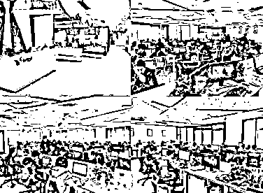

于是我冒出个新念头：不再只做系统安装交付，而是认真做一款能长期迭代的产品，慢慢把它做大。后来，个人🛰️工作手机就上线了。

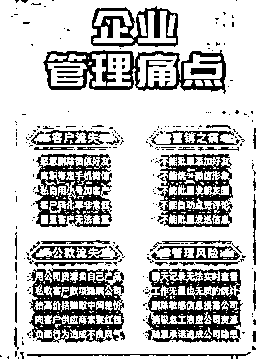

这条路并不好走。SaaS单价低、回款慢，收入自然薄；以前给客户整套系统，一单几十万，完全不是一回事。19年上半年，渠道商帮我们把产品卖进太平洋保险、途虎养车等公司。赚得不多，但总算往前挪了一步，我挺振奋。

之后有几家国内不错的风投来电，问项目往后怎么长。那阵子我不懂资本，也没弄明白融资的门道；公司账上利润和现金都还撑得住，便没有认真推进。

变故很快出现。19年中期，🛰️清理外挂类应用，账号成批被封。我在百度投广告，也被注意到；收到警告后，所有关联产品全下线。说不慌是假，腾讯法务的厉害我早有耳闻。

19年6月，收入断档，公司亏了六十多万。大学二年级起我就折腾生意，这是我头一回见到亏损。怕吗？还行。当时打算砍掉多数成员，把月度亏空控制到十万以内，照样能稳住，再准备新品；最差退回17年那支13人的小队伍。

那一步，我判断清楚，动作也对。可后来疫情阶段累计亏掉一千万时，我的做法却完全相反。人挺矛盾：同一类危机，处在不同时期就会换一种应对，就算早先交过学费。

19年6月底，我在香港玩，和山东一位合作多年的客户闲聊，碰上了刷脸支付的机会。回公司就立项。运气站在我们这边，7月底产品上线，重新走系统买断加贴牌的路子，回款立刻回来。那时公司已有销售队伍，不再由我单枪匹马跑客户。业绩再度冲高，单月峰值过六百万。

回看那些年撞上的热点：2015、2016押拼团和夺宝，2017押抓娃娃，2018押电话机器人，2019押刷脸支付。怎么年年都能赶上？我的办法不聪明：同时铺几个方向，增加撞中的概率。代价也清楚——全都没中，就只能一直失血。于是每一年都会留下几款推不动的产品，根子在对消息的判断跑偏。怎样让失败少一点、成功多一点？大亏之后我们做过几轮复盘，整理出方法和项目筛选流程；这里不细说，需要的人私信我。

前面说过，我在猪八戒挣到第一个一百万，后来去百度投广告卖工具。刷脸支付这个项目，我把预算投向了新渠道——抖音、今日头条的广告投放，结果又爆了。只押百度，不可能做到一个月几百万元。所以渠道选择很关键。现在流量集中在抖音、快手、📕、视频号，围着这些地方做买卖，方向不会偏。用户注意力落到哪，订单就跟到哪，新平台要敢上。

19年收得漂亮：创业第五年，队伍超过150人。途中虽有磕碰，但迈过去后还往上蹿了一截。我给自己提了台保时捷，也订了别墅。

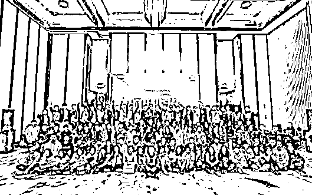

【7】逆风一来，亏掉一千万

20年开局，刷脸支付正热，疫情却猛然而至。现在回看，真像一场噩梦。

公司每月固定开销约150万。起初觉得现金还能顶，就没动裁员。19年6月那次，我们已经准备大砍团队；20年疫情反而没减人，规模还涨到接近200。同时开三条产品线。太天真了，总以为押中一个，千万级收入就来了。这个误判把20年拖成整年亏损，家底差点被掏空，辛苦攒的现金迅速流失。人得常复盘：设想可以积极，计划必须留足坏情况，执行时再拿出积极劲。坏情况想少了，危机感就没了。

直到20年9月，我才意识到不对，开始裁人，办公室里怨气弥漫。今天看，责任在我。公司上了一百人后，那点虚荣让我觉得裁员难看，怕丢面子；也把希望押在连续几年的好运上。这等于把好年份误当成自己的本事。行情好时赚钱的人很多，真正检验人和团队的，是逆境。

20年的我确实糊涂。人浮于事，干多干少一个样，奖励和分红没有拉开，大家都盼着再出爆款。这个软件推不动？没事，等下一个，手头还有别的产品在开发。估计三分之一的人在混日子。更糊涂的是，又砸下两百多万元，装了1500平方米的新办公室，原本还盘算把那层楼收作自有房产。

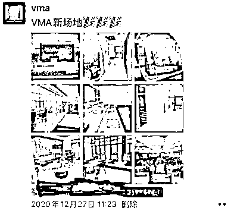

再想跟着我的核心成员，多数人缺少拍板经验，大事小情都等我定，个人能力没长起来。我开始补管理课，号召大家一起学。有效吗？临时补课作用有限，认知不是几天能搭起来的。从一个人干，到小团队，再到公司，要补的课太多；复盘挖得深不深，决定一个人能走多高。

20年就这么糊里糊涂翻篇，队伍缩到100人。后来把少儿教育这块拆出去，拿到风投几百万，这是我头一回用别人的钱来经营公司。我的精力投到那个项目，做软件的那家公司交给主要合伙人管。20年的管理规则和层级照旧。问题来得太急，急到没空去发现更大的坑，也没空细想。

21年开年，又砍了一轮人，最后只剩几十人。21年我反复琢磨：怎么走到这一步？全年都在复盘。人只有疼得够狠，才会真反思。21年第四季度，我动了几处大手术：把业务切成小块，每位合伙人管一块；他们分享项目股权收益，也要按约定一起出钱，不再平均主义。用最小队伍跑业务，尽量找回当初刚起步的劲头。让合伙人多锻炼、自己决策、自己成长。只有他们起来了，公司以后才少摔跟头；失误降下来，赢面自然变大。

21年就在不断纠偏和复盘中收尾。账上仍亏，但缺口小了很多，总算能喘口气。

【8】收拾残局，找回状态

22年，各项目真正分开跑。有些板块赚得不错，也有板块还在出血。这一年，我对市场、队伍、管理的认识都往前挪了一步，不再那么莽撞。各摊子的牵头人也能扛事，替我担走不少压力。

回看疫情阶段，电商、直播双双起势。抖音变成新的流量池，短内容加直播，改变了线上玩法。我没抓住，彻底错过。当时要是给抖音生态做工具，完全可能跑出爆款；少儿教育板块如果拿抖音开播，结果也会更好。

【9】新一年，再往前一步

22年翻篇了，我很少像那一刻那样激动，甚至从心里发颤。以前跨年，翻两下🛰️动态就过去了。今年不同：既感叹22年做得辛苦，也对23年生出冲劲。甚至会恍惚觉得——新一年是空白页，整整一年任你落笔。

23年已经开场。我还会用小而精的队伍打法，耐心等每条业务线长起来，不急着让每个产品跑快，先保证活下来，可能过三年，它反过来给我一个惊喜。

热点仍要借，平台放出来的红利，本身就是机会，顺着大势走，赢面更大。每个窗口都拿来磨自己、把队伍带起来，等机会出现，手里才有牌。23年视频号会是很大的窗口，我们已经布了视频号相关的软件线，也投了做直播、拍短视频的团队。

过去三年，我不再亲自跑业务，能聊的人少了许多，像是错过不少消息、灵感和窗口。23年想多交些朋友，欢迎来聊。读完若能有点用最好；觉得没劲也无妨，文字一般，像随手记录。写于2023.1.1 00:30，收尾在15:10。

留言区：

冰点：从头读到尾，故事够劲。

良辰美：复盘旧决策，常觉得当年犯蠢；说到底是眼界不够，真正长记性还是靠亏钱。

朱海涛：大家起步差不多，差别在眼界和胸襟，方向一歪就远了。

设计师小元哥：卖源码的黄金期翻篇了。2014—2018那几年，O2O、外卖、新零售的系统几乎躺收钱。往后我更看好企业级SaaS，关键是选能长期做的方向。楼主有空聊聊。

vma：我们当时不出源码，只做安装部署。

小土的世界：敢闯，还真能打赢。

Fly：经历够厚。

东哥：敢折腾、打得赢，强[强][强]。