# 快团团私域变现实战指南（2023.8）

> 资料来自：[`remhu1p2pr.feishu.cn/docx/F8g5dcDLlomGiCxkgxkcwYgEnCz`](https://remhu1p2pr.feishu.cn/docx/F8g5dcDLlomGiCxkgxkcwYgEnCz)

成稿日期：2023年8月11日

阅读提示：这份材料想让你看见一个项目还能怎么玩，也方便你边看边动手。若想迅速跳到某个知识点，可用 Ctrl+F（Windows）或 Command+F（Mac）检索关键词。

## 开篇寄语

💡

各位好，欢迎翻开5月航海｜快团团社群团购｜实战手册。接下来的交流里，我们会反复碰面。

❗️航海手册每轮都会更新。若你上一轮已经参加过，下面这些新增或调整处更值得留意：1.1 快团团是什么；4.8.1 小红书引流实操方法；4.9 方法九：公众号平台引流；4.10 方法十：线上社群私域引流。

这趟航海主要做两件事：先弄懂快团团，再在21天里借帮卖模式跑出第一笔收入。与往期不同，这次补上了小红书公域获客的模块。所以请重点看第二部分「帮卖团长如何参与帮卖」，以及第四部分「如何在小红书引流？」，边读边练。

快团团究竟是什么呢？它其实是拼多多系下、嵌在微信小程序里的私域社群卖货工具，开团、统计订单、收款都能线上完成。它正从单一工具长成商品供给丰富的私域卖货场。商家开团或帮别人卖，都能把私域转化为收入。它的长处主要有：

- 功能设计贴近使用者，操作顺手，一键就能开团；
- 钱到账快，平台抽成低；
- 流量聚集，还能蹭到平台的公共流量；
- 商品覆盖面和SKU数量都比较可观。

如果你手里有私域用户却苦于没有变现出口，快团团值得一试。若暂时没有私域底子，也可以把它放在后端，前端去小红书、抖音等内容平台获客，形成完整生意链路。例如在小红书或抖音做资料类账号，再把快团团的资料团购链接挂上去成交。有圈友用半个月跑出2340元收益（星球帖可看：《小红书资料引流+快团团社群团购，新手也能在 20 天赚回门票钱》）。

手册里的操作说明参考了快团团部分官方材料；在选品、引流建群、群运营等全流程上，我们请了几位老师，结合星球帖与学习资料，给出多种打法。你可以按自己的实际情况挑一条最顺的路。别紧张，在热门私域工具里，快团团算比较容易上手的。

为了让你尽快上手、尽早看到正反馈，我们另邀了8位快团团供应商，拿出近期热卖、有竞争力的商品，帮你先解决货源。航海期间产生的售后问题，也由他们处理。详细安排会在开船后发到航海群，请多留意群消息。

工具、货盘、同伴都就位了，只差你动手。希望大家借这次航海和手册真正学会快团团，让私域变现顺滑起来。这里有首批服务快团团的供应链团队，也有一同学习的伙伴。遇到问题，随时找教练和其他船员交流，少绕弯、少踩坑。以下内容由生财有术联合圈友资料整理，仅供航海船员及生财有术星球圈友学习。也欢迎圈友实践后持续反馈，一起把手册打磨得更好，可联系鱼丸（yuwan387）提修改建议。

# 一、走进快团团

💡

本章带你一步步摸清快团团：它是什么？入口在哪？有哪些特点？整个体系由哪些角色组成？这些问题都会在本章找到答案。完整的成交链条里，角色共有5种：

✅手里有货，可做供应商；
✅有货、能发货，也愿意卖货，可做供货大团长；
✅无货、无发货能力，但愿意卖货，可做帮卖团长；
✅有货、能发货，还想直接面对C端消费者，可做自卖团长；
✅看到想买的商品，任何人都能当团员。

这次航海的重心，是教大家成为自卖团长或帮卖团长。对多数已有私域积累的人来说，这是最友好、最直接的入局方式。各角色的具体玩法，本章会详细展开，一起看下去。

## 1.1 快团团是什么工具

快团团是拼多多旗下的私域社群团购小程序，主打快速发团、线上归集订单与收款。说得再具体些，它用工具能力服务团长的私域，把商品和团员连起来。入驻不收费，一键即可开团，服务成本也低，还配有订单管理能力。团购、报名、帮卖、直播、订单管理、店铺等功能都已具备，入驻同样免费。

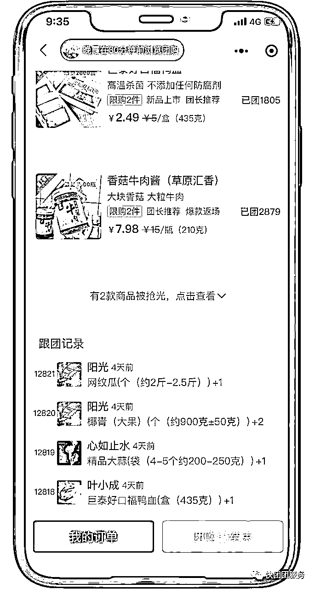

## 快团团有哪些平台特性？@徐福建

越来越多人愿意下场做快团团，说明这个私域交易工具确实有存在价值。第一，它不是一个撮合买卖的平台，也没有平台自动派流量的功能；成交要靠团长自己找流量。对新手来说它门槛低，对想长期经营的人也有深耕空间。第二，它有些特点是其他工具给不了的：

操作轻松。无论用有赞、微盟，还是走线下，卖货往往先要装修店铺；在快团团，复制帮卖信息，或上传几张图、写段描述，再填价格和佣金，就能把团开起来。学习成本几乎为零，投入成本也低。帮卖团长不掏钱就能卖；开团团长只承担0.6%的交易通道费，还有各类奖励返还。更难得的是实时提现，同类工具里很少见，团长体验提升明显。

裂变范围广、玩法多。快团团不把身份钉死，同一个人可以随时切换角色。传统社交电商走S2b2c：平台居中、系统封闭、先到者占优，多数人只是打工人；快团团走b²2c：团长居中、系统开放、多劳多得，自己当老板。

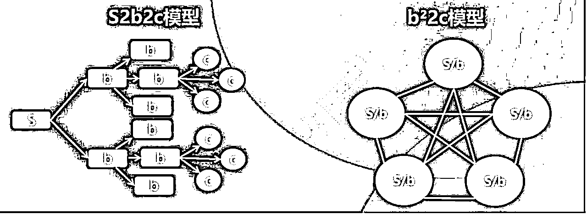

平台还免费开放不少营销工具，像秒杀、满减、拼团、红包等，让团长有充足玩法。以上是快团团的独特之处。成交场景也很多，私信自动咨询、朋友圈宣传、社群运营等都能带来交易。

内容来源：《沉淀一些朋友，用快团去经营》

## 快团团角色关系一览

完整成交体系里，共有5类角色：

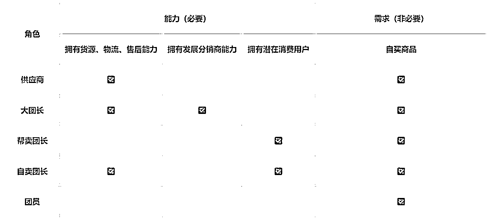

这些角色可以交叉重叠。比如大团长若自己也有消费者，照样能像帮卖团长那样卖货。上图只是为了区分基础定义，更完整的关系会在「1.2 快团团体系里的 5 大角色」展开。

## 如何找到快团团？

在微信里搜“快团团”，点“快团团小程序”就能进入。想开团，点“一键开团”—“创建普通团购”：

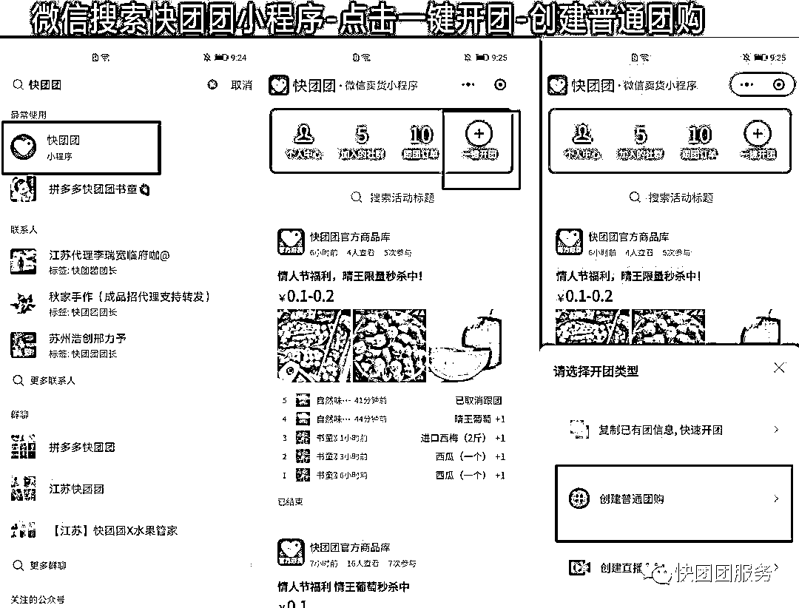

也可用手机扫下方小程序码，直接进入“快团团”：

接着认识几条基础规则。

## 快团团需要注册吗？

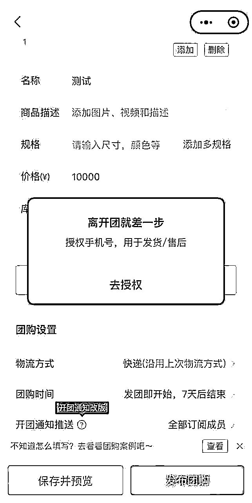

## 快团团收费吗？

快团团小程序把所有功能「完全免费」给团长使用，不收年费、不抽佣。但顾客付款时，微信官方会扣交易额0.6%的费用，这笔钱由供货大团长承担。

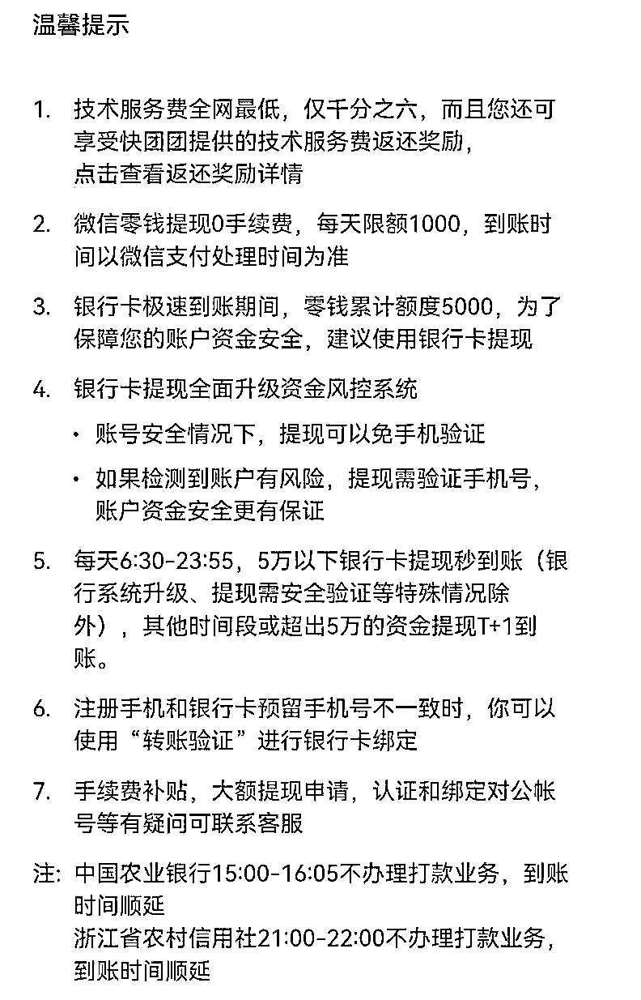

## 快团团有网页版吗？

有。网页版入口：https://ktt.pinduoduo.com/

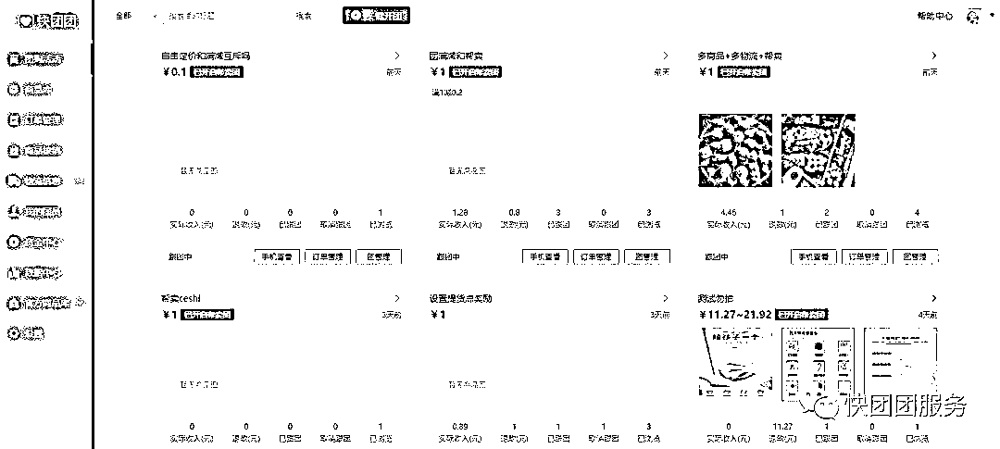

在电脑端发团、建商品、导入导出订单、录快递单号、打印电子面单、快速发货都更高效。PS：帮卖团长不用PC后台也不影响。

## 顾客下单后，钱多久到账？

帮卖团长卖完货，佣金是直接进自己账户，还是先留在供货团长那里，或者要等一个周期？这取决于团的具体设置。有的团由大团长手动发佣金；若不特别设置，默认自动发放，佣金直接进帮卖团长的快团团账户。默认自动发放时，顾客一下单，钱就到帮卖团长账户，可立即提现。提现到微信零钱或银行卡，都不收手续费。

提现时间与限额：提现到微信零钱，每天限额3000元，实时到账；提现到银行卡，每天限额5万元，每天9:00-23:00之间，5万元以下秒到，其他时段T+1到账。支持实时结算的商品会有下图提示：

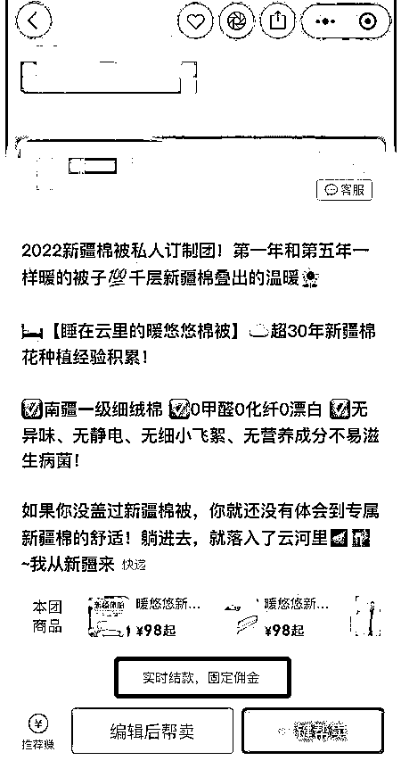

## 1.2 快团团体系里的5大角色

快团团是围绕团长私域做的工具小程序，核心玩法是“供货大团长—帮卖团长—团员”的帮卖链条。整个体系里有5种角色：供应商、供货大团长、帮卖团长、自卖团长、团员。

本次航海的重心，是帮大家成为自卖团长或帮卖团长。对多数有私域积累的朋友来说，这是最友好、最直接的入口。那么大团长和帮卖团长是什么关系？不少平台有“代理”概念，但快团团里的帮卖团长并非代理，而是“帮卖”——彼此搭把手的关系。大团长与帮卖团长实际是平级，互相协作：找到好货就分享给顾客。在这种良性结构下，很多人的业绩起得很快。

快团团以货为核心。你可以帮别人卖，也可以自己开团让别人帮你卖。下面逐个拆解各角色怎么玩。

### 1.2.1 供货商是什么？

供货商，说白了就是给大团长供货的商家，多数走一件代发：团长出单后，由供货商发货。快团团体系内，按团长来源看，主要有淘宝店主、海淘代购、微商、淘客、宝妈和实体店经营者等。

供货商参与快团团，眼下有两条合作路径：

1）官方商品库。在拼多多开企业店铺、交保证金、报名快团团活动，类似一个小型1688。适合品牌方或已有拼多多店铺的商家。

2）与大团长建立分销关系。用供应商系统同步订单，属于团长和供货商之间的个人交易，快团团不提供担保。适合供应链有优势、能BD拓展大团长合作的商家。

### 1.2.2 供货大团长是什么？

供货大团长，也就是后文常说的“大团长”，指能独立完成货源、上架、发货全流程的团长。他们既可以直接把货卖给顾客，也能设置佣金比例，让其他团长帮卖。顾客从帮卖团长那边下单后，订单信息和资金会自动拆分，大团长不用手工处理，结算更省心。这个角色更适合有选品能力、活动策划能力和团长管理能力的商家。大团长还能借快团团沉淀自己的私域客户和帮卖团长资源。

快团团虽然定位是私域社群团购小程序，但在私域之外，官方也在建公域帮卖团长流量池，也就是“明星团长计划”。目前官方已组建60多个官方帮卖群、20多个母婴帮卖群，每天安排5-6名明星团长在群里分享好物，覆盖TOP20000帮卖团长。

怎样快速成为明星团长、吸引帮卖团长？官方基本门槛是：连续60天以上在快团团卖货；连续月度自卖销量20万以上，或供货30万以上；团队成员数3000人以上。若你供应链优势明显，又有私域能启动，推荐用快团团承接私域，再通过明星团长计划链接公域帮卖团长。

### 1.2.3 帮卖团长怎么玩？

帮卖团长直接面对团员卖货，多半自己没货，但手里有私域客户。他们帮其他团长卖商品，既让私域粉丝活跃起来，也能赚佣金。客户从哪来？可能来自线上引流，也可能来自线下积累，比如做过社区团购、菜鸟驿站、母婴店、美容院等实体项目的人，或者线上有粉丝、常混社群的人。

不少朋友微信里攒了大量客户，却长期没法变现，也缺少运营动作。现在可以用快团团卖更多品类，补上变现渠道，变成客户身边的“哆啦A梦”，增强粘性。总体看，只要你愿意服务C端顾客，基本都适合做帮卖团长，区别只在起步快慢。对大多数人来说，成为帮卖团长是入局快团团最快的路径，也是本手册的重点。后续大部分内容都会围绕“做好一个帮卖团长”展开。不过，大团长、自卖团长等其他角色，也能从选品、引流、建群、群运营等方法里吸收经验，逻辑相通。

### 1.2.4 自卖团长是什么？

自卖团长指自己有线下货源的团长，既能当自己的供货商，也能处理发货和售后，还直接连接团员。这类角色特别适合做多多买菜、连锁店等手握大量线下用户的城市经理，帮他们进一步打开线上市场。当然，供应商、大团长、帮卖团长、自卖团长这4类角色之间可以互相重叠。比如我作为大团长，也能帮卖其他大团长的商品；作为帮卖团长，顾客看到的都是我在卖货，发货过程无痕。因此网络效应更明显，团长粘性也更高。

### 1.2.5 团员是什么？

团员最好理解：就是通过快团团小程序，在团长或帮卖团长那里买东西的人，也就是快团团社群团购的买家。只有团员下单，大团长或帮卖团长才有佣金。

## 1.3 航海权益

对帮卖团长来说，找到合适、靠谱的大团长非常关键。大团长若不靠谱，可能出现用户付了钱却不发货、实物与描述对不上、货有瑕疵但售后难等情况。所以，切勿草率选择帮卖对象，切勿草率选择帮卖对象，切勿草率选择帮卖对象。

对不认识的人发来的帮卖卡片，也要多留个心眼。一定要深入了解大团长，否则容易埋隐患。最大的隐患是：你通过A帮卖某个团长的商品，客户买了之后出问题要退款，如果A账户里没钱，你就操作不了。

怎么理解？比如我推荐你成为帮卖团长，你点我发的二维码卡片，成为某团长的帮卖；你每卖一单，我能拿1%～1.5%左右的佣金（佣金概念可跳到「2.2.1 帮卖团长参与帮卖」了解）。若客户后来退款，系统会把我拿到的1.5%佣金退回。假如那时我已提现、账户余额为0，你就没法给客户退款了。

别只盯着团长排名和订单数据，这些都可能作假。对快团团货源渠道要有甄别能力，后文有策略：「2.3 快速去看如何甄别大团长是否靠谱」。所以，推荐帮卖的人也很重要。

为保障本次航海安全稳定，我们联系了一些靠谱的供货大团长圈友提供货品，帮大家快速上手。具体名单会在开船后发到航海群。没货的，可以先从他们的商品里挑合适的帮卖，出单就能拿佣金。先拿正反馈，迈出第一步。航海期间，群内只支持展示推荐团长的货品，主要是为了减少因货品问题在建群初期引发“信任危机”，帮圈友开出第一单。多轮验证显示，15%以上的圈友第一次发朋友圈带商品，当天就能开单。

航海结束后，更丰富的供货资源要大家自己拓展。但务必做好筛选，千万别加入大团长账号后立刻带货，一定要验证靠谱再动手。

# 二、快团团的基础操作

💡

认识快团团之后，就可以用它启动自己的社群团购了。本章教你怎么用快团团。「2.1 如何开团卖货」主要写给大团长，作为资料拓展，也便于大家理解大团长开团的底层逻辑。从「2.2.1 帮卖团长如何参与帮卖」起，我们带帮卖团长实操：第一步，参与帮卖；第二步，顾客下单；第三步，查看收入与提现；第四步，处理售后问题。在「2.4 快团团其他功能讲解」里，我们整理了小程序常见问答，可点链接直接看答案，也可去快团团小程序的“团团学堂”找更多信息。想自己找更多供货团长，可参考「2.3 自己如何选择供货团长」。注意，别轻易定下一个团长，要花精力辨别对方是否靠谱。看千遍不如动手做一遍，开始操作你的快团团吧。

## 2.1（拓展）大团长如何开团卖货

「2.1.1 如何开团卖货」原本是大团长的操作，但帮卖团长要理解自己的帮卖逻辑，最好也了解大团长怎么开团。所以请帮卖团长自行阅读这一节，当作资料拓展。第一步：大团长发布团购，销售产品。

# 快团团全流程拆解：开团、分销、售后一次讲透

在快团团上，开团方通过发布团购就能把自家商品卖出去。取货方式可以二选一：做小区周边生意，选买家自提最省事；面向更广客群，就走快递发货。

## 发起团购的操作流程

进入快团团小程序，点首页的【一键开团】，再选【创建普通团购】。

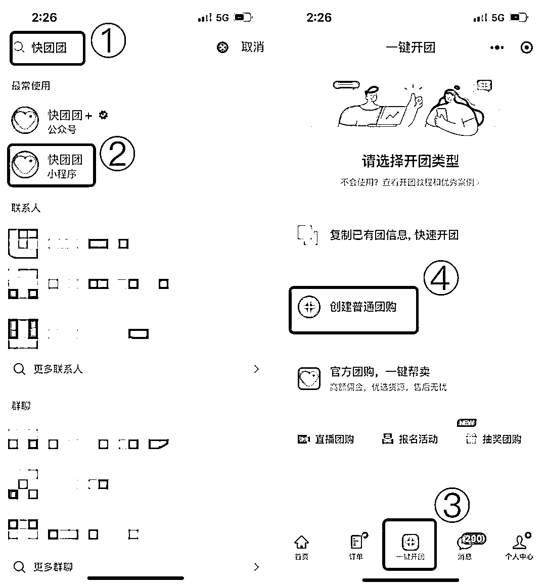

之后按页面引导，把【团购介绍】【团购商品】【团购设置】逐项填好，最后点发布团购即可。

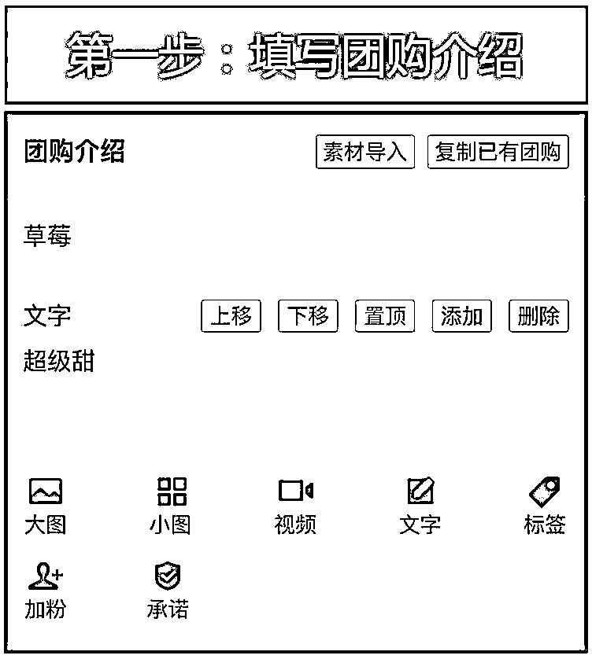

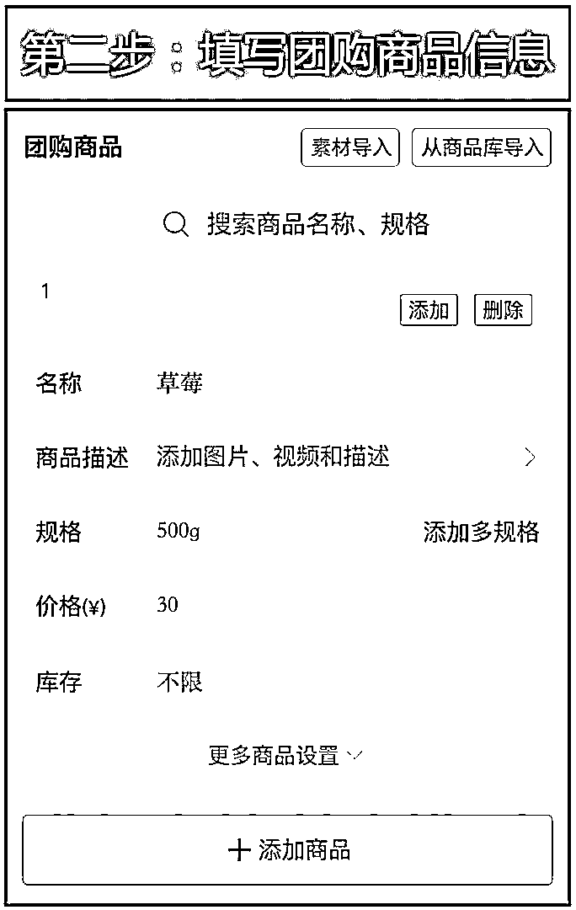

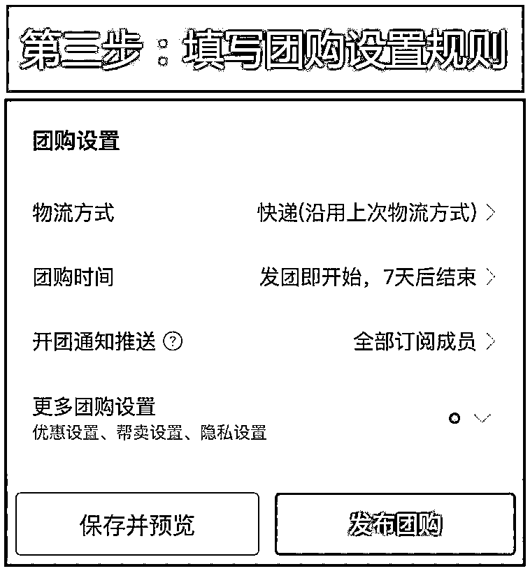

视频演示：https://mp.weixin.qq.com/s/fgcKbswY8JyDp_qISAtMxQ

## 第 2 步｜供货大团长设置帮卖并发布

手里有货、想放量出货的团长，可以给手握客源的团长开出佣金，拉他们一起分销。

设置入口：【团购设置】→【更多团购设置】→【设置团长帮卖】。进入后勾选【团长以自己的身份，复制/分享你的帮卖】，再填好帮卖佣金比例。

「复制帮卖」和「分享帮卖」两种方式的差别，看这张图：

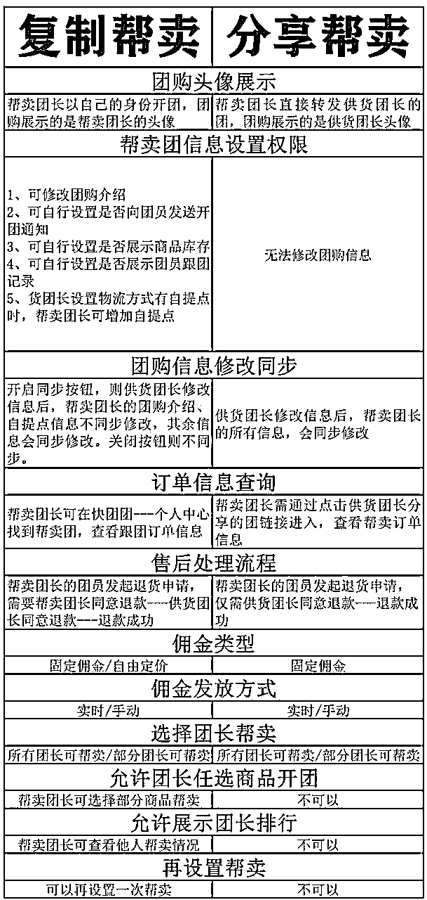

配置完成，就能把帮卖团购发出去。

接着把帮卖入口发给想邀请的团长，让对方开卖即可。

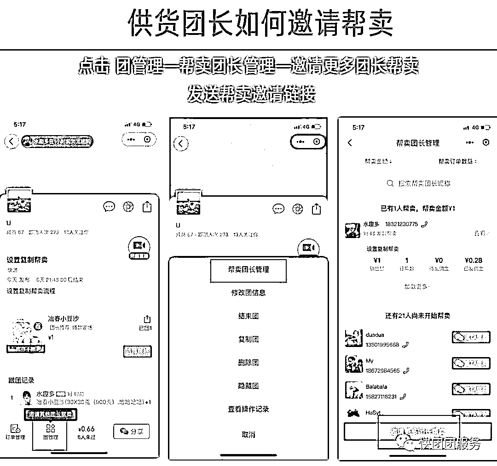

### 大团长开团时的关键提示

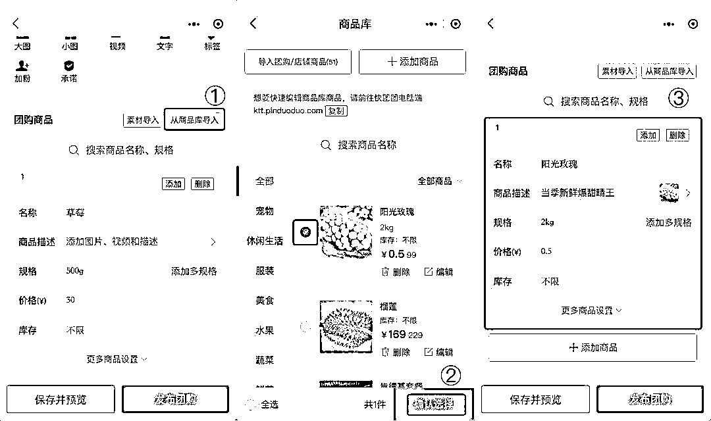

上架商品时，也可以直接从买买相册里选用现成素材。

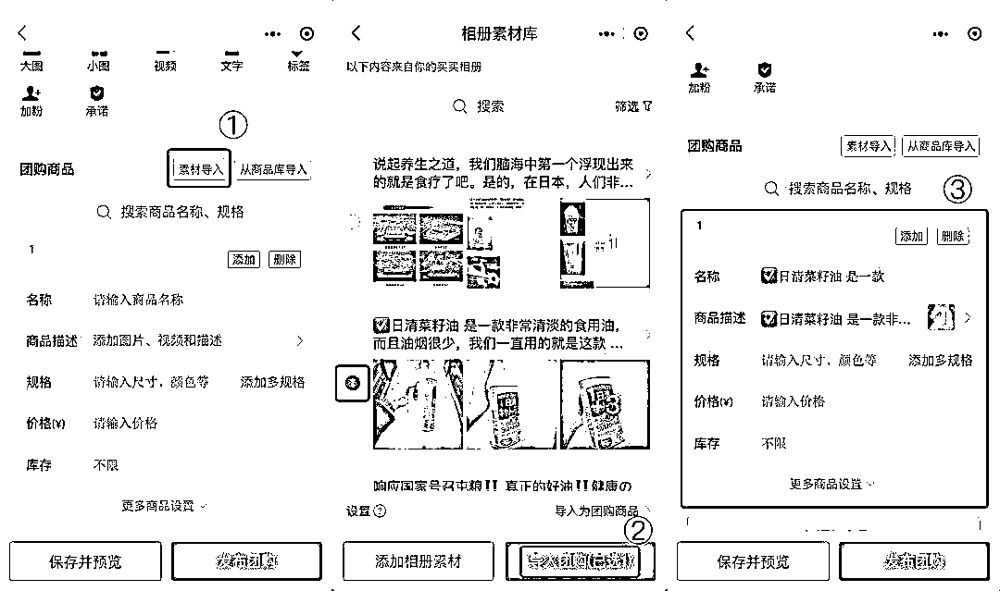

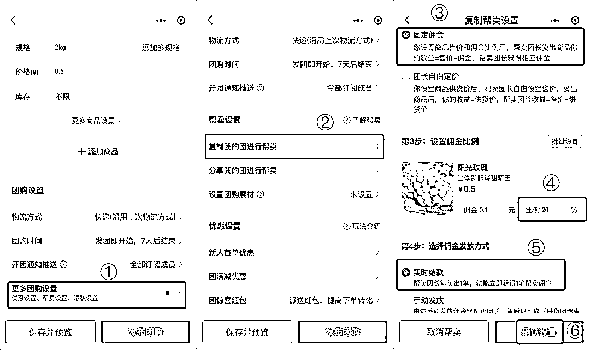

在【团购设置】→【更多团购设置】→【隐私设置】中，可以自定义团购的展示与转发权限，以及跟团用户能看到的信息。

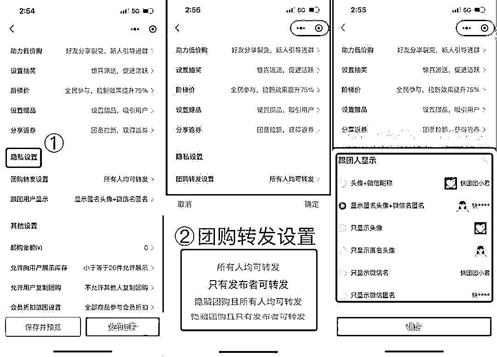

## 2.2 🔥快团团帮卖玩法全解析

### 2.2.1 🔥帮卖团长上手教程

这一小节，是帮卖团长真正要吃透的重头戏。

**第 1 步：想清定位，配好基础资料** @星宇

流量规模决定了你在快团团上的方向，方向又左右着后续的选品和社群打法。所以别急着开干，先问自己：你到底想服务谁？

有的品复购率很高，比如水果、生鲜、肉类；有的品属于日常刚需，尿不湿、绘本、厨房湿巾都算；还有一类品专门提升生活趣味，鲜花、好看的餐具和厨具就属于这种。

选品始终围绕一件事：现有粉丝需要什么，或者你希望吸引哪类人。越垂直、越聚焦越好。前期可能赚得不多，但沉淀得越久，你的价值越明显。比如只盯3—5岁宝妈，专供这个年龄段孩子的必需品，妈妈们一有需求就会想起你；经营水果群的团长也一样，大家馋水果时自然会找上门。

判断定位，可以参考这张四象限图：

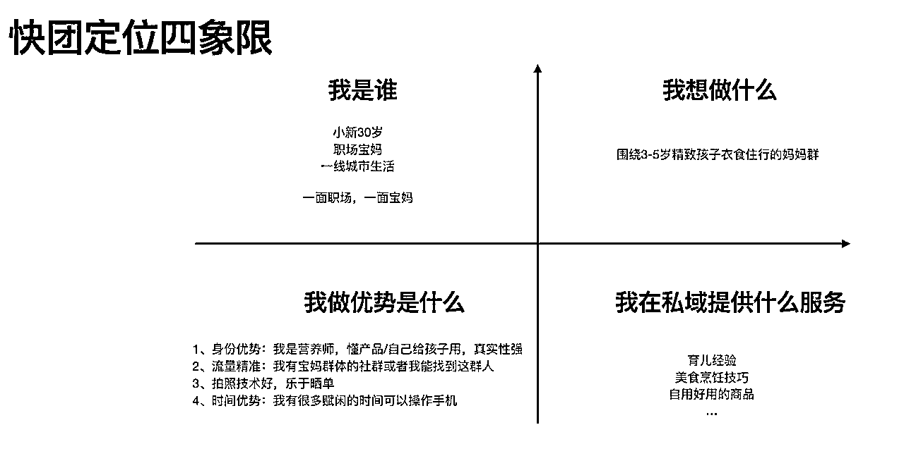

**配好基础资料**

定位清楚了，就顺手把头像、昵称、简介、背景图都弄好。

拿宝妈做母婴号举例：昵称可以叫「安妮妈妈」；简介写清楚自己是谁、为什么做这个号，把昵称、性别、年龄、生活状态、价值观都提炼进去，越详细越真实越好（注意：人设和本人是两回事）；头像可以放抱着孩子的合照，也能用在线设计工具做一张。

**第 2 步：申请加入供货团，成为帮卖团长**

想帮卖某个供货团的货，先得扫供货团的小程序码，完成入驻手续。

这次航海活动中，项目方已为船员对接了8家供货大团长，不设数量上限，8家全部加入也没问题，方便大家快速上手。各家简介与二维码如下：

**1）元宇宙供应链**

⚠️先说明：它和暴雷的「糯米福利社」没有任何关系。

元宇宙供应链脱胎于千寻供应链，面向中小型团长供货，以食品、生鲜、百货为主，另配少量小众品类。经过一年多耕耘，已建起上海、嘉兴、西安、安徽等多个仓配，并与战略品牌方合作建仓，发货稳定。

千寻供应链主要为快团团、群接龙上的私域团长做代发，是P妈、趣趣、海涛、樱花、77、骄傲等全国头部的长期服务商；想找Top20团长开过的团品，千寻这边也能提供。

元宇宙供应链如今主推品质稳定的品，优先自家仓库发货或战略合作厂家供货，同时也把战略品牌方的全私域运营接了过来（涵盖有好东西、万物心选、蜜桃、严寻等）。

本期航海挑选的品，集中在仓发食品、产地直发的应季水果和品牌方福利品上，比如有出口资质厂家溯源过的枸杞原浆、陕西甜瓜、新疆哈密瓜、甘肃金银水果玉米，还有自家仓库发的奶制品和尾货福利品。

扫下方小程序码，即刻入驻帮卖。

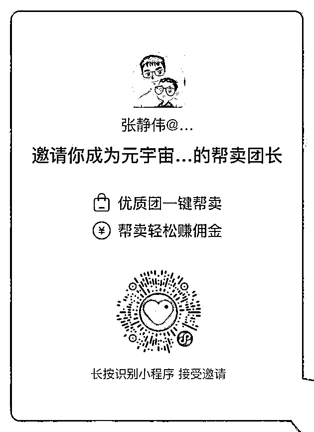

**2）忘忧惠团**

忘忧惠团成立于2019年6月，总部在青岛，采用分布式办公，北京、杭州、新疆、广州都设有营销商务部。2020年切入快团团供应链，代理联合利华等品牌商家，跟蜜瓜、云爸、猫家这些私域头腰部团长快速建立合作，年社群团购GMV超过亿元。

2022年12月，团队用孵化+定向邀请的方式做了大团长号「忘忧惠小团」，涉及食品、母婴、百货、宠物、护肤五个类目，主打品牌直签、官方仓发货、售后有兜底。

主理人连续4期当生财有术快团团航海教练，一直为圈友们的货品保驾护航。

识别下方小程序码，加入帮卖。

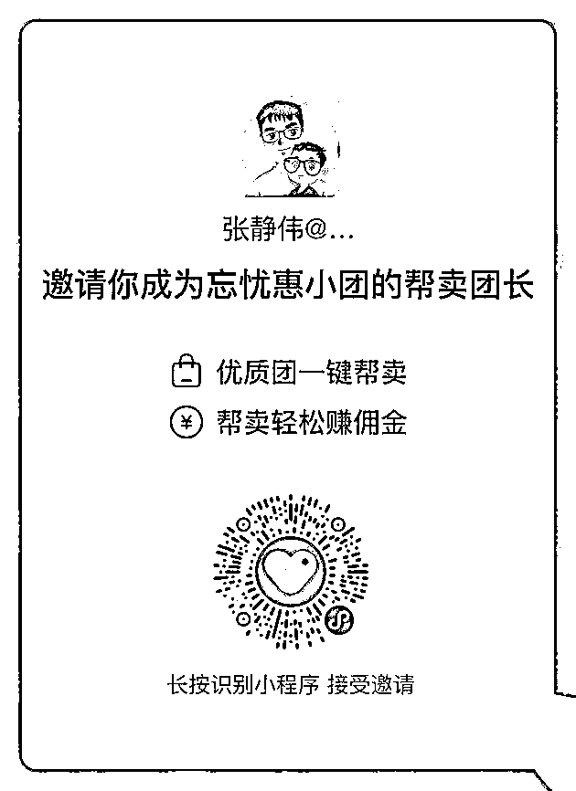

**3）深藏好肉团**

深藏好肉这个牌子，专攻中高端牛肉，前身叫赛鲜浦乐牧，主打美国黑安格斯和澳洲和牛。供应链端和来自美国、澳洲的顶级供应商维系了十多年的深度合作；电商深耕多年，淘宝和快团团都跑出过10倍销售额增长。疫情期间服务过上海的一百多个小区，跟上海女神团等大团长配合密切。

日式烤肉店、西餐厅遍布上海，用的都是它的货。牛肉部位全，牛排、寿喜烧火锅片、烤肉、牛肉饼、中式炖煮都有。

扫下方小程序码，即刻入驻帮卖。

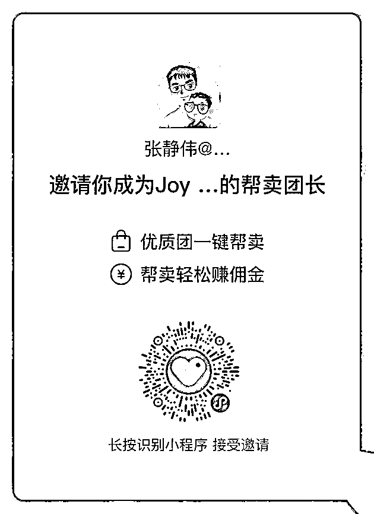

**4）创港渔农生鲜**

✅创始人出身南海博贺渔村，父辈就是渔民，从小就跟海鲜打交道；✅自己的捕捞船、收渔船、加工厂、打包仓库连成完整链条，从海上到出库全程掌握；✅做全国海鲜快递团已有8年，口碑在线，客户满意度99.99%。

🦑🦐🦀专心干好这一件事，希望各地朋友都能用实惠价吃到鲜货❗️❗️❗

识别下方小程序码，加入帮卖。

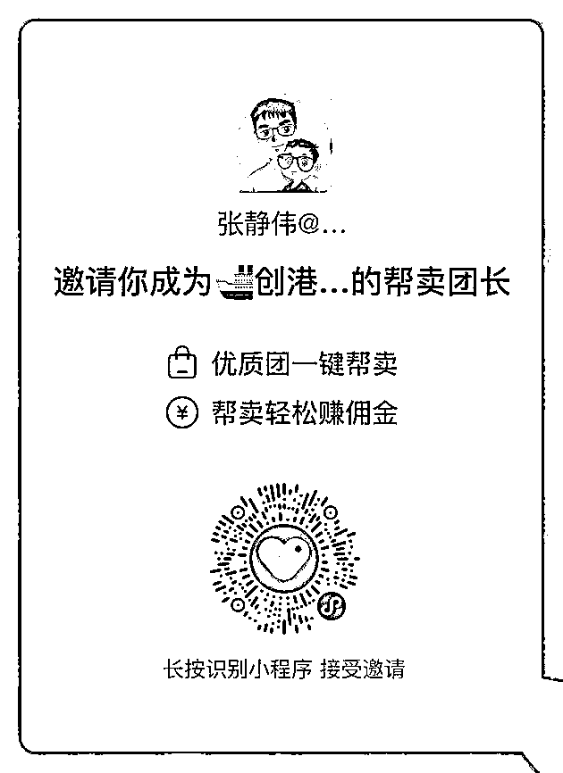

**5）小果臻选团**

手握20万私域粉丝，从不卖假货，货源授权凭证齐全，对粉丝和团长的信任格外爱惜。专职客服团队全程盯售后，不让大家有后顾之忧，帮卖方可以放心冲。

✅只开转化率高的团，每款货都先看样再开，跟快团团前50名团长都有交集；✅自带的20万私域用户，让团队攒下大量一线经验，运营心得毫无保留地分享；✅每个月给帮卖团长送免费赠书引流方案，还有抽奖促活的社群玩法。

扫下方小程序码，即刻入驻帮卖。

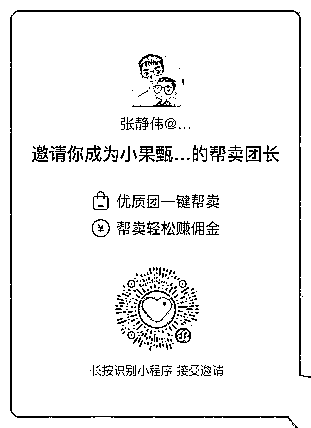

**6）Ume好品福利社**

Ume好品福利社是2022年10月苏宁易购官方发起的，专给头部团长供货。目前合作了苏苏高品质、阿迷高品质、三妈团、柯柯、小马优选、欣欣优选等近50位团长，每月合作单品100多个，跑出不少万单爆款。

它由苏宁易购易开团推出，面向帮卖团长供货，从大团长的爆款里精选，覆盖食品生鲜、日用百货、小家电等，价格低、佣金高、品质有保障。

识别下方小程序码，加入帮卖。

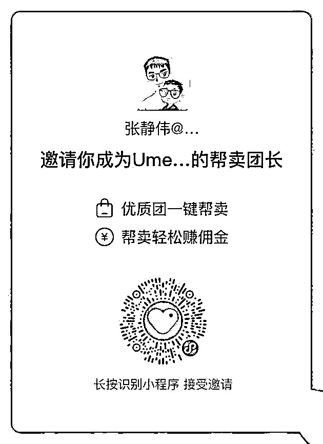

**7）简爱乐选**

简爱乐选的定位是「宝妈美好生活服务者」，给帮卖团长提供丰富母婴品，还有食品、百货、家居等日常全品类。自己的仓库超过1000平米，选品、运营、客服团队30多人，服务对象包括三妈、小象、猫家这些全国母婴Top团长。

这期航海，它带来一批夏季爆款：驱蚊防晒、儿童服装、零食辅食、洗浴护理、玩具等，大牌货卖平民价，还配了一堆流量款，帮船员们轻松开单。

扫下方小程序码，即刻入驻帮卖。

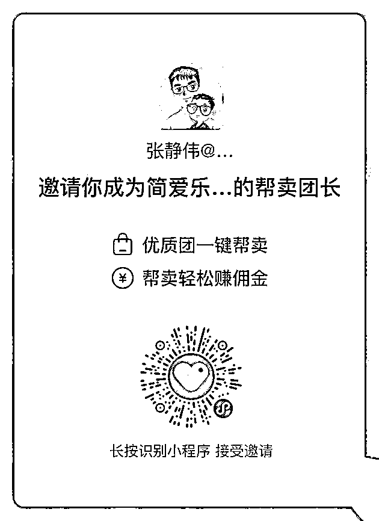

**8）模范妈妈尖货严选**

这家公司以自营图书电商为根基，深度耕耘图书供应链，专门把图书文教产品精选给团长。已跟全国200多家出版社合作，主营3—12岁童书，在库SKU过万；湖州、香河、咸宁三个分仓，每个都超过5000平，发货又快又专业。

识别下方小程序码，加入帮卖。

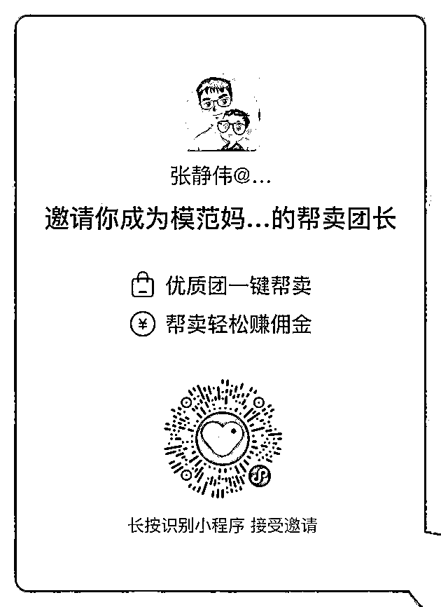

**9）魔都卷妈**

魔都卷妈的心愿是「为孩子做实实在在的严选」，背靠上海的资源与多年文教渠道积累，严选图书、课程、教具等产品。合作方包括全国数百家出版社、课程品牌和亲子剧场；除了常规的3—12岁童书课程，英语和小语种的书籍课程也有。SKU虽过万，但只上架验证过的精品，品质和性价比都有保证，为每位团员护航。

扫下方小程序码，即刻入驻帮卖。

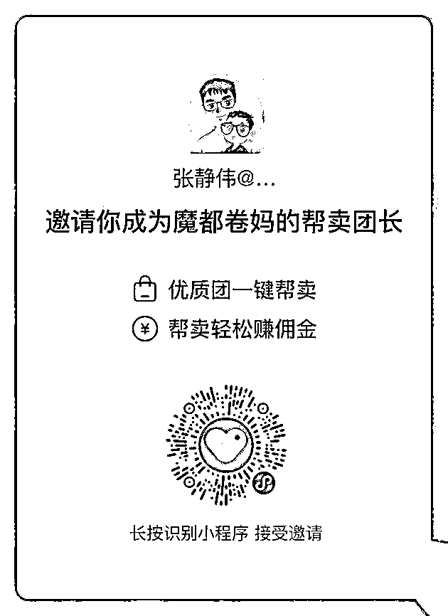

**第 3 步：帮卖团长参与帮卖**

点开供货团长转发的帮卖链接：如果信息不用动，直接按「一键帮卖」；想调整帮卖团购的介绍，就按「编辑后帮卖」，在编辑界面可以改这些内容：

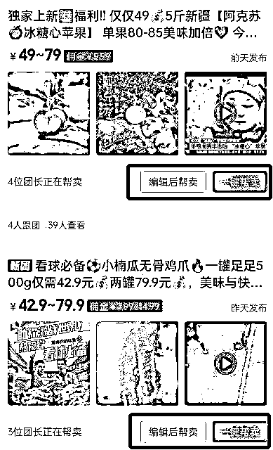

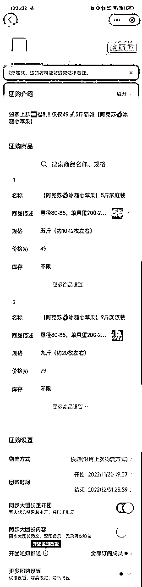

选了「编辑后帮卖」后，若要改介绍信息，可以把「同步大团长内容」关掉再动手。要注意：关掉之后，对方以后改了团购介绍，你这边也不会同步。

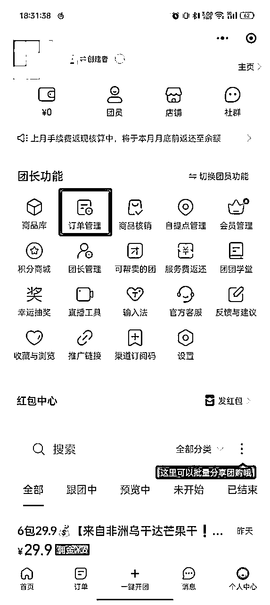

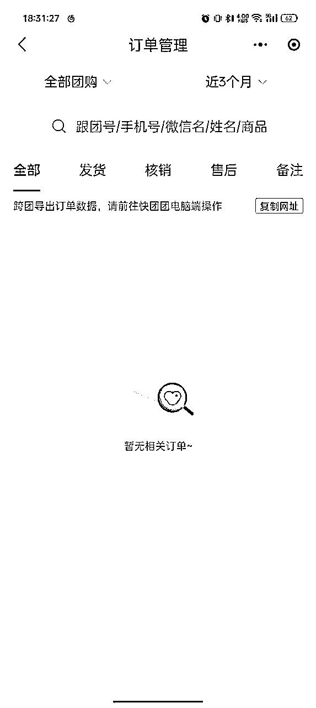

**第 4 步：顾客下单与查单**

把「帮卖团购卡片」发给顾客，对方就能下单了。流程拆开看：

1）顾客怎么下单：

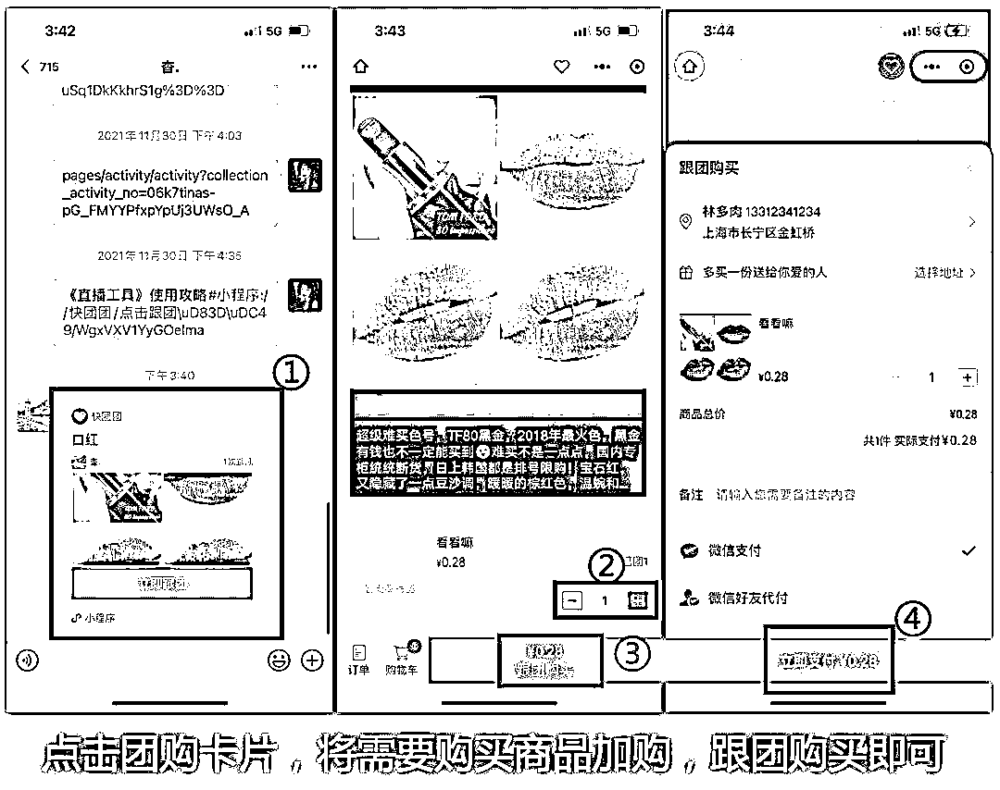

2）顾客怎么查订单和物流：

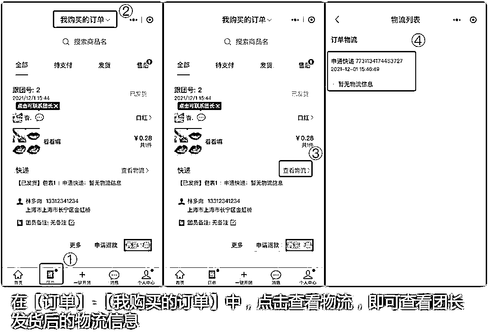

3）顾客怎么联系团长

通常顾客买完都会来加团长好友。在快团团小程序里，可以按这个路径找到入口：

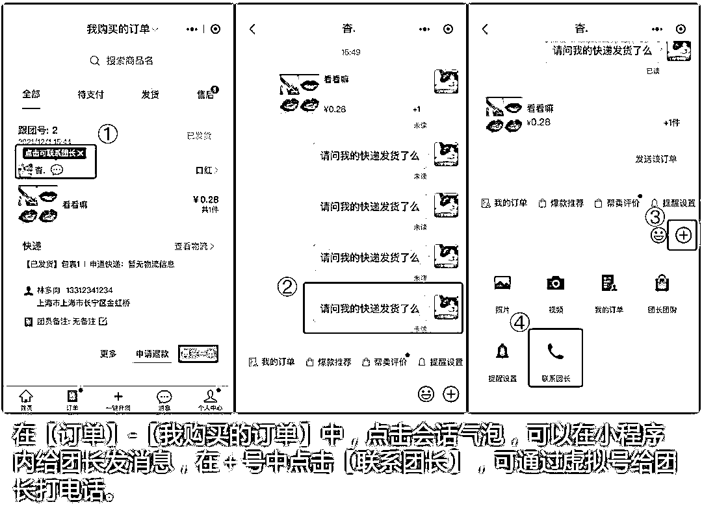

记住：顾客从谁的卡片买，就联系到谁。比如从你（帮卖团长）的卡片下单，找到的就是你；你搞不定的问题，再由你去联系供货团长。

到这儿，帮卖团长的销售任务就算完成了，发货这些事交给大团长处理即可。

**第 5 步：查收入与提现（帮卖团长和供货大团长操作一致）**

1）查团购收入：

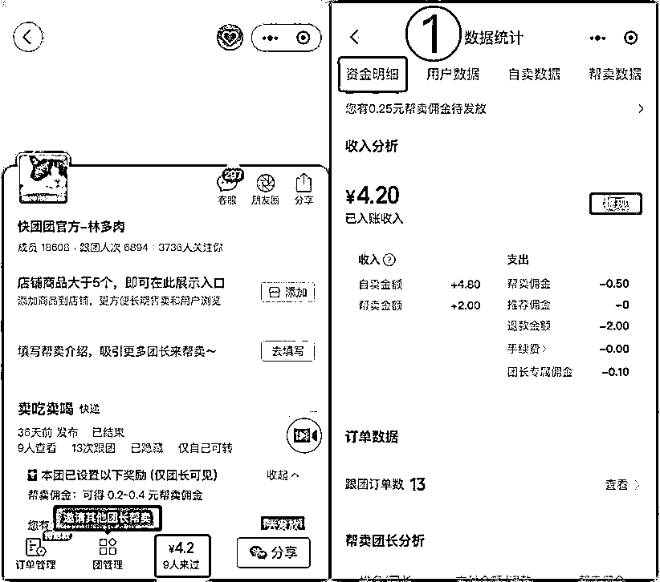

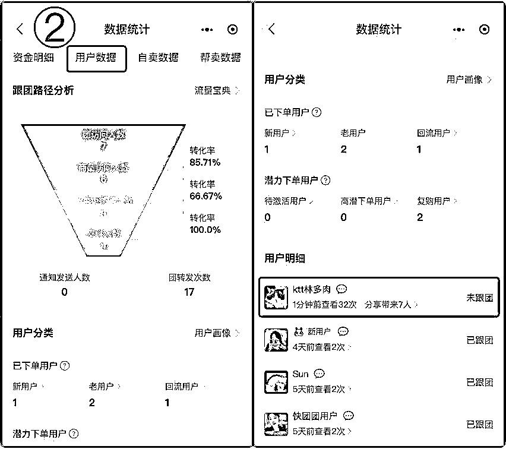

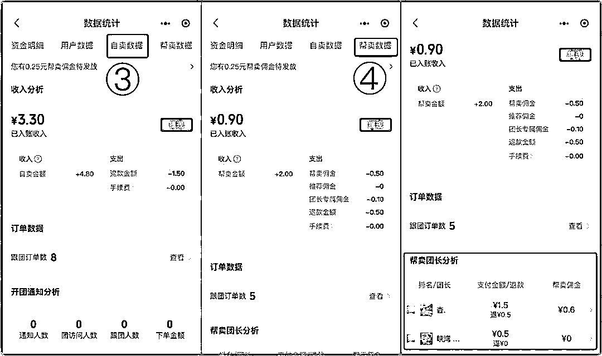

在团购详情页里，点左下角金额，就来到资金明细页。这里能看到该团购的资金流水和用户数据——包含查看次数、分享引来的访客数、有没有新客、有没有跟团。

2）看全部数据/提现：在「个人中心」里进「我的钱包」，就能操作提现。只要供货大团长没有特别改动，佣金会随顾客付款自动结算到账。提现到微信零钱或银行卡都行，不收手续费。

额度提醒：微信零钱每天提现上限3000元，即时到账。

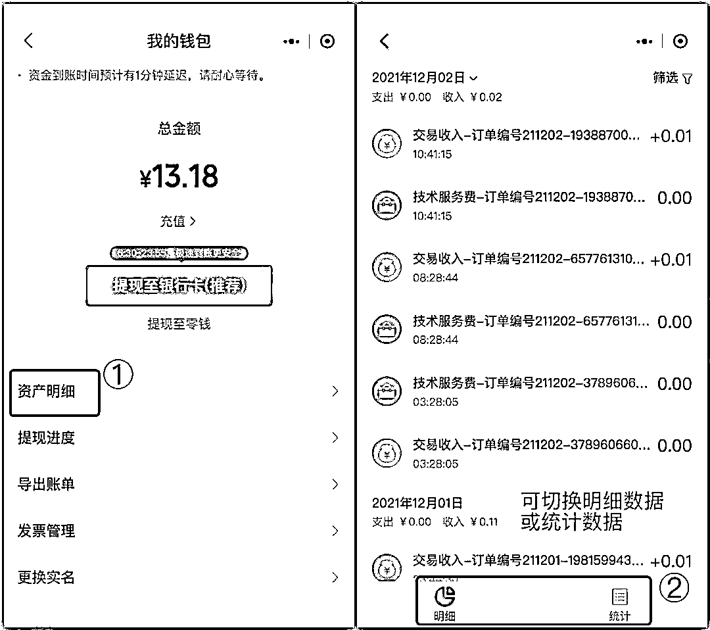

进「我的钱包」点「资产明细」，能看到各种明细；「统计」里支持按日、按月核对账目。

5）导出账单：在「我的钱包」点「导出账单」，选好日期发送至邮箱，大约10分钟后就收到了。

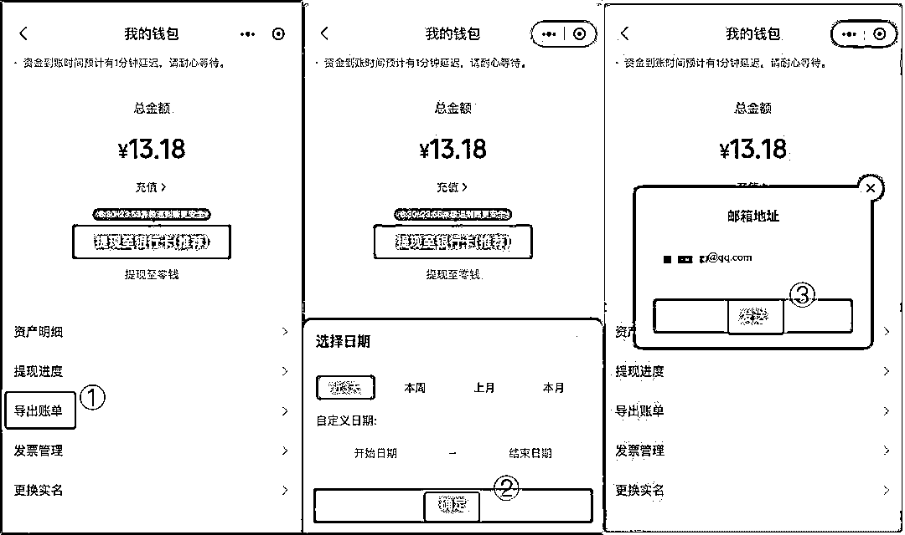

**第 6 步：售后怎么处理**

退款规则先理清：

- 团长退款：只有供货团长能操作主动退款，帮卖团长没有这个权限。
- 顾客退款：要帮卖团长和供货团长两边都确认，退款才成立。

遇到顾客退款，帮卖团长在点确认前要看看自己账户里佣金够不够，因为供货团长那边确认退货时，也得退还这笔订单对应的佣金。

退款视频演示：https://mp.weixin.qq.com/s/AuJBaJGCRiH7a9XZN1n1rw

常见售后问题主要有3类：

**（1）产品问题**：大多是标品跟描述对不上，比如写着100%棉，实物却是纤维面料。这种帮买家把退换货办好就行。

**（2）物流问题**：多半出在发货环节，生鲜有时效性，这类问题尤其多。赶上疫情，还得提前跟供应商确认收货地址能不能发（买家下单时如果地址不可达，系统会给出提醒）。常见的有：快递太慢导致冷冻品化冻变质、暴力分拣弄坏生鲜水果、有单号但物流错位或丢件，这时候买家提供单号，再由商家补发一单。

**（3）退换货问题**：售后大头基本在这。一定提前跟供应商/供货大团长谈好退换条件和标准。团长既要护住买家的权益和体验，也要站在供应端考虑公平，比如生鲜一定提醒及时签收放冰箱，有问题马上拍照反馈。

帮卖团长的响应速度至关重要，最好能做到秒回。底层逻辑就一句话：第一时间确认问题、作出回应；自己能答的马上答；要对接供应商的，赶紧联系对方售后，代表买家去沟通，再把方案转达回来。凡是品质问题，先答应退换，再按流程走。

### 各供货团售后政策参考

每家的售后规则会有些差别。拿本次合作的元宇宙供应链来说，政策如下，大家日后可作参考：

1）凡是快递原因引起的售后，一律先联系快递处理赔付，该补发的补发（路径是：买家找帮卖团长，帮卖团长找供货大团长，供货大团长找发货快递。谁发货，谁去对接快递）。

2）运输中暴力分拣造成商品破损，马上联系快递公司（谁发货谁对接），并让买家提供照片：外箱单号和破损物合照（要能看清单号、货物正面和破损处），加上整只外箱的外观照。

3）按比例退款的，直接发红包处理（后台可操作），把证据给元宇宙供应链申请赔付红包。

4）买家改地址：还没发货就退掉重下新单；已经发货就找元宇宙供应链客服改收货信息。

5）标品有质量问题退换，来回运费由元宇宙供应链出；但「买来不喜欢」的无理由退换，退回运费买家自理，确认收货之后全额退款。

6）清仓、特价、食品、美妆、贴身衣物不支持7天无理由退换。支持7天无理由的，得保证不影响二次销售；换货往返运费自理，退货要先扣掉当初的发货运费再退款。

7）少发、错发这类发货方的责任，当天签收时就找客服，提供外箱单号+照片、整箱外观照、货物+单号合照；超过24小时就不再处理。

8）因质量问题退换，按地区不同，运费能报销5—10元；寄回别用顺丰。

9）特别提醒：买家没经过商量就拒收，来回运费得自己出。

# 快团团实操：售后不踩雷，选品不踩坑

做团购，售后边界和选品眼光，是真能决定你赚不赚钱的两件事。下面这份笔记把要点拆开讲，边看边对照自己的操作就行。

先划清售后界线：口味是很私人的事，所以食品不会因为「不合我口感」就给你退；服饰受拍摄打光影响，实物和图片存在色偏属于正常，接受不了请慎拍；工厂直出的衣服偶尔带点线头，拿剪刀随手处理即可，这不算质量瑕疵；尺码请照页面提示选，万一要申诉，得附上照片或视频，证明标签信息与实物确实对不上；鞋包服饰刚拆封可能带着加工原料的味道，挂在通风处放一放、或过一遍水就淡了，同样不纳入受理；部分工厂货没有吊牌，介意的话请先别下单，这类情形我们也不受理。

💡

无忧惠团

1）凡是快递环节出的问题，先由我们对接物流方走赔付，该补寄的直接补寄；

2）要按比例退款的，走红包形式最省事（后台即可完成），把货品和外包装面单摆在一起拍照，发给忘忧团售后申领赔款；

3）买家想改地址：还没生成快递单号的，找无忧惠团客服改；单号已出的，就得买家自己联系快递公司问能否变更；

4）标品因质量退换，往返运费我们承担；单纯不喜欢走无理由退换，寄回的费用由买家自付，货到后原路全额退还。

💡

JoyMeat 团

1）下单后两天（48小时）内出库，最长不拖过三天（72小时）；

2）缺件、错件或质量瑕疵，请在签收后一天（24小时）内，把面单与货品合影发给客服，我们会尽快介入处理；

3）生鲜离仓后，地址不能改、货不能退换；没跟客服沟通过就自行拒收的，我们不认；

4）买家留下的电话或地址有误导致送不到，责任不在我们这边；

5）打单与上传单号之间有24—48小时的时差，查不到单号不等于没发货，物流有疑问直接问客服；

6）冷冻保温有时限，像新疆、内蒙古、海南、黑龙江这类配送要超过48小时的偏远区域，我们不接单，请理解；不确定自己那片能不能送到，先问客服确认；

7）疫情管控期间，个别地区可能下不了单或发不出货，有疑问先与客服核实。

💡

创港渔农生鲜产品：博贺港海鲜

发货地：茂名博贺
快递：顺丰冷链
快递时效：广东省内次日达，省外2-3天
保存方式：-18°C冷冻保存

售后须知：

1）地址和电话务必填对，货一旦出库就无法再改；

2）及时取件、当场开箱验收，别让它躺在快递柜或驿站；

3）运输途中个别真空袋会失压漏气，不影响海鲜本身，真空包装只是为了延缓化冻；

4）签收后一天（24小时）内，拿【受损货品＋快递面单】同框拍照申请理赔；

5）走的是冷链陆运，请耐心等件；到货后若有问题，按上述流程申报即可。

特殊时期，彼此多一分理解与耐心，什么坎都能过去，比心～

售后对接：各团售后同学都会进航海大群，进群就能找到对应的人解决问题；也可以到各团帮卖主页找该团客服，下图是示例。

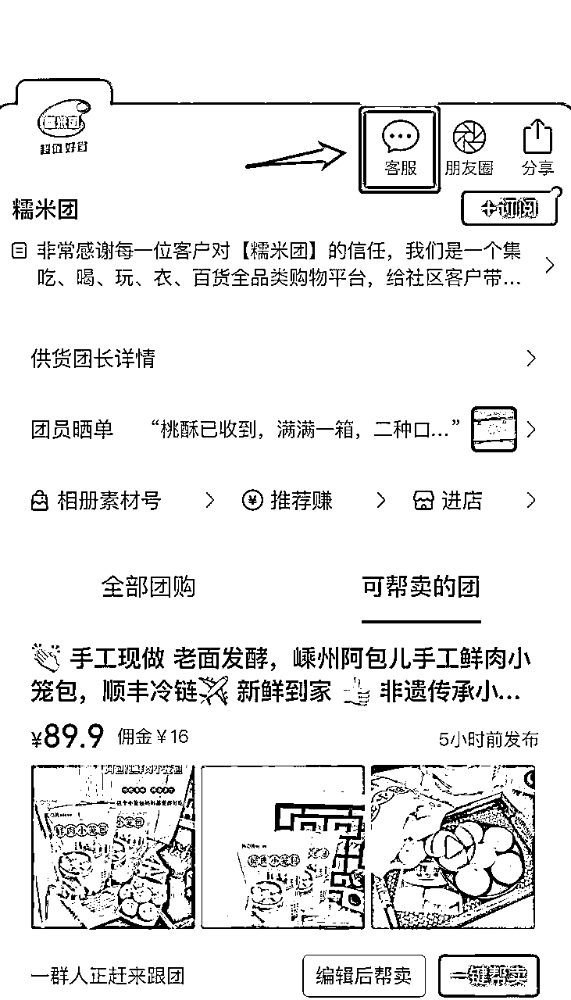

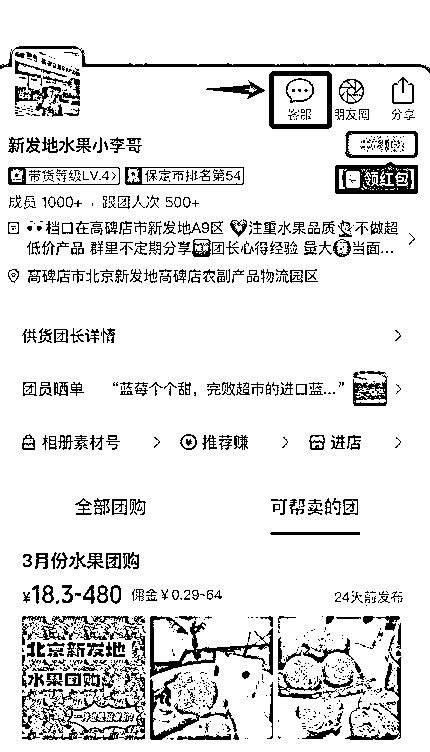

别忘了，你是买家与供货方之间的那个连接点，衔接必须到位。碰到质量或瑕疵问题，处理时可以试着把标准抬到客户预期之上：看上去你多让了一步，实际换回的是口碑，还能把一次不满转成回头客。举个例，本该退货退款的情形，你完全可以只退款、不要求寄回，再补一张下次下单的优惠券。

### 2.2.2 帮卖这件事，其实就三步

整条链路拆开看很简单：供货团长把团开起来、设好佣金；帮卖团长用一键帮卖、或自行编辑后上架；买家成交，供货方发货，帮卖方结算佣金。

帮卖团长真正要干的，是挑到合适的货、推到自己的社群里，把转化率做上去，佣金自然就来了。

## 2.3 供货团长怎么挑、怎么验 @宝藏小鹿 @星宇

想扩充品类，自己去找供货团长完全可行，但这一步最考验眼力，辨不清就容易掉坑。圈友@宝藏小鹿给出了一套找人加验人的思路：

1）找大团长的入口：在微信搜「快团帮卖团长」
渠道其实不少，闲鱼、小红书、微信、抖音里搜「快团团」「快团团大团长」都能翻到，相关公众号与文章也值得读一读。

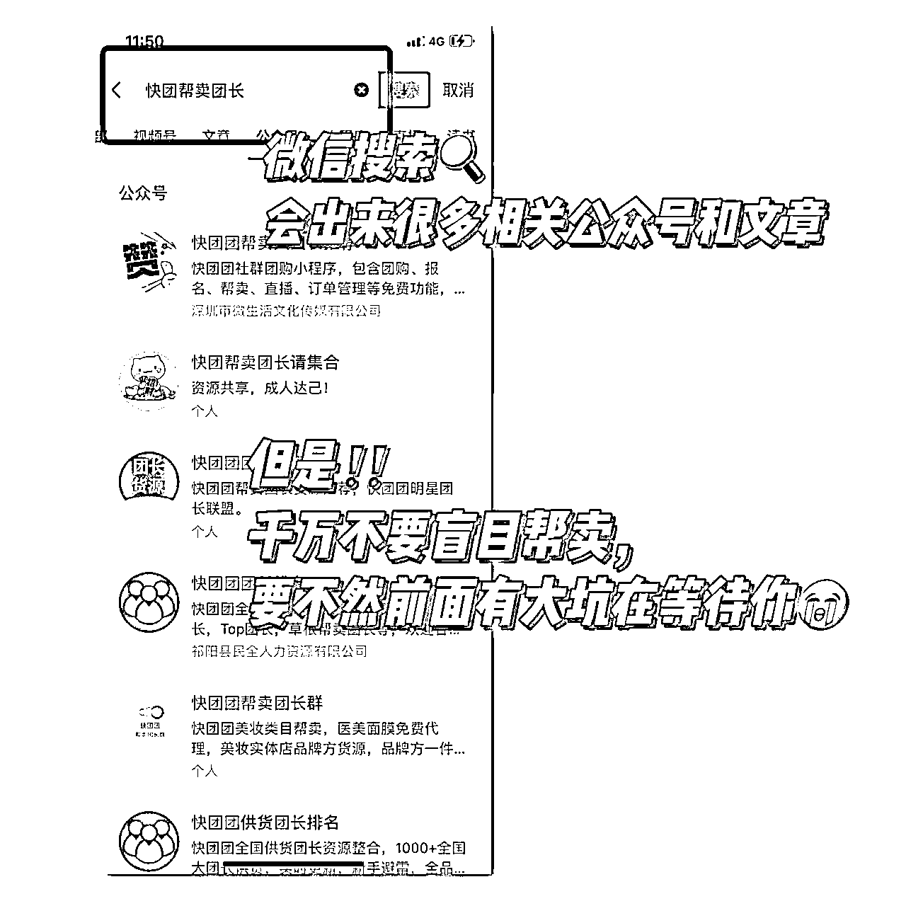

2）怎么判断一位供货团长靠不靠谱？

不少人第一眼看团员规模、团品销量、在平台的等级排名。这些当然能参考，可正因为摆在明面上，注水的空间也大，不能当作唯一依据。

⚠️团员多不等于售后风险小，两者并不成正比。那该盯什么？怎么验？往下看👇

基础判断——看商品

把售价和商品本身放在一起对照。货品大致分两类：有市场价锚点的品牌货，和没有锚点的非品牌货。

品牌货有公认行情。苹果手机市场价8000，团里卖7500说得过去；卖5000就得多个心眼——凭什么这么低？是不是埋了雷？真到3000，别犹豫，撤。

非品牌货没有标尺，只能看区间。三斤苹果水果店卖30，团里卖20能接受；要9.9三斤，明显违背价格常识，踩坑概率陡增。

判断售后——分场景压力测试

【场景A】

加上对方售后客服微信——挑一件你打算带的货下单——趁未发货立刻申请退。要留神，个别商品被设成「禁止退货」。

目的：看对方售后多久响应，退款快不快。

【场景B】

同样加上客服——下单——等签收后再申请退。同样要留意是否有「禁止退货」的限制。

目的：一看响应与退款速度；二看实物品质，到手的货有没有超出预期的惊喜。

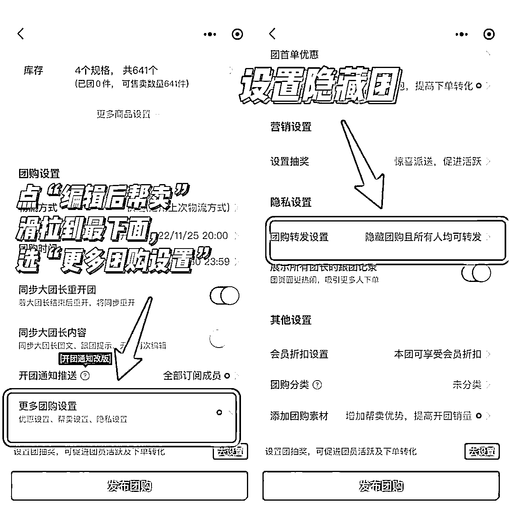

进阶玩法：比佣金

这属于高阶操作。等你带量上来了，同一货源在不同团长手里的佣金比例，是可以比较、可以谈的，这里不铺开，懂的都懂。

⚠️特别提醒：快团上的美妆个护务必慎带，假货密度高！哪怕某位团长的服饰鞋包做得漂亮，也不代表他的美妆渠道正规，务必反复核实。

3）怎么把团员数和跟团人次做上去

快团越做越成熟，不少供货方为挡住「全民帮卖」，门槛一提再提，新团长起步确实更难。等你做了一阵、想多申请几家团长，却发现团员数和跟团人次不够，可以分两步优化数据：

a. 闲鱼上有提供涨团员数的服务，先小额试一点，验证靠不靠谱。

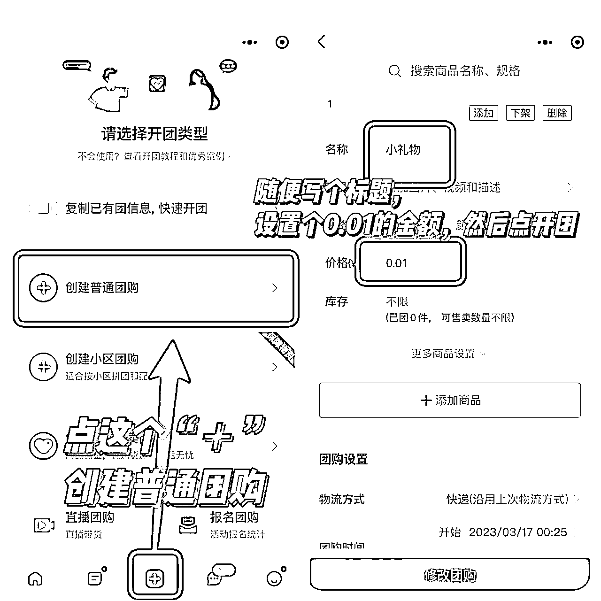

把团员做到1000、跟团人次做到1000，可申请的团长就宽裕多了。

内容来源：《新手团长快速「脱白」的几个步骤》

## 2.4 其他功能与常见疑问

「2.2」那节讲的是开团和帮卖的基本动作。真正上手后，还会撞上各种细碎问题。我们把官网被问得最多的问题汇总成一个问答库，你按自己的情形点进去看对应教程或答案即可，入口在文末附录：快团团高频问答库。

另外，手机端打开快团团小程序，里面有个「团团学堂」。提醒一句，学堂里的部分内容可能已经过期；若仍解决不了，在航海群里发#举手求助（本次航行期间有效）。

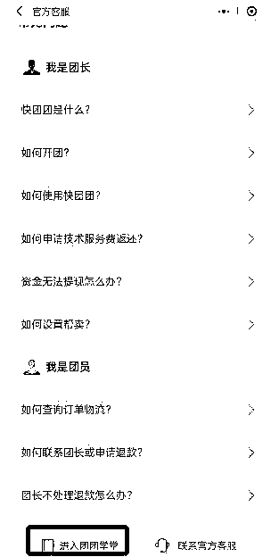

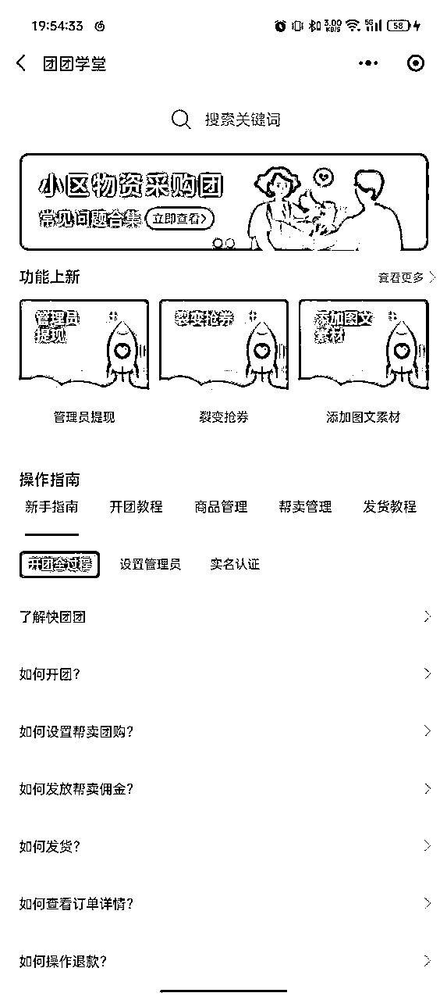

想找具体答案，也可以直接搜关键词：

# 三、怎样挑到合适的货

💡

章节概要

无论做什么项目，选品都是绕不开的第一关。货挑对了，你在快团团的局面很快就能打开，从第一单一路做到第一百单……不同私域、不同社群的客群不一样，选品方向自然也不同。为此我们请到几位正在实操快团团的老师，把他们的经验提炼出来供你直接复用，于是有了下面这几套方法：

✅刚入门，建议先从方法一看起
✅已有社群或选品底子的，方法二至方法九可能更对味

不过我的建议是全都读一遍——底层逻辑大多相通，读得越多，体会越深。真正要紧的是读完就动手，从货盘里筛出最适合你的那批品。

## 3.1 方法一：新手起步的五个选品方向 @深藏 blue

看品通常从几个维度切入：品类（红海还是蓝海、复购高不高）、品牌知名度（认知度与接受度）、价格（客单高低、有没有价格优势）、服务（售后）。

大团长与刚起步的新手，思路差别其实很大。今天先聊新手。

1）从自己和身边人出发

新手起盘，靠的多半是熟人——小区邻居、同事、老同学。所以挑品要贴着自己的情况，也要贴着他们的需求。优先做自己熟的类目：用得越多，讲起来越顺，卖点也挖得越深。科技迷可以碰电器，吃货可以做零食，家里有娃做母婴就很自然。

如今是个人IP的年代，团长本身就是一张名片。先想明白自己擅长什么、在哪块懂得多，顺着这个方向带，效果才会好。

2）品类要做出差异

团购赛道越来越挤，同质化严重。跟大多数人卖一样的东西，等于把自己丢进红海。更聪明的做法是：在「有流量」的大类里，切一个「有差异」的细分。拿进口牛肉举例，大类之下先切「美国」「谷饲」；再往下切「牛排」「火锅片」「烤肉片」；还能更垂直，比如「厚切」。比普通牛排更细，才能接住那些在普通超市买不到合适货的专业客群（超市多为薄切）。再看流量端，「战斧」本身就是自带搜索量的爆款形态。两条线一交叉，「美国谷饲厚切战斧牛排」就成了值得一试的方向。

3）品牌知名度

品牌是流量的入口，名气越大，越好卖。但大牌也意味着激烈竞争，所以做大牌，核心在于价格——优势越明显，动销越快。小团长若拿不到大牌的优惠货源，不妨转向中小品牌或新锐品牌，比如曾经爆火的空刻意面（如今已算大牌）。

市场之间也有差异。有些领域品牌并不起决定作用，像原切牛肉，消费者根本记不住国外工厂的名字，他们认的是「安格斯」「和牛」「澳洲」这类产地或牛种标签。可见品牌重要，却也没那么重要：大牌能推你一把，前提是你手里有价格优势（或者能拿到市面上稀缺的新品，这难度太高）。没有品牌光环，就从产地、工厂、原料去讲故事，让客户相信这货确实好。麦当劳的「黑安格斯牛堡」，就是借牛种认知来拉升产品认可度的典型。

4）价格

团购客群，很大一部分就是冲着实惠来的。但你要有意识绕开单纯的价格厮杀，这里给三个方向：

一是做「不好比价」的品。全新品类，市面上找不到参照物；或者非标品，比如定制类、特殊规格。牛肉天生是非标——部位、等级、饲养方式、厂家、牛种不同，价格就没法一一对照。

二是给自己找一个「比价角度」，别让客户拿你的品和别人家的品硬碰硬。我们做牛排套餐时，会专门设计一套与天猫官方旗舰店不同的规格组合，客户自然无法直接对表。

三是主动设定参照物。我们常拿餐厅牛排做锚：同样500g西冷，我们只要餐厅的一半价，品质却一致。客户的判断标准，就这样被带到我们设定的框架里。

高客单与低客单，各有取舍。低客单容易起量、出单快，但客户盯着价格，忠诚度有限；高客单客户看重品质，一旦建立信任，黏性极强。条件允许的话，优先布局高客单——前期难一些，等客户池养起来，后面会轻松很多。

5）服务

供货方的售后能力很关键，响应快不快、退换顺不顺。专业团长在考核供货方时尤其在意这一项，通常会明确要求响应时限。因此挑品之前，一定把对方写明的「物流与售后政策」读清楚，并让对方给出明确答复。

## 3.2 方法二：四条选品逻辑，别人缺的我补上，别人有的我更强 @叶子、@佳佳

动手选品前，先分清私域客群与公域（淘宝、京东、拼多多、抖音、快手等）客群的不同。私域的流量是确定的，不是随机撞上来的。也就是说，你得先摸清自己用户的画像：性别构成、收入层次、所在城市、周边商超都在卖什么。因为你要选的货，得对得上他们的口味，要么他们买不到，要么你的性价比高过他们日常渠道——别人缺的我补上，别人有的我做得更强。

沿着这条线，私域里被公认有效的选品逻辑有四个：

稀缺与特色：挑市面上少见、特色鲜明的货，别去碰家门口夫妻店随处可见的东西；

背书够硬：有真实销售数据、有高端渠道背书（山姆、Costco、麦德龙等）、有热度（小红书、李佳琦、东方甄选等推荐过）。客户愿意在你这买，本质是相信你的东西更好，而这些背书就是「更好」的证据；

价差够大：差价越大越有吸引力，谁都喜欢占点便宜。相比官方旗舰店、淘宝等渠道，你这里便宜得越明显，效果越好；

利润高、售后少：这是所有帮卖团长最在意的一条，谁都希望赚得轻松，售后缠身最耗人。

一句话总结：私域选品，就是围绕「别人缺的我补上，别人有的我做得更强」，让货具备稀缺、特色强、背书硬、热度高、价差大、售后少这几个特征。

思路之外，找准类目同样关键。每位团长都有自己的粉丝标签，大体可分为产品类目型（生鲜食品、日化百货、进口商品、服饰、美妆等）、杂货型、母婴型……这些分类虽多用于描述供货大团长，但帮卖团长同样要选准自己的主攻方向。先把客群分析透，才知道该带哪类货。

客群是宝妈，就围绕家庭生活、吃穿住行与孩子展开——她们在意好用的厨房小物、靠谱的食材、能提升居家质感的物件；客群是小区住户、人群混杂，就挑男女老少都能用的品，比如性价比高的特色零食；客群是你的品牌粉丝，选品调性要与品牌一致，别让人觉得突兀，客户最反感被挑战既有认知；客群来自淘系、抖系，起步阶段也尽量贴着原店铺的调性走。

想把团长做好，必须舍得花时间去了解、去测试自己的客群画像。刚做私域的人，一定要小步试错：用不同调性、不同价位的品去试探偏好，再逐步收窄、提高命中率。

## 3.3 方法三：先对齐 IP 人设，再挑对供货团长 @102℃De 月亮

选品的第一道筛子，是它能不能对上你的人设。讲个反例：我做供应链时，曾给一位头部的宝爸团长推过一款大牌健身速食鸡胸肉，却忽略了他的人设是「无添加、给孩子最天然的选择」，任何含添加剂的产品都不碰——这单自然黄了。

同时，要评估品牌影响力，也要把团购价与公域价放在一起比。特别要留心大促期间的价格波动，以及非官方旗舰店搅乱价格体系的情况；这些要提前跟团友讲清楚：我们的货是官方旗舰店同仓直发，品质有保障。遇到品牌临期清货，更要在链接显眼处反复标注真实保质期，把售后隐患挡在前面。

对帮卖团长而言，最关键的一步是找到与自己匹配的大团长，并摸清他的选品规则。若能打听到对方过往的职业背景与资源积累，对他供应链的判断会更有底。所以建议帮卖团长先加进大团长的素材群——群里通常会有新品预告、详细讲解、客户好评、素材分发。你在群里挑出客户可能关心的信息存下来，开团时抛到自己的群里，转化会加分不少。

那靠谱的供货大团长去哪找？这需要相当强的识别力，核心是判断对方的真实底子：报价里有没有水分、售后处理顺不顺畅……把各项因素综合起来，再决定这个人靠不靠得住。

PS：为保证本次航海安全稳定，生财官方对接了一批靠谱的供货大团长圈友来供货，帮大家更快上手。具体名单开船后在航海群公布。手上暂时没货的，可以先从他们的货盘里挑合适的带上，出单即结算佣金。后面更丰富的供货资源，还得靠自己去筛。

## 3.4 方法四：四条找货路径 @刘梁

在团品这件事上，我确实花了不少心思。我本身是个爱吃的人，在家带娃那阵还写过美食类公众号，所以总愿意去挖好吃的东西分享成团——这对我像是推开了一扇窗，全国各地的好货都能被我找到。

我找团品的做法是：自己平时在别的平台买到品质过硬、经得起考验的东西，就回头去找卖家谈团购价，谈拢了直接开团上架。

逛群接龙时，我看中某个品不会立刻上架，而是先自己尝一尝、用一用；接着去对接供货的大团长，争取进入对方的社群。进去以后先当观察者：听团长怎么说话、看对方怎么办事，判断这个人靠不靠得住。同时我会亲自下几单，专门盯着售后处理的速度。等确认对方人品稳、实物和描述对得上、遇到问题响应快，才敢把这个品搬进自己的群里卖。群友有时也会给我出题——她们在其他平台刷到新鲜好吃好玩的东西，就叫我找货源开团，于是顺序反过来：先有明确需求，再去匹配合适的团品。另外，朋友和团长牵线介绍的供应链，也是我比较信任的渠道。

内容来源：《一个转化率 40%的乌托邦式的社群团购是如何做到的》

## 3.5 方法五：闭眼演一遍用户的生活 @泳怡

选品之前，先回答一个问题：掏钱的人是谁。买卖不是自己一头热，而是双方来回互动；把客户真正想要的东西弄明白，出手才容易中。

用户画像在教科书里往往要海量数据打底，品牌和电商平台尤其吃这一套。可对超级个体而言，客户规模有限，只要画像够准，同样能做得细、守得住复购。

怎么找得准？我常用“用户沉浸式体验法”：闭上眼睛，在脑子里拍一条短 vlog，先捏出一个活生生的人——性别、年龄、婚否、有没有小孩；平时出没在哪、此刻正在忙什么；手机里最常打开哪些社交软件、追哪类剧；干什么职业、月入多少、家里资产什么水平、住的小区大概什么价位；口味偏好、常买哪些牌子、日常消费习惯如何；最近又为什么事犯愁。把这些碎片连成 TA 的一天，甚至一段人生，像排一场小话剧。你越能抓住 TA 的念头和情绪，就越容易用对味的产品和情绪价值把单子促成。

再补一句：想把货卖好、把用户读透，自己最好先成为这类产品的真实使用者。

拿我和刘梁姐做对比。我的客户大多是 90 后妈妈，年龄集中在 26 到 35 岁，孩子 0 到 4 岁，也有一部分二胎妈妈，大宝会大一些；她们爱聊天、爱社交，也爱下单。有一阵快团上出现了不错的食材，我跟着上架，结果买的人很少；再看刘梁姐那边，订单一直往上涨。问题出在生活场景：我的客户很多是 90 后，下厨频率低，最多做点宝宝辅食；宝宝常吃的无非胡萝卜、玉米、番茄、贝贝南瓜、水果这些，我卖得动，肉类和其他生鲜就很难。更关键的是，她们大多跟公婆住，或者家里请了阿姨，买菜做饭轮不到自己操心，菜钱由长辈出或阿姨采买，自然不会想着在网上下单囤菜。刘梁姐的客户孩子偏大，不少已经读小学，正是长身体的时候，妈妈更重视营养搭配，对食材的要求也更高。就这么一个小差别，选品方向就能分出好几条路。

我这边跑得比较好的是内衣、服装、饰品、宝宝衣物、零食等。开服装工作室到第二个月，流水突破 20 万，最高纪录是一位客户一次买了 1 万多。客户有一个共同点：30 岁之前生了孩子，熬过最累的前两年，孩子大了，终于有心思打扮自己，于是愿意为“变美”“穿得舒服”掏钱；在她们现阶段，自己开心比什么都重要。同样都叫妈妈群体，年龄不同、处境不同，适合的品就大不一样。只有把用户刚需找对、找准，才能少费力多出单。

内容来源：《人均复购 80 次的秘籍》

## 3.6 方法六：靠数量让爆款自己浮出水面 @五加皮

选品通常有两条路：一种人直觉极准，推一个成一个、成一个爆一个，这属于天赋，这里不展开；我走的是另一条——靠量去试，也敢负责任地说，量堆到位是有用的。用铺货的方式，让真正能打的品自己冒头，这也是我的做法。

我们适合的节奏是每天上 100 个品，重点不在“上完”，而在“分时上”。不是一口气哗啦啦全挂出去，而是参考下面这个时间表（和发朋友圈的节奏类似）：

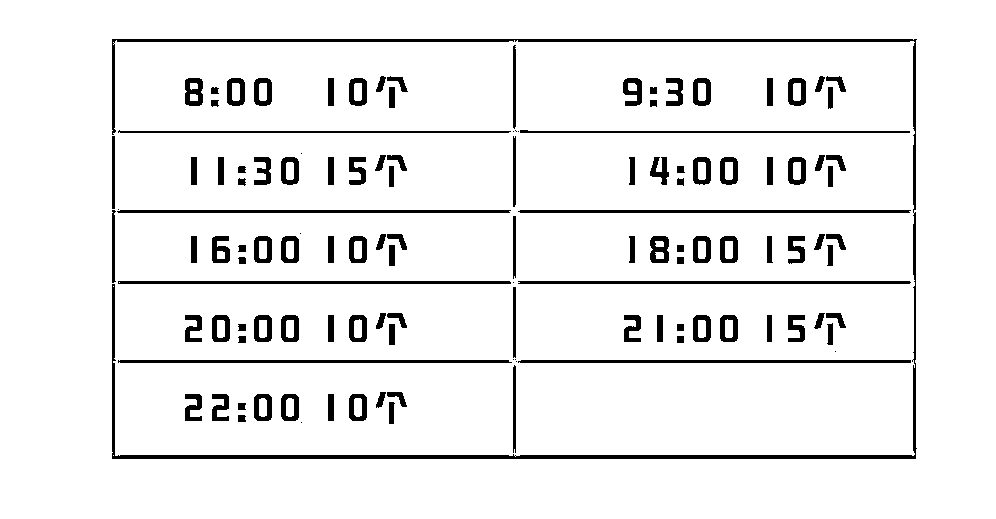

8:00 上 10 个（上班早高峰）

9:30 上 10 个

11:30 上 15 个（午休吃饭）

14:00 上 10 个

16:00 上 10 个

18:00 上 15 个（下班时段）

20:00 上 10 个

21:00 上 15 个（晚上刷朋友圈高峰）

22:00 上 10 个

还要注意工作日和周末的差别：从周五晚上到周末，往往只有 22 点前后上品效果比较明显。这一点得拿自己的用户群去测。

100 个品从哪里来？一是找大团长，先盲上，跑得好的立刻拿货（自己测评后，再发朋友圈加推）；二是快团团官方商店（多多商品库以及对应的素材群）；三是把拼多多、淘宝、抖音上卖得动的品搬过来，做无货源（这招我一般不往外说）。

内容来源：《私域如何转型做快团团？10 个月一千万，我做对了这 3 件事》

## 3.7 方法七：摸清客户、小步试品、挑对供货方、锁定商品 @叶子

1）先把自家客户拆开看。多数帮卖团长都是新手，兼职卖货或拿碎片时间卖货，背后没有专业团队，所以手头有限的客户更要榨出价值；这里先不谈运营，只谈货。看朋友圈客户的消费档次、所在城市线级、住什么房、开什么车、周边商场什么级别，基本就能判断该走什么调性：常规品、新奇特、小而美、品牌货还是进口货；一时判断不了也没关系，后面可以测。年龄和性别尤其要留意：如果客户以男性、年轻人为主，建议慎重，因为快团供货团长大多围着 30 岁以上女性做产品，客户群和供给对不上，就很难帮卖。

2）测品。分析完客户，很多人还是会犯迷糊，这时候测品就很重要；别一上来就盲目选，否则会透支客户信任。第一次来团里下单的人，多半是抱着试试看的心态，所以试错门槛越低，越容易成单；一旦成交，后续服务跟上，客户就容易变成铁粉，因此第一印象很关键。前期建议从生活日用品入手，别一开始就推服装、美妆；换位想想，选大多数客户都熟悉的居家日用品。接着可以试生鲜食品，初次尝试的客户也愿意接受，但千万要避开售后麻烦多的生鲜（除非供货团长特别专业）：一条差评能抵消上百条好评，在群里炸开还会把负面无限放大。选客单低的产品，同样是降低试错成本；花小钱就算不满意，心里也不至于太难受，和客户的关系也不容易伤。第一次上的品一定要比价，参照淘宝或线下商超，价格必须更便宜，客户最怕被忽悠。最后再穿插一些客单价高、利润好、自己特别看好的产品，测试客户接受度；数据最好的价位段，就是以后核心选品的方向。

3）帮卖团长的选品原则。测完品，基本能判断自己适合卖什么。三条通用原则：同样品质，你的价格要比其他渠道低；售后率必须低，重要的事情说三遍，售后会占掉卖货 60% 的精力；利润要过得去，卖货是苦活，得能较快赚到钱，否则很难坚持。新奇特、稀缺品如果有当然更好，但这类品太少。

4）筛选产品渠道。A. 选品先选人。挑到靠谱的供货团长，才能安心卖货。给新手一个实用策略：优先选垂直领域做得专业的团长。现在快团供货团长大多深耕自己的垂直类目，比如渔乐专做生鲜、小Q米洛等专做服装；他们服务的帮卖团长比全国 Top 少，精力更够，垂直产品不差、价格也合适，能提供质量和售后都相对稳的供给。新手如果一上来就帮卖全国 Top，在几万个帮卖里很难被看见，产品再好、服务跟不上也会伤到自己。明星团长也是同样的逻辑：处于发展阶段、被官方认可，产品要求较高，下面帮卖不多，服务效率跟得上。Top 团长价格基本最优，但服务速度可能慢一些。权威推荐方面，有些行业里的权威玩家专门做私域，他们推荐的团长也比较靠谱，比如生财。

B. 供货团长怎么找？平台推荐：一些行业公众号会推团长，比如快团团团长推荐、呱呱爆品；呱呱爆品是我常用的快团分析工具，上面的团长排名、爆品数据值得关注（部分内容收费）。也可以找专业快团服务团队咨询。

5）确认产品。A. 看别人卖得好的：跟团数高、转化率高。快团里转化率高于 10% 就算很不错，常规产品一般在 5% 左右。这类品有两个好处：降低试错成本，利用从众心理更容易开单。

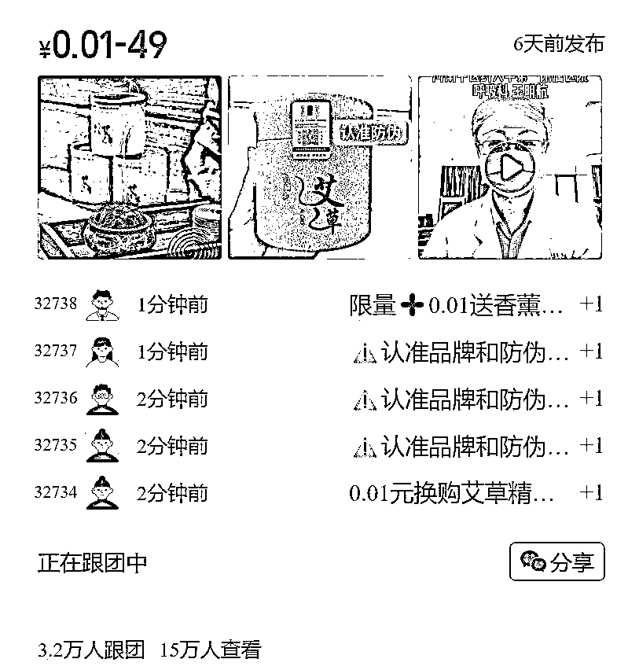

例如跟团数 3 万+、转化率 21%，属于超级牛品，一个月快团可能也就个位数；跟团数超过 1000、转化率大于 10%，基本可以放心帮卖。

B. 差价大、全网最低价、利润好的产品。这是通用原则，可能不一定爆，但至少不会让客户骂，还能加深下单客户的关系。原价 XXX、开团 XX，这种要重点选；一般客户很难拒绝，常见于品牌清仓或临期品。

C. 标题很“炸”的产品。这对帮卖团长、尤其新手特别适用。上面截图的几个案例就是标准强标题，客户看了容易心动。常见模式：原价 xxx、开团 xx；几折清仓；历史最低价；0.01 或 0.1 抢购；山姆、Ole、COSTCO 等同款（用背书增加信任）等，一切看起来劲爆、可信度高的标题都优先考虑，尽量卸掉客户下单的心理包袱。

D. 链接内容前后都要有吸引力。私域或快团本质仍是电商，要遵守电商逻辑：消费者大多数只在链接上停留 3 秒，如果前面和尾部内容不丰富，这个品可以不卖。底层逻辑是：客户看不到实物，链接内容必须让用户感觉性价比特别高。

内容来源：《从供货团长的视角，来讲讲选品和售后》

## 3.8 方法八：让数据替你做选品决策 @小白

先看人群维度。对我们最重要的三个维度是：用户性别与年龄范围；需求维度。比如客户是女性、30 到 50 岁的妈妈/奶奶/外婆，比较关注孩子学习，选品就围绕这个年龄段女性的教育需求和生活需求（打理家庭、变美等）展开。

然后根据三个数据来选品：转化率（看查看数、订单数）；出单率（按最近订单时间排序）；开团时间。开团时重点关注，基本满足以上任意两点就可以开团。

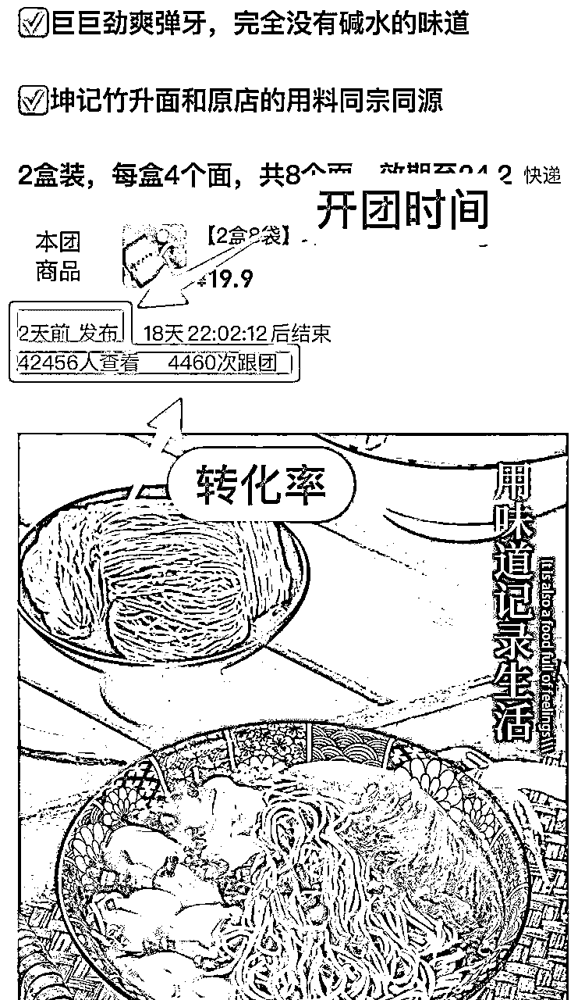

内容来源：《如何用数据来支撑选品和推品，提升用户体验和粘性？》

## 3.9 方法九：按人货场次序挑品 @贾璐 luca

（1）不少帮卖团长会卡在第一步：快团团帮卖到底卖什么？先解决卖给谁。我微信里的人画像比较集中：一类是中产家庭主妇，时间多、群里活跃，个人没有收入、个体价值感不强，主要依附家庭，开销也以家庭为主，给自己不太舍得花大钱；但借着孩子、家庭的名义，可以满足自己的消费欲，还能带来社交价值；收入高的家庭，在饮食、刚需、家庭教育等高频消费上，往往愿意选高品质、高价值、能带来生活方式高势能的东西。另一类是大城市女白领：工作忙、情感生活有限，个体价值感强且依赖消费来实现，消费能力也更强；她们更爱自己，晒单和展示社交价值时更在意烘托自身价值，爱生活会生活懂生活的人设必须有，但时间有限，所以需要能快速帮她们把“爱生活”这个设定立起来的商品。

（2）再按具体需求往下挖，看卖什么。先理解“生活方式”：它不是装逼，英文 life style 指的是生活格调和风格；放到社交媒体经济里，它的意义和价值被放大了。生活方式消费能让人感知到格调，人通过有格调的消费，成为更欣赏、更喜欢、更希望成为的自己。也正因为这样，有格调的消费才有人愿意付溢价，否则大家只想要低价；今天社交媒体让个人生活方式的价值可以快速折现成社交价值，让发布者站在高地，所以选品如果在生活方式角度做对了，就能自然激发分享欲，而不是靠晒单换折扣。

当然，人愿意为生活方式掏的钱是有限的，光有格调不够。选品和定价时，一边提升买家的格调感知，一边让价值感更突出，让买家觉得占了便宜，才会爆。比如直播间里的大牌主播，先把自己定位成懂生活、懂美学、懂格调的人，大家接受这个设定后，再看到折扣价才会把持不住；如果对主播不够信任，同样的商品和主播不匹配，效果也不会好。不同人对生活方式和格调的定义不同，人货场里人永远排第一，先倾听、关注人的需求，再选品。

我住的小区偏中高端，长期在群里交流，让我对两类目标人群的消费能力和社交价值有了评估，于是做了针对性的选品和定价。结合这些特点，水果成了我的首选：对女性来说，水果经过多年市场教育，天然有亲近感；颜值高，自带社交价值；高频消费，隔三差五就要买；水果店定价偏高，有低价击穿的空间。不足也明显：容易坏，品相和质量问题带来的赔付少不了；比较非标，很难保证稳定性，这两点也限制了水果团的天花板。先看机会的部分：基于对“人”的理解，我作为“场”，结合自己的爱吃属性，把“货”定位成性价比高的水果生鲜；具体选颜值高、品质高、购买欲强的葡萄、草莓、蓝莓、高端柑橘等。快团团只是我的工具。

内容来源：《快团团新手如何帮卖月佣金达到 8 万》

# 四、社群冷启动：聚人、引流与建群

💡

章节概要

快团团要真正“团”起来，靠什么？靠人。这一章要解决的是：怎么把人吸引过来，变成你的客户。

综合老师们的经验，我们提炼出 8 种办法：

✅方法一：用私域裂变和朋友圈撬动第一批人

✅方法二：制造记忆点，用特色品破冰

✅方法三：锁定种子用户，借活动扩散

✅方法四：安排群内气氛组，带热开局

✅方法五：盘活本地资源、混群经营口碑

✅方法六：公域导流配合朋友圈经营

✅方法七：线下广告投放引流

✅方法八：从小红书导流

其中，小红书导流是目前公域平台里比较适合的一种，不少做快团团的圈友在小红书上引流，并且做出了成绩，值得一试。

这 8 种方法画面感很强，大家肯定在各大群聊里见过一种或几种，今天就把它们的真面目拆开看。它们并不是各自独立，很多方法互相交织、操作上也有共通点：都要努力活跃社群、建立靠谱有人情味的形象、适当借活动裂变、注意维持朋友圈形象等。往下看，相信你也能找到适合自己的办法；找到之后，记得开始自己的社群冷启动。

## 4.1 方法一：私域裂变加朋友圈，用信任启动社群 @刘梁

1）起步从亲朋好友、身边熟悉的人开始。

2）在朋友圈分享美食好物后，有人下单，我就去问要不要进群。

3）群友会自发拉亲朋好友进群，这一步裂变很关键，因为她们是精准粉丝。

4）每天分享团到的团品，传递喜悦和享受的气氛。

5）真实生活也分享，有时吐槽几句，让大家看到一个有血有肉、有灵魂、带点幽默的我。

6）朋友圈也会发鲜花、健身、旅游这些情绪价值内容，让大家看到积极、热爱生活的我。

3. 怎么让群友信任你、认可你？

1）真诚，还是真诚；真诚分享，好的地方说，不好的地方也坦诚告诉大家。

2）品质，永远是品质；品质是社群的基石，离开品质的团品只会变成灾难。所以选品和选供应链要严格谨慎，毕竟不好的东西很快会在群里传开，坏口碑扩散得飞快。

3）责任心，是社群的安全底线

选品一旦翻车，最好的应对是直面问题：能退换就退换，能赔偿就赔偿。比如部分服装供应商不支持退货，我就让群友把货寄给我，自己留下穿或转送朋友。做生意不能只盘算利润，更得预留一部分用于兜底保障。这样群友才会放心：哪怕这次买得不合意，总还有人在身后接住你。

4. 铺开社群矩阵，扩大连接半径

好物分享群之外，其他类型的社群同样值得布局，把社交触角伸得更远。我另外运营着一个学习交流群、一个断舍离群，还有一个有机菜专供群，这些群互相配合，也能为好物分享群持续引流。平时在这些社群里做无偿分享，等于为好物群积累信任背书；团购群里的成员大多是强关系，所以极少有人退群。

内容来源：《一个转化率 40%的乌托邦式的社群团购是如何做到的》

## 4.2 方法二：用记忆点撬动冷启动，两步到位 @深藏blue

冷启动要想做好，讲究的是章法，拆解下来就两件事：先靠高品质引流品制造记忆点、积累口碑；再锁定目标客户，把私域建起来。

这里的关键词落在“记忆点”上。记忆点从哪来？我的理解是——用优质产品让用户记住你。尤其在团购赛道已经非常拥挤的今天，引流品必须做到“惊艳”，超出顾客预期，让人产生“在你这里能买到别处找不到的好东西”的感觉。所以，千万别拿千篇一律的大通货当引流品，那根本留不下记忆点。

那什么样的产品适合出来引流？举三个方向：有地方特色的农产品；市面上不好买到的网红款；性价比突出的高端产品。引流品挑对了，记忆点自然形成，优质客群也会跟着进来。

流量进来后，私域怎么搭？建群无非两条路：线下活动和线上朋友圈。

线下活动，就是借社区场景找到同频的人。比如小区办主题活动，你可以在现场设个摊位做分享，把感兴趣的人拉进群。再比如，发现小区里有喜欢自驾露营的邻居，就组一个露营交流群。

线上朋友圈，核心是用有吸引力的货或内容把人聚进群，再慢慢扩展。可以用前面说的引流品，让有兴趣的人进群下单；也可以发布免费课程、免费讲座、免费资料等钩子，把目标人群引进微信群。举个例子：请一位懂营养的朋友在群里讲“如何低碳饮食”，感兴趣的人自然愿意入群。

建群本身不复杂，难的是后续运营和保持群活跃度，这一点后面再展开。

## 4.3 方法三：把种子用户的价值榨干，冷启动与裂变同步走 @叶子、@佳佳

冷启动要分对象来谈：一种是自己手里已经有私域，想进一步拉新做增量；另一种是从0起步的圈友，想搭起自己的私域，当副业或正经事业来做。

如果你属于前者，那做增量会轻松很多。核心就是把种子用户用好，靠活动、抽奖、赠品这些方式，让他们主动拉身边的人进群。

常见的种子裂变玩法有这些：拼团，设2人团或3人团就够了，千万别搞很多人一起拼的大团，引流阶段要舍得下本，把参与门槛压到最低；分销，开通二级分销，有些客户天生就爱分享好东西，还能顺便赚钱，老客带来新客，新老双方都给奖励。裂变的套路大家基本上都懂，去网上找一找适合自己的就行。但有一点最要紧：私域里的口碑就是生命线，口碑立住了，客户会自动找上门。

如果你是新手上路，一个种子用户都没有，那怎么开始？私域这事的门槛很有意思——说高也高，高在选品难；说低也低，低在谁都能干，坚持干就一定能成。新手第一步，先想清楚自己的客户在哪儿。多数人的客户就在小区里、写字楼里，以及自己经营了许多年的微信好友里。我建议，从小区和好友这两个方向起步最稳当，因为私域玩的就是半熟人和聚集效应，如果客户之间的黏性和聚集度不够，冷启动会非常吃力。

针对小区、朋友圈起步的朋友，给几条具体的吸粉建群思路：

从小区切入，可以找小区里的便利店、快递代收点、物业谈合作，借助他们的影响力把居民带动起来做团购，这些人通常手里已经握有现成的小区社群；也可以找小区社群的组织者聊合作；要是都没有，那就只剩最原始的办法——在小区摆摊，搞“入群送XX”的活动。

从朋友圈切入，这也是圈友最想尝试的路子。但我的看法是，乱拉人建群、朋友圈狂发广告，都是效率极低的做法。更好的方式是，拉上几个闺蜜，或者找几位有影响力又有空闲的朋友，一起合伙干。建群需要有人暖场，也需要铁杆朋友在背后撑腰。还有一点很关键：第一个群里的每个成员，你都要一对一私聊一次，让他们知道你要干什么，戒备心自然就放下了。

种子用户有了、群也建好了，下一步怎么把盘子做大？可以试着做这几件事：

1）找大约10-15个铁杆粉丝，让他们出面支持你的新事业；
2）发福利别太小气，不要送看起来廉价的东西，最常见的是用水果做抽奖；
3）准备2-3个性价比特别突出的产品——用户在你这里买，价格远低于别的渠道——让他们一眼看到这个群的价值，第一印象直接拉满；
4）买完再送，比如任意下单就给新群专属赠品；
5）邀请身边的朋友来买，额外再送XX，朋友自己下单也能享受同样的福利XX；
6）最重要的一点，趁早告诉所有人：本群每天几点准时开什么团。让用户牢牢记住你们是干什么的、能提供什么、东西有多好、能帮大家薅多少羊毛。

很多团长起步时都是磕磕绊绊的，但慢慢都能攒起各方面的资源。所以，身边能用上的资源，一定要全部用起来。

最后再多说一句：现在大家生活节奏快、挑东西又容易纠结，只要你把某一个用户服务舒服了，他后续大概率就是你最忠实的粉丝。杭州有个朋友卖高档舟山海鲜，服务了20多个小区，光卖海鲜一年就赚了100多万。

## 4.4 方法四：提前在群里安插“自己人”，定时激活气氛，人情味是最强的转化力 @102℃De 月亮

冷启动阶段有个特别推荐的玩法：先把几个关系好的朋友提前拉进群，同时把群简介和群规准备好。等你正式邀请客户入群时，他们能第一时间帮你接话、捧场。

也可以让这些提前埋伏好的“自己人”在群里发问：大家最近想买什么？借着他们的嘴，把你接下来准备上架的商品顺势推出来。不过，这个方法不能一直用，用多了容易被识破。可以适当穿插一些真实意见的征集，或者去找供货的大团长，挑一些客户最新反馈的需求出来。

另外，帮卖团长可以每天定个时间，在群里抛话题激活氛围；再用红包换一些真实好评和返图，大额订单适当给点返现奖励。新群刚建起来那几天，活跃度是最高的，这时可以借助快团团配套的小工具做点互动玩法，比如新人首单优惠，刺激顾客先完成第一次下单；等他们收到货，再收集一波好评，第一波启动就会容易很多。

新人首单优惠教程：

#小程序://快团团/HNSFAEXXfozscp4（复制该小程序文字到微信打开）

实操举例：团长欣欣通过自媒体拉了一批新人进私域群，但新人进群后大多是观望状态，像“休眠”了一样，迟迟不下单。着急做转化的欣欣，在群里发放了新人首单专属优惠券：首单立减2元，限制120人，有效期3天。她又同步开了几款低客单价的商品，算下来几块钱就能买到十几块钱的东西，新人纷纷出手。最后，在一个500人的大群里产生了109单新人订单，转化速度相当可观。还有一部分新人在第一次下单后就订阅了欣欣，之后每次开团都能收到通知。

【操作路径】：创建普通团购→更多团购设置→新人首单优惠

朋友圈一定要经营起来，别抗拒它，也别害怕发多了会被拉黑。但频率一定要控制好，低质量内容刷太多，只会拉低别人对你的期待；也不要只发硬广，适当掺一些有生活气息的内容，你会显得更有温度，而不是一台没有感情的卖货机器。

## 4.5 方法五：本地人脉打底+混对圈子+口碑裂变，冷启动就稳了 @泳怡

1）本地人脉的积累

我的第一批种子用户，来自月子中心和孕妇瑜伽学院。那会儿我压根没想过做社群，只是每次上完胎教课、瑜伽课，会坐在大厅里和几个妈妈聊聊天。学院也给我们这批妈妈建了一个大群，聊来聊去就熟悉了。月子中心的客单价平均5万以上，孕妇瑜伽一节课300块，这一批人的消费实力自然不弱。所以大家可以多去参加本地线下的活动，靠主动社交积累客源，但一定要筛出精准人群。

2）混群

从瑜伽学院的妈妈群出发，我又陆续进了好几个妈妈群。那段时间我挺闲的，喜欢分享宝宝相关的日常，加上说话比较搞笑，很快就成了群里的“氛围担当”。再加上我对人真诚，等我建自己的群时，好几个群主都主动帮我吆喝，自然就引流来了一批精准又带着信任基础的客户。

那要是手上没这么多群，该去哪里找人？还有个思路：当你足够了解用户的消费习惯，你就知道她们爱买哪些品牌，顺着这些品牌的会员群，就能找到精准用户。举个例子，我的客户多是重视安全、品牌和颜值、对价格不太敏感的妈妈，她们都很喜欢一款有设计感但稍微有点贵的睡袋，均价400多。我自己也在淘宝买了一件，拆开快递盒，发现里面卡片上印着会员群的邀请，扫码进群一看，全是同类精准用户。只要你愿意好好在群里聊天互动，一定能把不少人慢慢引流到自己的微信里。

那怎么才算“混得好”？答案很简单，别让人看出你是来拉人的。就像狼人杀里特别会玩的狼人，会把自己完全代入平民的身份，自然就不会被怀疑。还是那句话：别人的私域，就是你的公域。

3）把口碑做好，客户自己会来

我建群的初期，第一批只有42个人，最顶峰到过800人，后来我主动清理，剩下462个人。这些人怎么来的？我从没做过公域引流，也不爱在朋友圈甩二维码喊人，全是靠转介绍。而转介绍能跑得通，靠的正是口碑和服务。

在我看来，建群之初人数多少根本无所谓。哪怕你只有10个人，只要你能把10个人服务到极致，这10个人就能为你裂变出至少10个新客户；你继续把这20个人照顾好，再次裂变，后面的人数会大到你不敢想。培养好100个铁杆粉丝，基本就不愁生意了。用真心对待每个用户，并且一直坚持下去，客户一定会源源不断地来。我就是靠着这462个人，做到了人均复购80次。我从来不贪多，只想把这462人一个个都变成深度信任我的老顾客，对我来说这就足够了。

内容来源：《人均复购 80 次的秘籍》

## 4.6 方法六：公域平台引流+朋友圈精细化运营 @五加皮

1）公域平台引流

先解决大家最关心的问题：公域怎么导到私域？抖音、知乎、快手、微博、小红书……用同一套逻辑，这些平台你都能够把流量倒过来，毕竟人性是共通的。当然，这套方法也可以用来把微信好友导进社群。

最常用的5种方式：送优惠券、抽奖（我最爱用这个）、打折、送资源/送资料、送免费引流品（比如直接给你100片面膜，或者承包你3个月的纸巾）。

紧接着看一个案例。我当时一共设了4个奖品钩子，分别是：抽奖送英文原版书、送价值129元的泰国Ray（射线）面膜、20元无门槛优惠券、英文原版杂志：

大家不妨猜一猜，哪个抽奖/引流的效果最猛？根据我们跑过的数据，转化最好的是英文原版杂志和英文原版书，因为我们的用户画像足够精准。这里就不展开讲了，你们一定比谁都懂自己的用户。但必须强调：抽奖的奖品选品真的太重要了，它直接决定导流效果。

我们现在的情况是：每周开一次抽奖，平均每次大概能带来300-700的订阅，400-600+的私人微信好友。

2）朋友圈怎么运营

第二个问题，我知道也是让很多新手朋友头疼的——朋友圈到底怎么发？先做一道填空题：

答案是10-20倍！

接下来我按文案、配图、发圈时间三个部分来拆解：

A、文案怎么写

真正好的文案根本不用长，4行以内、单行不超过16个字，就不会被折叠。写太长没人爱看，但写得短不代表就好，重点是精炼。不知道怎么写？每个人都有自己的生活体验，比如你去包子店吃了个包子，这包子好不好吃你心里是有数的，把你的真实体验写出来，就是最动人的文案。

如果还是没思路，还有个取巧的办法：大团长们通常都有专门的文案团队，他们的标题往往就是对产品卖点最精准的概括。你把快团团的标题拿过来改一改，把关键信息提炼出来，把文案压缩得更短更利落。这个办法我推荐大多数人使用，一是省时间，二是真的好用，而且可以批量生产。好文案也是可以反复用的。我们会定期做文案复盘，记录哪些文案的转化效果最好。

这条标红的内裤文案，我印象特别深。每回发它，内裤订单都是10个起跳，而且我会时不时翻出来再发一遍。我压根不需要喊“我家内裤好，快来买”，只要把这条文案贴上去、附上二维码，订单自己就会哗哗地来。

大家可以重点关注这条，我圈红的地方是体验型文案的绝佳示范。虽然字数比较多，但排版上用1234列得清清楚楚，读起来很有条理；而且它不是冷冰冰地在讲体验，字里行间带着强烈的情绪，比如“我真的不信”、给它跪下！

B、配图怎么放

互动：你们觉得配图是多张好还是单张好？为什么？（现场几乎都说多张好）这里得分情况：食品、服装、鞋子这类商品，强烈建议放多图，而且最好是好看的模特图、实拍图，3-4张；日用品和引流款就放单张。比如9.9一箱的紫米面包这种引流款，卖点就是价格，一张图把价格优势怼到用户脸上就够了。这些方法上手很快，完全可以照着批量复制。

C、什么时候发

发朋友圈的时候，大家往往只顾着研究文案和配图，很容易把发圈时间抛到脑后。

互动：你认为什么时段发圈效果最好？有这么5个重点时段是必须出现的：8:00-8:30上班早高峰；11:30-12:30午休吃饭时间；16:00-16:30肚子开始咕咕叫，适合发吃的；17:30-18:00下班晚高峰；20:30-21:30吃完晚饭、睡觉之前，人人都在刷手机。下午四点和晚上这两个节点，我们会集中发吃的（注意，不是米面粮油，而是零食）。淘宝有个数据挺有意思：下午四点是逛淘宝的高峰期，而零食正是这个时段搜索量最高的品类。

D、一天发多少条

在发圈数量上，我们的做法是：早上8点到晚上23:30，每半小时发3条，核心原则是让内容均匀地出现在用户的朋友圈里，尽可能增加触达频率。

很多人怕发太多被删，收到一两个好友提醒就开始心慌。但你想想，你加他是为了什么？等他给你朋友圈点赞吗？你是卖货的！不在你这里花钱，对他来说你就是0价值用户，删了也没什么好可惜的。如果你不知道怎么做才对，跟着我做就行了，多触达一定管用。用户连你的朋友圈都刷不到，凭什么来你这里买单？

说到底，怎么才算把私域运营明白了？翻译成大白话就是：我天天玩命发圈，怎么才能不被人删？答案是人设！要做到利他、真诚、切实解决对方的痛点。我给自己立的朋友圈人设是：一个喜欢抽奖送礼物、带你薅羊毛、推荐各种性价比好物，还常常在圈里分享好看照片和生活趣事、长得有点像泰国人的90后女生。不管每天发多少条，记住，一定要留出至少3条纯生活类的私人内容。

内容来源：《私域如何转型做快团团？10 个月一千万，我做对了这 3 件事》

## 4.7 方法七：线下广告引流，把小区邻居圈进来 @水果小李哥

在小区做线下广告引流，主要有两条路。一条是直接建水果群，简单粗暴且精准。另一条是建「小区闲置群」，这是刚需中的刚需，进群转化率很高。因为你是群主，后面再配个小号打配合，就能慢慢筛出购买群。闲置群的变现玩法也很多，这里不跑题展开，总之哪里有用户需求，哪里就有钱赚。这两种方式对小区里的宝妈来说都很合适。

另外，你还能跟门店/快递点合作，北京这边大概100元/月的价格。把利益和老板绑定，让他做自提点，按单量分成，这样拉人效率会高不少。可以通过多多驿站、美团自提点这类渠道去找合作，反正他们本来就在搞自提，也想多赚钱，谈起来当然更容易。

还有一个偏门思路，但要看具体城市、具体小区的情况来决定能不能用。如果你想引流的那个小区允许贴广告，下面这些小技巧派得上用场；如果小区里不让贴，那要不要试就得自己判断了，也可以看看能不能贴在公示栏这类地方：

1.住高层的，坐电梯上到顶楼，一层一层往下贴；低层的就直接贴单元楼门口（爬楼实在太累），优先找有专门公示栏的位置。

时机：周五下午4点左右贴最合适。周六日大家休息，出来转悠的人多。夏天比冬天强：天气暖和，大家更愿意出门；天黑得晚，广告的“存活时间”也更长。

用喷胶来贴，一喷一贴，效率超高。胶量别太大，能粘住就行（还在用胶带的已经落伍了）。

4.广告文案参考：

内容来源：《新手做水果团购，首月交易额破 2 万，我是如何从 0 到 1 的？》

## 4.8 方法八：把小红书变成你的精准用户收集器

愿意持续表达的人，正在享受这个时代给的红利。每个人身上都有某个领域攒下的专业积累，或者是独一份的经历，能把它们做成内容，就慢慢沉淀出自己的标签和人设，把关注点相似的人吸引过来，这批人就构成了流量的原始来源。小红书给反馈特别快，假如你手里有合适的帮卖方向，拿它获客是很划算的。下面就把小红书上搞流量的具体做法展开写一写。想系统研究爆款怎么打造、账号怎么打理，可以翻一翻「5 月航海｜小红书运营｜实战手册」。总之，把你锁定的那群人真正关心的东西发出去，他们就会被吸引过来，从公域里捞到精准用户这件事，就不再是空想了。

### 4.8.1 小红书获客的实战方法 @张岳

#### 4.8.1.1 小红书获客有哪些特性

做内容的门槛低、耗时少。成本不高，期望值就不会被抬得太高，坚持下来更容易，而且可以批量产出，让拉新效率更快。普通素人也更容易跑出爆款。这由两个因素决定：平台去中心化的程度，以及你要做的内容在这片土壤里的拥挤程度。作者上个月成功带来 1500 人，共运营一个老号和一个新号——老号记录生活，新号从零开始。老号的第一篇笔记直接爆掉，新号到了第三篇才起来，但热度甚至反超老号。所有笔记的制作时间都在 15 分钟以内，正好踩中上面说的两点。

#### 4.8.1.2 怎么挖准引子

引子通常就三种：实物、虚拟资料、信息差渠道或服务，而且前提必须是平台上已经有人试过并且有效的。作者总结了三条经验。

垂直人群是基础。越垂直就越懂他们要什么，引子也好设计，流量利用率越高。再讲个作者亲历的例子：二月份做了一波中年养生人群的项目，15 天里给私域输进去 600 人。当时起盘之前，先从流量侧想问题：先理解这些人关心什么、有什么需求、过日子是什么状态。下一步就是定位这群人的聚集地——作者在小红书搜养生类的词，再到热门笔记的评论区看用户。根据头像加留言的内容做初步判断，觉得像，就点进他们的关注列表和收藏夹，一条一条慢慢翻。翻上几个人，就能整理出一份人群兴趣标签库：

再拿目标客群的年龄分布、后端的定位、产品体系做二次筛选，最后确定把艾灸、面部刮痧、小儿推拿这几个方向作为切入的入口。引子就从这些需求关键词里长出来。

结合平台属性来做。关键词有了之后，得按平台的口味来做引子。小红书的用户最看重实用性，作者做了一套虚拟资料：全套艾灸课资料、艾灸百问宝典，用来做拉新（资料是否合规要自己把关）。想快速验证引子有没有用，有个思路很省事：先上架一个 PDF 封面图去测试，需求旺盛再补齐内容，没什么人理就直接换下一个引子试。

这张图是作者当时的矩阵号，可以看到测了不少不同类型的引子。因为作者本来就有养生类后端合作，艾条是真低价卖给客户的，不是拿来当幌子的。

交付成本也要想清楚。实物类的引子，要盘一下货源成本和后续转化的投产比；虚拟资料类、信息差服务类的引子，要算好公转私以后，中间沟通解答要花多少时间。假如引入一个人，客服要聊半小时，那效率就太低了，流程能缩短就缩短。作者现在已经靠工具完成自动化交付，人工只需要回一些表情包和简短话术。

#### 4.8.1.3 做出有效果的内容

引子备好后，就该做内容了：视频、图文、商品页都算。作者本来想把这个部分命名为“如何做出爆款”，后来想了想，改成了“有效的内容”。原因是爆款不是常态，把目标定在爆款上，最后多半会动作变形、心态崩掉。作者想要的是那种每天都有、稳定进量、消费意图又非常明确的流量，放长线去铺，规模自然很可观。内容有效，长尾流量就会一直来。

拆解再拆解，优化再优化。把内容做好大约有四步：囤足对标账号；分析对标内容；照着模板做像素级模仿；在模仿基础上做小改良。这部分在项目手册和精华帖里覆盖得很全，想学的朋友可以自行查看，这里不多占篇幅。关键词布局一定要做。作者的目标一直是精准、长期、有长尾的流量，这离不开关键词布局。关键词既拉动曝光，又给了内容长生不老的机会。图里的文字、标题、正文、标签，都会被算进关键词收录，生财那边的小红书航海和很多帖子都讲过这一点。拿当时的一篇内容当例子，标红的就是作者埋的关键词。每一篇都是先定关键词再填内容。那几个账号已经很多个月没更新了，但到今天每天还在进精准线索。

#### 4.8.1.4 把流量效率放大

一旦验证引子能吸引到想要的那群人，内容也被数据证明了，接下来最重要的一件事，没有之一：放大流量效率。你慢了，流量就是同行的。怎么放大？三个方法。

爆款重复发。数据不错的内容就重复发，不是发一次，是发到没流量为止。重复有两个层面：内容重复、形式重复。这套玩法背后的逻辑是：爆过的还会爆——在没有形成方法论之前，先记住这条；平台查重也松——作者跑下来，目前换个图片、微调一下文字，基本不影响流量。矩阵多账号。之前一直说要做低成本的引流素材，到了增长阶段就显出价值了。一天能产出多篇内容，就放到多个账号上去分发。再和关键词布局配合起来，用户在搜索框里输入某个词，前排出现的全是你的账号和内容——这个领域多个关键词下的主要流量，基本都被你承包了。有个画面作者印象很深：一个用户加了他微信以后惊呼，“我竟然已经加过你了！”付费投流撬动流量。面对高效的引流素材，除了堆量，还要有付费投流的意识。小红书上加热内容用薯条就行。一来，付费能把优质素材的流量层级顶到更高；二来，作者有阵子账号被限流，笔记拿不到自然曝光，但薯条照投不误。有一回作者就怼着之前数据最好那篇投薯条，单靠付费流量，私域一个粉也就 5-10 元。策略上作者比较直给：给同一篇创建多种投放计划，记录数据，哪个 ROI 好就继续跟投。

这张图仅供参考，它是被限流账号某篇笔记的投放情况，可以看到除了付费流量，自然流量几乎为零。

#### 4.8.1.5 导流动作要持续做

导流动作有几个指标得盯住：够不够及时——作者单拎出来强调，因为这是转化率最核心的影响因素；转化损耗——和导流发生在评论区、私信还是群聊，以及添加理由话术、联系方式的隐蔽程度挂钩；动作成本——流程越简单越好，量起来以后你会发现导流真的累人，可以试试讯飞快捷输入法；安全程度——平台查导流非常紧，要设法避开红线的同时找到可行的路子，这个在生财也有大量讨论。先给各位做一下心理预期：做导流的没有没封过号的。作者的小红书号废掉至少 5 个。废号不怕，重新起号再干，别因为怕就畏首畏尾。记住我们的目标：导流，而不是养大号。

#### 4.8.1.6 私域接收端的两个要点

自动化工具。这个方法适合私域每天都有新增的玩家；流量太少就算了，还是精细化运营更合适。作者早期没有工具，白天在公域发私信拉人，晚上公域没量了才去处理微信好友。四天都没通过完，300 多个申请直接过期，作者心疼了很久。这里提醒一句：网上说微信好友申请能留七天，但作者实测四天就没了，可能也和微信号的权重有关。后来用了 wetool，自动通过好友、自动打招呼、自动丢群链接，时间直接省了一半。不过话术千万不能像机器人，不然影响用户体验；用户回你以后，手动补个表情包或一句简单回应就好。

超额交付。用户愿意被你导过来，哪怕是冲着某种需要来的，添加私信这个动作本身也有成本，人会觉得麻烦；加上两人还是陌生人，破冰必须做。作者的核心办法是：超额交付、送人情，从而制造亏欠感、建立信任、立住人设。这里的超额价值，尽量拿边际成本低的东西来给，比如会员身份、虚拟资料、信息差渠道。会员身份加权益尤其好用，它能让用户的心态直接转化为消费者，这点很妙，值得细品。实物尽量别给，一个成本太高，另一个容易惯出白嫖党。

内容来源：《新手小白如何通过公域平台精准导流快团团私域》

### 4.8.2 选题方向怎么定 @小野

从小红书导流，要先找到大多数人都需要、且还没被满足的需求，再用干货内容来立住信任，最后放一个引子（让对方产生交流欲望，或想拿到一份刚需资料）。流量洼地在哪里？几个判断方法：1、想想你自己缺什么。自己需要但网上找不到的东西，很可能也是别人共同的需求；2、看看大家都在追什么，在其中能不能找到一个你能做得更出彩的角度；3、去请教有结果的人，观察他们怎么做，再优化自己的打法。热爱穿搭的人，可以分享穿搭，做出自己的辨识度；音乐/数学/英语老师，可以输出学科干货；做金融的妈妈，来聊孩子的保险和教育金规划，一定比泛泛之谈更有用；吃货就做探店、测评、美食分享，这些都是天然的生活内容。去表达，流量就来了。

### 4.8.3 笔记内容怎么做 @水果小李哥

选题就像电商选品。作者把选题分成：干货类（挑水果小技巧）、产品素材类、稀缺内容类。像挑水果小技巧这类内容就很容易爆。作者用 0 粉账号跑出过 1.5 万赞，但下单很少，因为和商品的相关性弱。利益是涨粉，粉丝能背书，也能抬高账号权重。

干货内容怎么产？参考站内已有的干货，加上自己收集的资料，再通过自己的理解二次加工。产品介绍类素材吸引来的人非常精准；干活门槛低，靠量取胜。单条可能只有 500 播放，一天发 10 条就是 5000。素材怎么来？买回产品自己实拍，尽量多角度多拍，再拆成几天发。稀缺内容怎么搞？去找平台上没什么人做的内容，这种内容可以一直保持热度。比如这篇讲国外软件的内容，一直有流量进，因为站内几乎没有可替代的选择，平台只能推荐你（数据截至去年）。

怎么找稀缺内容或稀缺词（词即为内容）：1）在 https://account.5118.com/ 上从某个词扩展相关词、行业热词；用小红书下拉框、推荐词也行。2）到小红书搜这个词，看笔记数量跟阅读数的差距，落差大的就是稀缺的。想省力一点，可以用套模板的办法，找到个好模板就持续发。模板去哪找？

### 4.8.4 怎么把人引到微信 @小野 @水果小李哥

引到微信的路径，第一种：建小红书群——笔记下方挂群——小号定时在群里发微信号；第二种：个人主页@小号——小号主页引导“去看第一篇笔记”——联系方式藏在第一篇笔记里；第三种：吸收评论区的流量——私信对方——引导对方先发联系方式（别反复复制同一条话术）。引子设计上，最简单的思路就是：找到同频的人，一起做同一件事。比如备孕的话题：“准备要孩子了，第一步该做哪些检查？”“有没有一起备孕的姐妹？来聊聊”“帮忙看看这算不算双杠？”……还有很多不适合放上台面说的话，就到微信群里继续。同理，有人一起拼单吗？有人一起减肥吗？有人一起备考吗？……处在什么位置、会什么东西，就建什么样的群，前期先交流，别急着收钱。

### 4.8.5 建群的方法 @小野

（1）建群前要做两件事。第一，从引流那一刻起就给每个人打标签，作者打的是“小红书/备孕”，这是朋友圈运营的基础；

第二，转化前先把群建好，群介绍、群规都定好，作者后来还给团购主页做了品牌 logo，看起来更靠谱；

（2）群邀请：一对一邀请，每个群都埋好触达与转化的诱饵。前面有信任打底，作者一对一私聊说明自己建了团购群，对方有兴趣就来玩，大部分姐妹都进了。另外，作者有好几个孕期交流群，能在群与群之间导流，让资源都转动起来，不浪费。

（3）群裂变：真诚和口碑才是底层逻辑。群刚建时，多数人会观望一阵才下单。等到有人体验过好团购，就开始自发拉别的育儿群的人进来。后面靠口碑拉来的，其实比前期硬广拉新的还多。作者的总结：想让群继续裂变、产生更大价值，真诚和口碑才是王道。

内容来源：《新手做水果团购，首月交易额破 2 万，我是如何从 0 到 1 的？》、《作为职场宝妈，我如何从小红书引流并做到百万营业额的？》

## 4.9 方法九：在公众号平台引流的思路 @小野

作者从 2014 年运营公众号至今快 10 年了。以前运营的公众号都很垂直：2015 年的订阅号以药企客户为主，一年多时间从 0 做到 2 万粉丝；后来帮市级政府做过服务号从 0 到 1 的全案策划；现在的本职工作里，也带团队运营着一个近 2 万关注的肿瘤患者服务号。公众号的口号是“再小的个体，也有自己的品牌”，特别鼓励原创和优质内容。如果你要建个人 IP 或品牌，还想把流量沉淀下来，作者强烈建议你好好做公众号。它流量来源有搜索、推荐，也包含来自视频号、问一问等入口的联动流量。搜索流量的权重看的是点赞、在看、收藏、互动、转发、浏览时长这些指标。微信搜一搜也是一个不错的搜索引擎，能力不容小觑。2023 年公众号依然是很好的流量池，值得做起来。另外推荐流量是今年的新规：原创文章只要发布时开启可推荐，就有机会被平台推荐。

### 4.9.1 公众号在微信生态里的连接力有多强

公众号在微信体系内的链接能力极强，几乎能把体系内所有功能串联起来。发布文章时，你可以直接勾选绑定小程序、视频号、橱窗带货等功能，这意味着公众号体系内部就能互相导流。

同时，公众号和微信新出的“问一问”入口关系紧密：从问一问到公众号，再到私域，路径一气呵成。在问一问中，你以公众号或视频号的身份作答，只要答案足够准确、有观点、有意思，被其他用户刷到以后，他们立刻就能点进你的公众号、关注你、再加到你的微信，全程没有阻碍。

### 4.9.2 公众号怎么用诱饵拉关注？

公众号也不能只顾引流，还要稳住关注用户，才能把好内容持续触达给粉丝。公众号涨粉的核心，是把持续且有趣、有价值的内容做出来，让用户愿意关注你。有个特别好用的技巧：在文章里跟用户互动，设置一个和文章主题相关的福利或资料，引导大家回复关键词领取。

用户想拿关键词回复，就必须先点关注，才能在公众号对话框里回复，一个涨粉动作就这样完成了。紧接着，如果你是

### 4.9.3 公众号怎么留微信号？

公众号是所有公域平台里留微信号最顺畅的地方，主要有这些做法。文末放微信号。文章末尾可以直接贴微信二维码，这是最直接也最硬核的。但不建议每篇都放，引流味道太重，用户会反感；除非你用利他姿态给个理由，让大家知道加你有好处。自动回复留线索。关注公众号后的第一条自动回复，就是第一个触点，要把微信号放在招呼语里，让每个新关注的人都能第一时间加到你。

菜单栏再放一个入口

# 私域团购：留人，养群

菜单这个位置常被低估，其实它承担着关键作用。新粉刚关注时还能看到欢迎语，隔久了就未必翻得回去。因此可以在菜单栏放一个

只要对方是从哪个渠道加过来的，都别闷不吭声。先大大方方亮明自己是谁，再顺势邀请进团购群，让对方成为顾客，后续靠产品与服务把人留住。

## 4.10 方法十：线上社群变私域入口 @小野

### 4.10.1 按需求铺主题群

围绕某一类人的具体诉求布点，可以单群起步，也能铺成矩阵。母婴方向就很典型：备孕、孕期、带娃、闲置转卖，各自对应一个群。阶段不同的人都能留在你的圈子里，等她们产生购买念头，第一个想到的自然是你。

拿母婴社群来说，我最早那批好友来自小红书。当时自己正备孕，想找同伴聊天，就把个人经历写成帖子发出去，同频的姐妹陆续找上门。后来大家一起走过孕期，有的连孩子出生日期都撞在同一天。

同城同院群也是同样的逻辑。生娃前我发现鼓楼医院没有官方组织的孕妈群，就写了一篇「助产士才会透露的待产要点」发在小红书。仅这一篇，拉起了近五百人的同院孕妈群。我的母婴团购群正是从这批人里孵化出来的，其中大多数后来顺理成章变成了下单客户。

**育儿群**：孩子出生后，交流重心自然转到养育话题，小红书依旧可以作为持续获客的渠道。

**团购群**：从前面的主题群自然过渡过来，也能在群内靠活动推动老带新。

**主题群与团购群怎样互相导流**

群有了，怎么把主题群里的人带到团购群？第一步是做一次郑重其事的说明——用坦率分享的姿态，向群友宣布你打算开团购群。

说明要涵盖：动机是什么、你具备哪些条件做好、能给大家带来哪些实际好处。再配合引流款产品和抽奖，凭真诚、利他与自身过硬背景，完成团购群的第一批种子用户积累。通常群友不会反对群主做这件事；即便少数人反感也无所谓，本来就是彼此选择。

正式宣布一次之后，把开团购群的信息写进日常群公告。主题群每次有新人加入都需要重新发公告，这样总有人会注意到你还有团购群，感兴趣的自然会私下来找你。

### 4.10.2 靠混群积累信任

自建主题群确实要投入不少精力和时间。若眼下腾不出手，可以换一条路：去别人的群里“混”，借利他行为吸引好友，而不是那种见人就加的粗暴涨粉。

先筛选目标群。小区群适合生活类、美食类团购，也最容易混进去，小区这个圈层本身就是团购的最佳土壤；同行交流群、校友群要用心经营，同行未来很可能变成你的优质客户——我手上的VIP客户就有不少是过去同行业的朋友，原因很简单，行业相同，信任建立更快；兴趣型社群涵盖学习、育儿、同品牌车友等，用小红书、微信、豆瓣搜关键词找优质内容，总能定位到与你气味相投的圈子。

在群里如何刷出存在感、让人愿意通过好友？先给自己安排一个角色：气氛担当、干货担当、红包担当。气氛担当靠夸人，多给群主、话多的成员和小助手正向回应，接住别人的话题，再顺势加好友，做一个让人舒服的捧场者；干货担当主动整理学习笔记发出来，跟群主搞好关系，可以自荐做嘉宾分享专题，或参与话题讨论、输出知识点，也分享个人技能与生活经验。别担心内容没人看，你愿意拿出来的东西基本都有价值。事先征得群主同意后，还能埋一个让人主动来找你的钩子。红包担当适用面最广：进群发个红包并做自我介绍，收到别人的红包记得说声谢谢。

加好友的切口可以这样设计：帮个忙——“你在群里问的某某问题，我手头有份资料能发你”；道个谢——“刚才那个问题谢谢你解答，以后多来往”；捧一句——“翻到你的发言，收获不小，想跟你学”；留个念想——“原来我们都在某城，期待以后多交流”。

通过之后千万别沉默，先大大方方亮明身份：我是谁、在做什么、手上有哪些资源、需要哪些支持。对方连你是谁都不清楚，谈后续转化就是空话。

有件事要强调：用这些办法引流，优先选自己真实生活里所在的社群，比如小区、校友、妈妈类群。如果你进的是付费群或购物群，务必给群主留足面子，没经过推荐别擅自加人。

也别小看零散的加法。每天通过3个人，一年积累下来也有1000多。每次通过好友都准备好一套自我介绍，邀请对方进团购群，或者靠朋友圈持续输出吸引对方主动加入。时间拉长，转化率并不低。

# 五、社群怎么养才不冷场

💡 **本章概览**

群建好只是起点，让它长期保持活力才是接下来的课题。下面综合数位老师的实战心得和门店私域的活动打法，整理出几条“把群养热”的路径：

✅方法一：造一个理想型社群，立稳优质人设

✅方法二：三类消息组合出拳，推动成交

✅方法三：立规矩，让社群稳得住

✅方法四：借鉴门店私域活动，炒热团购氛围

✅方法五：踩准活跃时段，效果翻倍

✅方法六：高复购的“海王模型”

✅方法七：饥饿营销+刺激购买+同类对比

✅方法八：社群里的内容分享

这些招数不是孤立的，更像是一套可以自由拼装的活跃思路。你可以从中挑出与自群契合的，组合出新的打法。本章末尾还会聊运营禁忌，帮你避开坑。现在，动手把群带热，为团购加一把火。

## 5.1 方法一：理想型社群，转化率能到40% @刘梁

我一直想造一个“理想生活型”社群：好物在这里都能找到，任何疑问都有人接住，买到的东西可以在群里敞开聊，价格比公域更划算，出了问题售后也靠得住。

社群团购本身就自带解决多数购物痛点的基因。在这个基础上，我又添了几笔，让它更接近理想状态：

1）先培育社群气质。每天清晨我会送上一首诗、一曲音乐和一幅画，让艺术渗进日常。人活着，赚钱奋斗之外还需要爱与美；被艺术浸润过的人，精神状态是不一样的。

2）每条反馈都有回声。夸奖也好，吐槽也罢，都有人接话；也鼓励群友把踩雷经历说出来，提醒别人别买。真实的声音被认真对待，群里的氛围才会轻松自在。

3）选品先过自己这一关。多数产品我都亲自试用、横向比较，确定品质过关才敢推。试用的过程顺带挖出不少物美价廉的好货，推荐起来底气也足。

4）成员可以自由分享。健身收获、旅行目的地、吃过的好店都可以聊。时间一长，大家处成了朋友、熟人，关系黏性明显更强。

5）售后给足保障。任何产品不满意都能处理。我也实话实说：做团购确实有利润，但我愿意把这份利润花在售后上，退货的邮费可以报销。有人退货后不肯收邮费，我会告诉她这是群规，所有人都一样。

6）价格上保持竞争力，让成员每次都有“赚到了”的感觉。

这样经营了一段时间，群友对社群的喜爱肉眼可见。不少人买到好东西后主动推荐给身边人，甚至直接把亲友拉进来。我被这份信任打动，又在群里加了一个抽奖机制：谁邀请新人入群，就发起一次抽奖，手气最佳者得奖，奖品从30—40元的爆款里挑。

为什么不是直接奖励拉人者和新人？因为这个理想型社群的底色是顺其自然：真心喜欢才拉朋友进来，用奖品去驱动就变了味道。抽奖则让新成员感受到一种被欢迎的仪式，也觉得自己被看重；群里热闹一番，大家更乐意迎接新人，还能试试运气。这种发自内心的欢迎气场，比奖品本身更珍贵。

就这么滚下去，群从去年10月的100多人，长到了如今的400多人，绝大多数靠人拉人。偶尔我也会做清理：从不发言的、从不参团的、甚至红包都懒得点的，会被请出群。

内容来源：《一个转化率40%的乌托邦式的社群团购是如何做到的》

## 5.2 方法二：三类消息打组合拳，活跃的同时带动下单 @深藏 blue

群内每天发什么，需要提前规划，大体分三块：产品购买类、互动引导类、活动组织类。拿美食群举例。

第一类，日常卖货。别干巴巴贴产品介绍，要把选品思路讲出来。比如推西冷牛排，我会解释为什么选美国极佳级：这是上海高端餐厅点单率最高的部位，品质接近和牛，价格却只有和牛的一半。选品逻辑摆出来，再配上合理的价格，客户就容易被说动。

第二类，互动内容。目的是把群友的话匣子打开。可以这样问：“新到的牛肋条，有人用空气炸锅试过吗？求分享做法。”有人接话，互动就转起来了。关键在于让用户自己产出内容。有段时间我专门设了优质内容奖，谁分享产品体验，我直接发红包。

第三类，活动内容。定期策划有仪式感和趣味性的活动，借人的心理做推动。我做过一次“膨胀金”：当晚12点首发新品，大家先付10元定金到我账户；第1—2名付10元的，可抵100元；第3—5名抵50元；第6—10名抵30元。效果出奇地好，因为谁也看不到别人的付款顺序，博弈心理被充分调动起来。

## 5.3 方法三：七条规则，让社群稳下来 @叶子、@佳佳

别的行业社群多在做知识、课程分享，快团团社群则特别接地气、贴近普通人，所以文案要丢掉高深晦涩的词，越直白越好。

1）先把群定位定清楚。群名要让人一眼看懂。我们做元宇宙供应链，给上海很多小区供应实惠好物，群名会采用“供应链品牌#小区名#家园团购群”这类格式。这样命名有三个好处：一是表明自己是正规团购，不是打一枪换一个地方，让人安心；二是借小区名做背书，进一步卸下客户的防备；三是把小区名嵌进去，群友会有“这是我家小区”的归属感，自然更愿意支持。

2）定群规：与产品无关的内容一律禁止，发现就移出群。很多群之所以没人说话，是因为里面垃圾信息泛滥，成员觉得没价值，当然不会活跃。所以要明确告知：这个群只做一件事——以后想买好东西，来这儿就够了。

前两条做到，群基本就活了一半。接下来是卖货社群更具体的活跃办法。

3）筛出铁杆粉丝，培养几个KOL。群里要热起来，必须有带头的人；有三五名核心粉丝，就能带动其他人参与。

4）固定开团，穿插不定期活动。固定开团让成员形成条件反射：到点这里有好货；不定期活动则让他们愿意时常进来看看，别错过什么。

5）邀请有礼。成员拉新人进群，可以偶尔发发红包，具体按成本来定。

6）鼓励晒单好评。和忠诚度高的客户保持互动，请他们把好评发到群里，刺激其他人消费。

7）定期换血。群满之后，务必把不活跃的人清出去，新鲜血液很重要。

## 5.4 方法四：借门店私域的活动玩法，把团购气氛托起来

1）活动预告。活动敲定后，在朋友圈和群里提前放出消息：某月某日几点，群里会有红包雨加优惠。

2）红包雨暖场。活动开始前十分钟，陆续发红包，把大家的注意力拽回群里，防止有人把这事忘了。到了开始时间，连发五个红包，金额逐次递增。注意红包别太小，个数也别太多，让抢到的人有获得感，没抢到的人有期待感。五个红包发完，用小号在群里带节奏，比如“群主也太舍得了吧”“终于抢到一次这么大的”。温馨提示：成本要控制住。

3）公布活动并引导话题。气氛起来之后，再公布活动或团品。多数情况下，活动一公布，大部分人是沉默的，都在观望，卖货群就是这样，需要有人第一个站出来引导情绪。这时小号该登场了。按参与人数准备两三个或更多小号，从不同角度提问题，但别太刻意。而且小号不能连着说话：A提问后稍等片刻，看有没有真实用户接话；如果没人，等群主回答完，B再继续问。要提醒的是，小号千万别说这类话：这个活动太给力了，我马上买；真的假的，比之前便宜这么多；我能多囤几份吗，也太划算了吧。这些话用户一眼识破，瞬间对活动产生怀疑和反感，甚至退群或当众指出“有托”。正确姿势是问流程和细节，比如：“请问群主，某某在本次活动范围内吗？”“如果我买两份，能在现有优惠上再打折吗？”“截止日期之后购买是什么价格？”

4）实时答疑加订单接龙。有人在群里提问，尽量用@对方的方式回答：一来把他的注意力锁在群里，二来问题多了大家也知道你在回谁。这时如果有人点开商品链接，就鼓励晒单并接龙，刺激其他人的购买欲。怎么让用户愿意晒单？可以额外给福利，具体看活动设置和成本。常见的办法有：晒单加送一份超值赠品；买指定数量并晒单，在原有优惠上再打折；晒单送商品会员资格，以后买其他商品还能打折。

5）库存更新加倒计时。活动一定要限时限量，否则群里制造不出稀缺感；没有稀缺感，订单接龙就失去了意义。当接龙数量超过限量一半，或活动时间过半，群主就可以喊话：“名额只剩某某了”“距离结束还有某某小时，想买的朋友抓紧”。

6）小结。记住几个重点：一定要提前预告，留足时间触达用户，引导进活动群；快闪群的小号要备好，人多时多准备几个话题，否则一旦冷场很难收拾；操作顺序是——发红包→发布商品或活动→小号引导→用户下单→群内接龙晒单→实时公布库存和时间。这个顺序记牢。

内容来源：《门店私域运营｜小航海学习手册》

## 5.5 方法五：踩准社群活跃时段，晒真实反馈事半功倍 @102℃De 月亮

社群有自己的作息表。上午十点半到下午一点半、晚上六点半到十点半，通常是群内最热闹的窗口。想想你上班间隙和下班后的状态就明白了——那正是偷闲或彻底放松的时候。把产品推荐和好评晒图安排在这两个时段，往往事半功倍。

另外，亲自讲真实感受会额外加分。社群团购依托的是私域信任，仅靠几张公域平台的商品详情图，很难让顾客放心掏钱。

## 5.6 方法六：高复购的“海王模型” @泳怡

聊到高复购，我有一套自己打磨出来的独家打法，前后践行了两年多。它不仅让我卖货赚到钱，还替个人品牌攒下不少粉丝。如今“泳怡”两个字，在用户心里基本就是一块金字招牌。

我是怎么做到的？总结成一个模型：海王模型——说白了，就是跟用户谈一场浓烈而漫长的恋爱。

为什么叫这个名字？因为你要同时面对很多用户，自然得像个海王，还要当中央空调，见谁暖谁，让客户对你欲罢不能、产生依赖，直到上瘾，一天不刷你朋友圈就浑身难受。这其实是习惯的力量。当用户一想到某类需求就下意识来找你，不再自己费心比较，形成条件反射，习惯就养成了。比如我在社群的标签叫“无所不能的乐妈百货商店”，所以大家买东西前都会习惯性地到群里或私聊问我。

这个模型分四步：吸引—接触—甜蜜—投入。

1）吸引。先靠各种触点把用户引过来。外部触点可以是物美价廉的产品，也可以是朋友的推荐；用户因此认识你，你也进入了她的生活。内部触点更为关键：你的人格魅力、朋友圈散发出的能量和磁场，以及在她需要情绪价值、需要陪伴的时候，你或你的社群能否让她感到温暖。

还是拿我自己当样本吧。我的微信头像用的是海马体那套艺术照，点开先看到一张笑脸，签名写得很直白——“超厉害的女人”。所以新用户刚加我时，通常会先感受到两点：这个人挺真实，状态也有能量。朋友圈里，我隔三差五写点生活感悟，价值观不歪，用户看完常会点头。人设就这么慢慢扎稳了。

回到社群，我除了卖货，也当大家的树洞。产后情绪低落、心里堵得慌的姐妹，来群里说，我能接住就接住。有人带头，其他妈妈也愿意搭把手，共情能力很强。日子一长，群里的气氛变暖了，大家遇到难处或不开心，第一反应就是回群里聊。

建群第一天起，我统一喊大家“姐妹”。嘴上这么叫，事上也这么待。两个字看着轻，却让没见过面的用户之间也生出了亲近感。

有回一个用户说遇到麻烦，群里另一位做检察官的用户主动帮她看材料。后来我去道谢，她回：“群里的姐妹，客气啥。”

吸引力一旦形成，用户心里就会给你腾个位置，这就是常说的占领心智。

2）接触

只被看见还不够，后面每一步都得落到行动。我把它叫服务动作。用户从心动、下单到收货，这条链路任何一环掉链子，前面都白忙。

举个例子：用户想买条舒服的瑜伽裤，恰好你这里有，她下了单。收货后就两种结果：穿得满意，或者觉得和介绍不一样要退。

满意的状态：先别急着结束。估摸她快收到时，主动问一句体验如何。她满意，就谢她支持；同时你已知道她练瑜伽，可以顺手找些小红书上的练习提醒发过去，再叮嘱：“用的时候有问题随时找我，我都在，售后我兜住。”

不满意的流程：若她说不满意，售后马上启动。先问清卡点，请她拍照拍视频留证，同时联系供货方。这里最忌争对错，先接情绪。哪怕你确信货没问题，也可以站她这边吐槽厂家：“这厂家搞什么，之前口碑还行，这条裤子评价也不错，我才敢推，真是对不住。”再配几个哭脸。她多半会觉得团长也不容易，问题在厂家。

接下来走正常售后：反馈上游，争取退换。

我的原则是：别被眼前小利拴住，要看长期。真质量问题，我兜到底。运费厂家报6块，她只能找到10块快递，我补差额，再发个小红包压压情绪。若是她主观不喜欢、上游又不退，金额不大我就自己吃下，尤其首单正在建立信任的用户；老客也照做，毕竟这种情况不多。

曾经一单佣金10块，售后我倒贴100多按原价买回。值不值？我看长期关系。她只要还在我这里，后面总能赚回来。但纯薅羊毛、特别刁钻的，我不给第二次机会。服务有温度，也得有边界。

总结：快团团没有独家壁垒，大家货盘、图片、文案都差不多，甚至有人降佣金打价格战。能拉开差距的，就是服务链路。你比同行多走半步、更体贴一点，这就是竞争力。

3）甜蜜

从吸引到顺畅接触，用户关系就进入热恋期。情侣这时会写情书、送礼物；我们做社群，也要会变着花样给回馈。我常自嘲是“海王”，那就得广撒网、广结善缘。

A、客户动态别错过。我看到就点赞；自拍、娃照，评论“太可爱了”“真好看”；生日就送祝福。看起来哪都有我，但有人本来很久没想起我，刷到评论点进主页，又被内容圈粉。人被看见、被认可，是刚需，这就是人性。

B、把感谢说出来。做社群带货这些年，我心里最重的就是感恩。没有用户托着，我走不到今天。群里、朋友圈、私聊我都反复表达；重要VIP我还会亲笔写信，一笔一画写感谢和祝福。用户本来只是来消费，却发现你一直记得她、谢谢她，这份真会让她愿意继续帮你。手写信在今天，杀伤力仍然很大。

C、记住客户的重要日子。用户看重的，无非自己生日、母亲节、孩子生日。重要用户生日，我发红包或悄悄送花；孩子生日，我给娃红包，也给妈妈红包——孩子生日也是妈妈的受难日。很多人只顾着祝宝宝，我会补一句“妈妈辛苦了”。母亲节，我让花店小伙09:00前送到门口，要让我的花成为她家门口最早的一束。圣诞到跨年，消费前十的VVVIP会收到500+大牌彩妆和年货，谢她们一年支持。送礼这事，我把双鱼的浪漫用到了极致。

C、当客户的客户。还要学会成为客户的客户。看到她在做不冲突的小副业，就去捧场。她有来有往，也会更真心待你。利他不是口号，是关系润滑剂。

E、建立专属称呼（尤其女性用户适用）。群里叫姐妹，私聊我叫宝贝。就像谈恋爱，每位用户都是我的宝贝；聊天收尾配“爱你哦”和亲亲表情。她被宠着宠着就习惯了，习惯后更难离开。

F、让用户生活里到处有我。我把自己定位成百货店：家里吃的用的、老公内裤、婆婆拖鞋睡衣、孩子衣服玩具绘本，都从我这里买。她一见这些东西就想到我，购物前先来问我，甚至不去淘宝，慢慢觉得我这里又好又便宜，去别家反而不顺手。

4）用户投入

人对自己投入越多的事越珍惜，越不舍得放。情侣过了热恋进入平淡，就看双方投入。社群也一样，像激励机制：在这里有收获，就愿意再投入。所以要让用户真正参与、共鸣。

A、提供真正有价值的内容。只卖好货，撑不起长期关系。物质之外，心里也得被满足。2021年起我做个人IP：短视频、直播、文章，聊产后抑郁、女性成长。很多用户从那时真正喜欢我——从微信文字到直播间看见真人，不装、真实、有话直说，路人粉变铁粉。有人来找我聊困境，我尽量鼓励、开导；我自己也持续学习变好，这种状态会感染人。我的能量鼓舞了一些用户开启新生活，她们自然更欣赏我。

C、让用户有参与感。建群第6个月，我撞上瓶颈：活跃度往下掉，母婴快团同行越来越多。我反复想：怎样让社群持续运转、让用户愿意留下？正发愁时，刷到一门399的社群运营课，抱着试试看的心态学，真学到一招：让用户真正参与进来。参与不只是卖货，而是让她在群里有获得。那时我产后半年，正在做产后康复，就发起盆底肌恢复打卡：每天5分钟跟着视频收缩，小程序打卡，坚持30天送大奖。群里妈妈大多有同样需求，我又自费买奖品，参与度很高。那个月大家互相打气，濒临解散的群又活了，我也收获一批忠实用户。之后一年多，我又办读书会、早睡早起、早晚护肤变美打卡。累也费钱，但看大家有收获，我开心。活动会在用户心里种下一颗种子，慢慢发芽。还可以让用户参与运营：请她做主题分享，或给社群岗位，让她有责任感，自然离不开。也可以设社群货币奖励，鼓励大家参加活动。

以上就是我的“海王模型”。

别把自己只当销售，要把自己当产品。推给用户的不是货，而是值得信任的你。用户一旦依赖你这个“好产品”，竞争优势会非常强。客户也不只是客户，要当朋友、爱人，真心换真心。

有人问我成交秘诀，我只给三个词：真诚、利他、长期主义。全做到的人不多，很多人半路放弃或忘了初心，把信任弄丢。我还在坚持。我跟用户说过：哪怕以后不卖货，这个群我也要做到80岁，大家约着跳广场舞、一起玩。愿望很美，我也提醒自己别丢初心。

内容来源：12月5日《人均复购80次的秘籍》@泳怡

## 5.7 方法七：制造稀缺+推动下单+横向对照 @贾璐 luca

出处：《快团团新手如何帮卖，月佣金做到8万》

## 5.8 方法八：在社群里输出内容 @小野

第一，新人进群后的欢迎话术、群介绍、群公告要提前设计好，让人一进来就明白这个群是做什么的、能给她什么。

第二，内容要持续给，固定频率也行，不定期也行，重点是商品之外的附加价值。

母婴群可以给育儿干货、带娃心得、自己用过团品后的真实体验；美食群可以教做法，比如怎样煎出外酥里嫩的包浆豆腐，也可以讲怎么挑进口牛肉。

有了内容，团购群才不会沦为卖货素材堆，而是一个有温度的场。刚开始内容少也别慌，好产品、订单反馈、用户晒图，本身就能当内容。

另外，快团团的红包机制也可以巧用。用户愿意在这个渠道下单，是因为品质不变、价格更划算。抓住这种心理，用红包加粘性。我更多用快团团里的红包，而不是微信红包——它只能用于团购下单，对成交更有推动力。

出处：《作为职场宝妈，我从小红书引流做到百万营业额》

## 5.9 注意事项：社群运营的禁区 @叶子、@佳佳、@102℃De 月亮

社群里有些事不能碰：

别发和社群主题无关的内容。人以群分，现在社群遍地都是，用户只留对自己有价值的群。

群主自己得活跃。群主都畏手畏脚，成员更会觉得这个群没价值。群主是KOL，也可以把铁杆粉丝设成KOL，提升她们的归属感，让她们一起帮你运营。活跃度要保住，哪怕发消息没人回，也不能停；开团、发素材都要坚持。

别和成员争吵。哪怕客户有错，也别在群里争。消费者天然觉得自己是弱势方，其他成员看到某人不对，也未必会指责。售后处理好了，反而是加分项。

拼多多砍一刀、多人团之类和团购无关的链接，不要往群里发；无关话题尽量少聊。

红线更不能碰：党政问题、社会负面情绪、民族仇恨、暴力恐怖、黄赌毒等，发现就制止并撤回。

祝大家都能做出最棒的快团团社群，成为最棒的团长～

# 六、如何把售后做成加分项

## 6.1 方法一：响应快、态度稳、肯让利、格局大 @刘梁

社群团购，拆开看就是“社群”这个场里，靠人与人的连接来卖货。快团团和群接龙就是为这种模式生的工具。商品一键代发，选品团长和团品海量，双向选择；卖货团长最基础也最核心的，是把人和人的关系接住。

卖货时，用户看朋友圈、看群、看链接，商品信息自己就能获取。她最主动来找你的环节是哪里？就是收货后发现问题：不合适、发错、品质有瑕疵。这时候，售后就来了。

你的沟通态度、反应速度、售后有没有闭环，直接影响她的购物体验，也影响复购、转介绍和社群裂变。你真心待她，她自然回馈温暖。当然，我也不卑微、不讨好。我们是好商品和好事物的分享者，同时有责任把售后做好。

我的社群从100多人慢慢涨到700多人，很多是口口相传、朋友拉朋友。增长不算快，但有效客户多，复购率也高。社群团购拼的就是复购，最终目标就是让一个人买1000次。我看过自己的客户，复购几百次、上千次的都有。

具体怎么做？分四步：

1）快速响应。有空多看手机，看到售后诉求马上接，尽快提交给选品团长。要退换货的，及时拿到地址；生鲜品质问题，和大团长沟通退款。提交后上游没动静，要继续跟，直到每个售后闭环。

2）态度要好。沟通时先认可、同理，从解决问题出发。消费者没有绝对对错，解决问题才是关键。非要争赢，她一气之下不买了，损失还是团长。要时刻记得：她是要在我这里买1000次的人。

3）懂得让利。做团购有利润，售后福利上要舍得。我给社群的福利是：退换货运费全报。用户不满意、上游又不退，我就自己接住，把费用退给团友，大不了自己用或送朋友。至少让她知道：每次购物背后有团长兜底。她买得舒服，后面才会持续复购，还会带朋友来。

4）心胸宽广。团长心量要大，得像山川一样宽，配得上“团长肚里能撑船”。

举个例子：有团友买37码鞋，说小了要退。我安排退，报销运费。她重新拍38码，又说大了，还要退。我还是二话不说退掉，照样报运费。这样的客户在别处没享受过这种包容，就容易变成铁粉，持续复购，甚至超过1000次。

出处：《讲讲社群团购里的重中之重——售后服务》

## 6.2 方法二：可量化售后、特殊售后与质疑类售后 @叶子

老话说，常在河边走，哪能不湿鞋。选品再严再细，也有翻车的时候。只要卖货，售后必然出现。所以先稳住心态，再解决问题。怕麻烦的人做快团，会觉得很累。

我的看法是：售后别怕麻烦，它恰恰是你和别的卖家拉开差距的机会。客户很多时候不是非要你怎样，而是要一个好态度，来补心理的不平衡。

常见售后分几类：

1）大多数是可量化售后。比如催发货、快递卡件、破损补偿、退换货。最麻烦的是催发货，因为供货团长的货未必在自己仓里。要问清延迟多久；如果时间不确定，又是不可抗力造成，比如灾害、疫情，就给一套专业说辞，先让客户退款，等发货稳定再重新下单。若是商家自身原因，就和商家沟通，给延迟客户补红包。通常客户不会拒绝，若有异议，多半是金额不够。破损补偿则灵活看：上游给多少、客户重不重要。

2）特殊售后，主要是客户不按标准提供凭证。这类最头疼。我的做法是看客户情况和态度。重要且态度好的客户，我会先讲清售后标准，再补一句：“下次请提前备好凭证哦，这次我给您补个红包。”这类客户要的，往往就是好态度。

举个例子：有客户说丑苹果没有果柄，怀疑不新鲜。很多卖家会回：“生鲜运输会失水，除非大面积磕碰腐烂，不然没法售后。”客户不认，她觉得在你这里买到了品质不好的货。而且每个人标准不同，卖家觉得苹果没皱皮就不算不新鲜；客户却认定放久了，果柄才会掉。

这时你告诉她：“我们的丑苹果来自15年老树，很多果树没改良，采摘时没法剪，都是扭下来的，所以没有果柄。”一句话，顾虑就散了。她来你这里买水果，少一点猜疑，多一点信任。

3）少量“挑刺型”售后怎么接？

选品再用心，也难免遇到有人嫌口味不对、用起来不顺手。私域里处理这类反馈，不能照搬电商的售后话术，更别劈头就是一句“口味问题，我们不退换”。正确思路是：用专业能力讲清楚，再用诚恳态度留住人。

拿脆皮金桔为例。有客户收到后说皮太硬，有的团长一句“口感问题，不能退换”直接打发。其实换一种讲法，效果会好很多：

“这款脆皮金桔产自广西融安，是地理标志保护产品，11月中下旬才开始采摘。我们上架的是第二代果，跟早年间那种皮薄、涩嘴、甜度不高还带籽的第一代相比，第二代香气更足，甜味和水分都更突出。头批果子的果皮确实偏厚，但这很正常——金桔树一年会开好几轮花，果实陆续成熟，第一批里个别皮厚并不意外。果皮本身营养不错，连皮吃最合适；如果吃不惯，削皮再吃或者熬成果酱泡水，秋冬天喝对嗓子也有好处。我们详情页里没把这点讲清楚，责任在我们，补一个小额红包聊表心意。”

这样回应，客户会直观感受到你懂行，甚至可能反过来觉得自己对金桔了解太少。结果自然一目了然。

出处：一篇关于选品与售后的团长分享

## 6.3 方法三：降预期、给真诚、敢兜底 @小野

售后做得好，客户对你的信任会越来越深；做得不好，再铁的客户也可能悄悄走人。私域和淘宝、京东最大的不同，是不该只有机械式的客服对话。我在踩坑之后，整理了三点体会：

a. 如果有预售，或者快递出得比较慢，要在群内和私信里早一点打招呼，让客户对到货时间别有太高期待。我以前经常在群里解释，平台出单比较慢，一般要48到72小时才会寄出，时间久了大家自然就接受了。

b. 回应要热忱、实在。有了问题就马上跟进，别拖延。私域客户本来就很珍贵，你态度一冷，人家很容易转头去别的直播间或社群下单。

c. 该兜底就兜底，别太计较自己会不会亏。客户如果对赔偿金额不满意，信任感可能瞬间崩塌。不如干脆一点：换货产生的来回运费我们出；只要是质量问题，哪怕上游不赔，我也照样赔。

经验来源：小野的复盘分享

# 七、附：快团团问答索引

以下问题在微信公号“快团团服务”里都有解答。

🔥买家高频提问

1. 买家怎么下单？
2. 买家去哪看自己的订单记录？
- 快递走到哪了，在哪里查？
- 想退货/退款，从哪儿申请？
- 下单时想写备注，在哪儿填？
- 收货地址写错了，能改吗？
7. 买家想联系团长，怎么找？
- 到店取货的核销码怎么使用？
- 不想错过开团，怎样关注团长？

🔥帮卖方高频提问

1. 帮卖方去哪里看自己的收益入账？
- 帮卖方自己拍下的单子，退款从哪申请？
- 帮卖方怎样通过推荐新团长来获得奖励？

商品设置

1. 商品类目怎么配置？
- 一个产品多种规格（如颜色/尺寸），怎么加？
- 产品详情文案在哪里填？
- 秒杀活动怎样创建？
- 满减促销怎样设定？
6. 想限制每人购买数量，怎么设？
- 商品类目想横排/竖排展示，怎么调？
- 自编货号怎么录入？
- 库存量怎么改？
- 含多种规格的商品，图片怎么批量上传？
11. 团购页里的类目名称怎么修改？
- 产品标签在哪里设置？
- 价格上的划线（原价）怎么标？

🔥订单处理

1. 想给买家发通知，从哪里操作？
- 电脑上怎么上传快递单号？
- 到店自提/核销怎么做？
- 详细的交易明细怎么导出？
- 小票怎么打印？
6. 怎样查看某一笔交易？
- 能不能按关键词筛选交易？
- 退款完成的单子去哪找？
- 买家地址错了，怎么改？
- 只想取消交易里的某一件商品，怎么做？
11. 快递面单怎么打印？
- 筛选出需要的交易后，怎么单独导出？
- 好几场团的交易想合并导出，怎样操作？
- 怎样关掉买家自己发起退款的入口？
- 电脑上打印交易单据怎么弄？
16. 同一笔交易拆成多个包裹，快递号怎么对应？

团购配置

1. 最低成团金额怎么设？
- 参团者信息想要隐藏，怎么做？
3. 复制别人的开团设置，怎么操作？
- 满减活动在哪里配？
- 库存量展示/隐藏如何切换？
- 默认配送方式在哪里选？
- 新客专享券如何发？
8. 幸运转盘抽奖怎么开启？
- 拼团玩法如何创建？
- 助力低价购买的玩法在哪开启？

🔥账号与权限

1. 后台操作员怎么添加？
2. 操作员的权限怎样分配？
- 想把某个成员屏蔽（让他看不到我开团），怎么弄？
- 买家的参团次数和累计消费去哪里看？
- 团长个人主页的二维码怎么生成？
6. 开过的团能删除或恢复吗？怎样操作？
- 买家下单后，团长收不到提醒怎么办？
- 提货点负责人怎么指定？
- 会员福利规则如何设置？
- 后台数据报表怎么用？
11. 快递查询码从哪里获取？
- 积分玩法如何配置？
- 显示在个人页上的排名标签怎么加？

分销佣金

1. 帮卖方自主定价，这个功能在哪开？
- 想让部分产品支持帮卖方销售，怎么设？
- 给帮卖方的分成要手动结算，怎么操作？
- 推荐他人成为团长，推荐奖励比例在哪定？
- 提货点参与分成，怎么设置？
6. 提货点的单笔交易抽佣比例怎么配？
- 单独给某个团长设定专属分成，怎么做？
- 帮卖方入驻申请从哪里审核？
- 帮卖方的销售额和分成支出数据去哪看？
- 不同分成类型有什么区别？怎么选？
11. 上游供货方怎么查看帮卖方卖出的交易？

直播相关

1. 直播带货功能怎么开启？
2. 直播间怎么分享给别人？
- 禁言设置在哪里？
- 摄像头和麦克风权限怎么授权？
- 直播进行中怎么添加产品？

其他使用疑问

6. 微信公号文章里怎么插入开团链接？
- 单独分享某个产品怎么操作？
- 别人发起的开团活动想屏蔽，怎么设置？
- 团长在线联系买家的入口在哪？
10. 不同地区邮费不一样，怎么设规则？
- 多个提货点之间的送货顺序怎么规划？
- 买家的偏好和人群数据从哪里看？
- 电脑上怎么用和买家聊天的客服功能？

更多解答可以到快团团小程序里的官方学堂查看。提醒一下，学堂中部分内容可能已过时；如果仍没解决，可在本次航海活动的社群里发#举手求助（这期航行内有效）。

进入方式：打开快团团小程序→进入个人页→找到客服栏→点击团团学堂。

想直接搜某个具体问题，也可以用关键词查找解决方法：

