# 社群发起人 · 八月启航

> 来源：[`remhu1p2pr.feishu.cn/docx/QXJAdhbPUod0Prx9zcvcqEeUnJf`](https://remhu1p2pr.feishu.cn/docx/QXJAdhbPUod0Prx9zcvcqEeUnJf)

产出时间：2023 年 8 月 10 日

使用指南：这份文档想做的，是掀开社群经营的底层逻辑，也铺出更多可玩的路径，让你既想得通，也做得动。
建议：想快速跳到某一段，按 Ctrl/Command + F 调出查找框，输入关键词即可。

## 开篇的话

💡各位好，欢迎登上 8 月航海 | 社群发起人 | 实战手册这条船。往后这段日子，我们大概会碰面许多回。

这个时代靠人与人的联结立身，社群几乎铺满了我们身边每个角落。当人们彼此勾连、把价值激发出来，新关系便不断生成；它也在冲击乃至重写传统商业的老规矩。移动互联网为社群提供了新的落脚处，让群内、群与群之间的往来更频繁，社群生态的层次因此多了起来。

看眼下市面上的社群，一类拿它做营销、完成转化变现；另一类把社群本身当商品来卖。说到底，拉起一个群，就是一次最小成本的创业尝试——用来检验某个需求方向能否撑起个体与群体的成长。

要是你正琢磨怎么从零建群、怎么把它经营好，心里揣着真诚、热情与分享欲，或者想借社群做成自己的生意，那就一起开始这趟航海吧。

这份文档怎么用？

8 月航海开船仪式之后，我们会在航海群里发一张「知识点亮卡」。它会拆开社群逻辑，帮你更轻松地读懂文档内容。

具体来说，学习路线是这样铺的：

第一步，先弄懂社群的底层概念和它值什么，对应「一、社群到底是什么」「二、社群能带来什么」，回应 WHAT 层面的疑问。

第二步，进入「三、怎样把社群搭起来」，掌握方法与原理骨架，重心放在实操心法上，回应 WHY 与 HOW。

第三步，在前两步之上，用四、五、六章往深处聊商业化——社群怎么增长、怎么长期存活，以及有哪些可行的商业路径。

另外，文档末尾附了条形马老师对社群的思考与一份书单，值得翻一翻。

本期内容脱胎于 2 月航海 | 社群运营 | 实战手册，主体沿用旧版；第六章「商业化案例鉴赏」补进了新的实例，方便大家对照理解不同类型商业化社群的形态与打法。

有一点得说明：这份文档会把更多笔墨花在社群的底层规律上。别处反复讲的运营小技巧，这里不展开；容易过时的知识，这里不浪费篇幅。但只要你吃透这里的东西，再看别处的技巧，就能看出它们背后的逻辑与短板。

具体案例会放在航海期间的高手分享环节；也欢迎你到群里多聊聊自己观察到的社群动态，一起琢磨五花八门的玩法。

此外还有一件要紧事：多问、多聊。这里若解决不了你的问题，就去航海群里找其他船员，答案往往能凑出来。

愿这趟航行结束时，你不只带走成果，还认识一帮同路人。

以下正文由龙哥盟嘉宾 @条形马 授权、龙哥盟联合制作，仅供航海船员与龙哥盟星球圈友学习。

其中「6.2 商业化案例鉴赏」由 @一尘学长 @黄伊森 @徐欣欣 三位圈友贡献，特此致谢！

也欢迎圈友在实践中随时反馈，帮我们一起打磨。可联系鱼丸（yuwan387）提建议～不多说，启航。

# 零、系好安全带，出发！

## 0.1 学习路线怎么走？

Naval 说过一段大意如此的话：学会卖，学会造；两样都会，没人拦得住你。造东西的人去学销售，比销售出身的人学造东西容易。造物者的手艺必须不断更新，而销售能力会随着公司成长越用越顺。@Naval

从 2012 年算起，我泡在社群这件事里已经十一年。

琢磨社群的妙处在于：它没那么难，可也绝谈不上轻松。

想做成「龙哥盟」这样——生命力旺、在行业里有分量、商业上站得住——本身就是难却值得做的事。难在哪？社群不是标准品，也不是需求一目了然的平台，它一直在动。而且，社群的“成色”永远跟群里那些人绑在一起，这点和别的产品很不一样。

所以，做社群不算小事：挑战多、难题多，成就感也多。

可社群也有容易的一面——一个人、一个群主就能开张，不必先凑齐一支团队。

这种拧巴，恰恰是社群的迷人之处。

我希望这份文档能帮你在面对社群这个迷人的东西时先别急，放慢脚步，别一上来就抓玩法，而是从第一性原理切进去。

也希望它能带你厘清「社群」这类组织的核心概念，让你攒下“做废几个群反而更强”的胆量，以及“能比同行做得更好”的底气。

具体路线，我是这么排的：

第一步：打底，弄清社群的基本概念与它值什么，对应 WHAT。
第二步：往前一步，从原点出发讲建群的方法与原理框架，重点在实践心法，对应 WHY 与 HOW。
第三步：在上面的基础上，谈增长、谈长期，再往深里聊商业化，把可能的商业路径尽量铺开。

与此同时，实操中卡住的地方可以提问（会收进文档的百问百答），航海活动也同步推进。

时间上，这三步落在本次航海的前两周；而“工作坊”式的手把手建群实践，排在第二、第三周。

更精确的航海图，请到群里看。

## 0.2 这里不写什么

它不会手把手教你怎么拉🛰️群、怎么开 Discord 频道、怎么申请知识星球。它要回答的是：一个社群凭什么能立住、能靠自身站稳并长起来；以及怎么判断某个平台适不适合承载你那种社群。

它也不教你怎么写拉人海报、怎么写高转化的付费文案，不谈低转高怎么埋点、怎么锁单、怎么把转化率做上去，更不谈怎么“收割”自己的🛰️好友。它讲的是：社群真正的价值从哪里来，又该怎么把它摆到别人面前。

它不讲怎么发展分佣合伙人、怎么设计三级以上的分佣层级；它讲的是怎么和你想找的那批人一起把社群建起来，以及你们的注意力该投向哪里。

它不把社群当成一个叫“社群运营”的岗位来拆解；它讲的是社群怎么成为商业模式的 MVP、甚至本身就是一个商业模式，以及社群如何改变一个人看世界的方式。

那些到处都能读到的运营窍门，这里一句不提；会过期的知识，这里不花笔墨。可只要这里的东西你吃透了，再看别处的技巧，就能看穿它们背后站不站得住。

所以这份文档可能有点不合常规。但它足够独特，我还能再保证一件事：

里面讲的社群知识，五百年后（大约 2523 年）仍然能帮上一位真心想建群的后来者。

另外，我只担保逻辑靠谱，不担保读起来轻松。

启航前该交代的，就是这些。

坐稳，出发。

# 一、社群到底是什么？

## 1.1 给社群下个定义

我们要面对的第一个问题，本身就不好回答。

社群不等于一个🛰️群或一个知识星球。它是一种特定的组织形态，是慢慢长出来的、会起落、有内核的共同体。

把所有人聚成一个整体，再减掉个体的简单相加，剩下的那部分，才是社群。

一节地铁车厢里的乘客，称不上社群；小学里坐进同一间教室的那个班，算。

大会散场后还赖着没走的人，和他们所在的那个现场群，不算社群；在同一个群里聊得够久、久到想张罗一场线下聚会的那批人，算。

看台上为进球狂欢的球迷，多半不算；更衣间里那支队伍，多半算。

群里的人，向内聚拢、一起做事、互相连接、彼此交换。

所以，给社群下定义，真不轻松。

## 1.2 在哪儿建群合适？

能承载社群的 App 和平台多得很，而且还在不断冒新的。与其逐个列举，不如给你一份判断清单——用来检验手上的工具适不适合建群。

清单如下：

一、成员用起来是否方便、是否高频。
比如你的主阵地和受众所在的行业都不在抖音，那就别去抖音开群，🛰️群更合适。
再比如做的是跨国社群，🛰️群就明显不如 Discord、Facebook、Telegram。
🛰️里的 H5 与小程序，内容呈现不如原生 App（像知识星球），响应速度又不如🛰️群本身，通常不是好选项。

二、平台能否放大你想建的那种社群的长处。
想以内容（主题、帖子）为地基、让东西能持续沉淀，知识星球、飞书加飞书文档往往比🛰️群更趁手。
若群里的日常就是大规模直播，钉钉眼下可能更合适。

三、平台是否贴着潜在成员的日常。
在阿里内部建群，钉钉胜过🛰️；在腾讯内部则反过来。
游戏里若自带公会频道，建部落群就远比搬去知识星球强。

四、“顺路进来”的群，通常赢了“专程跑一趟”的群。
这也正是🛰️群的强项。
影视爱好者聚在一起，豆瓣小组有时比🛰️群更对路。
知识星球里的免费群，向已经付过费的人招手，比去站外拉人省力得多。

五、在谁的地盘建群，就得守谁的规矩，明规则暗规则都算。
每个平台都扛着内容监管的压力。👀稍不留神就会收到“互联网不是法外之地”的提醒。
实在守不了，换个地方是更明智的选择。

六、只要价值够硬，建在哪，成员都会想方设法来用。
有圈友的知识星球里只装了一个龙哥盟，点开 App 等于点开龙哥盟。
有能力的话，自己上架一个社群 App 也未尝不可。
当然，价值够硬这件事，本身极难。

## 1.3 哪些东西不算社群

能装社群的容器（平台、App），自然也能装别的东西。可要是明明不是社群，却按社群的思路去经营，方向就整个反了。

千人行业大会的现场群，不算。
只做一次性转化、低客单转高客单的群，不算。
靠裂变批量生成、名字还带着编号的那类🛰️群，不算。
只囤流量、不养用户的群，不算。
物业建的业主群、税务部门建的会计群，也不算。

这里没有褒贬：是社群不代表好，不是也不代表坏。只是社群那套知识与逻辑，用在这些场景上只能提供启发，照抄会出事。

挑个典型说说：为什么一次性转化群不属于社群？

这问题值得单独占一小节。

像低转高群、七天体验群这类转化群，都不在我这份文档所讲的社群范畴内。原因很简单：它们的首要特征是对业务方负责、为业务结果服务，而不是为用户价值服务。

这不是说它们毫无价值，而是说，看待它们仍要站在业务优先的立场上。做方案时尤其要记住：这类群的寿命注定短。

最常见的拧巴，是嘴上和手上不一致。比如：

① 目的本是转化，运营时却对群友讲另一套初衷（“把大家聚在一起多交流”“一起做点有意义的事”“我们会不定期请高手来分享”）；

② 七天一到，业务组眼里这群已经没有价值，运营者却舍不得，还想再给用户点什么。

于是群既不解散，又没有新话题——对用户、对团队都没有意义的话题——就这么慢慢荒掉，没了生气。

另外，有句话我想提前放在这里，是我做社群近十年的体会🧐：在初期和中期，群主不肯持续投入、只是偶尔冒个泡的社群，一定做不成。

# 二、社群能给我们什么？

社群能带来什么，是我想在这份文档里回答的第二个大问题。

这一部分，除了干脆地回答“社群能不能赚钱”，我还会重点拆几个常被忽略、却极其值钱的基本概念。

所谓基本概念，是那种基础到不能再基础、以后设计任何社群都绕不开的东西。它们就像地基，打不牢，上面盖的玩法、活动、方案、变现逻辑统统撑不住，一晃就塌。

读完之后，如果你对社群能给你的东西动了心，或者好奇在我眼里哪些概念算得上第一性原理级别，那么为设计、经营社群吃点苦，大概也是苦里带甜。

## 2.0 先说钱

做社群，真的能挣钱💰吗？

龙哥盟的朋友只要看一眼成员规模，再看一眼现在的票价，就不会再怀疑社群这套模式一年能做出数千万级的收入。

换作别的场合，这块恐怕要费不少口舌；在赚钱，一句都不用多说 :D

## 2.1 杠杆与复利

社群为什么能有这么强的变现能力？聊它创造价值的逻辑，有两个词绕不过去：杠杆、复利。

这两个词，决定了日后你自己做社群时，是以小力撬大力，还是拿大力换小果。所以得细讲。

干线性的事，拿指数级的回报——这就是复利。

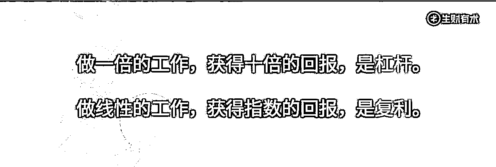

带杠杆的事、能复利的事，都会放大你投入的倍数。

而这两样，在社群的框架里都能拿到。它们也正是本节的关键词。

*

社群的第一重价值是杠杆，体现在两处：时间与信任。

先看时间。

道理不难懂：你花掉的是跟一个人讲话的时间，可你想说的东西，群里所有人都能看见。

想想古代的村子，消息传得最快的地方在哪？井边、树下。为什么？那是村里人最容易凑到一块儿的两处所在。洗衣时手占着，嘴和耳朵却闲着。

到了夜里没灯、热得睡不着的盛夏，树下光线昏黄、看不清彼此的脸，反倒成了交换见闻的最佳会场。一个不得不开口的场景被造了出来，高频的、一对多的交谈就此发生。

好的社群就是这样的场：一群人得以一对多地说话。媒体擅长一对多地发信号，社群擅长一对多地交谈，没有比这更贴切的。

能一对多沟通，这不就是杠杆？

再看信任。

以🛰️群为例：你在五百人面前立住一个可信的形象——专业、价值观、人品——和只在一个面前立，付出的代价其实差不多。

同样的成本，在群里能触达五百人，他们对你的印象是活的、具体的。这些攒下来的印象，在日后的合作里，能不能削掉那道难跨的信任门槛？我看能。

等你往下读、真正明白“攒信任本身就是在挣钱”，就会知道自己手上这五百倍的杠杆分量有多重。

*

我对复利的理解是：过去做过的事，价值不停在过去，它还在推着未来的事往前走。

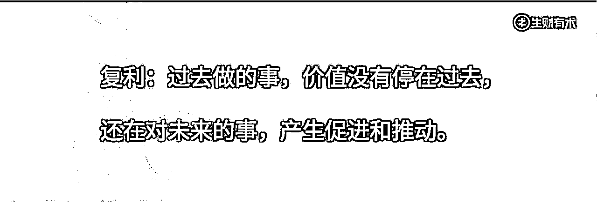

用🛰️购物群来看看这种复利怎么发生。

设想你手里有 01 号、02 号、03 号等几个群，加起来几千人。你是个厉害的买手，挑货眼光好，拿到了性价比高的货源，供应商也打通了。

因为你推货很克制、选品把关又严，群里的人慢慢聚了起来，也慢慢信你。这份信其实不复杂，不必贪心地让对方什么都需要信。你只要在两点上被相信。

第一，东西是她需要的，跟着你下单，就不会买错。

第二，她买到的价格，一定低于她付出的总代价。买一件东西，成本从来不止标价，还有挑来挑去的功夫和试错的损耗。

这两条，群里只要有一个人认、一个人晒单，第二个、第三个很快就会跟上。

这种共识的形成，比挨个私聊高效得多。而且共识一旦立住，就带着惯性，停不下来。群里的人对你的那份笃定，会让你越卖越省力：第一回卖货、第十回、第一百回，清货速度绝对不在一个水平线上。

不妨自问：在用户心里，这个群卖给她的东西，是让她日子更好过，还是变着法掏她钱包？这个答案，直接决定你变现的路是越走越顺，还是越走越窄。

越顺，不是说你效率变高了，而是复利在替你出力。

复利发威的地方当然不止购物这一处。以后设计、经营社群时，不妨拿这个问题照照自己：我的社群有杠杆、有复利吗？这个提问，或许会给你不少启发。

## 2.2 沉淀，才是分水岭

内容能不能沉下来，同样是社群的价值所在，也常常是社群生命力强弱的一道分水岭。

很多聊天群热闹归热闹，可散场后什么都没留下，很可惜。那些被认真说过的判断、反复讨论后的共识，本来值得日后再翻出来咀嚼；可它们一旦被新消息压下去，基本就石沉大海。就像足迹被雪掩埋，再难寻觅。

若有人愿意正视这一点，给群配上一套存留机制，或直接用知识星球这类以沉淀见长的载体，效果会完全不同。每隔一段时间，把旧内容郑重取出来、再抛回讨论场，等于让群的效用成倍放大。更详细的拆解，我在知乎某条回答下展开过，这里不重复。

有家底、成体系的社区，是后来者没法轻易复制的优势。

让积累真正服务全群，听起来高大上，落地其实不复杂。只看三件事：🛰️群里的精彩发言，有没有人愿意整理成帖子或飞书文档？特别出彩的一段对话，群友或管理员能否当场合并、绕成一条转发？有没有熟悉社区历史的人，能顺着新话题把旧内容挖出来重新连接？三件事都能办到，内容留存就开始为社区增值。从此不必每次重复回答同样问题，也不必一次次地重新造轮子。

龙哥盟就是一个现成样本。给精华内容发龙珠，办共读活动，本质都是把“留存”做到极致。

## 2.3 人脉账本

谈关系积累，绕不开人手一份的成员总表。

最基础的动作，是维护一份靠谱的联系人目录，把成员的背景、专长写明。它不是群主私藏的小本子，而是所有成员共享的资产。

🛰️群有个毛病：新人是看不见历史发言的，自然也不知道谁有真本事、遇到麻烦该敲谁的门。有了成员目录，后来者就等于拿到了地图。目录不必停留在姓名、电话、单位、职级这些“正式身份”上；哪怕只写“我能解决什么问题”“我手中有什么资源”“我对什么事情有兴趣”“我急需什么帮助”，这种不标签化的描述也足够好用。

不过，关系的沉淀不止一本通讯录，还包括：让足够多的人知道你是个靠谱的人。

你甚至不需要是群主或管理员。只要在同一个圈子里长期稳定出现，某天你公开发出需求信号，又合乎群规，弱关系会给出远超预期的回馈。别人愿伸援手，不一定是因为天生善良。背后的潜台词是：“你在这个圈子泡了这么多年，做的始终是这一行。谁会为了鸡毛蒜皮装这么久？信你，拉一把。”

一个常年温和、还在多个行业圈子里刷脸的人，开发客户的难度，比只靠私聊和朋友圈的人低得多。我有个朋友，能在某头部公司常常拿业绩第一、年薪数百万，她的心得就是在圈子里修炼。

正在读这份材料的你，若也因为常年泡群撞上过离谱的好运，欢迎分享给我，也分享给同航的伙伴。

你可以和三五个知己做十年挚友，却很难和几百个人逐一维持十年私交。而社区恰好补上了这个空缺。

## 2.4 贵人出现在众目睽睽之下

这段逻辑和上节相似，但多了一个关键词：被看见。

在一个圈子里待久了，不管你是组织者还是普通成员，身上下都落着其他人的目光。这种持续的目光会沉淀为信任。当你的请求、你的信号在众人注视下发布，旁边又有人接话、帮腔，整件事的可信度几乎满格。

设想一个接近500人的老群，你混了很多年。某天你写道：“公司业务调整，设计组砍了，出5台去年买的Mac。”配一张照片。有人问：“上次去你办公室见过那几台，都出了？”你说：“留一台。”又有人接：“今年生意是不好做，什么价？”你答：“和闲鱼差不多，国行，同城面交。”这时，一个潜在的买家点开了你的聊天框。

再换一种：同样在这个群里，有位你加过但从未深聊的人。这次你不发群，只把上面那段话单独丢给他。哪怕他正好需要，你猜，哪个场景他更容易信你？

这个差别无关话术，也无关好感值，但真实存在。它决定了信任厚薄，决定了机会去向。而这，就是被看见的力量。

所以我劝你，靠社区、靠弱连接，更容易赢得贵人。杠杆让你一对多，围观则替你完成了暗中背书。表面看，贵人好像忽然现身。

再看另一种可能：那位贵人虽然加了你🛰️，但你们无话可聊，你的分量也够不着对方，单聊很难建立兴趣与信任。结局多半是，你每年发一遍新年祝福，第二年发现对方把你删了。

两者一比，社区的价值不用多说。

写到这里，“社区能带来什么”算是交了第一份答卷。可社区这门手艺太深，我未必都说到了。它还能给有心经营的人带来哪些惊喜，本身就很值得期待。若你同意，我们就往下走：社区到底该从哪里建起？

# 三、社区从零到一，怎么走？

## 3.0 先别急着谈拉新

先放图。

图很朴素，门道却深。第一眼看不懂没关系，慢慢拆。

这张分层图要从下往上读。底层是上层的地基，上层会反过来打磨并丰富底层；左右两栏则表示互为平行的板块。

它要说的，其实就是一句话：社区的全部底盘，是信任。这一节就从底盘说起。

## 3.1 信任，地基中的地基

问个扎心的问题：把社区做好，最关键的一件事到底是什么？你不妨先在心里给个答案。

你也许会答：人气。也许会答：有大神站台。也许会答：红包福利到位。也许会答：拼命进新人，否则就是一潭死水。也许会答：群主要够红，影响力越大越好。这些都不是正解。

正解是：信任。

只是这个词被鸡汤泡得太久，很多人一听就划走，觉得它空洞。

有人把它看作道德口号；有人把它当作美好的空气；有人觉得它看不见也管不住；有人以为它只是讲给别人听的漂亮话；有人坚信它只属于品德话题；还有人断定它不产生价值。

我全部反对。

理由是这样的：信任专门喂给人类对确定性的渴求；信任砍掉了沟通中大半隐性成本；信任本身是成本最低的策略；信任能转化为真金白银；信任也发生在人与系统、规则、组织之间，不限于人和人。

你总听过信贷、信用卡、货币总量、准货币，也听过“三根大阳线改变信仰”“共识凝聚”“零信任架构”。在这些领域，信用可测量、可计算，甚至能直接变成钱。学经济或金融的朋友，欢迎在批注里帮我注释这一句。

再回头看第二节说的现金收益、杠杆复利、内容留存、关系积累、贵人显现，哪一层没有信任在底下撑着？

甚至可以说，人类应对不确定时最古老的手段，就是信任。我们天生迷恋确定性，信任则是摸爬滚打多年后存下来的经验。

农耕民族能长期牵制游牧民族，很大程度上就因为一个“信”字：他们连地球与太阳的关系都不清楚，却敢信节气、信周期，敢按时把种子撒进土里，再安心等大地回信。

再说一遍：人迷恋确定性，信任正是与此针锋相对的古老策略。

这节把信任讲得这么重，不是要做名词解释，而是想把它搬回该待的位置：社区里的支配位。如果你把信任放在角落，后面做战略时会连环踩坑。

甚至，就算这本手册最终没有教会你怎么建社区，只是让你用新眼光看懂了“信任”二字，我就已经很满意；对你，大概也不算亏。

同理，社区的地基，就是信任。意外的是，社区刚出生时，地基为零。

可以拿知识付费的博主来想：我信不信他的专业功底？信不信他的审美？他是不是够硬、能说服我？他价值观靠不靠得住？判断力是否在线？他讲一个新概念，我敢不敢照单全收？这些统统属于信任。

信任，就是人类在回答这些问题时进化出来的应对方式。

有了这层认知，社区早期才谈得上两件事。第一，招募要慢；第二，丑话要说在前面，比如退出规则。说白了：进人慢，踢人快。

由信任推导出的策略一，叫慢速熔核。

社区成员的增长不能求快。人没法昨天认识、今天就托底。信任既珍贵又耗时，所以最开始应该只凝聚一个极小的核心，用信任当粘合剂，把人牢牢焊住。

有些群主特别爱自坑：上周刚立项，这周就拉满一百人。素不相识的一百个人，要熬多久才能互相相信？不如先从三五个人的核心开始，一圈圈放大；表面慢，实则稳。总想着快速膨胀，群往往死得更快。

所以，社区初期用慢速熔核，是避开早夭的第一步。

策略二，退出机制。

这个名词一听就懂。社区发展时，成员都是盲选来的，没人能保证个个合适。挑错了，就该请出去。前提是你早就把丑话说透；否则对方离开时会很难看。

既然预判到这种可能，入群第一天就要把退出条款讲明白，别等收不了场。不合适的成员像积压的库存，会让整个盘面越拖越沉。没有一套像样的退出机制，成员就无法真正越处越紧。俗话讲：该走的不走，该来的不来。

信任讲到这里。回头看分层图第二层，可以叫趋同的目标，更凝练地说，就是定位。

## 3.2 定位就是指南针

定位同样是底层工程。它在定什么？定的是社区价值的内核：目的地在哪里？要给成员交出什么？在世面上处于什么生态位？想接住哪一类人？这些最初的问题，就是定位。

可以看几个小例子：
“这里只做二手书生意的中转；新书请到当当。”
“只谈钱，不伤感情。”
“多肉以及多肉周边。”
“杭州周末新玩法，周周有局。”
“写作改变人生，七天一篇，连写七年。”

统统算定位。

定位越锋利，成员越不会迷路。它把“做什么有用、做什么受欢迎、做什么被鼓励”标得明明白白。社区的集体价值取向，也会与定位严丝合缝。

不到30人的小群，只要信任在，怎么折腾都行。可一旦目标变成200人以上还稳稳当当，就必须拿出定位，并且是以信任为底色的定位。盘子越大，越需要这盏灯。

定位没找到时会觉得很费劲；找到后往往豁然：“对啊，不就该走这边吗？”有这种感觉，基本就对了。

这里常有一步错：定定位时可以一个人拿主意，哪怕成员还是零。可定位一旦落地，招人就必须招认同它的人。

请记一句话：和定位连不到一起的事，再赚钱也别硬往群里搬；和定位合不来的人，就算肯出门票也不要放行。定位，就是过滤器。

用这个过滤器筛活动、筛创意，是最简单也最不坏的取舍准则。

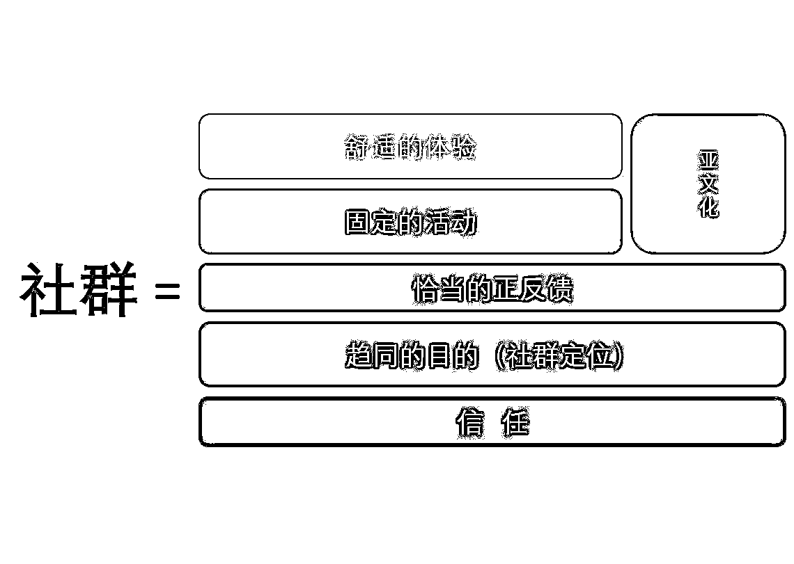

还记得之前那张分层图吗？底层两块讲完，这节把余下的模块一次性收尾。篇幅不短，打个预防针。

### 3.3.1 先给领导力开个窍

心理学有个有趣的发现：一个人有没有领导力，并不取决于他自己，也不取决于他是否手握绝对决策权；还要看有没有人接他的茬。

一声令下，只要立刻有人应，领导力就成立了。那个第一个应声的人，本身就是号召的正向回应。

应用到活动上，有个很接地气的招：发起之前，先在群里找两三根铁杆，把想法漏给他们，问他们愿不愿意搭个台；等正式开喊时，由他们带头冒泡。这招背后是人性的从众、领导力的组成、正向回响的原力。你如果不自信，值得一试。

正向回响扩展开来，是让群活起来的长效机制：一切有利于社区的事，都应该获得群友或群主的回应。比如古籍爱好者的群，有人发出一段考据；玉石圈里，有人捧出新收的宝贝请大家验。若这类发言永远没有回音，群的定位早就名存实亡。

设计活动时，最好拿一张常识清单来对照。

社区运营常识清单：
- 用户只参与和自己相关的事；
- 目标要短，短到一眼能记住；
- 形式能简就简，多余都是负担；
- 规则宜少不宜多，繁琐是敌人；
- 用户留给你的注意力少得可怜；
- 用户想要少付出、多回报；
- 用户喜欢自己控场，讨厌被指挥；
- 强迫成员每天打卡，是违逆人性的；
- 信任的积累极其缓慢；
- 吸引永远比追求有效；不懂吸引的人，做不好社区。

这些“常识”最大的作用是打破设计者的自嗨，让方案落到地面上。

想推动用户做一件事时，逐一问自己：给他的回报够不够大？他会不会感兴趣？他愿意付出的成本高不高？他是被拖着走，还是自己握着方向盘？你有没有把他注意力稀缺的现实算进去？

每次做完方案，别急着觉得“这次一定炸”。对照清单过一遍，哪关都过不去，趁早反悔。

当一件事不是出于拍脑袋，而是经过了反复推敲，你推动时自然敢为它制造正向回响。组织者往往要第一个出手，带动更多人跟上。

接下来，是一条颇为魔性的公式。

### 3.3.2 让人上头的公式

超强激励 = 正向回响 + 随机性。

再看一眼分层图：正向回响站在定位之上。凡能推进、滋养、拓宽定位的事，都要及时给到积极回应，别让它次次落空。再往其中注入随机性，效果会猛烈好几倍。

赌博为什么让人戒不掉？因为它恰好提供了这种随机、高频、非理性的超强正向回响。这是人性里最古老的开关之一。

路边捡到钱的瞬间快乐，背后其实是两个开关同时被按下：结果不可预知，且立刻有甜头。

盲盒潮玩卖得动，靠的也是这套组合；商家为了把情绪拉满，还会故意设置稀缺款。

娃娃机长盛不衰，奖品越精致，投币后得到的爽感就越强。

再想想早年让 🐧 邮箱、🛰️活跃度猛涨的匿名漂流瓶、摇一摇和附近的人，底层逻辑如出一辙。

你不妨做个反向测试：把“不确定”或“立刻爽”任意拿掉一个，这些玩法还转得动吗？答案多半是否定的。这恰好说明，被拿掉的那个环节就是模式成立的必要条件。

不确定性加即时奖励还有个隐藏收益：省钱。把这两点再放在一起看，🛰️红包就是典型。发红包的人制造了正向刺激，抢到多少却靠手气和排序，运气成分拉满。

当年🛰️在支付市场上几乎从零开始，底子薄得可怜，却借春晚红包打了一场翻身仗，一个春节就把绑卡用户规模做到能和支付宝掰手腕。能做到这一步，是因为团队对“不确定的奖励”和“害怕错过、害怕失去”的心理拿捏得极准。

这一仗还顺带成了后来互联网公司抢春晚广告的模板：拿红包当入口。

有意思的是，2023 年春节有人问，怎么今年没见大厂上春晚撒钱？我第一反应还是🛰️当年那场经典战役——它把🛰️支付的江湖地位打出来了。

### 3.3.3 别让群主只靠热情硬撑

正向激励不只用给成员，也要用给社群发起人。

一个社群的第一责任人，法律上都写明了，就是创建者。既然要拉起一个群，发起人就得有长期搭时间、搭精力的心理准备。

既然投入躲不开，那就要尽早找到一条路：把社群价值沉淀下来。目标很明确——到了中后期，社群自身产生的价值要能覆盖你的时间成本。

只有这样，你才有机会换来时间上的杠杆。否则一直满负荷输出，没人扛得住；如果一个群只能靠发起人硬撑，它基本也走不远。

很多小而美的免费社群最后无声无息，症结就在这：发起人的免费劳动不是无限的，哪怕当初发过大愿。

我的看法是，与其硬撑免费，不如改成收费。用真金白银回报创建者的投入。一旦收了费，付出就从“义务劳动”变成“履约责任”，这种身份转换反而会逼着发起人长期做下去。

还有，每个做社群的人都该多懂一点人性。

第一个结论：人不是理性机器。经济学里的理性人假设，本身也只是有限理性；这是拿过 2017 年诺贝尔经济学奖的判断，分量不轻。

怎么理解？

社群刚起步，你可能热血上头，激情、承诺一大堆。但激情是一阵风，承诺也可能是一时冲动，冲动本身就不理性。

把时间拉长，如果你从运营社群里得不到价值，就很难持续投入。反复吃力不讨好、觉得没意义、付出没人认，成员又因为免费而参与意愿低，你迟早会问自己：图啥？

这就是社群运转的一种动力机制。

所以设计社群时，必须把“发起人自己也会冲动、也会疲惫”算进去。不然方案看着漂亮，落地却虚，至少没把第一执行人的诉求照顾到。

在社群完成原始积累、长出新的持续贡献者之前，发起人的热情一旦熄火，整个群可能迅速滑坡，甚至直接散掉。

上面这些，是对 3.3.1 正向激励部分的补充。作为群主，你一定要把激励写进制度里，学会借这股力量。否则经营社群对你不是滋养，而是消耗，时间一长很难维持。

这个坑很容易踩，但初期大家常常忽略。

说直白点：如果你的付出是实打实的，别忘了收钱。

赚钱嘛，不丢人。

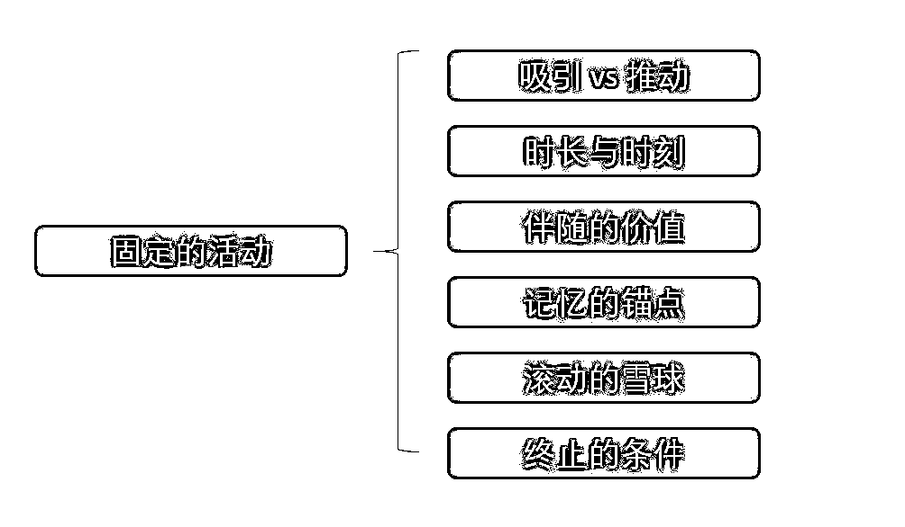

下面一项项说。

① 用吸引力，别用推力

社群活动多半是发起人拉着几个骨干想出来的。但设计完一丢出去，没人响应、大家无感，才是常态。

原因常常不复杂：你是在硬推。凡是需要推着才动的活动，基本都推不动。

活动设计之初就该明白：它是用来勾住用户、点燃用户的，不是发作业，也不是摊派任务。

想通这一点，你对节奏、需求、供给价值、钩子在哪，都会设计得更顺手。

追女生也是这个理：死缠烂打往往没效果，能吸引对方才是本事。

那怎么让活动有吸引力？

练换位思考，把“用户看到这个活动是什么感受”变成你的本能。有了这个感觉，你自然知道钩子该下在哪。

② 时间点与时间长度

设计活动有两个工具：一个是时刻，也就是时间点有没有讲究；一个是时长，也就是持续多久有没有算过。

一般来说，别在不对的时间点办活动，也别用不对的时长折磨人。

举个例子：一个线上活动要占半天，每周还来两次。这种安排不用抠细节就知道反人性，就算第一天没散，长期参与率你敢指望吗？

另外，工作日下午别在群里搞活动。周末也让大家喘口气，线上安排尽量少。线下活动放周末方便，但线上活动得先问一句：值不值得占用别人的休息日？

从经验看，用户比较买账的时段是周二、周三、周四晚上，周末反而冷。

当然，凡事有例外，但底层逻辑不变；有时候反着安排也合理。

拿行业峰会来说，大多数放在周内而不是周末。为什么？

第一，参会者周内参加本行业的会，名正言顺；放周末就成了私事，还不带薪。

第二，周内去开会，跟同事提一嘴，整个业务组可能就一起去了。反过来，业务负责人带骨干去参会，本身也是工作，当然该占工作日。放周末，大家一听先泄气，人还没到，好感先掉三分。

第三，主办方把会放周内，还能挡掉一些跟行业无关的人。周末大家有空，周内无关者却很难请假，总不能跟领导说去参加一个跟自己行业不沾边的活动吧？理由不硬，假批不下来，人就不来了。于是周内办会也顺手完成了人群过滤，这是择时带来的额外好处。

③ 陪伴感

这个不难懂：再小的活动，只要反复出现，也会长出陪伴感。

小时候守着电视，知道周五晚有节目，或者每晚九点半有剧；哪怕不一定好看，到点也会瞄一眼。

当你知道某个周期里，某个时间点会发生某件事，而且这个安排有合理性，陪伴感就出来了。

大家一提到活动总想搞大的，但大活动频繁办，谁都吃不消。活动不一定要大，每周只占半小时到一小时，但周周都有，反而更合适。

甚至每天只花一到五分钟，只要准点出现，也会让人产生期待。

罗振宇在👸号每天早晨发 60 秒语音，单次很短，但拉长到十年看，陪伴感非常明显。

④ 给认知钉一颗钉子

周期性安排再小也别嫌小，有总比没有强得多。大小不是关键，关键是用户得到的要大于他付出的。

不少社群发起人总想憋个大的，其实没必要，反而把自己框死。一两次大动作后就想不出招，直接走进死胡同。

持续做小事更简单，只要保证“用户收获大于用户投入”，这种小事就有长期跑下去的力量。

周期安排还有个好处：它能在用户脑子里钉一颗认知钉子，让人条件反射地想起你的群。

很多社群玩着玩着就没了，因为群没特点，用户对它没有独特认知。反过来，一个群如果有常规节目、有持续发生的有意义的小事，至少不管它后来死活，都会被人记住。

认知钉子再举两个例子：

这种滚动还有一层作用：帮你筛出真正的铁杆，也给用户留下更多关于社群的记忆。不管从哪个角度看，这都是在让树扎根。

一棵没根的大树，很难在风雨里站直。

把社群成员和外部潜在用户看成土壤，那些在局部有影响力的铁杆就是树根；是他们抓住土壤、帮社群聚拢人，而不是靠你一个人硬扛。

所以大社群会设小组长，或者请不同方向的高手；更大的社群还有城市分舵，每个舵配一个小舵主。

⑥ 想好什么时候停

周期安排好处再多，也有一件事要提前想：终止条件。

事情发展总有意外，做一个常规活动不等于要背它一辈子。所以最好一开始就写清楚它什么时候结束。

这和“丑话说在前头”一个道理。当价值增量不如预期，或者局面开始变味，给自己一个体面停下来的机会，很重要。

### 3.3.5 亚文化为何重要

框架边角上的亚文化，到底是什么？有什么价值？这一节聊这个。

这个概念不直观，先看例子。

弹幕之于 B 站：国内是 B 站先做，后来别的平台也上弹幕，但弹幕文化最浓的还是 B 站。一个平台独有的特色行为或功能，容易长成平台文化。像“空降”“前方高能”这些梗，就是从弹幕里长出来的。

再看表情包。颜文字 →_→ 和“最右”这个段子 App 关系很深，一个表情符号竟然能催生一个产品。数字 233333 表示大笑，则是从猫扑社区走出来的文化符号。猫扑论坛的留言功能可以输入表情编号，回帖直接显示对应表情；第 233 号就是大笑捶地。当年无数人在别处看到 233333，既好奇又费解，就这样被这个符号引回猫扑。

再说 B 站，它是真懂自己的社区文化：拿站内热梗持续做官方表情包，还实时更新。我见过的平台里，这么干的只有它。

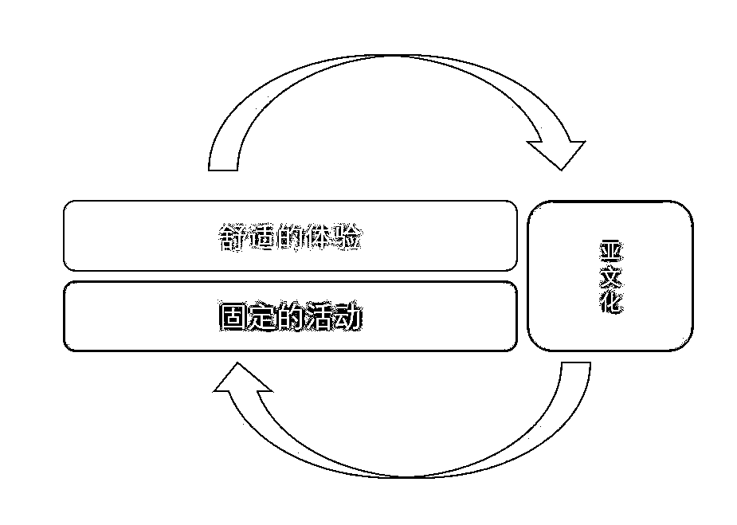

亚文化之所以和常规活动、舒服的体验放在一起，是因为三者相伴相生。在全图上，亚文化立在正向激励之上，也说明它同样靠激励打底。

答案不复杂：常规活动和舒适体验会制造共同经历、共同记忆，这些记忆一小块一小块积累，慢慢长出绰号、共识、段子、表情包、梗——这些都是文化符号。

脱口秀演员李诞常说，不建议在脱口秀大会上讲内部梗，就是因为演员们天然形成一个共同体；共同体里的梗内部认可度极高，外部人却听不懂。内部梗太多，这个共同体就很难破圈。

这让我想到 2016 年各家公司扎堆做 App 的那波。最大的教训是：初出茅庐的小团队只打磨界面流畅度、体验顺滑度，却没解决真正有价值的问题。最后程序员、业务组、投资人一起抱团团灭。

经历过那个阶段的人，大概还记得一批产品：界面很美、体验不错，但就是不知道能拿来干嘛。

从体验切入——也就是社群框架的顶部——而不从地基切入，是典型的建群误区。

那么，能不能顺着这个框架，给一套创建社群的流程参考？

可以。但先说清楚：参考只是参考，不是死板的 SOP，别反过来被它捆住手脚。

Q：如果我要做技能成长型社群，哪怕是我不会的技能，我会怎么起步？一步一步怎么做？

A：

① 先不急着拉群

我会先去看：在没有我这个群之前，想学这项技能的人都散在哪儿。我要扎进这个群体，培养自己的兴趣，理解他们的兴趣。

我会尽量列出大家提问或讨论这项技能时会用的专有名词——按钮名、报错文案、学习软件名、领域里的意见领袖、分支概念，都算。

然后，去一切有搜索框的网站和社交 App 里搜这些词，也就是“指纹名词”。看大家在什么场景下说、为什么说、想讨论什么、卡在哪里。如果我在朋友圈发现一个不常联系的好友经常聊这项技能，我会单独找他聊，或者约电话，了解这个群体从 0 到 1 是怎么走过来的。

我还会尽量关注这个方向上做内容的人或卖相关商品的人，最好是在有推荐系统的平台。关注得足够多，系统就会不断给我推相关内容。放到今天，我会选视频号、抖音、B 站、快手、淘宝、📕。

直到我弄明白：一个新人踏进这个领域，容易踩哪些坑、犯哪些错、最常问什么、怎么才算入门、哪些书值得读、哪些文章值得看、哪些人是行内公认的高手。

直到我搞清楚：这个行业的重要事情、新闻、机会都在哪里发生。

直到我遇到一个新人，线上聊几句或线下喝杯咖啡，他会惊讶：你怎么这么懂我？怎么跟我有这么多共同经历？

如果做不到，我就亲自扎进去当小白，从零学。我会带两种视角：一种是白纸状态，该怎样就怎样；另一种是退一步、高一层的俯视视角，看自己卡在哪、困惑在哪、怎么突破。两种视角都做笔记，这样我会更懂用户。

因为投入得深，这个过程中认识 100 到 200 个潜在种子用户，也很正常。

② 找一件对新人真正有意义的小事

这件事要探索，但不用急。

它可以是给行业做一个导航站，并借这个站找愿意一起维护的人；可以是拿重要行业情报去请教高手，把他们的观点消化整理成文章；可以是把这一行很重要但还没有中文版的资料逐字逐句翻译过来，免费公开，一章一章放出去；也可以是每周雷打不动想一个练手案例，为案例找练手的人，为练手的人找点评的人，为点评的人众筹一个红包表示感谢。

有意义的小事得能把人召回来，还能精准筛出目标用户。它不好找，但我会多想。

不过，如果我要建站，我会先用飞书导航搭起来，而不是写代码、搭网站、注册域名、申请 ICP 备案。快速验证比按部就班更重要。

如果我要翻译重要资料，我会先用 ChatGPT 和 Google 翻译打底，而不是自己一个字一个字查。懂得借力很重要。

③ 带着这件小事去找目标用户聊

聊他的兴趣，聊他听到这件事时的好奇心，聊他愿不愿意参与。用这些反应来判断这件事本身有多大吸引力。

④ 从种子用户开始做内测群

能用🛰️群就先🛰️群。测试常规安排是不是每多办一次，群的黏性就强一点。

我会和种子用户讨论参与成本，讨论他们从中获得的体验、反馈和成就感，也讨论如果这件事要收费才能转下去，他们愿意掏多少。

我还会观察，有没有人私聊我，说他准备拉什么人进来。

我会开始整理零基础新人的晋级路线图、知识图谱、检查清单；每个月学什么、练什么，然后看反响。

如果内测群运转良好——慢热但能凝核、信任积累起来了、方向清晰不混乱——我就试着扩大一步。先从我自己影响力能覆盖的地方招募，同时继续观察。

⑤ 再往后，如果还没问题

我会试着为这件事搭增长渠道（具体方法在 4.3.2 节讲），看哪条渠道有效，再维护、强化、深化它。

同时，我会正式准备“加入社群该知道的事”这类材料，做成小册子，让每个人都知道进群后最值得做什么、去哪找社群沉淀下来的知识。

⑥ 起名、定价、结束内测

我会直接给社群起一个好名字，定好价格，宣布内测结束，开始收费。价格上，我会学龙哥做一点涨价策略，制造紧迫感。

⑦ 朋友圈和👸号持续讲社群里的故事

我会不添油加醋地分享社群里发生的事：谁拿到了成果，谁付出了代价，我因为社群有了哪些新思考。

我会讲高手的故事、新人的故事、特别的故事。如果故事不够多，说明我和成员一起做事还不够久、不够近。

👸号也这么干；如果我会拍短视频，这也会是内容的一部分。我还会鼓励其他成员也这样记录，把社群的事当成生活的一部分。

如果我没想明白该给做贡献的人什么回报，那就先发红包。

⑧ 找一件成员想参与就能参与的事

比如和成员共创一本在线的《技能入门实战手册》。我们一起探讨、梳理重要问题，邀请社群里有能力的人来写。

对某一节有独立贡献的人，我会把名字写在第一页，列进共同作者；对细节有推敲贡献的人，我也会在手册末尾感谢。

即便手上没有一本成型的手册，我也盼着大家在这个社群里攒下的见识与理解，能够一点点积存下来，不至于消散。

这本册子眼下有了个雏形，路子也走得通，我便会带着它去交朋友。会跟人讲，这里正发生着一件事——一群人凑在一起共创一份手册。要是它能摆上小报童做成付费阅读，赚到的钱我会和写它的人一起分。

我还会琢磨，社群怎么扶着一个肯动手的新人，从零走到一；怎么从只讲课的模式，转向先讲后陪的模式。我盼着社群收的不是课时费，而是大家舍不得走才掏的钱。这两笔钱不一样，因为社群是个共同体。

走到这一步，社群就算上了轨道。往后我会反复追问：社群的原点在哪、靠什么长大、价值几何、眼下最要紧的是什么、手上做的是不是对的事。也会一直想，怎么把价值观传得更到位、把共识攒得更紧、让肯付出的人被激励、把旁枝斜叶修掉。

创建社群、想办法让它站得住，这一路上大致会碰到什么，我想我讲明白了。创建社群和干一份社群运营的活儿，差别在哪，我也讲明白了。

只是读到这儿的人，请你别忘了，上面这些只是一份参考，不是标准答案。它大体画出了创建社群的模样，但愿对你有用。

## 3.5 什么样的人能挑起社群？

这个小标题，约等于在问“哪种人适合建社群？”

先把五花八门的概念、运营招数搁一边，连社群最底层的认知与逻辑也暂时放下，再来答这个问题，或许更对症。

我的看法是，下面这几类人适合建社群。

真诚的人，适合建社群。

乐于分享、喜欢交流、经得起挫折与冷场的人，适合建社群。

愿意靠近别人、能读懂人心的人，适合建社群。

这些才算先决条件。

至于那些干着干着自然就懂的事、能学会的认知、能掌握的技巧，还有各种运营工具和软件，统统可以先放一放。

它们都归在后天，别一开始就背这么沉的包袱。实践中留点心，遇上了试着拿下就行。

也正因如此，这一节的标题写成「社群牵头人应有的品质」，而没有写成「社群的牵头人应该懂得的知识」。

# 四、社群成员怎么涨？

用户增长、成员招募、社群拉新——叫法各异，指向的其实是同一桩期待：社群成员怎么才能多起来？

一提起这个，脑子里容易蹦出引流、裂变、钩子、SEO 之类的词。可社群成员的增长，正如 3.0 节所说，另有它的门道。

不管怎样，这一章我把增长这件事掰开揉碎讲清楚。

## 4.1 冷启动怎么迈第一步

社群冷启动，指社群头一回涉及招人的环节，应当算作社群的第一次增长。

冷启动一般从哪儿拉人？无非是主页发通知、兴趣小组发帖、朋友圈转发、👸号推送、好友群发之类。

这个阶段，很少有人投广告、买推送刊例，或者急吼吼地做分佣推荐——那样反倒显得冒失。

前面聊信任时提过一个说法——先慢下来，把核凝住。照我看，只要社群的核还没冒头，整个社群就仍算在冷启动里。

把这个核养出来，正是此阶段招人的重中之重。核没出来之前，不建议急着铺规模。

具体是这么几步：

① 小范围地招人；

② 想明白谁该出现在这个群里；

③ 想明白社群日后怎么筛人；

④ 怎么跟不合适的成员体面告别。

哪怕是付费社群、每位成员都掏了钱进来，上面这些问题照样不能省。

这些琢磨与动作也不会白费，它们会留下痕迹。也就是说，社群的内核（成员）开始露头、成形了。

过早盯着规模，不是好事。核没现身，或者养核的路子还没想清楚，摊子铺得越大，需要你去收拾的“乱”也越大。

上面这些做法很难给个量化指标，让大家一眼判断做没做对，把握起来确实费劲。不过无妨。别抱着“一切尽在掌握”的心态去建群、去招人。

不妨把几个社群做崩！一个还不够！

建议你拿捏一种有点矛盾的平衡，叫「莽撞又细心」。「莽撞」是敢动手，「细心」是动起来之后能做个心细如发的观察者，盯住哪些地方已经脱离你的掌控。

做个莽撞又细心的建群人：先动，小范围试，紧盯自己最早那几个群是怎么被自己搞垮的。在做崩的过程里或之后，再回头翻这本手册，也许是更聪明的路数。

像“对，就是这感觉”“我能察觉这回砸在哪儿了”这样的判断，都算上道的心领神会。

## 4.2 社群的吸铁石

社群的吸铁石，说的就是社群的吸引力。

吸引力该怎么理解？

设想这么一幕。群友在饭桌上跟旁人聊起这个群，说：哎，你快加进来，这个社群 XXX。那个 XXX，他会不自觉地讲些什么？

假设一百个人这样替社群做转介绍，其中八九十人说的是同一件事。这件共同的事，大概就是大家心里社群最要紧的吸引力，也就是吸铁石。

这种事有些属于常识范畴，或者一说大家就懂。比如这个群老发红包——这种吸铁石比较客观，也比较大众，任何社群都拿得出，只看愿不愿意。

另一类社群，它的吸铁石是独一份的、稀缺的，甚至别无分号。而且越是独特、难得、稀缺、唯一，吸引力就越猛，社群自身的活力也越足。

我随手举几个例子，你感受一下：

内推群，“这个群能改简历，带过大厂招聘线的同事亲自上手教，改出美团味儿、字节范儿。”

古玩群，“群里坐着好几位鉴伪高手。你摸不准的物件，他们扫一眼就知道是假的。”

搞钱群，“群里白手起家、从 0 干到五十万以上的高手，十个不止。而且个个乐意分享。”

吸铁石还决定了另一件事：招人时，宣发该把什么摆在正中央？

我们能用的，未必只是自己的影响力——总有影响力照不到的地方。影响力覆盖不到的角落，靠名气很难破圈、很难打开局面。也未必只靠自己的私域和听众群，因为那是存量，盘子终究有限。

那该靠什么？社群的吸铁石，回答的正是这一问。

拿吸铁石去做宣发，最顺。

行业里通行的逻辑是详情页逻辑：故事怎么讲、背书怎么找、证据怎么摆、大纲怎么列、退款怎么定。这几块要是没有，大概率已经很糟了。可眼下大家卷得厉害，这几块几乎成了课程、训练营、社群宣发的标配。

所以，你若只有这几块，缺了那个更独特、让人记得住、心里发痒的东西，做出来的物料和素材，观感上仍会千篇一律，跟用户见过的其他群撞脸，毫无辨识度。

我们凭什么独特？人们为什么值得走近我们、走进我们中间？把社群的吸铁石定清楚，用它来答这两个问题。

吸铁石一旦定下来，对社群的增长和招募能起到四两拨千斤的效用。

这也是我看社群增长的底层思路：不把心思挂在“做增长、拉人头”上，而去想怎么建一个真实的所在、怎么建一个让一部分人心生向往的地方。想把社群做好、做大，完美不是必选项，但“向往”一定是。

前文提过某个社群的口号：“7 天写一篇、一起写 7 年，7 年后一起去南极。”海报上还画了冰川和企鹅。这样一句口号很抓人、很让人向往，会让人不由自主地在脑子里过一遍那个画面，然后心里冒出句：“嗯，是挺美的。”

有了这样的口号，以及围着它长出来的细节，才是要紧的。

它甚至不必写明收费多少、每周谁来分享、神秘福利和神秘嘉宾都是谁。没有这些常见的“加分项拼盘”，照样能把社群规模做起来。

因为它抓住了一块吸铁石，这块吸铁石甚至很锋利，直指人心。让人切实感到这个群不一样，印象深得能烙进脑子。

“有它在，这事就成立，别的没有也无所谓。”用户若这样感知，那它就对了。

话锋一转。

我们当然盼着每个社群都有吸铁石，可现实往往是，找到它真的难。

所以，定义吸铁石这件事，一直走在路上、一直盘算着、琢磨着、摸索着，不指望一步到位，这才是对的心态。

找准之后，社群就不再是成不成立的问题，而是在增长和发展上会再上一个台阶。

吸铁石这个说法，抛出了一个命题。而且这个命题，该放在显眼的位置上。

## 4.3 社群引流这回事

与其叫社群引流，我以为更准确的说法是给社群修渠道。

但为了方便理解，下面两种叫法仍会混着用。

先说我给社群渠道下的定义：

用户在他日常活动的地方，看到你的内容、听到你的消息，被你吸引、被你指引，走进了你的社群。那么，从他出没之处——不论线上线下——通向社群的那条路，对社群而言就是渠道。

社群引流也好、渠道建设也罢，若能立在吸铁石的地基上，便是如虎添翼；可就算暂时没有吸铁石，该做还得做。

先动起来最要紧。

动手修渠道之前，有件事得先办——把社群的各种物料备齐。

我们总在各类平台、渠道上推内容，视频、文字、图片、音频都算。这么推，其实是在向公众做一道证明题：证明我们的社群真实存在、我们讲的价值真实存在、我们说的优势真实存在。

那么，哪些地方可以拿来引流？

### 4.3.1 自有渠道怎么引

最简单的引流渠道，举个例子。有个面向职场人的👸号，叫「辉哥奇谭」。

这个号处理内容的手法很典型。每篇正文底下，他都像插一段小曲似的放张图，展示自己的付费知识星球里正发生什么。位置固定得很，几乎像在文章里辟出一块专栏。

于是，差不多每篇末尾都能给他的星球做一次露出。这种做法很持久。但这里头藏着一个常见误区。

叫做“勾了全员可见，不等于人人都真看见”。

我们多数人都有自己的影响力基本盘：👸号、抖音、📕、贴吧、博客、论坛等等。可哪怕在你影响力最大的地盘，大多数人也漏做了一件事——持续露出。

很多人觉得，我已经专门发过一篇文章或一条视频介绍自己了，这就够了。

其实远远不够。

为什么不够？

拿👸号来说。

## 1. 👸号渠道

👸号打开率大概 2% 到 3%，这已经算高了。但这只说明，哪怕这 3% 的阅读全是你自己的读者，也还有 97% 的读者压根不知道这回事，不知道你建了个社群。

这中间，差着足足 33 倍。

你若因为不好意思，只发一次；或者找不到自认为不打扰粉丝的发法，于是只肯打扰一次——粗粗一算，你差不多把这个渠道 32 倍的增长拱手扔了。

你也许会说，那我多发几次，同样的文章反复推。这也不可取，因为对那 3% 的人来说是反复骚扰。

所以我建议你不断换新形式，长的短的都行，持续去做。唯有如此，才能在一个渠道里做到全量露出。

所以，全量露出不取决于你发布时勾没勾“全部人”，而取决于实际上有多少人知道了你在做的事。这两件事差得远。

刚才说的「辉哥奇谭」就是好例子。他每篇文章都换一个有差异的短内容去做露出；文章写得好、阅读超出常规时，还能触达新的人群。

到目前，他的知识星球成员已过 1.5 万人，年费 420 元。

## 2. 📕渠道

再说📕。📕上的引流通常做得低调，一般就是在账号主页挂上个人🛰️、助理🛰️，或者写明社群该找谁。

事实上，像📕、哔哩哔哩、抖音这类账号，跟真实世界接触的所有点位里，浏览量最大的绝不是主页。虽然每条作品都会带一部分人点进主页看看。

用主页做露出，只能证明你确实埋了个渠道入口，可体量并不好看。想想看，用户在信息流里刷到一条视频更新、一个账号更新，他有多大概率顺着点进主页？这个转化率通常也就千分之几。

最好的办法，也许不是在主页挂社群入口，而是就地解决！在你当天新增播放量最高的那条作品下面置顶一条评论，效果可能更好。

那有没有办法，把“招社群成员”这件事本身做成内容发出去，直接引流？

也有，但难度不小。因为你既盼着这条内容起传播作用，又盼着它起招募转化作用，这两个目标不好平衡，会互相削弱。

一般不建议，但也不妨一试。

上面讲清了修自有渠道时常踩的坑。

下面再说另一件事，一个关键词：信念感。

意思是，我一旦决定做这件事，就得打心底相信：我做的这件事是好的、有益的，是我尽最大努力从用户需求出发的，不光是我拿来变现的工具，也是别人真正需要的东西。

若没有“用户很可能需要我的社群，只是还不知道它有多好”这份信念，那么每次提起自己花心血做出来、花精力运营的社群，都会觉得自己在打广告。

这种心态，会严重妨碍你把宣发揉进日常内容的方方面面，进而实打实地拖累社群增长。

当然，那种极端的、疯狂 spam 的、但凡能塞广告的地方都要塞、广告味冲天的账号，非常招人烦。我个人也很反感。

但这并不等于打广告不对。不对的是不厌其烦、不分场合、打断别人话题去刷千篇一律的广告。

我们得立一个信念：哪怕全方位地讲，也能跟那些像狗皮膏药、像牛皮癣一样无孔不入的做法划清界限。

我们是在分享自己亲手打造的作品，而不是拿社群做流量变现。

我们靠作品创造价值、换取酬劳，而不是圈钱、割一波韭菜。

我们的用户对我们表达的是认可。

他们用脚投票，在社群里活跃。

他们用钱包投票，付费加入社群。

这份信念感，会推着我们更用心地思考和实践如何构建，也会撑着我们更坦荡、更坦率地推荐别人付费下单加入。

（附一句：把用户叫韭菜的人，在我这儿永远学不会社群的构建与经营。）

如果你不想宣发做得千篇一律，还有别的路吗？

答案很简单，社群里面就有。

因为一个健康的社群，发生的事情是方方面面的。你完全不必每次都把社群整个端出去展示吸引力。

这一周可以讲社群里发生的段子；下一周可以拿社群共创的好内容去馋人；再下一次可以公开复盘我们办了场什么线上活动、反响如何；再下一次讲讲用户加入后发生了哪些改变、拿到了哪些成果。

这些都是社群氛围与社群价值的不同切面。拿它们当吸铁石、当有吸引力的引流种子，宣发的内容创作自然就丰富了。

我把这法子叫「万变不离其宗法」。宗生万变，以万变引人入胜即可。

（读到这里，你该更明白，为什么我们要花一、二、三这么大的篇幅去讲社群的宗了。道理很朴素——无宗，生不出万变。）

万变会不会招人烦？

其实大家烦的，并不是你做了社群这件事，也不是你有个商业化的产品。大家烦的是你把已知的信息一遍又一遍地反复刷。

就像鲁迅说的那位极度絮叨的祥林嫂。

反过来，潜在用户会排斥吗？

不会。因为他期待的可能是：上次说的我已经知道了，我也想加入，但眼下看到的还不足以让我下决心。那么自然，你得回答一个问题——你还有没有更有力的东西，帮他更好地判断该不该进这个群体？

以上的分享，其实已经把引流和渠道建设路上最常见的坑、误区以及背后的逻辑，都讲透了。

按渠道归类，自己的朋友圈、👸号、📕，以及哔哩哔哩、抖音、快手、视频号这些短视频账号，都算以自己影响力为半径的自有渠道、自留地。

接下来，讲讲在自留地之外怎么建渠道。

### 4.3.2 向外找渠道

要知道，出了自己影响力的辐射圈，我们就是个透明人。那怎么才能让别人注意到我们？

一句话回答：挑一个恰当又有力量的载体，把我们的内容嵌进去。

找到好载体，极其关键。

业界常用找风口、坐飞机、上电梯来比喻“找到载体”这回事。热点就是一种载体。但载体不一定非得是热点。

如果一个人不管对方聊什么，七拐八绕都能把自己擅长的话题接上去、扣起来，那对他来说，万事万物都能当表达自己的载体。

但有个误区：有人蹭热点蹭出了大曝光、大播放，可他做的内容里没有他自己。追热点的过程中，他把自己弄丢了——价值观、判断、存在感、产品，一样都没嵌进载体。

这样，数据再漂亮也白搭。

那该怎么做？

我拿一个服务行业新手的社群，演示一套常见打法。

第一步：把行业新手聚集、交流的公共空间摸清楚、列出来，线上线下都算；

第二步：收集新手最常问的问题，调研也好、搜索也好、直接打电话问典型用户也好；

第三步：筛出你最看好的 100 个问题，让典型种子用户投票，问他们最想知道哪些答案；

第四步：挑出票数最高的 20 个，认真备内容，先以文字稿为主，务必用新手愿意读、能感同身受的话；

第五步：找到公域里讨论这些问题的地方，把准备好的内容贴上去，挑最适合那个场景的形式——图文、视频、短视频、语音都行；

第六步：每天巡一圈，看数据反馈，在数据好看的地方建渠道。

谁摸透了新手的全部常见问题（FAQ），谁就懂新手，谁就能赢得新手信任，谁就能让新手主动靠近。

如果你还记得自己当年做新手的细节，能真诚地讲出自己是怎么一路走出来的，那也是极好的、适合置顶在主页的内容。

这里面甚至还有些取巧的门道。

# 新手做内容，先借用户的势

刚进入技能服务赛道的人，若肯把 Pr、Ps、剪映、达芬奇、Anaconda 这类生产工具的官方帮助页、说明书里的问答区翻透，再从用户论坛里捞出被反复追问的条目，录成视频讲清楚，新手八成的疑惑基本就有解了。做到这步，你有可能成为真正替人解决问题、一年挣到几十万元量级的内容博主。

不过，这里面有坑。整理高频疑问时，常会碰到：自己觉得最要紧的，和用户真正卡住的地方，并不重合。别拍脑袋。要把姿态压下去，再压一点，混进用户堆里，看他们反复求助什么、最挂心什么。哪怕对方问得显得幼稚，你耐心拆解，他也会记你的好、认你这个人。更高阶的是，在他还没开口时，你就点中那个让他翻来覆去睡不踏实的问题，并给出漂亮答案，那种震动会很强。

读到这里，先道声恭喜。留个练习：若你已大致想清未来要做哪类社群，请逐条作答——你的潜在成员是谁，描述清楚；他们最常追问的二十件事是什么；为何是这二十件，依据在哪。

说到底，高频疑问是靠近用户的通道；你的解答，则是走进去之后长出来的独家内容。通道为何有劲？因为它装着用户最在意的点。这也是关于“外部渠道”如何搭建的一点思考与样例。体量尚小时，建外部渠道常用的一招，我称作“借风上青云”。但借势时别把自个儿弄丢。

侯蒙《临江仙》有句：“当风轻借力，一举入高空。”

以知乎为例。2017 年我运营那个知乎知识星球，只在平台上答了四道题，之后没再打理；就是这四道题，当年给我带来六位数进账。答用户挂心的事，比答自己感兴趣的事，更像在关心用户；接用户关切的话题，比硬造自己关切的话题，更像在贴近用户。查理·芒格讲过，钓鱼诀窍不复杂：去鱼多的地方下竿。反过来，先把竿甩出去、盼鱼自己游来，是以自我为圆心，未必靠谱。

这里给一份问题清单，方便看热度：网页版打开，瞄右上角浏览数据，再看高赞回答是否已商业化。例如“如何把皮肤养好”“多肉新手怎么养”“英语好的人怎样背单词”“有哪些相见恨晚的背单词法”“年轻人该早点知道哪些知识”“得罕见病是什么体验”等。

知乎的机会在于：仍有大量用户当下挂心、却没被商业化的问题，且每天都有新阅读量进来。怎么判断热不热？若在百度知道，可用简单原生接口取每日浏览增量；也可用百度指数看对应关键词热度的年度起伏。若从🧣热搜发现，要清楚并非每条都真热，有买的，有真热的。简易测法：把你关心的热搜词完整塞进一条🧣，造个句子发出去，看浏览量。每个词都能这么试；浏览量轻松冲上去的，才算真热。

4.3 篇幅不短，先收成五个关键词：

1. 自有渠道怎样用出最大价值
2. 信念感
3. 外部渠道怎么建
4. 借势时别丢了自己
5. 如何判断关键词热度

下一节聊“裂变”。

## 4.4 裂变：别神化，也别轻视

提到裂变，大家容易想到海报、详情页、分销、分佣、项目合伙人、快速扩散这些操作。我想谈它，有两个出发点：一是别把这类玩法吹得神神秘秘；二是别把它当成社群增长的底盘。裂变很难同时拿下“量”和“质”，常常只能顾一头，而我更看重量这一端。

裂变大约在 2017 年下半年走红。荔枝微课、千聊、唯课、熊猫课堂，连三联生活周刊都做过分销裂变，朋友圈里海报满天飞。它主要有两类：口碑带动的，和纯分佣收益带动的；不同比例混着用的情形，此处不展开。

拿纯分佣说：有人会想，“今天发这条，就是把朋友圈尽量转化。东西不是我的，是我看到的；有人下单，我拿 35 块。拉 20 单，赚 700，去吃顿好的。”无数这样的人一起发，朋友圈就被刷屏。后来🛰️团队不认可这种扩散，开始治理：同一域名被二维码扫码的频次短时冲高，会触发警戒，官方人工介入审核，直接限制链接或域名打开，传播就断了。

社群适合让分销者抱着“顺手赚一笔”的心态来做裂变拉新吗？从社群角度看，只冲利益而来、对社群和产品认知认同都很低的人，通常不是目标成员。他们中约八成是薅完就走的羊毛党，不打算投入精力。你跟他们接触太短，短到没正面打过交道：他只是刷朋友圈看到一张图，海报顺眼，三秒内扫码。真正接触仅三秒，何谈认知？

所以有个点值得记住：拿什么吸引人，来的人就可能带什么属性。用占便宜吸引，最后聚来的多是爱占便宜的人，反而不是好事；用抢红包吸引，即便你希望大伙聊人工智能、聊行业新动态，最后来的还是抢红包的。数据有时好看，不代表事情真好；数据之外、甚至数据背后的东西，才决定成败，不能只盯数字。换个指标可能就露馅：新增很漂亮，成交率却断崖式下跌。这种下跌是结构性的，补不回来，不是“新增到成交”这一步做错，而是前一步就错了。

那何时、哪类社群适合裂变？若你能找到大家都觉得有吸引力的点，社群内部又有信念感，口碑也攒到一定火候，做一次裂变是合适的。赚钱日历常被拿来举例。卖日历比推荐星球挣得少，但参与者本身认日历，不是想把流量价值榨到最大才找这个载体。日历并不能帮他把流量价值量化，他选择做，纯粹出于对内容的认同，而非佣金多诱人。这就是不错的裂变传播样本。

所以裂变不能一棍子打死。希望大家从这一节看到它的正反两面。再看长期裂变与短期活动之别：长期增长节奏慢，却持续不断，我们放到社群自增长里讲。先界定短期爆发式裂变：周期短，一天、一周或半个月。长期的口碑扩散，也有人叫裂变，但我觉得老老实实叫“口碑传播”更准确。裂变有它该待的位置，别当万能药，也别贬得一无是处。真感兴趣，可沿两个词往下钻：病毒传播模型、传播因子；也可留意深圳一家在裂变上很有水准和操盘经验的团队——零一裂变。此处不展开。

讲件趣事。🛰️生态里，我目前知道的行业首个小程序裂变案例，是 2017 年 8 月我操盘的。我们的小程序在 2017 年 8 月 8 日🛰️无现金日，两三天做到 200 万用户，并因刷屏拿到天使轮融资。所以这一节虽讲得少，发言资格还是有的。 :D

## 4.5 增长，再到自增长

理想的社群增长，先靠主动，后转被动。主动指什么？指创建者亲自上阵推广：自己写内容、自己投广告、自己拉人进来，都算。被动增长的关键在复利：你留下的内容、机制或口碑，不必再投入等量力气，它们会自己出去带路，把人领回来。形成这种局面，才是我说的被动增长。

健康的、理想的模式，通常开头以主动为主，之后逐步让渡给被动增长。换句话说，想做长期万人付费社群，却解决不了被动增长，等于业务模式选了 Hard 模式；若能有意锻炼并触发被动增长，则像选了 Easy 模式。那怎么造出被动增长？得学方法。用关键词列：口碑、内容、问题、软件、机制、品牌。品牌这块我不懂，也没实操过，只列出来备忘。下面逐个简聊。

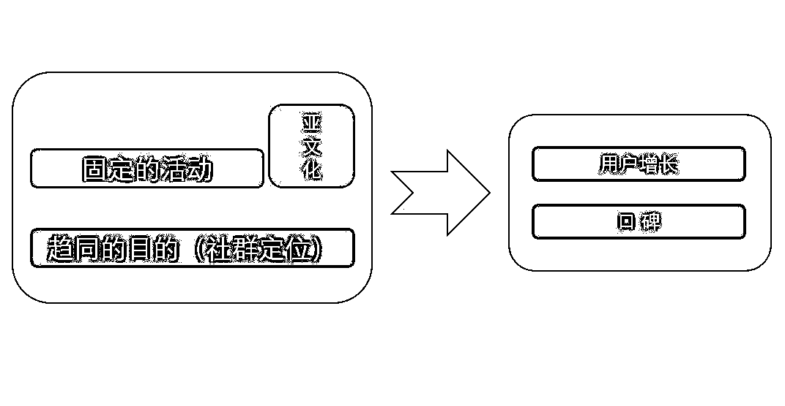

### 4.5.1 口碑：慢，但值得

“众口铄金”四个字，就是被动增长的一条秘诀。大家觉得小米有情怀，硬件毛利压在 5% 以下，喊“为发烧而生”。很多人不知道，小米早期不做用户增长，只做口碑。他们早想明白：口碑建设就是最好的被动增长。可看小米内部营销手册《参与感》。

真诚，公开地真诚；回应，公开地回应；传播，努力传播因社群而受益的人，而非只传播社群本身。坚持这些，口碑会慢慢长出来。建设口碑，也是社群里经典的难而正确的事。若问从零建口碑该抓什么要素、守什么原则，我会答：两个抓手，一是参与者感受，二是让参与者带动参与者。

第一，参与者感受。最容易坏在“体验变口碑”这一环的，是社群名和活动名。以下描述都不算好名字：拿社群名做听写，一百人听到有一半写不对——尤其那些出人意料的谐音替换；中英夹杂；英文词太生僻，国内做尽量避开英文；KFC、ETC 这类字母缩写，字母别超过三个；超过五个汉字；读着拗口；朗朗上口又不妨碍注册商标的才算好，比如阿里巴巴、小鸡叫叫、4399、农夫山泉；看到名字脑中难浮现画面的不算好，苹果、小米就比讯飞好，风向标就比商业线索好。这些描述可当工具，检验名字是否合格。原理不赘述，重点是体会。 :D

活动的记忆点、高光时刻，也能把丰富感受压成可扩散的素材。同一场活动，不同人记住的不同。总结和事后传播物料，要让物料鲜活、有画面、能缩成一句话或梗。酒桌上，“现在的 00 后一口闷小一斤白酒，分酒器直接吹，不带换气的”，比“年轻人真能喝”更好传；🛰️群里，“他分享完，十几个群友发专属红包，直接刷屏”，比“老师分享干货满满，线上气氛很好”更能传；“那时虽然大家都在线上用文字交流，但奇了怪了，能感觉到全场鸦雀无声，所有人都在屏住呼吸等下一条消息冒出来”，比“他分享时没有人插话”更能传。这些感受不仅要讲，还要往社群外讲，持续地、有方法地讲。若群友被问起在社群的收获，都能清楚说上几句，那就是口碑正在发酵的好状态。因为社群的事，会变成他和朋友喝茶、聚会、饭桌上的谈资，会成为他给别人讲新东西时的社交货币。所有感受里，能激起情绪的，最让人记得久。概念、信息、知识都难留下长久且一致的印象，情绪可以。

第二，让参与者带动参与者。传播战场，得递子弹。若没有特别强的技术技巧，只想靠人与人的关系增长社群，首先要想：怎样让群友去发动更多群友。若你的小活动都多少带点“一人带动另一人”的基因，推广起来可能比你单节点向多点覆盖更有效。拼多多就是典型，推广成本很低，因为每推广一人，能触达三到四人；这被设计进它的基因里。还有些行动类、成长类社群，会给用户发荣誉勋章、纪念品或称号。一来用户有成果可秀；二来若他觉得称号或品牌有价值，未来自我介绍时会提起，旁人好奇“这称号是什么”“奖章又是什么”，又会带来回流，从社群角度看也是增长。再如 Keep，下面这个帖子也说明了本节所讲。

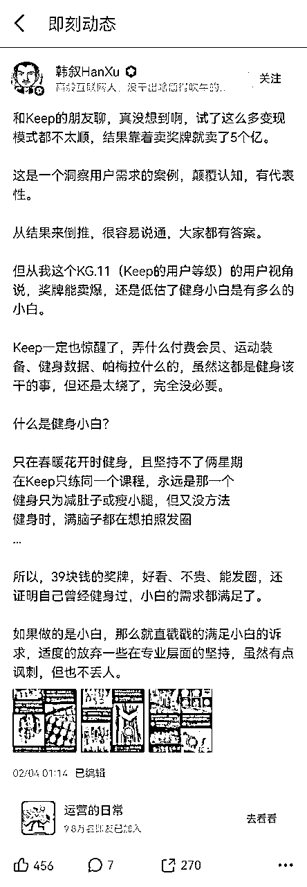

### 4.5.2 内容：让能跑的先去跑

社群产生内容。拿内容做被动传播、做自增长，策略很清晰：推容易传播的内容，而不是反过来。这里容易踩的坑，是去推容易转化的内容。可你想，易转化的内容在扩散上往往不出彩；推它看似见效快，骨子里仍是主动增长逻辑。易传播的内容，你花力气推，后面更容易有陌生人接棒。换个说法：先让会走路的内容走出去，让能传播的内容去传播。顺带推荐两本书：《理解媒介》和《舆论》。

怎么判断内容易不易传播？我会看另一点：读到它的人，有多大可能再转给别人，或跟别人讨论。举个例子，社会事件让人积压情绪、积压压力，想表达又说不清；这时若有人写出透彻、有说服力、能释放情绪的文章，它就会成为无数同情绪者的“嘴替”。反映到阅读数上，就是爆量。反过来，若文章会让转发者身上多一个负面标签，哪怕作者不是故意的，也不那么好传。对比一下：

《年中就加薪，教你和老板谈工资，彻底 K.O 老板》
《职业成长规划指南，职场无它法，打铁还需自身硬》

哪篇更容易被你的用户发到朋友圈？答案显而易见。第一篇会进收藏夹，第二篇才会进朋友圈。

### 4.5.3 问题：去用户搜索的地方等

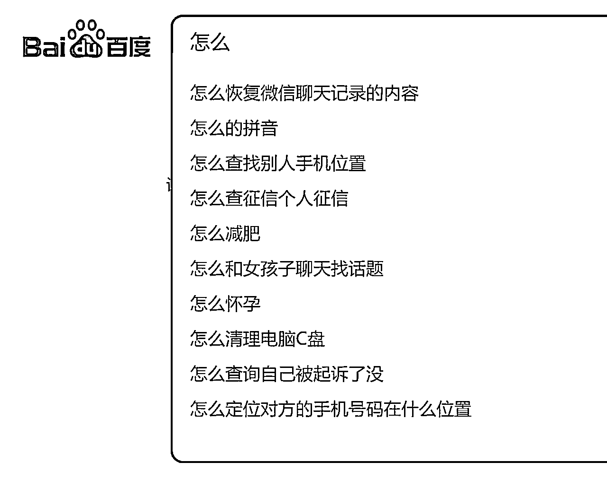

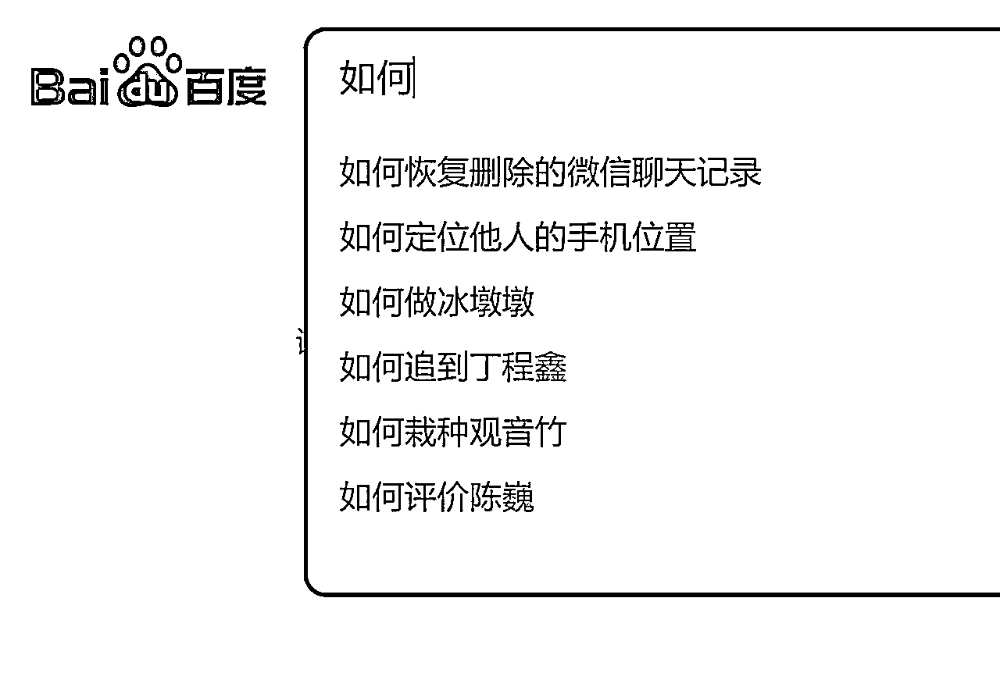

比如📕（2023 年 2 月 24 日）的联想是：

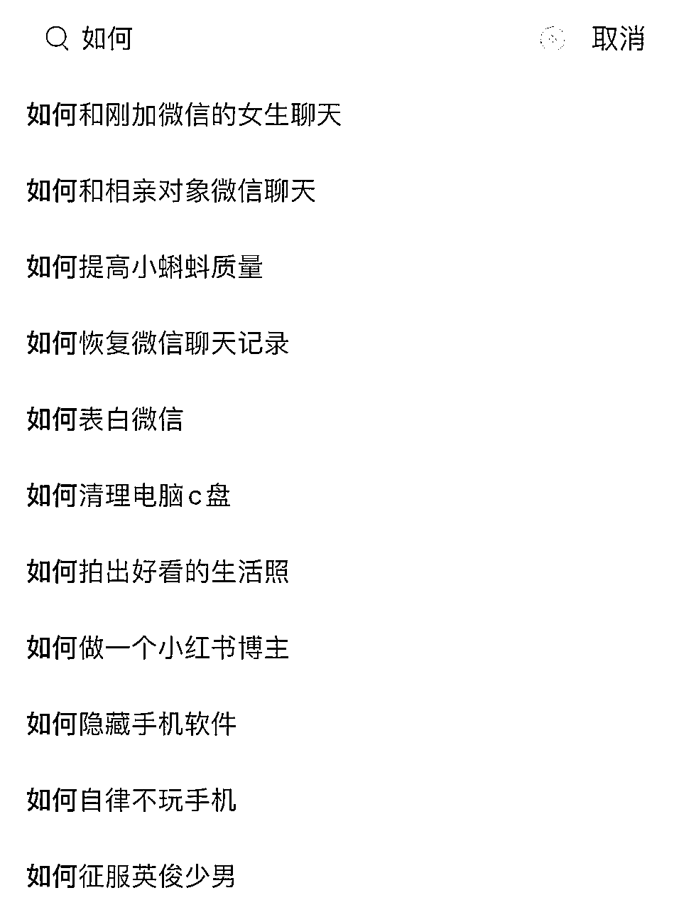

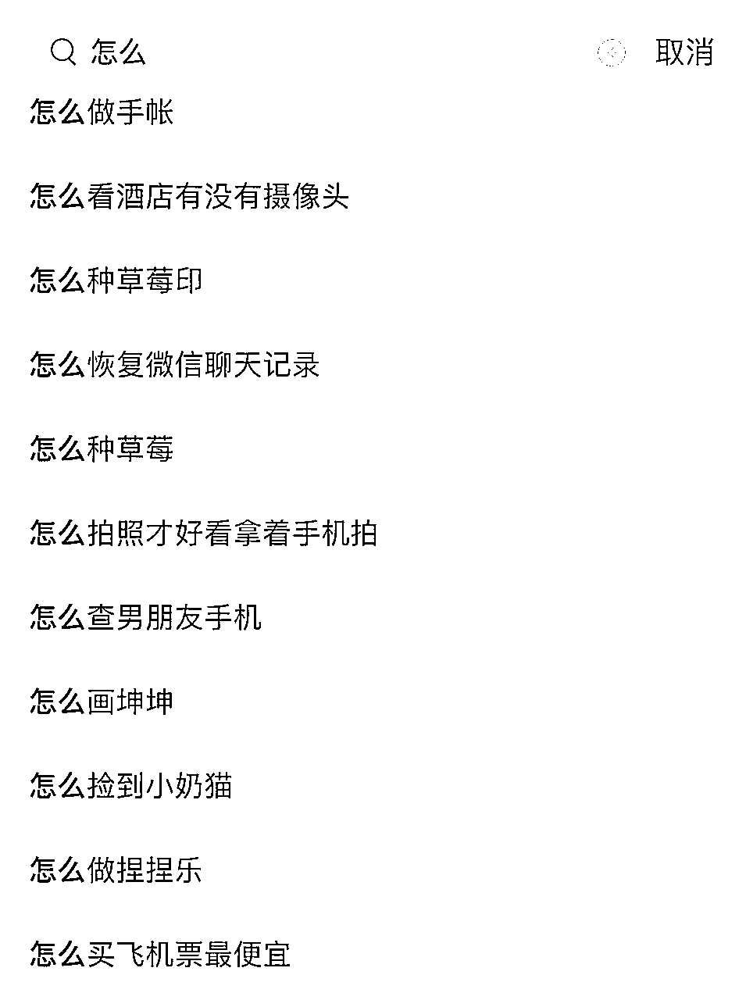

这些内容，哪怕不是相关从业者，定期搜一搜也会有启发。4.3.2 节讲的建外部渠道方法，就是用“问题”做自增长工具的示范；读到这里可回看。这种自增长的动力根源在于：你持续回答用户挂心的事，用户持续关心自己记挂的事；内容和需求相遇，一拍即合。

那找准问题后，放哪些平台？好问题。我的解法是看数据：哪些平台让用户养成了搜索习惯，且内容半衰期长，就去哪里放。我的推荐是📕、知乎、🛰️👸号、抖音和 Bilibili，它们在当下（2023 年 2 月 24 日）都值得试。其他小站点若想尝试，也建议两点：① 你自己就是目标用户，常逛的地方就是好地方；② 小站点在百度、🛰️等平台有较高的内容排名权重。再附一个让人意外的📕搜索数据：2022 年 2 月 24 日消息，昨日📕 COO 柯南透露，平台日均笔记发布量超过 300 万篇，60% 的用户每天会在📕高频搜索，日均搜索查询量近 3 亿次，“📕已经成为了普通人的生活搜索入口”。Ref: 📕 COO 柯南：平台日均搜索查询量近 3 亿次。其他平台搜索数据官方也有公开，这里不占篇幅。关切问题、关切搜索、关切需求，这三者紧密相连。

### 4.5.4 软件与机制：把重复活交给工具

1）软件

长期自增长，尤其不靠运营活动驱动的自增长，往往要有软件配合。一般以下需求旺盛时，就该找软件、SaaS 工具帮忙：给新加入成员自动打标签，便于统计和区分渠道；靠推荐海报、二维码完成自动化指引；用 SCRM 系统给每位成员建简单档案，便于精细化服务；需要独立会员荣誉体系，或清晰的打卡记录工具。

靠人工逐个环节去推动用户活跃与社群自增长，这种模式天然撑不起全天候运转。与其处处亲力亲为，不如把心思花在软性机制的设计上——让机制去消化社群中不断变化的动态难题。一套好机制，既能托住社群的价值观，又能在日常运转里持续给它加固。

有些时候，机制所折射出的价值观，其实际影响力甚至盖过组织嘴上宣扬的那一套。而在所有机制中，最能猛力重塑社群面貌的，非激励机制莫属。

这一回我暂且按下讲理论的冲动，改用几个具体例子，帮大家把机制这件事看明白。

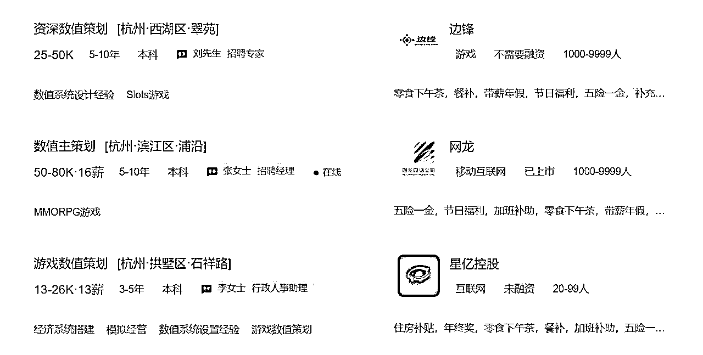

先看一份游戏数值策划岗位的招聘需求（2023年2月25日）。

在游戏这个超大型社区的设计里，数值经济设计师（业内常称数值策划）干的正是机制相关的活儿。

这个岗位分量不轻。他们要借数值来界定：玩家投入之后能换回什么、稀缺如何划定、到手资源怎样消耗、各种消耗与转换又怎么配平，从而让游戏系统长期稳定运转、不至于崩盘。

一旦缺少机制兜底，多人游戏就可能遭遇类似通胀的危机：顶级装备一夜之间贬成废铁，或新人达成同一进度比老玩家快了十倍，游戏体验便会全面失衡、彻底崩坏。

*

回到社群语境，规定成员在何处投入才能换回回报，实质上就是在划定社群资产的基本盘；换个说法，这也暴露出创建者对基本盘的理解方式。

组织所鼓励的东西有没有优先级？优先级长什么样？组织所排斥的东西又有没有优先级？优先级怎样排？

这一连串问题，靠口号宣传是锁不住的，唯有机制才能把它们定下来。

举个例，长文与短文孰重？帮群友解决问题与牵线让群友彼此结识孰重？直播分享和文字发帖孰重？学与做孰重？

这些事，社群起步阶段就想明白最理想；若到了快速扩张期还糊涂着，那对社群而言，或多或少是场灾祸。

想明白的标志，同样得落在机制上固化下来。

再如，社群若设有货币，它的发行依据是什么、又因何而支出？把这类问题答清楚，等于答清了激励机制该怎么搭。

还有一种情形：社群提倡的努力方向颗粒无收，而未被提倡的方向却回报丰厚。那么社群最终演化出来的价值观，反倒会倒向那个不被提倡的方向。

再说，社群对不提倡甚至禁止的事情，究竟投入过什么实际行动？光动嘴皮子，禁令自然形同虚设。

拿付费社群举例：哪些举动会让你宁可退全款也要把人请出群？这类举动才算社群真正的底线，而不是群公告里列的那几条。

界定“哪种行为会触发清退与退费”，本身就是在设计一项社群机制。

宣传口径与实际行动保持一致，做起来很难，但方向没错。

*

以城市与县城、契约型社会与熟人型社会作比，它们运行的机制本就两样。

机制不同，相同的结果会带来截然不同的回报：有的催生成果，有的却滋生摩擦和对立。

*

瞧，4.5节写到这儿已经不短了。读到此处的你，还记得本节聊的是“增长与自增长”吗？

来回头捋一遍本节的结论吧。

促成自增长的五条有效路径：口碑、内容、问题、软件以及机制。

:D

## 4.6 增长并非万能药

先驳一个流行说法——“增长包治百病”。其实增长未必是解药。这正是本节要展开的话题。

头一条，社群跟消费品完全是两码事。

消费品交付时间短，体验主要发生在使用环节；交付与使用彼此分开、各自独立。

社群的交付却是漫长的。一个为期一年的付费社群，交付期整整一年，交付过程与用户的使用过程彼此交叠。

正是这一差异，使得社群没法什么人都收；也使得社群在推进过程中，必须反复界定核心用户画像，持续提炼成员应当具备的共性以及实际存在的共性。

一旦出现关键性的偏移，此时再增长，只会越增越偏。

第二点，内核与规模有时相互排斥。

以🧣和知乎为例。

🧣上社会热点常与网络戾气同行，这跟国内两项普及的数量级差距脱不开干系：其一是移动互联网的普及，其二是高等教育的普及。

那为什么大家总念叨知乎早年的氛围？是官方运营团队水平下滑了吗？

我猜还有一个关键的客观因素：规模扩张越过内核之后，又冲破了潜在用户画像的总人数上限。

这种客观因素跟运营水平无关，纯粹是增长超限造成的。

实际上，不少垂直社群的总人数本就不多，几千人就能把整个圈子装完。

2017年以前的中国脱口秀行业便是典型：整个行当里叫得上号的演员，一个🛰️群就能装下。这时谈增长，真正要解决的是从业者基数，而不是增长本身。

最后一点，增长快往往意味着了解浅，增长慢则对应了解深。

上了规模的社群若消化不了快速涌入的用户，由此产生的负面效应会盖过增长带来的短期收入。

快增长考验消化能力，慢增长要扛营收压力，这对矛盾每次都得做二选一。

上述问题若处理不当，暂时关掉增长闸门、而非死磕增长，或许是个不错的选项。

另外，还有几种特殊情况值得一提：

当社群规模即将超出自身服务承载力时，就得靠暂停增长来控规模。

社群若意外获得一条增长渠道，查实对不上路之后，就该把这条渠道掐掉。创业者社群正聊着新机会，忽地涌进一群炒股大妈，显然不是什么好事。

社群定位处于转折期时，对原有的增长渠道也要小心处置。

以上种种，都是“增长”这枚硬币的反面。

# 五、怎样才能把社群运营“好”？

这里先抛出一个好问题：把前四章的内容全部吃透，就一定能运营好社群吗？

我的回答是——当然不是！

哈哈，是不是顿觉肩头轻了不少？

## 5.1 “好社群”没有标准模板

那到这里，咱们放慢节奏，再把这个问题问一遍：什么才算运营“好”一个社群？

你大概已经猜到，这个问题很难有什么固定答案。

更活跃、规模更大、付费者更多、增长更猛、内容更干……这些都能算答案，但都不是标准答案。

把所谓“社群运营”的行业惯例丢到一边。每个有特色的社群，对“什么叫好”都该有自己的定义。

所谓好，不必面面俱到，也不必完美无缺。

关于“什么是好”的这一定义，最好先经过斟酌，再推动形成共识，再落到社群一次次行动里，最后通过迭代被重新定义。

也正因如此，别盲目照搬别人的定义，而该找到并确认属于自己的“好”法。

主打本地流浪动物救助的社群，盯住救了多少只动物就行，不必操心每天群里有几个人冒泡。

主打好书共读的社群，关注每轮选书合不合理、每次活动让多少人真读完了一本书就够了，不必先看群友之间能不能处出友谊或熟络。

主打口语交流的社群，甚至不必太计较语法错误和发音是否标准，保住成员的交流欲才更要紧。

在你认定社群最在乎的那件事上，进度怎样、成效几何？这才是最要紧的。

其余事情上，懂得取舍、保持克制即可。包括我手册里这些逻辑，一条条照做、死守不放，反倒让你寸步难行。手册里某些逻辑哪怕写得再长，只要跟你社群在乎的“好”关系不大，搁着不管就行。

## 5.2 社群没有“重启键”

常有朋友问：“我的群被我运营死了，你懂社群，说说看还有没有办法把它激活？”

“没有。”

把社群运营到咽气，并没有什么一招回魂的秘技。

甚至“重新激活社群”本身就是个伪命题。

社群没法被重新激活，只能重新出发或再度生长。若你弄明白了群是怎么凉透的，就可以针对那个原因做改动，重新出发再试一回。

原因往往不止一个。

也许是人不对，也许是给的价值不对，也许是交付方式撑不起那份价值，也许是群内创造价值的路子变难了，也许是垃圾信息没人清理，也许是信任根基被毁了。

这些原因得靠洞察挖出来。

不能无视多重原因，笼统归因、一键启动。

再送一个小技巧：

倘若群里发红包都无人理睬，那可能得逐个私聊，或者干脆另起新群了。

## 5.3 社群经营始终处于动态

这个小标题，恰好点出了社群经营不省心之处。

起步走对的社群，途中未必一直正确。

起步走偏的社群，途中也未必纠正不回来。

社群的动态性，正在于此。

我们把社群创建人看作社群的第一责任人。

创建人一旦停掉对社群的时间与精力投入，社群便容易滑坡、走低。

群成员一旦都觉得不值得再往社群里搭时间、耗精力，社群就注定走向消亡。

社群靠成员的参与、时间和注意力的持续投入来维系，这点再清楚不过。

甚至，只要这份投入意愿还在，一个信任度极高却极少冒泡的社群，也能因一句话而让天南海北的人聚拢起来。

经营社群，没有一劳永逸这回事。

当然，经营的分量轻重，可依具体情形调整。

## 5.4 几点碎碎念

社群要的是经营，不是运营。

社群创建人要靠的，同样是品质，而非技巧。

社群成与不成，根子在“是否做对了事”，不在“各项指标是否踩中行业平均线”。

社群凝聚成员的功力，源于信任，而非活跃度。

沉下心去经营社群——观察它、打理它、琢磨它——它总能赋予我一种返璞归真的劲儿，让我收获别处难寻的力量。

但愿这份力量，你也能体会到、拿得到。

# 六、社群商业化怎么做才扎实？

先喊一声冤枉！

把社群商业化放到这一章，绝非因为做社群不赚钱。

而是因为，“如何建社群”比“如何靠社群挣钱”更难。

等更难的底子打牢了，本章总算能在社群商业化这块儿百花齐放一把。

## 6.1 商业化社群样本盘点

### 6.1.1 直接向成员收费

最直白的路子，就是社群直接收费变现。互联网那套“羊毛出在猪身上”的经典玩法，社群大可不必绕这么远。把价格摆明、直接收钱，最为省事。社群对成员有价值，直接收费天经地义。

最简模式，🛰️里收款、群收款都顺手。

若帖子和内容占比较重，知识星球是最优解。个人使用的话，平台会代缴20%的税。

做海外社群要闯语言和文化两道关，Telegram与Discord都值得考虑。

若想就近省事，付费🐧群，以及抖音、📕、快手的主页粉丝群也都合用。群本身没有收费入口，在直播间收礼物放行即可。抖音若走“课+群”模式，用学浪最方便。

只要付费意愿够强，收费方式反倒没那么要紧。

别纠结。

哪些类型的事可以直接收费？

信息、认知、社交、培训服务、陪跑、陪伴，都是典型的付费点。

不妨拿买相机、玩摄影来举例。

第一时间同步各相机厂商的新品情报和最新价格，做付费社群，这属于信息型。

科普怎么分析各家厂商的成像水准，把旁轴、全画幅这些概念的基本原理讲透，做付费社群，这属于认知付费。

跟着某位摄影名家同行，顺道结识一批摄影高手和同好，为此付费入群，这属于社交型。

想接写真拍摄的活、搞摄影想拿奖，报名训练营，一周理论加三周实操，进群先交费，这归培训服务类。

照片拍出来老出问题，挑出来丢进群里求指点，群友情况也相仿，入群每年包看100张片子，群主碰到好片还会拎到群里拆解点评——进这种群，属于陪跑。

大伙儿互相请教，聊摄影、玩器材、互换闲置镜头、淘老相机、约着一块儿街拍，这类群属于陪伴型。

不过这些类型之间并非泾渭分明。说到底都是群，不同类型甚至能混搭、能互相转化。

不同主题倾向的选择往往不一样。比如减脂减肥用社群来做，通常选训练营；营养搭配、宝宝辅餐，多是培训服务叠加陪伴式社群，请位营养师坐镇。

### 6.1.2 靠复购撑起的电商社群

做电商型社群，甚至可以说：没有电商社群，只有电商复购社群。真可谓无复购即无电商。

因为电商社群得有足够的交易频次，才能撑起相应的商业化体量。毕竟，在养活一整支团队之前，至少得先靠社群养得起一个人。

所以做社群选型时，卖女装的群多半比卖男鞋的群好做些。

至于群里设不设积分、有没有等级成长体系，都得看社群本身能不能持续产生复购。

钻研并实操社群11年，迄今我只见过一个例外：不做复购，一期一会，靠大额交易达成商业化目标。

那例外就是“线上看房团”，做跨城房产投资。线上组队、线下带队看房，看中了就找群主当中介签合同成交。群费拿来平摊食宿。建群一周，看完即散。

### 6.1.3 线下门店的引流入口

做线下门店社群，拉群不难，顾客入群的入口也能做出花样。

这里给几个思路。

可以让店员在导购或结账时招呼顾客入群。连锁品牌还可在🛰️、支付宝支付后的页面挂出入群入口。也可在门店门口立易拉宝、摆立牌，借物料上的二维码直接引导入群。

若是成交后商品连包装带回家，还能靠包装里的卡片邀人入群。

甚至餐饮店，排队取号时那号也能带个群。

说件有意思的事：这一行里，除了各家小店自己，最大的垄断级玩家是家叫“美味不用等”的公司。你们都用过，却未必记得它。

到2020年6月，美味不用等已覆盖全国352座城市，为30多万家餐厅提供智慧餐饮一体化方案，每年服务近10亿人次消费者。

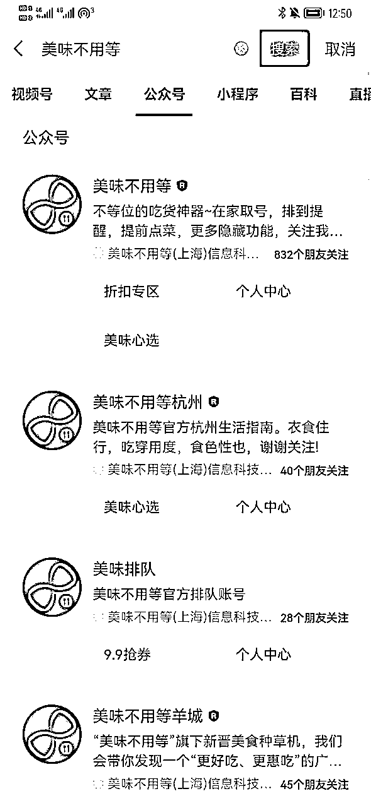

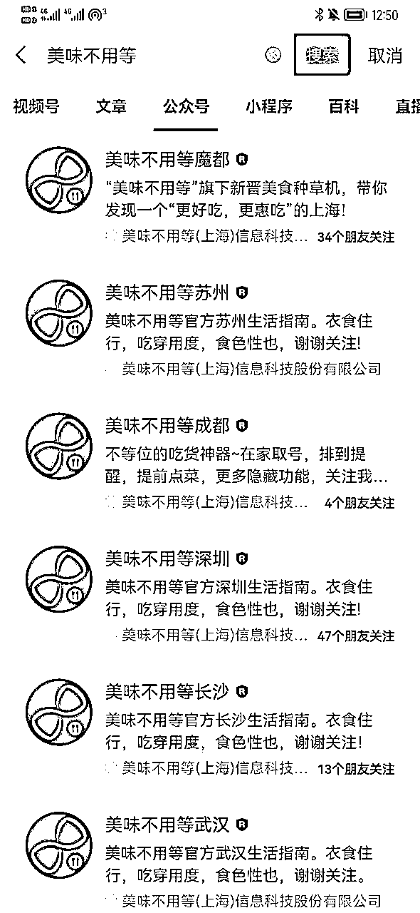

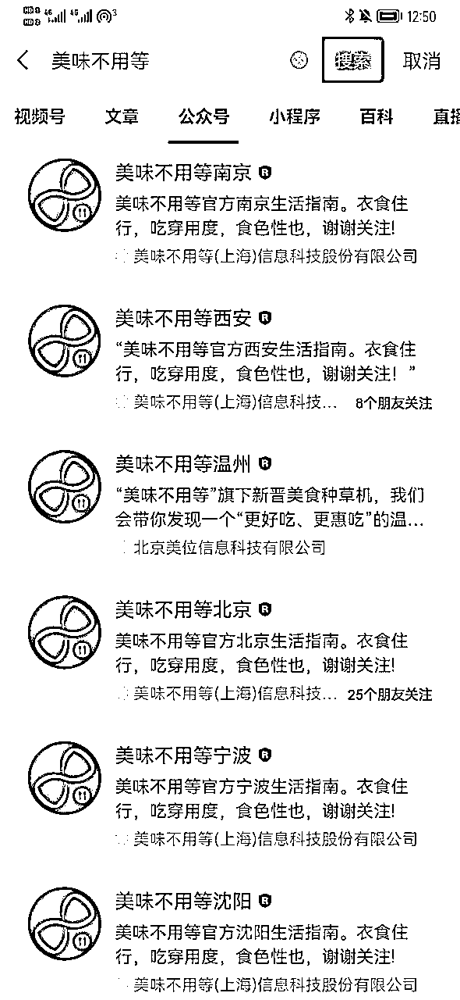

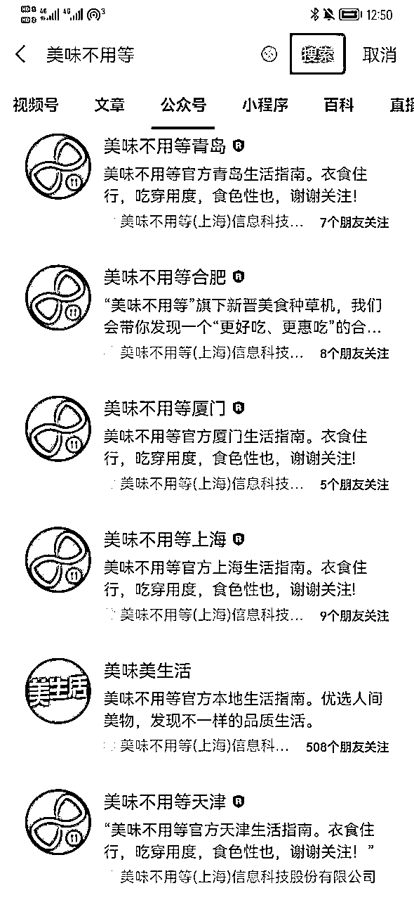

有多壮观？翻翻我手机🛰️的截图吧，留意那一抹绿色的“xx个朋友关注”。

早年这家团队扩张极快，融资也接连不断，可商业化方向始终没摸到。据我观察，他们如今把排号群与同城美食营销（群内发券之类）捆在一起，靠庞大的群规模往前推。

说到这儿，瑞幸和蜜雪冰城的社群玩法不得不提。

赚钱圈友里，加过这两个品牌消费者群的一定不少。多数好奇其运营思路的人，估计也一头雾水：“所以就是没完没了地发券？没别的招了？”

实话说，真没了。

可这样毫无社群氛围啊？

是的。

这类门店众多的品牌社群，本质仍是为业务服务。它们只要把“线上领券、线下核销”这一件事办妥，靠足够规模薄利多销，就已经很有价值。

到了这个体量，硬往群里塞太多环节、为氛围而氛围，只会加重门店或城市运营中心的直接负担，也重蹈了我们前面提过的“从舒适体验出发优化社群”的覆辙。

当然，这般规模若能做加法、且加对地方，也能提升社群在乎的业绩与体验。这很考验社群直觉与社群理解力。此处不妨留作一道开放题，供各位一同探讨。

### 6.1.4 内容种草之难

内容种草也是大家常提的商业模式，只是现实很骨感，这条路尤其难走。

从📕的商业化进程便可窥一斑：在📕种草，转头却去淘宝拔草。

内容种草能激发需求、引导消费、完成变现，虽难，倒也能举出例子。

典型主题可选植物、多肉这类越种越上瘾、拍照又易出片的品类，在群里交流种植心得、分享新品种。

也可做小众设计师的上新群，比如独立设计师专攻女包。大家蹲在群里，围观一款新包如何诞生，同时以早鸟价拿下心仪款。

尽管我能举出这两例，仍得承认难度很大——内容种草只能给原有业务打辅助，难以独立撑起业务基本盘。

### 6.1.5 社群亦可作行业媒体

社群规模通常比不上内容订阅型媒体。

可若论的是精准而非数量，社群或许也够用。

一整座商场的全部店长，一座城市所有服装厂负责人与鲜花老板，一个产茶地全部有茶园的人，一个细分赛道多数创业者，一个垂直领域大半媒体人，一个法律分支所有律师和法条研究者，单平台一个大类目下全部头部广告主。

一条群通知，抵得上全行业消息同步。

具体到某区域、某行业、某环节，关键人物也许没多少，一个群便能装下。这类社群的商业模式可对标媒体：向三五百人投放广告，相当于向整个行业投放广告。

当然此时的价值不看阅读量，而看消息能触达的一个个具体的人。

### 6.1.6 撮合型社群须落到场景

撮合型社群可涉足的方向更为丰富。

头号误区，便是不落具体场景，上来就攒一个“资源对接”群，甚至群名里都写着资源对接。资源对接的具体场景、具体双边是谁，才是创建人该明确的。双边对象一换，玩法可能天差地别。

撮合型社群做相亲，需求尤其刚性。若社群价值观已有实质巩固，做相亲更是水到渠成。

相亲若要独立做成付费社群，有个要点：不能按能否约到会来收费，得在入群门槛处收。收费卖的是潜在约会机会，而非约会本身。

招聘社群同样是撮合型的典型。不过这行做得好的，多以“内推机会+简历指导”为主。社群收不收费另说，至少每做到一个到面、一个入职，就能拿到可观的内推金。

另外，把精准领域里的潜在人才聚起来——尤其在人才缺口大且急、或鉴才成本高的行业——聚才的价值更高，跟需求方谈合作时也底气十足。

把投资人介绍给创业团队，替创业者寻找联合创始人，或者让体量接近的人坐到一起谈合作、做异业联动——如果一上来就直奔主题，路径往往偏长。商学院、MBA项目真正被低估的价值，或许正在于提供了这样的连接场，而不是课堂里学到的那些知识点。

还有哪些线可以牵？供应链与品牌方、品牌方与营销方、方案需求方与代实施方（TP、DP），都能做成以业务达成为目标的对接型社群。

再往下，哪怕需求很小，也能成群。00后的扩列社群、Z世代的表情包互换群、🛰️读书爱好者的组队群、拼多多砍价互助群、蚂蚁森林合种群……这些需求单看很小，却高频、硬核，能撑起很大的用户盘子。有亲身经历的朋友，可以在航海群里展开聊聊。

派单、接单同样是典型撮合社群。收费来自两头：一是降低成交摩擦的交易成本，二是汇集订单、制造机会的机会成本。设计外包群、技术外包群、垂直领域翻译社，以及抢茅台、抢潮玩、抢门票并承诺刚性兑付的群，都是典型成群方式。发单、接单、进单会构成这类社群的日常节奏，各种活动围绕它展开；哪些单值得接、单子怎么做，也会逐渐沉淀出一套价值判断。

从相亲到招聘，从投资关系到合作关系，从上下游到异业合作，甚至生活里需要搭把手的小事，都是撮合型社群能发挥能量的舞台。

这里不得不推荐一本《中间人经济》，做这类社群的人值得读一读。

总之，商业化社群的多样性非常足。行业与经济变迁会不断催生新社群；多数情况下，社群还是平台型商业模式极好的MVP。比如2018年由腾讯领投、估值约1亿美元的多抓鱼，早期验证模式时并没有先做App，只靠社群；交易也没有订单系统和商城SaaS，Excel表在群里传来传去。无论是把社群当作第一个变现产品，还是让它为原有业务增收，各有各的长处。

当然也值得重申：社群未必要停在业务层，它也可能长成一部分人的生活方式。

# 6.2 商业化案例鉴赏（圈友实战版）

### 6.2.1 【案例一】合伙人社群：百度答题分销的社群打法 @一尘学长

这个案例来自百度答题分销项目，核心做法是用分销获客，用训练营交付，收入来自培训费。项目背景是团队原本做大学生假期工，疫情让线下兼职受阻，学生转而在线上找机会。2022年9月他们第一次尝试百度答题，由于答案要自己找，效率不高，也难以规模化，项目暂时停下。到12月，团队顺着龙哥盟的ChatGPT风向标，把AI和百度答题结合，项目重新启动。首期人数不多，团队把心思全放在交付上，学员上岸率做到了100%。能跑通的原因主要有三：项目匹配目标人群；操作简单，执行就有结果；交付内容足以支撑学员落地。正因为如此，第二期人数增长很快，市场空间足够大，校园代理也开始参与分销。线上逻辑相同，团队便联系朋友问是否有兴趣。推广中重复问题不断，他们于是建了分销群，让信息同步更顺畅。分销群最初只为同步消息，后来功能逐渐多元：成员各有影响力，群里形成分销氛围，且多数是创业者，对搞钱这件事很积极。

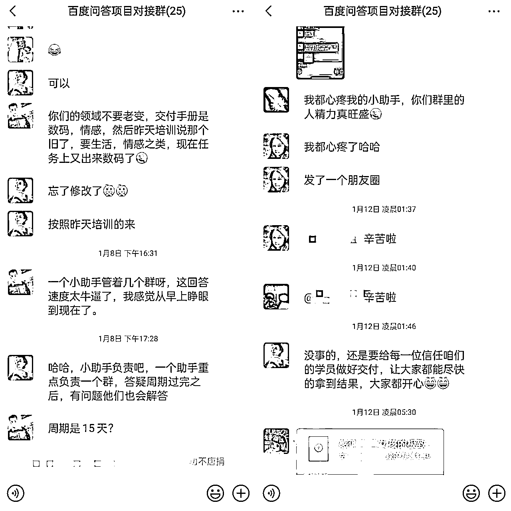

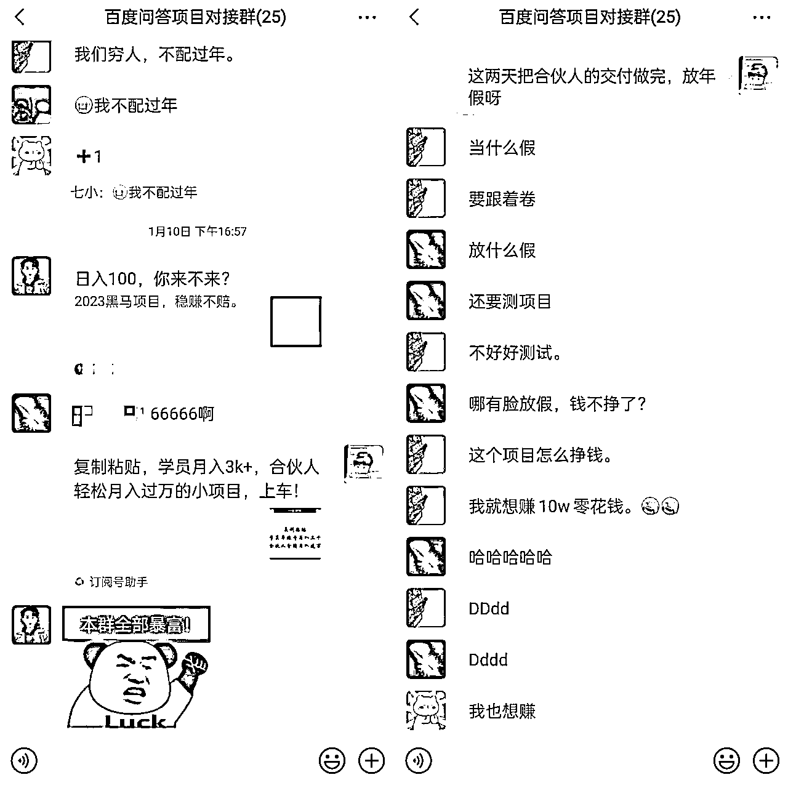

复盘下来，第一步是明确社群目标。他们建了两类群：学员群负责交付，分销群负责宣传和裂变。如果你也想做，可以搭建一个有活力、能协作的分销合伙人社群，为产品和课程放大传播与分销。

交付与分销要分两层搭。学员交付层要做的是：把交付做实，让学员拿到结果；流程持续迭代；每天汇总答疑问题；答疑助手即时响应；给学员每日任务与目标；用激励把氛围带起来。合伙人分销层要做的是：让分销者安心，提供一条龙支持；准备朋友圈营销转化素材；给专属交付手册和答疑引导；带学员裂变，获取新流量；后端交付做好，再按利润分成。

日常运营中，要鼓励合伙人从旁观者变成参与者，多抛正反馈，比如当天分销数据、学员收入反馈；也可以评选优秀贡献者发红包，带动更多人加入。还要定期跟进合伙人，了解推广中的需求和反馈，持续优化课程与产品；安排专人关注分销合伙人的👸号、朋友圈，把新内容同步到社群里，维持兴趣和参与度。除了维护现有合伙人，也要破圈寻找新伙伴，例如与私域KOL或其他社群合作，一起推课程或项目，扩大影响力和覆盖范围。对表现积极的合伙人，可以给节日红包、礼品等奖励，增强关系动力和推广积极性。

一句话，分销合伙人社群要跑好，负责人得在建群、吸引人、供内容、给支持与反馈、办活动、做关系等环节持续投入并优化。

分销比例怎么定？他们总结了几个维度：项目成本，比例不能伤到盈利能力；市场竞争，同类产品比例高时，自己也要有吸引力；合伙人贡献，贡献越大比例越高，通常设阶梯。整体区间多在30%到70%，再按实际情况调整；也可根据推广效果和销售额动态浮动，激励合伙人更卖力。

实战经验是，好的分销合伙人不是一开始就有的，而是筛出来的。产品推广的教育成本很高，培训可以让合伙人价值最大化；但如果连怎么分销都要手把手督促，不如自己培养人更轻松。当然，作为第一负责人不能偷懒，要把合伙人的不确定性降到最低，可以从这些地方优化：

1. 用提成、奖励等丰厚机制激发动力；
2. 提供海报、倒计时、项目介绍等多样化推广文案，方便按场景选用；
3. 给培训和指导，让合伙人理解产品特点与优势，掌握推广方法；
4. 给更高自由度，推广时间、方式、渠道乃至方案策略都可自主选择；
5. 建监测与反馈机制，让合伙人实时看到推广效果和销售情况，定期评估反馈，及时调整策略。

通过上述做法，既能激发合伙人的动力，也能提高其自由度，让他们更积极地参与推广，为产品带来更多销售额和市场份额。

内容来源：《从 0 到 500w+：百度问答项目社群分销模式的打造与实践》

### 6.2.2 【案例二】付费社群：从0到1跑出十万盈利的育儿社群 @黄伊森

这个案例的主角是儿科医生，有留学医生背景，先用短视频和图文试水自媒体，后来因市场趋势推动社群落地，而龙哥盟日历共读群给了他社群主营方向的思路。路径是：用育儿知识科普提高个人影响力，再挖受众痛点，搭起购物群。收入来自知识付费和产品利润。

建群前他没有运营经验，先听了圈友@北大苏姐的社群运营踩坑课，记住三条：第一，别做免费社群；第二，别让群主一个人热情输出、群里没人回应；第三，群规必须明确且严格执行，目的是营造舒服的环境，让同频的人留下。

消费能力链条是孩子＞女人＞宠物＞男人，所以育儿+宝妈群消费力强、变现空间大，也最容易活跃；但运营不好，就会沦为闲聊和吐槽群。他认为好社群要带大家做一件共同的事，让人愿意待、每天有收获，而不是为了活跃而活跃。

加入赚钱后，他看到圈友卖赚钱日历并运营共读群，把同频的人聚在一起分享见识、共同成长。于是确定私域社群方向：育儿日历共读群，群规是“抱团取暖，互惠利他，保持同频，鼓励链接”。做法类似赚钱日历共读群：每天分享一个育儿知识，宝妈们每天有新内容可学，并围绕主题讨论。

初代铁粉：社群虽是付费制，但最早一批成员是免费的——来自门诊的铁杆粉丝，他把小朋友家长请进来，作为第一批友军和基础支持者。他们在舆论把控上给了很大支持；他每隔三四天就询问分享内容和运营反馈。因为此前有信任基础，家长们反馈中肯坦率，他及时调整，事实证明对运营很有效，内容分享也更高效及时。

增加曝光：连续100场直播，大力出奇迹。此前他没有互联网产品销售经验，是互联网素人。自媒体合伙人@梁靠谱医生曾在赚钱日历共读群分享：素人要闯出名堂，一靠持续内容输出，二要有自己的互联网标签。加入赚钱后，他看到视频号直播正热，也看到粥左罗老师连续直播100天挑战，便想发起自己社群的连续100天直播。好处有三：连续直播能为刚创立的内容社群持续输出，保持活跃度、保障内容质量，也让更多人看见，提高影响力和规模；能锻炼直播能力，包括直播间运营、互动和带货，后续新品上线可通过直播促成交；挑战完成后能拿到一个互联网标签——第一个完成连续100天直播挑战的儿科医生。直播过程中，不少育儿电商平台来找合作，他沟通筛选后选定一个靠谱母婴用品平台，新建“伊森严选母婴好物群”，主推靠谱实用、有专业背书的母婴用品。

目前销售超过10w+，个人佣金10000多块钱，这还是疫情期间上海物流受到很大限制的情况下。销售额不算高，但任何100万都从第1块钱开始；随着口碑和影响力增加，增长不会线性。

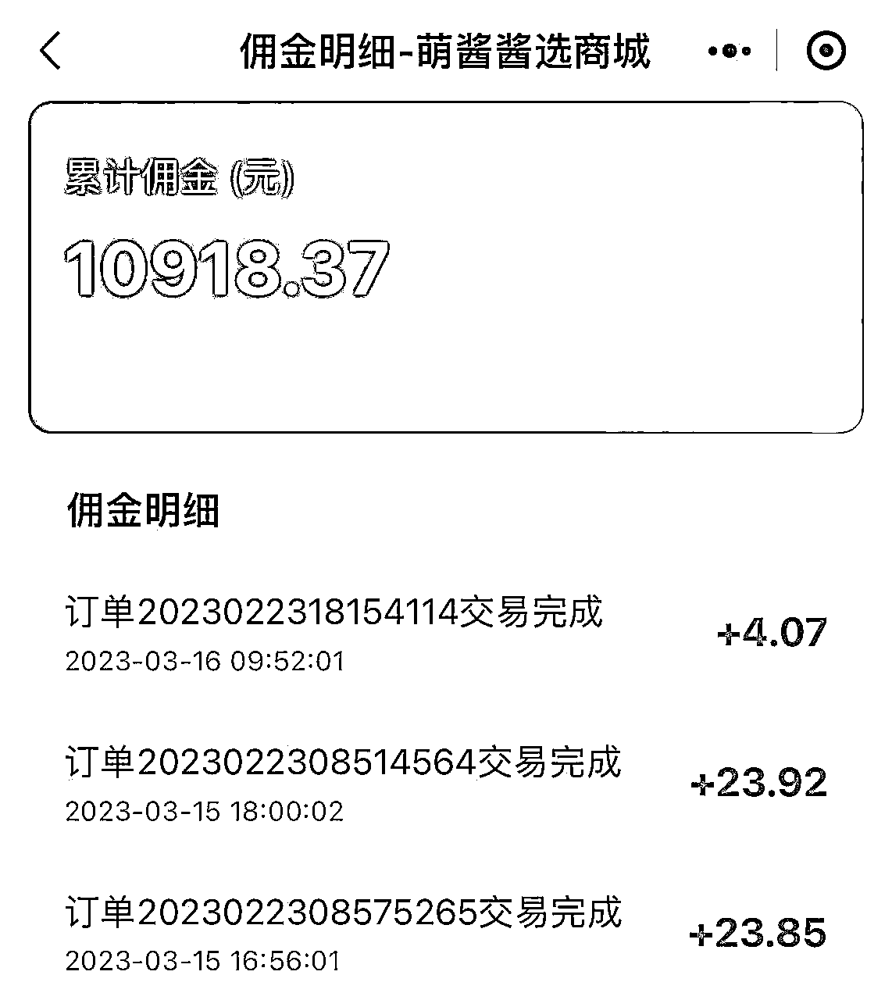

#### 4. 突破瓶颈：把客单价抬高15倍

社群运营到一定阶段，要在合适时机迭代，从低客单转高客单。他做了几件事：

第1点，挖社群成员需求。社群增长，成员需求也在增长，要敏锐观察变化，甚至挖潜在需求，再按需求升级产品，客单价才可能由低转高。刚开始育儿社群只是低客单价引流品，像很多育儿群一样，他一个人包打天下，群里问题分享全由自己上。临床经验长，90%问题能搞定。但社群长大后，一个儿科医生专业知识再丰富，也覆盖不了儿童健康所有领域。宝妈对孩子健康的关注越来越多，不只看病，还包括喂养、睡眠、儿保、视力、口腔等；宝妈自身需求也要挖，如产后康复、女性成长、宝妈副业，都是潜在增长点。

第2点，打造“小而全”的团队。发现或挖出新需求却满足不了，怎么办？他的策略是放弃创始人IP，找同行当医疗合伙人，组一个“小而全”的团队。

第4个，设体验卡制度。做知识付费的人大多讨厌伸手白嫖党，但社群升级时他设了体验卡：不了解社群的新用户可免费体验28天，群内无限次提问，还能参加期间举办的实操训练营。28天免费，到期可退出；若觉得服务达不到预期，分文不取。原因在于育儿社群做的是长期陪伴，28天对宝宝很短，只是给宝妈一个机会了解这个有专业服务团队的社群。他不担心白嫖28天，因为体验过专业服务后，相信对方28天后会选择成交而非退出——别处找不到这样的育儿社群，他对产品有信心。而且付费用户是双向筛选：如果宝妈的育儿理念实在不合，他们会劝退；28天后可退出，理念不同就好聚好散。

第5个，借社群周年庆造共同回忆。活动目的是造共同记忆，同时让宝妈提供正反馈和社群宣传素材，效果不错，收获很多真情实感、真实发生的好评。这些素材可反复用于朋友圈和社群升级。

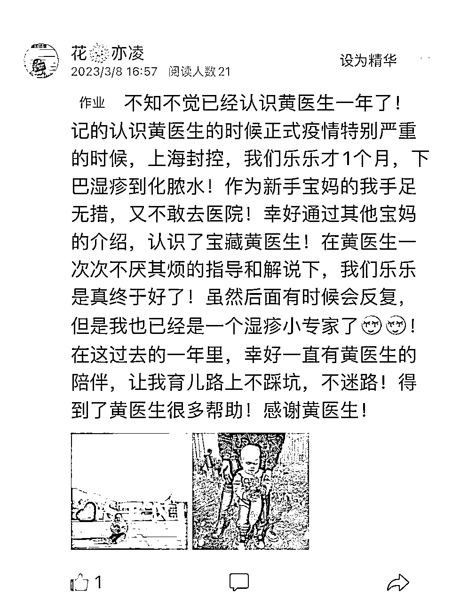

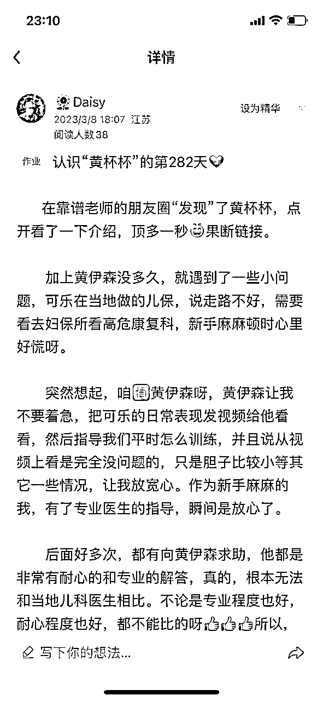

内容来源：《从 0 到 1，我是如何打造出盈利十万的育儿社群的？》

### 6.2.3 【案例三】电商社群：23人小群做出高复购 @徐欣

这个案例是高复购率的快团团电商社群。模式是社群冷启动，用运营策略增加客户粘性和信任，提高个人影响力，进而提高销售额和复购率；利润来自产品。背景是线下实体生意经营多年，选品和选供货商经验丰富，链接源头厂家和卖家也有经验，于是确定做快团团。冷启动和初期运营后，他根据反馈总结经验，确定做生鲜品类。社群定位是健康，他报考公共营养师，为社群做专业赋能。快团团群只有23个人，2月正式运营；一周只投入周一到周五早上5分钟晒早餐，群里除不定期分享养生知识和推品，基本不闲聊。2月一共推46个商品链接，平均每天不到2个，而且只卖生鲜。在这种情况下，2月业绩11562.3元，提成1996.87元。

# 不到三十人，照样跑出社群首单

快团团圈子常流传一个说法：想把销量做起来，群规模怎么也得凑够一百五十号人。可我刚起盘时连三十人都凑不齐，眼下也才四十七人。今天就把这段小群从零启动、慢慢跑通变现的完整经历拆开聊聊。

开张那天，我在朋友圈刷到芷蓝分享的一份“个人使用说明”，觉得挺新鲜，就照葫芦画瓢整了一份。老实讲，卖什么当时心里完全没谱，只是先把手上能拿得出来的东西统统亮出来。

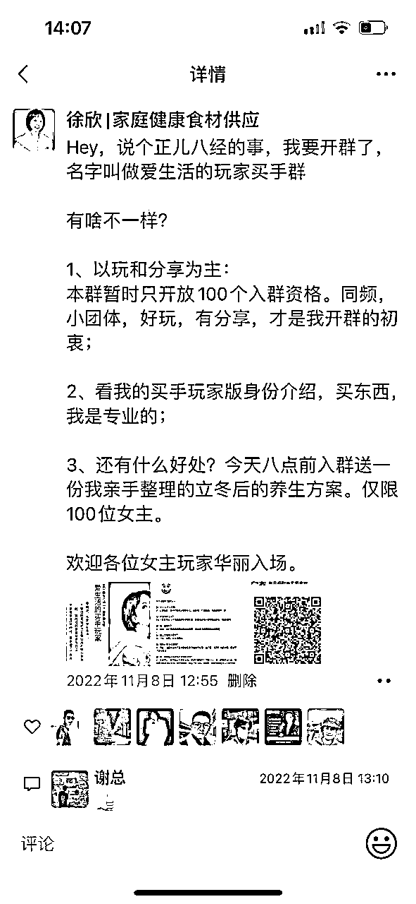

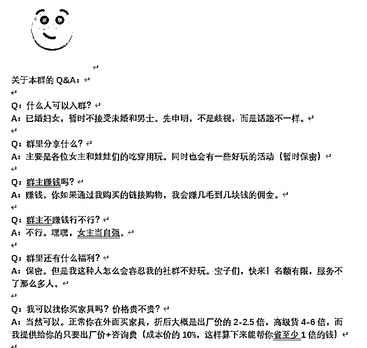

群刚拉起来那会儿涌进来十多位，聊得热火朝天；可真等我开始推商品，出手的人寥寥无几。我翻快团团后台一瞅，童鞋童装的浏览量其实不寒碜，成交却死活上不去。后来改推吃的，总算有人掏钱了。这一下我就开始刨根问底：差别究竟在哪儿？

换成买家身份点开鞋服页面，连我自己都很难按下购买键。满屏信息堆得密不透风，真正能戳中人的卖点却找不着几个，样式也少得可怜。再回想日常给自己、给娃添衣服的情景，衣服这玩意儿跟个人审美绑得太死，你几乎不可能恰好对上别人的口味。大群人数多，还能靠覆盖面去撞概率；小群这么玩就是拿命赌。

到十一月二十三日，我琢磨明白两件事。头一件，品类撒得太宽是死路，短时间内根本吃不透；随手甩个链接过去，别人只会把你当镰刀。第二件，生鲜食品虽然打开率拼不过日化服装，可成交转化明显更硬；况且我本来就不会在快团团上买衣服，买菜买果却是绕不开的日常，偏偏电商平台又总让我失望。那还不如先把自己这张嘴伺候好。

打那以后我把重心挪到食品生鲜上，陆陆续续找了不少做食品、生鲜的大团长来试品。前期自己掏腰包砸了将近一万元，最终敲定两三家品质稳、售后也靠得住的合作方，拿到的食材正好契合我想走的家庭健康路线。

头一波有销售时，群里不过两三个人下单。我就在朋友圈发自家餐桌的实拍，做真实分享。第一次挑的是苹果，一条朋友圈直接带出几单；等大家签收后我挨个去问反馈，评价好得让我意外，甚至有人当场又追了五箱，拉去给公司同事分。之后我朋友圈晒单、群里也晒单，群内慢慢有了成交，但量依旧不大。再往后疫情放开叠加春节，我们一家子全躺下了，全国快递也一度停摆，我干脆把卖货按了暂停键。生鲜最怕的就是路上耽误，这种节骨眼上最容易把客户弄丢。

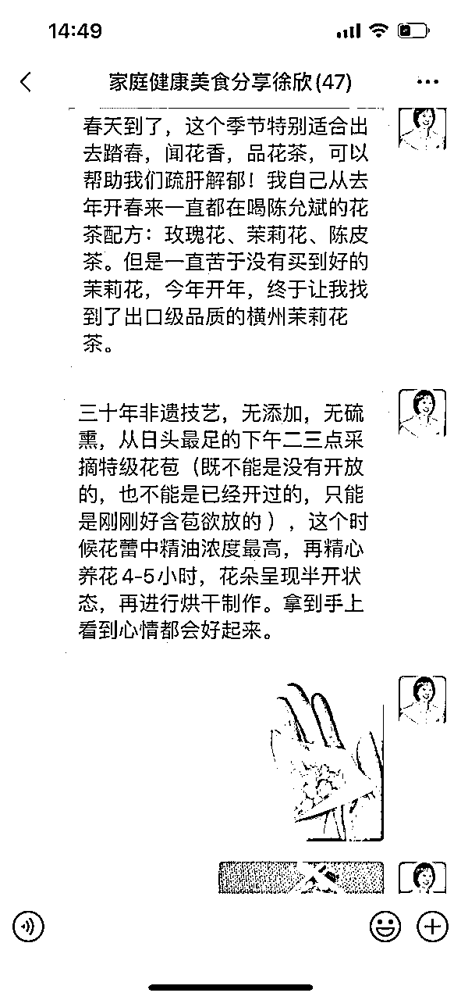

后面再搞活动，现场那股热乎劲儿特别足。那天我立了条群规：每拉进一位新成员，就多给一次抽奖机会。这招是跟赚钱的朋友偷师的，具体效果我后面再交代。当天销售额一千二百出头，提成二百四十多，红包加各项费用共六百一十块。不少朋友一算账就摇头，说这买卖亏了、不值当。可往长远看，我觉着太值了。理由有两条：一来我卖的是高端生鲜，光靠嘴皮子怎么吹都隔层纱，非得亲口尝过才晓得差距；直接白送试吃，人家心里容易有负担，抽奖抽中的反而拿得心安理得。二来让大家觉得这个群有意思，事后我问了几个要好的朋友，她们都说过程特别好玩、相当过瘾。

有一回在📕刷到某位大团长讲，必须每天早晚请安，固定时段干固定的事。这话怎么听着这么耳熟？条形马老师那本手册里就写过。所以我读那本册子格外有感觉，因为好多事我都亲身趟过，好多坑我也结结实实踩过。不过早安红包这招我没照搬：一来烧钱，二来群里的人未必稀罕。我就琢磨，什么事能搁在早晨做、又能跟群牢牢绑在一块儿？答案是早饭。我给家里人做早餐已经坚持两年了，做不到天天，但一周五六天稳稳的。于是我开始往群里甩早餐图。

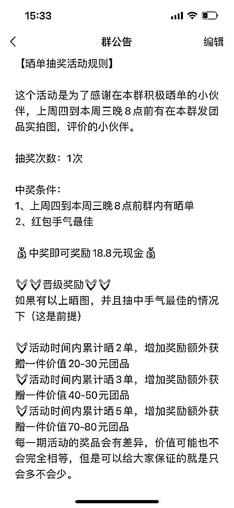

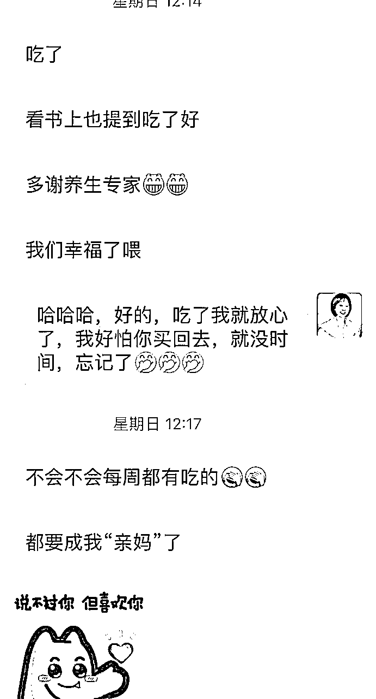

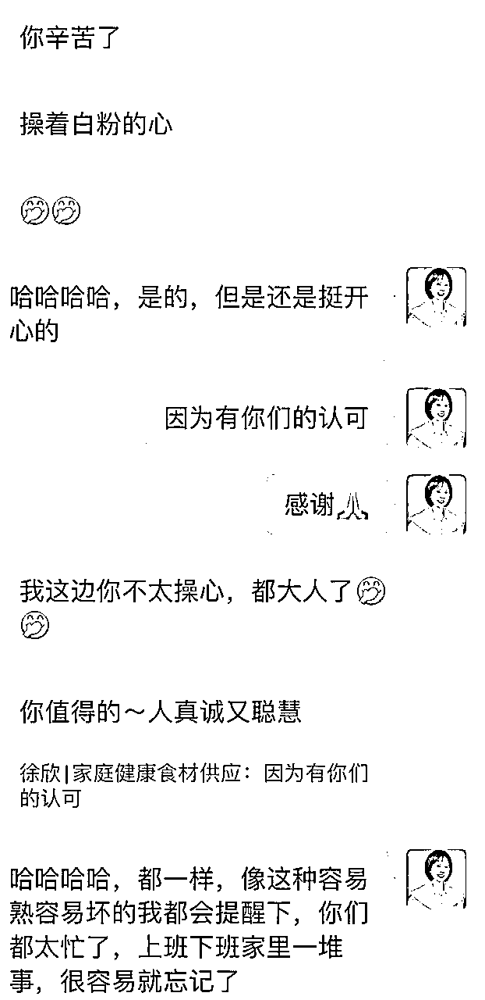

群外功夫第二招：售后不扯皮，永远站客户那头。平台不认账，我自己掏钱赔。有回回访梨子，客户说有两个水分差点意思。这种事搁平常根本算不上售后，毕竟照片拍不出那点差别。我一句废话没有，按个数直接赔了钱。

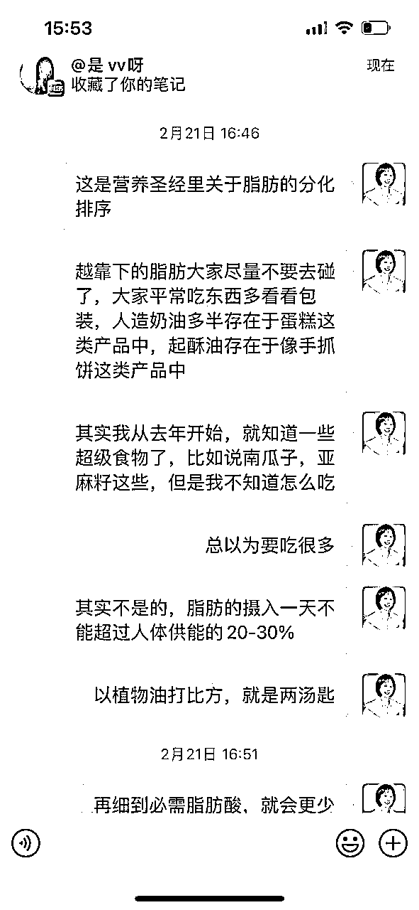

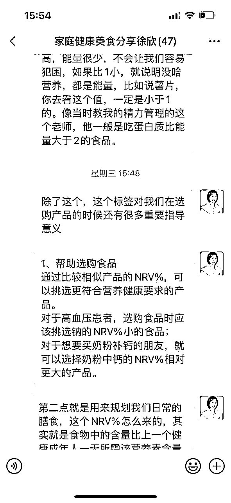

接着聊聊我踩过的三个坑。

坑一：运营成本压不住。最初听几位大团长忽悠，说群里得撒大红包，于是每逢大活动节点我都甩四十块一个的红包，抽奖也塞五块的。后来一复盘才发现纯属浪费，没人会因为老板手松就下单。之后我砍了三刀：节日红包停发，大红包不包，抽奖红包一律缩到一块钱。做买卖嘛，小数怕长计，日常那些没必要的开销必须一刀切掉。

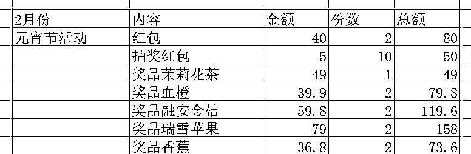

坑二：瞎裂变，钱砸了水花都没溅起来。运营了一阵子想裂变，元宵节那天跟群友放话，拉一个新人就抽一次奖。后来发现压根没必要，大家根本不买账，群运营成本倒是上去了，我挑合适价位、合适货品的负担也跟着加重。

坑三：活动时间得反复试。会员日最初定在晚上八点，可群里多数人有娃有家，八点基本都在盯作业。最后我把档期挪到中午十二点出头，那会儿反而是上班族最松弛的时段。

运营社群还捎带手给了我三个意外之喜。

头一个，捡到了陌生链接和信任。赚钱这事我分两层看：一层是账面数字，干这桩买卖实际落袋多少；另一层是别人对你的信任，往后兴许能长出更有价值的东西。具体是啥我暂时说不清，但凭我做了四年实体生意的直觉，这笔投入绝对划得来。我想，这大概就是条形马老师嘴里的“贵人”。

第二个，拉朋友出了泥潭。我有个关系很铁的朋友去年查出重度抑郁症，这件事也狠狠推了我一把，让我下定决心做健康这条线。那阵子我一直在帮她搜罗有助于康复的饮食方案。后来她也想搞快团团，我就把经验原样复刻过去，帮她光速打通了从零到一。

第三个，企业团采。开局就碰上有人买五箱苹果给公司员工发福利。后来又有个朋友觉得茉莉花茶实在好喝，张口就要给企业采八百份。可惜我没当回事，跟供应商谈团采时火候和时间都没拿捏好，白白错过了机会。不过这也给我提了个醒：企业团采这条路走得通。

最后，想跟所有还没动身或者刚迈出第一步的朋友说：困难肯定一箩筐，但我信一条定律——竹子定律。竹子前四年总共才蹿三厘米，从第五年起每天三十厘米疯长，六周就干到十五米。那前四年它都在土里闷头扎根，全是为后面的爆发攒家底。这篇复盘的原素材叫《新手如何从0到1打造拥有高复购率的小社群》。

# 七、社群这件事，再往深处想

第七章并不在咱们社群手册的主干线上。手册里讲的what、why和how，前六章基本已经收尾了。可关于社群，我还有些没处安放的念头，索性搁在这一章里跟大家唠唠。

## 7.1 社群能活多久

翻到第七章，总算能聊聊社群的生命周期，也就是社群能活多长这个话题了。不过开聊之前，我想先岔开一笔，扯另一个问题：社群一般是怎么死的？

1）有些典型的社群创始人爱这么干：先把人圈进来，再琢磨能搞点啥。这么弄特别容易翻车。因为圈进来的人共性模糊，各怀各的心思。到后期再想敲定一个稳定、统一的定位，难度直接拉满，而且这难度还是自己亲手造出来的。这种群半路夭折一点不稀奇。它违背了“先定位、再招人”的路数，先招人再定位又没玩转，寿命自然嗖嗖走完。

2）社群到头来会拧成一种共同体。动力可能来自入群前大家就盼着互相认识，也可能来自共同经历给彼此创造了相识、欣赏的由头。要是光靠创建者使劲和外力推，社群拧不成共同体，也没法一点点攒出群体认同，那等大家耗光期待，群就归于沉寂，说白了就是凉了。

3）社群的商业化路子得不到成员点头，也是典型的死法。尤其是那种先免费、后来扛不住经营压力转收费的群，商业化走得最拧巴。谈钱不伤感情，搁大多数群体身上都是难啃的骨头。成员从建设者一转眼被当成商品本身，这身份转换谁都不好消化。我的建议是，群主打一开始就帮群友把预期调好。如果将来注定要收费，最初的“免费”不妨换个“内测”的说法来理解，听着更顺耳。同时得有合理机制，让群里贡献大的人当上虚拟股东，再不济也得混个受益者的身份。

4）社群这玩意儿太难了，想把死因总结全几乎不可能。对创建者而言，干黄一个群才是家常便饭。要是一个接一个干黄却啥也没捞着，很容易把社群看成铺天盖地没完没了的失败。就拿这篇不下三万字的册子来说，那是干黄了多少群才攒出来的血泪账。可回头复盘，社群给我的启发和改变，远远超过我的付出。这也正是我能一直琢磨社群的动力来源。

言归正传，我怎么看社群的生命周期？有四条想法：

① 社群周期画上句号，意味着社群价值到头了。

② 社群创始人撂挑子，是决定性的；创始人不撂挑子，同样是决定性的。

③ 社群走完自己的周期，兴许出乎创建者意料，但这本就是社群的常态。

④ 短周期的社群短做，长周期的社群长做。社群的意义，不一定非得拿长短大小来量。

## 7.2 群体的非理性，天天在群里上演

这话题也挺有意思。群体的非理性算不上什么学术名词，它就是社群里每天发生的日常。🛰️群里的“保持队形”“人类的本质是复读机”，全是群体非理性的活标本。在意的群友都下单了，这比自己一个人琢磨该不该买，怂恿力强出好几条街。大庭广众之下，一个人死捍卫自己错误观点的劲头，远比私下单聊时足，哪怕这“大庭广众”在线上。单独时不会干的事，一群人凑一块干，反倒不觉得别扭了。一群人有本事给一件事赋予意义，一个人却很难有足够胆量彻底相信自己给事情安上的意义。群体的非理性、泡在群体里的个体的非理性，既不算坏事，也不带“失了智”那种贬义。有时候，勇敢恰恰需要一点非理性。社群创建者要是能看懂并借力这种群体非理性（它明摆着就在那儿），能干成的事、能攥住的力量，会比另一个自己——那个把每位群成员都当理性人的自己——高出一大截。当然，非理性的力量、群体情绪的力量，怎么使全在一念之间，选善选恶也在一念之间。

# 八、想长期做社群，这些书值得翻

下面列一份我认为想把社群长期做下去、值得深读的书单。多说一嘴：以下这些书的价值和作用互相替代不了，哪怕有些名字瞅着挺像。

- 兰·费雪《完美的群体》
- 古斯塔夫·勒庞《乌合之众》
- 罗伯特·西奥迪尼《影响力》
- 理查德·塞勒《助推》
- Eric S. Raymond《大教堂与集市》
- 郑也夫《信任论》
- 查尔斯·杜希格《习惯的力量》
- 杰克·特劳特《定位》
- 徐志斌《小群效应》
- 查理·芒格《穷查理宝典》
- 戴维·迈尔斯《社会心理学》
- 基思·斯坦诺维奇《对伪心理学说不》
- 玛丽娜·克拉科夫斯基《中间人经济》
- 沃尔特·李普曼《舆论》

读书是件慢功夫，却稳赚不赔。从书里淘到的启发，通常不会立马见效。可要是知道自己推荐的书被人啃完了一本，心里总是美滋滋的。所以，这些书单要是对你有点用、有点触动，我特别想知道；哪怕你只是跑来告诉我“我读完某某本了”，我也举双手欢迎。

# 九、社群百问百答（持续填坑中）

这一节会跟着航海进度慢慢往外掏，请盯紧航海资料库……

上面那份书单的意思跟前面一脉相承：读书不会立竿见影，却值得慢慢磨；你要是读完了其中任意一本，愿意言语一声，我高兴还来不及。

