# 时间经营手册（2023.08）

> 出处：[`remhu1p2pr.feishu.cn/docx/G2CEdWB8QoK25JxUx0rcHC7Nnob`](https://remhu1p2pr.feishu.cn/docx/G2CEdWB8QoK25JxUx0rcHC7Nnob)

发布日期：2023年8月18日

翻阅建议：这份手册梳理个人时间经营的原理和操作办法，目标是让你看懂也能用。想快速跳到某段，Windows按Ctrl+F，Mac按command+F，输入关键词检索即可。

开篇寄语

💡

各位好，欢迎加入8月航海·时间经营实战营。接下来的日子里，我们会有不少交流。

先说明背景：本册在5月版本基础上升级而来，新增重点为“执行力提升”以及上期优秀学员的分享，集中在第二、七、十、十一部分。所以阅读时你会看到旧版内容再次出现，这属于正常安排。

时间安排是每个人都躲不开的题。工作、家庭、自我成长，处处都有任务堆着。可同样一天24小时，有人工作推进顺利，还能学技能、陪家人、睡好觉；有人总加班到深夜，成果没拿到，身体先吃不消。

先别急着怀疑自己。多数时候效率低，不是做事能力差，而是没察觉到时间在悄悄流走，也没认真规划这份稀缺资源。

如果你也受困于低效，不妨从这趟航海开始，掌握时间经营的基本功，逐步拿回对时间的掌控感。

我们会先弄明白：时间经营，其实是管理自己更合理地使用时间；然后学记录与复盘；再对基础时间、蓄能时间、创造时间做规划和调整；接着系统提升时间利用效率，并强化执行力；最后处理拖延这个老难题，以及如何与情绪相处。整套流程都有详细步骤，最后一章还整理了圈友案例供参考。

航海结束后，这份手册仍可作为实操教材。航行期间，我们会请教练做多角度分享，帮大家解决可能遇到的问题，也欢迎大家交流自己的时间经营心得。

除了读内容，多提问、多交流也很重要。有些难题在这里未必一次讲清，但我们可以一起找到更多解法。

❗️每期手册都会持续更新。如果你参加过上一期，下面这些新增或修改内容更值得关注：

2.3.1 愿意度分配法

七、如何提升执行力

10.4 从事件维度去做量化

11.8 一块木头：如何在不同的环境下，用时间计划表保持自律

11.9 卓卓子是我🎈：弹性上下班的职场人如何做好主业的同时提升自己

希望大家收获成果，也能认识一群同行者。

以下主体内容由生财有术联合圈友 @车纯的高效人生 制作，另整理了圈友时间经营案例供参考，仅面向航海船员及生财有术星球圈友学习。也欢迎圈友在实践中持续反馈，和我们一起完善，可联系鱼丸（yuwan387）提修改建议。

# 一、时间经营的内核是什么 @车纯纯

💡

动手之前，先建立整体认知。工作、家庭、大事小情，都牵涉先后安排和时间规划。很多人平衡不好工作、休息与陪伴家人，又不知道从哪里下手。本节先带你感受时间，再拆掉三个常见误区：✅误区一：把时间经营等同于管好时间；✅误区二：认为必须从列计划起步；✅误区三：把计划中断当成不自律。接下来逐一打破，为后面的实操打底。

## 1.1 算清三笔账，明白时间并不宽裕

正式开始前，请你先回答三个问题：

第一，余生里还能拿出多少时间用于奋斗？

第二，你当下的时薪是多少？

第三，你希望时薪达到多少？准备何时实现？

第一笔账这样算：用期望退休年龄减去当前年龄，再乘以1/3。剩下的2/3，一部分用于睡眠，一部分用于吃饭、娱乐等日常事项。假设你30岁、计划60岁退休，真正能奋斗的时间就是（60-30）×1/3，也就是10年。这个数字比你预想的多，还是少？

第二笔账也不复杂：有全职工作，就用收入除以（21天×8小时）；创业者或自由职业者，用收入除以（30×10）。后者的工作时间通常远多于上班族，回报也会相应更高。这里有一张《各级收入人群时薪》图片，可作参考。

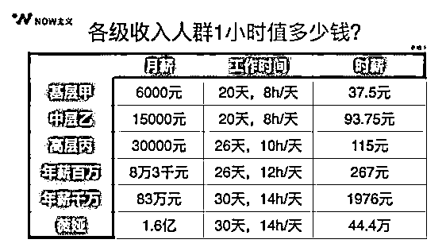

第三笔账：你的时薪达到期望了吗？若没有，目标值是多少，准备用多快速度实现？

注意，这里只算了赚钱的时间，还没算花钱的时间。实际上，我们用退休前1/3的时间赚来的钱，要支撑另外2/3的生活，以及退休后的开销，更别说孩子、父母等需要照顾的家人。

相信你已经感受到：虽然“死亡”看似遥远，但年富力强、能全力奋斗的时间其实不多。如今一谈赚钱变现，大家先找机会、找风口、找资源，却忘了外部要素可以无限多，赚钱方法也千千万，而每个人一天只有24小时，一生不过百年。若管不好时间这个唯一人人平等的资源，不关注时薪提升，把珍贵时间随手耗在杂事里，最终既浪费了时间，也很难拿到真正成果。

人一出生就在时间河流中，不能截断也无法退出，做任何事都要花时间。唯一办法是静下心，按工作、生活、家庭等板块认真经营时间，实现各阶段目标，活出想要的人生。

## 1.2 拆掉三个常见误区

误区一：以为时间经营就是管理好时间。静下来想，时间有四个特征：第一，不管你是否愿意，它都在流逝；第二，没人能人为控制它；第三，一生中做任何事都要花时间；第四，过去的时间永远不能复返。这样看，时间根本不可能被管理。好消息是，时间也是世上真正平等的资源。亿万富豪想拥有好身材，也得花时间去健身房流汗。所以，我们管的不是时间，而是自己——通过管理自己，更高效地利用时间，完成想做的事。

误区二：以为时间经营要从做计划开始。回想一下，你是否做过一张看起来无懈可击的计划表，现实却完全不是那样？更糟的是，这种循环反复出现，慢慢让你失去信心，觉得自己根本做不到自律高效。

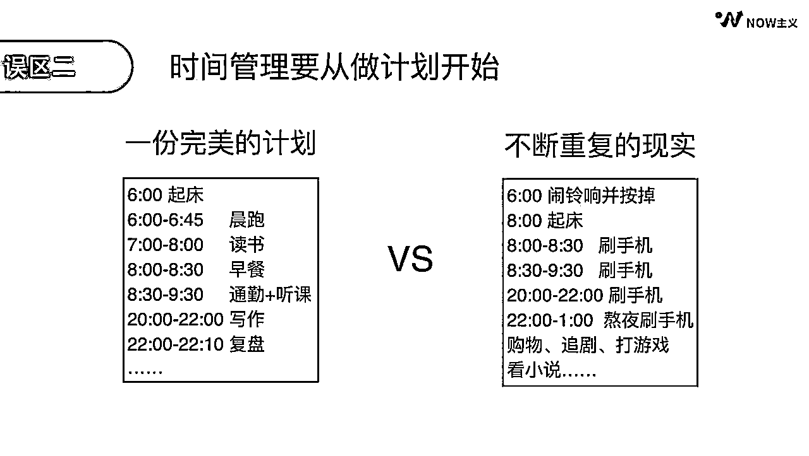

为什么看着完美的计划往往落空？根子在惯性。研究显示，人一天95%以上的行为由惯性驱动。高效人士的自律只是表象，他们早已习惯成自然。想一天就复制别人一年甚至几年养成的习惯，不现实。要变，只能一点点优化时间分配，这也是长期高效者真正采用的办法。

网上流传过一张时间表，主人是清华特等奖学霸马东涵。表上从周一到周日、早上6点到凌晨1点排得满满当当。第一眼很多人当成计划表，她后来澄清：那其实是记录表。

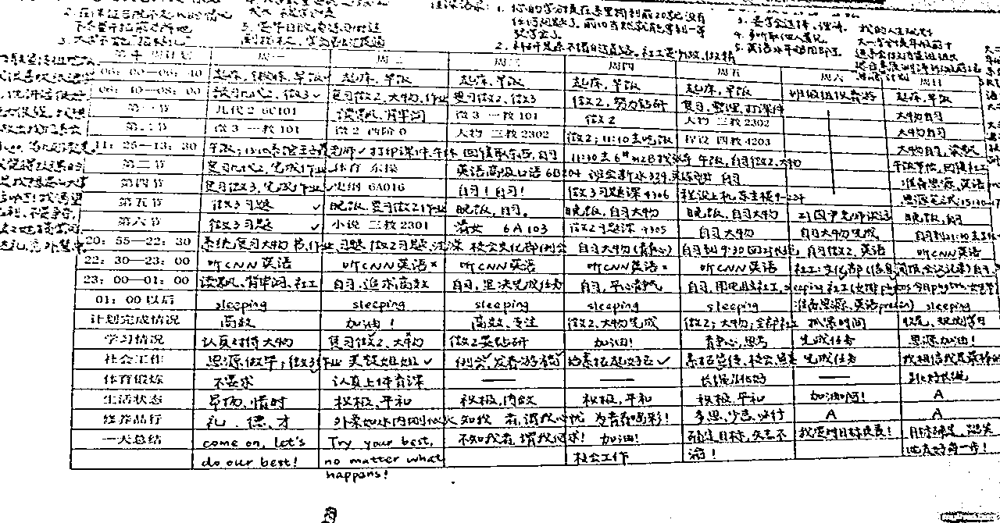

用记录去改进时间分配，才是时间经营的起点。这个方法可追溯到时间管理大师柳比歇夫。他一生写了70多部专著、12500页论文，自学3门外语，收集13000只地蚤标本，留下大量通信和回忆录，每天还能睡10小时。听完是不是很受冲击？普通人与高手的差别在于：普通人先计划后执行，缺少记录和反馈，没几天就丢到脑后；高手先记录真实用时，再复盘，找出能优化的地方，设定计划并执行，提升效率，再把执行情况记录下来，重新复盘、优化，循环往复。

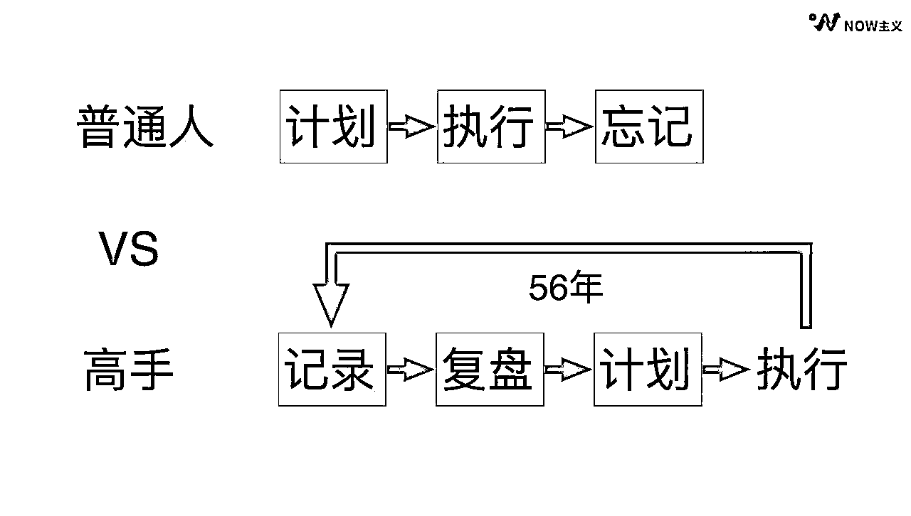

柳比歇夫把这件事坚持了56年。可见，哪怕天资聪颖、才华出众，也要在时间经营上肯下功夫，才能有杰出成就。普通人更要按“记录—复盘—计划—执行”的循环，日拱一卒，才能真正管好时间，创造价值。

想更好理解，可以把人生比作一条河：从出生起就不停向前。想改变时，没人能把长江直接搬到黄河。能落地的做法是：先搞清自己当前在哪，再沿期望方向耐心开挖新河道。所以，别迷信不靠谱的计划，正确的时间经营从记录和复盘起步。

误区三：以为计划中断=不自律。如今打卡很常见，很多打卡要求一天都不能断。大家由此认定，高手就是天天锻炼、天天读书的人。真是这样吗？高手也是普通人，会有突发状况，也会生病。除了极少数真能排除万难、天天坚持一件事的人，多数人没这个条件和能力。所以，我们和高手之间的差距，其实在如何理解自律。

普通人咬牙坚持7天，第8天被事情打断，立刻陷入强烈内疚和自责，然后放弃。高手会先接受现实，第二天接着做。拉长时间看，断断续续的积累远胜短期冲刺。可以这么想：每坚持一次，就像往家里搬一块金砖；第二天没搬，前一天的金砖也不会消失。所以中断很正常，关键是重新开始。每一次努力都不会白费，它们会沉淀成只属于我们的财富。因此，别再执着于连续打卡了，做时间经营，积累比连续更重要。

# 二、24小时怎么分

💡

时间经营第一步，先弄清时间花在哪。我们用“记录”和“复盘”帮大家了解事项与耗时。本节还会介绍经典的四象限时间配置法，以及圈友 @车纯的高效人生提出的“NOW主义”三分法：把24小时看成完整一天，把工作、生活、娱乐等所有耗时事项列出来，整体合理规划。记录工具可用推荐手机App，也可用电子工作表。现在开始记录每天的事项和用时。

## 2.1 两个同事的24小时 @车纯纯

先看一对同事：笨笨和大明。两人同期入职，笨笨单身，大明已婚，有个3岁女儿。工位相邻，工作内容差不多。但大明不到一年就升职加薪，每天神采奕奕；笨笨天天辛苦加班，忙忙碌碌却成果不多。两人只隔半米，却像活在两个世界。为什么？看看他们上班的一天。

笨笨总说自己忙到天天加班，没空运动学习；晚上觉得时间终于属于自己，刷手机常到凌晨两三点；住得远，通勤还要花两三小时。结果就是只有工作、没有生活，自嘲是弱小可怜又无助的社畜。把24小时摊开看：睡眠仅5小时，三餐平均可能只花10分钟，刷手机却占7小时；白天8小时工作低效，晚上又低效加班3小时。

同样24小时，大明却保证7小时睡眠；8小时工作未必全程专注，但能有60%-70%的时间、约5小时高效投入就够；他几乎不加班，业余用心陪家人、学习、运动；通勤路上学提前排好的课程；他认为休息和娱乐都重要，会主动安排。总体工作和生活都不错。遇到问题就面对，能解决就解决，不能解决就接纳。

再看大明的一天：睡眠7小时充足；三餐每顿平均20分钟，吃得从容；除清洁外还有1小时休息；学习和通勤合并为2小时；运动30分钟；陪家人2小时；主动娱乐2小时。关键是他8小时内高效工作，没让工作溢出到其他时段。

对照一下，你是笨笨还是大明？想高效工作、愉快生活，就一起开始吧～

## 2.2 先留痕，再回看 @车纯纯

### 2.2.1 给时间留痕

第一步是留下痕迹。《奇特的一生》中，柳比歇夫记录时间的方式非常详细。

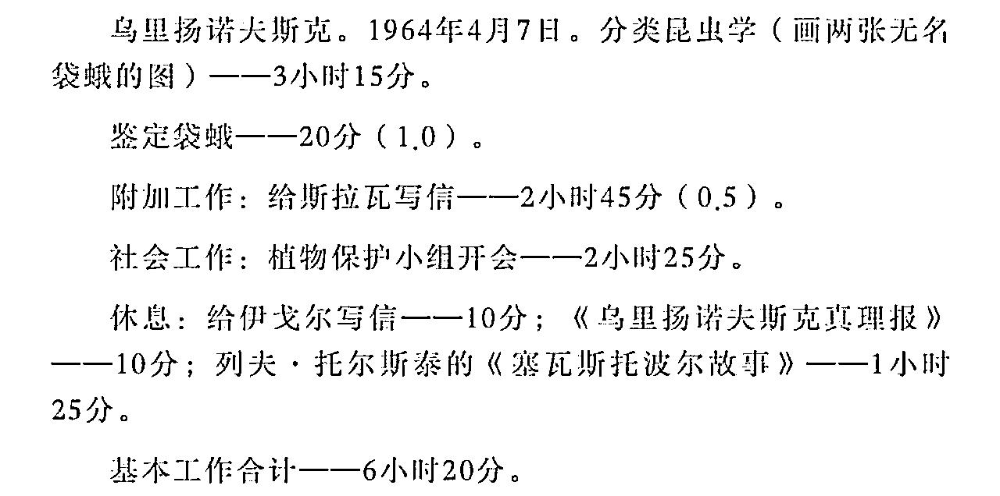

这种传统办法有效，可工作量太大，不容易坚持。为了更省力，我找到块时间App。安卓端叫“块时间”，苹果端分两个版本：免费版是“时间块青春版”，收费版是“时间块”。收费版色块能显示标签名，还支持二级分类标签，按需选择。下图是安卓版界面。

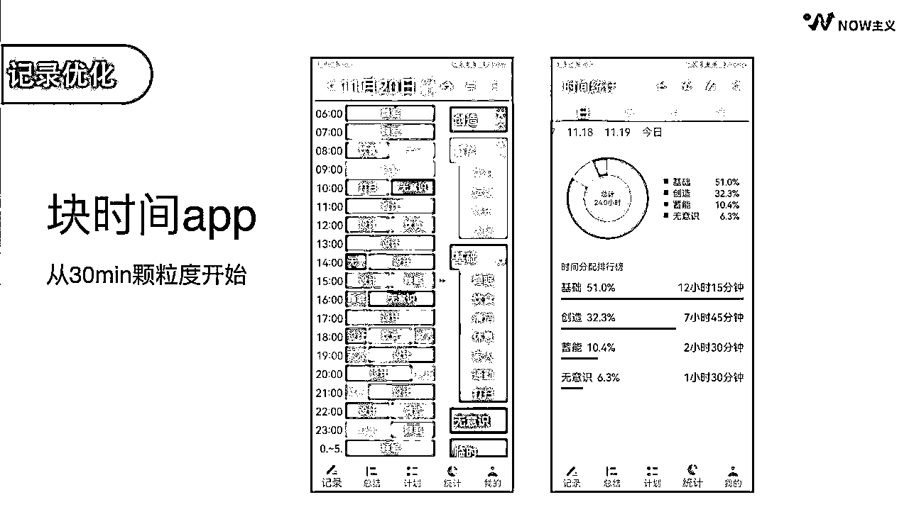

块时间的操作不复杂：在右侧栏列好常用事项分类，点选左侧要标记的时间块，再到右侧对应颜色上轻轻一点，记录就完成了。起步建议按30分钟一格，熟练后再缩到15分钟。俞敏洪、王健林等企业家的时间颗粒度，也大约在15分钟。记录本身要花多久？有工具帮忙，每天通常不超过10分钟。

有人可能觉得：这也太细了，我哪记得一天干了什么。第二个工具就是手机闹钟。第一天记录时，跟我们一起玩个游戏：从起床到睡前，每个整点设一个闹铃。听起来有点疯？这个玩法就叫“疯狂的闹钟”。

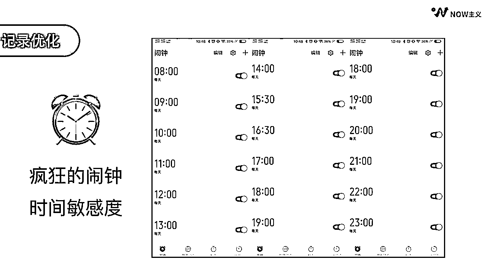

人对时间快慢的感受常和事实不符：打游戏觉得一眨眼，做讨厌的事又觉得漫长。用闹铃体验一天，先能准确知道每个小时做了什么，不会再出现“明明很忙，却说不出干了啥”的落差；其次，整点提醒能训练时间敏感度，校正主观感受。尤其对一刷手机就停不下来的人，这个办法很管用。道理简单：一旦你意识到自己正在随意浪费时间，就不太愿意继续浪费。

块时间App配合整点闹铃，就能轻松记下一天做了什么。闹铃体验一天足够，App建议至少连续记一周。这样，工作生活中每件事花了多久、任务为什么没完成，都会一目了然。你会感觉一天比想象中更不经用；但真正用心安排时，效率又会明显提升，这就是时间经营的奇妙之处。

### 2.2.2 回看

如果把人生比作河流，记录让我们知道身在何处，下一步就是回看。复盘模板很多，比如贴纸手账、九宫格晨间日记，但大多太复杂，填一份至少半小时，难坚持。怎么简化？先问“复盘到底要盘什么”。核心无非三件事：今天做出了什么成果、明天打算做什么、今天有哪些反思。回答完这三点，就能快速审视一天。

从今天起，可以按这个结构做日复盘打卡。第一次可能花10分钟，熟悉后约5分钟就能完成一份较全面、有反思、能指导行动的日复盘和日计划。

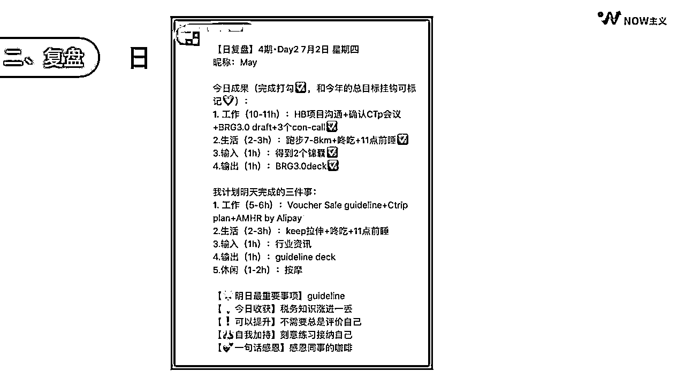

（日复盘举例）

上面的示例在模板上标出了每件事的用时，能给后续计划提供参考。复盘一天也许看不出什么，连续做一周，你就能清楚这周做了哪些事、拿到哪些成果，不再觉得时间白白流走。坚持一个月，你会得到一份较完整的月复盘表，一个月的行动收获一目了然。

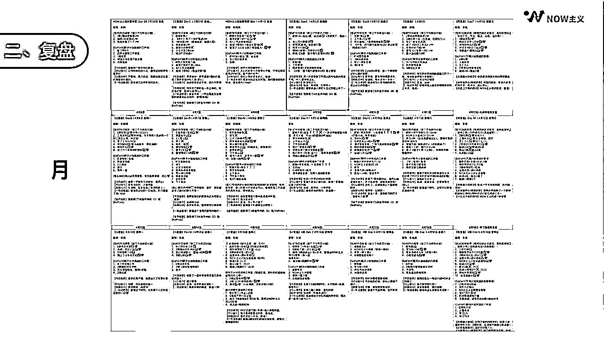

若能坚持10年，成长轨迹会清晰可见。这是我每年的年度复盘和计划表，每年做了什么、哪里进步、哪里还要提升，我都心里有数；对新一年的目标也有清晰安排和落地路径。说实话，这样的生活有安排、有成果、有盼头，感觉很好。

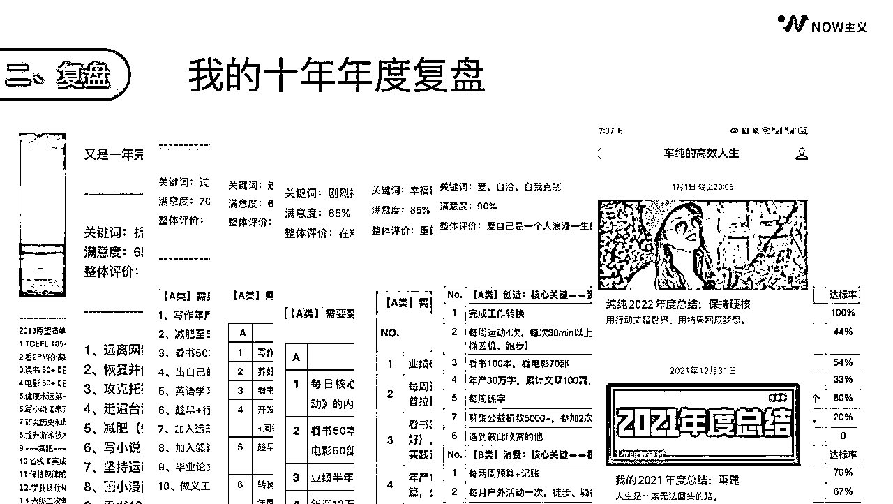

高效的人，都懂得分配24小时

每个人走的路各不相同，而复盘能帮我们看出哪里偏了、哪里该调整，让人逐步靠近更好的自己。这正是复盘最迷人的地方。如果你已经开始留意自己的时间流向，请一定把记录和复盘一起坚持下去。用不了多久，你会更懂自己的节奏，也更有底气掌控时间。接下来，顺着“记录—复盘—计划—执行”的脉络，我们来聊聊怎样做计划，才能让时间越用越高效。

## 2.3 每天的24小时，如何分配？

每个人拥有的每日时长完全一样，都是24小时；让结局拉开差距的，从来不是时间多少，而是把时间投向了哪里。

高效能者与普通人的分野，说白了就是前者更擅长规划和使用时间——既能在工作上拿出成绩，也能把生活过得有声有色。所以真正关键的问题是：一天24小时，到底该怎么排？这一节会介绍三种时间分配思路，你可以结合自己的处境来选。

### 2.3.1 按意愿排任务 @卓卓子是我🎈

这个办法，是把一天要做的事先分成“想做”“不想做”和“不得不做”三类。无论是工作任务还是学习任务，都写进手机提醒或备忘录；清单里既包括应该做的，也包括有点抗拒的，还有怎么都绕不开的。到了执行时，就交给当下的心情来选。比如早晨到办公室精神正好，我会去做产品规划、写方案这类需要大块时间和深度思考的事；午后状态变差，就处理消息、回邮件、和开发同步进度、整理需求表。这些事琐碎但难度不高，数量还不少。通勤路上偶尔蹦出好想法，我会马上打开备忘录，用语音转文字记录下来，留作以后写内容的素材。有人会问：大段时间老被打断怎么办？我的经验是主动“预约”别人。领导掌控欲强，就提前约好汇报进度的时间；同事总爱临时来问事情，就先问清楚他们上午是否需要协助。总而言之，把时间主动权握在自己手里，把别人可能来打扰的时段，挪到不需要专注的时段之外；还可以在名字后面备注“xx:xx-xx:xx可联系”。这样做，被打扰的概率通常能降低一半。不必硬性规定几点必须做什么，而是给自己足够的弹性，让大脑知道：今天要处理的就这几件，具体顺序和时间你自己拿主意。这样既不会在状态别扭时硬扛，也不会因为错过某个时间点而懊恼，更不会赔上一整天的能量。

内容源自6月8日《顺应人性的时间管理方法》@卓卓子是我🎈

### 2.3.2 经典四象限法 @车纯纯

只要聊到时间整理，很多人脑中跳出的第一个工具就是四象限图。它普及到了什么程度？几乎人人都从它开始做时间管理。

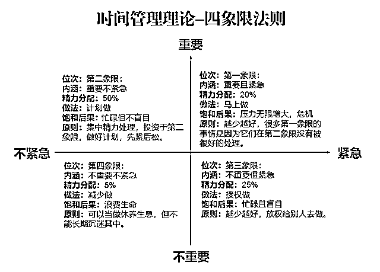

四象限按重要程度与紧急程度两个维度，把常见事项放进四格：既重要又紧急的，马上处理；重要但不紧急的，写进计划慢慢做；紧急但不重要的，交给别人办；既不重要也不紧急的，最好碰都别碰。

### 2.3.3 NOW主义：从时间出发分成三类 @车纯纯

上面这套经典方法，不少朋友已经在用，也确实有效果。但另一部分人会卡在四象限上：轻重缓急分不清，事项越列越多。如果你也有同感，可以试试圈友@车纯的高效人生 提出的NOW主义时间三分法。这套方法为什么会出现？因为四象限以“事件”为原点，只要想列，四个象限永远装得满；可事件没有尽头，时间却只有每天24小时。不考虑时间上限，很容易排出一堆根本没空做的事。再说读书和运动，它们通常被放进重要不紧急，但“不紧急”听起来就像“今天不做也可以”，慢慢就变成每天都不做，最后干脆再也不做。还有娱乐和放松，被归到不重要也不紧急，可这恰恰是人的天性：一个人可以一天不读书，却很难一天不碰手机。最后，不重要但紧急的事被建议授权出去，但并不是每个人都有条件授权，很多事别人也替你做不了。下图中列出的职场日常也印证了这一点：真正称得上重要且紧急的事，几乎全发生在上班场景里。时间久了，吃饭给工作让路，娱乐给工作让路，睡觉和休息也都给工作让路。结果是工作不断扩张，人越来越累、越来越焦虑。

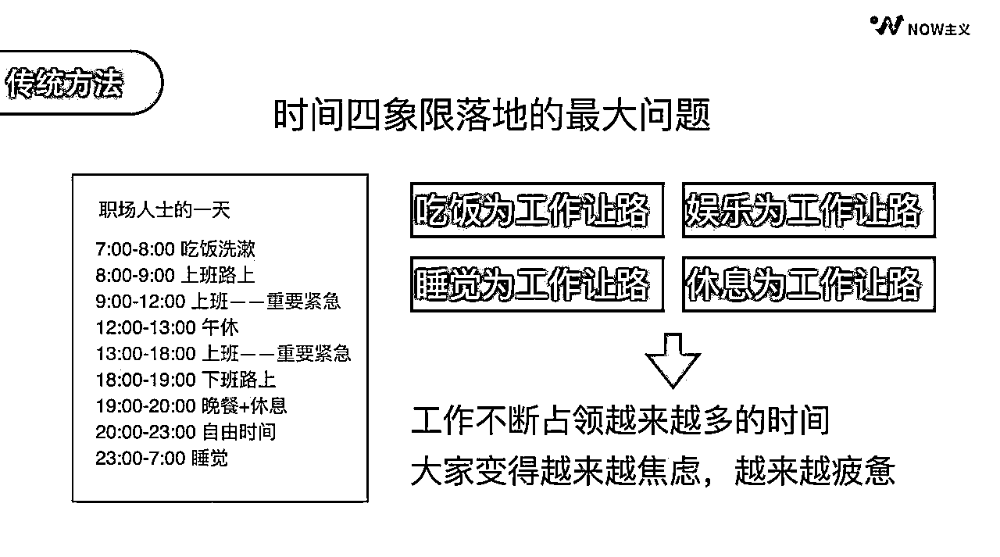

所以四象限法本身很棒，只是更适合管理“工作相关的事”。如今工作与生活的边界越来越模糊，如果只用四象限，很容易把二者放在对立面，让它们互相抢时间，形成焦虑内耗。想明白这点后，我换了一条思路：与其跟永远做不完的事较劲，不如从有限的时间出发，认真看看一天24小时究竟花在了哪里。不盘点不知道，一盘点会发现，一天里要刷牙、洗脸、吃饭、通勤、上班、午休、刷手机，可能还有运动、读书、见朋友、陪家人、琢磨自己感兴趣的事……这些事按用途可以归成三类。第一类，睡觉、饮食、清洁、休息，是生存的底座，叫基础时间。第二类，学习、运动、娱乐、爱好，是让身体和精神恢复电量的时间，叫蓄能时间。第三类，主业、副业、做公益，本质上都在创造价值，叫创造时间。人终究是社会性动物，免不了要与人合作：基础部分有照顾家庭，蓄能部分有经营关系，创造部分有协作推进。我把这套分法命名为NOW主义时间三分法：基础时间是生而为人的必需，蓄能时间是为身心充电，创造时间则是创造价值、与社会交换。这样分，也能帮人更清楚地看见每件事的分量，少一些无意义的内耗。比如休息属于基础时间，本来就该被满足，不必因为想休息而羞愧，也别为了别的事拼命压榨它。家庭是情感根基，人需要花时间在家人身上，这是底层的精神需求，也是幸福的来源之一；用“太忙了”搪塞，最终骗不了自己。娱乐承受的误解最多。主动娱乐是健康正向的，也是人很基本的需求；刷短视频不必有负罪感，你可以主动安排每天刷多久，然后在那段时间里尽情享受快乐。下表的结论很清晰：工作只是人生的一部分，不该也不能随意挤占其他时间。

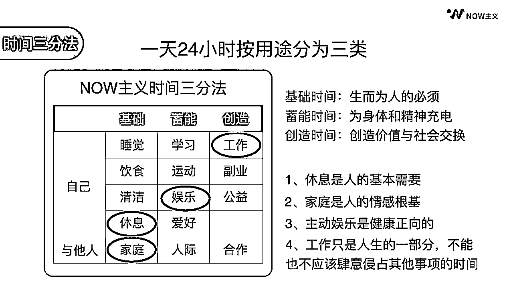

那么问题来了：基础、蓄能、创造这三类，从时间管理的角度排重要性，你会怎么排？

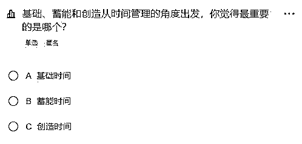

很多人第一反应会把“创造时间”放最前，毕竟它直接连着赚钱，赚钱难道不是头等大事？但冷静想想，要赚钱，先得有一个健康精壮的身体和稳定的心理状态。所以基础时间里的吃饭、睡觉、清洁、顾家，才是最基本的生存需要，也最该被重视。第二重要的其实是蓄能时间，因为到了创造阶段，你必须直接拿出成果。没有老板招人是为让你来学习的，他们要的是你立刻为公司创造价值。可现实中，许多人恰恰忽略了专门安排时间学习、运动、自我充电、精进技能。于是我们常看到一个人工作五年后，身体疲惫，知识储备见底，很难支撑下一步的职场发展。这往往就是把三类时间的优先级搞反了。从基础到蓄能再到创造，是一路赋能的过程；反过来走，就是不断消耗自己的过程。

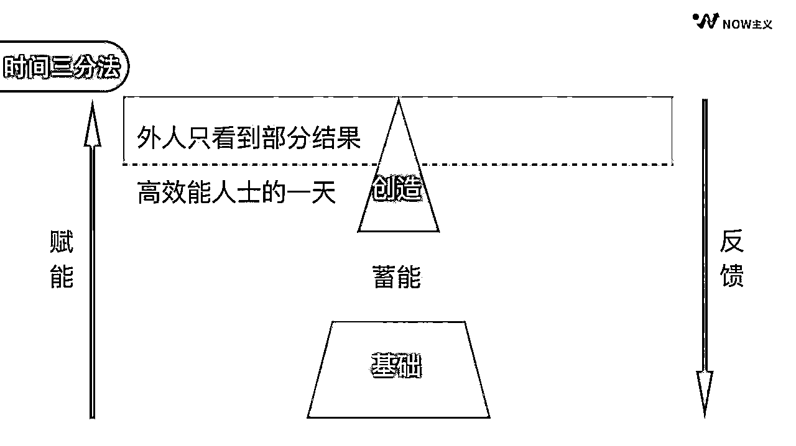

一个真正高效的人，一天的结构通常都符合这个顺序。但外人往往只看见表面的成绩，误以为他把全部精力都投给了工作。回头再看笨笨和大明，两人状态为什么差这么多？答案已经很明显：笨笨基础时间太少，精力跟不上；蓄能时间又太单一，低质量娱乐和超载工作占据了大半。大明则基础时间给够，精力在线；蓄能安排丰富；工作时间稳稳控在8小时以内。这样的大明即便偶有加班，也能很快调回来，回到让自己满意的工作生活平衡状态。

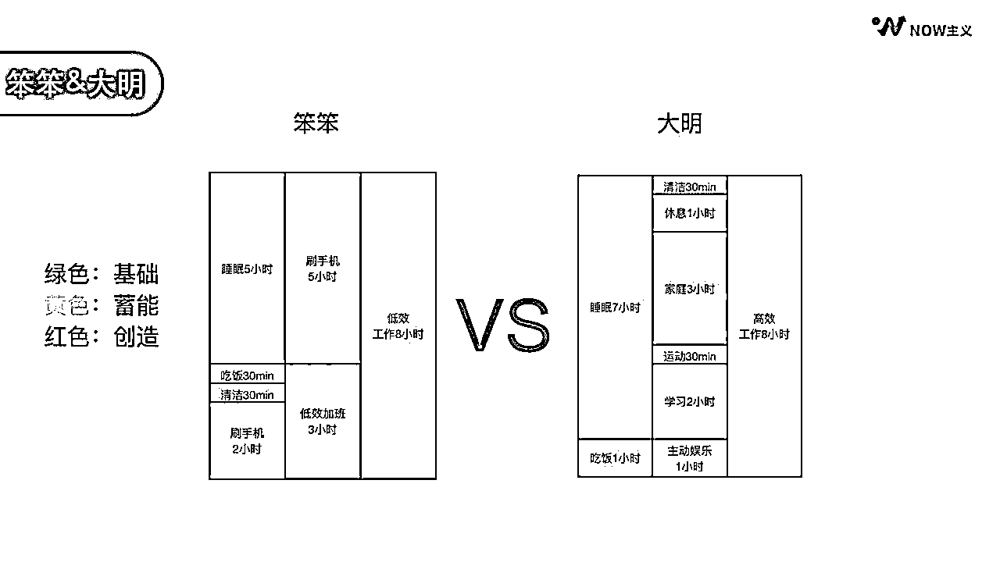

这里再给大家几张不同角色的时间分配参考。同样是高效运转的职场人，单身和已婚在基础时间的大部分以及创造时间上不会差太多，真正的差别出在蓄能安排上：单身的人会把更多时间拿去发展社交和爱好，已婚的人则可能把其中一部分分给家庭。

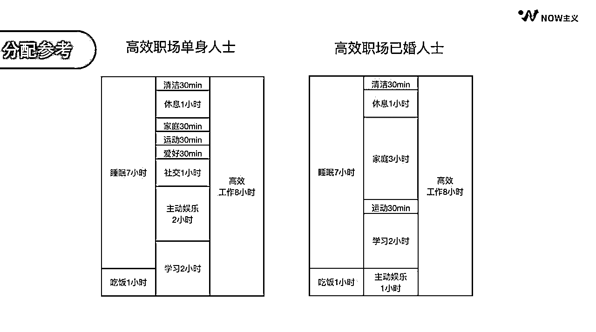

再看创业者，创造时间比8小时再多出3个小时也不少见。但不管创业多忙，人都要留时间陪家人。没有亲密关系兜底，赚再多钱也很难真正幸福。高效的学生通常也比别人花更多时间学习，同时还会安排朋友社交和娱乐。

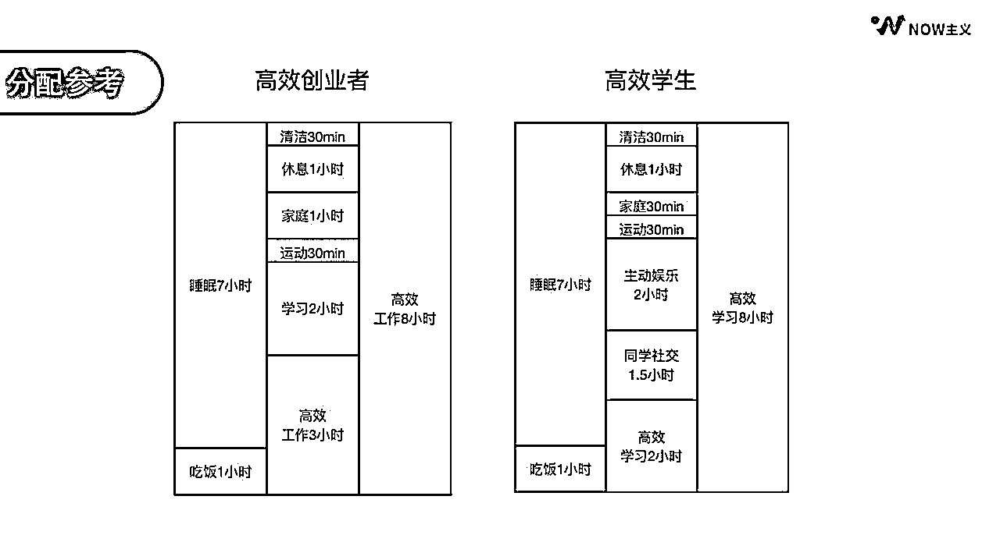

全职父母则很不一样，大部分时间都投入到家庭经营里。我特别把基础部分的“购物1小时”列出来，因为这也是全职父母在家的重要工作。相比之下，做兼职的宝爸宝妈为了凑出足够的工作和学习时间，可能会和家人商量压缩家务，也会主动砍掉部分娱乐。

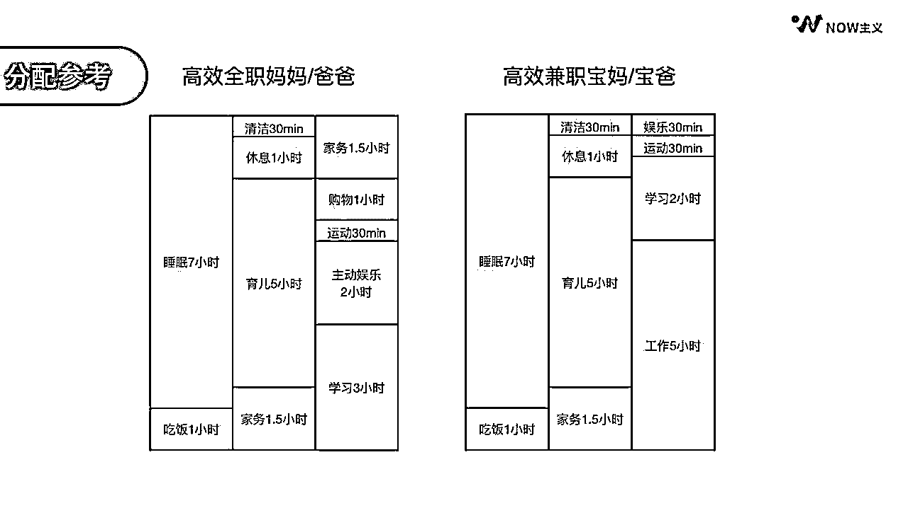

每一张高效时间表背后，都是一个用心经营工作和生活的人。每个人一天都只有24小时，处在不同人生阶段，分配比例自然不同。关键在于有觉知地主动安排和协调，而不是被日子推着走。

## 2.4 练习：记录时间并优化分配 @车纯纯

方法聊完了，现在可以行动起来。从记录和复盘开始，建立自己的时间日志。第一步，做时间记录。你可以下载块时间App辅助记录，也可以用工具包里的时间日志表格，方便之后统一复盘。下载入口：《时间管理 | 实战工具包》。时间日志表格的概览如下：

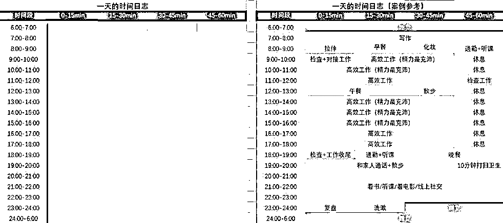

第二步，优化时间分配。做好日志后，结合记录内容可以完成一个小练习。模板很简单：先按【基础-蓄能-创造】把一天24小时拆开，列出属于自己的事项；再写下优化动作；最后写一句鼓励自己的话。参考案例——基础：睡眠、饮食、清洁、休息、通勤、打扫、化妆、和妈妈通话；蓄能：读书、散步、拉伸、看漫画、刷微博、链接朋友；创造：规划、IP、引流、产品、内容、运营。优化动作可以是：1. 人际关系投入偏少，开始每天上午11:30-12:00联系一位朋友；2. 睡眠时间从12:00提前到11:30；3. 固定早上起床到10点为完整输出时段。鼓励语：慢慢来，比较快。这个模板也放在工具包的第二个子表格里，同样可以下载使用。

# 三、优先规划创造时间 @车纯纯

第一个要规划的，就是创造时间。为什么？因为大多数人现在花费时间最多的不是睡眠，而是创造。看看身边，八小时工作制早就被冲破，工作正在渗进生活的方方面面。创造时间因此成了最费时的一块，工作时间长、效率上不去也是普遍的烦恼。如何提升工作效率，确实是一个非常重要的课题。如果先排基础时间和蓄能时间，你多半会觉得“根本没有时间去做”；可一旦先把创造时间划定，再安排蓄能时间和基础时间，压力是不是就小了很多？高效的工作规划一共五步：列任务、估时间、留缓冲、排顺序、做回顾。乍一听可能有点晕，别担心，接下来展开来讲每一步。你会发现，每一步都对准一个真实的效率痛点。

## 3.1 高效工作规划的具体做法

### 3.1.1 第一步：把任务分门别类列清楚

不少人的待办清单是想到什么写什么，这样最容易漏掉事项。更清晰的做法，是先分类再罗列。日常任务大致有四类：每天都要做的常规性任务；今天原计划推进的事；昨天没完成顺延到今天的工作；今天临时新增的任务。把这四类分别填进清单，基本就不用担心遗漏了。

### 3.1.2 第二步：估算任务耗时

清单列好之后，要判断每件事到底需要多少时间。你有没有过这种感觉：今天只排了两项任务，觉得太轻松了，结果一天结束，时间全花光，也就只做完这两件事。这是为什么？时间管理领域有个著名的帕金森定律：工作会自动膨胀，直到占满你所有的时间。它带给我们的启示是：预留的时间越多，任务消耗的时间也越多；留得过宽，反而拉低效率。不用太担心，通过前面坚持记录和复盘，你会逐渐具备精准预估的能力，尤其是那些经常重复的独立任务。比如我每天会花5分钟做日复盘，写一篇2000字文章大约需要2小时，阅读熟悉领域书籍的速度大约是3万字/小时。当你有这些来自复盘的判断，就不会再给自己留出太多水分，也不会在不知不觉中把时间放走。

### 3.1.3 第三步：给意外留出缓冲

工作中，除了能预估的常规任务，还一定会有新任务出现。常规任务这边，哪怕准备充分，也可能刚迈出第一步就出状况，后面不得不花大量时间补救，原计划全部打乱。新任务这边，一个接一个地插进来，最后可能连一半计划都没完成。遇到这两种情况怎么办？这里需要引入另一条定律：墨菲定律。它说的是，事情只要有变化的可能，哪怕概率极小，也终归会发生。换句话说，只要碰到不熟悉的任务，准备得再周全也可能出错。所以面对新任务、陌生领域或新技术，一定要给自己多留时间。我自己的做法是预留3到5倍的时间，并且不在初期准备上投入太多；未来本来就不确定，不如先开个头，边做边改。可能有人觉得3到5倍太夸张。如果能用1到2倍时间完成，当然最好；但为了覆盖未知风险，多留几倍是更稳妥的选择。另外，每天还可以留出40%的时间给意外事件。以工作8小时为例，我会先空出2到3小时不安排。要是当天没有突发情况，就把原本第二天要做的事提到今天，或者用这段时间学习提升。所以说，计划不是排得越满越好，留出机动和盈余，才真正让人心里有底、节奏从容。

### 3.1.4 第四步：先定时间，再排优先级 @车纯的高效人生@ T_T

很多人会纠结一件事：常规任务和新增任务堆在一起，到底先做哪件？方法其实很简单，三步走——先排固定时间，再排重要程度，最后按预估用时安排进日程。举个例子，某天我总共有5项工作：早上7点发营销日历，制作给客户的提案，撰写业务文章，推进新项目的营销方案，下午1点和B客户通电话。时间是硬条件，所以先把两件固定事项定下来：7点发营销日历，1点到1点半与B客户通电话。剩下三件按重要程度标成A1、A2、A3，预估用时分别是3小时、1.5小时、1小时。A1最重要，排在上午9点到12点；接着1点半到3点做A2，3点到4点做A3。排完这些，仍然要应对新增事项：突发情况、计划外的紧急事件，或者一些不断干扰你、却不那么重要和紧急的事。需要注意的是，新事项不一定都要自己做。判断下来不是自己的责任，就可以果断拒绝；判断可以授权，就分派出去。轮到必须自己做时，2分钟内能解决的，顺手做掉；2分钟内解决不了，就放回事项清单，和其他任务排在一起，再决定是立刻处理还是另找时间。整体来看，可以把工作事件分成三类：A类是自己必须亲自处理的计划内重要事项，既包括重要紧急的，也包括重要不紧急的；B类是突发性、计划外的紧急事件；C类则是那些带来内外干扰、但重要性或紧急性都不高的事。

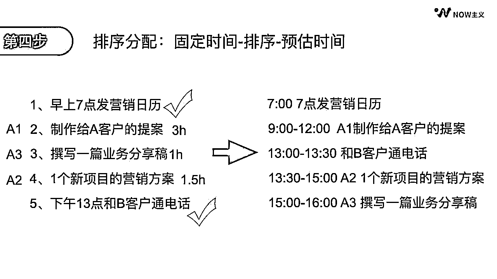

# 三、执行有章法：先分类，再匹配精力

分好类之后，真正关键的是“按什么次序动手”。我的原则很明确：A 类事项必须落到实处；B 类可以先放一放，或者转手给别人，能不由自己扛的就尽量分出去；C 类则直接划掉，顶多留一行文字备查。

另一条重要心法，是把每天的 A 类要事嵌进精力最旺盛的时段，这就是“高能要事”。普通人效率最高的窗口，多半出现在刚醒来那两三个小时。拿我自己来说，上午九点往后的一两个小时，以及下午两点以后的一两个小时，注意力最容易聚拢。若几件事紧急度接近，我会把 A 类中最费脑子的那件放进这些窗口；要是事情本身就火烧眉毛，那就先灭火。有人会问：两个任务实在分不出轻重怎么办？真相是，不存在完全平级的两个任务——并排一放，总有一件压过另一件。把当天的事项统统摊开，孰先孰后自然就浮出水面了。当然，每个人节奏不同，按自己的高能时段来调就好，有些人偏偏是夜深人静时脑子最透亮。

内容参考：《高能要事：如何通过时间分类来提高时间管理效率》

### 3.1.5 第五步：检查回顾

另一种熟悉的窘境是：白天脚不沾地，临下班一翻待办清单，竟还有好几项纹丝未动。这到底是为什么？

原因在于，我们的大脑并不擅长同时兜住太多事情，所以清单列好之后，必须反复回头检查——说白了，就是一天里多照几回镜子。头天夜里，借着日复盘把第二天的安排写下来；清早踏进办公室，头一件事就是核对当天的待办清单；下午开工之前，先盘点上午的完成度，顺手把下午的计划调一调；临近下班，再确认一遍今天的事项是否收尾。这样算下来，到下班时已经查了四轮，漏项和延误基本可以杜绝。

把高效工作计划的完整链路串一下：第一步，把当天所有任务摆上台面；第二步，给每项估个耗时，再从中抠出一块机动余量；第三步，排序分派——时间固定的先占位，剩下的按轻重缓急填进去；第四步，每天至少回看三次，确保件件有交代。

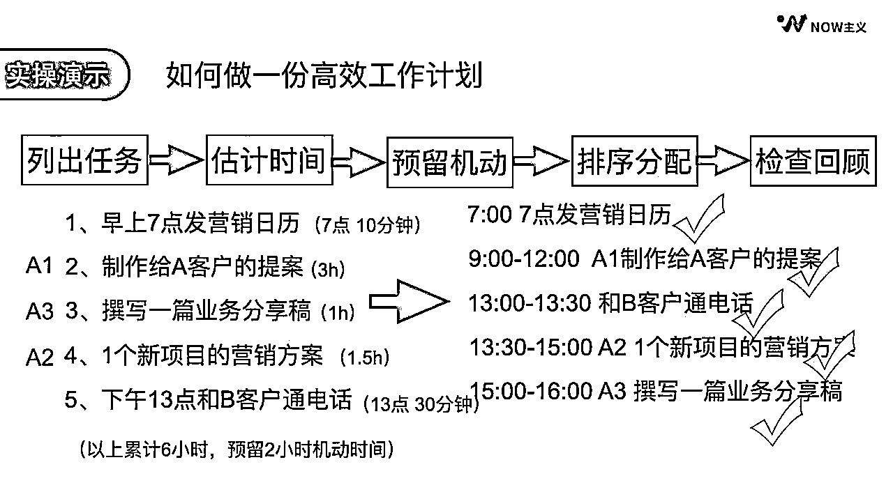

这五步值得反复咀嚼，练得越多越熟，学完立刻上手，才算真把知和行拧成一股绳。

## 3.2 工具：顺手比高级更重要

Excel 表格胜在直观、好存档，适合那些大部分工作时间都泡在办公室的人；日事清 App 则更贴合节奏灵活、时常在外跑客户或出差的伙伴——它能以周为单位铺排整周计划，一眼看过去清清爽爽，手机、电脑、网页多端打通。

工具本身没有高下之分，差别只在你怎么使唤它。挑一个合你脾气的，今天就把行动跑起来。

# 四、基础时间：先把底盘稳住 @车纯纯

借助时间管理三分法，一天的二十四个钟头可以切成基础、蓄能、创造三块。三者之中，基础时间分量最重——它涵盖睡眠、饮食、休息、清洁，还有陪伴家人。

这一节要聊的是基础时间规划的四道工序：记录、调整、固定、优化；同时也会带大家认识一个老牌时间管理工具——番茄钟。基础时间是人生的地基，也是日日必做之事，规划时盯住一个目标就够了：尽量规律。

## 4.1 基础时间凭什么优先安排？

睡得踏实，白天才有本钱迎战各种难题；吃得对路，身体才能及时补上燃料；休息到位，体力和脑力才不会提前透支；清洁做足，整个人看起来清爽体面，自己舒服，旁人也舒服。

还有一点要单独拎出来说：“陪伴家人”同样归在基础时间里。亲密关系是幸福生活最底层的支柱，若拿工作忙或要自我提升当挡箭牌，长期缺席家庭，代价往往超出想象。

## 4.2 四道工序，把基础时间排明白

基础时间大体围绕睡眠、饮食、清洁和家庭展开，规划起来并不复杂，分四步走：记录、调整、固定、优化。

第一步：记录

人本质上是惯性的动物，大量举动都在“无意识”状态下发生，基础生活领域尤其如此，只不过我们很少跳出来，用旁观者的眼光审视自己。而睡觉、吃饭、清洁、陪家人又是每天都逃不掉的，日积月累，悄悄溜走的时间相当惊人。

就拿早起来说，不少人眼睛一睁开就抓手机开刷，等回过神来，半小时甚至一个钟头已经没了。这个藏得很深的坏毛病，不光吃掉了一天中最金贵的晨间光阴，还让大脑一大早就被最刺激、最容易到手的信息灌满，等到白天面对真正棘手的任务时，反而聚不起神。

所以，记录的意义在于：把自己从睁眼到下床、再到入睡的整条时间线完整记一遍，揪出那些惯性行为。

第二步：调整

举个例子，记录之后你发现每天睁眼就刷手机，一直刷到非起不可，那不妨把睁眼后的这段时间改成——立刻坐到书桌旁，读上半小时或一小时的書。同样一段光阴，就从“刷手机”变成了“阅读”。

再比如，有姑娘记录后发觉，早晨光是想穿什么、换来换去就要耗掉半个多小时。那就把“搭配衣服”这件事挪到前一晚睡前，顺便把衣橱理一理，备好几套固定组合，第二天早上直接拎一套穿上就走。这些一点一点抠出来的时间，日复一日攒起来，能省下的浪费相当可观。

第三步：固定

想改掉一个旧习惯，办法是用新习惯去顶替它。但旧习惯之所以根深蒂固，是因为它在我们的生活惯性里扎了很久。所以，当“早起看书”替换掉“早起刷手机”之后，还得再撑一段时间，靠反复重复把它焊稳，让好习惯彻底把坏习惯挤出去。

第四步：优化

原则上，基础时间越规律越理想，比如固定钟点睡下和起床，固定时长刷牙洗脸。在这个过程里，还能继续发现可以打磨的空间：刷牙的同时把鸡蛋煮上；休息时靠墙站着，一边看喜欢的片子；打扫这件事拆成每天到家后十分钟随手收拾，再在每周五或周六抽三小时来一次彻底大扫除。这些细枝末节的优化，都是在做的过程中慢慢体会出来的，久而久之会形成一套属于自己的基础时间高效打法。

拿我自己举例：睡觉通常落在 23:30 到 00:00 之间，早上 7:00 到 7:30 起身；三餐时间比较稳，早饭 8:15—8:30，十五分钟，午饭 12:00—12:20，二十分钟，晚饭 18:20—18:40，也是二十分钟；洗漱方面，早上化妆三十分钟，晚上卸妆十五分钟；打扫是每天十分钟随手做，每周五或周六再花三小时大扫除；家庭方面，每天至少通话三十分钟；休息则每工作五十分钟就歇十分钟。

记录一段时间之后，你对自己的基础时间就会心里有谱。这部分是每天的刚性开销，千万别为此焦虑。既然饭总是要吃的，那就吃的时候别再惦记工作、惦记客户，安安稳稳把饭吃完就好，其他基础事项也是同一个道理。

这里有两件事要特别提一下：

睡眠。想过上高效生活，头等大事就是规律且高质量的睡眠。睡眠这事儿不适合一上来就硬排，可以分三步来优化：第一，监测睡眠；第二，找到规律；第三，优化作息。市面上记录睡眠的工具不少，睡眠手环、睡眠手表、睡眠软件等等，按自己的实际情况挑一个顺手的就行。偶尔熬夜或偶尔失眠都很正常，关键在于能通过监测和调整，及时回到规律睡眠的轨道上。圈友杨涛也分享过改善睡眠的心得，有需要的可以跳到 10.3 去看。

及时休息。如今办公大多是坐着的，但久坐的杀伤力远比我们以为的要大。

第一个事实：久坐跟不少疾病都挂钩。比如容易招来颈椎病、腰椎间盘突出，肌肉量往下掉，内脏脂肪往上走，二型糖尿病风险增加 88%，心脏疾病风险增加 14%，肺癌风险增加 27%，肠癌风险增加 30%，子宫癌风险增加 28%。这些数字准不准不必死磕，记住一条就行——久坐会波及身体的方方面面。

第二个事实：运动和久坐并不能互相抵消。也就是说，哪怕你每天运动两小时，也补不回久坐六七个小时甚至十小时以上给身体造成的亏空。所以，比起拼命加运动量，及时休息可能更值得优先考虑。

## 4.3 工具推荐：番茄钟

一说到休息，很多人脑子里会蹦出那个经典工具——番茄钟。它以三十分钟为一个单元来工作或学习，里头包含二十五分钟专注加五分钟休息。背后的道理是，人的专注力大概只能撑十五到二十分钟。

从理论上看很科学，但 25+5 这套节奏搁职场里并不完全好使，原因有三：其一，二十五分钟太短，不少人刚摸到状态的门；其二，职场中很难每二十五分钟就起身溜达或去倒杯水；其三，办公环境里被打断才是家常便饭，二十五分钟全神贯注多少有点理想化，未必真能兑现。

所以，可以把休息模式切换成每工作五十分钟、歇十分钟。五十分钟里心无旁骛干活，然后拿十分钟集中放松——倒个水、上个卫生间、做几个简单拉伸，顺便瞄一眼手头进度。最简单的落地方式就是用电脑桌面闹钟提醒：苹果 iOS 系统可以装 Be Focused，Windows 系统自带的闹钟就够用了。

另外，每次休息完还可以换换办公姿势：第一个五十分钟坐着，第二个五十分钟站着。现在能帮忙切换站坐姿的桌上桌、落地桌选择很多，按需添置就行。

把前面的记录和梳理串起来，就能得到一份按时间轴排好的基础安排。也许记了几天你就会发现，每天早中晚都有一些固定行程，这些事天天都得做，而且越规律越省事——用行为惯性去节约意志力，这笔账很划算。

# 五、蓄能时间：给身心充电 @车纯纯

创造时间用来换钱，基础时间守住身心健康，蓄能时间则顾名思义——在工作之余给大脑、身体和人际关系补能量。它包含学习、运动、娱乐、爱好和人际五个方向。

蓄能时间的规划分三步走：第一，做计划；第二，粗估各项耗时；第三，以周为单位提前铺排。动手做蓄能规划时你会发现，方向很多，却未必能精确定到某天某刻，所以心里要装着一句话：完美的一天难求，完美的一周可期。具体怎么操作，接着往下看。

## 5.1 蓄能时间有什么用？

学习让我们攒下更多知识和认知，去拆解复杂未知的难题；运动提升身体素质，同时也是释放压力的上佳出口；娱乐本身是正常且积极的需求，主动把娱乐时间安排好，才能心安理得地享受；爱好承载着我们对世界的好奇心，多给我们一个打量世界的角度。

人际关系同样属于蓄能板块。经营人脉很像往银行里存钱，平时一点点往里存，需要用的时候才取得出来，这部分时间也得提前预留。

## 5.2 三步做好蓄能计划

蓄能时间大致分三步：做计划、粗估耗时、以周为单位提前安排。

拿我自己当样本，我的蓄能时间覆盖学习、运动、娱乐、爱好和人际。规划时先把每类想做的事列出来，再逐项估时间。比如：学习方面，啃完一本《影响力》大约要八到九个小时；运动方面，一周健身三次，每次两小时，再加上一小时路上的时间和清洁时间，合计九小时；娱乐方面，想看一部两小时的电影、一部三十分钟的纪录片，每天还想刷十五分钟漫画、三十分钟微博；爱好方面，希望周末能挤出一小时练字，若碰上超过一天的空档，就去户外爬山或徒步；人际方面，希望每周线上联系一位朋友，线下安排一次社交。

大家多半也碰过这种场面：中午吃饭想找部下饭综艺，结果挑了半天，饭都扒完了节目还没选出来；或者晚上好不容易得空想看书，翻来翻去找不到想读哪本，时间就这么溜走了。所以做计划时，务必提前把要读的书、要看的电影、要做的运动敲定，别让临时决策偷走时间。

我的常规蓄能安排大致长这样：

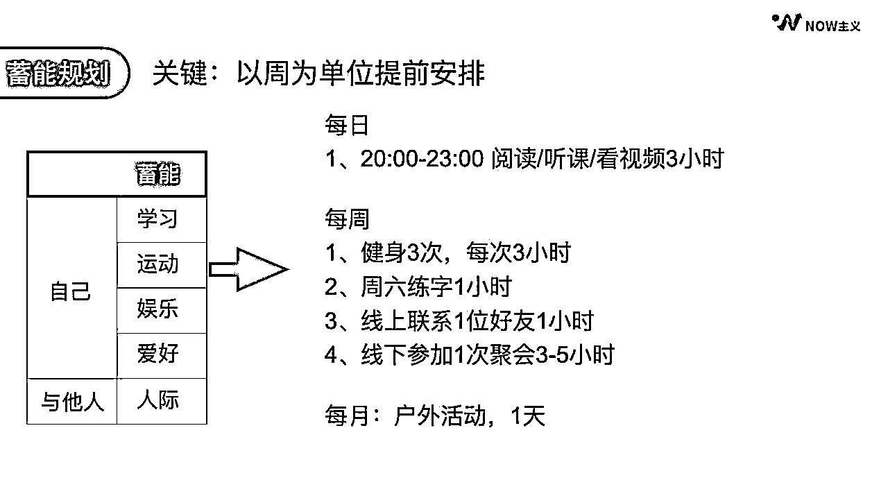

这套基础模型定下来之后，往后的蓄能安排就可以照着这个架子来搭。

## 5.3 蓄能规划的几个提醒

以周为单位提前铺排。做蓄能规划时要拎清：完美的一天不可得，但完美的一周可以有。

不妨看看，按基础和蓄能这样搭配下来，美好的一周究竟长什么样。我们来瞧瞧大明的一周是怎么安排的。

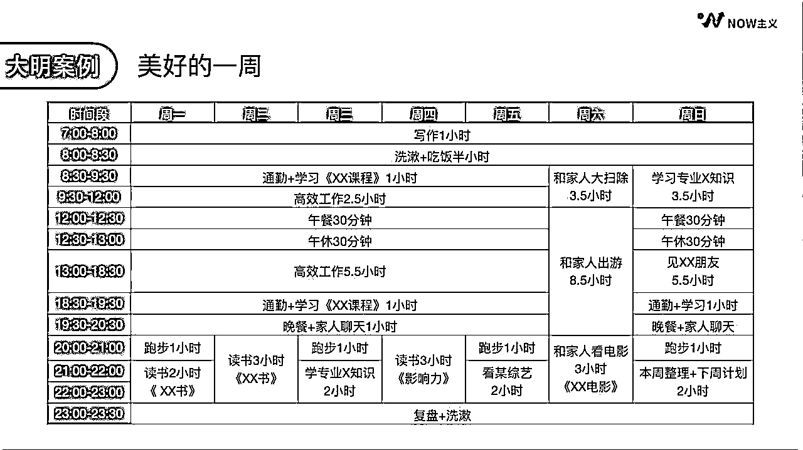

从图中能读出，大明每天清晨的节奏都很稳，周末和工作日作息一致，整个人的状态会更规律、更健康。而且因为内容和耗时都提前敲定了，基本上都能落地执行。这样的一周，充实、丰富且愉快。相信只要持续记录复盘、合理规划并践行，我们也能拥有同款完美一周。

## 5.4 【练习】时间三分法综合练习

了解了基础、蓄能、创造三类时间的规划思路，现在就试着用时间三分法，把自己的各类事项排一排吧。

模板比较长，这里用图片形式呈现，你可以在工具包表格的第三个子表格里找到它，下载使用：《时间管理 | 实战工具包》

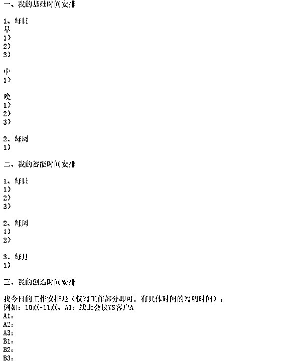

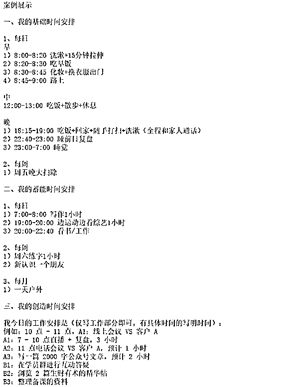

# 六、效率怎么往上提 @车纯纯

记录时间的过程，本质上就是把时间变“看得见”。把每个时间块想象成一块乐高积木，时间就是那堆有限的积木，而时间管理，就是用这些有限的积木去搭建自己的人生。

时间总量有限这个大前提下，怎么把时间利用率拉高，就是绕不开的课题了。深耕利用率可以从四个方向切入：第一，抬高单位时间的产出；第二，让时间被精准使用；第三，让时间被精细打磨；第四，让时间产生叠加效应。下面逐一拆解每个方向怎么操作，快来学一学，顺手优化你的时间安排。

## 6.1 怎么抬高单位时间产出

想抬高单位时间产出，先得搞清楚效率低下的病根，主要有三个：

第一，不想做。原因五花八门，比如被情绪搅乱，这部分会在情绪管理那一节细讲，这里先做个整体扫描。这种“不想动”的感受，可以用“混沌”二字概括——不管是情绪还是做事，仿佛都罩着一层雾。破解之道就一条：从混沌走向具体，看下面这张图你就懂了。

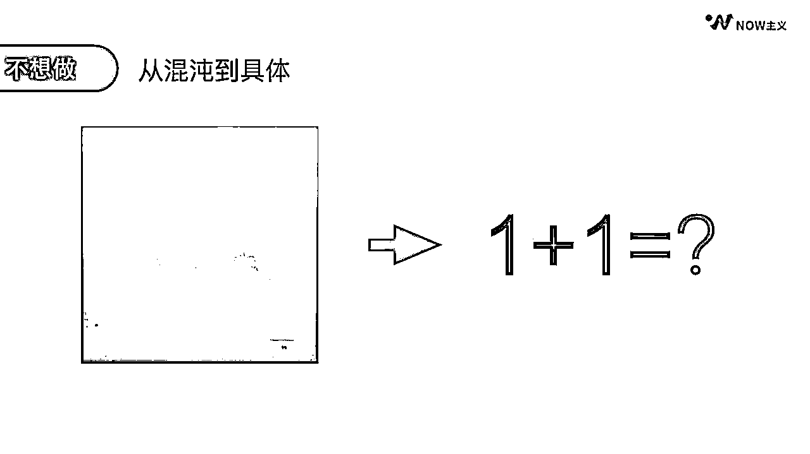

左图传递的是一种模糊、发懵的体验，就像面对一个复杂任务，脑子里一团乱麻，不知从哪儿下手。

可目光落到右图，大脑几乎条件反射般蹦出 1+1=2。这就是“具体”的威力——它能帮你绕过情绪的迷雾，拽着大脑直奔解决方案。

做事的时候你大概也体会过：只要开了头，越干越来劲。因为越做越具体，人就越有底气；反之越不开工，事情越糊成一团，最后整个人被焦虑吞掉。所以从“不想做”到“动起来”，你缺的只是一个开头。送大家一句很好使的口诀：“我就先做五分钟。”甭管问题多难多绕，先试五分钟再说。一旦手碰上具体的事，注意力就会从焦虑那边挪到解决方案这边，行动自然就发生了。

第二，想做但不会做，或者思路不清。开了头之后，也可能撞上不会做、想不明白的坎，照样拖低效率。这时候就得把大事拆小，拆解路径一般分三步：第一步，确认目的；第二步，确认有多少时间；第三步，确认这件事要做到什么标准。

举个场景：领导让你做一份 PPT，你该从哪儿下手？接活的第一时间，就按上面三步逐一跟领导对齐。摸清需求之后，再按做 PPT 的流程和耗时往下拆：第一步，把已有的 PPT 资料整理出来，一小时；第二步，写大纲文案，一小时；第三步，制作 PPT 并配图、配图表，大约四小时；第四步，加动画、转格式、检查 PPT，约莫半小时；剩下一个半小时留作机动。这样，一个大任务就被切成几块小任务，再结合手头的实际情况塞进事项清单。

碰到新任务，怎么快速摸清拆解门道？给一条思路：千万别花时间从零原创，一定去找别人的模板来改。很多你头一回做的事，早有人做过并总结出经验了，别重新发明轮子。当然，把已经会的事重复做，也未必自动带来效率提升。

第三，会做但注意力拢不住，导致效率低。注意力涣散大致分两类：一类是被外部打断，另一类是自己定不住神。沟通是协同工作绕不开的环节，但也正因为这些沟通，我们常常在工位上随时被截断，而且一旦断掉，再回到工作状态就很难，效率很受伤。这里教一招特别好用的：给自己划出防打扰时间，提前把免打扰时段圈出来，集中火力处理关键任务。

# 先发制人：把打扰挡在门外

拿部门协作来打样，财务部可以拟一份这样的告知：各位同仁上午好。公司近期经营势头不错，业务量也跟着水涨船高，财务这边待办事项一下子多了起来。所以我们打算把每天上午十点到十二点留给自己内部消化事务。需要跨部门对接的伙伴，麻烦集中在早上九点到十点、以及下午一点之后这两个窗口来找我们。多谢理解。

若你是甲方要催稿，不妨这样开口：白云早安，我是A公司这边跟您对接文案的黑土。需求我们已经发过去了，烦请您在今天下午一点到三点之间把初稿回传，我这边会在四点前跟您敲定，辛苦了。

面试安排也可以提前打招呼：烦请把我的面试统一排在周三下午一点至四点；万一有变动，我会第一时间告知。

日常对接可以这么回：收到，上午我得先把A项目那份材料处理掉，下午三点前给您，您看行不行？

自由职业的伙伴可以跟身边人这样交底：大家好，我上午一般用来集中产出内容，回消息会偏慢，有事尽量放到下午一点以后找我。

所有事情搅在一块儿的时候，效率往往最差。可要是你抢先一步，事先跟别人把沟通时段敲定，就能把一天切成两块——专心干活的时段和集中对接的时段。该沉下去做事就沉下去，该对外交流就一口气处理完。这两块时间，就都成了高效时间。

所以说，防打扰的诀窍就四个字：先发制人。提前把时间约好，既给对方行了方便，也把自己解放出来。这跟《孙子兵法》里讲的“致人而不致于人”是一个理儿。

外界的打扰之外，我们自己也会开小差。这些年摸索下来，有几个法子确实顶用。

其一，给自己搭一个专注的环境。

这环境又分信息和工位两层。信息层面，尽量把非必要的软件推送统统关掉，免得被八卦或者无关紧要的新闻拽走注意力。

越拉越多的微信群，其实是藏起来的专注力地雷。退不掉的群，就设成免打扰；实在太多的，干脆折叠起来。怕漏掉要紧事，可以挑几个“重点群成员”来关注，只有他们发言才提醒你，比如群主、班主任之类。这么筛一遍你就会发现，真正值得看的群消息其实少得可怜。

工位层面：桌面不必一尘不染，但家伙什得备全，别干着干着发现少这缺那，活儿被迫卡壳。

其二，干活时能不能听歌？得看情况。

要是你把音乐当成隔离外界杂音的墙，那听歌是有用的。可要是周围本来就安静，你放歌纯粹为了放松，那多半会分神——熟悉的旋律一响，忍不住跟着哼；碰上不喜欢的，还得掏手机切歌。所以建议：做烧脑的工作时，把音乐关掉，全神贯注；做轻车熟路的工作时，把音乐打开，松松散散地干。

当然，就算不放歌，在办公室耳朵上挂副耳机，本身就是在对外宣告“别来烦我”，对自己也是一种“我要开始认真了”的心理暗示。

其三，给自己设计点专属的开工小仪式，比如先倒杯水搁在手边。

除了把信息环境和工位环境拾掇好，我们还能主动去监测、去提升自己的注意力。具体做法是：挑一个带倒计时的软件，设个五十分钟。这段时间里，只要下意识想去摸手机，就把屏幕上显示的时间记一笔，然后马上把心思拉回手头的活儿。等倒计时走完，再回头数一数自己一共分了几次心。

这么练上几回，短期内专注度就能往上提。它之所以灵，是因为你走神的那一刹那，能第一时间察觉并掐断“想刷手机”的念头，提醒自己赶紧归位。

类似的倒计时工具不少，这里特别安利一个简单好用的App：Forest。

## 6.2 怎样把时间估得更准

所谓精准化，就是让预估的耗时和实际耗时尽量贴近。

那为什么我们估的时间老是失准？静下心来想想，每天做的事无非两类：一类相对可控，一类相对不可控。相对可控的那部分，其实完全能估得八九不离十。

打个比方，读一本十八万字、主题你又比较熟的书，得花多久？可能不少圈友压根没想过这问题。但只要按下面四步走一遍，你自己的答案就出来了。

第一步，先读一刻钟，记下读了多少字。
第二步，算出自己的阅读速度，比如每分钟五百字。
第三步，换算成一小时的阅读量，照这个速度大约三万字。
第四步，答案自然浮现：读十八万字的熟主题书，你需要六个小时。

读书属于可控的事，所以这个数据算出来之后，下次再捧起一本新书，瞄一眼总字数，你心里就大致有数要花多少时间了。

精准预估还能使在哪儿？比如你每天雷打不动要做的那项工作是什么？大概耗时多少？基础时间里各板块又各占多少？因为每回做起来变化不大，所以它能帮你更准地拿捏自己的时间开销。

至于相对不可控的事，就得记住霍夫施塔特定律：你在一件事上耗掉的时间，永远比你预想的多。而且即便你提前知道了这一点，给复杂项目定死线时，照样容易盲目乐观。

这里给个参照：把你最坏情况下的耗时乘个二，就是你比较理想的截止时间。这跟前面说的预留三到五倍机动时间，道理是相通的。

明白了这条定律，心里就得先有数。你可以定一个严格的死线，但别指望项目能照计划全须全尾地完成——结果多半会比理想预期缩水。所以时间精准化教我们的是：从事情本身出发，可控的往准里抠，不可控的把预期放低、把时间留足，这样计划才更容易落地。

## 6.3 怎样把碎片时间用细

接下来聊第三个法子：时间的精细化利用。时间的度量单位其实很多，年月周日、半天、小时、三十分钟、五分钟、一分钟，都算。

前阵子做块时间记录，大家的时间颗粒度其实已经磨细了。但你们肯定碰过这种人：跟他约时间，他来一句“咱们下午见”。这种人的时间，就是以半天为单位在切的。

颗粒度越细，能榨出来的时间就越多。而我们一天不管怎么排，总会冒出不少碎片时间。所以想把精细化做到位，就得提前想好这些零碎时间能塞点什么。

比方说十五分钟能干啥？听一节音视频课，来一组快练，给家里拨个电话，麻利地收拾下屋子，或者网上下单买好当天要吃的菜。

五分钟又能干啥？听一首歌，做一组颈部拉伸，上一趟洗手间，下楼丢个垃圾，飞快回一条消息。

手里攥着这么一张清单，碰上碎片时间就能立马用起来。所以精细化是从时间下手的：颗粒切得越细，能装的事就越多。

## 6.4 怎样把时间叠着用

深耕时间利用率的最后一个法子，是时间叠加。其实大家早就在这么干了，比如刷牙时听课，或者通勤路上打着电话，顺便来回走动走动，把运动量也补上。

时间叠加，说白了就是找出能并行的事，把时间合并着花。

当然，做记录的时候，可以按价值更高的那件事来算。比如通勤路上拿来学英语，这段时间在账本上就直接记成学习时间。

# 七、执行力怎么往上提 @刘小排

💡每一期生财有术小航海，都能在一个月里改写不少新创业者的轨迹。没跑出结果的圈友，复盘时十有八九会提到一句：执行力没跟上。

这一章刘小排老师会拿生财和生财航海的实例，跟大家掰扯掰扯执行力到底是个啥、又该怎么提。全章从三种执行力切入：头一种叫“症状解”，第二种叫“杠杆解”，第三种叫“系统解”。带大家认认不同的执行力，各位可以对号入座，盼着能给你点启发。

咱们先从三位有代表性的生财圈友说起。

圈友一：小X，朋友圈立了个flag——“明天中午十二点，也就是十七小时后，搞定小航海”。结果第二天，他还真把小航海给完成了。

圈友二：小杨，曾经背着140万负债。为了把淘宝学会，他连轴转了三天，每天差不多十六个小时，把生财有术里电商相关的精华文章全打印出来，边读边琢磨边记，攒下五万字的文档笔记，里面塞满了大大小小的知识点。后来他成了淘宝高手，如今年利润好几百万。

圈友三：老刘，一天的行程是这样的：七点准点起，接着运动、阅读、跑活动、演讲、跟客户聊项目进度、开电话会、和多年没见的老友叙旧唠嗑，一路忙到夜里十一点，听十五分钟雨打窗棂的白噪音，然后入睡。他挺享受自己的日子和工作，一年讲一百多天课，给企业做咨询，写得到的付费课程，公众号日日更新，还运营着付费社群进化岛，一年还能出国玩两趟。

那么问题来了：这三位都有执行力。可他们的执行力，是一码事吗？

## 7.1 执行力的三种面孔

头一位圈友，名字就不点了，因为他基本代表了大多数圈友。相信大家刷朋友圈时，或多或少都见过类似的操作。

第二位圈友是木易Troy，想细听他的故事可以看视频：https://t.zsxq.com/036Qbi2RB

第三位圈友就是大名鼎鼎的刘润老师，他同时也是生财有术的嘉宾。

这是三副截然不同的执行力面孔。为了讲着方便，我借了吴伯凡先生讲道德经时用的比方，给它们各起了个名。

头一种源自“症状解”，第二种源自“杠杆解”，第三种源自“系统解”。

### 7.1.1 头一种执行力：“症状解”

什么叫“症状解”？就是头痛医头、脚痛医脚。冒出什么症状，就扑上去灭什么症状。脑子想做一件事，心里却提不起劲？那就“打鸡血”。对某样东西好奇？那就去探个究竟，把好奇心喂饱。肚子饿了？那就找吃的。搁在做项目、启动计划这档子事上，最常见的“症状解”就是打鸡血。项目刚起步，鸡血当然得打。要是连鸡血都懒得打，那执行力仨字跟你基本不沾边。

打鸡血的招儿挺多，我个人觉得最灵的一招，是扎圈子。

你在书上、网上瞅见别人靠副业抖音挣了多少多少，多半戳不动你，你不会动。可要是你身边的朋友、那种天天抬头不见低头见的，忽然靠副业抖音进账不少，那刺激就到位了，鸡血效果直接拉满。

生财有术常讲“线上聊千遍，不如线下见一面”，说的就是这个。

就拿做副业来说，训练营、小航海这种形式，比起自己闷头看书看教程，效果常常更好。道理一样：把大家拢在一个圈子里，你一言我一语，互相打气。

不过得提醒一句，打鸡血恰恰是最不牢靠的执行力来源。不信你翻翻今年的新年计划？好多人的新年计划，就是把去年的翻出来，年份一改，别的原封不动。

短期冲刺、快速启动，你找“症状解”就对了，打鸡血和好奇心都行；可想做得长久，你还得另找执行力源泉。

### 7.1.2 第二种执行力：“杠杆解”

木易Troy的执行力之所以那么猛，能让他明明对淘宝无感，还砸进那么大精力去学去练，全靠“欠140万”这个前提撑着。换句话说，他是被逼出来的。“欠140万”这档子事，就是他行动的杠杆。

类似的还有罗永浩的“真还传”。那这种执行力怎么弄到手？归根结底，你得找个外部的东西来逼自己一把。

市面上不少教抖音、TikTok、视频号的训练营，你们发现没有——收费越贵的，效果往往越出挑？这里头有一部分原因，就是你掏出去的钱，不知不觉变成了逼自己的那股劲。

生财有术的小航海不要钱，你看过也就看过了，没啥动力去动手。可你要是报了3999、7999、12999的训练营，潜意识里就会嘀咕“不好好干，这钱就扔水里了”，也算是一种逼上梁山。

当然，你要愿意玩得再大点，效果还能更好。像我公司里几个小伙伴自己攒的减肥赛，每人押5000块，一个月后减得最好的把那笔钱全拿走。你猜怎么着？最后所有人减得都相当漂亮。

这套路怎么复制？

哈哈，原理刚都讲透了，操作细节还用我啰嗦吗？

比方说，你转给朋友十万块现金，除非你顺利跑完七月小航海并且冲上排行榜，否则这钱不退。那你小航海的成果保准排得上号。你也许会问：这执行力怎么长久得了？等我把十万块退给你那天，我的动力源不就断了吗？

别慌，它能长久。等你拿到结果之后，自然会有别的正向反馈接着给你续劲。

到那时候，可能是你雇了人，得为他们的柴米油盐操心；也可能是你发现这事居然能赚钱，爽，于是自己琢磨着多赚点；还可能是“干着干着就爱上了”，一路升级成第三种执行力。

### 7.1.3 第三种执行力：“系统解”

这对应着道家讲的“无为”。

“无为”不是“啥也不干”，而是“看着像啥也没干，事情却自然而然成了”。头一种和第二种执行力，是“Make Things”，刻意去做事。第三种执行力，是“Make Things Happen”，让事情自己发生。

明摆着，刘润老师很享受他的工作和人生。他给自己搭了一套系统，人就活在自己编的这套系统里。你以为他在拼命干活，他自己觉得只是在尽情玩。

这才是最好、也最持久的执行力源泉。

## 7.2 为什么说第三种执行力最香

咱们再往上抽一层。假设眼前有块砖头，搬起来特别痛苦，可我们又非得把它挪走，咋整？办法其实不少。

办法一：给自己打打气，告诉自己必须搬，然后撸袖子亲自上。——这叫“症状解”。

办法二：找根杠杆，把砖头撬起来。——这叫“杠杆解”。

杠杆的花样可多了：你花钱雇人搬，用的是金钱杠杆；你刷脸找人搬，用的是影响力杠杆；你敲代码让机器人搬，用的是技术杠杆；你不搬就得饿死、不搬就亏十万，用的是动机杠杆。

办法三：你设计一套机制，让搬砖这个过程变得有意思，搬砖不再是个痛苦差事。——这叫“系统解”。

凭啥说第三种最香？再来个例子。

我不爱学习，可我马上要高考了。——这是症状解。
我爱学习，因为学习能让我妈高兴。——这是杠杆解。
我爱学习，因为学习本身就让我快乐。——这是系统解。

猜猜看，拉长来看，哪种学习效果最顶？

想起步，可以找“症状解”；想做成一家成功的企业，得找“杠杆解”；想做成一家伟大的企业，必须找到“系统解”。

## 7.3 普通人怎么用这三种执行力

你要能直奔“系统解”，一步到位跨进“无为”境界，那当然最好。先爱上某件事，然后不计成本地扑进去，这事恰好你又擅长、恰好还能变现。还有比这更美的事吗？

可这种事往往强求不来。大多数人的执行力来源，基本是照着顺序打怪升级的。就说我自己在生财有术这一路吧。

### 7.3.1 头一阶段：我当初为啥要进生财有术？

因为身上有“症状”。身边有朋友进来了，还跑出了些成绩，我好奇。那会儿我正处在“找症状解”的阶段，我的症状就是“好奇”。进了生财有术之后，我白天黑夜地啃完了几乎全部精华帖，所有举动都是好奇心在推着走。等好奇心喂饱了，症状也就消了。

好在我迈进了第二阶段，不然我跟生财有术的缘分到那儿就断了。

### 7.3.2 第二阶段：我为什么在生财有术持续输出？

因为“杠杆”，我手里至少攥着三根。

头一根，我有帖子拿了精华，心里挺美，推着我继续写。

第二根，我从生财有术学到的一些法子，居然帮朋友赚到了钱，那更美了，推着我继续在圈子里泡着。再加上，我试着拿自己的经验和方法论去改良一些招数，偶尔效果更上一层楼，那真是爽翻了——票子上、心理上我都得了满足。

第三根，我在一期小航海里当了船长。这就有点“逼上梁山”的味道了：要是不好好干，我这张老脸往哪儿搁？只好咬着牙扛了一个月。这跟木易Troy背着债做淘宝差不多，只不过我背的是人情债。

### 7.3.3 第三阶段：我开始觉得生财有术成了我生活的一部分

没错，干着干着就爱了。

现在的我，每天零碎时间都会把生财有术的新帖子刷完、在龙珠群里唠几句。没人逼我哦，是我自己觉得带劲、喜欢。我会时不时发个帖，跟大家分享点新感悟。没人逼我，纯粹因为我乐意。我也爱跟生财有术的圈友们打交道，他们个个都是实干派。

以上就是刘小排老师带来的执行力提升心法。相信不少人在执行路上最常撞见的拦路虎，就是拖延了吧？下面咱们再跟着车纯纯老师，学学怎么收拾拖延症。

内容来源：三种执行力

# 八、怎么拿下拖延症 @车纯纯

💡拖延症算是现代人负面情绪的头号源头，几乎人人都爱挂一句“我有拖延症”。但这里得先掰扯清楚：拖延症不是心理或精神上的病，而是自我调节掉了链子。爱说自己拖延的人，会把计划里的事一个劲往后挪，哪怕心里门儿清这样会让自己愧疚、焦躁，活儿也干得更少。

所以说，拖延只是行为落下的果。真想连根拔，得从因上下手。这儿也给两个对付拖延的法子供你参考：

✅法子一：积极语言的力量

✅法子二：if then方法

最后还有两个拖延相关的重点得留神：

✅提防没有截止日期的拖延

✅学会把积极拖延用起来

下面，咱们就一块儿来治拖延症吧！

## 8.1 拖延是怎么来的

我捋出了七条导致拖延的根由，你会发现它们清一色是我们对事情的认知套路。想真正解决拖延，根本上得拿积极的思考方式，把这些认知从脑子里换掉。

把“任务太复杂、无从下手”扭成“万事皆可拆”的思维。

碰上信心不足、怕失败而拖延的，要对自己说：成了是大收获，砸了是小收获。

当一味求完美、结果项目虎头蛇尾时，要对自己说：完成比完美更打紧。

因为急于求成、轻易撂挑子，害得学习计划一直搁着没动弹的，就试着告诉自己：慢慢来，反而快。

当我们把拖延甩锅给别人，消极抱怨、干等着的时候，得赶紧反省：求而不得，反求诸己。

当我们心态往下出溜、自暴自弃的时候，记得对自己说：我挺好，此刻的我本就圆满具足。

当我们察觉自己总在干等、没时间观念也没个deadline的时候，就要对自己说：最好的时间是现在，当下就动起来。

拖延这回事，没有什么“一键清除”的捷径。真正管用的，是在每天的实际行动里，靠正向思维和鼓励性话语给自己充电，攒出直面难关、翻过障碍的底气。

## 8.2 破解拖延困局

### 8.2.1 方法一：让正向话语反复滋养自己

挑几句你发自内心认同的话，抄进随身小册子，或写在便签上摆在书桌一角，隔三差五翻一翻、念一念。话语是会积少成多的，它会悄悄渗透进你的思维。越是简单的招数，越容易被坚持下来；只要你肯动笔、肯去看，就能发觉自己的念头正在往积极的方向移动。

### 8.2.2 方法二：设计“if-then”触发指令

对付拖延，还有一个值得一试的套路，叫 if-then。什么意思？你可以把自己想象成一台手机，拖延就是那个总出故障的老程序。我们要做的，是给自己写一段“如果……就……”的自动指令，省去内心交战，直接开跑。比如跑步总是起不来，真正的坎是醒了以后赖在被窝里。那就把逻辑改成：if 闹钟一响，then 立刻下床换鞋出门，绕开那个赖床的坑。阅读坚持不住也很常见，卡点往往是手指离不开手机。那就改写认知脚本：if 意识到自己正在刷手机，then 马上放下手机，翻开书。这套方法已经让无数人慢慢养成了好习惯。如果你也总在类似的地方栽跟头，不妨照着设一个自己的触发指令。

## 8.3 关于拖延，有两点要记牢

### 8.3.1 要小心没有截止期限的拖延

拖延大体能分成两种：一种带明确的截止期限，也就是大家熟悉的 DD L；另一种压根没有截止期限，比如自己的成长规划、阅读、健身这类事。带期限的拖延，虽然常让人在最后关头拼到精疲力竭、身体被透支，但好歹不论质量怎么样，多半还是能硬着头皮交付。真正磨人的是没期限的那类，它会一点一点累积情绪负担：你一边清醒地感到时间在流逝，一边又因为始终没动手而觉得无力、焦灼、害怕、难受、愧疚，甚至反复怀疑自己。

### 8.3.2 学会主动“多拖一下”

反过来，在确定某件事意义有限，或还没想清楚值不值得投入的时候，不妨先把它搁在一旁。放一阵子再看，也许它已经不再需要做了。比如在书店看中一本新书，先别急着付款，把书名记下来，过几天到豆瓣翻翻读者的评论。如果分数很难看，恭喜，你躲过一个坑。新电影、新综艺、新款产品、热点新闻，也都可以先“晾一晾”再决定要不要关注。

# 九、学会和情绪好好相处@车纯纯

💡

前面提到，拖延或事情没做完，常常会带来情绪上的低气压。那么当情绪真的冒出来时，怎么做才能少伤到自己，也尽量让其他事继续往前走？这里分享一个从正念疗法里总结出来的「情绪修炼四步法」：觉知、接纳、分析、处理。接下来会结合案例，把每一步怎么操作讲明白。除了四步法，我们还可以做一件事：给自己准备一个“积极情绪锦囊”，放一些做了就会变开心的小事。如果你有自己的独门妙招，欢迎一起交流。具体怎么做，我们往下看。

## 9.1 情绪为什么总是先人一步

我们或许都有过这样的瞬间：明明想好好讲道理、按理性做事，可真到了面对现实的那一刻，情绪一冲上来，理智就断片了。情绪问题几乎人人每天都会碰到，究竟为什么？这要从大脑的进化说起。人脑的形成跨度极大：最里层的爬行脑出现在大约5亿年前，第二层古哺乳动物脑约是2亿到3亿年前的产物，最外面的人脑则要到约20万年前才成形——这就是常说的“三脑理论”。截至2023年2月，最新的情绪神经科学研究已经指出，三脑理论因为过度简化，严格来说并不算科学。但它的确点出了情绪与理性之间最基本的关系，所以这里仍然借用这个极简框架，帮助我们理解并应对负面情绪。

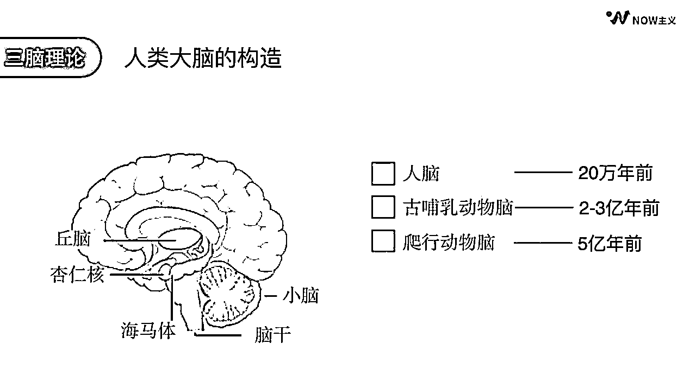

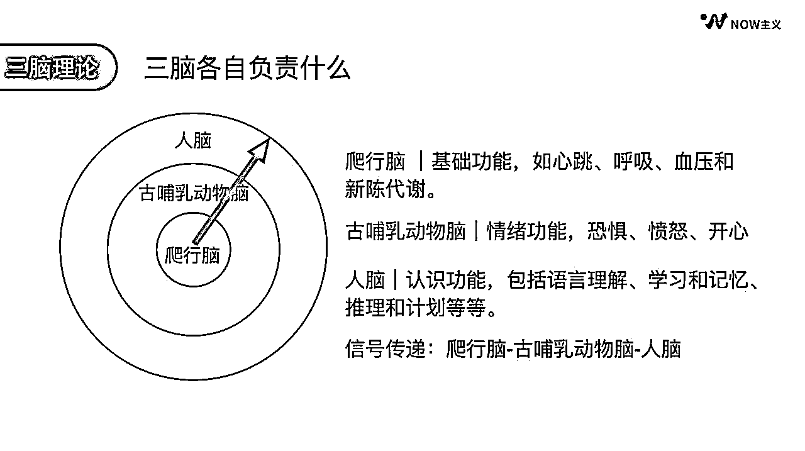

这三层大脑各有分工：最里层的爬行脑掌管心跳、呼吸、血压、新陈代谢等身体基础；中间的哺乳动物脑负责恐惧、愤怒、开心这类情绪反应；最外层的人脑承担语言、学习、记忆、推理规划等认知功能。大脑里信息的流动方向，是从爬行脑流向哺乳动物脑，再到达人脑。把功能压缩一下就是：最内层管生理，中间层管感受，最外层管思考。这样的结构决定了人总是先有情绪，后有理性的认知，并且情绪的推力远比理性的指令更猛。更重要的是，这是神经系统层面的设定，每个人生来如此。那么，既然谁都无法避开情绪，怎么才能让情绪更稳一点？答案就在下面的方法里。

## 9.2 正念四步法：和情绪过招的正确姿势

多数人遇到情绪，第一反应是害怕被它吞没，于是赶紧竖起防御墙。可情绪永远跑在理智前面，硬挡往往挡不住，反而又添了一堆新的糟糕感受。会处理情绪的人不一样：他们先认出“我现在有情绪了”，并接受这个状态，再把情绪摊开来分析，最后想办法应对，而且每经历一轮都会调整优化。这套方法的内核来自心理学里的正念疗法：有意识、有目的地觉察，把注意力放在当下这一刻，同时在觉察的过程中不评判好坏，不分辨对错。具体怎么练，我们一条条拆开。

### 9.2.1 第一步：觉知

觉知，就是察觉到自己正在被情绪包裹，然后试着站到一个客观的外部位置，和情绪拉开一点距离，静静观察、体会此刻内心真实的动静。一个小技巧是：想象自己的意识缓缓从身体里飘出去，悬浮在半空，用“上帝视角”看着那个正在经历情绪的自己。

### 9.2.2 第二步：接纳

我们要明白，情绪总是先于理性出现，所以这一刻的感受已经真实存在了，不论它合不合意，都很难直接抹掉。这时需要做的，是带着不评判的心，不逃开、不说教，老老实实承认眼前的状态。感觉不好没关系，负面情绪也是情绪，它发生了就是发生了，先接住它，没什么大不了的。易仁永澄有一句话很值得记：当你因为自己没做好而难受时，请立刻更新一下认知——眼前这件事并不能说明你不行、你很差、你的明天也不会好。别再用这种话给自己补刀。真实的情况是：你正巧遇上一个练习“控制注意力”的好场景，这就是一个修炼场，是为你专门创造的训练契机。

### 9.2.3 第三步：分析

先搞清楚，自己现在到底处于哪一种情绪里？这里最忌讳一句“我很不爽”草草带过，要尽量精确地描述、下定义、贴标签。常见的八种情绪包括：恐惧、焦虑、愤怒、愉悦、羞愧、内疚、恶心、兴趣。当然这个清单还不够细致，你也可以按自己的体验理一份“专属情绪词表”。举个例子：我判断此刻的情绪是焦虑。触发的原因，是今天上午没有照计划推进。于是我不停叹气，整个人提不起劲，甚至想干脆破罐子破摔——再瘫一下午，周末就彻底报废。短期来看，这种选择很伤；长期来看，还可能动摇我对“做计划并且完成计划”的信任。接下来要追问到底：情绪是被什么人、什么事点着的？身体上有哪些反应？它可能怂恿我做出什么冲动行为？短期看划算吗？长期看又会留下什么？这些问号一个个拉直，情绪也就有了轮廓。

### 9.2.4 第四步：处理

注意，“处理”不一定是“消灭”。先判断：这股情绪有没有办法化解？有，就做点事去化解它；没有，就只能接纳，学着一面生活一面和它共存。回到前面的例子：上午虽然已经过去了，但下午和晚上还完全属于我。我可以先叫一份健康的外卖，下午按计划读书和写作，再去买点菜，给自己做一顿像样的晚饭。吃完如果不想跑步，改成散步也不错。重新排好计划后，让心情慢慢落地，然后开始行动。这样一来，一次完整的觉知、接纳、分析、处理就走完了，情绪也被顺水推舟变成了行动力。当然，四步法要练熟并不轻松。好在随着练习次数增加，觉察会来得越来越早：一开始，往往情绪过去了、甚至事情都做完了，才反应过来；练着练着，就能在情绪升起的当下立刻看见它；再往上，有些高手甚至能在情绪还没催生行动之前，就提前做好防备。这些都是不断修炼换来的本事。

## 9.3 工作被打断后，如何快速“回血”

讲完四步法，再看一个常见的职场画面：正聚精会神忙着手头的事，突然被意外插曲打断。事情被迫停下一码，心情也瞬间跌到谷底，半天回不过神来。对付意外本身，其实并不复杂：把新冒出来的事和今天原本的安排放在一起，重新排一轮优先级。特别要紧的，马上处理；不太要紧的，记进待办清单；两分钟能解决的，当场做掉，连清单都不用写。真正麻烦的是意外带来的情绪波动，它会让人卡在烦躁里，迟迟回不到工作状态。想快点恢复，得处理更深处的问题：期待与焦虑。我们原本期待任务能按计划漂漂亮亮地推进，可意外把节奏全打乱了，于是失望、懊恼、焦躁、内耗一起涌上来，时间本来就不富余，这下更紧巴了，有限的思考空间也被挤得只剩一条缝。所以，原计划被破坏只是浮在表面的问题，意外真正冲击的是情绪与状态。用一个更抽象的词来说，就是“能量”。当我们感受到失控，能量就会往下掉，拖延也就跟着加重。用什么来预防？答案就是刚讲的四步法：觉知、接纳、分析、处理。其中最关键的一步是觉知。但实际经历意外时，我们正忙着应付事情和安抚自己，很难原地把整套流程走完。没关系，可以在事后专门找一个时间，给自己留一块安静的空间，慢慢梳理，像剥洋葱一样一层层剥开，直到找出真正影响情绪的那根刺。剥到最后，大家往往会发现，情绪底下藏着一种委屈感：为什么突然扔这么多事给我？为什么偏偏遇上这么糟心的状况？世界上那么多人，为什么是我？再往深处探，一个更底层的念头浮出水面：我希望一切都按我想要的样子来。单看这句话，你可能会觉得敢这么想的人大概是疯了。但有意思的是，很多人每天都在不知不觉地这样要求世界。这也难怪，职场上会有那么多人因为计划被搅乱而崩溃。好消息是，如果你也被说中了，接下来三个办法应该能帮上忙。方法一：解决问题。说白了，就是用行动改变眼前讨厌的处境，把麻烦一个个处理掉。这是硬核派的选择：看不惯，就直接上去把它干掉。方法二：改变认知。看清一个基本事实：变化本来就是世界的一部分。只要做了计划，就一定会被打乱，只是早晚的问题。把这条认知焊进脑子，你对计划完成度的期待就会软下来，再遇到意外，情绪也不会瞬间爆表。方法三：先安顿情绪，再处理事情。这一条对任何人都适用。情绪上头的时候，你根本没办法专注问题本身，所以要先找到适合自己的方式，把自己从情绪里捞出来。安顿情绪虽然不能直接改变事情的结果，但像止疼药一样，当下能让你缓过劲，这就已经值了。至于具体怎么疏散情绪，各人有各人的偏好，这里就不展开讲了。内容来源：《给人类的自我管理解决方案》

## 9.4 打造你的“积极情绪锦囊”

情绪管理不只有“灭火”的四步法，还可以提前给自己存点“快乐粮草”。具体做法很简单：收集一些“只要做了，心情就会好起来”的小事，攒成一个专属锦囊。比如，去晒晒太阳，把房间的灯全部打开——充足的光照经常被用来辅助缓解抑郁。身体和情绪是连通的，身体动作也能反过来改变心情。你可以试试：对着镜子咧嘴笑一笑，喝一杯温热的东西，吃几口最喜欢的水果，洗个热水澡，多套一件厚衣服，闭眼打个小盹儿，做10分钟运动，顺手把屋子收拾利索……这些都是成本低、回报高的情绪急救小药丸。再比如，翻一本能让自己安静下来的书，看一部喜欢的片子，听几首顺耳的音乐；起身走到更开阔的地方，哪怕只是到楼下绿地站一站；专门留一笔“心情购物金”，闷了就痛快花一点；状态不好时也可以复盘，但只准写自己做得好的地方，不许写“下次要改”；找一个懂你的家人或朋友，好好说会儿话；看一部催泪电影，让悲伤顺着眼泪流走；把心里翻来覆去的东西都写成文字。美国哲学家尼布尔有一段很广为人知的话：愿上帝赐我平静，去忍受那些无法改变的事；愿上帝赐我勇气，去改变那些能够改变的事；愿上帝赐我智慧，让我分清这两者。其实，我们做觉知、接纳、分析、处理的每一次练习，都是在一点一点积攒勇气和智慧。正因如此，情绪稳定才成了每个成年人一生的必修课。

## 9.5 【练习】给负面情绪来一次实战拆解

请你回想最近一次被情绪冲昏头的经历，看看自己掉进了哪种思维陷阱，再用情绪修炼四步法把它拆开，写下你的处理方案。

📌

我的情绪拆解记录：

1、事件：2、思维误区：

3、应对方案：

1）觉知：

2）接纳：

3）分析：

4）处理：

送给自己的一句话：

参考案例：

1、事件：航海营打卡一直拖着没做，心里发虚，不好意思在群里露脸。

2、思维误区：恐怖化——觉得没跟上就会很糟；应该化——认为自己必须把所有打卡都漂漂亮亮地完成。

3、应对方案：

1）觉知：我正被强烈的内疚感笼罩。

2）接纳：事实确实如此，先承认这份难受。

3）分析：因为没按时参与航海学习与打卡，我给自己贴上了“必须完美”的标签，内疚和自责越滚越大，结果反而更不想行动，最后干脆从群里消失。

4）处理：离这次航海收官还有一周多，我可以立刻动手，先把今天的打卡补上。

这个模板也放在了工具包的第四个子表格里，可以直接下载使用：《时间管理 | 实战工具包》

# 十、把时间管理养成一种习惯

💡

有没有认真琢磨过：为什么方法明明有用，自己也尝到甜头了，还是会在某一天突然放下？要搞清楚这个问题，得先认识两种截然不同的思维模式：问题思维和创造思维。尤其在养习惯这件事上，我们更需要创造思维。创造思维的结构特别简单，只有两步：✅第一步，看清当下的事实；✅第二步，画出想要的愿景。时间管理说到底只是一种工具，你真正想做的事才是目标。为了靠近那个目标，你自然会愿意把时间管理用好；就算中途停下来了，也没关系，再重新启动就好。接下来，试着换种思维，让时间管理走得更远。

## 10.1 别小看“持续做”的力量@车纯纯

参加过21天航海营的人应该都有体会：跟着节奏认真做项目，至少写完12篇航海日志，收获确实不少。可一旦21天结束、船靠岸，你可能会开始嘀咕：少了这里的氛围和同行的伙伴，自己会不会又慢慢丢下时间管理，回到拖延与自责来回拉扯的日子？这种担心不算多余，我们也都有过类似的经历。但只要把自己从问题思维挪到创造思维上，很多养成习惯的难题，会变得好办很多。

## 10.2 从“找问题”切换到“造未来”@车纯纯

拿最常见的减肥来举例。用问题思维减肥，过程是这样的：你不满意自己的体重，越看越焦虑，于是决定管住嘴、迈开腿，连续三天晚上不吃饭。到了第四天，你觉得自己瘦了一些，焦虑退了，赶紧停止管控，又放开吃。吃完又后悔，第二天再重新节食。如此反复折腾，体重没怎么下去，对自我的信心倒是连滚带爬地往下掉。如果用创造思维减肥，画面就完全不同了：首先，承认我现在的体重是60公斤。这是一个事实，不掺好坏，我全能地接受它。接着，我给自己定一个理想画面：希望体重到55公斤。为了靠近这个画面，我打算少食多餐，并每天上秤记录。因为我真的很想达到新目标，所以在选择吃什么、动多久的时候，都会拿“对实现目标有没有帮助”来做标准。创造思维的结构就是两步：认清现实，计划愿景。然后看着现实和愿景之间的距离来制定行动，持续往前走，直到两者重合。再补两个例子帮大家找感觉：现实是每两个月才读完一本书，愿景是每周读一本，计划就是从现在起每天读1小时。现实是天天踩点迟到，愿景是提前10分钟到单位，计划就是每天早起30分钟。问题思维与创造思维最大的差别在于：问题思维被问题与焦虑推着跑，一路充满自我攻击和无力感；创造思维被目标与愿景拉着走，满心都是想把事情做成的兴奋与期待。前面那个“担心21天后坚持不下去”的念头，正是标准的问题思维：事情还没发生，就先给自己编了一套悲观预言，还顺手把自己评价得一文不值。换到创造思维，该怎么想？很简单：我已经入了时间管理的门，也搭出了一套适合自己的方案，接下来要做的是继续优化时间的分配，那就先再来一个21天日复盘吧。你瞧，思维一转，焦虑是不是立刻散了，反而对接下来的行动生出不少期待？陈海贤在《了不起的自己》里写道：人生是一个创造的过程，是把我们心里珍爱的理念慢慢变成现实的过程，而不是解决问题的过程。当然，这话不是说问题不用解决，而是解决问题不应当成为驱动我们的引擎，真正该驱动我们的是热爱与渴望。所以，别担心自己会停下来。时间管理只是途径，去做你想做的事，你会为了那个目标而更愿意把时间管理落进日常。哪怕真的中断了，再捡起来就好，因为积累远比连续更重要。其实你始终走在成长的路上，从未真正停步。再回到最根本的问题：我们究竟为什么要学时间管理？刘擎在《西方现代思想讲义》里提到，死亡和贪欲是人类痛苦的两大源头，因为每个人都逃不开“有限的时间”对“无限的欲望”的挑战。学时间管理之后，我们既能更坦然地面对人生有限的事实，主动追求自己认可的价值；也能更接纳、更理解自己的欲望，听得清内心真正想要什么，也找得到真正让自己开心的事。一边珍惜时光，一边勇敢追梦，这也许就是时间管理能带给我们的最大礼物。

## 10.3 借环境的力，走得更远@久树

一个人往前冲，力量终究单薄；若身边有人同行、彼此搭手，再远的路也能一点点走完。群体能形成一种推力：今天你不想动，旁人搀你一段；改天别人泄了气，大家再把他托起来。借外部的约束互相打气，步子慢些无妨，先迈出去才要紧。

## 10.4 别只记时长，改数事件@卓卓子是我🎈

不少人在日程经营上，习惯把注意力放在计时上。可如果光记时长没能帮你形成稳定习惯，不妨换个切口：以“完成哪些事”为刻度来量化，让好习惯真正长出来。

人都有懈怠的一面，面对不情愿的任务尤其如此。靠意志力硬撑，本身就违背本能。假定今天安排读书六十分钟，发呆也是六十分钟，专注也是六十分钟；自控不足时，翻翻手机、东瞧西看，钟点照样走完。事后在“块时间”里写下18:00—19:00阅读，表面圆满，内里不过是给自己一个交代。

更稳妥的办法，是把要交付的成果拆成数量，而非只盯钟表。拿一本书举例：这个月想读完，我不会规定每天坐几小时，而会要求每天推进多少页。二百页摊到三十天，日均约六页；然而生活难免插曲，不可能天天都能端坐书桌。于是改为每日十页——一个月只要凑出二十天，每次至少啃十页，任务照样能落地。

然后选一个不被打扰的时段和角落，避开诱惑，在自己的小天地里把十页读完，同时把这次行动耗掉的时间记下来。这样一来，目标没有被“熬时间”注水；你也摸清了在状态、地点都合适时读完这些页数要多久。下回排计划，就能更精准地留出预算。

# 十一、高效时间管理实战案例

到这里，关于时间安排的认知、规划，以及拖延和情绪的处理，我们已经聊过一轮。你大概已经开始调整自己的日程。接下来换个视角，看看圈友们的真实做法：老板、创业者、宝妈、上班族，各自怎样排布一天，又怎样理解时间安排。

每个人的处境不同，案例只是参照，最终仍需摸索出合身的方案。若你也有值得分享的经验，不论聚焦哪类场景，都欢迎来讲一讲。

## 11.1 小马宋：事业与家庭怎样兼顾

我过去一年待在公司很久，晚上常忙到十点后才回家，孩子早已入睡。后来我改了做法：除直播这类非在公司不可的任务，其他加班一律带回家处理；周末也在家干活，顺便陪孩子学习、说说话。

太太问我，在家加班效率如何？我说不如办公室，但综合收益最大——家里既能推进工作，又能参与孩子成长。我始终认为，人一天若真能沉下心四小时，很多事就够推进了。

我睡七到八小时，加上起床洗漱、做饭和早餐，差不多用掉九小时。洗漱时我会顺手完成英语任务，读约一千词英文新闻；做早饭时再听半小时音频课。

出门后只剩十五小时。我骑共享单车上下班，往返十四公里，骑车加步行九十分钟，余下十三小时三十分。路上听得到或播客，算学习；若不听，就琢磨工作，约一小时可计入工作。

午饭加午休一个半小时，剩十二小时；游戏我给自己封顶四十五分钟，余十一小时十五分；社交平台留三十分钟，余十小时四十五分；如厕、俯卧撑、和同事闲聊等杂事每天约一小时，余九小时四十五分；回微信等再耗一小时，真正留给正事约八小时四十五分。当然，人没法全程满负荷，即便熬到晚上十点，有效产出也很难突破六小时；可这六小时质量很高。

通知我全关了，只留电话和微信语音提醒；朋友圈不刷，隔一两个小时看一次微信。症结常常不在技巧，而在意愿——我们想做的事太多，而对多数人来说，工作恰好是最不想碰的那一件。

## 11.2 Lissa Tam：亚马逊创业者的日程样本

亚马逊业务跑顺之后，我的链路大致固定：挑品、取回样品、敲定产品方案、下单采购、拍摄、修图、剪辑、运营、补货。一轮通常两到三周；若挑品卡住，就整体后挪。下面这张甘特图，是我二一年刚起步时排的。

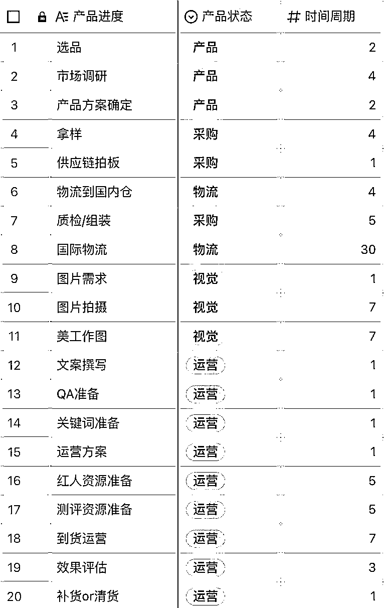
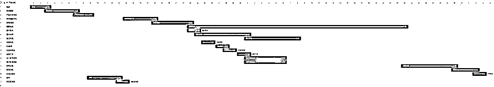

挑品最折磨人，常让我觉得一天下来毫无产出。所以我把“选出一款产品”当作阶段碑。它周期长、反馈慢，后来我尽量把颗粒度切细：每天海选多少款、每周出多少产品方案、每月定下多少可量产的方案。

流程之外，数据整理也不能少。我用第三方工具归拢信息，再用Excel搭一个分析看板，盯各节点完成率；推新另有记录表，日销、关键词位次、产品指标、流量转化、上新日志都填进去，方便复盘，也让打法能复用。

我的大半时间砸在挑品上，约六成五。产品端费心多，运营端就省着用。运营我只保留回报最漂亮、效率最高的一环：投广告。像post这类事，先前招了人便全交出去；它值得做、回报也还行，可我精力有限，只能往后排，忙不过来就砍掉。

新品我天天看排名、销量和广告表现，随手调；老品则一周巡检一次，集中处理。每周再汇一次销售数，对照目标。事情看着杂，摊到每天并没想象中忙。比如最近：八点起，九点到十二点在星巴克，下午一点到十点回办公室。上月两个待开模产品往前推了，上月和本月挑出的品也毙掉一些，眼下正为当月产品KPI犯愁。

事务扎堆时，我会用印象笔记列清单再逐项打勾——多数当天做不完；更多时候跟着状态走。我身上也有拖延、懒散、情绪化这些毛病，改不干净；也正因如此，我才是我。说白了，我的日程经营水平并不高，靠的是拿加班补。

自由职业者最要紧的是自我约束。自律换来自由，这话我信。我的原则是：把单位时间的产出提上去，而不是一味拉长总工时；我更看重结果和聚焦，也会兼顾精力。精力在线，时间才用得值。这套思路来自生财里易仁永澄老师的时间安排，以及CC老师的精力课。

每月开头，我会在飞书里写好当月OKR／KPI，再拆成若干小计划推进。飞书模板真好用，强烈推荐；同款链接：《项目管理模板》。

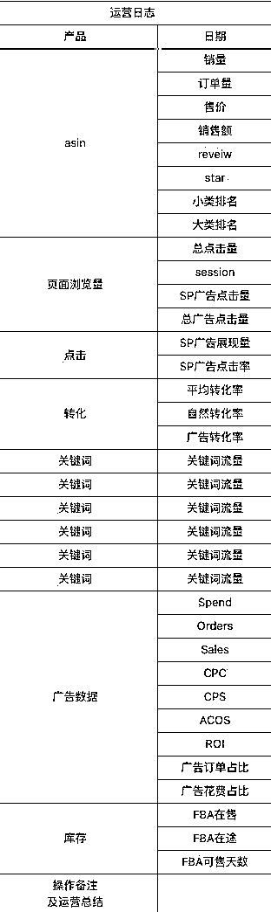
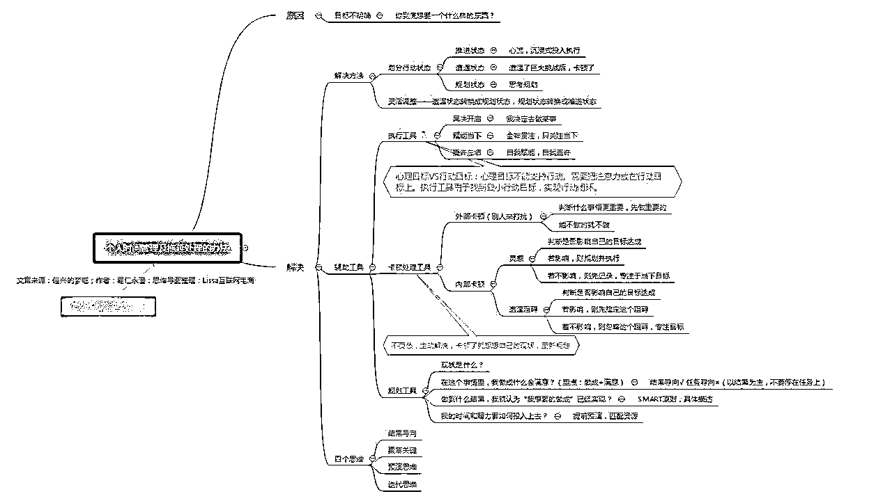
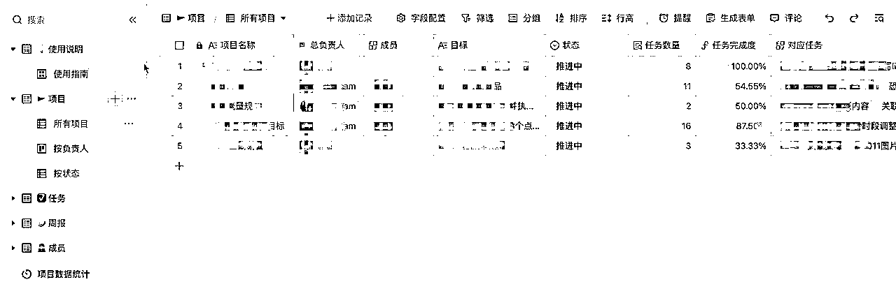
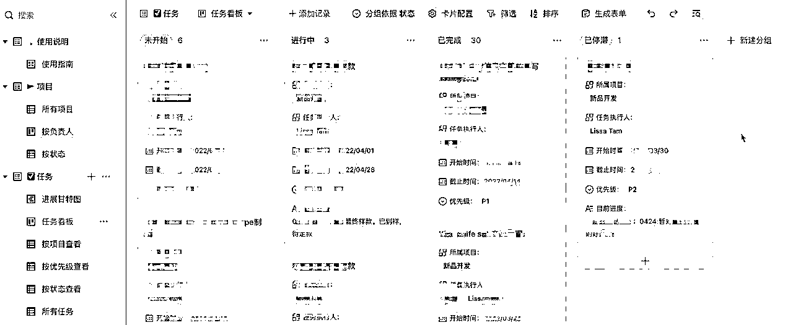

对创业者而言，时间尺度要拉长，至少按半年来算。创业是长跑，许多人退场并非破产，而是撑不下去。

若按周、按月排，我通常照亚马逊项目流程走，平均每周投入六十小时。每周写一次文字复盘：两千字文章耗一到两小时，六千字以上约八小时。每周至少练两次，跑步、刘畊宏、健身房、羽毛球轮换，平均三小时；每周歇一天，多数追剧、翻书，偶尔画油画；每两周或每月自嗨一回，唱一小时歌；每月或隔月出门玩一趟，海边、爬山都行；每周两杯奶茶，多半用来压焦虑。

日子看着平、甚至有点单调，但运转正常。要说遗憾，最大的还是没把自由职业的“自由”用足——空间和时间都自由：随时随地办公、去想去的地方旅行、做想做的事。

## 11.3 杨涛：把混乱作息拉回正轨

想把作息拨回正常，最管用的仍是三件事：睡够、吃对、动起来。道理朴素，各种花哨方法多半是围绕这三点做加法，再借操作给自己一点信心。

生理性入睡难确实存在，那种“困意刚冒头又溜走”的感觉，想必有人懂。可试这些：泡脚、红酒、牛奶作用有限，褪黑素更顶用（挑贵的）；床品别省，床陪我们走过约三分之一人生，很多人却没在这上面花几个钱——好床垫、好四件套，是性价比很高的幸福投资；枕头要单拎出来说，它最难挑且因人而异。我今年换了五只枕头，邓禄普、睡眠博士、慕思都试过，出差住酒店还买过两次，仍没有特别满意的推荐；但我认定，枕头关键在托住脖子；深蓝或紫色床单、遮光彻底的窗帘，对睡沉有帮助。

心理性难眠，不妨换几个角度：晚睡带来的“时间变多”是假象，总睡眠其实差不多——十点睡五点起，和两点睡九点起，时长一样；哪怕打游戏，早上爬起来玩还会有种奇怪的成就感；电子产品别带进卧室，头两三天难受，第三天起会舒服，这时千万别破功，破一次代价太大；再想想，第二天有要紧事时我们往往能早睡早起，既然这样，为何不把日子过好？冥想也值得试，我亲测有效。

再给几个野路子：其一，倒生物钟最狠的办法是，实在睡不着就熬到天快亮，别硬躺，洗漱后吃顿像样的早饭，白天照常做事，中午困也顶住，晚上早点洗漱上床，次日闹钟定六点；其二，先给伴侣转一万元，每个早晨让对方叫你起床，你洗漱完就领一千元奖励，起不来钱就没了；若对方没叫，她扣一千，双份快乐；其三，早饭固定在七点，夜里往往睡得香；其四，九成五的人一天连一分钟刻意锻炼都做不到，你想不想做那百分之五？其五，糖能少则少——一生配额只有八百公斤，谁先吃完谁先走。

## 11.4 杨涛：赚钱路上，把精力押在关键处

赚钱路上的日程安排，番茄钟、四象限、待办清单都只是工具。真正要紧的念头是：你若只有三分钟热度，那就设法在三分钟里收工。听明白，各位——容易半途而废的人，更要挑能迅速见到回报的事；你清楚自己难坚持，就得让正反馈来得快些。

天性难改，性格更难重塑。怎么办？只能反复刺激大脑。哪怕学的是硬技能、难技能、需要长线的技能，也要争取短期出结果。结果一出来，大脑被点亮，满足感上来，灰质层释放多巴胺和内啡肽，人就爽；爽过之后，下一次学习更有劲。成功有滚雪球般的惯性，一个小高潮会带出更大的高潮。

第二件事：压缩纯赚钱时间，腾出增值时间。你接下来想挣的那笔钱，靠现有业务和能力惯性推得动吗？推不动，就得留出档期，为另一种可能做准备。这里有个怪圈：不少人用战术上的勤快，遮住战略上的懒。每天把意志力榨干，事情干得很累，却没胆量空出一段时间做规划、复盘、调方向。为什么？因为改变违背惯性。改变未必更好，但不改就只能停在原地；对现状不满意，就必须动。所谓增值时间，就是拿来在战略和方向上使劲的。

方向错了，停住就是前进。这句话我很喜欢，但很多人做不到——沉没成本摆在那儿：都学这么久了，学得又苦又费劲。可方向不对，停下本身就是进步。

把八成时间投到决定成败的事情上。赚钱路上要懂取舍；在无关紧要的环节死磕完美，最耽误挣钱。有句话提醒我们，别老琢磨抄近道，因为近道往往通向错误。值得做的事，多半难而正确；若一件事看着有近道，它通常也长不了。所谓取舍，就是在鸡毛蒜皮上追完美，那叫钻牛角尖。送两句话：很多事没有深究的必要，很多事没有怀疑的价值。比如和人吵完架，回家才想起刚才没发挥好，整个人被消耗；在群里对喷，过后又懊恼；脑子里闪过一个念头，转头忘了，却一直较劲想找回——这都是钻牛角尖。“轻重缓急”四个字，值得反复品。你若总躲着难而正确的事，说到底是没胆量跟自己人性的弱点过招。

## 11.5 港妈金侣：宝妈兼顾多份副业的方法

当妈之后，可用的时间和精力都紧巴巴。我的办法是按不同时段安放不同副业。

第一，能自己说了算的时段：我早晨状态差，夜里环境安静反而出活。所以把最费脑的活放在精力最旺的时候做。

第二，零碎时段也别浪费：做饭时听课，坐车时处理不用全神贯注的副业，比如在社群里推产品。可以盘一盘：哪些副业要整块时间（像自媒体写作），哪些能拆碎（社群带货），哪些能并行（我常同时开几个群的会）。

第三，给任务排先后：副业再多也有轻重，按自己的节奏安排；耗时特别长的项目可以砍。去年我做了不少短期训练营，今年基本停了，把时间挪到更能滚出复利的事情上。

第四，管能量比管钟表更要紧。很多宝妈不是没时间，而是没力气启动。学会调能量，在精神最好的时段干最重的活，本身就是在省时间。

## 11.6 运营女超人子渝：工作、带娃与博主副业如何兼顾

我平时工作强度不小，家里也要照应。博主这份副业，靠的是白天碎片时间加上晚上九点到十二点。白天我会借午休、甚至上厕所的间隙刷最新内容找灵感，随手记下；下班后再把灵感整理成稿，周末集中录制。我还报了两个学习班充实自己，想让内容表达更出彩；周末孩子去补习班或我在家收拾时，就拿来听课。节奏确实绷得紧。

我安排日程主要靠SOP流程化，加上花钱把基础活外包。流程化能省掉反复计划、重新排布的成本，提效很明显。

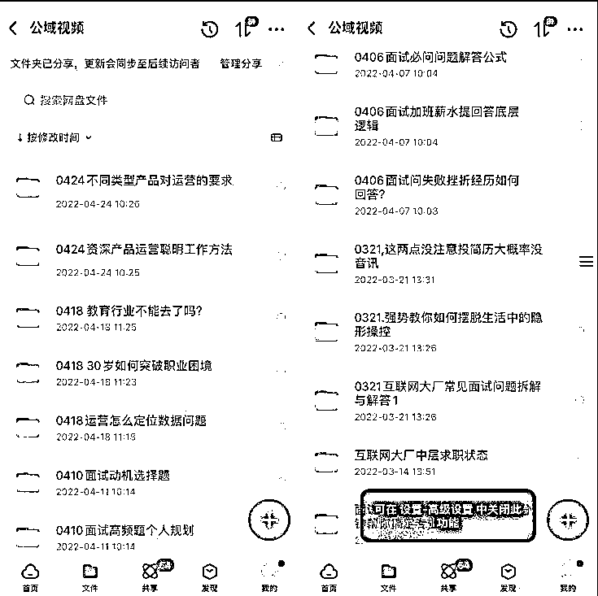
花小钱买时间：很多忙，是零碎事堆出来的，而这些活可以交出去，把精力留给核心。最近我请了小助手帮忙剪视频、做图文，自己只盯内容生产。收入会少一点，但分工有效，我能坚持得更久，也能把心思放在内容和视频表现的精进上——这恰恰是在加强核心能力。

## 11.7 总加班？IT人这样管时间

在IT行业，加班一多，休息、放空和复盘的时间就被压得所剩无几。遇到这种情况，先别急着感叹“时间不够用”，更有效的办法是倒推：到底是什么在拉长你的工作时间？原因不同，解法也不同，关键是要有分析问题的意识。

先看任务分配。如果你是执行者，就判断领导给的任务量是否合理、资源是否够用、内容是否正好踩进你的陌生领域。若是这些因素让进度吃紧，别闷头硬扛，带上具体事实和数据去沟通，争取人手、资源或排期调整。上级本来就需要掌握进度，也更希望你提前反馈，而不是最后爆雷，这样他才可控。

再看时间被切碎的情况。那些可开可不开的会、可做可不做的杂事，要练习礼貌拒绝；如果白天大量时间被低效消耗，时间管理正好能帮你把注意力收回来。若问题出在能力和经验不足，短期靠加班补课也正常，但别只拼时长，还要搭配高效学习方法。

做大型项目时，突发状况、潜在风险、没识别出的依赖、外部资源变化，都会让计划偏离，最后只能用加班填坑。所以计划评估要细：背景、痛点、人数、经验、周期、范围、工具、依赖、风险以及应对措施都要心里有数，执行时严格按计划走。项目结束后认真复盘，把踩过的坑变成下一次的经验，项目推进会更顺，因“A类事件”延期造成的加班也会减少。

IT人还可以多留意重复性工作，能自动化就自动化，善用效率工具，比如截图用Snipaste、记录信息用ediary。说到底，加班可能牵扯目标、计划、执行、精力、习惯和回顾等多个环节。用PDCA循环持续打磨：Plan计划、Do执行、Check检查、Act修正。有效的经验要总结、输出、肯定并标准化，没解决的问题放进下一轮循环。等这套动作变成习惯和能力，你会越来越从容。

## 11.8 换环境，也别让计划掉线

有段时间我工作很忙，家里又正好有事，只能带着工作回老家待几天。离开有制度约束的办公环境，回到最舒服的家，人很容易懒散，效率也容易往下掉。按我过去的习惯，只要离开上班环境、回到被家人照顾得很周到的舒适环境，做事就会懈怠，处理工作的速度骤降。但这次学了时间管理后，情况真的不一样了：我坚持开整点闹钟提醒，也坚持记录时间，及时回看自己每小时的状态，再动态调整。结果在家的时间安排得刚刚好，吃喝玩乐没有心理负担，工作没落下，甚至还超预期交付。原因是基础时间、蓄能时间、创造时间都通过复盘及时调整，排出了适合当下状态的节奏。

在不同环境里用时间管理法，最爽的一点是：当我顺着人性想偷懒、想快乐时，整点闹钟就像革命号角响起，把我从被欲望控制的状态拉回理性世界。每次按计划做出满意成果，身心都很舒适，自信也一点点叠加，觉得对得起时间。所以入门后想深入实践，可以多换环境训练这项技能，比一直在规律环境中运用更快拿到有效反馈。

方法一：时间三分法。按车纯老师的方法，在不同环境里以工作为中心先规划较合适的时间，再根据实际动态调整。比如我在杭州出差学习时调整过时间表：

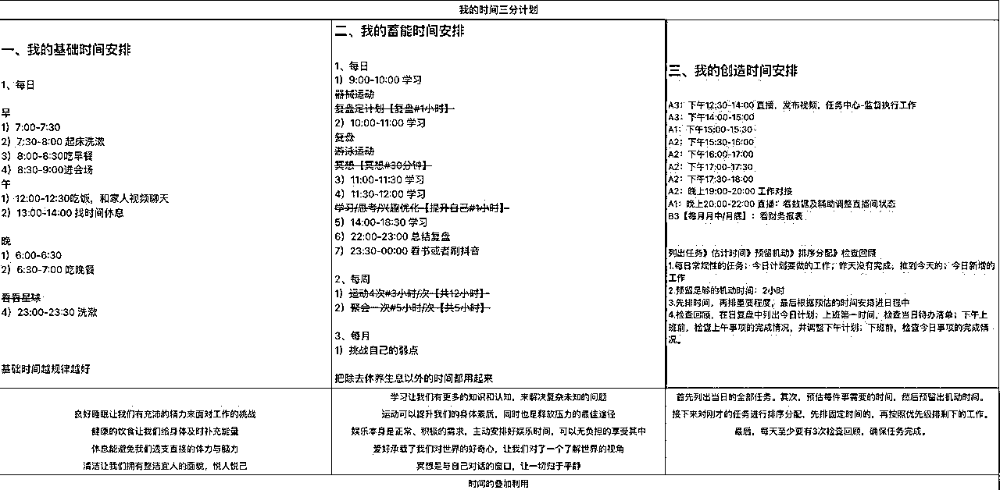
方法二：疯狂闹钟。整点响铃就回顾过去一小时：做了哪些有价值的事、哪些时间被浪费了；再看计划表该时段该做什么，当下行为是否偏离目标。发现偏差就立刻修正回轨道；如果任务没完成但原定时间段已过，就把它挪到其他时间块。

方法三：时间块。回顾完一小时行为后，在时间块里记录下来，借记录做复盘总结和及时调整。基本目标不变，看看哪段时间可以动态调整。调整时：一看计划表剩余时间的任务安排；二从基础、蓄能、创造时间维度判断已规划任务是否适合当前状态；三不合适就马上改计划，实时调整以完成一天计划，也顺便复盘。

方法四：学会拒绝。挡住那些会妨碍目标完成的诱惑；懂得拒绝，时间管理已经超过很多人，算进阶。

方法五：把时间块和滴答清单放在手机屏幕最显眼处，降低忘记使用的概率。

两个注意点。第一，环境不熟悉时，创造时间要多留机动时间。平时创造时间预留2小时机动，不规律环境最好扩到2到3倍，可能挤占基础时间和蓄能时间，但能保证工作完成不堆积。离开规律工作环境后，未知因素多，专注力下降甚至被打断；把机动时间留足，相当于把集中的创造时间打散。第二，习惯没养成前常忘记记录，这是初期正常反应，别因此懈怠。忘记记录会连锁：没法深度复盘，没法及时调整，久了看不到成效就懒散，循环出现懈怠。哪怕暂时做不到，也尽力而为，只要做了就在积累。想被时间认可需要恒心；每次认真运用都算数。即使某段时间忘了，它还在，未来某一刻会想起。想起时别犹豫，马上回顾过去一小时并记录；怕再忘就开启疯狂闹钟整点提醒，循序渐进，迟早成为时间管理达人。一直不忘记录当然最好。

最后感受是：在不同环境运用时间管理，会让时间更有价值。基础时间、蓄能时间、创造时间是正向规划：人先休息和赋能，才有精力创造价值；创造价值后又会反哺休息和赋能，形成正向回路。

## 11.9 弹性上班，主业提升两不误

弹性上下班的职场人，怎么在做好主业的同时提升自己？我的办法是抓碎片时间，每天多出2小时。我的工作弹性，上班晚下班也晚，早起不存在，主要是我懒，也不愿早睡，所以可支配时间不多，只能在现有作息里多干点。于是我把注意力放到日常碎片时间。

通勤加等地铁约1小时，我可能看书、听播客、刷生财有术精华帖，尽量不闲着不打瞌睡。上班8小时总有走神摸鱼的时候，持续专注有限，我就站起来在办公室拉伸15到20分钟，扭腰走动活动颈椎，碎片化健身完成。午休1.5小时，边吃边看喜欢的综艺或剧，吃完差不多，再留半小时午睡。娱乐需求满足后，晚上不会额外惦记刷剧浪费整晚；取而代之可以上网课、读感兴趣的书、做项目相关的事。不贪多，某阶段只选最重要的一件事。成片不被打扰的时间很珍贵。

这些是我的经验，你可以看看自己每天哪些碎片时间不得不花，把其他事嵌进去，原本要做的事就被消化了。多出来的时间想做什么都行，哪怕用来处理工作、腾出更多摸鱼时间，也未尝不可。

别高估自律，进雷区前先排雷。有小伙伴说做事没定性，本打算看航海手册，结果刷淘宝、看别的资料，衣服没买成，手册也没看多少。我一般不建议上来就讲目标感、信念感、专注力、意志力，大家都是普通人，别用超人精英标准要求自己。最简单好用的方法，是营造好环境：不在卧室工作；不用手机查资料；工作设备不装娱乐软件。简单粗暴但管用。

希腊神话里，人面鱼身的海妖用歌声迷惑航海者，让他们失控触礁沉没。荷马史诗中，奥德修斯得到神示后提前安排：经过海岛前让船员把自己绑在桅杆上，并叮嘱无论自己怎样挣扎都不能松绑，同时船员用石蜡堵住耳朵直到驶离海岛。经过时他果然听到迷人歌声，拼命想挣脱、大吼大叫，船员无人理会；离开海岛后才解开绳子，他也安全欣赏了海妖歌声。舒适卧室、手边手机、同事八卦，都是做事时的诱惑。不要考验自己，在专注完成目标时还要分心用意志力对抗。做事时手机调静音或专注模式，或放到远离自己的位置，用平板或电脑学习，不装视频软件和游戏。多数分心是主动发生的，所以要减少环境刺激源。真走神了，就停下来放空，站起来活动筋骨、伸伸懒腰，宁可放空也别被思绪牵着走，再坐下让专注力一点点回到原事。

