# 202308·视频号涨粉实操笔记

> 来源：[`remhu1p2pr.feishu.cn/docx/EJs6dTCjJoUOApxrs4bchRXsnWb`](https://remhu1p2pr.feishu.cn/docx/EJs6dTCjJoUOApxrs4bchRXsnWb)

# 视频号增粉实战指南

发布日期：2023年8月10日

本手册用途：带你了解一个项目的更多可能，助你更透彻地理解并落地操作。

小提示：若想迅速锁定具体内容，可用 Ctrl + F/command + F 输入「关键词」，直达所需段落。

开篇的话

💡各位好，

欢迎加入8月航海 | 视频号涨粉 | 实战手册。往后这段时间，咱们会在这里频繁碰面。

你刷视频号时，有没有碰到过这类作品？

画面谈不上精细，甚至略显粗糙，偏偏数据好得离谱。中老年情感号、中老年祝福号、怀旧类视频号、励志情感号，都归入此列。

另有一类作品，在抖音上反响平平，一旦搬到视频号却成了热门爆款，英文育儿号就是典型例子。

这些账号吸粉速度惊人，远快于常规的短视频带货号和IP号。有时连发三条作品，点赞量就能突破一万，属于异常值区间。加上上手门槛低，可复制性极强。

本期手册的核心目标，就是教你如何对标这类赛道作品，实现快速涨粉。

那这本手册具体怎么用？

「一、视频号涨粉介绍」会讲清视频号涨粉的当前局面、适配人群、变现路径，以及时下热门赛道，帮你建立对视频号涨粉的整体认知。

「二、视频号核心涨粉思路」则拆解了视频号的流量分发逻辑与用户画像，助你搭建自己的涨粉路线图。眼下微信正将大把流量向“问一问”模块倾斜，所以建议大家务必试试用“问一问”做导流。

我们尽量多铺赛道，让每个人都有下手的机会。因此手册收录了8个时下热门赛道玩法，即「章节三-章节十」。零剪辑基础也能做「中老年情感赛道」「中老年祝福赛道」「励志&情感文案赛道」「怀旧赛道」「招聘信息赛道」；进阶方向则有「英文育儿赛道」「ChatGPT赛道」「AI说话赛道」。

每个赛道开篇，我们都准备了一份赛道概览，帮你摸清该赛道的涨粉态势、受众构成、素材渠道、制作难度、内容特征及注意事项。你可依据自身能力，挑选感兴趣又有把握的赛道。

要提醒的是，所有赛道仅提供思路框架，具体细节还需各位在航海期间一同摸索。

此外，「十一、更多涨粉赛道参考」还盘点了一批异常值账号，或许能给你的赛道选择带来灵感。

多数赛道门槛并不高。只要逐条照做、执行力拉满、持续打磨一段时间，成功基本是水到渠成的事。请相信自己，选准适合的热门赛道，找到高效的创作打法，聚焦单一赛道，以数量换概率，属于你的流量或许只是早晚问题。

流量到手之后，变现的可能性就打开了。手册末章「十二、变现方式」列出了6种视频号变现路径，希望能给你带货之外的更多启发。

祝愿各位在这次航行中既收获成果，也结交一群同行伙伴。

以下内容由生财有术联合圈友共同打造，仅供航海船员及生财有术星球圈友学习使用。

也欢迎圈友在实践中持续反馈，与我们一同完善手册，可联系鱼丸（yuwan387）提出修改建议。

# 一、视频号涨粉介绍

## 1.1 涨粉这件事为什么值得做

账号增粉是相当普遍的需求，背后主要有两层原因。

其一，粉丝基数越大，账号权重越高，能拿到的流量政策往往越好。当粉丝刷到你的作品并点赞、转发后，你的内容更容易挤进热门信息流，进而放大账号的整体曝光。

其二，粉丝量积累起来后，变现的路子会更宽，比如收徒、卖号等，不必死磕带货一条路。当然，对想在视频号带货的人来说，涨粉仍是基础诉求——千粉正是挂车开播的门槛。

## 1.2 视频号涨粉的当前局面

说实话，如今在任何平台抢流量都不轻松，视频号也不例外。若按传统路子起号，比如从个人兴趣切入，你会发现流量来得越来越慢，增粉愈发吃力。

不过，近期视频号冒出了一批异常值账号，特征如下：

1、制作粗放，播放量却很高，粉丝增长极快的账号，例如中老年情感号、中老年祝福号。

2、部分作品在抖快上跑不动，迁移到视频号后效果出奇地好，例如英文育儿号。

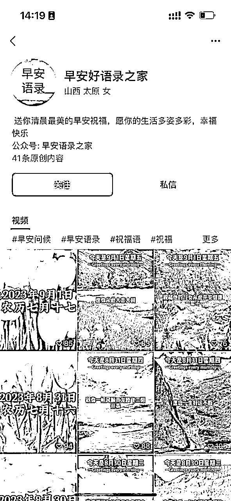

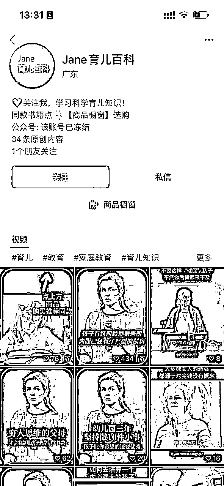

这类账号的可复制性很强，作品容易爆，操作也不复杂。所以，视频号涨粉并没有想象中那么难。挑一个类型切入，先模仿再超越，涨粉目标很快就能达成。

## 1.3 涨粉之后怎么变现

粉丝底盘打好后，变现的选择就丰富了。

眼下带货仍是视频号最主流的变现手段。除此之外，收徒、卖号、对接广告主分佣、向公众号引流赚流量主收益、开通视频号创作分成计划等，都有不错的变现潜力。

具体的变现玩法和部分案例，我们会在「十二、变现方式」中展开细讲。

## 1.4 哪些人适合做视频号涨粉

绝大多数人都能做视频号涨粉，不需要精湛的剪辑功夫，也不要求过硬的内容功底。

只要你对视频号有兴趣、眼下有增粉需求，就可以动手。

假如你不想靠视频号带货变现，也不打算做个人IP，那不妨试试视频号涨粉。

若你手里已有私域流量池，也建议用私域去反哺视频号。

## 1.5 当下值得关注的涨粉赛道

本期手册覆盖8个赛道玩法：中老年情感赛道、中老年祝福赛道、励志&情感文案赛道、招聘信息赛道、怀旧赛道、英文育儿赛道、ChatGPT赛道、AI说话赛道。

其中，中老年情感赛道、中老年祝福赛道、励志&情感文案赛道、怀旧赛道，核心逻辑都是面向特定人群输出情绪价值，激发共鸣，进而带动传播。这类内容整体制作难度偏低，但要注意做好去重、提升原创度。

招聘信息赛道，是把机构或企业的招聘启事做成短视频，借大公司的势能为自己引流。该玩法还能进一步升级，比如专注某一领域的招聘信息汇总，吸引更垂直的粉丝，便于后续变现。风险在于，引流的账号容易遭封禁。

英文育儿赛道、ChatGPT赛道、AI说话赛道的门槛相对高一些。英文育儿赛道卡在外文演讲素材的搜集；ChatGPT赛道要求你对ChatGPT本身足够熟悉；AI说话赛道则难在AI图片的生成，以及如何让图片开口说话。

「十一、更多涨粉赛道参考」中，也整理了8个近期风向标里较热的赛道案例，供你参考。

最后再强调一遍，手册里的所有赛道只提供思路，具体细节需要大家在航海期间共同摸索。

# 二、视频号核心涨粉思路@大星儿 @盗坤 @小鹿

💡

章节提要

涨粉，说穿了，就是把流量变成粉丝。

想涨粉，先得搞明白两件事：平台会把流量倾斜给什么样的内容，以及粉丝真正爱看什么。把这两个问题想透，就知道该往哪儿使劲，从而实现高效增粉。

这一章拆解了视频号当下的流量分发机制与用户画像。前者帮你弄清平台的流量池有哪些、从哪儿来；后者让你了解我们的用户是群什么人、他们究竟偏好什么。

此外，我们也总结了四种常见的涨粉打法，建议新手重点研读「2.2.1 找爆款内容、做爆款选题」这条路径，并试着用问一问导流，这样能进一步提升涨粉成功率。

希望各位学完之后，都能摸索出一条适合自己的涨粉路线。

## 2.1 视频号现状

### 2.1.1 流量分配机制

这一节会讲三种视频号流量分发机制：社交推荐机制、算法推荐机制、微信生态流量（视频号之外的入口）。

所谓社交推荐，是借朋友圈的社交关系做裂变，本质属于私域流量。算法推荐和微信生态流量则归入公域流量。前者依据视频数据、兴趣标签、热点、地理位置在视频号内部做推荐；后者以看一看、搜一搜（问一问）、订阅号为入口，把流量导入视频号。

弄懂这三种机制，你就知道该在哪些环节下功夫，从而获取更多流量。

1、社交推荐机制

通俗地讲，社交推荐就是：只要有几个好友关注了你、给你的作品点了赞，你们的共同好友很快就能知道你的账号、看到你的内容。这是微信的独门特色，抖音做不到。

在抖音，刷到一个漂亮小姐姐，你会毫不犹豫点赞，那是真实的你；换到视频号，明明碰到心动的女生，你反而不敢点了。可要是刷到一条看不太懂、但显得挺高深的鸡汤，你倒会点个赞——那是顾及形象的你。

所以，能在视频号引发社交裂变的，都是那些能满足人设展示或情绪共鸣需求的内容。

下面具体说说社交推荐怎么运作。

视频号主页分三个板块：“关注”“朋友”“推荐”。其中“朋友”标签页主要通过“点赞+多位朋友看过推荐”和“好友圈推荐”两种方式实现社交推荐。

① 好友点赞+多人观看触发推荐

微信好友给某条短视频点过赞后，微信“发现”页的视频号入口会亮起小红点，提示你有好友赞了这条视频，还会展示点赞好友的名字和头像，见图1。

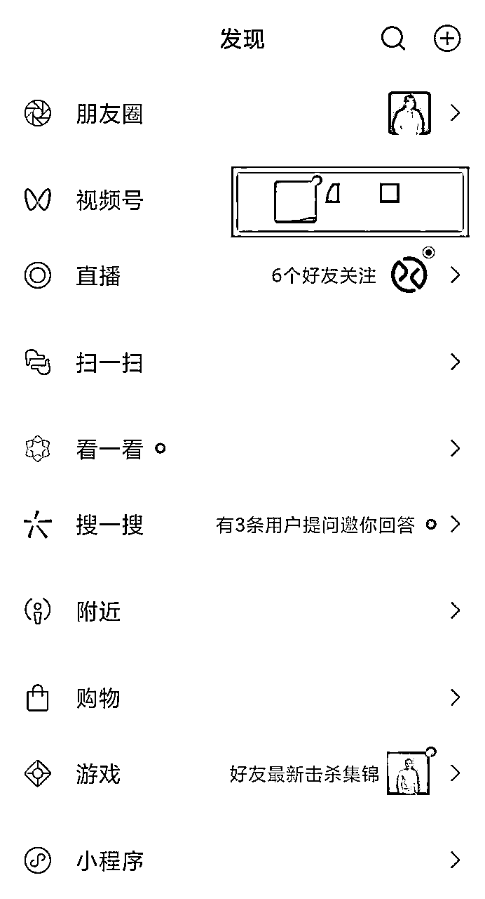

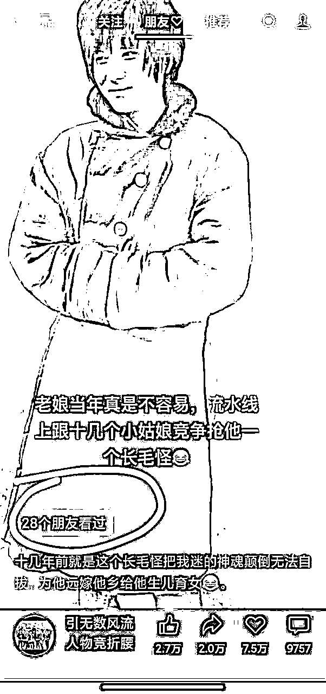

② 好友圈层推荐

视频号与本人微信账号绑定。只要你加了微信好友，在视频号发布新作品后，你的微信好友就能通过社交推荐机制“刷”到你的短视频。

2、算法推荐机制

视频号内部的算法推荐机制，大致分四种：数据权重、兴趣推荐、地理推荐、热点推荐。

① 数据权重

视频号【推荐】流量会根据播放量、点赞、评论、分享、关注等数据指标做加权推荐。大多数零粉爆款作品，正是靠推荐完成冷启动。

② 兴趣推荐

系统依据用户的年龄、职业、兴趣爱好、短视频内容偏好等，归纳出用户标签关键词，再向用户推送可能感兴趣的作品，实现定向推广。

③ 地理推荐

路径：发现—附近—本地视频/同城直播

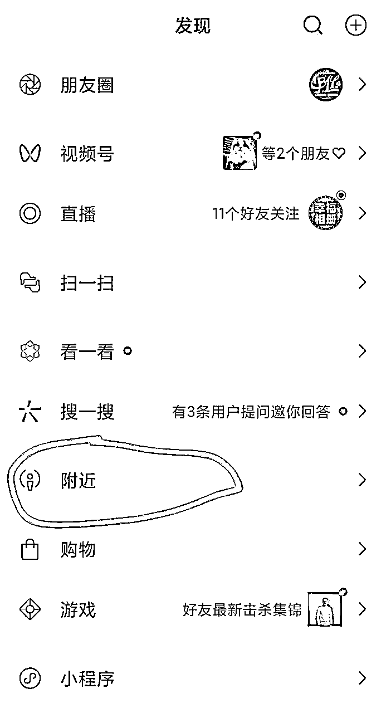

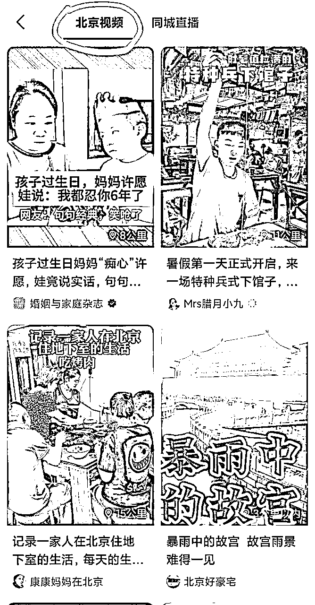

④ 热点推荐

视频号在【看一看】板块中设置了“热点”栏目，专门用于传播带热点话题的短视频。用户点开观看后，会跳转到视频号页面，从而扩大作品的传播面。

因此，创作短视频时不妨适度蹭一蹭热点话题，以触发热点推荐机制。

3、视频号流量生态

用户除了主动打开视频号，还能在发现页的“看一看”“搜一搜”“直播”以及订阅号里找到视频号入口。我们可以借这些入口把流量导入视频号。比如近期“搜一搜”里的“问一问”，就是不错的流量风口，值得趁机引流。

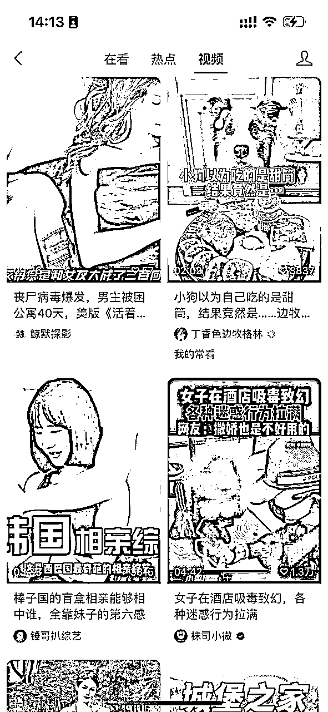

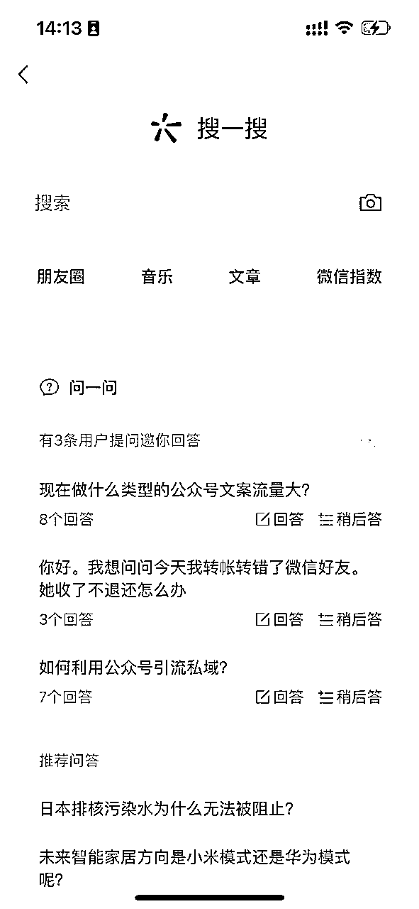

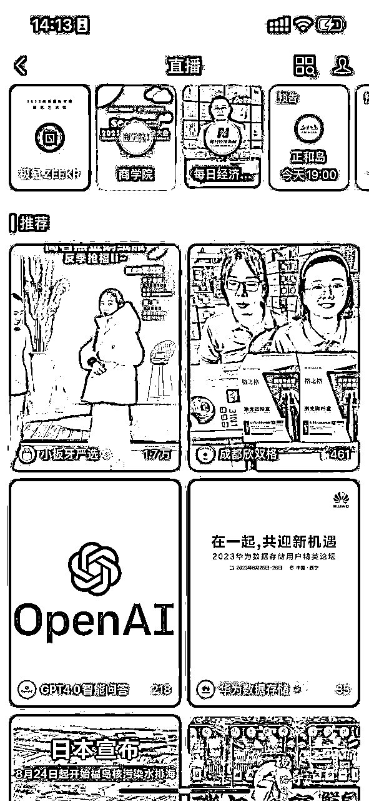

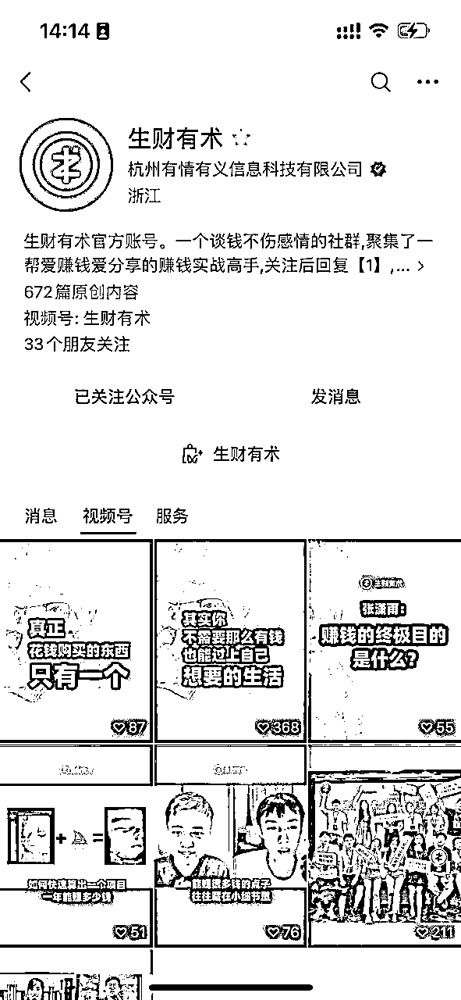

### 2.1.2 视频号用户画像

如果视频主要靠朋友圈转发、微信群分享、公众号推送、朋友点赞等（即私域流量）好友关系裂变来扩散，那视频号的用户画像基本就等同于微信用户群体。如果视频主要靠视频号内部的【推荐】专栏来分发，那受众就以三四线城市、偏下沉的中老年群体为主，人群占比

正如圈友@盗坤 所言，流量的本质是人。

很多人把流量简单理解成一个个点击、一个个UV，但流量背后其实是一个个鲜活的人。想真正抓住流量，首先得读懂流量背后的这群人。

我们真正该关心的是：他们在中国哪些地方生活？长什么样？有哪些喜好？空闲时间都干些什么？只有足够了解用户，才能做出更优质、更对路的内容，也才更可能挣到钱。

参考来源：盗坤—视频号带货分享底层逻辑；单账号变现超百万，如何在视频号进行流量变现？

## 2.2 涨粉思路

对0-1的新手来说，建议先在手册里挑好自己适合的涨粉赛道，再去寻找对标账号和选题素材，着手内容创作。当然，你也可以在大量刷视频号的过程中，发现其他合适的赛道。

如果你已有私域流量池，不妨用私域给视频账号做冷启动，借私域反哺视频号。另外，眼下微信正在给“问一问”注入大量流量，借助“问一问”的势能，也是一条重要的涨粉路径。

以下几种涨粉打法比较常见且有效，希望能给你一些启发。

### 2.2.1 找爆款内容、做爆款选题

不管在哪个平台，优质内容始终是涨粉的核心抓手。

只有对用户有用、有趣、能引发共鸣的内容，才能留住用户的关注，这也是爆款内容的关键所在。

起步阶段，你可以借助蝉妈妈、考古加等数据平台，按赛道关键词找到对应的对标账号和高赞视频，再用已被数据验证过的视频素材加脚本文案做二次创作。

账号跑稳之后，即掌握了视频爆款的核心要素，就可以尝试自己改造创作选题，或者针对已经爆发过的选题，用ChatGPT对爆款文案进行改写。

至于如何找到适合自己的赛道，可以从以下几个方面考量：

1、视频受众是否精准/广泛

2、内容选题来源是否足够多（抖音&视频号）

3、制作门槛对新手是否友好，能否轻松做到“先借鉴后超越”

4、内容是否自带传播属性，容易跑出爆款

### 2.2.2 提升完播率与互动数据

用悬念撬动5秒完播：

前3秒是黄金窗口，话只说一半，把观众的好奇心悬起来。

例如：村里一位老人房子拆迁拿到100万补偿，却一分都没分给子女，这中间到底藏着什么故事？且往下看。

引导用户点赞的技巧：

引发共鸣——戳中用户痛点或调动情绪，顺势引导点赞。

例如：你觉得xx这做法在理吗？认同的朋友点个赞，评论区说说你的看法。

示弱效应——适当放低姿态，换取用户的关注与支持。

例如：谢谢家人们的陪伴，顺手点个赞吧，祝您阖家幸福、万事顺遂～

拉动用户分享的手段：调动情绪——打到用户内心深处，让人感同身受。

代入感——让用户不自觉把自己放进情境里，仿佛亲历。

共情效应——唤起对美好生活的向往，传递正向能量。

### 2.2.3 用问一问给视频号导流

问一问的终极目标是为视频号导流，所以在挑选问题时得有所取舍，并非什么题都值得答。

引流通常分两类：热点类与专业类。

热点类用来吸泛粉、冲数据，优先挑与自身用户画像重合度高的题目作答。

专业类用来吸精准粉、促转化成交，主要围绕内容赛道相关关键词，选择关注量和回答量都高的题来答。

选好题之后，爆款回答怎么写？几个要点：

1）句子要短，多用短句：每个标点之间的字数，以一口气读完不费劲为准，段落不超过两行。

2）轻松幽默，制造共鸣：如今各大自媒体平台主打休闲娱乐，核心是提供情绪价值。幽默搞笑的内容能让人会心一笑，更愿意转发分享；有共鸣的内容则容易引发情绪共振，促使用户点赞、评论。

3）内容扎实，有趣又有料：这一条主要针对“干货类”账号。别写得太专业晦涩，表达要通俗易懂。由于「问一问」与视频号、公众号深度绑定，一旦有用户给你的回答点赞，系统会自动弹出你的视频号/公众号。虽然在「问一问」里不能直接引流，但可以借视频号头像、昵称和简介的曝光，引导用户关注你的账号，从而实现涨粉。

参考来源：靠『问一问』精准引流200+、变现3999的爆款问答实操复盘

### 2.2.4 用好私域流量池为账号蓄水

相比其他短视频平台，视频号有一个天然优势：能与私域链路顺畅打通，还支持一键转发。

所以，如果本身已有私域流量池，可以借私域为视频账号做冷启动，再把视频号的粉丝导回私域沉淀。后续发布新作品时，一键转发到私域社群做宣发，数据增长会更快。

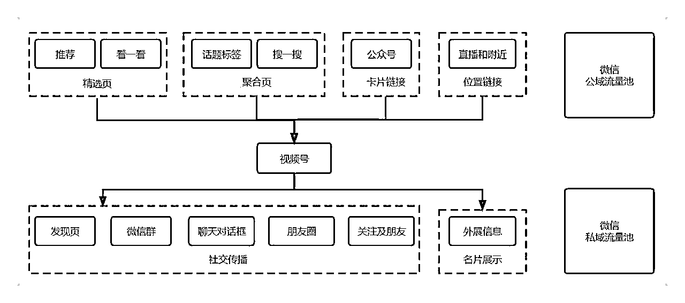

# 三、中老年情感赛道如何涨粉@大星儿

💡

章节提要

中老年情感号，从名字就能看出，是面向中老年人群创作情感类视频，吸引用户关注、实现涨粉。

涨粉表现：账号运营第3天，出现第一条大爆款，7天涨粉10W+，累计播放2000W+。后续运营中还跑出过多条百万播放视频，通常一条百万播放视频能带来2000+粉丝关注。

视频受众：50+年龄段的老年群体，其中男女性占比接近3：7，符合视频号平台画像。

素材来源：抖音&快手&视频号，可用素材足够多。

视频制作难度：适合新手，对画质、剪辑软件的要求不高。

内容特点：情感故事更容易引起共鸣，不涉及私密喜好，更易传播。

注意事项：搬运视频容易违规限流或封号。

本章将会从赛道概况、账号搭建、素材收集、视频创作、避坑经验方面，带你了解中老年情感赛道的玩法。需要注意的是，这里只提供玩法思路，具体细节需要大家在航海期间共同探索。

## 3.1 赛道概况

中老年情感号，从字面意思就能理解，是瞄准中老年群体制作情感类视频，以此吸引关注、实现增粉。

# 我如何用中老年情感号做到7天涨粉10万+

做视频号这件事，我起初只盘算三件事：目标用户是谁、内容做起来难不难、自己能不能拼得过同行。翻完前面对视频号整体盘子的分析，能看出它的核心受众是三四线城市的中老年朋友。他们爱刷什么？我靠两条路径交叉确认：其一，查阅第三方数据机构对外公布的报告；其二，留心自家和中老年亲戚在微信里都点赞、转发了哪些内容。

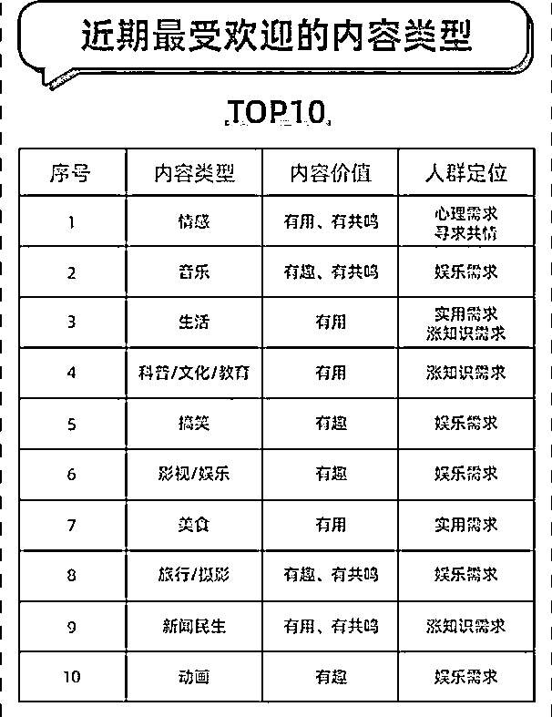

公开数据表明，泛娱乐仍是视频号的大头，其中情感类稳稳坐在头把交椅上。再回头翻亲戚群，转得最多的视频基本落在两类——民生新闻和情感故事。前者多为官方媒体出品；后者打开一看，画质谈不上讲究，有的甚至相当毛糙，自然也就意味着制作上省力。

方向敲定，接下来就是起号：锁定同行标杆、把门面做起来、该填的信息填好。发布内容到第三天，第一条现象级视频就跑出来了，七天时间粉丝多了十万，总播放冲破两千万。往后又陆续出了好几个百万级播放，一般来说，单条百万播放至少能拽来两千多个新粉。

以上算是摸爬滚打出来的实战成绩，接下来就把中老年情感号这套打法掰开揉碎聊一聊。

## 3.2 账号包装

### 3.2.1 头像

情感号主打中老年群体，头像这块可以直接去抖音或小红书搜“老年头像”，拿到链接、做去水印处理、存图，再上传到视频号。

去水印的实操：小红书右上角点击分享并复制链接，接着在微信小程序里搜“去水印”，点开排名第一的那个，贴入链接，下载无水印图片保存好就行。

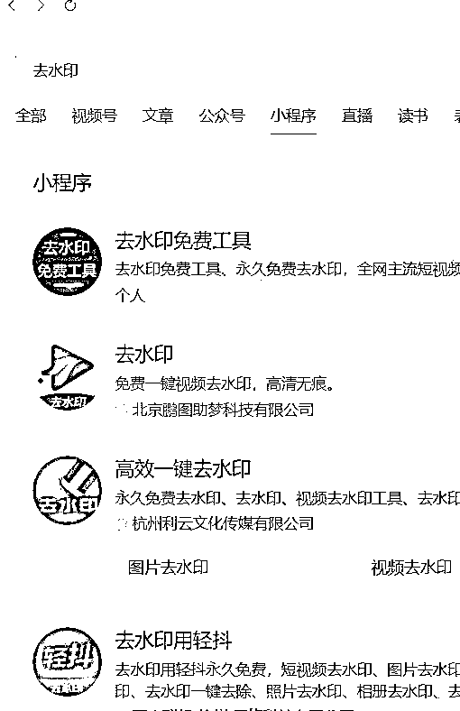

### 3.2.2 昵称

昵称的修改机会一年就只有5次，别随手改。常规做法是围绕账号定位来包装，比较常见的套路是关键词拼接，像xx聊职场、xx女装、xx国学、xx妈妈育儿好物这种。

另一个思路是直接照着同行标杆来，比如xx故事会；要是撞名了，就把xx那块的文字换掉，或者挂个后缀加个数字。

### 3.2.3 简介

简介没有修改次数限制，可以拿来放账号能提供什么价值，也可以写引导成交的话。

## 3.4 素材收集

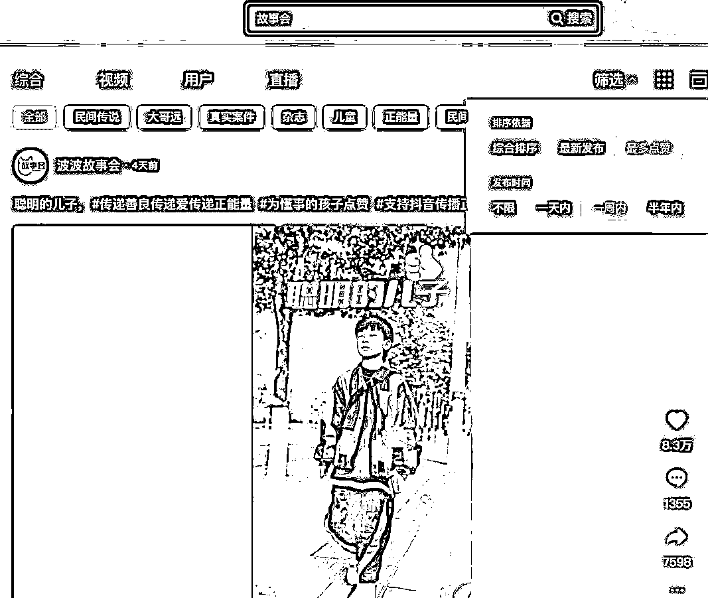

先看同行主页上每条视频的点赞情况；然后锁定那些点赞高、发布时间在近1—2天内（最长别超过7天）的作品。为什么卡这个时间？因为数据越漂亮的视频，放得越久越容易已经被搬去视频号了。进入评论区看用户头像，如果一眼就是花花草草那种中老年画风，那基本能断定这条视频和这个账号的受众就是中老年人。

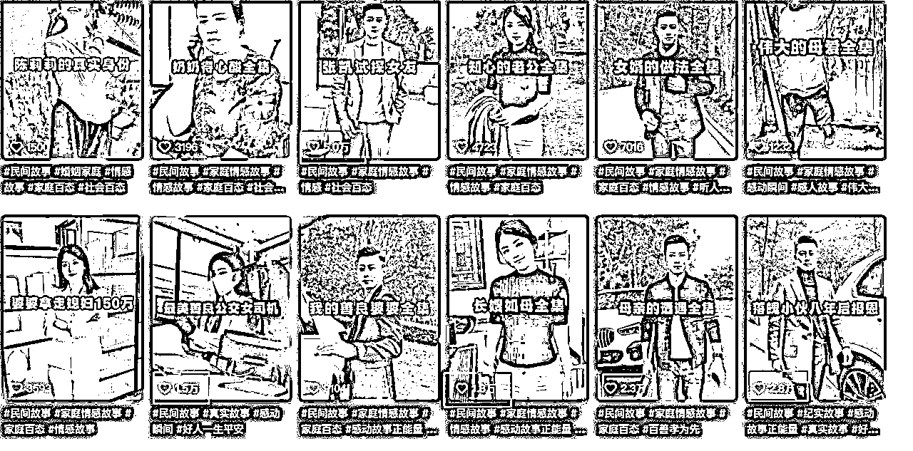

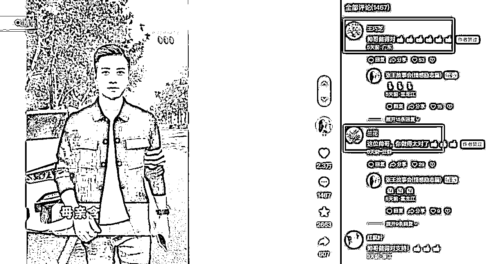

方法2：走蝉妈妈搜索再做数据印证。路径一：蝉妈妈—视频—热门视频库/带货视频库—情感。

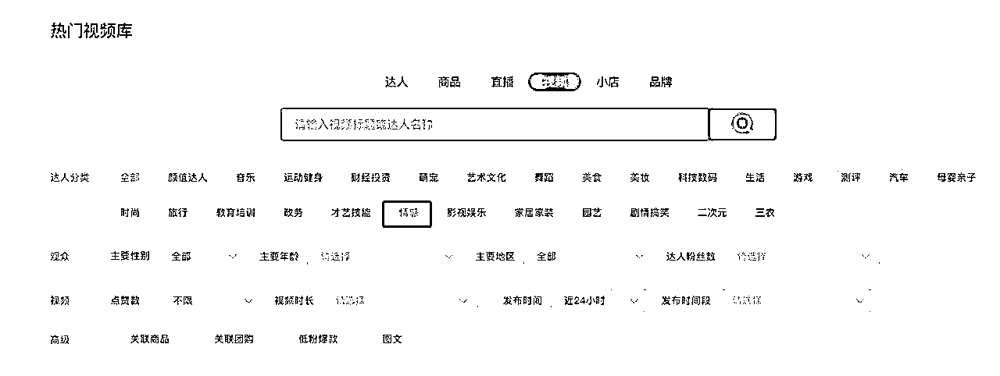

路径二：蝉妈妈—视频—搜索框输入故事、情感、正能量等词，筛选近7天内点赞高的视频，点进该账号主页，看看数据表现和视频源够不够充足，为后面剪辑备好粮草。

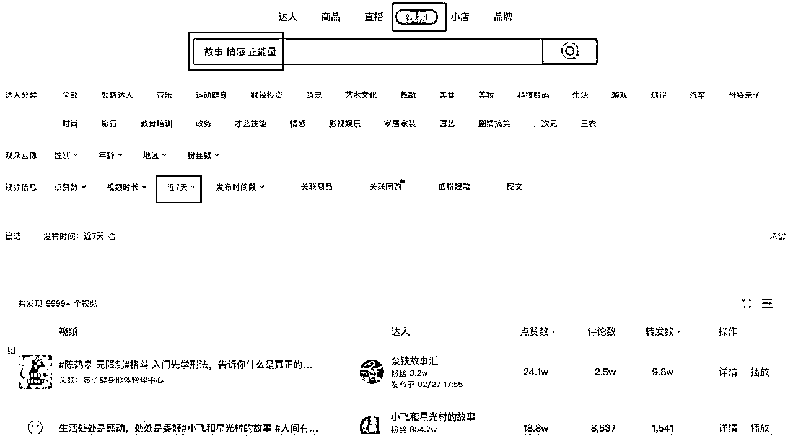

顺着这个细分品类往下扒相关账号，进主页看具体数据，重点盯两件事：一是近期涨粉人数，用来判断这个号涨粉猛不猛、最近有没有出过爆款；二是账号的视频用户画像，看是否跟50+人群对得上。

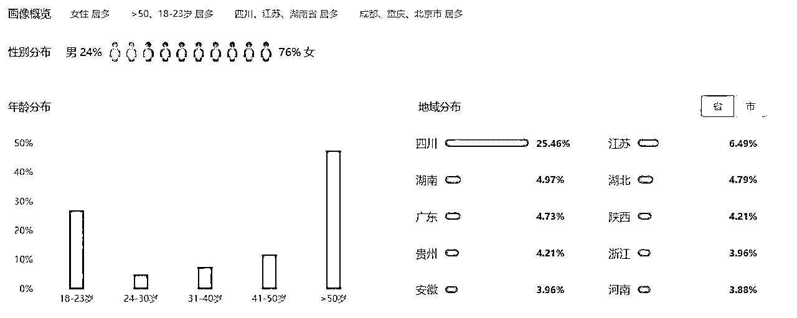

筛出合适的账号后，建一个账号信息库，把关键信息记下来，并且用抖音号关注它们。这样博主一更新，你就能第一时间收到推送，把热乎的原始素材扒下来。

方法3：在视频号里找同行素材。拿微信小号搜关键词，找出差不多的账号，把视频看完、点赞、留评论，过一阵子主页就会给你推相似的视频；头部账号也值得关注。重点拆解三块：1）主页包装设计；2）视频内容类型和数据表现，为后面的伪原创提供选题来源；3）引流和变现的套路，看看同类受众的账号是怎么赚钱的、需要什么资源，如果自己来做这一块，能不能“先学后超”。

具体搜法：1）发现—视频号—搜家庭故事、正能量这类词，会刷出一堆视频，重点看封面一眼就很糙、没有真人IP出镜的那种；2）点进主页，看昵称、头像、简介，以及有没有挂商品。

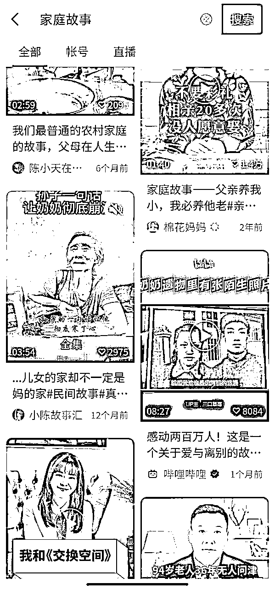

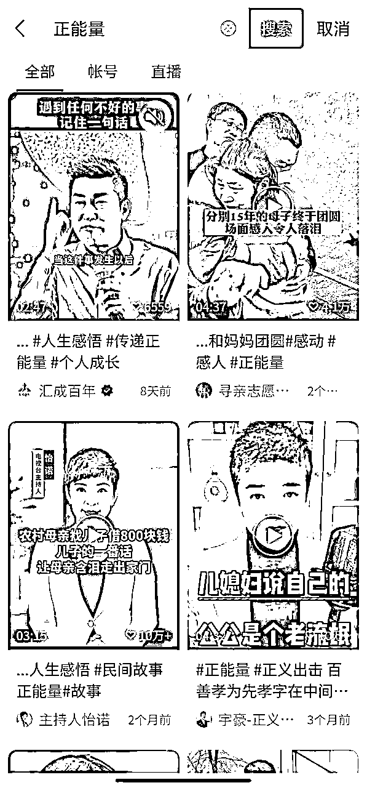

点开头像进主页，观察包装、视频风格和内容类型。

注意：真人露脸的号直接跳过；封面和内容一看就很粗糙、整体画面像素偏低的，才是要锁定的中老年情感号类型，因为这个群体对画面精细度并不敏感。

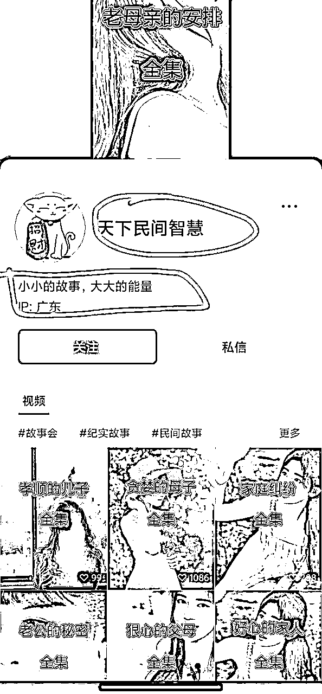

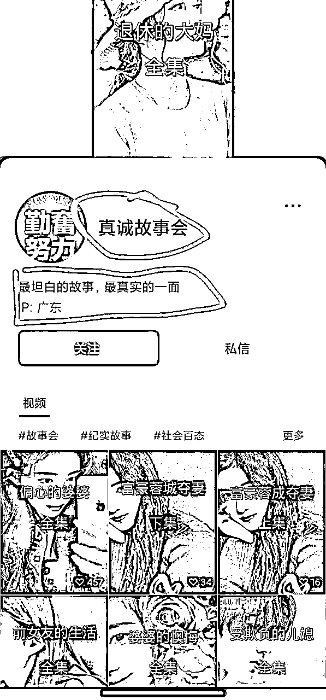

方法4：公众号爆文+ChatGPT来创作。情感号和公众号情感号底层打法其实是一套：前5秒用“开幕雷击”钩住用户，让他继续往下看；正文靠剧情反转或民族主义把情绪拉起来，推高完播率；结尾补最后一脚，引导互动转发，把分享传播做起来。具体的创作思路可以翻翻公众号爆文：8月航海 | 公众号爆文写作 | 实战手册。

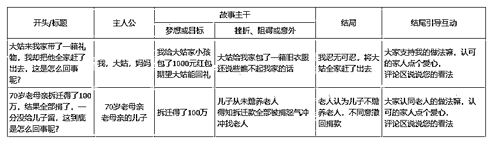

## 3.5 视频创作

方法1：源视频去重+混剪。步骤1：把源视频链接复制下来。步骤2：用圈友分享的去水印工具，把单个或多个视频链接复制进去，去水印后存到本地。

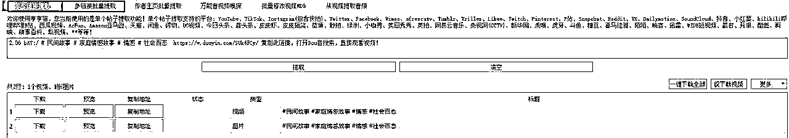

步骤3：在剪映里打开，导入源视频。步骤4：导入自己拍的视频，把音视频分开，删掉音频。步骤5：加上背景图、滤镜特效，音频音量调低。

这里给一套模板：源视频+自己拍摄的素材库+背景图+滤镜特效+音频调低音量。后面直接换源视频就行；要是播放量低（说明没过重），那大概率是找到的源被用太多次了，得再往深里做多个视频的混剪。深层混剪的玩法，可以去翻8月航海 |剪辑特训 |实战手册。

方法2：保留原音频，替换画面。步骤1：同样先把视频下下来。步骤2：拖进剪映，音视频分离。步骤3：把源视频画面删掉。步骤4：放入自己拍的视频（或YouTube上的视频，核心目的是尽量避开被大量重复使用的素材），作为画中画素材，分离音视频并删掉音频。步骤5：按照源视频的大纲内容，挑合适的人物图片导进剪映，在操作区选中对应图片，右上角动画—向左/向右滑动—动画时长设到3.5秒上下即可。

方法3：保留原文案，重新配音+做视频画面。

做音频：可以真人上阵配音，也可以用AI配音工具，推荐Text To Speech - 在线文本转语音，能输入文本、调语音、语速、音调等。如果是多人对话，得根据实际情况换音色。比方说脚本里是老年婆婆跟儿媳对话，那婆婆的声音用“女-老年”更贴，儿媳的声音用“女-年轻”更对味。

基本设置弄完点生成，把音频下载下来，按自己习惯的文件命名存到指定文件夹。

进剪映，用图文成片，把脚本文案输进去，一键合成。

合成完对画面做处理：步骤1：把图文成片自带的音频换成提前做好的音频。步骤2：画面比例设为6：19。步骤3：选中视频画面，画面—背景填充—模糊—选第2或第3档模糊程度就行。步骤4：调字幕样式。步骤5：设主标题。步骤6：加滤镜、转场、特效等。

上面这些走完就能导出发布，后面再根据实际数据反馈去调画面风格。

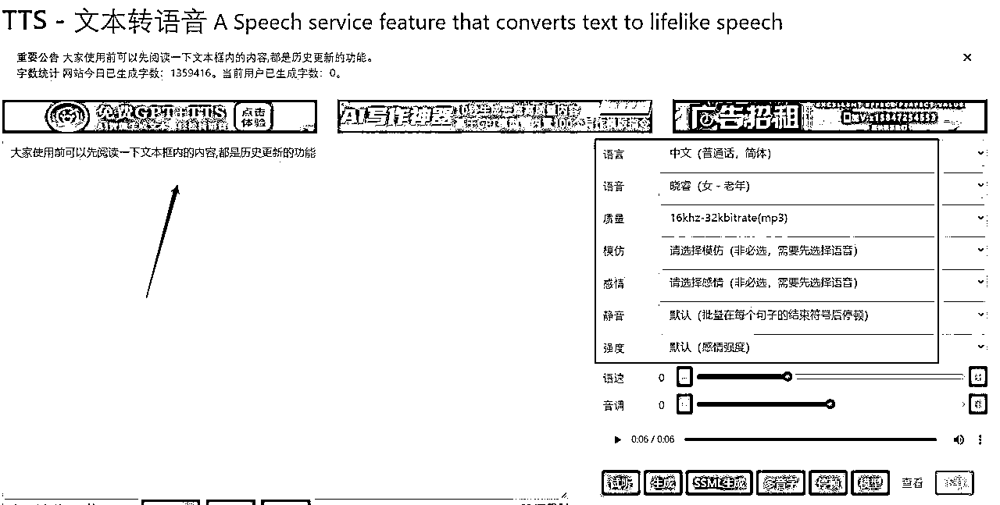

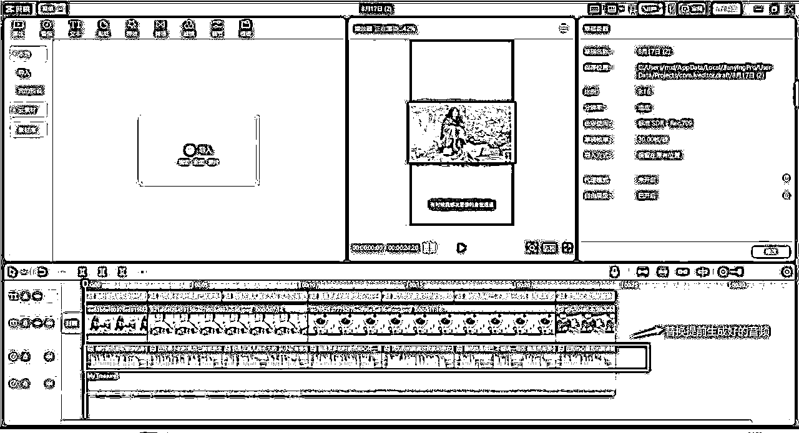

## 3.6 避坑经验

### 3.6.1 别等万事俱备才动手

从来没有真正“准备好”的那一天。一味纠结、一直筹备，只会把自己在岸上耗死，大概率拖着拖着就黄了。

所以别磨叽，立刻开干，边做边迭代。设备行不行、头像昵称简介要不要精雕细琢，统统不用管。

0粉起爆主要吃的是公域推荐，账号搜索流量本来就小，这些细节不用放心上。我第一次折腾视频号时，把其他账号的包装方式研究了个遍，表格记录、分析，断断续续耗了一个礼拜才把账号弄完，结果呢？流量并没有因此爆掉。第二次开新号，定下方向就立刻注册，头像昵称简介十分钟解决，直接发视频，流量照样没受影响。

如果你现在看到这儿，也打算开始做视频号，别想了，马上掏出手机、打开微信、建一个视频号。头像能改，昵称一年有5次机会，简介也能改，别老想着一口气做到满分，先上线再说。

### 3.6.2 别被流量数据冲昏头

对个人玩家来讲，流量最终是要给变现铺路的。所以一旦出了非带货类爆款，赶紧跟上带货视频、测试选品。会有用户顺着爆款点进主页，看到你其他视频，这就能给带货内容多争取曝光。

用终点倒推起点，先想清楚最终靠什么赚钱，执行时留意自己有没有跑偏。如果确定就是带货变现，那就把更多精力砸在选品上，数据一爆就开播，想尽办法用各种能拉转化的手段去测，把带货佣金往上顶。

别沉迷在爆款视频里。点赞、评论、关注这些不过是短暂的虚假繁荣，账号一旦踩线违规，视频分分钟零播放。

### 3.6.3 爆款出现必须开播

爆款来了别拖着，赶紧开直播。有选品就直接带货；还没选品就先把用户导到私域，微信号最好，小程序和公众号的触达效果偏弱。只留在视频号上的粉丝，后面很难再碰到。

原因在于大部分视频流量靠公域推荐，哪怕你有几十万粉丝，用户也没养成从关注列表里专门点你视频的习惯，基本是随手刷，刷到了觉得不错才继续下一步。所以机会来了，要么当场转化，要么把人存到能反复触达的私域里去。

下面这张图是当时爆款视频的数据，不到半小时就涨了几千粉，速度非常猛。但那会儿我犹豫了，没选品，直接开播又不知道讲啥，加上对直播有点发怵，就让这种爆的状态持续了三四天，白白流失掉了。

要是趁着那种涨粉速度开直播，靠短视频把人引进直播间，轻轻松松就能把自己送进场观几千人的直播广场。

所以视频号一旦爆播放，不管爆的是带货类还是非带货类，先把直播预约上，下班就开播讲产品，中途跟用户互动时引导点赞打赏，把直播间互动数据拉起来，推着自己进更大的流量池。直播场景里转化链路更短，互动也更及时，比短视频的转化方式效率更高。

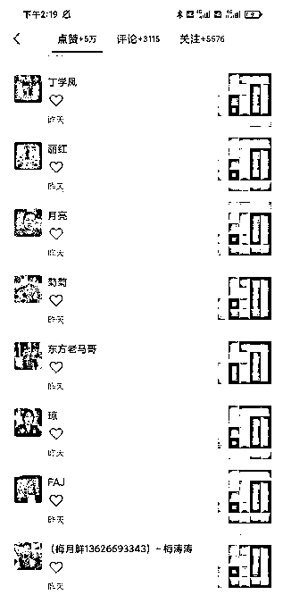

后来还有一回，爆了200W+播放的视频，那时距离爆发式增长已经过去3天，流量增速慢下来了，大概每半天能涨3000粉左右。我上午把直播预约挂上，下午开播，场观轻松过了500。

短视频数据（2月3日开始数据有明显增幅）

直播数据

### 3.6.4 选题在前，剪辑在后

要是一条视频得靠深度剪辑才能过审核破重，那这条果断放弃二剪。抖音上这个赛道很多爆款视频，画面像素并不高，大家看了可能觉得粗制滥造、看不下去，但换个人换个画面，脚本照搬，照样能爆。核心是内容能不能戳中用户，引发共鸣、破圈传播。

剪辑是锦上添花的事，别搞反了主次。中老年情感号大概是少有的对画质不挑剔的赛道，有的素材甚至就像座机摄像头拍的，配上选题文案和画面，数据依然不差。内容为王，说白了就是选题为王，在视频号照样成立。

### 3.6.5 新手别踩带货雷区

抖音不管的品类，视频号可能就管。定选品之前先去查查视频号的带货类目限制，尤其是养生茶、中医书籍、食谱书籍这些，新手最好绕道。

一是因为这些大众都熟的选品已经是红海，素材早被用烂了；二是容易擦边违规，平台现在已经开始管了。我当时从抖音搬了2条养生食谱书带货，直接被扣分限流，后面发什么都起不来量。

# 四、中老年祝福赛道如何涨粉@大星儿

💡

章节概要：中老年祝福号瞄准的是中老年用户群体（50岁及以上），通过制作祝福问候类视频来吸引关注、实现涨粉。

视频受众：50+中老年用户，男女比例差不多，跟视频号平台画像吻合。

素材来源：抖音、视频号、原创AI图，可用的素材量够大，原创度也高。

视频制作难度：对新手友好，画质和剪辑软件都不挑。内容特点：文字动画+风景视频+祝福背景音乐；文案+财神/弥勒佛/金币视频动效+财源滚滚音效。祝福问候类视频本质是传递美好祝愿，很多用户乐意点赞或转发到亲戚群，传播力比较强。

注意事项：尽量做原创视频，二创有可能被限流违规。本章会从赛道概况、素材收集、视频创作三块带大家了解中老年祝福赛道的玩法。需要说明的是，这里只给玩法思路，具体细节要靠大家在航海期间一起摸索。

## 4.1 赛道概况

祝福类视频在视频号上的传播力挺强，能比较准地抓住中老年用户。这类内容里的美好祝愿，加上鲜花、美景、财神、金币这些意象，都是中老年群体特别吃的一套，他们也很愿意点赞转发到亲戚群。

下面放几种祝福风格示例：

早安祝福&财源滚滚来视频：风景类/金钱类视频素材+文字动画+AI语音口播+BGM，制作门槛低。

祝福儿女的视频：核心在祝福文案，结尾引导评论转发接祝福，素材把儿童相关视频混剪一下就行。

运营层面，可以借鉴「2.2 涨粉思路」，重点是把视频内容打磨好，然后试试去问一问做视频号导流。坚持一段时间，耐心等，会有结果的。

接下来拿早安祝福视频当例子，讲讲这类视频具体怎么创作。

## 4.2 素材收集

方式1：抖音搜关键词，比如早安、早安祝福、暖心文案、祝福语录等，找到同行标杆，把对方的素材下下来，多条视频混剪。

方式3：ChatGPT+Midjourney搭配，让ChatGPT生成花海、风景这类绘图描述词，Midjourney照着描述词出原创图。

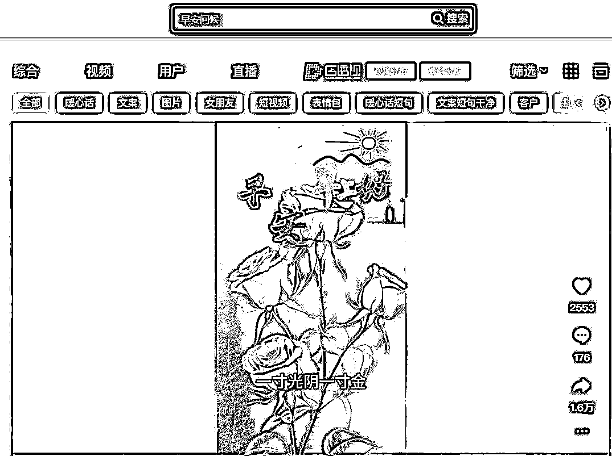

## 4.3 视频制作

类型1：单图关键帧+文字+BGM。目的：给图片打上位置关键帧，让图片滑动起来，做出动态视频的效果。

步骤1：把图片和音频导进去，图片长度拖到跟音轨一样长。

步骤2：在图片起点位置打一个关键帧。

步骤3：拖动图片，让图片左侧跟画面左侧对齐，再打一个关键帧。

步骤4：识别字幕+加BGM。

步骤5：加贴纸+特效等。

类型2：多图动画+转场+文字+BGM。前提是得会基础的AI绘图，这里不展开讲怎么画，想了解可以翻8月航海 | AI绘画+自媒体 | 实战手册。我们直接说怎么完整做出一条视频。

步骤1：文本转音频。在配音网站Text To Speech - 在线文本转语音，输入文本，设置语音、语速、音调等。音色一般挑云希（男-年轻人-抖音热门），也可以听听别的音色试试。

试听没问题就点生成，把音频下载到本地。

步骤 2：进入剪映后点“创作”，先导入3到4张原创图片，放进素材库并拖上主轨；随后把步骤1做好的音频拖入音轨，再逐张延长图片时长，让整组画面与音频长度对齐。

步骤 4：点选图片素材，在相邻图片之间加入合适的过渡动画。

步骤 5：挑一首合适的背景音乐，放入音轨。来源一：在剪映音频库检索“早安纯音乐”后直接选用；来源二：到抖音搜“早安祝福纯音乐”，复制作品链接，取得音频文件后拖进剪映音轨。

步骤 7：用字幕识别功能生成文字，再调整字幕外观。

步骤 8：把预览指针移到轨道末端，按 O 键圈定导出范围，随后输出视频。

类型 3：风景画面＋文字。先到抖音、快手、YouTube 等平台按关键词找原片，拿到链接后用去水印工具保存到本地；再打开剪映，把若干段视频拖进视频轨，用转场做混剪拼接；音频部分照类型2的做法处理。

# 五、励志&情感号如何涨粉@大星儿

💡本章看点

把励志文案号与情感文案号合并来讲，原因在于两类账号的受众人群接近，制作视频的底层方法也一致。

受众画像：13—40岁女性。文案风格不同，年龄分布略有差异。学习、成长、努力、暗恋、失恋、校园向内容，以13—26岁学生女性为主；成长、努力、独立、女性、家庭向内容，则更多覆盖27—40岁女性。

素材渠道：抖音、快手、视频号以及付费素材库，供给充足。

制作门槛：剪辑本身不难，但对画面的审美判断有要求。

内容特征：能引发共鸣的文案＋质量较好的画面＋热门音乐。核心是提供情绪价值，用户借文案抒发感受，共鸣强的作品更容易被转发、评论，扩散效率高。

提醒：这类内容偏伪原创，原片去重处理不当可能被限流甚至违规。本章从赛道概况、素材收集、视频创作三块展开，只给方法思路，细节还需在航海过程中一起打磨。

## 5.1 赛道全貌

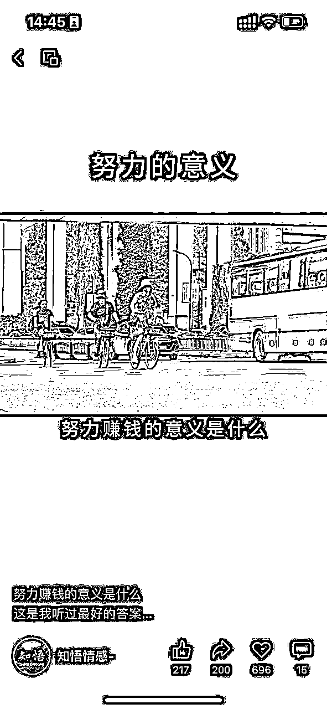

运营上可参考「2.2 涨粉思路」：先把内容质量做上去，再试着用问一问给视频号引流。持续做，给账号一点时间，结果会慢慢显现。下面说创作方法。

## 5.2 素材获取

方式一：在短视频平台按关键词检索，例如车流、烟花、风景、街拍人流走动等，复制链接后用去水印小程序保存到本地，再按类别整理成个人素材库。

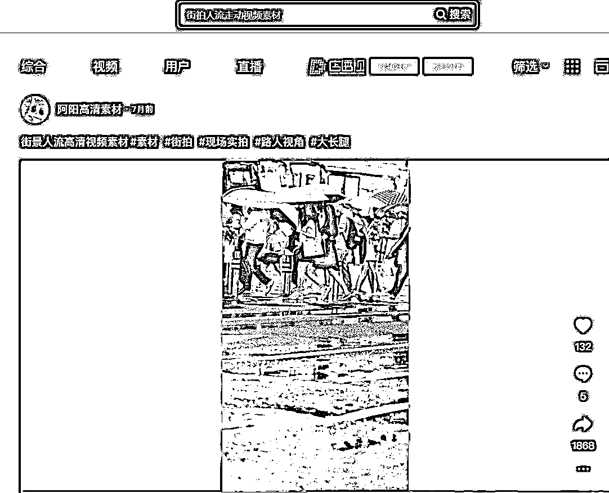

方式二：到淘宝、拼多多等平台付费购买素材库。卖家通常会按类型分好类，不过不同人买到的内容差别不大，后期仍要重新混剪、做去重。

## 5.3 成片制作

方式1：用自己制作或截图公众号文案的图片，配上热门BGM，再加画面特效做去重。注意：第3点加入的视频主要让机器审核时更容易通过，提高原创度；因此选片尽量避开平台已有素材，或通过混剪降低相似度，或直接拍原创。

效果参考：

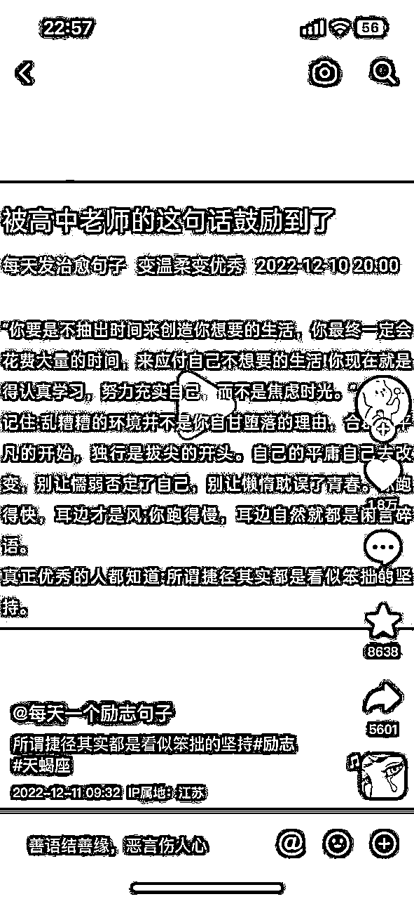

方式2：语音文案＋优质混剪视频＋BGM。

效果参考：

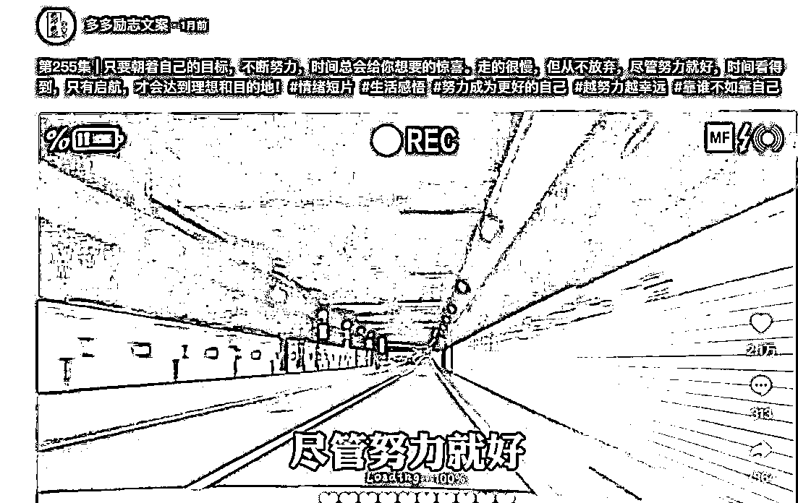

方式3：自己出镜拍摄＋BGM＋字幕。

优势：视频完全原创，出镜口播的人设更鲜明（可参考视频号“笑笑悟”）。

弊端：需要真人出镜录视频，很多人比较抗拒，而且录制通常较费时间。

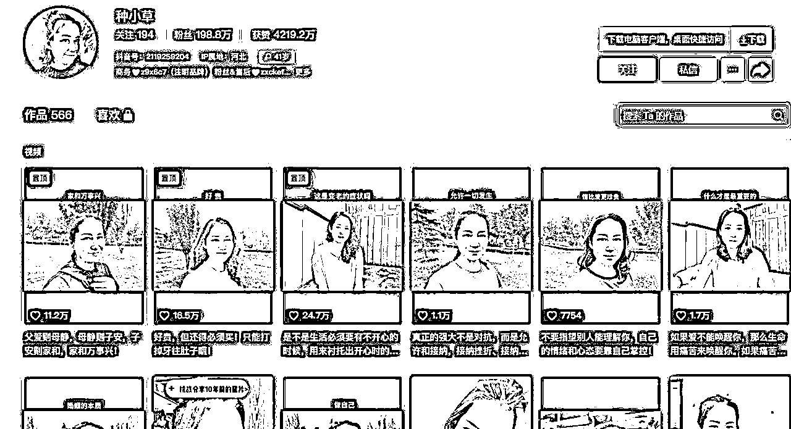

# 六、怀旧号如何涨粉@黄岛主

💡本章看点

怀旧号面向70/80/90后，用童年时光类内容吸引关注、完成涨粉。

起量表现：在平台搜“怀旧”，能看到大批万赞作品，点赞、转发、推荐均破10万＋的也不少。有些账号第三条作品就开始起量，从几百赞冲到上万赞。

受众：70/80/90后，与视频号用户画像贴合。

素材渠道：抖音、视频号，资源很多。

制作门槛：新手可做，对画质与剪辑软件要求不高。

内容特征：用怀旧记忆击中相关人群，传播阻力较小。

提醒：最好新注册一个视频号，从0到1起号。

本章从赛道概况、账号搭建、素材收集、视频创作、运营动作五块展开，只提供思路，具体细节需在实操中继续试。

## 6.1 赛道全貌

怀旧号，说白了就是做童年回忆类视频来吸引关注。目标人群是70/80/90后，和视频号粉丝结构很接近。再加上不少人从小在农村长大，看到相似场景会有兴趣；刷到这类内容时，常常会点进主页连着看几条，因为确实会勾起小时候的记忆。怀旧题材也不只这一种，近期农村神嫲嫲、鬼神类怀旧视频也有不少人愿意点开。下面是视频号案例：

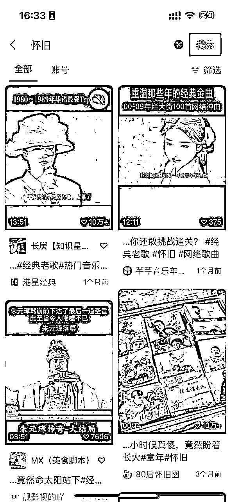

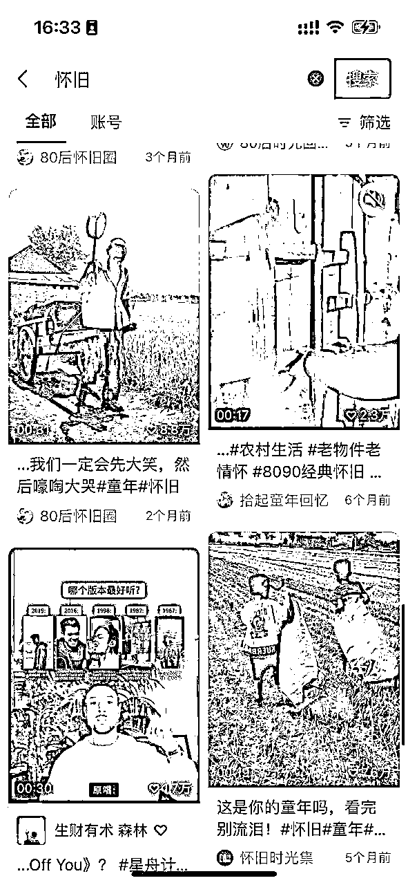

下面说这类内容怎么做。

## 6.2 账号准备

### 6.2.1 开号前建议

1) 建议新开视频号。0到1更顺，麻烦少，且新号有扶持。
2) 老号如果做过其他赛道，再转过来效果往往一般：原有标签已固定，垂直度不足，扶持期也过了。真想做，建议重新养号。
3) 老号里的作品，可隐藏但别删；删除可能降权，后续再刷领域垂直。已发几百条也可以先隐藏，后期用垂直内容测试。
4) 早先注册但从未发作品、只用来刷内容的号也能用，不过扶持期已过，起号速度通常不如新号。

### 6.2.2 注册环境

坚持一机一卡一号；注册微信和运营视频号都在4G/5G网络下完成，别连WiFi。

不用WiFi的原因：
1、WiFi下注册可能带来流量下滑、限流或风控。
2、安卓机可限制WiFi，让微信仅走移动数据，避免误连（仅安卓）。

手机卡建议：
1、用实名卡，别用虚拟卡、接码号、物联卡等。
2、已有手机号和微信的，可跳过。
3、没有手机号或要重新注册的，先办卡再注册微信。

办卡方法：去营业厅办理电信、移动、联通卡，三家各可办五张；建议办移动副卡，与主卡共享流量。

流量包：选稍大一点的套餐即可，视频号并不怎么耗流量，够发作品就行。

### 6.2.3 注册流程

1) 已有微信或刚注册好微信，可直接开通视频号；若之前开通过且发过作品，建议换号。
2) 注册时需填资料，可按下述模板填，也可在视频号搜“80后怀旧”找对标。

昵称：80后童年怀旧、80后怀旧时光、80后童年怀旧时光
签名：你的青春，我的回忆，致70-80-90后
头像：按这个形式作图，也可直接使用，建议稍改，影响不大。

PS：注销方面，目前一年仅3次。特别注意：若曾绑定商店，注销前务必解除关联；分数别掉到60分以下，否则会被继承。

## 6.3 素材获取

找素材以抖音为主，不建议从视频号取材。因为成品要发视频号，若素材也来自视频号，容易被判搬运。稳妥做法是：素材取自一个平台，成品发到另一个平台，降低搬运判定。

### 6.3.1 手机端取料

① 打开抖音搜“80后怀旧”，下拉词很多，任选一个就能看到大量对标作品。建议关注几个长期更新的对标号，方便持续取料。
② 找到目标作品，点右下角箭头复制链接；再到微信搜小程序“轻抖去水印”，粘贴链接，提取后保存到相册。

轻抖操作见图：

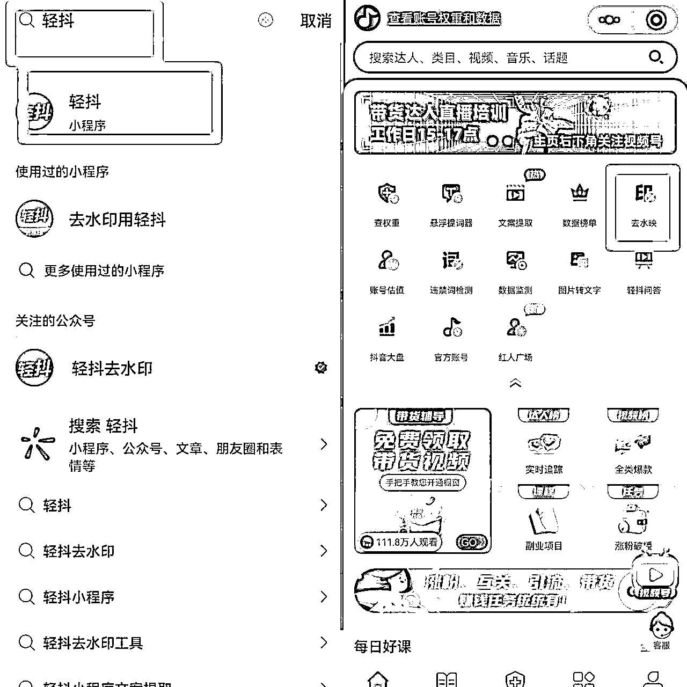

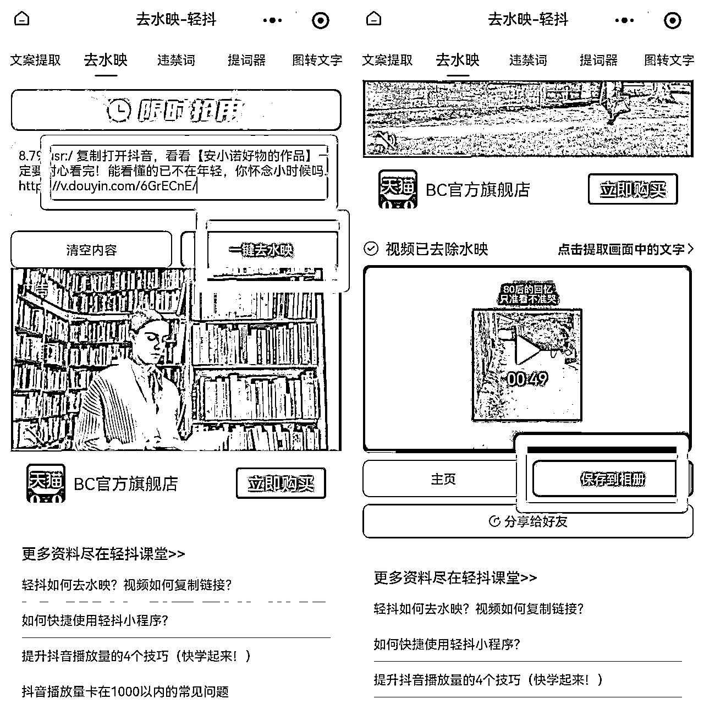

### 6.3.2 电脑端取料

① 打开抖音官网：https://www.douyin.com/
② 搜“80后怀旧”等词，找到素材，如图。

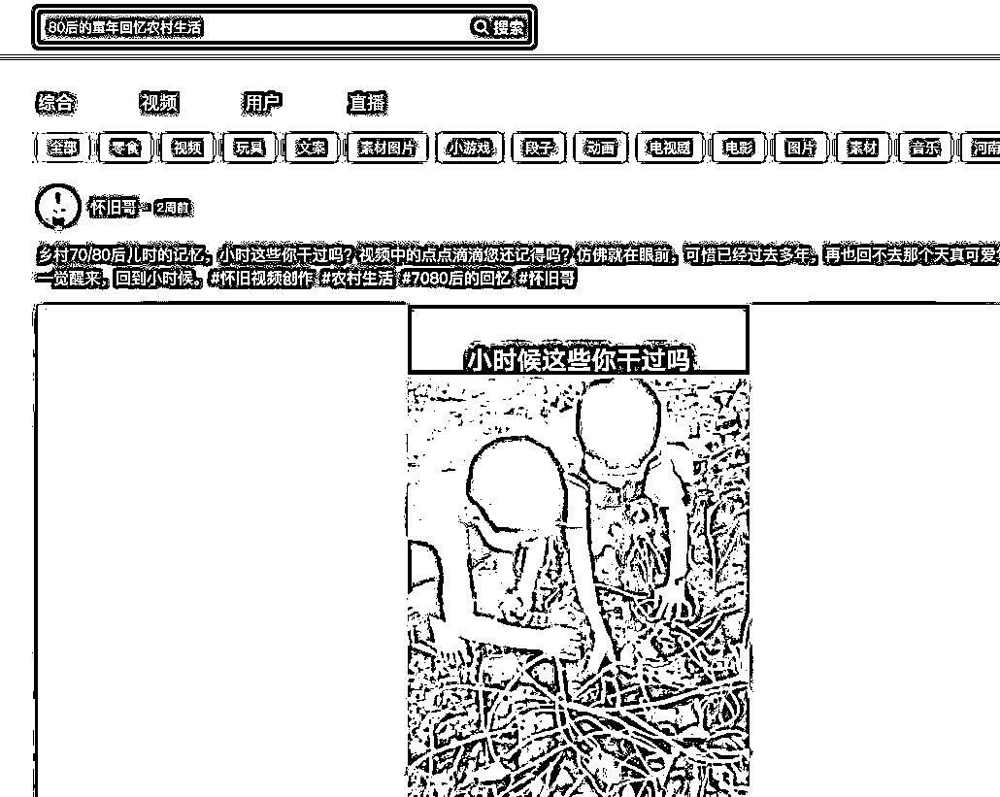

③ 用PC端软件下载，推荐Apowersoft视频下载王，链接：https://www.pcsoft.com.cn/soft/117044.html。打开软件后复制链接下载即可。

操作步骤：
1) 打开软件
2) 点“侦测”，输入网址，按回车访问
3) 在网页端取得链接地址

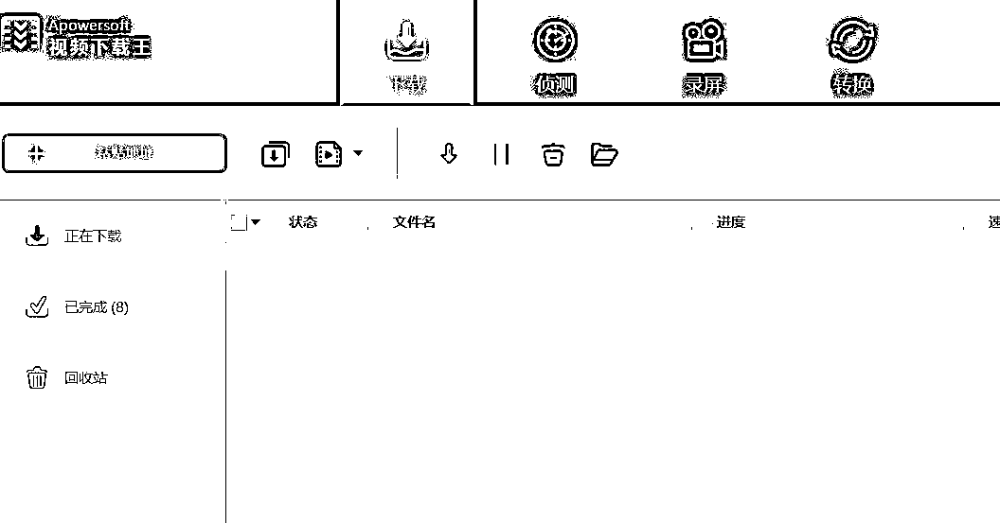

4) 网址只保留该段链接，回车访问，软件会自动侦测并下载
5) 点“下载”，再点“已完成”，找到对应视频，右键“打开文件夹”，即可看到文件。

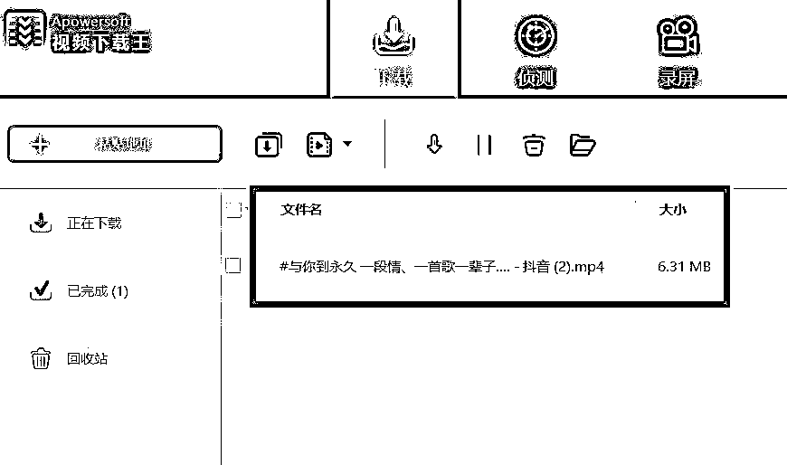

## 6.4 成片制作

素材到手后开始制作。

1、打开剪映，点加号选素材。把几段视频加入后做二次剪辑：不需要的开头和结尾删掉，拆成一个个镜头，无用片段删去，每小段大约剪掉1秒。

A：先挑出可用片段，多余部分删掉。留下的应是最精彩、最贴合怀旧概念的镜头，总长约30秒。随后把镜头顺序彻底打乱，后段前移、前段后移，打乱到自己也记不清顺序，只要不影响观看即可。
B：最好围绕一个主题做，多观察同行，比如过年、上学等场景，尽量保持垂直；也可把多个情境混在一起，具体再孵化。
C：前三个镜头务必选全片最好的。前三秒决定用户是否停留，可多参考对标作品。

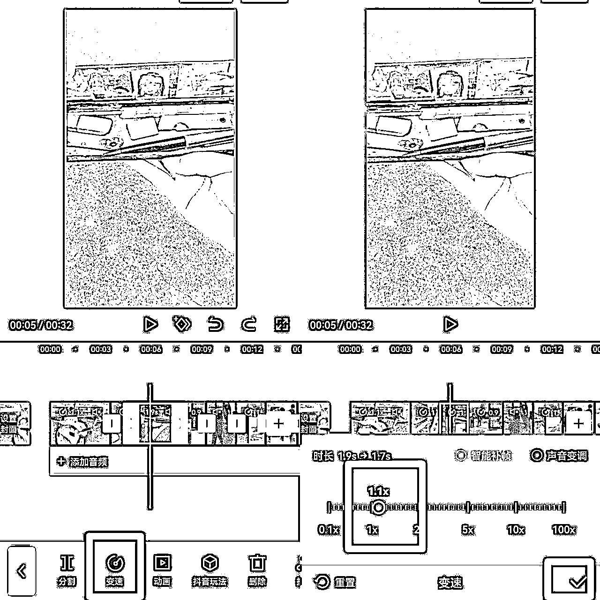

3、逐个镜头调镜像。镜像在编辑里，作用是把画面翻转。画面带字的尽量不调，没字的尽量调；有字也可切掉。镜像建议做，每个镜头都过一遍。

4、给整条视频加滤镜。怀旧常用黑白滤镜，黑白里又有牛皮纸、江浙沪等效果，按需求挑喜欢的效果；调好后把滤镜拉到片尾，保证全程覆盖。

5、整条视频加特效。复古特效较适合怀旧内容，很多对标作品也在用。常用黑色噪点、荧幕噪点两类；加完后同样拉到与片尾对齐。

6、做调节，让画面更清晰、观感更舒服、色彩更饱满。新增调节：对比度10、饱和度10、锐化20。饱和度提升质感，锐化增加清晰度；调好后也拉到末尾。

7、加音频。这里已整理好现成音频，可直接用。每条视频约36秒，与音频对齐即可。导入方法：先把音频发到QQ，再从QQ导入剪映；前提是剪辑区已有视频，否则导不进去。具体看步骤。若觉得别人的音频文案不错，也可复制：先用轻抖去水印下载视频，导入剪映后关闭原声，点“提取音乐”，只取视频声音。

视频处理完，再做文字点缀，见第8点——制作抬头文字。

好的抬头文字能留住用户。可以这样理解：刷到一群对内容兴趣不大的人，很容易划走；若有一句抬头吸引，可能会多停留几秒。比如写“经历过的至少已经35岁了”，用户一看“我已经40岁了”，就想知道后面讲了什么，对完播率帮助很大。

操作：点“画中画”，新增后进“素材库”，选黑白布，添加黑布。黑布会遮住画面，把它移到上方；若太小，用两指向外拉大，调到需要的位置，再把长度拉到与镜头一致。若下方未遮住，复制一个同样的画中画拉下来，叠一层；上下遮好后开始做抬头。点“添加文本”，新建文本输入文字。抬头文案做好后拉到与视频对齐，再调颜色、大小、字体。字体样式很多，颜色也丰富，通常用偏复古的黄色，醒目且贴合主题；其他颜色也可。

抬头文字需与画面同步，并设置字号、颜色、字体。样式按喜好选，复古黄通常更醒目、更贴题，其他颜色也没问题。

最终效果这里无法直接展示，因为不能上传视频。可去视频号搜“80后童年时光机”，看看这个对标号，我们基本照它操作。如图：

## 6.5 发布后运营

作品发布后要认真运营，不能发完就不管，否则很难出效果。记住：权重和热门是一点点做起来的。我们目前主要吃公域流量。大家开视频号时都没粉丝，所以只能在公域流量池里靠作品质量竞争。持续产出优质内容，账号权重积累到一定程度，官方会匹配基础播放量。比如最初发布可能只有几十、不到100播放，然后逐步抬升。

一条视频发出去，平台给的曝光并不是一步到位的。大致按档位递进：起步档五百上下，接着三千左右，再往上五千、一万，越往后还有层层叠加的推荐。

真正决定成败的那个数，是观众平均停留了多久。平台衡量内容优劣时，这个指标的分量最重；完播率、点赞、评论当然也看，但都排在它后面。别把互动数据当成唯一标准，权重最高的还是平均观看时长。

1、每天抽一小时养号。前期我们没强调这一步，但依然建议：发布前后去搜“80后怀旧”之类的词，翻翻同行的作品，让账号保持活跃状态。倘若长期不看别人的内容，系统容易把你归为营销号，权重随之走低——扶持期还能拿到推荐，过了这阵子就没了。所以，每天刷同类视频这件事，值得当成固定动作。

2、作品上线后，先自己把点赞、评论、完播、转发走一遍，把零互动的局面破掉，推荐量才推得动。这个习惯要养。也可以顺手转到别的有粉丝的号或微信群里。

3、备上几个小号，专门负责点赞、评论、完播和转发。

A：主号发完，小号点进去把视频看完，再补赞、评论、收藏、转发。系统看到这些动作，会当成真实用户喜欢才互动。

B：小号留言别随手写，最好提前设计一句能勾人的话。这类评论容易引来别人点赞、跟评，一条就能带出一串讨论。比如“这样的童年，你是不是也经历过”之类。平台不会追究留言动机，哪怕只打了个句号，也算作互动信号。点赞评论攒起来了，系统就认定内容优质，继续往外推，火起来往往就在不知不觉间。

C：把对标的头部账号关注上。他们一更新，关注流里就能刷到，方便跟进。

4、有人留言，尽量回，回得越多，推荐越容易往上走。

5、记住一条：作品永远别删。不想让人看，设成仅自己可见藏起来就好。

6、发布后按七到十五天观察。先看这期间播放能不能稳定在五百以上；头五天每天都过五百，说明内容质量站得住。七到十五天再复盘账号整体表现，据此调整。

7、想快点上热门，可以用加热投放推一把。

8、什么时候从4G切到WiFi？我们的做法是一机一卡一号，等号起来之后再换无线网。起号阶段必须走4G或5G，IP不能动。

9、发出去没量，别急着隐藏重发。按标准流程正常发，等七到十五天看整体数据再说。

10、老号和新号的数据都整理一下，反馈给我。

11、账号零播放，我想到的原因有几类：有过违规记录；新号前期冲得猛，忽然归零或数据跳水；同一IP下登录的号太多；发布频次过高；内容非原创、同质化严重、去重没做好。照这套思路运营，起号一般能走顺。

内容来源：80/90后童年时光怀旧短视频副业项目，从起号再到10W+复盘全过程分享

# 七、靠招聘信息涨粉，@郭耀天这么做

💡

内容速览

招聘信息赛道，说穿了就是把各家企业的招聘公告做成短视频，画面里展示岗位，引导观众去公众号拿详细信息，粉丝就这么涨起来。

成绩：单日最高涨粉数千，同时跑几个号，两个月累计十万以上。

受众：以应届毕业生为主，另有一批三十五岁以下、盯着考公考编的人。

素材从哪来：企业官网、公众号、政府人社部门的招聘专区、校园招聘栏，以及本地做招聘的人力网站。

制作难度：文案和画面基本现成，剪辑不复杂，新手能上手。

特点：不受地域限制，大城市小县城都能做；招聘信息本就公开，内容撞车也不影响。

要留神：引流号容易被封，但流量确实能起来，把号的问题解决掉就行。目前测试下来，视频号这边封得不算狠。

下面从赛道概况、账号搭建、素材收集、视频创作、运营动作、思路拓展六个方面展开。这里只给思路，细节还得在航海期间一起摸索。

## 7.1 先摸清赛道

每年毕业季，各类机构和企业都在招人，不少公司更是全年挂着岗位。招聘本身跟我们没直接关系，但这份信息可以拿来引流涨粉。

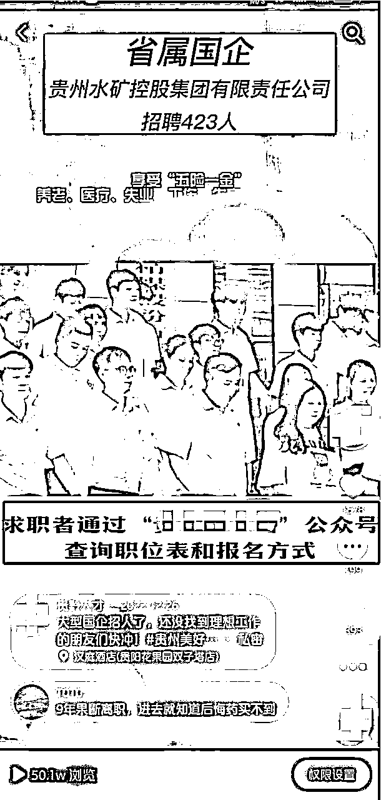

操作其实不绕：把招聘公告整理成短视频，视频里展示岗位，引导观众关注公众号领取详情，粉丝积累起来后再变现——接广告、卖粉、卖课程、卖会员都行。有伙伴靠这套做法攒到四十万粉左右，眼下还在涨，赶上毕业季流量尤其旺。用别人的信息换自己的流量，路子是通的，粉丝也够垂直；缺点是这批人付费意愿偏弱，加上引流号容易挂。

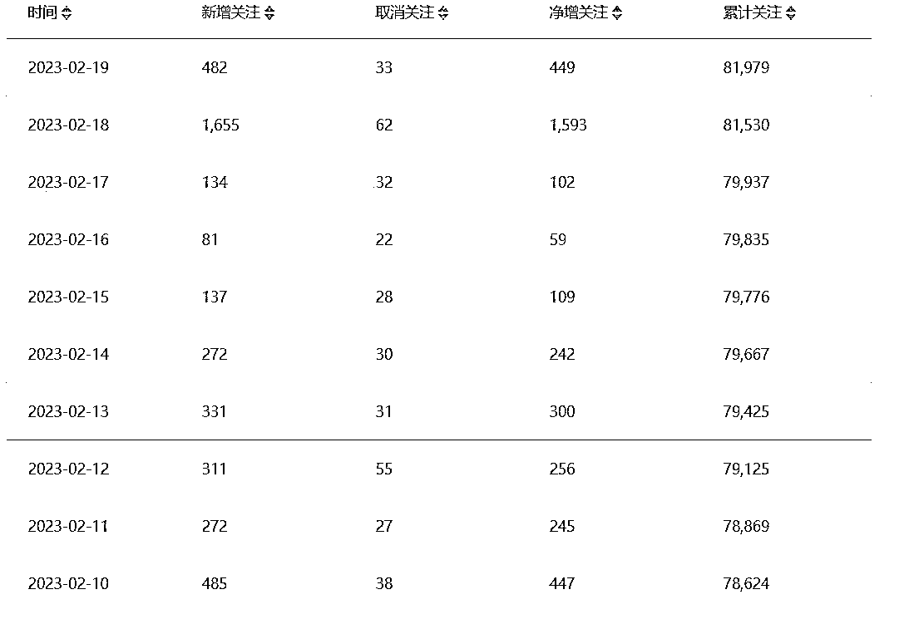

手里有资源的可以上矩阵。比如对接了高校，就让学生帮你批量铺号，多账号多渠道往主号导流；也可以把玩法教给别人，让对方替你跑，按涨粉数结算。

## 7.2 账号怎么搭

各平台的短视频号注册完、资料填好即可，名字能统一最好，不统一也无妨。真正要紧的是公众号——眼下招聘、兼职类内容管得严，不少人拿个人号在撑。

个人号同样会出状况。更稳的做法是挂靠人力资源公司，有招聘业务资质最好，资质在手，账号跑起来基本不出岔子。日常注意内容真实，涨粉和阅读都不会差。

## 7.3 素材从哪来

企业官网、公众号、政府人社招聘专区、学校招聘栏，还有本地专做招聘人力的网站，都能挖到料。我们本地就有一家这类网站，信息更新快，随时能取，有内容就整理成视频。

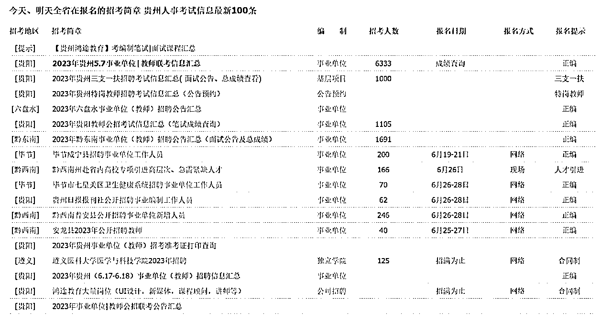

## 7.4 视频怎么做

动手前先去各平台搜这家企业或单位的现成视频，自家的最好，别家拍的同类型也能用；官网宣传片、介绍片同样可以，核心是让观众认出这是哪家在招人。素材拿到手简单剪一下。实在找不到，就找几张图片拼成短视频。记住，画面最打眼的位置要留给引流公众号。

## 7.5 运营怎么做

有些平台不允许直接放广告，那就走留言或私信。以头条为例，可以设自动回复：用户想要具体岗位，私信过来，自动回复里带上公众号信息，引流照样完成。当然，最直接的还是把广告嵌进视频画面，就像这样。

## 7.6 换个领域也能用

这套打法不止适用于招聘。企业或机构送福利、发资源，都能照搬这个模式——借别人的东西做自己的事，别把自己框死在招聘里。之前写公众号时，有读者留言说他们就在跑类似玩法，一年攒了几十万粉，如今每月进账三五万。

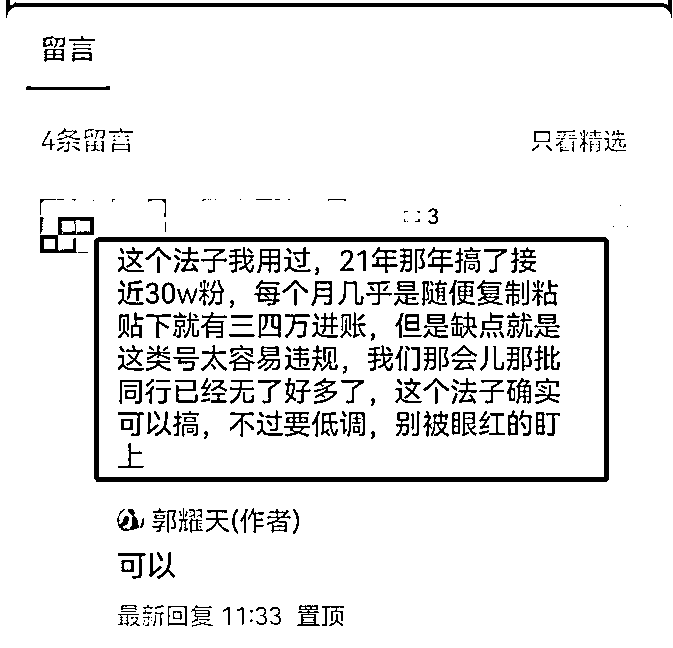

同行在各平台做得也不差，多扒些案例出来研究，往往能挖到新方向。抖音上现在还流行另一种变体：把各平台的课程、项目、玩法做成拆解视频，片子里植入广告，想要资料就去找某个公众号。素材不少能在拼多多上买到，挑版权弱的用。

内容来源：复制粘贴涨粉八万，变现十万元

# 八、英文育儿赛道，@秋海这样起号

💡

内容速览

英文育儿号，本质是育儿混剪加英文解说：把育儿专家的内容译成英文，出镜人物换成老外，配音改成英语，再照着同行的混剪套路做流量，最后靠带货或其他方式变现。

成绩：圈友@秋海做了快一年，两个号累计一百二十万粉，月利润一到两万。

受众：家长群体。

素材：抖音找文案，译成英文；YouTube、TED 找外国人的画面。

难度：有一定门槛，英语要懂一点，剪辑要会，最关键的是会找素材。

特点：原创度明显更高，流量起得快，侵权风险小，账号活得久。

要留神：起号慢、流量忽高忽低，都是常事。

下面按赛道概况、账号搭建、素材收集、视频创作、避坑经验展开。这里只给思路，细节在航海期间一起探讨。

## 8.1 这个赛道值不值得做

说白了，英文育儿书单号就是中文版的英文化改造。

家里有孩子、刷过育儿内容的，多半见过李玫瑾老师的视频。把这类专家的内容译成英文、人物换成外国面孔、声音换成英语，一个英文育儿书单号就成型了。

运营套路是：先用流量视频把粉涨起来；等某条视频爆了、粉丝够到带货门槛，再拿爆款流量去带书。

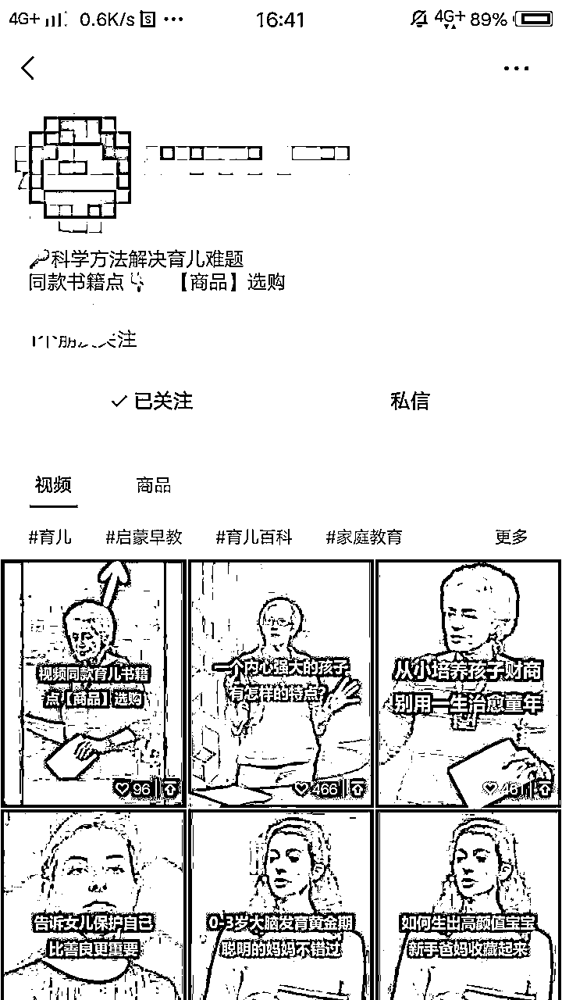

为什么选它？

第一，蓝海。我准备入场时，抖音和视频号上干这事的人都不多。那阵子做中老年女装，每天习惯刷一会儿抖音，撞见这种模式后专门去找对标，翻来翻去不超过十个号。以抖音的体量，这妥妥算蓝海。

第二，门槛挡住了一批人。比起纯搬运混剪，它要求懂点英语、会剪辑，最要紧的是会找素材。素材要是别人没用过，剪出来就算原创。

第三，家长舍得为书花钱。我家也是男孩，每年绘本童书开销不小，身边不少宝爸宝妈同样愿意在这上面投入。

还有一层心理：外来的和尚好念经。很多人觉得国外的育儿理念更先进，天然容易被吸引。用外国人形象，侵权风险也低得多。

选视频号，是因为当时在那边起号最快，第一条就爆了，精力自然往这边倾斜。当然其他平台没丢，做好的视频会同步到抖音和快手。

两个号目前抖音十万粉、快手八万，跟视频号不是一个量级。

流程拆开看就五步：找爆款文案、译成英文、AI 配音、找画面素材、合成。下面逐一说。

## 8.2 账号准备

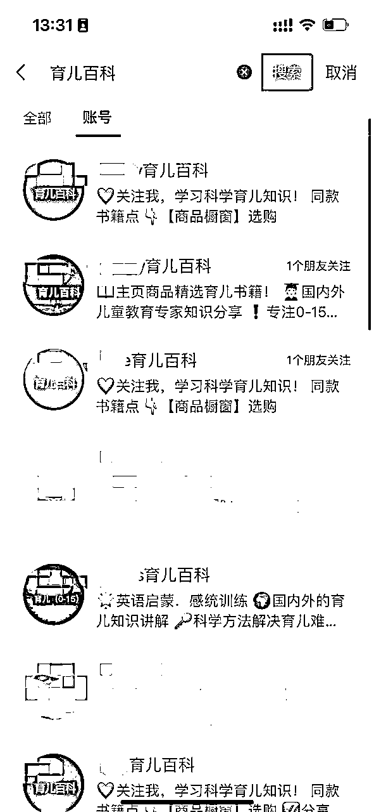

## 8.3 素材怎么找

### 8.3.1 先挖爆款文案

抖音内容最全，找文案自然从这儿下手。判断标准很简单：点赞高就行，图文视频都无所谓，只要主题跟育儿沾边。

操作：首页搜“育儿”，打开筛选，按“点赞最多”排序，时间选“一天内”或“一周内”都可以。刚起步的话，“半年内”甚至“不限”也行。

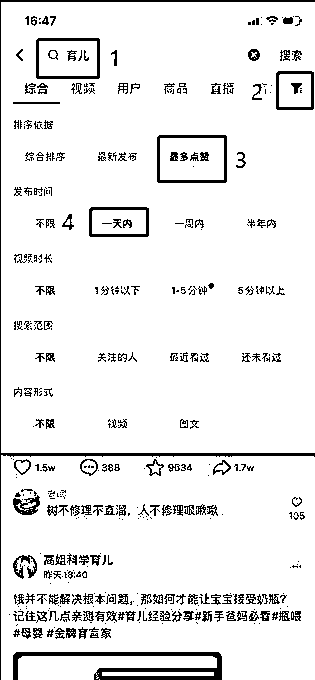

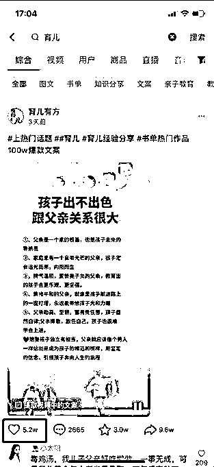

电脑端流程一样：

提取文案：图文得自己敲，或者丢进 OCR 网站识别；视频先下下来，再用飞书妙记转文字。

下载工具网上能搜到，我用 IDM。另外轻抖、哼哼猫这类也常见，还有视频号相关工具，具体可跳转 8 月航海 | 视频号带货 | 实战手册查看。

另一条路是盯住做得好的同行，直接把他们的文案拿来用——那些多半也是从爆款里扒的，能直接用。

拿视频标题去搜，基本都能找到对应的中文原片。下下来，同样用飞书妙记提取。

### 8.2.2 译成英文

在线翻译站都行，百度、有道都可以。

我常用 DeepL，免费，准确度也够。有精力就再校一遍英文，没精力直接用译文。

### 8.2.3 用 AI 配音

配音工具有配音神器、魔音工坊等。

我用 tts-vue，里面接了微软 Azure 语音，各国英语音色都有，中文等其他语种也支持。

右侧参数调好，点转换生成音频，底部绿色按钮即可下载。

### 8.2.4 找画面素材

素材分主、辅两类，核心原则是：别人没用过。

主素材是外国人口播画面，辅助素材用来衔接两段口播。

找外国人，自然要去外国人的地盘，油管最合适。前提是能科学上网，这算一道小门槛。

主素材锁定演讲类，TED 是首选。为降低侵权风险，可以先在 TED 找一个演讲，再拿演讲者姓名去油管搜，通常能翻出同人的其他演讲。

搜不到就换个人再试。

辅助素材同样在油管找，关键词围绕 kids、child、family 这类育儿词。有个小窍门：关键词后面加 stock footage，能筛出无版权的高清片段。

下载还是用 IDM。

## 8.3 动手剪片

### 8.3.1 流量视频

剪映足够。细节见图，音乐轨下方还要叠一条背景音乐轨。

刚上手会慢，因为素材库还没攒起来。等素材多了，半小时出一条不成问题。

注意：视频轨的素材必须静音。

主素材里人物的口型要跟音频合上。有声音时，画面中的人得在说话，别出现有声却闭嘴的情况。

口型对不上，就拿辅助素材顶上去——它的作用正是抹平声画不同步。

英文字幕选中音频自动生成即可。中文字幕得手动敲。

### 8.3.2 带货视频

流程和上面大体一致，区别是要把自己拍的商品片段塞进去。

先拆对标号的带货视频，看别人怎么剪，照着来；也可以找中文育儿书单号的视频依葫芦画瓢。

商品画面尽量自己买样品拍。用别人的片段，容易被判非原创。带什么货同样看对标——他们带啥你带啥。

另一个办法是借第三方数据平台挑销量好的品，买回来自己拍。

以考古加为例，既能找热销商品，也能顺藤摸瓜找到对标带货视频。

筛“图书音像”，挑合适的品，进详情页点关联视频，对标的片子就出来了。

## 8.4 避坑心得

起号慢、流量不稳，做项目难免碰上，平常心看待。

我开了四个号只起来两个：一个首日就爆，另一个磨了将近一个月，剩下两个始终没动静。想提高成功率，初期不妨多铺几个号。

只押一个号，起得慢容易心态崩，很难撑下去。起号这事有运气成分。解法无非两条：要么加号，用数量换概率；要么调低预期，把周期拉长。路走得通，迟早能到。

视频爆的时候，一天几十万甚至几百万流量。但爆款有衰减期，短则一周半月就凉，大爆的能撑一两个月。

流量回落后只剩几万，落差极大。出单量跟流量成正比，流量越大单越多。

于是心情像坐过山车，在顶峰和谷底之间来回。

爆的时候人跟打了鸡血似的，不眠不休。第一次爆，带货权限还没开，连播两天，每天只睡两三个小时。

那会儿几乎每分钟都在出单，结结实实体验了把日入过万。

有过这种体验，等流量回归平常，剪视频的劲头就提不起来了。

做久了心态反而稳了：爆了就多剪几条带货视频，把流量吃干榨净；不爆也保证日更不断。

说到底，还是平常心，跟做别的项目一个道理。

内容来源：视频号蓝海英文育儿书单带货一年累计粉丝120W+，月入2W+，我是怎么做到的？

# 九、ChatGPT赛道，@轻松学长如何涨粉

💡

内容速览

ChatGPT 类视频覆盖面很广，从少年到中老年都能看，题材可以是情感、热点、历史等。

成绩：一个半月涨粉九万以上，运营半年后每月仍能涨两万左右。单场直播观看破二十万，往企微/个人微信引流八千多人，直接变现两万。

受众：年龄跨度大，几乎通吃。

素材：知乎、微博、ChatGPT 本身，可用的内容管够。

难度：会用 ChatGPT 就能做。

特点：话题容易引发讨论，限制少，传播快。

要留神：政治、黑产这类话题别碰。

下面按赛道概况、账号搭建、素材与选题、视频创作、运营动作展开。这里只给思路，细节在航海期间共同探索。

## 9.1 热度从哪来

ChatGPT 面世有些日子了，热度却没降。一边是大量人还不会用，一边是越来越多人开始用它、搜它——自带流量的属性摆在那儿。

问过 GPT 的人都有体会：它的答案本身就能留住人。把这类问答过程录成视频，观众为了看完回答愿意多停留几秒，数据自然差不了。目前 ChatGPT 相关的账号里，录屏问答类的内容反馈和涨粉速度都相当能打。接下来就把这套玩法从头到尾拆开讲。

## 9.2 账号搭建

### 9.2.2 昵称

视频号目前对新改名的账号有限制，不让直接带 ChatGPT 关键词，那就用 Chat/GPT 加后缀的方式，沾边就可以。像 Chat 聊天助手、GPTAI 智能机器人这类名字，自己随意发挥，也可以让 AI 替你想几个。

### 9.2.3 简介

简介里可以把微信号放上去，粉丝或者商务找你都更方便，同时写清账号的定位。尽量多堆一些 ChatGPT 相关词，能提升账号的搜索权重；多看看同行怎么写的，吸取经验。

## 9.3 素材&选题

问答类视频，选题是命门。能戳中情绪、引发讨论的话题，最容易爆。选题可以从四个方向找：实时热点、社会民生、其他平台热榜、同行爆款。

方向一：实时热点。从当下热点里找观众关心的角度，一个问题能引爆一串问题。比如七夕快到了，就能延伸出一堆选题：怎么向暗恋的女生表白？送女朋友什么礼物比较好？七夕女生最怕收到什么礼物？怎么策划一场有仪式感的七夕约会？

方向二：社会民生。大家茶余饭后聊的事，整理一下就是选题。高价彩礼、996、买房、结婚、教育等都能挖，但注意别碰敏感内容，跟国家政治沾边的尽量绕开，免得违规。

方向三：其他平台热榜。热榜跟实时热点有点像，又不完全是一回事。主要盯两个平台：知乎、微博。知乎的热榜一天更新 50 条，挑其中大众向的话题，参照方向二的标准过滤一下；微博则只给关键词，得自己顺着关键词把问题设计出来。

方向四：同行爆款。做短视频、做自媒体，躲不开参考同行这一步。选题枯竭的时候，同行就是最好的老师，他们的爆款已经过了观众检验。刷视频号时重点看两类视频：一是账号整体点赞平平，突然有一两条特别突出，这种多半是爆款，再做一次也可能爆；二是直接看数据，超过 100 赞有爆款潜质，超过 500 算小爆，超过 1000 基本就是观众盖章认证的选题。

再送一个小技巧：如果 ChatGPT 给出的答案不满意，可以先把它的回答喂回去，再换个方式问。

## 9.4 视频创作

### 5.4.1 所需工具

1）剪辑：推荐剪映，教程网上很多，自己跟着学就行。
2）录屏：推荐 EV 录屏，下载对应版本安装好就能用。打开后先选「选区录制」，框出要录的范围，然后点开始，录完点结束。

工具不复杂，多试几次就顺手了。

### 5.4.2 录屏问答类

按现在的经验，ChatGPT 短视频主要两类：图片截图和录屏问答，其中录屏问答占绝大多数。实测下来图片截图的效果不如录屏，所以这里重点讲录屏版怎么做：把 ChatGPT 答题的完整过程录下来，原视频丢进剪映，头尾剪掉，再用变速把时长压到 30 秒以内，最后加标题、背景音乐、音效、贴纸，内容一下就丰富了。

模板也可以固定：把背景音乐、音效、贴纸做成模板，点素材左边的小眼睛隐藏，每次把新录屏放在模板素材上层剪就行。剪辑时注意调画面大小，用裁剪把录屏调整到合适的比例，保证观看体验。我自己做的是横屏，比例选的 3:4。

### 5.4.3 关键要素

制作本身很简单，难的是选题。挑那些会让人有代入感、有情绪反应甚至想吵两句的话题，比如搞钱、代写情书、做旅行攻略、哪些职业可能被取代等。实在没想法，多刷同行的视频，就知道该做什么了。还有一点，要有自己的风格，标题和排版尽量统一。选题都差不多的情况下，如果连风格也分不清，粉丝对比你和同类账号时没有记忆点，粘性自然不高。

## 9.5 运营动作

### 9.5.1 引导转化

简介处直接把微信号摆出来，需要代开账号、有问题要咨询的人才能找到你。有精力就经营评论区，每条视频下面做评论引导，粉丝提问也要及时回复，问得最多的基本是：怎么下载、怎么用。

### 9.5.2 直播预约

方法很朴素：在账号主页长期挂一个开播预约。因为你猜不到哪条视频会爆，提前挂好，爆了才有承接流量的口子。可以一周挂一次，比如固定每周五 20:30，那就每个周四晚上把下周的预约放出来。如果预约的人不多，自己又不想播，取消就行。像我挂的这个预约，观众刷到短视频时，系统会自动弹出预约入口。

直播预约的设置流程参考下图：

内容来源：10 天时间，成为视频号 ChatGPT 类头部账号，我做了什么？

# 十、AI 说话赛道怎么快速涨粉@云天

💡

章节概要 AI 说话号，就是把一些思维金句、禅意短句、创业箴言做成语音，贴到一张图上，再让画面里人物的嘴巴动起来。常见的思维老者语录、小和尚号，都属于这个玩法。

涨粉情况：小和尚号最早从抖音、快手火起来，转战视频号后也多次出现千赞账号。
视频受众：偏年长用户，男女差别不大。
内容来源：语录去抖音、快手搬运整理；AI 图自己生成，素材多且原创度高。
视频制作难度：剪辑要求偏高，还需要一些 AI 绘画功底。
内容特点：走心语录是内核，虚拟形象是外壳，对年长观众的情感命中率很高。
注意事项：小和尚号在视频号已是同质化重灾区，起量很难，建议换新形象。

本章从赛道概况、AI 图片生成、视频创作几个维度，带你看懂 AI 说话赛道的玩法。注意：这里只说思路，具体细节留到航海期间大家一起摸索。

## 10.1 赛道概况

AI 说话号是最近一个月在短视频平台忽然火起来的项目，涨粉很快。内核是让静态图活过来，再嵌入一段段语音内容，素材都是自己生成的，天然原创，不用担心被判搬运或者重复。熟练以后十来分钟就是一条。变现路径也不难走：号做起来以后，收徒、卖书、接小程序都行。具体效果看下图，大家多半刷到过类似的视频。

6 月 25 日.mp4【在线播放】

目前视频号里小和尚号已经过了最好做的阶段，没必要都挤在小和尚和老者的赛道。大家扎堆做小和尚和老者，你却可以另辟蹊径，选美女、生肖这种形象，甚至任何带口型的赛道——情感咨询、起名风水、节日祝福、交友配对，都能玩。

做这种视频的流程是：先生成 AI 图，再打开 did 网站，把图与声音素材传进去，一键就能做出动态成片。整套下来，一条 10 分钟搞定。下面看具体怎么操作。

## 10.2 生成 AI 图片

生成 AI 图有两条路线。一条是 Vega AI：套小和尚模板马上出图，也能自己调风格。它免费、免翻墙、好上手，缺点是画质上限不高。想了解走「10.2.1 使用 Vega AI，免费无需翻墙」。另一条是 Midjourney：不需要琢磨描述语，以图生图即可，还省去等图时间，画质更好，但操作更麻烦，还得掏钱买账号。教程见「10.2.2 使用 Midjourney，以图生图无需咒语」。

### 10.2.1 使用 Vega AI，免费无需翻墙

玩法 1：套小和尚模板快速生成图片

第一步：注册并登录 Vega AI 官网 https://rightbrain.art/
第二步：点左侧菜单的「风格模板」

第三步：输入「云天」，选小和尚模板

第四步：点「应用」

第五步：在右下角调整图片参数
选 9:16、4 张、普通画质就行。高清和超清只能出 2 张，效率太慢，所以先用普通画质，后面再拿高清修复软件升级。

第六步：在下方输入文案，生成图片

比如填：光头，在草地，背后是蓝天

就会生成 4 张图片

第七步：挑合适的图片下载到本地

第八步：用高清修复软件或网站把图片变成高清

玩法 2：自己训练风格，制作其他图片

想生成别的 AI 形象，可以上传自己的参考图，让平台学出一套专属风格。
第一步：左侧菜单选「风格定制」，点「开始训练」

第二步：输入风格名称，选基础模型

第三步：上传其他图片，开始训练

第四步：等训练完成。

### 10.2.2 使用 Midjourney，以图生图无需咒语

1、先去某宝买 Midjourney，不建议自己注册充值，官方的月费动辄几百块。按 16 到 32 元的月租买共享号，商家跑路也不心疼。
2、登录 https://discord.com/，用买来的共享账号进入社区。
3、输入框输入 /，选 /describe，点红圈处，选一张想要的图。比如目标是做小和尚号，就去截一张同行的画面传上来。
4、回车以后，系统会返给你 4 条与图片意境匹配的描述语，随便复制一条丢进翻译软件。

7、在 prompt 后粘贴刚才的英文：
A bald little monk wearing a robe and holding a candle, with a Confucian style, video montage, Grass Mountain Empire, daz3d, orange and brown, solid color, imitation material --ar 11:18
记得把 11:18 改成 9:16。改的时候注意，数字、符号都要在英文状态下输入。
按回车等 MJ 出图。

8、这样会生成 4 张风格相似的图片，按需选择，或重新生成，也可以基于某一张再生成 4 张，素材就源源不断了。补充说明 U1-U4 和 V1-V4 的意思：U1-U4 是你看中某张图，点 U2 就会单独返回这张图的大尺寸版本；V1-V4 是觉得某张风格不错，点 V2 就按这个风格再生成 4 张。右边的刷新按钮是四张都不满意时，按原描述重新生成。
9、以第一张为例，点 U1，就能拿到这张图的超清原图。
10、点击图片放大，右键另存到桌面。

## 10.3 视频制作

1、打开 www.d-id.com 注册。用邮箱就能完成注册，不同账号送几次不等的免费成片机会。为了省注册邮箱的时间，推荐用「无限邮」。如图。

填注册信息时，@ 前面和名字中间按图上示例加上数字。验证码会发到你的主邮箱，登进去取就行。

到这里注册完成，登录即可。

开始建片：点加号，把已经生成的图传上去。

在这里把音频传进去。

一条成片就出来了。

### 10.3.2 后期制作

再回剪映处理字幕。因为视频自带字幕，把画面稍微放大，遮住水印就行。然后配上字幕，选合适的字体。

具体效果看成品。

7 月 13 日.mp4【在线播放】

至于文案，若担心照搬同行会踩线，不妨用市面上的配音工具，把内容用自己的话重写一遍，再重新配音，问题就解决了。

文字步骤还没完全看懂？文末的视频版教程可以直接下载，跟着操作会更快上手。

链接：https://pan.quark.cn/s/46c2abd1ea0e  
资料出处：小和尚、老者图片会说话升级版教程；小和尚说话教程，7 天万粉（第 3 版教程）

# 十一、八个涨粉方向，从案例里找感觉

案例一｜高考励志语录 · 每天晒白牙

一张静态图，配一句能戳中人的话，再铺上张雪峰、高考等相关音频。视频号里的用户多数是长辈，其中不少人就是考生家长，看到这类内容很容易停下来。

链接：https://t.zsxq.com/119NTCsEk

案例二｜学生课堂语录 · 单手劈榴莲

一眼看去像教室实拍，实际是虚拟背景套视频，做法并不复杂。家长刷到会多停留几秒，语录题材也可以随时换。后端既能卖亲子沟通、家庭教育课（单价 19.9—399 元），也能把人导向私域，卖书包文具之类。

链接：https://t.zsxq.com/11TZyXhtk

案例三｜情景剧式科普 · 念念无住

孩子为什么愿意看？第一，科普内容天然吸引小朋友；第二，阿基米吴用悬疑故事一层层讲知识，节奏抓人；第三，语言接地气，孩子不会听不懂。

链接：https://t.zsxq.com/114ziRZ7A

案例四｜服饰店剧情号 · will 阿伟

在服装门店场景里演剧情，视频号上已跑出不少十万赞先例。流量既能导到门店的线下定位，也能在视频号橱窗和直播间完成带货。

链接：https://t.zsxq.com/11iXoxUHI

案例五｜中老年情感语录 · 鸡蛋面

一句“一辈子不结婚真的可以吗”，就能让爸妈辈主动转发给子女。下面两个账号形式、内容都差不多，流量却相当好，10w+ 并不少见。这类内容精准踩中长辈的心事，爆过之后过段时间常常还会再爆，照着做就行。

链接：https://t.zsxq.com/11XePdVIv

案例六｜英语启蒙动画带货 · 枫晓陌

用英语启蒙动画做带货，两个月卖出 5.1 万单；客单价 59 元、佣金五成，单号两个月进账约 150 万。素材来源很便宜：从拼多多或同行处花几十块买几千 G，剪映智能分割把几分钟长片切成几十个几秒小段，再随机组合；配音从同行视频里分离；最后把切片、声音、字幕拼成新内容。

链接：https://t.zsxq.com/11JvsLY2A

案例七｜追星小卡 · 星辰

一直以为视频号是长辈的主场，最近发现年轻人明显变多。这类小卡经常刷到，点赞评论都很高，几万点赞也不稀奇。刚开始完全看不懂，评论区全是“冬卡”“XX 卡”这种黑话。研究半天才知道，原来是在卖追星小卡，价格还不便宜。“冬卡”就是 winter 的卡片，winter 是韩国组合 aespa 的成员。

链接：https://t.zsxq.com/11yIzWFZQ

案例八｜聊天记录情感号 · 肆零柒

拿下视频号 7 月情感榜第一的账号，靠聊天记录撑起全部内容，做起来不难，收尾动作是向小程序导流。

# 十二、6 种赚钱路径：从带货到卖号

💡 小结：视频号目前最主流的赚钱方式还是带货，但粉丝到一定量级后，可以走的路就多了。下面这 6 种路径——带货、收徒、广告主分佣、公众号流量主玩法、卖号、创作分成计划——可以给你一些思路。

## 12.1 爆款来了，开播带货 @大星儿

现在视频号最普遍的赚钱路径依然是带货。前面那些赛道走的是内容吸粉路线，不带具体商品，核心是把流量做起来。

只要某条内容出现爆款苗头，就可以马上跟一条带货视频，靠挂车和橱窗促成成交；同时把直播打开。短视频带来的集中流量，会短时间内把观众送进直播间，而直播间挂上小黄车，成交链路更短。

如果粉丝只留在视频号里，后期很难再反复触达：大部分流量仍来自公域推荐，用户并没有“从关注列表里专门点开你”的习惯，更多是刷到什么看什么。所以爆量窗口出现时，要么抓紧转化，要么把用户装进可多次触达的私域。

从当时的后台数据看，一条爆款不到半小时就能涨几千粉。在这种增速下开直播，短视频导入的观众足以把场观推到几千人的直播广场。因此，只要视频号出现爆量，不管是不是带货内容，都可以先约一场直播，到点开播介绍产品；直播时引导点赞、打赏，把互动数据做漂亮，平台会把你放进更大的流量池。

直播的转化链路更短、反馈也更及时，整体效率通常优于短视频。

后来还有一条播放冲到 200W+ 的视频。爆了 3 天后增速放缓，大约每半天涨 3000 粉；当天上午预约直播，下午开播，场观轻松破 500。

## 12.2 收徒教学，把做号经验变成收入 @大星儿

### 12.2.1 如何把粉丝导到微信

方式一：绑定企业微信。账号先完成企业认证，绑定企业微信；用户点开头像进主页就能看到入口，简介里写清添加后的好处，能提升添加率。直播时还能挂企业微信卡片，用话术引导添加。

方式二：在昵称和简介里直接留个人微信号。

### 12.2.2 收徒怎么变现

80 分可以教 50 分，50 分可以教 30 分认知的人。只要你在做号上比对方强，就可以把方法教出去，靠收徒收费。

把起号、涨粉的经历整理成保姆级手册；有条件的录成视频课，在抖音、小红书发笔记招徒，或直接直播教学。意向用户导到微信私域成交，后端主要做答疑交付。

课程怎么做，可以参考我们在 生财有术抖音商业 IP 大航海 2.0｜课程 里讲的内容。自己开发不了课程也没关系，找生财圈友做 CPS 合作：你负责流量和成交，后端交付由对方完成。

## 12.3 找广告主谈分佣 @大星儿

账号长期发内容型视频，粉丝画像往往集中在某一人群，但购买需求不一定明确。这时可以从粉丝画像倒推：这批人还可能对什么课感兴趣？再找圈友或靠谱机构谈付费合作。

比如账号靠情感内容积累了一批长辈粉，就可以对接站桩、老年剪辑、老年拍照、中医养生等课程机构。一种方式是在自己的视频号里发布对方课程；另一种是先把用户引到微信私域，再按 CPS 结算。

## 12.4 引流公众号，赚流量主收益 @大星儿

### 12.4.1 公众号怎么导流

方式一：短视频里插入文章链接，文章正文提供额外价值，吸引用户关注公众号。

方式二：把视频号和公众号绑定。两边设置同一个超级管理员即可互相关联；关联后，没关注的用户刷到热门视频，也有入口进入公众号。

### 12.4.2 公众号里怎么赚钱

1、图文流量主

公众号推荐机制今年改版了：过去只有粉丝能看到推送，现在系统会根据内容推荐给更多非粉丝。因此，可以先用爆款视频把用户沉淀到公众号，再发文章插入智能广告，赚流量主收益。具体写作方法可以参考 5 月公众号爆文写作航海，这里只提供思路。

2、付费阅读

用短视频把人引到公众号，文章设置付费阅读。适合付费的内容有两类：一类是“有用”，比如剪辑、拍照、做饭、生活常识、纯干货；另一类是“好奇”，比如魔术、命理、小说。

案例一：视频号账号@one 先生靠魔术表演引流，公众号做魔术付费教学。  
来源：https://wx.zsxq.com/dweb2/index/topic_detail/814512542585242

案例二：@一念 结合热点发热门表情包视频。  
来源：https://wx.zsxq.com/dweb2/index/topic_detail/814214411451882

## 12.5 卖号 @大星儿

账号起来后，可以按粉丝价值找买家，把管理员和运营权限一起转过去。不同内容类型的账号，粉丝价值差异很大，市面上没有统一报价。具体卖多少需要双方谈；想了解行情，可以找几个卖号同行，以买号的名义聊聊，心里大概就有数了。

## 12.6 创作分成计划，用评论区赚广告费 @白水

视频号官方有一个“创作分成计划”。圈友@白水 加入后，一周时间里一个号涨粉 1.1w，另一个涨粉 1.8w。评论区广告有收益，比公众号流量主更省事，发视频也不限次数，现在还处于红利期。

具体来说，它是基于视频号生态的广告分成模式：符合条件的优质原创作者，可以在原创视频评论区展示广告，从而获得收入。

作者发布视频时声明原创，后台会在评论区自动匹配适合的广告，作者无需额外操作；持续发作品，平台会不断匹配广告。

谁能加入？

同时满足以下三个条件即可：

✅ 有效关注人数（粉丝数）100 及以上  
✅ 内容符合平台规范：鼓励优质原创、画风精美、真实正向  
✅ 优质原创作者

怎么加入？

第一步，申请。登录视频号，前往「创作者中心 - 创作者服务 - 创作分成计划」，点击“申请加入”。

补充说明：暂时没收到邀请的创作者可以继续等，获得邀请后就能看到入口。

第二步，发原创视频。加入计划后，发视频时打开“原创声明”即可，评论区下方就有机会展示广告。

成功进入收益的视频，可以在「创作者中心 - 创作者服务 - 创作分成计划 - 参与收益中的视频」里查看。

第三步，提现。从原创视频发布次日起，可到「创作者中心 - 创作者服务 - 创作分成计划 - 分成收益」查看每日预计收益，点“去提现”就能把钱提到微信零钱包。

内容来源：评论区广告来了！视频号“创作分成计划”上线；视频号收益图：一个号涨粉 1.1w，另一个号涨粉 1.8w

