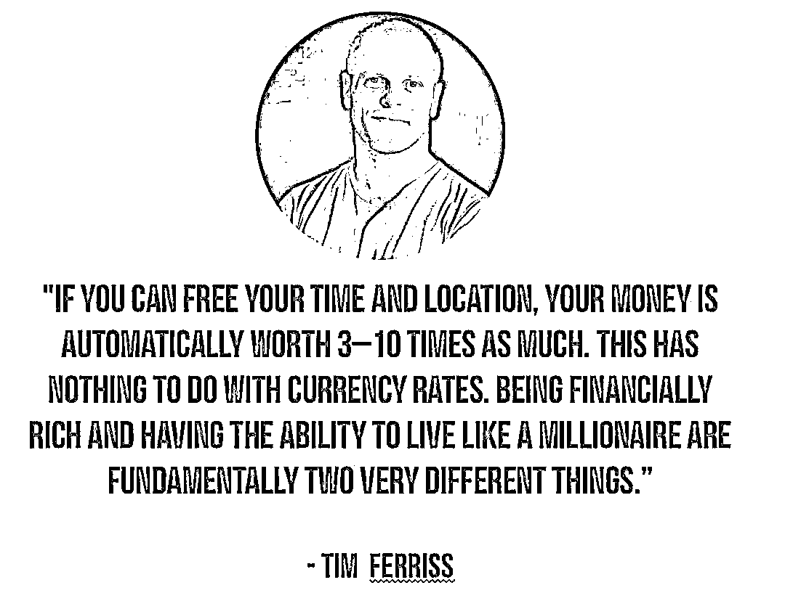
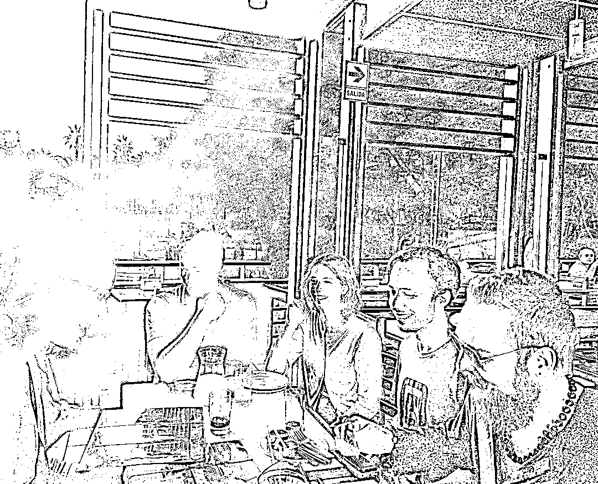
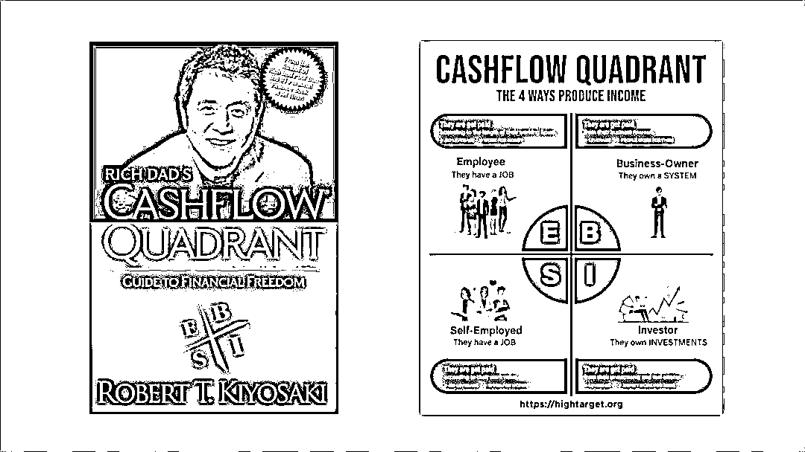
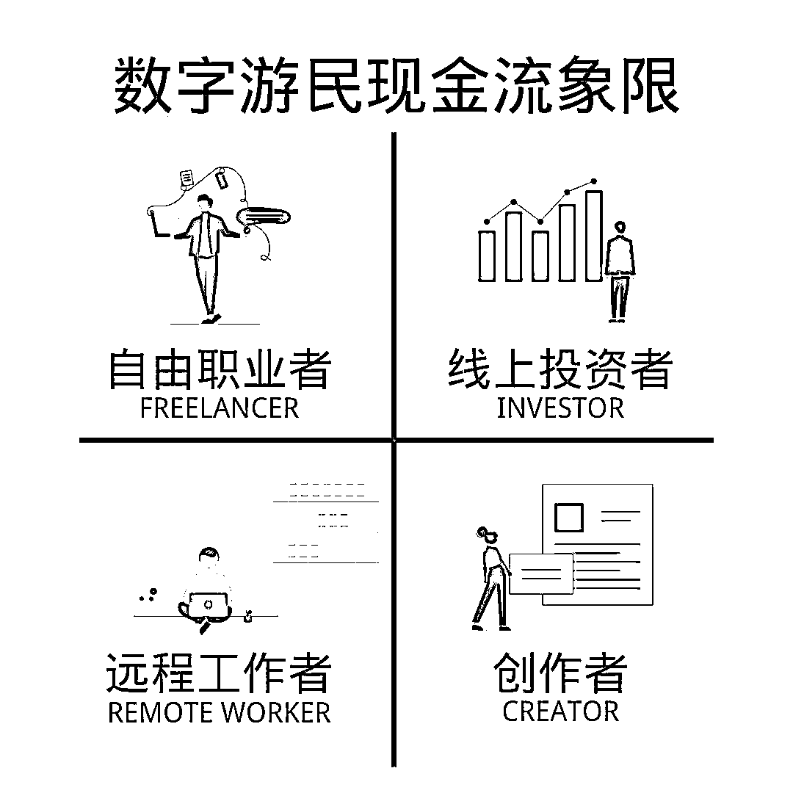
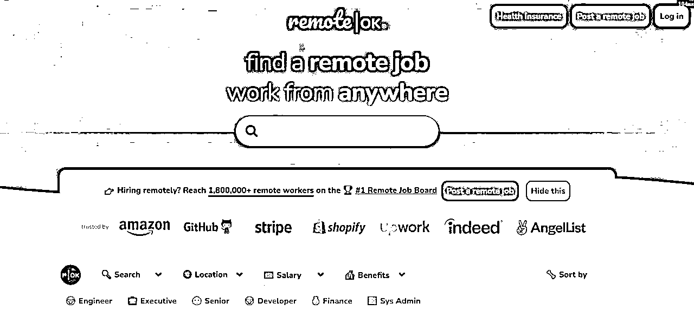
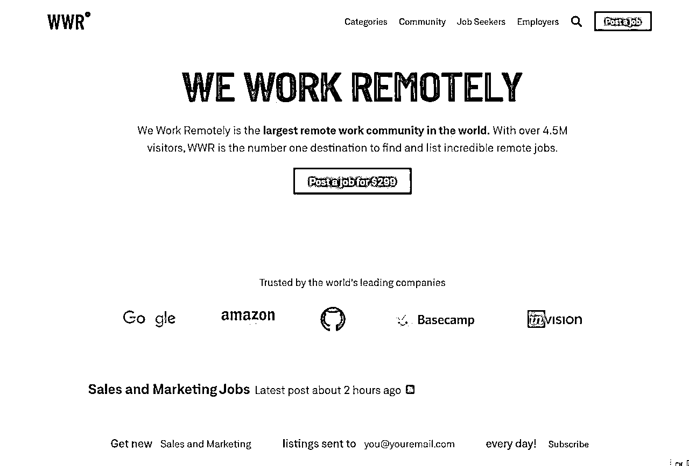
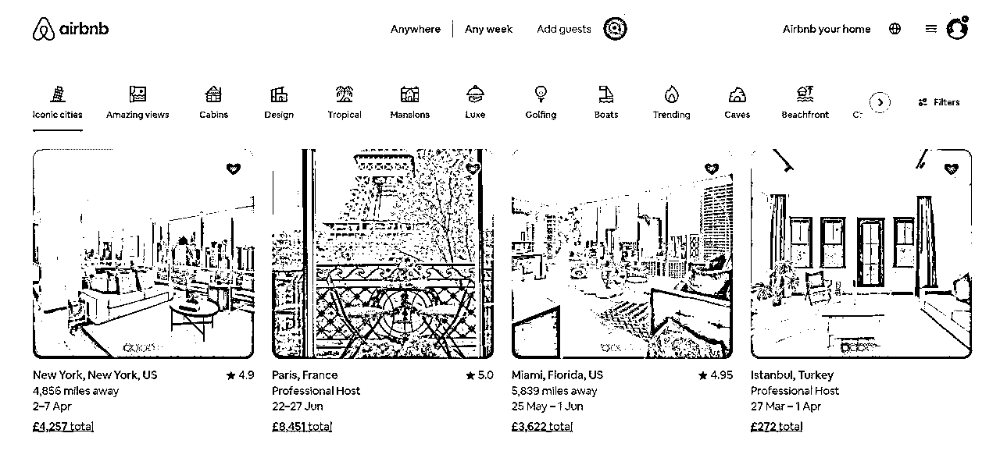

# 数字游民 202308

> 来源：[`remhu1p2pr.feishu.cn/docx/EoEfdChUxokYtJxO9ducUapMnbf`](https://remhu1p2pr.feishu.cn/docx/EoEfdChUxokYtJxO9ducUapMnbf)

# 8月航海｜数字游民｜实操宝典

出品：龙哥盟团队
日期：2023年8月15日

怎么用这份手册：我们希望借它让你看见一件事能延伸出多少可能，也帮你读懂门道、真正动起来。
小提示：想直奔某个话题，按 Ctrl+F 或 command+F 调出搜索框，输入你要找的词即可。

**写在前面**

各位好，欢迎翻开8月航海｜数字游民｜实操宝典。往后这段日子，咱们大概会在这儿碰面不少回。

1）数字游民到底指什么？

与其把它看成某个行业或岗位，不如说它是一套活法：靠网络挣到钱，再把落脚点选在自己中意的城市。说白了，这是一群以互联网为饭碗、让“在哪工作”和“做什么工作”松绑的人——地点不再卡死，日程也能自己做主，于是活成了在全球挪动的生活方式。

他们真正图的，既不是打卡式旅行，也不只是账户数字变大，而是把日子过出更好的质地，把自由攥得更紧。

2）谁适合走这条路？

听着诱人，真操作起来，门槛其实不低。你得有点学习劲头，能和人打交道，也照顾得好自己的日常；换一座城市生活，适应速度要跟得上。更关键的是，你要能跳出固定工位和固定作息的框框，把收入做成一条稳定的水流，并且自己摸索出赚钱的门道。

所以，想让游民状态长久，就得把“个人生意”这件事琢磨明白，也别忽视对投资的理解。这套系统一旦转起来，你才可能松松散散地去打量世界某个角落。

反过来说，如果收入这条腿一直站不稳，那么即便人已经飞到远方，也很难真正常住当下、安心去挖当地的宝藏。

⚠️得先说清楚：这次航海不负责教你赚钱，赚钱里的每一种玩法都值得一试。我们想做的，是把真实的游民日常摊开给你看，让你自己判断：什么样的人更适合上路？怎么把这种日子过得有滋味？

3）手册怎么用？

要是你对数字游民完全陌生，或者只听过这个名头，建议先从【一、你适合成为数字游民吗？】读起——先搞清它的面目和门槛，再对照自身，看看要不要迈这一步。

要是读过之后你觉得自己对得上号，后面的章节能帮你解决不少实际麻烦：

✅【二、如何成为数字游民】：弄清上路前要备好什么；
✅【二、如何成为数字游民】：再确认一遍成为游民的条件；
✅【三、怎样搭好“主动+被动”的收入组合？】：摸清游民的职业地图，以及有哪些方向值得试；
✅【四、如何拥有更精彩的数字游民生活？】：看看怎样把游民日子过得更出彩；
✅【五、用更健康的心态面对数字游民】：聊聊游民常见的心态坎儿，以及怎么跨过去。

这回我们请来的写作者，各自带着不同年头的游民经历，所以笔下的观点会比较杂。说到底，数字游民是一种活法，一千个人眼里有一千种理解。要是对哪个说法犯嘀咕，欢迎到航海群里唠，也可以去豆瓣、知乎之类的平台翻翻答案。

还有件事特别要紧：多问、多聊。这里给不了你的，尽管抛出来，咱们一起琢磨出更多解法。希望这一趟航行，你既能带回成果，也能交下一群同路人。

下面的内容，是龙哥盟和圈友一起攒出来的，只供航海船员和龙哥盟星球的圈友学习使用。也欢迎圈友在实操中随时反馈，帮我们把这份东西打磨得更好——有修改建议随时联系～

# 一、你适合成为数字游民吗？

💡

本章导读

楼越盖越高，工位越坐越挤，职场那根弦也越绷越紧。于是“自由”和“自我”成了许多人挂在嘴边的念想，数字游民一词也跟着热了起来。

可它真就人人适配吗？

为了不让大家一拍脑袋就跟风，这一章咱们先把数字游民看清楚：它真实的模样、它带来的好处，还有路上可能踩的坑：

✅【1.1 什么是数字游民】
✅【1.2 数字游民的优势】
✅【1.3 数字游民要承担哪些风险】

看完之后，你心里大概会有杆秤：眼下的自己，到底适不适合踏上这条路。

## 1.1 数字游民到底指什么 @Jarod Zhang🔥

在不少人眼里，数字游民就是“边玩边赚”的代名词。但摸爬滚打这些年，我对这件事的理解是：它要抵达的终点，从来不是单纯游山玩水，也不止于财富数字，而是生活品质和自由程度双双上一个台阶。

生活方式设计领域的教父级人物 Tim Ferriss，在《每周工作4小时》（The 4-Hour Workweek）中写过这样一段话：

「倘若一个人把自己的时间和地理位置都解放出来，他的物质财富会不请自来地膨胀3到10倍。这跟汇率没有半点关系。不过，光在物质上富足，并不代表你就能过上百万富翁式的日子——这两件事，本质上不是一回事。」

这段话，恰好戳中数字游民生活设计最要紧的两块地基：一是在哪儿都能干活，二是时间自己说了算。

而它最终指向的目标，是过一种丰盛的人生——Live a rich life。

内容来源：《什么是数字游民生活方式？(后疫情时代升级版扫盲贴)》

### 1.1.1 第一要务：实现地理位置自由

数字游民生活设计里，头等大事就是把自己从地理位置上松绑——让手头的活儿，在任何有网的地方都能接着干。

职场里有个拧巴的怪圈，被我们瞧见了：一线城市明明又挤又忙，不少人心里并不买账，可“强者愈强”的马太效应偏偏把好薪水的位置几乎都攒在了那里。

于是，为了活出自己的价值、拿一份像样的收入，他们多半只能选择留下。

可资源就那么多，人一多，日子自然越来越贵。不少人因此陷进“挣得越多、花得越凶”的循环里，到头来钱没攒下，还可能欠一屁股要用几十年才能还完的债，硬生生活成了“负翁”。

地理位置自由一旦捏在手里，「地理套利」自然就成了顺手好用的选项。

说白了，地理套利就是哪儿过日子便宜就往哪儿挪，用更低的房租和生活费，把每天的支出压下来。打个比方，你可以搬到房租低、环境棒、日子过得舒坦的四线城市住一阵，同时在网上接一单薪水不错的活儿——这就把套利做成了。

它的核心思路是：盯着绝对收入往死里追，没多大意义；倒不如借地点自由，让每一块钱都更经花，同样的支出换回更高档次的日子——这才是更划算的活法。

内容来源：《什么是数字游民生活方式？(后疫情时代升级版扫盲贴)》

### 1.1.2 第二要务：达到时间自由

数字游民生活设计的第二件事，是让时间归自己支配：把被动收入的占比提上去，不再靠卖时间来换钱，做一个手头有闲的人。

前阵子网上有个被称作“哲学”的讨论，问的是：西二旗那帮月入五万的主儿，为何日子过得像月薪五千？

谜底一点儿都不复杂：不少按老标准算已经“财富自由”的高收入者，其实根本没换来时间上的自由。

换句话说，要是把时间也算作一种财富，那这些人未必有我们想的那么阔。

996为什么招骂？因为它背后塞着一套算盘：一个人得把生命中最金贵、精力最旺的三四十年拿去换成存款，然后等退了休，再去捡年轻时没空碰的爱好。

可这套逻辑本身就站不住。先不提埋头干满40年到底能不能攒够这笔钱——现实摆着，多数人的养老金根本撑不起这个念想——更悬的是，退了休之后，身体和心气儿还跟得上吗？二十岁心心念念的滑雪、冲浪、潜水、蹦极，等到了花甲之年，还有那份体力、那份胆气去碰吗？

科技评论家凯文·凯利曾做客 The Tim Ferriss Show 播客，说了这么一段话：

「太多人埋头苦干，拼命攒钱，就盼着退休后能去旅行。我偏把顺序倒过来：趁年轻、兜里还没钱的时候先上路。那些经历，十亿美元也换不回来。」

把这几层意思归拢归拢，就可以试着给「数字游民」画个像了：

如果非要给它画个像，那可以这么说：数字游民是一群被数字技术托起来的新式生活者。他们的收入全部从网上长出来，跟“必须守在某个办公室”彻底脱钩，于是左手攥住地理自由，右手攥住时间自由，再把地理套利的好处吃干抹净，在全世界范围里走走停停地过日子。

踏上这条路，意味着：

通勤这种白白耗命的环节，就此从你的日常里退场；“说走就走”不再只是嘴上说说，你大可以放慢脚步，把这颗星球一寸寸走个遍；

你也能更轻松地吃上「地理套利」的甜头，让每一分收入都更耐花，从又贵又挤的一线撤出来，搬去风光好、天气舒服、花小钱就能过得滋润的地方；

你还能把更多空档留给家人和老友，趁着身强体壮，去干那些真正让你眼睛发亮的事。

内容来源：《什么是数字游民生活方式？（后疫情时代升级版扫盲贴）》

### 1.1.3 这些概念，别和数字游民搅混 @饭先生

不少人稍不留神，就会将「数字游民」同远程办公、自由职业混作一谈。

说到底，数字游民落点在“怎么生活”，远程办公和自由职业落点在“怎么干活”，两者压根不是一个层面。那它们究竟差在哪儿？

远程办公：

远程办公其实年头不短了，科技圈和一些新行当里尤其常见；口罩那几年过后，它更成了许多公司默认的打法，在不少领域里都变得稀松平常。

它能给干活的人一份稳当、连贯的进账，可说到底仍是用工作量或工时来换口粮，只不过把人从固定地点解绑了而已。

所以，打算拿远程办公当跳板、迈进游民圈子的人，选行业和公司时最好挑那些早就把远程协作玩熟了的。这样的团队通常上下有默契，协作流程也顺，能防着远程办公变味成24小时随时待命。

自由职业：

有人把自由职业直接等同于数字游民，这俩确实有重叠，但不能画等号。

自由职业说的是，一个人自己就是最小的生意单元，靠给客户干活来收钱。其中有些人的活儿跟某个地方或某批客户绑得死死的，那就跟游民生活无缘了。

不过也有不少人，恰恰顺着自由职业这条路，一步步走上了游民的日子。

内容来源：《数字游民的定义》

## 1.2 数字游民有哪些好处 @饭先生

搞懂数字游民是啥之后，它的长处也就摆在明面上了。

地理套利：花得更少

他们能在全世界挑选落脚点，房租低、风景好、日子过得滋润的地方都行。平时开销一降，还能在网上接到报酬不错的活儿，或者把自己的那摊事业做起来。

时间和地点，都由自己摆布

收入多半来自网上接的远程活，或者自己折腾的小生意。只要身边有台电脑、连上网，活儿在哪儿都能接着干。

会安排的话，书房、咖啡馆、沙滩边、山道上，哪儿都能临时充当你的工位。

闲下来的时间一多，你就能扑向自己中意的事，把那些提不起劲的琐事压到最少。

假如你天天把日程掐得死紧，一分钟都不肯空出来，久而久之，焦躁、低落这些情绪准会找上门，身体恐怕也要跟着亮红灯。游民的日子则能匀出更多可支配的时段，让人把身心缓过来，维持一个康健的底子。

多元文化，开开眼界

在不一样的地方生活、做事，你能撞见形形色色的文化、语言和习俗，眼界自然就宽了。

城市换得多了，人也会被磨得更机灵，遇到变化能迅速调头，处理麻烦的本事也跟着长。

## 1.3 游民生活要防哪些坑

游民生活好处不少，可暗礁也同样存在。下面这些，最好提前心里有数——

进账忽上忽下：客户或项目稍有风吹草动，钱包就跟着起伏；身后没有一份铁饭碗垫着，手头自然会紧。

圈子变窄：活儿多半在家一个人干，跟同事、同行、朋友照面的机会骤减，心里容易发闷，人际关系也会慢慢变淡。

水土不服：换个城市甚至换个国家生活，语言、习俗、法规都可能让你栽跟头，想融入新环境，得给自己留出磨合期。

保障偏薄：没有单位给你交五险一金，生病、养老这些担子，最后只能自己挑。

上升通道变窄：少了公司给的系统和培训，专业上想往上走，机会可能不如坐办公室的人多，时间一长会拖累职业前景。

作息容易失控：时间一松，人不是拼命干过头，就是彻底躺平，想在工作和生活之间找个平衡点，还真得练。

断网和设备掉链子：工作全指着网络和电脑，万一网断了、机器坏了，不光效率打折扣，跟客户的关系也可能跟着受影响。

出门在外的安危：人在异国，安全这根弦一刻不能松；有的地方局势不太平，文化差异也大，意外就容易找上门。

对游民而言，关键不是假装看不见这些坑，而是提前想好怎么拆招：把作息养正、保险买对、朋友常联系，专业技能也别撂下。

要是你把当游民的好处和代价都掂量透了，对这种日子仍然来电，那就继续往下翻——

# 二、怎么一步步成为数字游民？

💡

本章导读

要是你已经弄懂数字游民这回事，也清楚它的门坎儿，等头脑冷静下来一琢磨，发现自己既对得上号，也有那份本事，那这一章就给你讲清楚：

出门前得备下多少钱？
手里得有几样什么本事？
具体怎么一步步成为游民？

⚠️有句话得放在前头：底下这些只是我们的建议。各人活法不同，不必等所有条件都打勾了才肯动身。

数字游民的状态五花八门，很多游民也是一边往前走、一边升级打怪。要是下面说的某些本领或者收入上的坎儿，你眼下还迈不过去，但心里依旧跃跃欲试，或者自信能撑住游民日子的花销，外加一颗乐意长进的心——

那现在出发，也真没什么不行。

## 2.1 出发前要攒多少钱？@Jarod Zhang

头一件事，是存下一笔“压箱底的钱”：哪怕整整三年颗粒无收，你也不至于揭不开锅。

有了这笔钱，你的生活方式设计之旅才算有了物质上的底气，心里也踏实。我碰见过不少一心想当游民的人，结果半道上又缩了回去，说到底都是被钱逼的。

具体数目看你怎么花钱，弹性不小。按我的经验，备上20万到30万元人民币，大多数人都能应付得过来。

倘若你相中的落脚点本身开销就不高，那这笔钱还能再缩一缩，不过别少于10万元。

把这笔“自由基金”存好，生活方式设计之旅就可以正式发车了。

内容来源：《有可能是中文互联网第一条全面深度介绍数字游民的视频（内附文字稿）》

## 2.2 核心本事：搭一套“主动+被动”收入结构 @范米索🔥

这条最要紧。

要是你连怎么靠自己从网上挣出钱来都没摸清，那多半会因为底气不济，把游民梦半路放下。

假如你心心念念想当游民，却对做买卖讳莫如深，一提钱就浑身不自在，那我劝你早点醒醒：这条路你大概率走不长，因为游民身上最要紧的那股劲儿，你还没长出来。

毕竟，谁也不会在赚钱的门路还没成形的时候，就一把辞掉工作、断了稳定进项，撒腿跑去看世界。

可反过来，也有不少人把出门看世界的花费想得太大，反倒把自己低估了。

游民跟那些一掷千金的旅行玩家，压根不是一路人。你得多下点功夫，把各个落脚点的房租、物价逐一算清、比透；一旦“地理套利”这四个字在你脑子里活起来，省下的就是真金白银，游民日子也自然更美。

不妨这样想：只要你能在网上把远程的活计交付掉，或者在虚拟世界里撑起自己的一摊买卖，那你大可以想去哪儿就去哪儿——有网络、有台电脑，钱就照进不误。这时候，你既是远程干活的人，也是自己那摊网络生意的老板。

可话又说回来，光有这一点还不够。

假使活儿把你的大好光阴啃得七七八八，那就算人已经躺在马尔代夫的沙滩上，也未必称得上在过游民的日子。你依旧被工作拴着，甚至忙到连街边的风土人情都来不及细细咂摸。

游民的生活里，饭碗之外还有大把内容，他们最拿手的就是把当地的好东西挖出来、用透彻。跟我打过交道的游民中，有企业主、投资人、教练、设计师、语言老师、自媒体博主，也有扎进Web3的朋友……这帮人个个都有在网上进账的路子，手里攥着自己那套生意经，投资眼光也相当了得。除开眼下手头正在转的买卖，他们对不同市场的投资分析也相当在行。

举个例，我认识几位玩房产和二级市场投资的游民，聊下来一看，这些人算账全是用“资本”那套脑筋。

顺着这个，得掰扯两个词：主动收入、被动收入。

主动收入：

说的是人得亲自上阵，把时间和力气投进去，事做完了才换来银子。说白了，这笔钱不会自己长腿跑来，得靠你实打实去挣。像上班族按月拿薪水，就属于这一类。

# 先播种，后收获：聊聊被动收入

被动收入是什么？简单说，就是前期花些精力或投一笔钱，后面即便不再天天忙活，钱还能陆陆续续进账。好比把某项差事或某笔资产调成“后台自动运行”，你腾出手来去做别的事。拿电子书举例：你把书写好挂到网上卖，只要有人下单，收益就来了，压根不用你每次都站柜台吆喝。

跟它相对的是主动收入——你不干就没钱，必须一直搭功夫。被动收入则不同，前头辛苦铺好管道，后头能接上较长一段时间的回报。不少数字游民会特地经营被动收入渠道，图的就是让工作与生活相互平衡，一边享受自由，一边还能有稳定的经济来源。

所以，真想走数字游民这条路，先得把个体生意摸透，同时提升投资方面的认知，尽可能搭出一套“主动+被动”双轮驱动的收入结构。这套玩法一旦跑通，你才能比较从容地四处探索，去看世界某个角落。不然的话，生计的烦恼会一路跟着你，不管跑到哪儿，都很难真正做到享受当下、深入体验当地的一切。这也是做游民绕不开的坎：你要补的学习能力不止语言一项，还得弄懂更高阶的赚钱门道——商业与投资，缺了哪个都不行。

内容来源：《成为数字游民的代价》

## 2.3 补上这几项软实力，游民生活才稳得住 @范米索

数字游民的日子看着很美，可真正跨进去，门槛不低。

收入这道关卡解决了以后，你还得具备几样东西：不错的学习意识、拿得出手的社交能力、生活自理的本事，以及在各个城市辗转旅居时那份强大的环境适应力。这些落到日常究竟怎么体现？

### 2.3.1 学习这件事，得自己推着自己跑

我认识的游民里，不少都称得上“超级个体”——旁人要几个人合力才摆得平的事，他一个就能搞定。这种本事不是娘胎里带的，他们的学习劲头和主动性，比普通人高出一截。

在拉美那阵子，我讲过一位游民小哥的故事。他干的是加密资产知识培训教练这一行，我俩在一门西语课上碰见，说实话，我被他“卷”得够呛。各位得明白，真想当一名货真价实的数字游民，语言是最基础也最关键的本事。语言就是游民手里的兵器，因为他们的舞台铺满了全世界。

我自认为学习意愿不算弱，日语也是靠硬啃拿下的，可遇上他，我只能认输。课堂上也罢，外头吃饭社交也罢，他张口就是西语，半点不犹豫。我还在那儿结结巴巴，他早已说得顺溜；偶尔我状态在线，他会夸我进步快，夸完转头回去又猛学几个钟头，生怕被我赶上。他在秘鲁只待一两个月，之前一站是巴西，再往前是墨西哥。每到一个新地方，他都会找当地语言学校，每周固定抽出时间学当地话；线下排不上课，就让老师线上继续一对一教他。离开利马那天，他跟我说：“Misso，你可别把西语丢了，咱们一起加油，盼着将来在世界某个角落再碰面。”

他那股自驱力和学习意愿，甩了我一大截。而这样的人在游民圈子里并非凤毛麟角——恰恰是常态。

### 2.3.2 搜得到信息，还得揉得成型

打算做数字游民，信息搜集、分析、整合这三样本事，必须硬。

平时出门旅游，你会不会提前做攻略？如果你擅长做攻略，还能按自己的思路把行程排得妥妥当当，那这方面的底子，稍微练一练就够用了。

游民一脚踏进陌生地界，头一件事就是摸清当地底细。要采集的东西包括：气候、气温、语言、宗教、文化、饮食习惯、消费水平、生活成本、安全性、安全范围、货币、汇率、出入境政策、签证可停留时长、适合结交本地人打探消息的活动场所、当地网速与网络环境、医院及医疗条件、当地人对老外的态度、短租与长租平台及价位……

要是旅居范围只限国内，那至少要搞清楚当地气候、气温、饮食习惯、消费水平、安全性、交通方式等。摸完当地情况，还得盘算自己出门要带的行头和相关准备，比如各国电话卡、国际信用卡、保险、海外社交联系方式（Line、WhatsApp）、社交账号（Instagram、Twitter 之类）、地图、翻译软件、境外意外险、常用药品……

否则，你揣着一颗走马观花的心去做数字游民，那不过是游了个寂寞，跟旅行团到某座城市打卡本质上没两样。所以，游民和旅客得掰扯清楚。

真想当游民，你就得保持头脑相对开放，一头扎进选定的目的地，想方设法去学、去融进当地的文化、风俗和本土社交圈。

社交圈背后藏着海量情报和信息。你碰上的形形色色陌生人，会在眼界、思想、认知、商机等好几个层面给你启发。所以说，游民绝不是关起门来造车、走马观花的那拨人。

不管你多内向，只要动了当游民的念头，社交这项技能就必须点亮，甚至还得学会借互联网在当地攒局，把当地的游民群体找出来，跟他们交流、互换当地情报。

### 2.3.4 心要大，手要细，独处也得扛得住

路一条叠着一条，织成没有尽头的迷宫；人走不到终点，只能自己停下，或者被现实按下暂停键。

数字游民瞧着挺酷，身上有一股野性的自由劲儿，是脑袋和灵魂的流浪者，可他们同样是一群被放逐的人，随时要跟孤独这个课题打交道。环境的切换带来了成堆的不确定，也带来了不少风险与机会。想成为游民，这层心理功课绕不过去。

没有社会意义上的身份标签，没有固定的社交圈层，甚至游走在社会边缘。你不妨扪心自问：从心理层面讲，这样的身份认同，你真能接得住吗？这就是你想要的“酷”所附带的代价。

我踏上这条“边缘人”的路以后，对从前心心念念的名和利看开了许多，对社会头衔也看淡了。你大可以说“你是得不到才说看淡罢了”，但在我心里，去追自己想做的工作、想过的人生，这意义远超社会贴给我的那层身份。因为当我握着后者的时候，也得一并扛起相应的枷锁和责任。反过来想，那层身份认同究竟是什么？真是我想要的吗？其实我也说不上来，反倒是眼下的状态让我心里踏实。

我已经认了：自己就是个四处漂泊、没有专属社交圈层的灵魂。我不觉得丢人，反而特别自洽，甚至乐意大大方方承认——这就是我。

孤独，是家常便饭。

可这份“孤独”给了我无穷的思考空间和探索可能，是一种健康、稳定的孤独。我需要它，也享受它，甚至可以说，没有孤独，我的人生走不到今天。与此同时，我也拥有高质量的陪伴。不管身在何处，总能碰上一群志趣相投的人，凑在一块儿喝酒聊天，听新朋友讲各自的经历和想法；等陪伴散了场，我又必须一个人待着，把他们带来的信息消化掉，把有启发的内容记下来、想透彻。

内容来源：《成为数字游民的代价》

## 2.4 五步走，搭出数字游民生活的骨架 @Jarod Zhang

接下来，结合 @Jarod Zhang 老师自己的经验，加上他对身边其他游民的观察，梳理出一条设计数字游民生活的基本路径。

第 0 步，前文已经提过，先备好一笔“三年不工作也饿不死”的保命钱。在这个基础上，盼你对数字游民有清醒认识——清楚“数字游民”的真实日子长什么样，即便如此仍然心生向往，敢于迈出尝试那一步，并且手里握着一些游民必备的能力。

第一步，把工作和地点之间的那根绳子剪断，让你干的活在任何地方都能收尾。凡是做不到的，要么砍掉不做，要么甩给别人。你挑中的糊口行当如果在家能干，那换到地球上任何角落照样能干。

第二步，斩断工时和收入之间那条直线关系。慢慢戒掉“拿时间换钱”的习惯，主动去造、去买那些能生出复利、带来被动收入的数字资产和金融资产，把工时与收入的关系从一条平直的线掰成指数上升的曲线。硅谷投资大佬 Naval Ravikant 有句话：你永远没法靠出租时间来发家。互联网行业跑得飞快，越来越多人醒悟过来——自己敲下的文字、代码，创作的音乐和画，都成了能升值、能生被动收入的数字资产。咱们要做的，就是尽量早、尽量多地攒下优质的数字资产和金融资产，余下的交给时间打理。

第三步，拿第一步换来的地理位置自由去做地理套利，搬去性价比更高、自己更中意的地方过日子。国际上公认的几个游民热门落脚点有：印尼巴厘岛、泰国清迈、葡萄牙里斯本、哥伦比亚麦德林、墨西哥卡门海滩、西班牙加那利群岛、保加利亚班斯科等。它们的共同点不外乎：基建扎实、旅游资源充足且旅游生态成熟、物价低廉合理、游民社群活跃。如果你还没体验过游民生活，不妨从这几处起步。要是打算从国内城市开始，可以考虑云南大理、海南文昌、浙江安吉。当然，你若偏爱特立独行，完全可以不按套路出牌，挑自己最喜欢的地方——哪怕就是自家沙发。地理位置自由的关键，从来不是你能跑多少地方，而是你想待在哪儿，就能待在哪儿的那份选择权。

第四步，用第二步换来的时间自由，去做自己真心想做的事。“自发的、有计划的生产活动是人类的天性”，当你不用再卖时间换生活所需时，“自发工作”的前提条件就到手了。人只要活着，总得找点事干，差别只在于：这事是被生活逼着做的，还是自己心甘情愿去做的。只有后者，才能喂饱你人生的意义。

内容来源：《有可能是中文互联网第一条全面深度介绍数字游民的视频（内附文字稿）》

# 三、把“主动+被动”两条收入线搭起来

💡

章节概要

从这一章起，我们分职业篇、生活篇、心态篇三块，带大家进一步看清：怎样才能更顺地适应数字游民的日子。

本章是职业篇，目的很直接：想撑住游民生活，稳定收入不能少。所以这一章主要聊——有哪些活能干？这些活长什么样？更适合谁？

⚠️有一点得先打个招呼：这儿不教你怎么挣钱。⚠️

赚钱这门手艺，你得从别的项目里去练。比方说龙哥盟每一期航海都会放出不少实战项目，挑适合自己的上手就行。再不然，结合自己的特长和实际生活，找出适合自己的收入路子。

那本章到底讲什么？

✅游民的职业大体分几类：【3.1 数字游民收入四象限】

✅入门级职业有哪些：【3.2 入门类职业：主动收入型】

✅进阶级职业有哪些：【3.3 进阶类：主动+被动收入型】

✅高阶职业又有哪些：【3.4 高阶类职业】

想把长期稳定的游民生活维持下去，你得慢慢弄懂更高阶的赚钱路数，学会按“资本”的逻辑来挣钱，把被动收入做起来。要是一直卡在“入门类”职业里，焦虑的日子恐怕比享受的日子还多。

多年前，一本《富爸爸·穷爸爸》风靡全球，帮不少人打开了所谓“财商”的大门。作者罗伯特·清崎后来又趁热出了好几本续作，其中有一本让我印象格外深，书名叫《富爸爸财务自由之路：神奇的现金流象限》。书里，作者拿横竖两条坐标轴，把人的收入切成了四个象限：左上 Employee（职员）、左下 Self-Employed（个体业主）、右上 Business-Owner（公司老板）、右下 Investor（投资人）。

职员，干一天活拿一天钱，哪天被裁了或者自己拍拍屁股走人，进项就断了——典型的拿时间换钱。

个体业主，比如菜市场的摊贩、小理发店的师傅、开出租的司机，比起职员的好处是没人能炒他们鱿鱼，但骨子里还是拿时间换钱，一天不开张，就一天没收入。

公司老板，活儿主要由底下员工干，所以他们不用拿自己的时间去换钱。只要公司转得顺，老板大可以远程盯着，腾出更多工夫打高尔夫、去度假。

这张图里，四个象限的收入都来自线上。区别在于：左边两个象限——自由职业者和远程工作者，代表的是通往地理位置自由的两种现金流，它们归入前面说的主动收入——你得亲自下场使劲，不断砸时间、砸精力，钱才进得来。右边两个象限——互联网投资者和创作者，把收入和时间之间那根直线拆了，地理位置自由和时间自由能一块儿拿下，它们更贴近前面讲的被动收入：前期投入一些精力或本钱，往后不必再持续大量付出，钱照样能持续流进来。

下面简单捋一捋这几种现金流的实现门道。

### 3.1.1 自由职业：门槛最低的那道口子

不少人习惯把数字游民的职业选项直接跟自由职业画等号，这其实不太准。自由职业不过是从传统坐班转向线上干活的最低门槛入口之一。

理论上讲，只要你有一门手艺，或者攥着一定量的信息差，能在网上给别人提供有偿服务，那你就已经拿到了当网络自由职业者的入场券。拿文案、设计、翻译、编程来说，这些技能都很适合搬到线上做自由职业。相信不少朋友平时在淘宝、闲鱼上多多少少买过这类根本不用发货的服务。再比如签证、法务、保险、理财这些业务，只要你手头有线下资源或者信息差，转成线上付费服务也容易得很。

许多人对自由职业最大的误解是：这行收入不稳。可经历过行业起落和经济危机的朋友应该懂，现代社会除了极少数体制内的饭碗，几乎找不出什么“稳定”的职业。在我看来，收入起伏或许是多数自由职业者都要走过的阶段，但只要踏踏实实攒作品集，在垂直领域扎下根，把口碑和长期客户群养起来，其稳定程度未必比传统职场差。

想在自由职业这条道上跑赢，千万别一上来就把挣钱摆头一位。反过来，初期你甚至可以低价甚至免费帮人干活，换来第一批用户和作品集。凯文·凯利有句话：在网络主导的新经济秩序里，关键问题不是你能卖出什么，而是你能免费送出去什么。要找答案，这问题又能拆成两问：① 你能让什么东西的生产边际成本无限趋近于零？② 你能把什么有价值的东西白送别人、不图任何物质回报？仔细琢磨，你多半会发现两问的答案指向同一处。找到那个东西，挑准时机，借网络的传播力免费放出去，靠它滚出一个自我强化的良性循环——这就是玩转网络经济的核心门道。

你可能会问：不把挣钱放首位，自由职业者喝西北风去？两条路：其一，刚起步时把自由职业当主业之外的副业干，当然，这样会比较累；其二，就是前文【2.1 成为数字游民需要多少积蓄？】里聊过的——入行前先存一笔够你在零收入状态下活两三年的安全基金，它能帮你稳稳熬过自由职业最开头那段收入飘摇的日子。等履历慢慢厚起来，攒下一定数量的用户口碑，话语权自然见长，薪酬水平和收入稳定性也会跟着明显好转。

### 3.1.2 远程办公：更稳的那条道

毫无疑问，咱们正站在一个从工厂、办公室向远程云办公切换的历史节点上，三股力量正推着工作远程化往前跑。

它们分别是：

① 工厂作业的自动化。流水线和机器人把大批蓝领从车间里解放出来，越来越多劳动力涌向坐办公室的白领岗位；用不了多久，就连不少办公室白领的活也免不了被人工智能顶替；

② 企业与市场的全球化。全球经济一路发展与融合，催生了海量跨地域协作的刚需——国际贸易、开源项目、大型跨国公司，还有 Web3 领域的 DAO，都是这股趋势的直接写照；

③ 电子设备便携化与工作流程全面无纸化。今天一台普通笔记本，就能顶掉上世纪末一整间办公室所有设备的职能。再加上电子邮件、即时通讯、协作文档，以及各类线上交易平台、加密货币和智能合约的涌现，绝大多数白领的活都能在一台联网电脑上搞定。

最后还有一剂催化剂：2019 年末暴发的新冠疫情。不夸张地说，新冠在全世界肆虐、造成灾难性破坏的同时，也逼着人们更快转向新的工作模式。

在我看来，远程办公是所有通往数字游民生活的路径里最稳当的一条。它既没有自由职业起步阶段几乎躲不开的单打独斗、朝不保夕的慌，也没有创业带来的各种不确定和风险，一边拿着稳定收入，一边享受地域不受限的自由。硬要挑毛病，那就是远程办公还没做到收入被动化，本质上依旧拿时间换钱。但跟在一线城市通勤加班 996 相比，只要安排得法，这种工作方式照样能让生活品质往上蹿一大截。

想靠远程办公铺出数字游民生活，你有两条路可选：说服现在的老板放你远程干活，或者另找一份允许远程办公的工作。

走第一条路，先得判断你手上的活具不具备远程的必要条件，这其实好办，问自己三个问题：① 去办公室上班时，绝大部分时间是不是都对着电脑干活？② 会不会时不时把办公室里没做完的活带回家继续？③ 碰上突发状况，比如疫情或者极端天气，在家能不能把活干完？三问答案都是“是”，那你的工作就已经具备远程的必要条件了。

这时候，只要公司制度框架允许，你就尽量多给自己制造远程办公的由头和机会，远程时把任务完成得又快又好，让老板看到：远程不但不影响干活，反而让你效率更高。这么一步步来，慢慢把老板说服。当然，要是老板死活不松口，那你就该认真琢磨第二条路了。

远程招聘：把人才池扩到全球

企业招人，早已不再只盯着本地。为了让可选范围覆盖全国乃至海外，开放远程岗位的公司正逐年增多。与之配套，专做远程机会检索与信息聚合的站点、社群也成长起来——海外有 RemoteOK、Remotive，国内则有电鸭、V2EX 等。

若你正经营一家公司，想对你说几句：

外部环境已经不同。网络、云服务，加上 VR、AR 这类工具走进日常，让“人在哪里”对工作的分量越来越轻；员工坐在你眼皮底下，也未必就更卖力。尽早接受远程协作这种更先进的管理方式，才可能把一流人才招进来、留下来，也才可能在变化中站稳脚跟。

### 3.1.3 创作者：以内容为业

这几年，“创作者经济”在网上的热度一直不低。

按维基百科的解释，它说的是在软件与网络辅助下，内容生产者靠自己做出来的数字作品取得收益的一种新经济形态。

“Creator”这个称呼，最早是 2011 年由视频巨头 YouTube 用起来的。当时用意，是替换“YouTube Star”（油管明星）这个听着不太专业的叫法。

在数字游民的四个现金流象限里，创作者的门槛排在最高一档，却也是我最愿意推荐的一条路。它既没有明显的天花板，又能让人从价值创造中得到别处难以替代的满足感。

做内容，本质上是草根创业的一种。网络普及之后，这类创业的启动成本被压得很低。

说得直白些，手边有一台能联网的手机，起步的本钱就算有了。想再讲究一点，租台服务器、注册个独立域名，一年开销大约两三百到五百元人民币；跟实体开店、做买卖乃至摆摊相比，这点投入实在不算什么。

硅谷投资人 Naval Ravikant 在 2018 年末发过一串长推文，题目叫“How to get Rich（without being lucky）”。他写道：

资本与人力，是旧时代放大财富的杠杆；到了网络时代，杠杆换成了代码与内容。

AI 让你零成本拥有一支不知疲倦的机器人队伍，它们散落在世界各地的机房里，随叫随到。

即便不懂编程，你还能著书、写博、拍片、做播客。

上世纪初，全球最有分量的企业多是造车、采油的；本世纪以来，科技与信息行业接过了领跑的位置。移动网络与人工智能的演进，使单枪匹马、以小博大的创业路径变得可行。

“一人公司”（Company of One）不断冒出来，其中大部分立足软件服务、自媒体内容或电商。

放眼历史，创业的土壤从未像今天这样肥沃。尤其以代码和内容为支点的项目，让“睡后收入”有了落地空间；数字游民因而在时间和地点两个维度同时获得解放，财富自由也不再是空中楼阁。

### 3.1.4 线上投资者：让钱替你干活

对数字游民而言，掌握线上创收的本领自然要紧。不过，当你手里攒下了从前工作结余的钱，或者网络收入已经能覆盖开销且还有富余，就该琢磨着把这笔钱投出去、让它替你生钱。

得益于 ETF、REITs 这类产品，寻常人也能用不高的起点和成本，把资产摊到世界不同地区、不同品类上去。

当然，风险不能不防。我不建议任何人把身家押在加密货币这个尚未经受充分检验的市场上。

多数数字游民若想获得稳妥些的睡后收入，定期定额买入成熟市场的宽基指数，或按比例做资产配置，都是可以考虑的做法。

理财是门深学问，我本人也算不上行家。以下三本书，留给愿意钻研的朋友：

### 3.1.5 小结：怎么挑对自己的职业

换句话说，只守一个象限、做到极致是可行的；四面开花、让多条现金流并行，同样可行。

《2.1 成为数字游民需要多少积蓄？》里给过一张生活方式设计路线图：右侧那两块不拿时间换钱的象限——创作者与线上投资者——自然能提供更多腾挪空间。不过，这不等于左边的自由职业与远程受雇就毫无意义。

只要这份活计是你中意的、又不至于拖垮身体和情绪，任何一类岗位都能成为通往数字游民生活的上佳入口。

梳理前面的职业划分，是为了把地图看得更全，别早早把自己钉死在一个格子里。

那么，怎么锁定适合你的那一份具体差事？从下一小节开始，我们围绕“靠时间换钱”和“不靠时间换钱”两条线，挑些实际岗位来聊，并按入门、进阶、高阶分层，帮你一点点搭起收入组合。

⚠️需要说明：

本手册不传授具体的赚钱技巧——真本事得在实打实的项目里磨；下面列举的岗位也远非全部，只求给你一点启发。

内容来源：《如何在互联网上赚钱？- 详解数字游民现金流象限》

## 3.2 入门类职业：主动收入型 @元稹

入门阶段工作的特点：

多停留在执行环节，得自己主动去揽活，收入才能接得上；

对个人时间的占用相当大；

短期过渡可行，长期支撑数字游民生活则很难；

收入性质几乎全是“干一天有一天”。

谁适合：

走出校门不久、或尚未掌握一门可独立变现手艺的人；

空闲时间不少、却一时摸不到赚钱门路的朋友。

去哪儿找：

翻一翻本手册【6.1 远程招聘工具】，那里收了二十多个站点，或许能淘到对口的岗位；

再就是托亲友、熟人牵线。

### 3.2.1 文案写作：靠文字吃饭

文案这行，说到底是靠笔头子干活——用文字抓住眼球、把事情讲清楚、替产品和服务吆喝。日常可能碰到的活计有：

拟广告口号、标语与推广文案；

写官网各页——产品介绍、服务说明、品牌故事之类；

打理社交平台帖子、博文、新闻稿；

起草销售信、邮件推广文案与宣传册；

围绕活动、促销节点产出对应文字。

需要什么本事：

点子够新：能冒出让人愿意停下来的创意；

笔头够顺：行文流畅，语法、错别字这些基本功扎实；

懂人心：清楚目标读者要什么、喜欢什么，写出来的东西才对味；

会共情：让文字牵动情绪，使读者觉得“这说的就是我”；

善提炼：把绕口的概念拆成一看就明白的话。

发展前景：

饭碗不少：需要写手的远不止广告圈，站点内容、社交平台、内容营销等方向都在招人；

可远程：大量写稿活计线上就能交付，不必卡着打卡机；

能联动：文字与图片、短片等形式搭配，玩法更有想象力。

具体案例：

如何成为持续创作的机器，分享三个技巧

我的第一笔 3 万美元收入，来自读研时在美国做的一份兼职：英文写作

### 3.2.2 技能出售：把手艺挂上网

把自己的一技之长放到网上卖，正成为流行的谋生方式。具体做什么，全看你的专长所在——平面设计、建站开发、语言翻译、音视频剪辑、编程、数据分析、数字营销等，都算。

发展前景：借平台之力，你能把服务卖到地球另一端，时间安排灵活，收入渠道也不再单一。与此同时，得持续充电才不被淘汰；还要用心经营个人招牌——这几乎决定了这条路走不走得通——并一点点攒下客户的信赖。

### 3.2.3 远程工作：不必坐班

有些岗位不必见人、线上就能交付，这类工作天然适合远程。例如：

技术岗：写代码的、做产品的、搞运营与推广的（社媒投放尤其常见）；

设计岗：平面、界面、剪辑、插画之类；

语言岗：翻译、写稿、网课教师等；

线上营销岗：广告投放、用户增长等。

需要什么本事：

外语过关：同事可能散在五湖四海，语言不通寸步难行；若在英文环境里干活，得能顺畅地用英语交流；

管得住自己：远程的自由度高，不等于可以昼夜颠倒。作息规律、每天有稳定产出、任务排得清楚，这几样缺一不可；

会沟通：该同步就同步，有事别憋着；能语音就别打字，一次讲明白好过来回拉扯；

手上要有真功夫：软技能之外，岗位硬本事不能少，具体要求则因职位而异。

## 3.3 进阶类：主动+被动收入型 @元稹

进阶阶段工作的特点：

手上有一定自主权，能把自己当半个老板；

干的是接需求、出方案，而不是照着清单打杂；

对心力、本事和资源的要求都往上抬了一档，专业底子得厚；

复杂难题要能独自、利落地啃下来；

起步阶段依旧靠时间换钱，等资源攒起来后，才可能长出睡后收入——比如站点的订阅费，或把经验做成课程、书籍来卖。

谁适合：

已经掌握一门能独立接活的手艺、专业水准较高的人；

在人脉、资源、阅历上有一定沉淀的人。

去哪儿找：

翻本手册【6.1 远程招聘工具】，里头有二十多个站点可供筛选；

再就是靠熟人牵线、老客户转介。

### 3.3.1 独立开发者：一人也能交付软件

所谓独立开发者，就是单干的程序员或自由接活的人，他们凭一己之力或拉上几个伙伴，做软件、做应用、做网站。

常见流程大致是：

摸底与规划：跟客户或同伴把范围、目标和功能敲定，再排出开发节奏；

界面这块：若产品带界面，还得兼顾易用与观感；

敲代码：挑合适的语言和工具，按需求把功能实现出来；

测与修：交付前反复跑测试、调 bug，保证跑得稳、功能齐、不漏安全漏洞。

怎么收钱：

订阅制：不少软件把进阶功能锁在付费墙后，设计一套合理的收费方案、按月收租，是多数独立开发者的主要进项；

广告分成：把流量导给广告联盟换钱，也是眼下通行的做法。英文区通常按每千次展示约两美元结算，当然品类和主题不同，价码也会有出入。

案例：

写给独立开发者：如何快速做出产品 MVP

独立开发者如何快速找到并实现属于自己的“躺赚”小工具 MVP

我是如何通过小程序，每年躺赚 X 万的？

# 8 月航海 | ChatGPT+海外工具 | 实战手册

### 3.3.2 设计师：把审美变成收入

设计师的分支很多——平面、产品、界面、室内、时尚……方向不同，要求的本事也各异。拿平面设计来说，日常大致绕不开这些：

做标识、海报、单页、名片这类视觉物料；

设计印刷件、宣传品与外包装；

绘制图标、插画等图形元素。

收钱的几种路子：

接单：替客户做标识、海报、画册等，按件计费；

卖作品：把图标、插画、模板挂到设计市场，赚授权费或分成；

打包服务：提供整套品牌视觉方案——标识、名片、规范手册——单价自然更高；

订阅：客户按月付费，换取模板、图标、素材的持续使用权；

开课：把经验录成教程，放到教育平台售卖。

案例：

我是如何找到插画设计这个领域，并从中挣到了人生第一桶金

通过猫狗绘画服务，每个月收入 $5000+

### 3.3.3 摄影师：镜头也能生钱

摄影涉及的面很宽，从按快门到修片，干什么取决于你拍什么、客户要什么。大致会有这些环节：

拍前：定主题、挑场地、定风格、备器材；

拍中：拍人像时还得引导模特的表情、姿态和动作；

拍后：按想要的调性修图，调色、明暗、曝光都得过一遍。

收入来源：

接拍：按拍摄类型、体量和需求谈一笔总价；

卖授权：把片子授权给广告、出版、网站使用，收授权金；

图库分成：作品传到图库，靠下载量拿分成；

订阅：客户按月付费，持续取用高质量图源；

授课：录制摄影课程放到线上卖。

案例：

索尼中国签约摄影师：技能变现的实践复盘与思考

### 3.3.4 自媒体博主：先聚人，再谈钱

在社交平台或博客上自己产内容、自己发，把观众聚起来后再想办法变现——这就是自媒体博主。日常主要忙这几件事：

选题规划：定主题、定更新节奏、定呈现形式，让内容在调性上前后统一；

内容生产：写文章、拍图、剪片、录音频，拿有意思又有用的东西留住观众；

账号运营：发帖、回评、维护粉丝，想法子把曝光做上去。

变现办法：

接广告：在内容或产品里给品牌留位置，按点击、曝光或成交结算；

卖货卖服务：直接把实物、虚拟品或专业服务卖出去；

会员制：用独家、高质的内容或服务，吸引人按月付费订阅；

线上商铺：借电商渠道销售实物、数字商品或服务。

案例：

2 年发布 3000+ 视频成为 YouTube 法语区教育类的 TOP1 的复盘分享

我是如何签约 ZYNN 短视频平台，仅用一个月就赚到了 3750 美金

### 3.3.5 博客网站：让文字沉淀成资产

做站长，等于同时当建站工、编辑、优化师和推广员。日常大致围着这几摊事转：

搭站：挑模板、定版式与配色，把浏览体验做顺；

写稿：持续产出有料、可读的文字，让站点有东西可看；

做搜索优化：埋好关键词与元信息，争取在搜索结果里往上爬，把流量带进来；

维护：盯运行状态，补漏洞、除故障，保证站点稳当安全；

推广：借社交平台、异业合作、付费广告等把名气打出去。

收入来源：

挂广告：接广告联盟（如 Google AdSense）或直接找广告主，按点击、曝光、成交分成；

订阅：以独家内容吸引读者付费，形成稳定会员收入；

卖数字品：电子书、模板、工具等，付费下载或直接售卖；

推广分佣：替相关产品和服务做推荐，成交后抽佣。

案例：

从传统 B2B 到做 Blog 网站，我是如何转变思维赚到第一个 100 万的？

案例分享：如何依靠博客写作，单月收入 25280 美元？

独立站运营指南

### 3.3.6 电商：把货卖向全球

电商的门类细得数不清，这里拿跨境来说——核心无非是把货卖出去、把客人服务好。日常主要干这些：

挑品：定下卖什么，跟工厂谈价、备货，别让库存断档；

上架：把商品挂到平台或自建站，写好详情页、定好价，库存信息勤更新；

引流：排推广计划——社交种草、投广告、做搜索优化，把店铺名气拉起来；

履约：对接供货方、仓库和物流，把存货、发货、退换这些环节理顺。

赚钱方式（说白了就是卖货）：

实物或数字商品上架销售，赚差价；

虚拟品——电子书、课程、音乐、软件——直接售卖；

增值服务，如安装、定制、延保，另收费用；

按客户要求做定制，单价能抬得更高。

案例：

跨境小白从 0 到 1 通过亚马逊在线套利的实操分享

电商小白实操 Amazon 项目 OA 从 0.1 到 1，我是如何做到的

独立站使用 Klaviyo 做邮件营销，每天 1 万美金额外收入

## 3.4 高阶职业怎么走 @范米索

走到这一层，单点技能已经不够用，真正吃香的是把商业系统跑通的能力，以及对金融逻辑的理解。项目制操盘手、咨询型选手，或者商业素养更全面的人，会更适配这类路径。

它们很少能靠某个现成入口“捡”到，更多是在你亲手搭建生意模型的过程中，边试边长出来的。

收入形态上，有人靠主动经营，例如单干公司、独立顾问；也有人偏向被动收益，比如做投资。

### 3.4.1 靠主动经营赚钱

#### 3.4.1.1 一人公司模式

名字容易让人误会，它说的不是全公司只有一名员工，而是这个主体可以由一个人完成日常经营与管理。

第一个门槛在于行业属性：它主要落在知识服务，也就是信息产业。价值来源不靠设备规模、人员数量，而靠个人判断、经验与知识密度。因此，重人力、重机械的第一第二产业，比如农业和工业，很难套用；文化、设计策划、出版、创意等第三产业，更适合单人撑起。数字化时代，这类企业形态会越来越常见，关键资产是软件与知识，不是硬件。

第二个门槛是你得握有拿得出手的核心能力。也就是说，要看清自己手里有什么资源、擅长什么，再对照市场需求和用户难题，拼出自己的业务结构，完成价值交换。

虽然人少，运作却要按公司标准来：执照、报税、账务、社保等环节通常不能省。团队层面倒不需要层层管理，更多是与外部伙伴以平行关系协作。

#### 3.4.1.2 独立咨询顾问

这类人通常靠硬专业和圈内口碑立足，背后往往有多年的项目经验与资源沉淀。

要求不低：帮客户看清现状、拆解诉求、给出方案与行动路径，在复杂目标和长线计划里找到关键抓手，推动事情落地。

按专业难度，大致可排为：战略顾问居前，其后依次是上市/并购、财务、人力资源、运营、技术类顾问。

获客多来自企业或个人外聘；若你在某领域已有成绩，口碑转介和个人品牌都能带来客源。

### 3.4.2 靠被动收益赚钱

#### 3.4.2.1 投资者

旅居者做投资，可以按品类粗分。这里拿主流的一级、二级市场举例——

一级市场

把钱投进已上市或未上市企业，成为长期股东，收益来自股价变化与年度分红；分红有无、多少，取决于公司经营。

核心本事是识项目，早投对、晚择时退出，回报会好看。常见关注餐饮、文娱、消费、地产等方向。

二级市场

比一级更灵活，玩法多：股票类、固收类、期货期权等衍生品，以及大宗、外汇、艺术品、法拍房等另类标的。

主流偏权益，比如股票买卖赚差价。

收益无固定上下限，受市场、决策力甚至运气影响。所以靠投资吃饭，前提是实力够硬，市场差时还能不亏甚至稳定盈利，才值得考虑。

### 3.4.3 主动与被动结合

#### 3.4.3.1 Web3

Web3 生态庞大，机会和坑都不少。建议先补基础认知、建立风险意识，再挑合适姿势进场。

新手前期多靠主动收入，比如空投、打新；资源多了，再慢慢搭被动收入管道。

《8 月航海 | Web3 | 实战手册》可作入门参考，里面聊到：

Web3 到底指什么？它解决哪类问题？靠什么赚钱？眼下走到哪一步？

底层技术区块链，以及当前基础设施进展

身份怎么确认？资产由谁托管？

代表性应用：链上金融、NFT 数字藏品、GameFi 链游

DAO 这种去中心化组织如何运转？

各国监管态度如何？

怎样建立靠谱的投资理财观

圈友实战经验分享

……

# 四、让旅居生活更出彩

💡

章节概览

开篇提过，数字游民本质是一种生活方式。不会享受多元、不能在路上感受风景人文，就不算合格。

旅居前要采集信息：气候温度、语言宗教、文化饮食、消费水平、生活成本、安全范围、货币汇率、出入境与签证停留、短租长租平台价格等。

国内旅居，至少了解气候、温度、饮食、消费、安全、交通。

再往下，要理解一个关键概念：地理套利。它是挑城市的重要标准。

本章聊这些：

✅4.1 何谓地理套利

✅4.2 挑环境与适应

✅4.3 海外租房攻略

✅4.4 走出社交困局

✅4.5 风险防范要点

✅4.6 工作生活调频

真实旅途中还会冒出更多问题，欢迎在航海大群一起聊～

每个人活法不同，答案也不止一种，别人的经验或许正好能给你新思路。

## 4.1 什么是地理套利 @Jarod Zhang🔥

这是旅居者绕不开的关键词。先理解购买力：同一笔钱在不同地方能换到的东西不一样。麦当劳汉堡、可乐在不同国家价格差很大；国内不同城市一碗兰州拉面也有价差。

结论很直接：拿较高绝对收入去物价低的地方花，购买力和生活水准会被放大。

疫情期间，硅谷、华尔街大厂宣布永久远程后，旧金山、纽约的租金随即走低。因为人搬去墨西哥 Riviera Maya、哥伦比亚麦德林、泰国曼谷、葡萄牙里斯本等旅居热点，生活标准不降，成本却可能少一半，这就是地理套利。

核心理念：只追绝对高收入没意义，借位置自由让钱更经花，同样支出换更高品质，才聪明。

中国古语说，仁者乐山，智者乐水。除了省钱，还能选喜欢的地方生活。

一些资深旅居者夏天在欧洲、北美享受阳光干爽，入冬前迁往南欧、加纳利群岛、东南亚、拉美，像候鸟一样全年好天气。

所以选常驻地时，地理套利是重要考量：生活成本低的城市常驻，开销降、品质升。

内容来源：《什么是数字游民生活方式？(后疫情时代升级版扫盲贴)》

## 4.2 选择适合环境并适应

### 4.2.1 旅居城市怎么挑 @do 小鱼 @元稹🔥

国内找信息，多在📕、豆瓣、🛰️群，再借旅游资讯网站了解风土人情。找到社群先潜水了解，幸运还能结伴。

国外靠 Facebook、YouTube 等社媒，旅游资讯站、数字游民论坛，或本地青旅圈子。

推荐一个工具站“明日故乡”，入口：https://guxiang.app/filter-home/

它是中国城市数据查询器，想做中国版 Nomad List，帮想离开北上广深的年轻人做参考，2023 年 6 月开始公测。

可复杂筛选：一年里晴天多于 90 天、夏天最高温不破 30℃ 的城市；城镇居民收入超 6 万、常住人口少于 10 万的地方；查是否有星巴克、麦当劳；查全年雨天少于 60 天、最高气温低于 30℃ 的县城……

考虑维度：

住房租金：日常大头，横向比价，合租、公寓都能省。

食品价格：超市、餐馆、市场行情，选食材丰富且价格合理的城市。

交通成本：公交、油价等，便利且低价更省每月支出。

医疗费用与保险：设施完善、费用较低，健康钱包都顾。

生活质量与环境：氛围适配、社区舒服，融入更快。

综合成本、比价、质量，找宜居城市。国外还要看：气候温度、语言宗教、文化饮食、消费生活成本、安全范围、货币汇率、出入境签证停留、结识当地人的活动场、网络速度、医院医疗水平、对外国人态度、短租长租平台价格等。

### 4.2.2 新环境怎么快速适应

沟通时真诚、尊重当地习俗、敢于表达。

这些方法可参考——

住处：安全便利适合办公，先短租（爱彼迎、美团民宿等）体验再定。

社区：加本地社媒群组、论坛、线下活动，了解当地生活，快速融入。

文化：尊重习惯，逛博物馆、艺术展、传统景点，慢慢建立认知。

共同兴趣：运动、艺术、志愿活动，认识同好。

美食：当地食物体验文化，搜攻略探餐厅。

本地交通：公交、地铁、共享单车，熟悉系统。

共享办公：找联合办公，提升效率认识游民创业者，如安吉有共享空间。

保持联系：家人朋友远程同事，视频社媒别断联。

逐步融入：别急，给时间，耐心。

保持开放心态，拥抱新体验挑战。每城有魅力，适应过程有成长乐趣。

## 4.3 海外旅居怎么租到合心房 @Jarod Zhang

目标海外，这篇攻略能用。租房是必修课，聊怎么多快好省找房。

### 4.3.1 渠道一：Airbnb

最简单是用全球最大短租平台 Airbnb。入口：https://www.airbnb.com

好处：评分和房客评价过滤差房源；地图模式看位置；跳过签租约押金，甚至🛰️支付，省时省力。

缺点：大量房源同时接一周内零租和几周至几月短租，除非很早订，否则整段时间难拿下；心仪房源被零租切碎，评分越高越难整租。搜一个月以上时，结果常不理想。

另一个痛点贵：多数房源算整租折扣仍比线下直租高 20-40%，房东定价加平台服务费。可砍价：新房源或淡季私信房东，绕过中间商常降 20-30%，但失去平台担保，风险自担。

最后，没去过的城市仅凭线上信息付长期租约很冒险；照片可能照骗，安全便利采光通风噪音家具舒适度难预判；退改成本高，后悔药少。

所以 Airbnb 适合单地不超一个月、预算不敏感的人；否则往下看。

### 4.3.2 渠道二：扫街

到目的地前，我会在市中心订 3-4 晚酒店/民宿，到达第一天开始扫街，实地判断喜欢哪个街区。

留意餐厅、便利店、菜市场、超市、生活服务位置，记录招租广告，回酒店用 WhatsApp 逐一询价约看。

好处：按喜好判断位置周边；发现未上线的隐藏房源。

观察：这类房东多是本地不擅长线上发布的老年人，租给本国/本地人，租金比 Airbnb 低且合理，旅游发达地更明显。

但房东多不会英语，偶有假房源黑中介，对判断力和语言有门槛，新手不推荐。

和国内线下一样通常押一个月房租，押金能否退很玄学。我们没遇到克扣，但交流发现概率不低；黑房东赌游客语言不通、退房后行程紧，耍赖不退。预防：一开始把租约和押金收据做正规；房东要押金却不给合同收据，多留心。

### 4.3.3 渠道三：Facebook

目前我们多数房子来自 Facebook。上面有两类入口：群组（Groups）和市集（Marketplace）。

先说群组。热门城市多有本地游民群或 Expat 群，搜“城市名+Digital Nomads”或“城市名+Expats”通常能找到。流动人口多，寻租求租信息丰富，当地房东也爱发短租信息。

# 游民租房避坑清单

落地一座陌生城市，住处怎么提前锁定？我的习惯是出发前七八天，先去目标城市的游民群和 Expat 群发帖求租。模板可拆成几块：到达时间与城市；想要的房型（配齐家具的公寓、独栋或带独立卫生间的宽房间）；住多久；几条硬指标——地段便利、灶台和锅碗能开火、有桌椅兼顾办公吃饭、网速别太拉胯（如下行高于某值）；再报月租预算和首签时长，末尾请有线索的人留言或私信。

在哥伦比亚麦德林、墨西哥普拉亚德尔卡曼这类游民与 Expat 扎堆的地方，帖子往往很快有回音。别只盯自己的帖子，同城小组里房东近期的招租帖也要翻，合眼缘就马上私信约看。FB 上还有专门做租赁的小组，搜“城市名+rental”一般能摸到门；这类群英语不普及，会几句当地话的话，把模板翻译过去再发也行。出发前在群里既发又搜，到了当地扫街就不会盲目，目标更明确。

Marketplace 在我这儿是兜底选项，前面办法都不灵才动。它相当于长在 Facebook 里的分类广告集市，把各小组相关房源按类别重新排好，不必按时间线一个个群翻；还能按价格、房型、卧室数筛选，地图模式也有。看中后通过 Messenger 直接找房东约看。我两次靠它从几乎无解的局面里捞到房：一回在普拉亚德尔卡曼，一回在圣克里斯托瓦尔-德拉斯卡萨斯。不过那里房源多面向本地人，不靠谱中介、二房东和语言障碍一样不少，新手最好别把它当首选。

以上是我个人踩坑后整理的租房心得，愿各位在海外换城市时少交学费。

内容来源：《数字游民环球旅居终极租房指南(附 FB 小组求租信息模板)》

## 4.4 社交破冰，先找对圈子

游民自由度很高，可经验交流和关系网同样不能少。找到契合的游民社群，往往能带来帮手、朋友和实用信息。几种常见入口：

线上阵地：豆瓣、📕、🧣，以及 Nomad List、Digital Nomad Facebook 群组等，都聚集着同类人，适合交换心得。

线下聚会与行业活动：参加游民集会、会议或沙龙，能和同行当面聊，把线上弱连接变实。分享旅途见闻、职业思路和文化观察，常能换回建议与人脉。

在地组织：在某个城市停留较久时，找当地游民圈子很有价值。既能接触原住民，也能认识同样漂在这里的人；聚会、工作坊、活动都是融入切口。

共享办公与共居空间：这类地方把办公和生活放在一起，方便交换资源、知识和经验，也容易碰撞灵感、获得支持。

怎么找？用“地名+主题词”在社交平台搜，比如“杭州+数字游民活动”，筛出近期可报名的场次。说到底，选对社群是游民生活顺利展开的一环；线上也好线下也罢，和同类多交流、互助，旅程会更有趣。心态开放、待人真诚，从圈子里攒下的见识、经验和关系，都会成为你行走世界的底气。

## 4.5 给旅居生活加一道保障

游民长期在路上，不确定性和定居上班完全不同，风险得提前垫一层。最顺手的工具是保险。按用途分，社保之外，商业保险可粗分为保障型、理财型、旅行险三类。

社保方面，可以自由职业者身份去个人缴费窗口办养老+医疗。线下找街道社保服务点或区县社保局；线上走各地政务网或 App，浙江可用“浙里办”；材料一般带户口本、身份证和复印件、两张一寸照；缴费基数参考上年度本地社平工资。但游民很难长住一城，要不要在某个地方续缴，得看自身安排。

商业保险：没有社保打底时，配置商业险是常见兜底；想再加一道锁也可以。按场景主要分三类：保障型、理财型、旅行险。

保障型常见有医疗险、重疾险、寿险、意外险，大致优先级为医疗险≥意外险＞重疾险＞寿险。医疗险能报门诊和住院开销，性价比不错；意外险在意外受伤、身故或伤残时赔付，同样划算；重疾险确诊合同约定大病后一次性给钱；寿险则是在身故时一次性赔。

理财型保险偏重理财，像商业养老金、教育金、婚嫁金、增额终身寿都算。以商业养老金为例：投保人一次性或分多年交费，到合同约定年龄（如 55、60 岁）开始领钱，领几年、领多少事先写进合同。其他产品形式不同，理财属性一致。若担心中晚年没有社保养老金，可以挑一份收益合适的商业养老金替代。

旅行险针对旅途中的意外和损失，比如旅客意外伤害险、旅行救助险、航班延误险等。它可能覆盖医疗费、人身意外、意外赔偿、紧急医疗运送、运返费用、行李延误、旅程延误、个人财产损失等，但保障期通常只卡在旅途中某段确定时间。

以上只是粗浅科普，不同产品功能有差异，市面也有性价比不高的商业险，买前要辨一辨。

## 4.6 让工作与生活各就各位

自由过度容易松垮，所以节奏必须自己拿捏。我的办法：接一些不吞时间的活，慢慢养出被动收入管道，同时把自律变成习惯。

工作这块，我写代码出身，带台笔记本有网就能开工，海边、车内、街角咖啡店都能当工位，日子和工作早混在一起。我观察到的其他行当，比如写稿、买手、社媒博主，多半每天划一段固定时间处理，任务不复杂，收尾也快。游民生活最怕懒散和没章法，所以日程和工作时段要提前排。

每周开头，我先列计划：要推进的任务、想去逛的点、休息、运动、娱乐，各自分配合理时长。游民不是外人想象中游手好闲、玩物丧志；日常杂事到工作安排都得自己扛。这个过程会练出独立性和自我管理，也让人学会定目标、拆行动、再靠执行把目标落地。这种自律安排，既保效率，也帮自己均衡成长。

在清迈遇到一个同龄姑娘，结伴玩了几天。她做全球代购，货品五花八门；某类需求爆了，还得专程飞一趟那个国家。她的日程表上，今天去哪玩、要去哪采货、工作怎么排，全都清清楚楚。

游民常在各国各区切换，生活和工作地点不断变，这就要求快速适应陌生文化、规则和日常。这种适应力让我到新地方能迅速找到自己的位置，和本地人搭上线，也能随时处理突发问题。旅居还狠狠锻炼了学习意愿：换国家得主动了解语言、环境和人文；途中遇到的新鲜事，尤其赚钱门路，会勾起学习劲头。习惯成自然以后，搜索和整合信息的能力就长在身上，反过来助推工作，速度和质量都能提。

# 五、心态稳了，路才走得远

因为一直在移动，心态好不好，直接决定游民能走多久。怎么面对未知、敢不敢失去、能不能消化孤独、如何停止内耗，都是必修课。

## 5.1 先算清“放弃账”

不少人眼馋游民生活，想逃开朝九晚五甚至 996、007，想自己说了算，想去不同城市住住，想边玩边干活。这些理由都成立，但成立不等于没坑：很多人没算“代价”，也没想明白自己愿意为这种生活让渡多少。

选择“在路上”，意味着你原本可能有一份不愁吃穿、体面稳定的差事，有本地熟人圈，有能回的家；下班有热饭，能陪爱人，能在舒适区里摸鱼，也能经营不错的人脉。可一旦上路，这些都要切开，重新开一局。

所以，如果你眼下还不是游民，有体面工作和稳定进项，甚至成了家，心里却痒痒想试“在路上”，不妨先问自己：敢不敢放下手里这一切——熟人网络、伴侣家人、稳定工资、社会标签——去换一个不确定的明天？你对这件事的信念，够不够强到愿意押上现有全部？如果你仍对未知抱有期待，敢舍当下，愿拿已有去换没见过的体验，甚至准备好吃最坏的亏，那恭喜，可以出发了。

## 5.2 用暖场社交融化孤单

这些年推广游民生活方式，被问最多的问题之一就是这个。先分清：人的社交分冷、暖两种。

冷社交，指没有任何前置关系的交往。比如地铁上看见合眼缘的人，直接上去搭话要电话，就是典型冷社交。人天生怕这个，很大程度来自祖先的生存记忆：原始部落时期，贸然接触外族陌生人可能丢命。所以每个人多少都有社恐，这是写在基因里的自保程序。

暖社交，则建立在已有关系上。比如新生开学，彼此都不认识，但坐进同一间教室，同学关系就自动成立；在这个底子上再发展交情，会顺很多。

因此，游民想破社恐、交新朋友，最管用的办法是把自己和对方放进一个提前热好的暖场。我能想到的暖场场景包括但不限于：

从 2018 年起，我出门总带一只飞盘（那会儿飞盘还没在📕大火）。每到新城市，就在当地 FB 群发帖约飞盘局，靠这个认识了不少人。在游民扎堆的地方，通常已有某种运动小圈子，比如清迈的飞盘群 2018 年就有几千人，每周固定两场。

只要坐进同一间教室，同学身份就成立了。同学之间聊学习、搭伴做作业，社交发生得很自然。除了学本事、交朋友，上课有时还能拿到合法长住的教育签证，比如泰国 ED Visa，一举三得。

这些年游民经济兴起，冒出不少服务游民的业态。表面看，共享办公提供工位，共居提供床位，会议分享达人和专家见解，但它们真正解决的是线下社交难题。更关键的是，参加 3C 的人本身就是游民，碰到三观合拍者的概率更高。

从旅行体验说，我一般不推荐跟团；但从破孤独说，团队游恰恰是极好的暖场。和一群陌生人同车、同吃、同看风景，想不熟都难。当然这是广义跟团：除了旅行社付费团，很多游客和游民扎堆的热点城市还有自发拼的短途游、郊外徒步、森林海滩野餐等，都是认识新人的好场景。

老话说，人生得一知己足矣。潜台词是，遇到同频的人本来就是小概率。既然概率低，我们能做的，大概就是多制造相遇，把在路上碰到知心朋友的概率往上抬。

内容来源：《数字游民孤独拯救指南》

## 5.3 别和自己较劲

游民往往更想拓宽能力边界，但也更容易怀疑自己不够强，掉进内耗。面对内耗，接受不完美和定可执行的目标，可能是两个抓手。

很多人（包括我）会踩“完美主义”坑：既盼收入多元又稳，又要求每件事零瑕疵。但在游民的不确定生活里，这种求全心态会带来扛不住的压力和焦虑。环境和条件一变，有些事就是没法按原计划走。接受自己、也接受生活的不完美，意思是学会在不如意里继续往前；别让小毛病拖垮整体幸福感和效率，成长本来就是一步步来的。

定可执行的目标，用目标推着行动，是成事的重要一步。但目标得合理，要和所处环境、手里资源匹配。游民常换地方，环境一变，具体目标也会受影响。目标定太大或不切实际（比如每月躺赚 5 万美金），最后做不到就容易挫败失落。把长期目标切成可控、可管理的小块，每次只解决一小部分，目标才有落地的可能。

举个例子：假如你正走在成为游民的路上，希望每月有点被动收入。完美主义者可能盘算一圈后觉得，每月得有一万美金才撑得起理想；务实的人会知道收入有起伏、复利要时间，于是定个更现实的目标——先做到每月一千美金被动收入，就可以启动旅居生活。

## 5.4 与恐惧握手言和

恐惧人人都有，是一种难缠的情绪；一旦它占上风，足以磨掉人的勇气和决心。游民生活变数多，部分朋友遇到未知或卡壳时，就会被这种情绪缠住。

有诗人这样写恐惧：“我们最深的恐惧就像守护我们最深处宝藏的巨龙。”只有杀死巨龙，才能找到最深处的宝藏；你越怕，往往离真相越近。回看我人生几次大决策，虽然都带着对未来的不安，但最后压住恐惧的，是一种兴奋。恐惧和兴奋之间，有时只隔一个念头。

恐惧这种感受，能量密度很高。它既可能把人推远，也能被重新解读成亢奋，再借这股劲去行动，把想要的东西拿到手。想明白这层，视角一转，外界再怎么翻涌，也很难把你打散。这道题终究得你自己解、自己扛，旁人替不了，路也只能独自走。反过来说，若始终不敢去争取理想生活，那它大概率不会主动敲门。可一旦迈出步子，脚下自会延伸出路径。天生爱闯、爱探索的人，多去几座城、几个国家，阅历会厚起来，当地的气质与文脉也会一点点沉进性格里。周遭容易束缚人的开放与多元，而迁徙与流动恰好撕开一道口子，让固化的认知松动，这种价值不可小看。

# 六、随身工具箱

想边移动边办公？下面这份清单把常用站点和工具收在一起，省去到处翻找的麻烦。⚠️ 部分站点需要借助“魔法”访问。

## 6.1 远程岗位入口

### 6.1.1 国内入口

云工网：http://yungong.com
可找：开发、文案、营销、销售、运营、美工与设计

小蜜蜂：https://www.xmf.com/
可找：客服、媒体、销售、人事、市场、设计、运营，以及产品与开发

云队友：https://awp.duiyou360.com
可找：技术、音视频、文案写作、设计、商业支持、市场营销、运营

程序员客栈：https://www.proginn.com/
可找：产品、测试、开发与设计

实现网：https://shixian.com
可找：测试、运营、设计、开发与产品

圆领超级个体：https://www.yuanling.com/
偏向互联网相关方向

电鸭社区：https://eleduck.com/
开发岗约占80%，其他方向有文案、运营、设计、产品

远程 work：https://yuancheng.work/
可找：市场/营销、文案、运营、设计、开发与产品及其他

### 6.1.2 海外入口 @饭先生

We Work Remotely：https://weworkremotely.com
跨国远程岗位聚合地，编程、设计、文案等方向都有；每月来此找机会的求职者规模在30万以上。

Slasify：https://slasify.com/cn/
可找：会计、运营、市场、设计、开发与产品

更多海外站点（以下为域名）：
upwork.com
fiverr.com
wellfound.com
dynamitejobs.com
justremote.co
workew.com
remote.co
talent.hubstaff.com
himalayas.app
flexjobs.com
weworkremotely.com
remotive.com

以上整理参考《番外：10 个实用工具助力全球工作与生活》。

## 6.2 住与行预订 @饭先生

Airbnb：https://www.airbnb.com
短租覆盖世界各地，方便落脚。到2021年，平台已在220个国家和地区上线700万套以上房源。

Booking.com：https://www.booking.com
酒店、公寓、民宿等类型均可预订；每天处理的房间预订量在155万间以上。

国内短住可看美团、携程这类APP；中长期落脚则不妨逛逛自如、贝壳、闲鱼，甚至📕。

来源同上。

## 6.3 成本与落脚城市 @饭先生

Nomad List：https://nomadlist.com
想比较城市的生活开销、气候和网速，可以用它；数据库覆盖2500多座城市，信息较细。

Teleport：https://teleport.org
它会按你的偏好和需求推荐落脚地；平台收录200座城市的生活质量与成本数据。

明日故乡：https://guxiang.app/filter-home/
这是中国城市数据查询器，定位接近 Nomad List 的中文版（远程生活数据库），为想离开京沪穗深这类巨型都市的年轻人提供决策参考。多条件筛选后，可找到合心意的旅居地。

来源同上。

## 6.4 协作和项目推进 @饭先生

Trello：https://trello.com
在线管理项目，能分配任务、跟踪进度，分布式团队用起来顺手。2021年注册用户已突破5000万，各地大量远程团队都在使用。

Slack：https://slack.com
团队实时沟通工具，异地配合更方便。2021年统计显示，其活跃用户数在1200万以上。

来源同上。

## 6.5 时差管理与异地配合 @饭先生

World Time Buddy：https://www.worldtimebuddy.com
处理各地时差很好用，和跨国团队配合时尤其省心。它覆盖所有时区，支持实时换算。

Timezone.io：https://timezone.io
能查看团队成员当地此刻几点，安排异地会议和沟通更直观。支持多团队、多成员管理，对时间跨度大的团队更友好。

来源同上。

