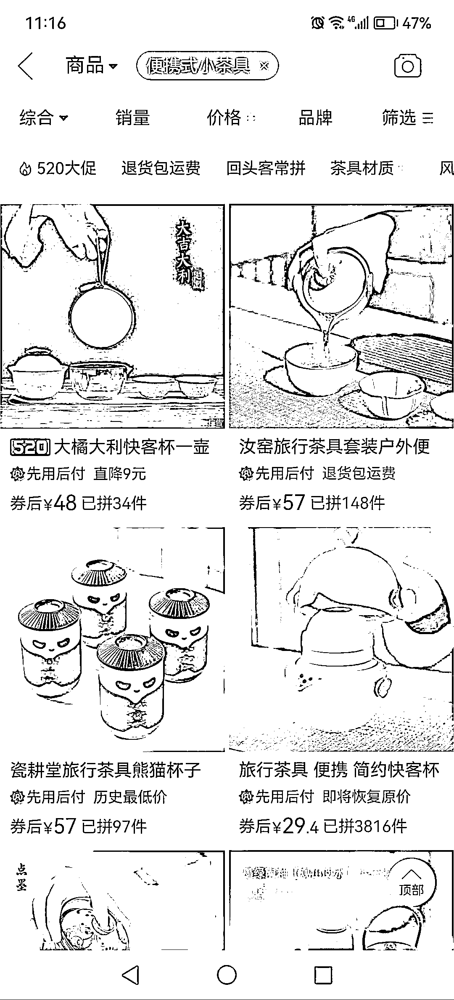
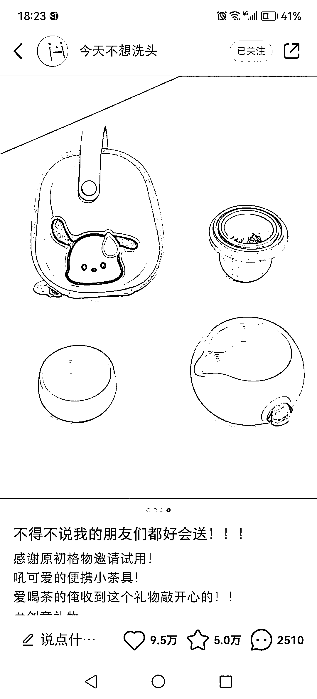
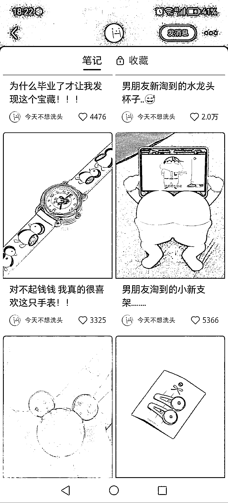
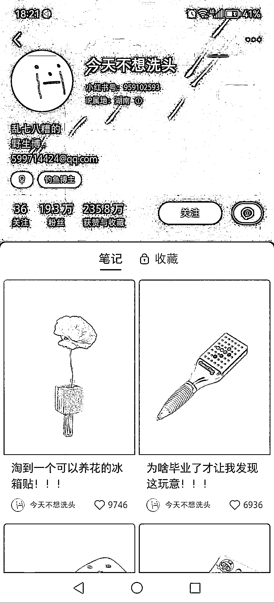
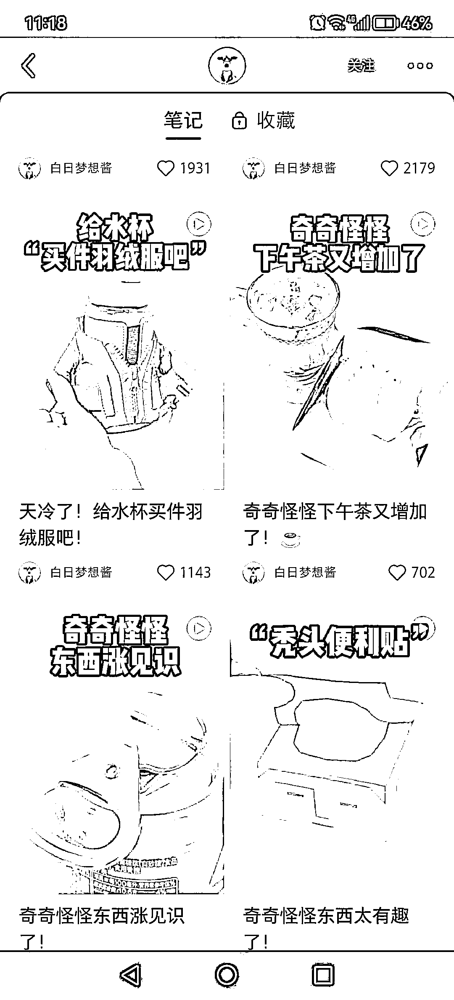
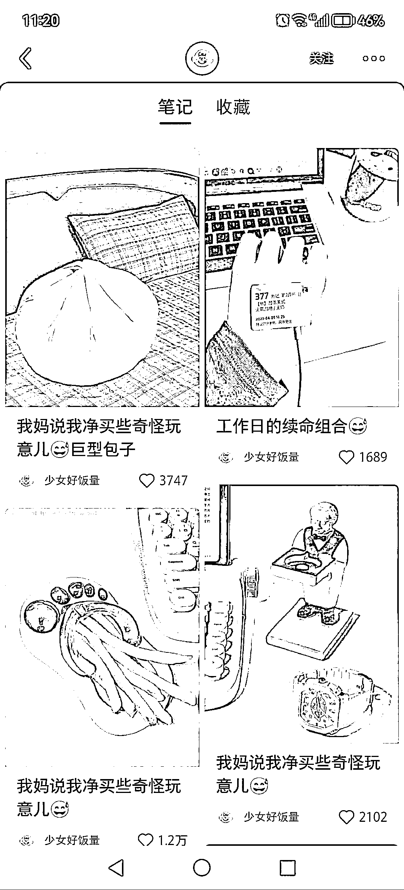

# 刷到停不下来的“创意实用好物”，竟是隐藏选品宝库

最近刷小红书，偶然点进一个“创意实用好物”博主的页面，结果一刷就停不下来。

东西颜值高，还特别实用，看着就让人心动。如果你正好开了店，想找找新灵感，那真的可以去翻翻这类博主——不仅是一种视觉享受，更是一条现成的选品思路。看完之后，再去其他电商平台搜同款类型，直接照着找源头，省时又省力。

这类内容最大的价值，就是把“好看”和“好用”结合在了一起，让你一眼就知道哪些东西能打动用户。对于想选品的人来说，相当于有人帮你提前筛选了一遍市场，非常值得借鉴。

如果你还没看过，建议去搜一下“创意实用好物”，相信你也会和我一样陷进去。

