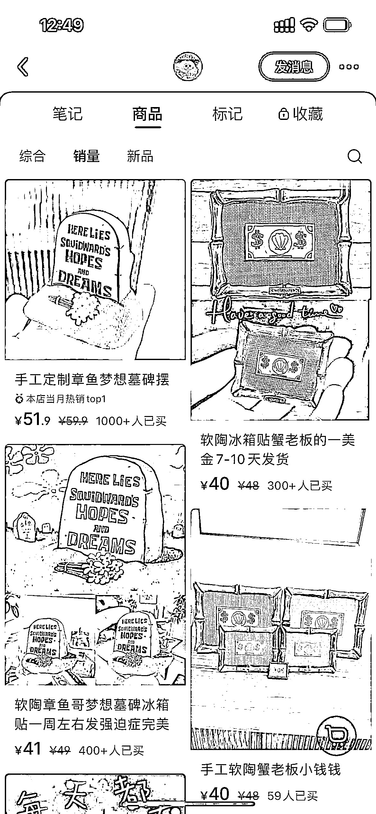
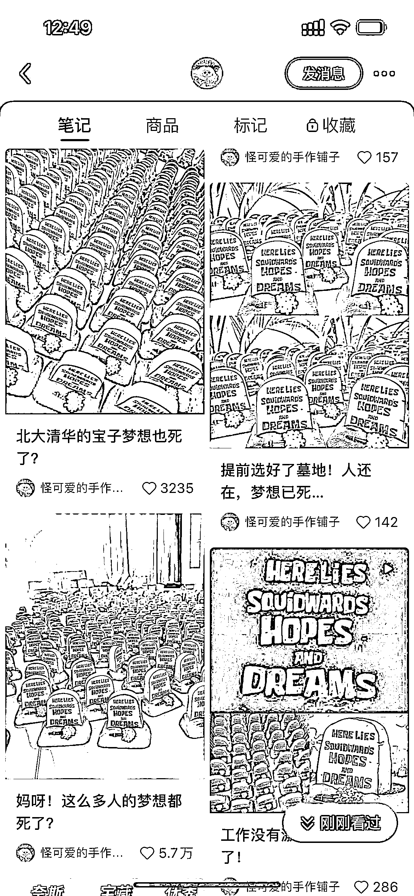

# 章鱼哥墓碑成小红书选品黑马

最近，章鱼哥墓碑这个物件在选品圈里热度蹿升。有博主凭这一单品做出接近10万元的销售成绩，单篇笔记点赞量还冲到5万以上。

评论区讨论同样活跃：有人表示头一回听说这类东西；有人没看明白，追问有没有懂行的能讲讲；也有人把它和海绵宝宝联系起来。亦仁给出“中标”判断，术值加一，并提示从上方专栏点进 #中标 即可查看全部中标风向标。Jie 感慨，小玩具里也能装下大梦想；胖大魔道贺之余催促作者补写精华帖；黄增添 Tony 表示感谢分享，认为动漫衍生品方向不错，还能延伸到其他生态，并建议先去了解章鱼哥。