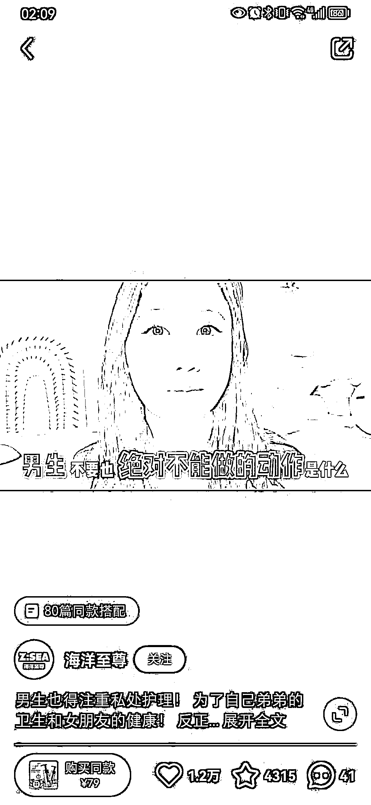
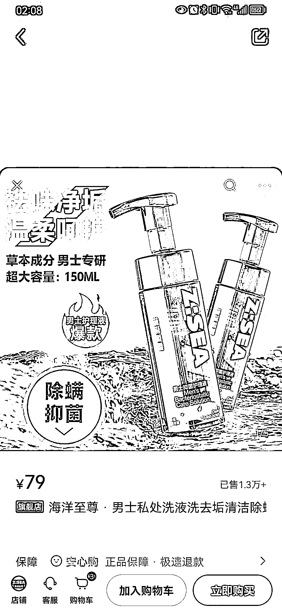

# 女生下单的男士洗液，藏着选品新思路

最近在小红书上看到一个挺反常识的选品：男性私密清洁洗液，销量居然不差。

按惯性想，这类产品男性自己主动搜索、下单的概率并不高。但数据摆在那儿——不少女性用户会替另一半做购买决定，给男朋友、老公挑日常护理用品。这个案例给做选品的人提了个醒：别只盯着女性自身的消费需求，女性也会为身边的男性买单，货盘思路完全可以再打开一点。

评论区也很有意思。有人调侃，过去男人一块香皂从头洗到脚，如今是被硬生生造出了新消费需求；也有人不买账，觉得几块钱的硫磺皂更实在，怀疑这类产品是智商税；但同样有用户表示自己买过，还有人认为精致男生确实有这种需要。另有一条观察：B站上类似内容不少，常见女性出镜推荐，关键词往往围绕“护理”“男朋友”“爽”等抓眼球的词展开。

说到底，选品不是急着判断谁对谁错，而是看见需求正在分层。这条线索值得记一笔：中标，术值+1。在上方专栏点击 #中标，可查看所有中标风向标。