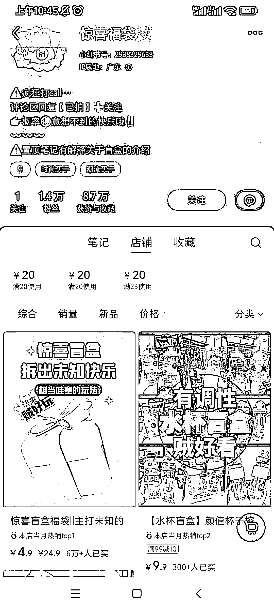
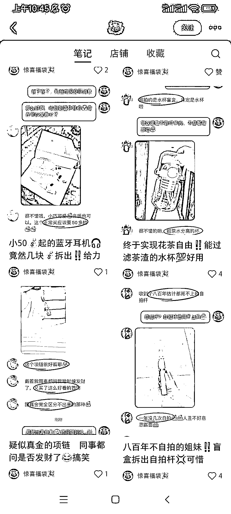

# 盲盒福袋卖出6w+单，这个玩法可以搬到其他赛道

2023年7月，一个主打“惊喜盲盒福袋”的账号交出了一份亮眼成绩单：销量超6万单，销售额突破30万元，而粉丝仅有1.4万。更值得注意的是，这个账号从2023年3月才开始发布笔记，每天保持约10篇的更新频率。每篇笔记的内容形式都是博主与客户的聊天截图，展示客户选购盲盒时的不确定感，以及拆开后或惊喜或吐槽的真实反应。核心卖点就俩字：未知。

笔记中会介绍当批售卖的商品类型，而唯一在售的就是盲盒。这种“出售未知”的玩法并不局限在盲盒本身，完全可以复制到其他商品领域——只要能制造期待和不确定性，任何品类都有机会玩出新花样。前期如果还没有真实客源，也可以自己安排一些“客户”来模拟对话氛围，为账号积累人气。

评论区里，豆豆表示：这个思路可以，前期缺客源时自己找人扮演一下也无妨。龙哥则评价：中标，术值+1。