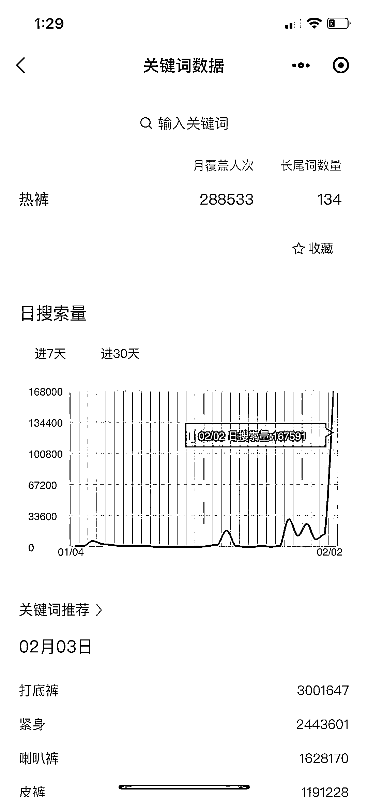
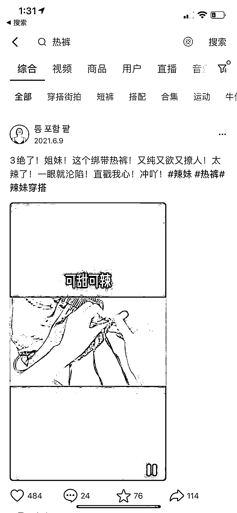

# 热裤关键词突然冲高，电商选品该留意了

作者：令狐峰  
日期：2023-02-03

这次发现一个异常信号：在手机端，“热裤”这个词的搜索量原本近乎没有，却一下子涨到了16万。

评论区讨论也很热闹：

- 亦仁：标记“中标”，术值+1。并提醒到上方 #星球栏目 专栏里点 #中标，就能查看全部中标风向标。
- 一登：这个异常值是用软件实时盯出来的吗？
- 令狐峰：对，靠软件监控发现的。
- 一登：老师用的是什么软件？能不能推荐一款，我也想试试。
- 令狐峰：团队自己开发的，目前还在内测。
- 封伟-自动化变现：我测过一些词，微信指数猛涨且排名靠前时，搜索和关注度的差别并不大；所以我现在会同步参考微信广告的搜索数据。
- 易博：看关键词数据用的是哪个小程序？
- 封伟-自动化变现：微信指数。