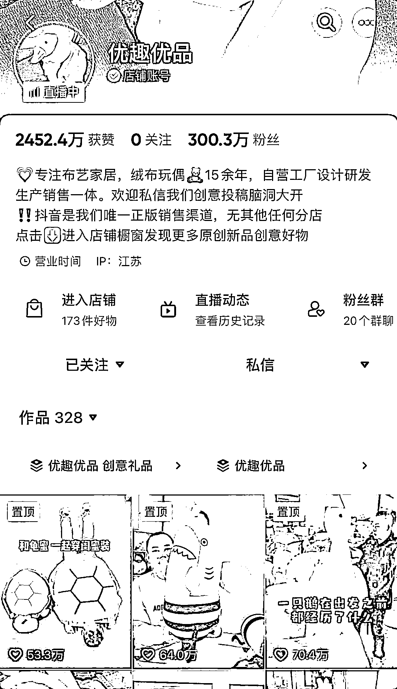
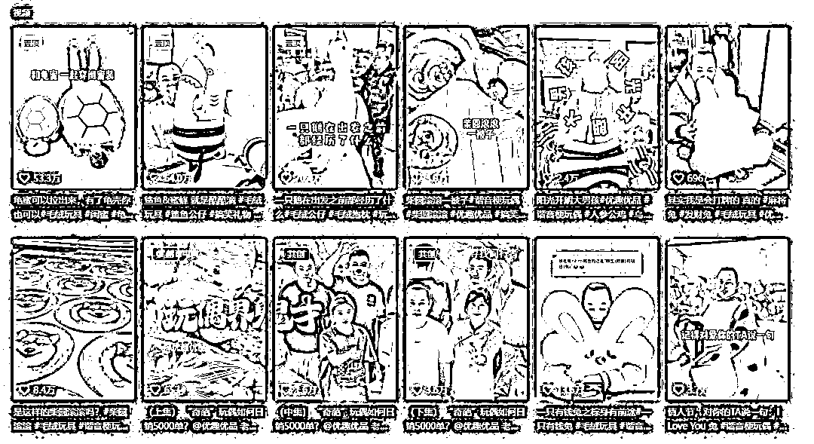

# 优趣优品：把评论做成毛绒生意

（1）先说为什么挑优趣优品来复盘。它踩的是网络热词：把热词做成毛绒玩偶，粉丝在留言区丢样图，商家负责把想法落地，再按点赞高低决定哪些产品进橱窗。这样一来，流量、产品、转化就连成一条线。玩偶本身够新奇独特，同行少，商家也有定价主动权。

（2）案例主体是抖音账号优趣优品（抖音号：Iffydino），方向是布艺家居和绒布玩偶。它的壁垒在于把旧要素重新组合：同一种原材料，换个设计就能做不同产品，原料和物流成本都不高，反向定制还能压低库存风险。选品围绕布艺家居、绒布玩偶展开，强调“一葱多用”，借热点做创新，新奇独特且覆盖面广，自带吸粉能力；反向定制也更容易跑通MVP小闭环。产品既有形象表达、能体现个性，也有实际用途。配乐走可爱、搞怪路线。视频文案的路径是：从评论区挑样图，再展示成品，讲清产品意义和细节功能，最后引导去橱窗下单。直播时按粉丝要求展示产品，说明尺寸和功能，并引导点亮灯牌、关注。封面图见图2，标题和话题用#毛绒玩具 #谐音梗玩偶 #创意礼物。

（3）复制这个案例，人群可以锁定20—40岁女性，尤其是上班族和宝妈。选品仍可放在布艺家居、绒布玩偶上，同时可尝试激光雕刻绘画、女性手机钥匙单肩斜挎包、各种创意造型指甲。

评论区也有反馈：昊东.Lee说这是他比较偏爱的商业模式，并预判该账号半年内粉丝有望破千万；小张直呼“有点牛逼”；亦仁留下“中标，术值+1”。另外，在上方#星球栏目专栏里点击#中标，可以查看所有中标风向标。