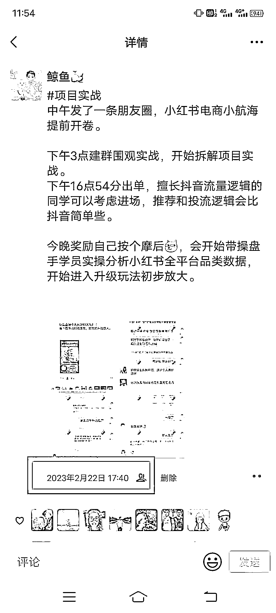
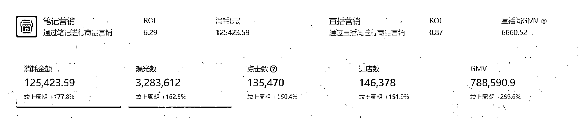
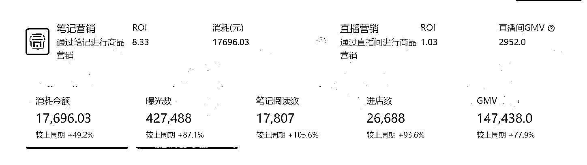
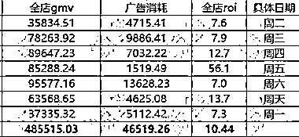
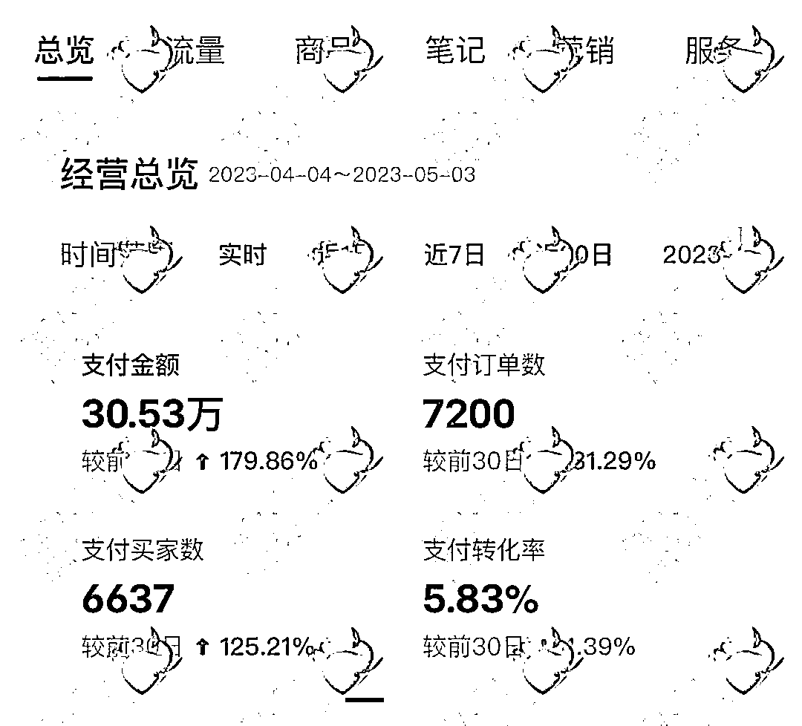
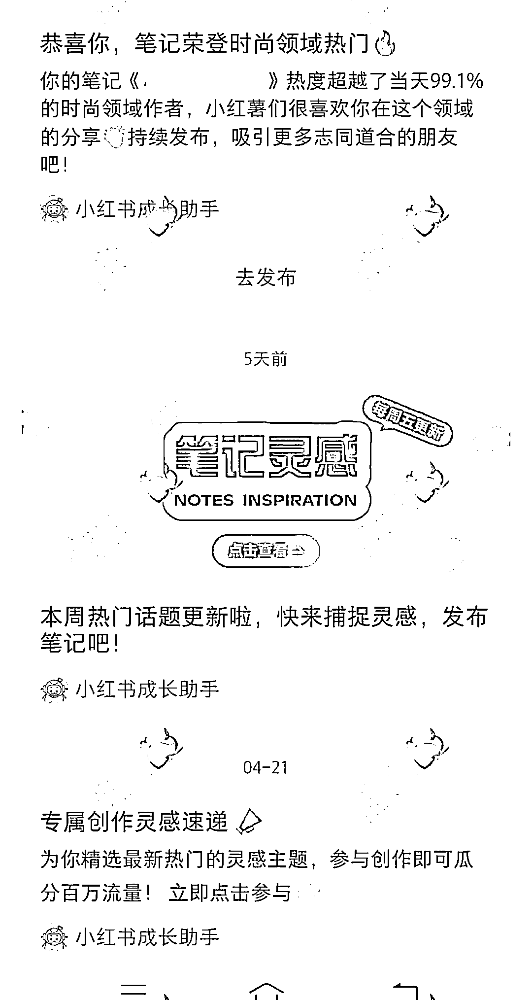

# 2周单店做到78万GMV：📕付费投流实战复盘

我是鲸鱼，早年在头部互联网公司做广告算法产品，如今主要做商业流量操盘，熟悉抖音、📕等平台的付费投放带货、精准获客和SEO。

今年2月，赚钱小航海给了我启发。当时我在📕电商上还是零基础，但判断这个方向值得做，就提前下场。2月22日，我用了两个小时跑出第一单。

首单跑通后，我把在赚钱获得的认知落到实操里，开始研究自然流与付费流结合的打法，连续做了两个月。结果，两周内第一家店做到78万GMV，第二家店做到14万GMV；一周投放的ROI稳在10以上，峰值到过56。

这里要感谢龙哥盟帮我打开认知，也感谢一路指点我的贵人老师。

为了让这套分享经得起验证，我也带学员做过自然流实操，已有单店GMV突破30万；目前正在帮他们用付费投放放大结果。

这篇复盘会从自然流量与付费投放两条线来拆📕带货项目。自然流部分覆盖当下常见的搬运混剪玩法，零基础新手和准备做付费投放的人都能参考。

完整排版文档放在飞书，链接如下：
https://ra0vtgukn5c.feishu.cn/docx/F3BjdXRJFoPmE3xPsxgcZGLDnZb

  

 

互动区也很热闹：云珞 YunS、星尘丶、林深、浅笑等读者留言点赞，有人表示先点赞再阅读，也有人夸作者实力强；鲸鱼🐳则多次回复，鼓励大家一起加油、一起赚钱。