# 零投放、一个人、60天：我在小红书卖货赚了30万+

作者：杉木  日期：2022-06-08

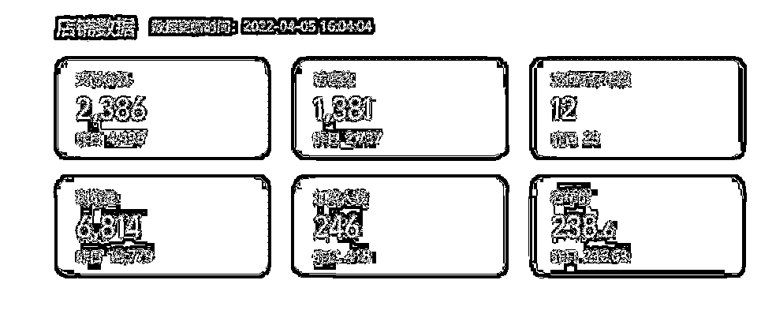
（图为淘宝某天的店铺后台，另外大部分成交在微信）

## 从知乎换道小红书，彻底从0开始

先交代下背景：我是杉木，山东人，1999年生。大学时代基本泡在知乎，做过两个账号，一个大学生领域3万粉，一个美妆领域2万粉。带货也掺和过，最得意的一仗是在知乎好物红利期，接了一个品牌推广盘，60天把GMV做到80万+。

第一次碰小红书是在2022年年初。以前我连App都没装过，总觉得这是女生玩的平台——请原谅一个大直男的偏见。现在小红书的男女比例依然偏，但这反而是一种机会，后面我会专门说。

起初的两个小红书号，还是照搬知乎打法，一个大学生号、一个美妆号，都偏个人IP风格，看起来挺“知乎系”。惊喜的是，两个号第一周就变现了。美妆号粉丝才4000多，一条合作报价就能到2000上下。美妆在小红书确实好赚钱。对比一下，我在知乎的第一笔收入，是忙了大半年之后才有的……

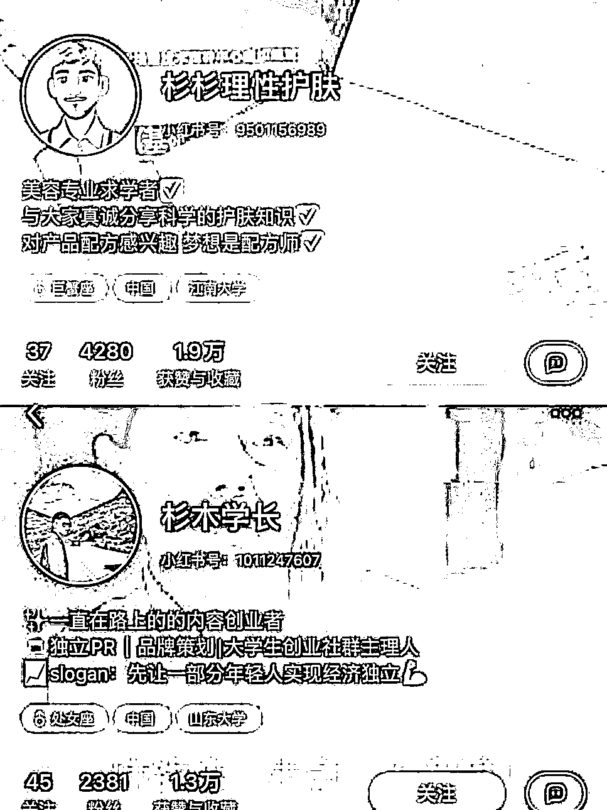

账号图给各位看下。这两个号都是往个人IP方向养，走专业路线。你要是能稳定产出内容，又在某个领域够专业，可以试试这种路子。

当然，这并非今天的重点。个人IP并不是人人能做，有门槛，收入也看流量脸色。但每个人都值得去碰一碰，因为传播这件事离不开渠道，而自媒体正好是普通人够得着的上升通道。

IP打造的方法，我跟@花爷@学了不少，也混在他IP实战俱乐部里。上个月在花爷内部聊了一次小红书带货，已经有人跑出了反馈。

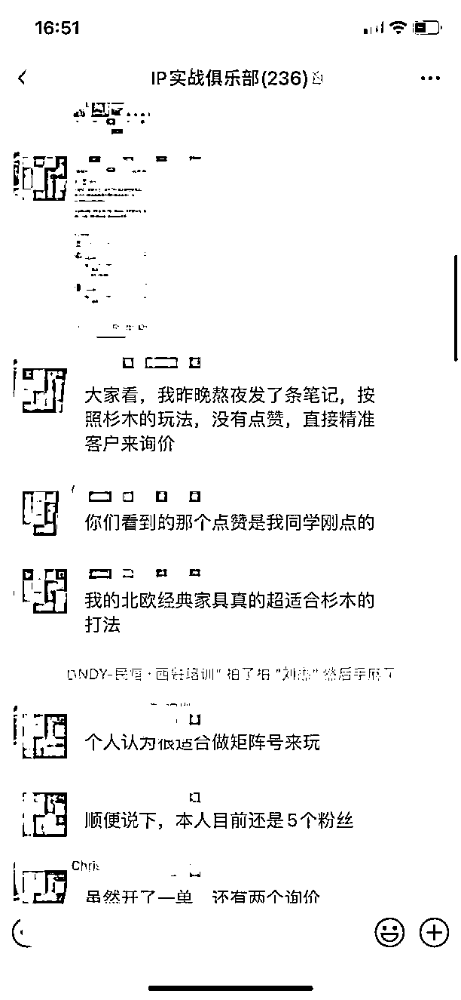

今天想重点拆的是小红书带货。我从入局到现在只用了60天，做过单篇曝光50万+的内容，一分钱投流没花，私域精准加人3000+，总营收过30万，产品利润能到60%。

这个品在开始前完全没人听过，全程我一个人操作。所以这套玩法的特点很明确：普适、低成本、能复制。

我给这套打法起了个名字：小红书矩阵化带货。说白了，就是低成本图文直接展示你要卖的货，通过内容把最精准的购买人群引过来，完成成交。

流量有多精准？后台私信几乎全是“怎么买”，回消息回到手软的那种。

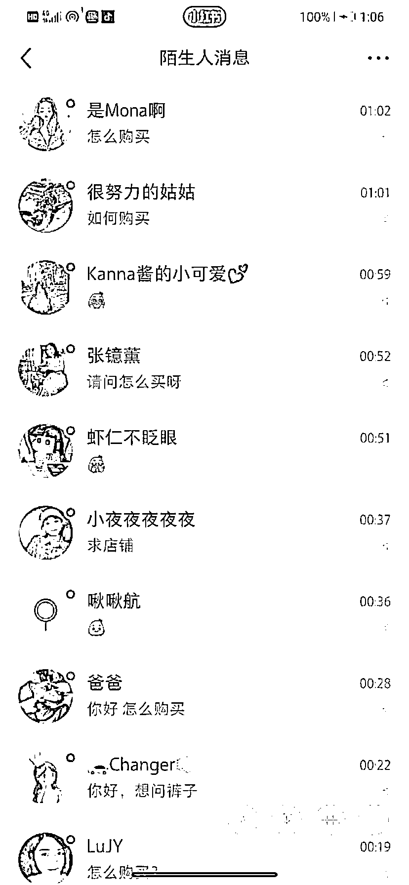

我拆项目习惯从五个词入手：道、术、法、器、势。今天就按这个顺序复盘，你们看完也可以自己套用一遍，会记得更牢。

道=底层原理；术=方法论；法=执行细节；器=辅助工具；势=窗口期。

先把我手上的账号亮出来。打码是怕一堆人搜过去影响号，产品我会说，下面也会放一个示例账号。

## 一：小红书矩阵化带货的“道”

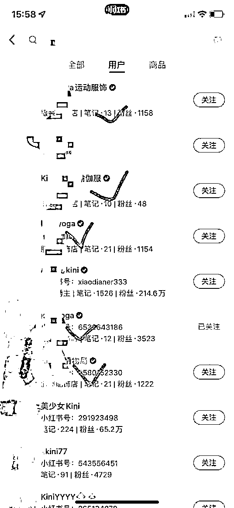

刚才那批账号有个共同点：清一色企业号，外加矩阵化运营。

为什么要企业号？小红书用户是来淘好东西的，企业号等于一个线上店面，产品可以直接摆出来卖，相当于交了“入场保护费”。个人号则是没牌照的小摊贩，官方随手清理，更别提大大方方叫卖了。

归纳一下企业号的好处：内容更直接、变现路径短、开通即可投流、营销工具全、运营成本省、引流够精准。不过它不是硬性条件，你有营销需要再开通也不迟。

那矩阵号又是什么？一句话：同一批货，用多个号一起卖，比如下面这种。

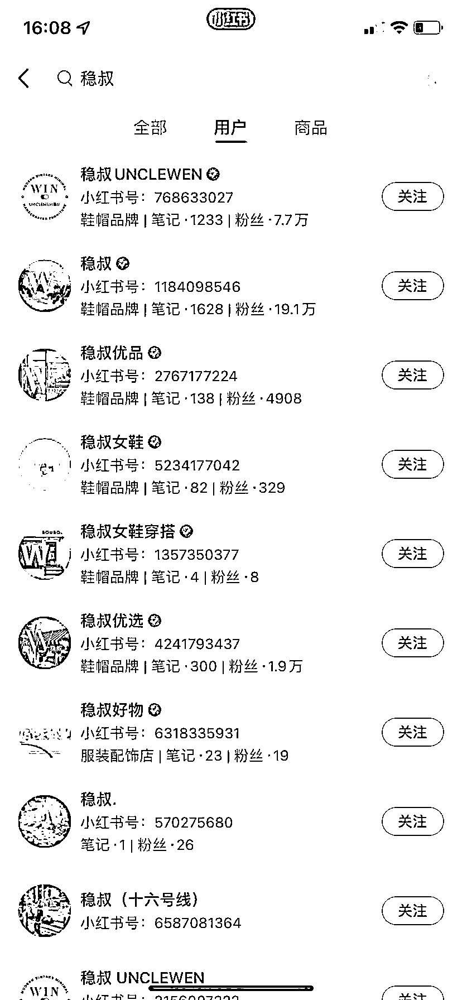

矩阵的前提是单账号跑通。我建议先做一个号，把流程和内容摸透，等第一篇数据起来后，再复制矩阵。

做矩阵的目的，一是对抗平台的不确定性，二是摊薄内容成本——图文生产的边际成本本来就低，号多了，平均到每篇的成本自然下来。更大的杀招是“大力出奇迹”：内容技巧过了及格线，能否爆就看概率了。如果20%的内容能达到爆文线，100篇和1000篇产出的爆文数就是20和200的差距，跟电商店群的逻辑一样。而且现实中，80%的意向客户都来自爆文，所以要尽早做出第一篇，然后复制这种感觉。

## 二：小红书矩阵化带货的“术”

### 选品：决定项目生死的第一步

做这个项目，其实就两块：内容和电商。电商人都懂，选品是命门。什么样的品适合小红书？先记住：没有十全十美的品，别在选品上纠结太久，优先用自己手上靠谱的货源。很多品，试了才知道。

下面这些品类反馈快，容易起量：

1. 功能性半标品——比如瑜伽服（我选的就是）、防晒服，都是真实强需求。
2. 红海里的细分蓝海——比如专做大胸或者小胸的内衣、专做小个子女鞋。
3. 美妆护肤——有货源且资质齐全，非常值得做。
4. 自带流量——情侣内衣、JK服、汉服这类。
5. 大牌平替——帮用户省钱，质量又接近。
6. 新奇特且真有需求——光猎奇撑不住转化。
7. 知识付费——要具体到某个明确项目，而不是别的平台培训；或者直接做咨询服务。

除此之外，产品最好满足下面几条原则中的三条。

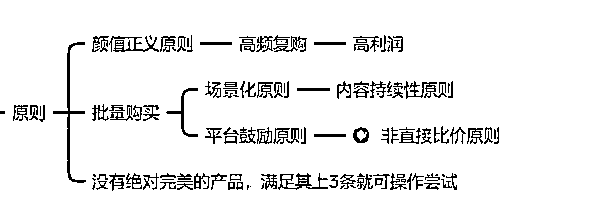

除了常规选品，还有一个方向：蓝海，也就是竞争没那么卷的市场。小红书男生比例少，但绝对量也有千万级，大多数品牌在抢女性用户，男性市场反而没什么人抢。蓝海这个思路，@陈铭@和@盗坤@都提过，我受益挺多。类似的还有小众高客单、服务高端客户的生意。前两天我刷到一个“焚火台”，露营用的，做的人极少，但露营热度一起来，流量表现相当好。

另外一条大原则：不管什么类目，在小红书尽量走中高端，敢卖高价。当然高价要有强卖点撑住，最好能精准打到用户痛处。

### 货源从哪来？

没货源的人，比如我，老老实实走一件代发，别囤货。找货的渠道：网上找供应商，或者用身边朋友的资源，生财社群里就有不少老板能提供货源。

也可以跟线下店合作。我卖瑜伽服之前试过眼镜，找了家附近的眼镜店，和老板娘说得很直接：我需要你的产品拍素材，用完就还，每次拿几副，不影响生意。我拍好的素材你能发朋友圈，我还能在笔记里挂你店铺位置，帮你引流。

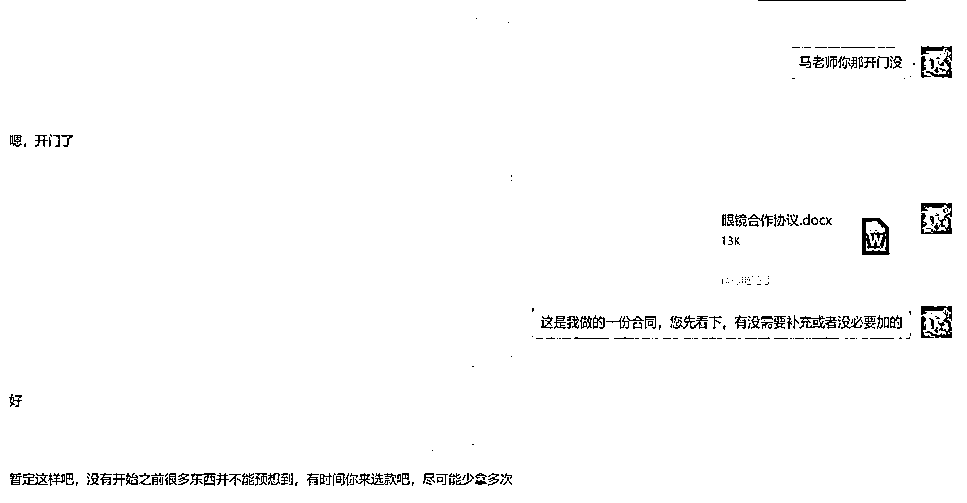

老板娘当场就答应了，押金一分没收。后来瑜伽服跑得比眼镜快，我才把眼镜砍掉。

找货的核心心态：万物不为我所有，但万物皆为我所用。

### 开工前，先备好三样东西

内容生产之前，有三件事必须做：①确定内容展现形式，选成本最低的；②定一套内容基础模板；③搭好私域或淘宝承接店铺。

为什么第一步关键？因为你的目标是找到“能赚钱的笔记”，不是“数据好看的笔记”。马斯克的第一性原理用在这里很合适——回到本质重新想。电商的本质是选品，自媒体的本质是内容。核心只占系统的20%，但搞定它就是搞定80%。这里要感谢@徐冬冬大佬那篇文章，让我想通了找赚钱笔记的方法：https://articles.zsxq.com/id_61nswd110ikb.html

注意，出爆文和能赚钱是两码事。我有一篇笔记只有80个赞，评论区却冒出来近200条“怎么买”“给个链接”。这一篇带来500多个精准流量，转化一半毫无压力。

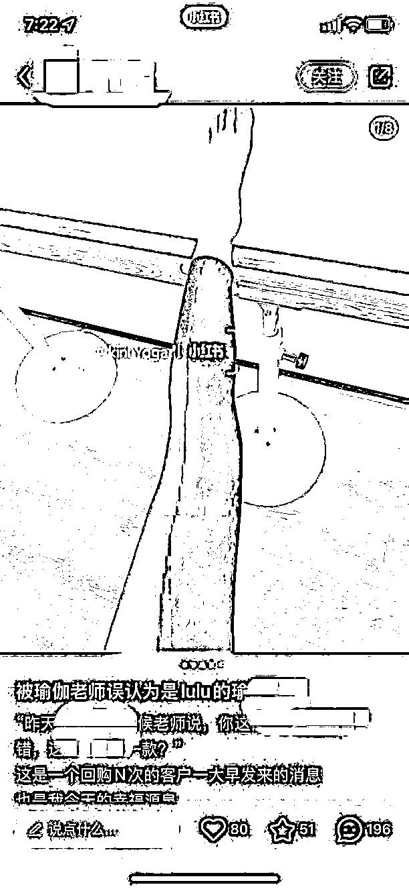

再举个反例：同样做瑜伽服，也是企业号，封面模特身材更辣，点赞171，评论区只有8条，而且都是男的，没一个冲着产品去。问题出在哪？用户需求和痛点抓错了。瑜伽服买家是女性，她们在意包裹性、弹性、面料，不关心模特白不白、翘不翘。内容不能自嗨，要让用户觉得“你懂我”，才能引来对的人。

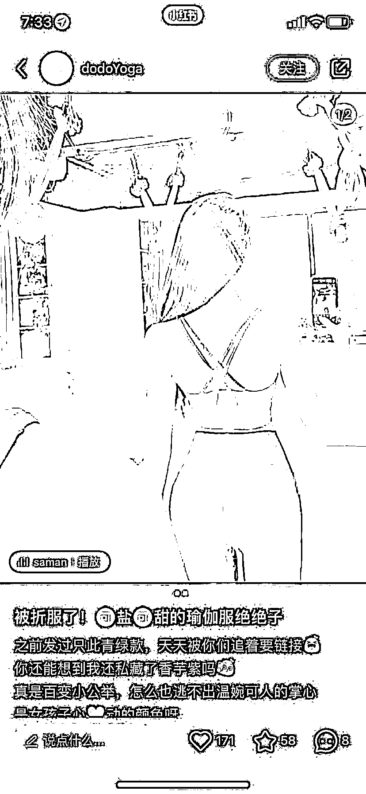

### 怎么翻出赚钱笔记？

盯评论区。点赞收藏只能代表“喜欢”“有用”，评论才说明需求迫切，尤其是直接问购买的。真正能带货的评论区长这样：

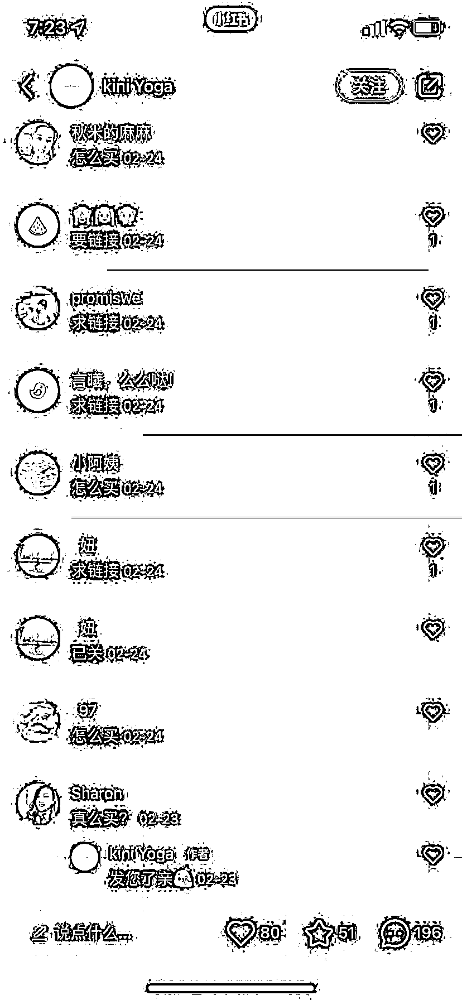

知识付费、咨询类笔记的评论区，画风则是这样：

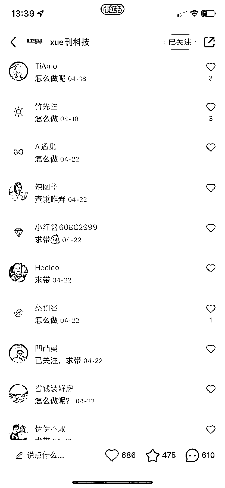

那怎么挖？标准很简单：赞评比越接近1:1甚至1:2越好，评论越多越好，而且评论内容直接指向购买。找这种笔记最笨但最有效的方法，就是大量刷同类内容，别急着上工具。刷的过程中你会慢慢摸清产品卖点，方向也更稳。刷到好笔记时，点进主页看看其他内容，如果篇篇都高询单，恭喜你，捡到宝藏。可以把整套内容扒下来研究，淘宝有代爬工具。也可以用蝉妈妈、新红这类数据分析工具，以新红为例：

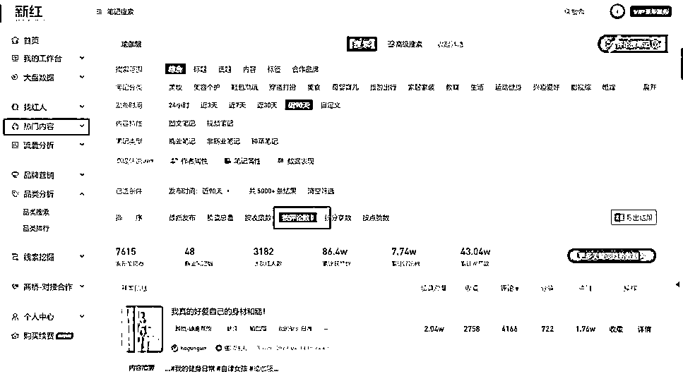

在热门内容里输入类目大词，按评论数排序。记住，别看赞藏数，那是糖衣炮弹。评论多且都在问链接，才是我们要找的料。

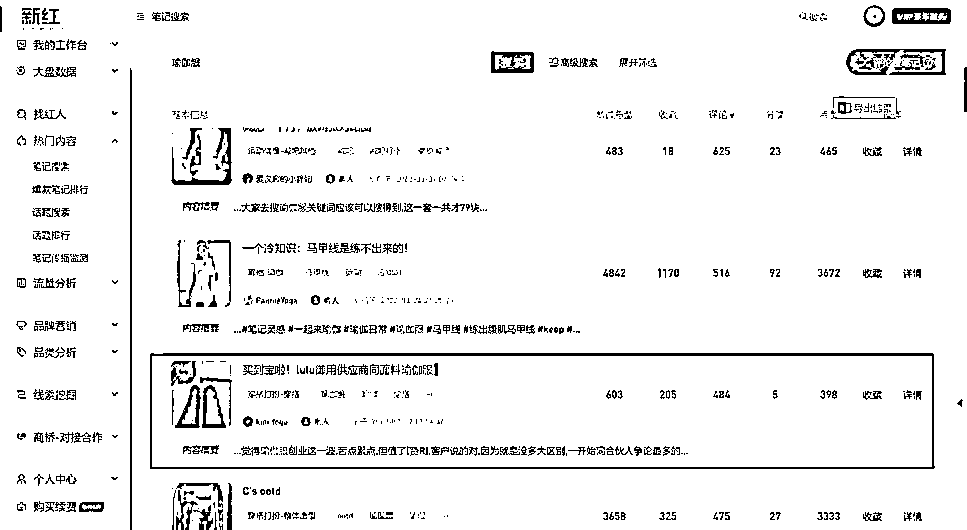

数据工具还能挖热度词，然后埋进文案里蹭自然搜索。小红书的搜索心智很强，品牌一有营销大动作，搜索量立刻飙。比如今年lululemon的热度甚至超过“瑜伽服”这个品类词，那就把它反复写进文案。

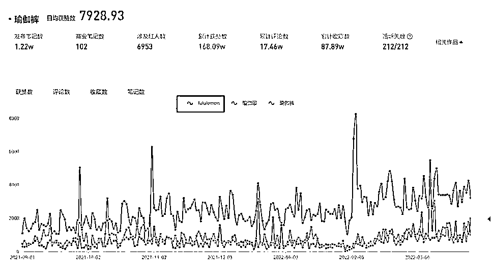

这些笔记扒下来后，重点读文案里的情绪，而不是只找卖点。因为靠直觉判断需求，哪怕你做这行多年也会翻车。只有评论区真有一堆人问链接问购买的，才说明内容扎中了需求；评论区七嘴八舌在聊别的，再高赞也只是热闹。所以：

找能赚钱的笔记，不找瞎热闹的。
目标是精准客户，不是爆款数字。
我做小红书是为了赚钱，不是为了点赞。

这个方法也可以当选品试金石。像T恤这种红海品类，竞争惨烈，但有一篇笔记能引来4000多个精准询单，拆开看是因为“高克重+专属定制”两个卖点，市场太需要这样的货了。

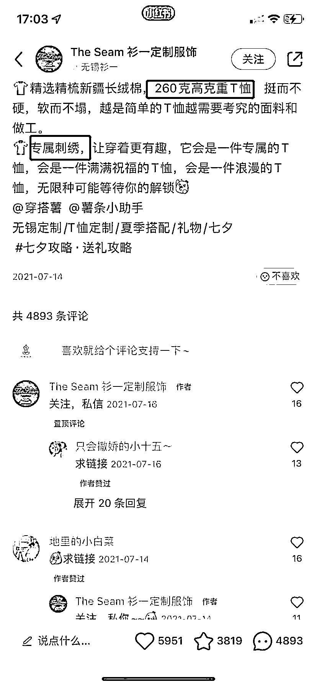

另外，要时刻算内容成本。矩阵做号，每篇生产成本都要量化。高成本未必带来高询单，我之前那条瑜伽裤就是例子，内容成本不到20块。拍摄方面，同城找模特就行，提前把注意事项和参考案例发给对方，免得拍一堆废片。真没必要请专业模特，更不需要精修图，这不是拍淘宝详情页。小红书和用户都偏爱真实感，原生态一点反而出效果。

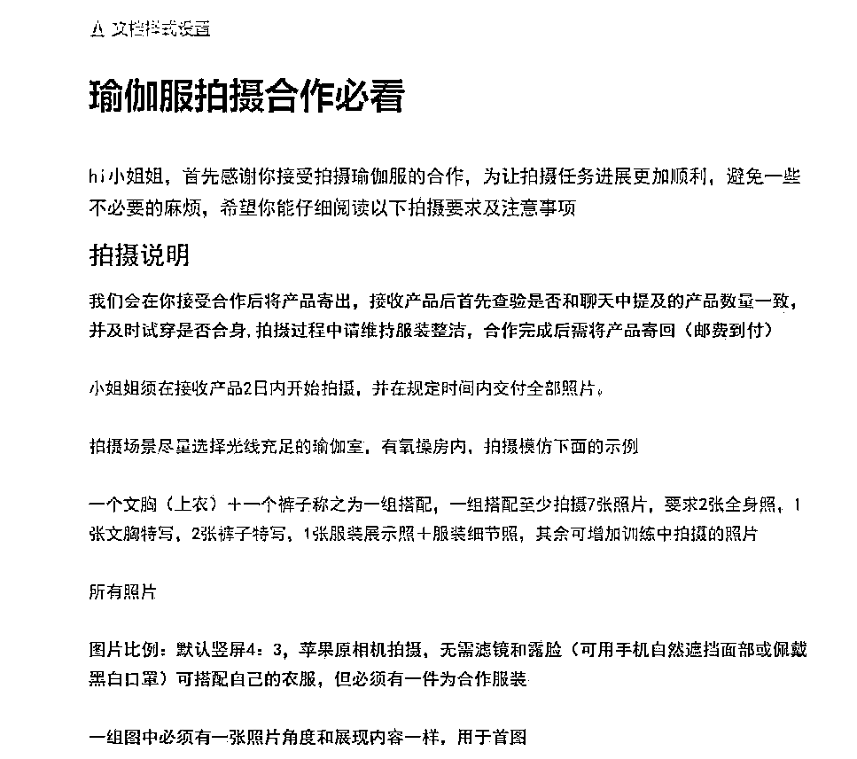

## 三：小红书矩阵化带货的“法”

### 流量当道，内容为王：低粉也能高变现

前面所有准备，都为了内容这一步。内容生产完全可以流程化，比如我的图片结构基本固定：产品整体图、细节图、客户反馈图各来一张；文案套路也高度重合。这样我一天能产10篇以上。前期模板多试几版，哪篇数据好就一直用。别怕发太多限流，只要内容不是完全重复就没事。

小红书图文就三部分：标题、图片、文案。

先讲标题。企业号起标题，最省力的办法是直接抄高数据标题的框架。举个例子，我随手刷到一个：

“挖到宝了！！这颜值实用双在线的婴儿车真香”

套用模板，把产品词、需求词、热度词填进去：

“挖到宝了！！这lulu（热度词）同面料（需求词）瑜伽服（产品词）真香”

再说文案和图片。企业号的文案弹性很大，可以直接聊产品，也可以用创始人视角写创业故事，从故事里自然带出品。我个人更推荐后者。正文里除了介绍产品，还可以加价值观输出、行业观察、客户趣事、真实反馈等等。

注意一个坑：企业号不能用第一人称“我”来写使用感受，否则会被限流。

下面是一些我积累的图文小技巧：

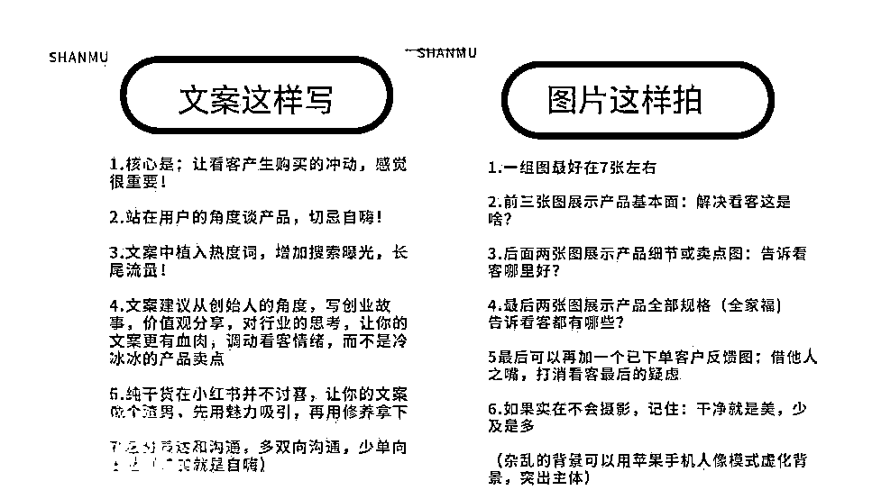

内容的核心还是对标赚钱笔记来写。这也是为什么我前面花那么多篇幅教大家找对标——这是地基。我体感最能挑动情绪、最易产生询单的是故事体。人天生爱听故事，小红书又是女性占比极高的平台，故事能带动情绪，也能让精准用户顺路走到付款页面。

我总结了几条高询单内容的经验，也整理了模板，供参考。

总原则：让用户感觉你站在他那边，替他着想，情绪跟他走。再次强调，感觉很重要！

第一：说出用户最深的痛，或最认同的“喜”。比如行业价格不透明、某名牌溢价太高，而我是厂家直发、同品质更便宜；或者我深受某厂剥削，愤而创业。这些放在开头，为了让读者看完想“对，就是这样！”，相当于拉起同一阵营，后面你说什么都像在帮他，信任就打底了。之前让大家做市场调查，就是为这一步铺垫。比如：

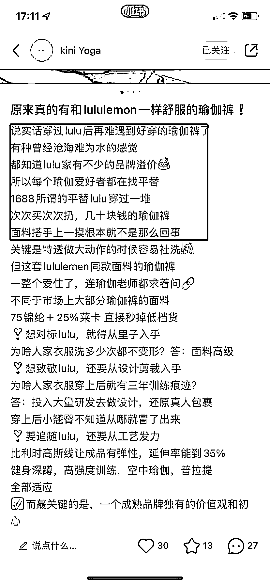

第二：写顾客证言。展示客服和顾客的互动，最好有波折，用对话还原现场，中间自然带出好评。案例：

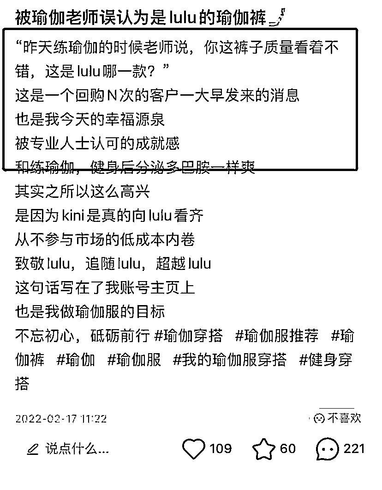

第三：输出自己的价值观。提炼一句好记的、能代表产品态度的slogan，反复讲初心。但别学大牌喊口号，什么just do it那种就算了，要接地气。

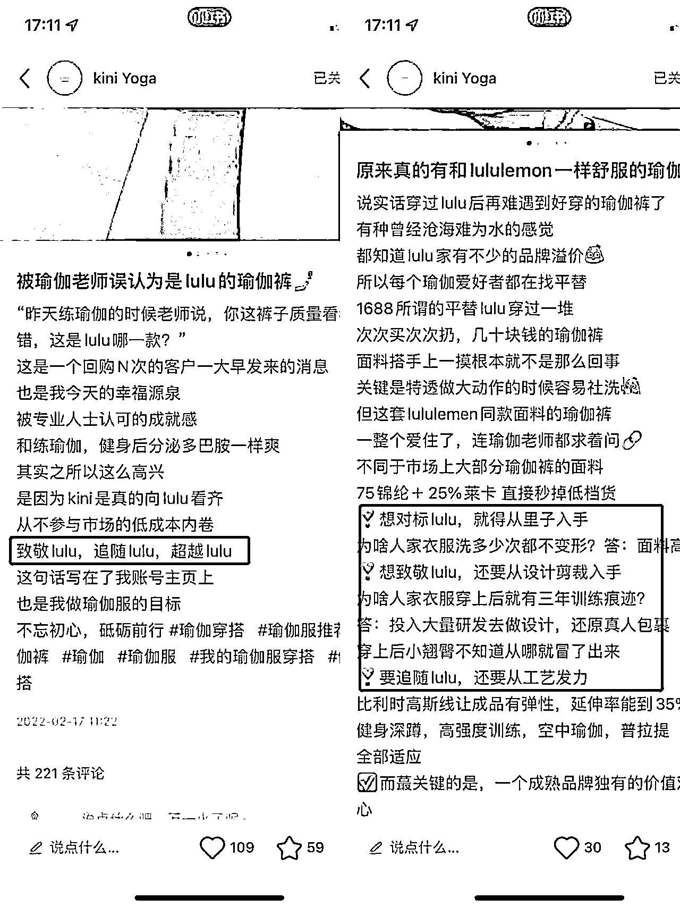

**④**销量怎么写

利用大众的从众倾向，在文案里直接或含蓄地传递“这款产品卖得很火”的信息，既能刺激下单欲望，也能让读者更信赖。如果产品本身有销量数据，就如实写出具体销售数量；要是还没有，就强调复购率高、走货快，一定要落在精确的数字上。

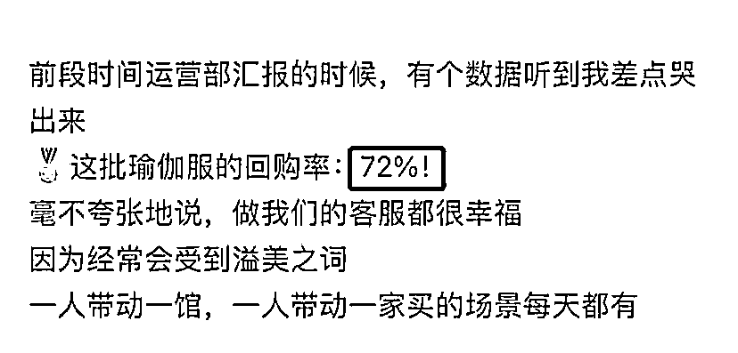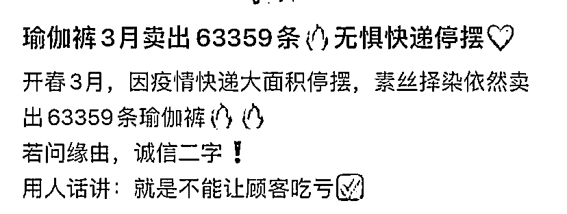

**⑤**语言技巧：多写小排比，适当押韵

这些手法从小学语文就学过了。排比句能层层递进情绪，让文案自带节奏感，读起来顺畅舒服，尤其在小红书这类短内容里，效果特别明显。比如：

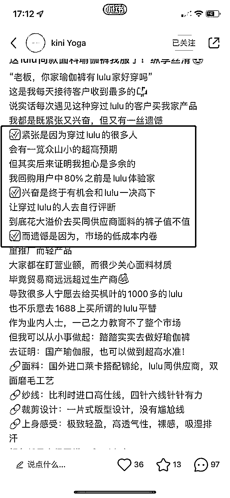

**⑥**用聊天的语气，而不是自己说个没完

写文案必须让读者接收到情绪，才叫成功。如果只顾自己写得嗨，读者看完一头雾水，那情绪根本传不出去。虽然不能站在消费者视角用“我”来写产品，但可以把自己代入一个具体角色，比如客服、创始人，用那个人的口吻来写。

**⑦**真诚要渗透到每个字里行间

读者能感觉到一篇文案是否真诚。不需要堆砌华丽词句，但必须走心，别生搬硬套模板。

**⑧**找好时机介绍产品，引导用户下单

企业号可以开门见山，直接写产品和服务，不过前提是你要有优势：相比同行，要么价格更便宜，要么附赠的东西更多，要么提供别人没有的额外服务。如果产品和同行没什么区别，最好从讲故事的角度切入。

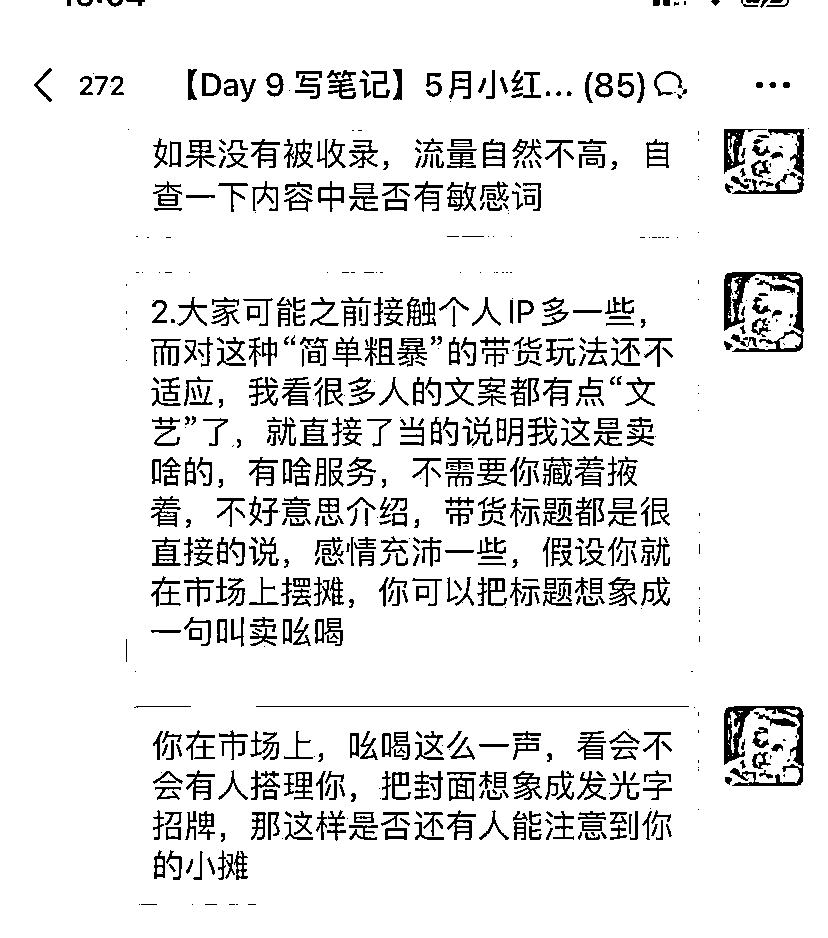

接下来聊聊排版。排版同样关键，内容再好，如果读起来费劲，读者根本看不下去，效果自然大打折扣。排版要干净利落，多用小表情，把长句拆成短句。写完后再通读一遍，确保逻辑顺畅、体验流畅。千万别大段堆字，我习惯一个句子单独一行，总字数别太多。纯展示类笔记可以不写文案，或者用100字左右介绍产品卖点；故事类笔记，文案最好控制在600字上下。

最后说说企业号怎么安全引流和成交。

① 先引导用户关注和私信，然后在私信里回图片。示例如下：

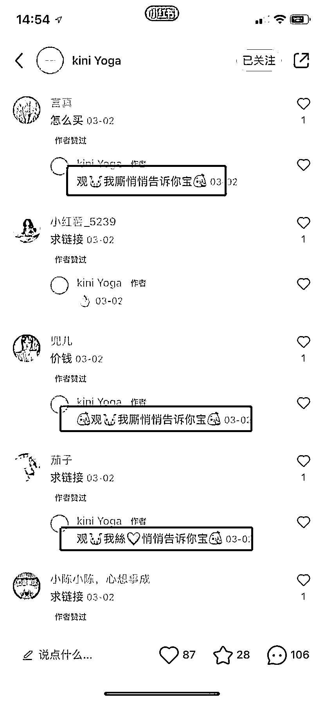

话术参考：
+关注，评论区扣1，发你们入口哈
点👍+关注之后，给博主发个消息，系统会自动回复[飞吻 R][飞吻 R]
想要的小仙女们，点👍＋关🐖底下评论：111，私信我怎么买，自动获取入口~

私信回复模板案例：

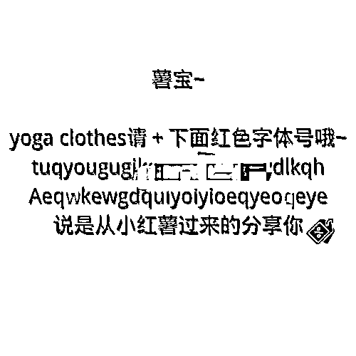

目前这种乱码图片，被系统监测到的风险相对小一些。但要注意，如果总是回复同样的内容，很容易触发监测，所以要多准备几套图片，轮换来发。

② 第二种引流方式：准备一个小号，让企业号和小号打配合。

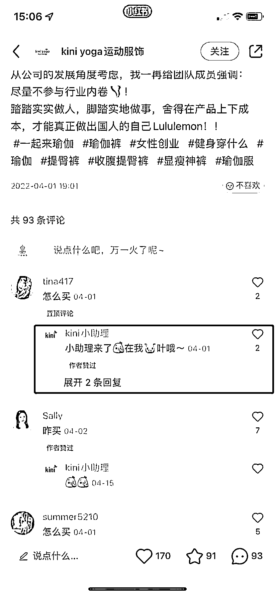

怎么提升私域转化率？

私域要提前搭建，别等到需要了才临时抱佛脚——这就叫“晴天修屋顶”。在内容生产之前，就要把私域体系准备好。

私域沟通怎么聊？加上微信后，先去通过好友（如果流量大，建议直接关闭加好友验证，否则容易提示“添加好友频繁”）。欢迎语要固定成一套模板，最好以一个问题开头。用问句破冰，能很自然地聊到你推荐的产品。另外，提问还有一个优势：你主动提问，就占了主导位，变被动为主动，后面就变成顾客跟着你的节奏走。

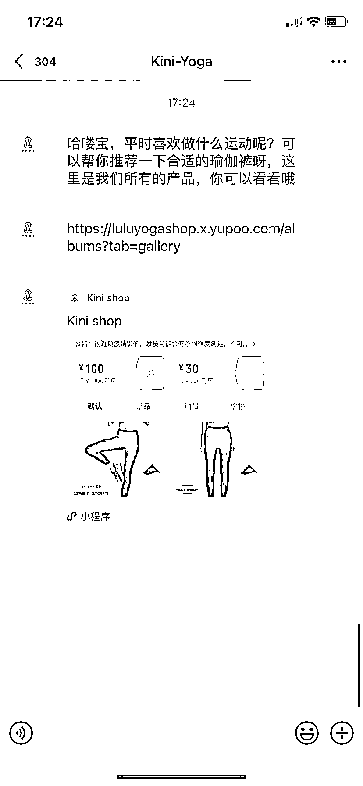

关于成交的建议

营销的学问很深，我在这里不班门弄斧。个人觉得不用太迷恋话术技巧，因为你面对的每个客户情况都不同，灵活处理就好。再多的技巧也抵不过“真诚”两个字。另外，朋友圈要用心经营，把微信商店里的产品信息写清楚。用户加上你之后，要尽快通过，因为加你的那一刻购买欲最强，最容易成交。

关于朋友圈运营

用户加上你后，第一件事就是翻你的朋友圈。朋友圈运营是个很大的话题，我自己也还在学习中，这里简单聊聊我的看法。

1. 每天都要发朋友圈，保持更新频率，建议一天发两条。
2. 发什么呢？专业知识、产品展示、个人生活方式都可以。别像微商一样一个劲地刷产品，那样没有温度。把生活内容掺进去，朋友圈才有血有肉。

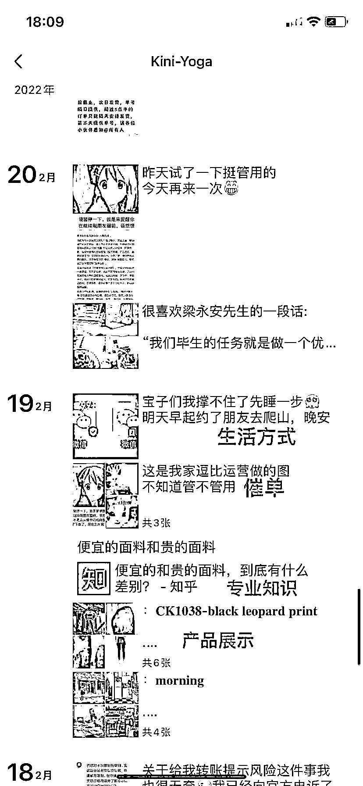

3. 还是要有用户思维，了解用户喜欢听什么、看什么。如果你的客户偏年轻，多发点有意思的表情包，或者玩些网络梗，能很快拉近距离。

私域这块我讲得不多，但真的非常重要。流量到了微信里，玩法就多了。怎么提升单个粉丝的价值？怎么维持粉丝粘性？同样的产品，有人靠1000私域能做出1万GMV，有人甚至能做出千万。这块我一直在学习，以后有心得再来分享。

**/**四：小红书矩阵化带货的“器”/**

其实前面已经提到过不少辅助工具，这里再集中整理一下。

作图软件：www.canva.cn、创客贴。我平时都是自己拍照原创，基本不用作图工具；如果你是做知识付费的，需要图片展示，可以用这些。

小红书笔记批量下载助手：文件传不上来，有需要的自己摸索一下，淘宝上也有相关服务。

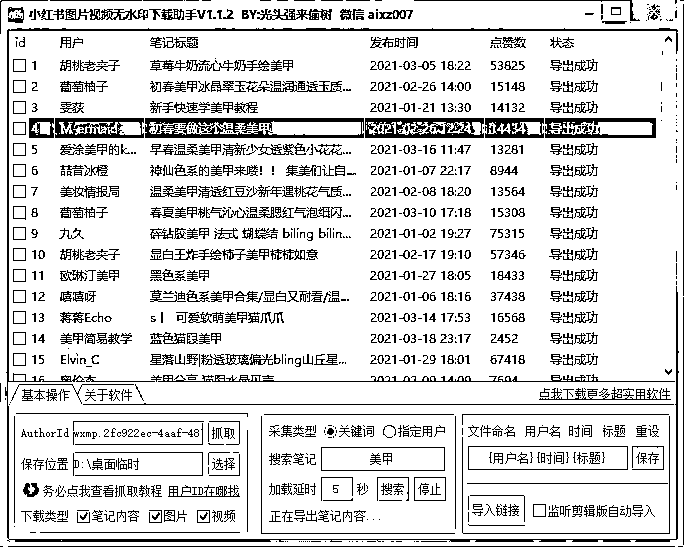

小红书数据分析平台：蝉妈妈、千瓜、新红。

小红书笔记内容排期表（我自己的，供大家参考）：
https://hnzx3q4p4a.feishu.cn/sheets/shtcn2TLlyip1OnjZ0Ech54hDBd

好了，啰嗦了一堆，最后放个思维导图。

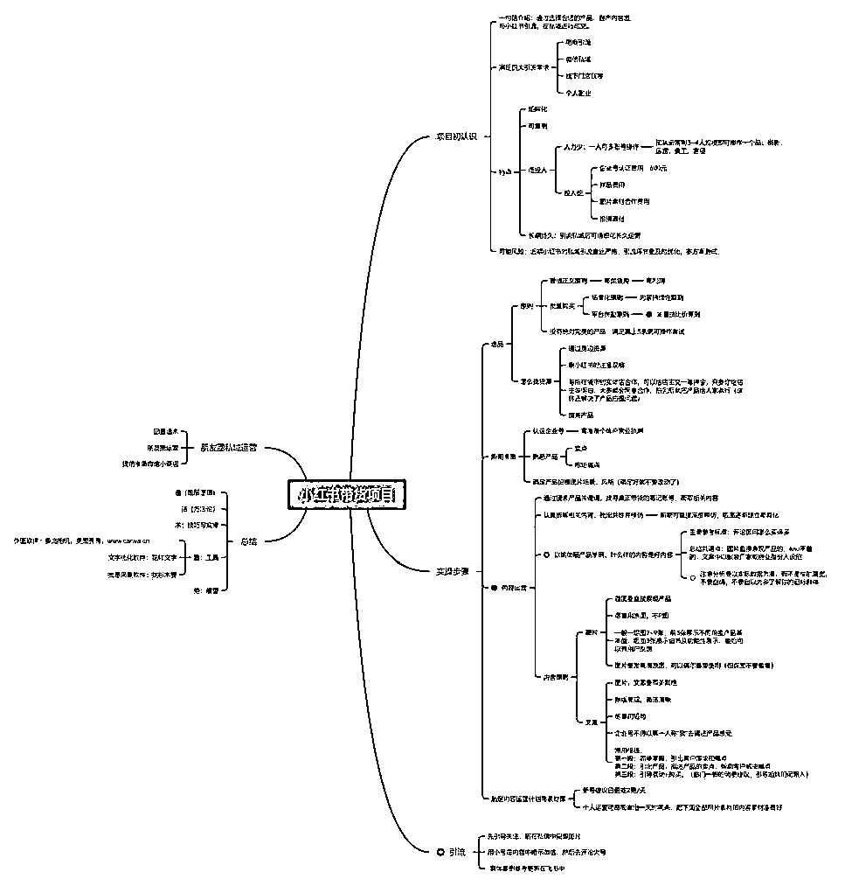

**/**五：小红书矩阵化带货的“势”/**

先说企业号比个人号“势”在哪里。这段话来自我加入的小红书群里一位大佬，总结得很精辟，我直接搬过来。

从流量赛道看，个人号竞争非常激烈。平台现在已经有4000多万个人博主，你要跟这么多人同台竞争，对内容质量的要求更高。

从账号运营看，个人号更偏向打造IP，变现周期比较长，必须积累起影响力和粉丝基础才能变现。

从变现方式看，个人号主要靠接商业广告和私域引流。接广告需要粉丝量积累，私域引流又容易有风险。而企业号变现周期短，主要就是卖产品和服务。

从内容方向看，个人号只能软植入，不能过多讲产品，否则容易限流违规；企业号可以围绕产品做内容，直接讲卖点，文案更硬核。

再聊聊小红书平台本身的势头。其实很多人都低估了小红书的价值，这是我做号以来最大的感慨。如果你还在犹豫要不要做，先迈出第一步再说，相信我，不会辜负你的。

总结一下，适合普通人的小红书卖货姿势：
1. 发纯产品图文的笔记，抓住最痛的痛点，吸引最精准的流量。
2. 找到内容生产成本最低的方式，算出每篇内容的成本。
3. 挖掘最能激发用户询单欲望的内容形式，然后去模仿。
4. 用矩阵模式抵抗不确定性。

写在最后：
特别感谢生财有术这个社群，以及各位老师分享的优质内容。虽然很多人没有深度链接，但老师们的分享让我受益匪浅，在项目推进中多次得到启发。真心感谢！也希望我的分享能对大家有一点帮助。永远谦虚，永远相信过程！

评论区：
何点解：杉木棒棒哒~
刘洋sama：有避免被检测到导流的办法吗？最近小红书一直提醒我有导流行为
梦洁：可实操性很强，非常干货[呲牙]
Zoe：杉木棒棒哒
小浔溪💛：杉木优秀，学到很多，赞赞赞~
桃酥：这也太干了！讲得很详细，杉木哥牛
幸运鹅小Au：杉木超优秀！！
幸运鹅小Au：这BD能力、文案能力、销售能力都太强了吧！！