# 水果团购：半年挣出十万利润

先给结论：盗坤老师说新手照样能挣钱，我用账本验证了一遍。

去年11月，他在龙哥盟社区提到一个偏蓝海的方向——去批发市场拿货，做水果团购。零投入、好模仿，对我这种工资外没赚过钱的人很友好。原帖在社区里能搜到。做了大半年，累计流水四十余万，净落近十万；五月单月做到十六万，如今已算一份稳定副业。跟大佬不能比，但对我而言，算真正迈出了第一步。

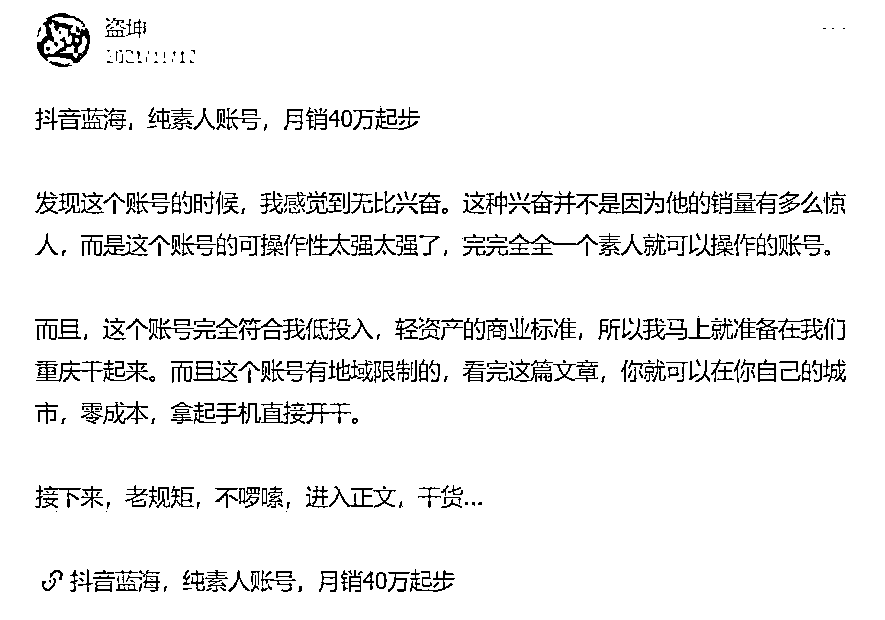
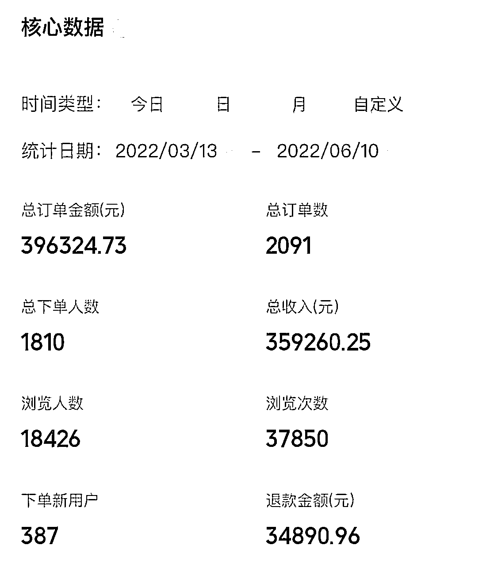

团购工具后台只能回看最近三个月，更早的数据没法完整截出来。

下面按启动、调整、交付几个部分复盘，约需一刻钟。新手可以拿我的经历当参照：起步难、调整苦、小成绩、迷茫，大概率都会遇到。也欢迎你在别的城市试试（尽量别选北京），多交流；资深玩家若愿意指点我最后的困惑，非常欢迎。

## 我为什么会下场

我在少儿编程行业待了六年，看着它从新概念长成细分市场，也陪一家创业公司从二十来人做到年营收近十亿，创业早期怎么跑，我是在旁边看会的。双减之后，教育赛道增长明显吃力，我就开始给自己找第二曲线。进赚钱后，我一直留意能落地的副业，最好是小生意先赚到钱，再慢慢放大。

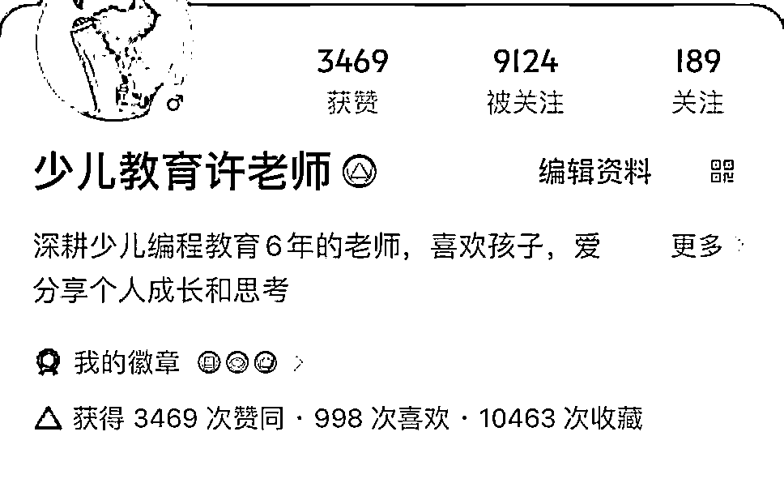

中间试过知乎好物，也想过做📕个人号，都没坚持。看到盗坤那篇帖子时很振奋：普通人零门槛、竞争不算挤、变现路径短，简直像给我准备的。评论区还补充了不少关键点。我人在北京，旁边就是新发地，先调研再跑市场，动起来再说。

## 调研：先找到能抄的样板

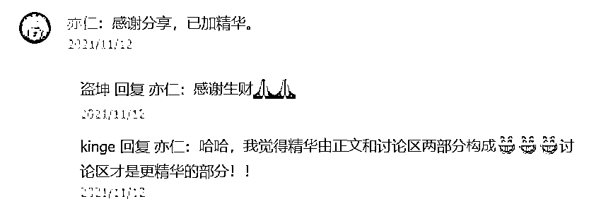

我在📕搜“新发地”“批发市场”“草莓”“车厘子”等词，发现不少卖水果账号粉丝不多，帖子互动却很好，评论区一水儿问“怎么买”“求团购群”。这说明两件事：需求旺，平台导流到私域可行。

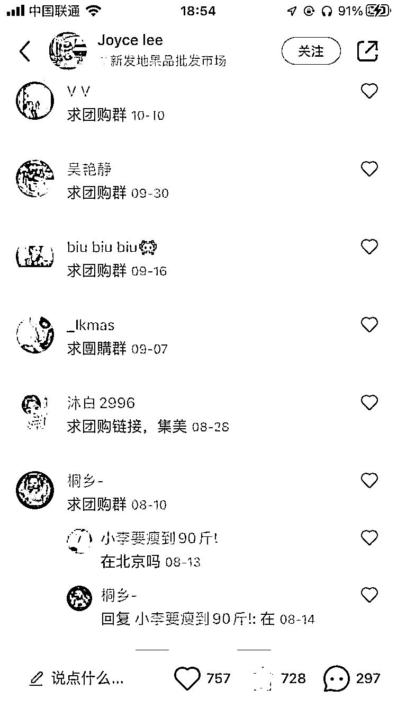

看到留🛰️号的就加。后来加到一个从2020年4月（新发地疫情之后）开始做的卖家，她几乎天天开团，每期稳定一百单以上；按客单百元估，月流水二三十万。她的私域只有三千人左右，却撑起这个量。有人已经跑通，项目可信度更高，我也有了照抄的对象。

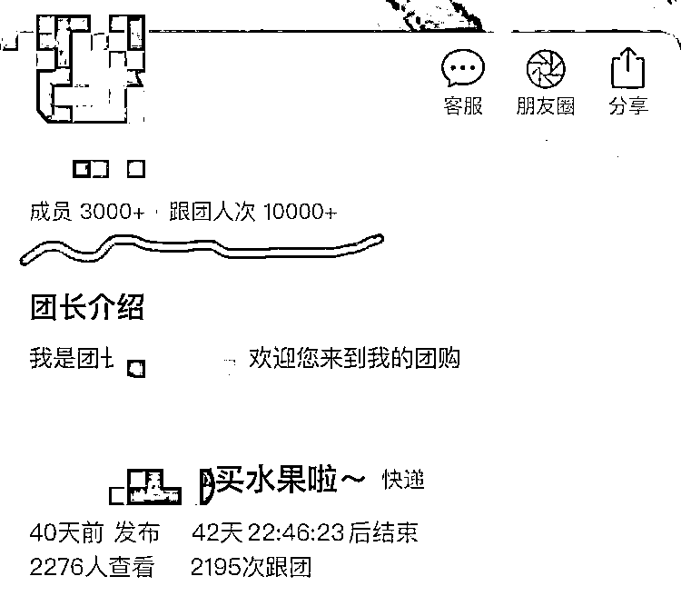

线上看的同时，我往新发地跑。11月中下旬丹东99红颜草莓刚上市，批发价每斤48元；水果店和抖音上普遍卖到80多元，中间有利润。草莓娇气，网购损耗大，水果店又贵，📕上求购声不少，天然适合做批发市场团购。调研一周后，我决定从草莓开刀。

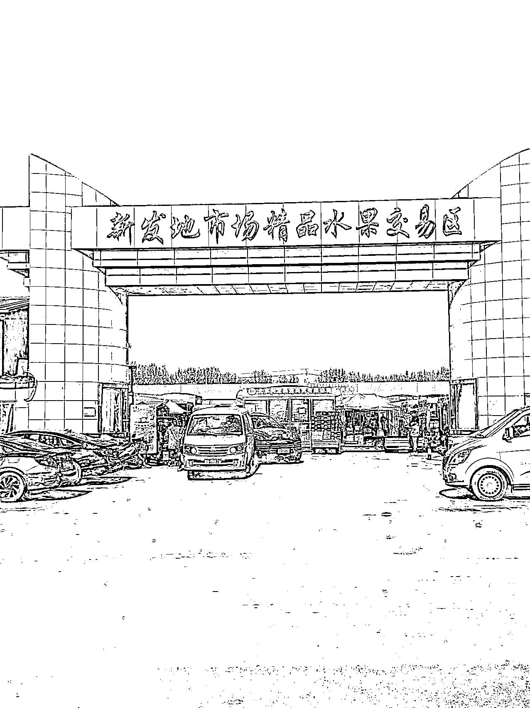

这一轮让我确认：方向成立、有对标、有具体单品。

## 起步：先解决流量

真开干，第一关是客人从哪来。原帖讨论说得很明白：朋友邻居那点流量不够，必须从外部引。我放弃社区宣传；不会剪视频，主业也没空直播，抖音排除。调研时看到📕问水果的人多，就选它做导流阵地。

发帖、立人设、起标题、找对标、做爆款，社区精华帖我基本刷过，然后每天泡在平台里模仿着发。到现在仍属入门，不敢装懂。

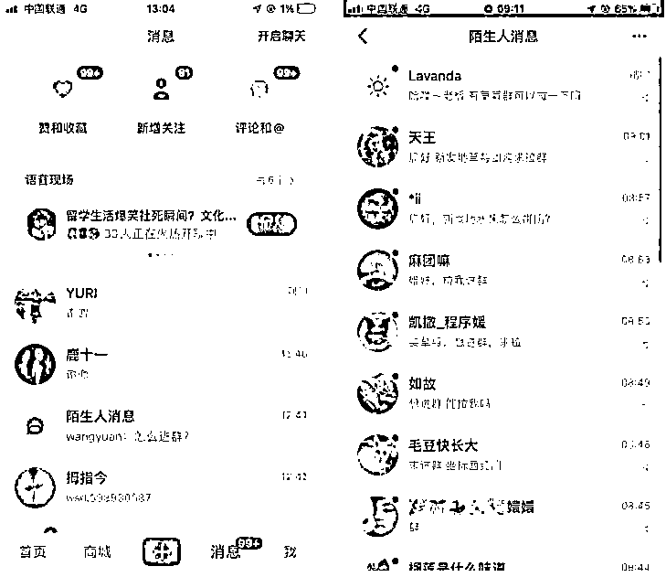

运气不错，第三篇帖子拿到一万观看、第一次99+，前后加了两三百🛰️，第一个群建起来。那篇写得很直白：我要去新发地团草莓，想跟就上车。因此来的人很精准，全是想买草莓的。

有群就开团。评论区的高招我用了：把水果尽量做成标品，别让顾客挑。首团只卖2斤装丹东99红颜草莓，定价120元（进价48元一斤）。结果五十单，浏览到下单约两成，流水七千，毛利一千。当时很兴奋，流量到成交总算走通一段。

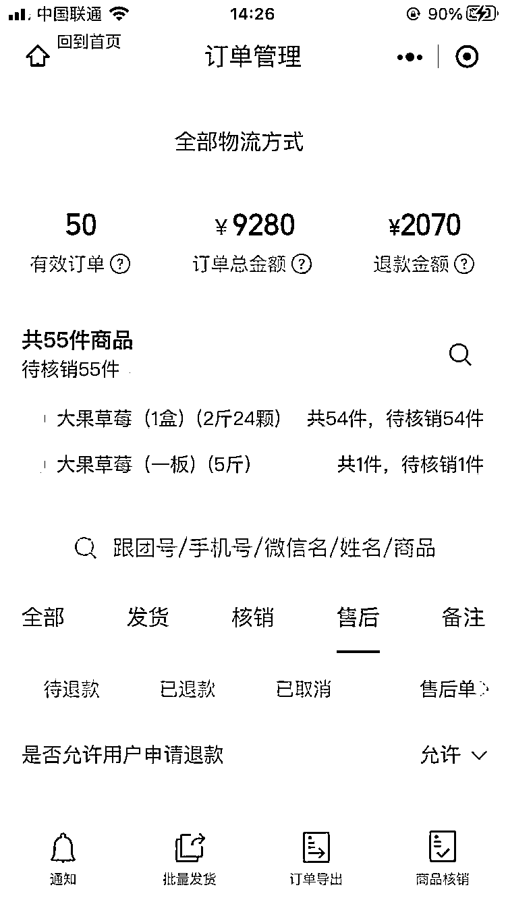

团完发完，麻烦紧跟着来：售后。草莓太嫩，快递一折腾就磕碰；有人按净重两斤来量，说缺斤短两要补差（批发市场按毛重两斤，我们没提前说明）；还有整盒被摔烂的。想着做回头客，该赔都赔，最后一千毛利赔掉一半。第一次真切感到水果不好做。

副业就这么转起来：每周开一两次草莓团，隔天去市场发货。首月卖出三百多盒，流水四万，利润七千左右；私域四五百人，团购工具转化稳定在一成上下。

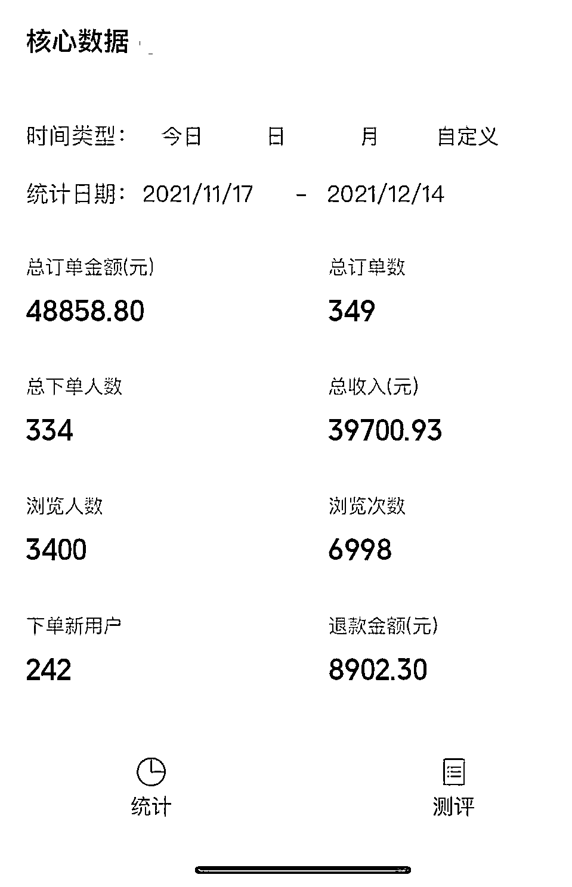

几次之后，顾客问有没有蓝莓、车厘子。我们对新发地还生，什么季节有什么、怎么和批发商谈，全无经验；批发商看我们面生又外行，报价贴近零售，新品类迟迟上不了。品类单薄，老客开始走。

更倒霉的是，我在私信里直接问顾客🛰️号，可能触发平台审核，也可能被同行举报，📕账号被限流一个月。十二月中到一月底，老客留不住、新客进不来，流水只有一万多，几乎没利润，转化也掉，我那阵子真想收手。

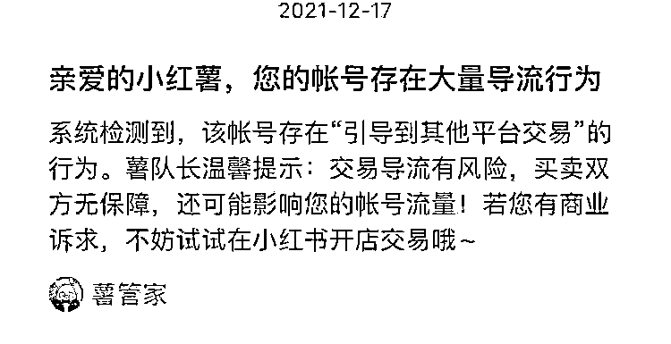
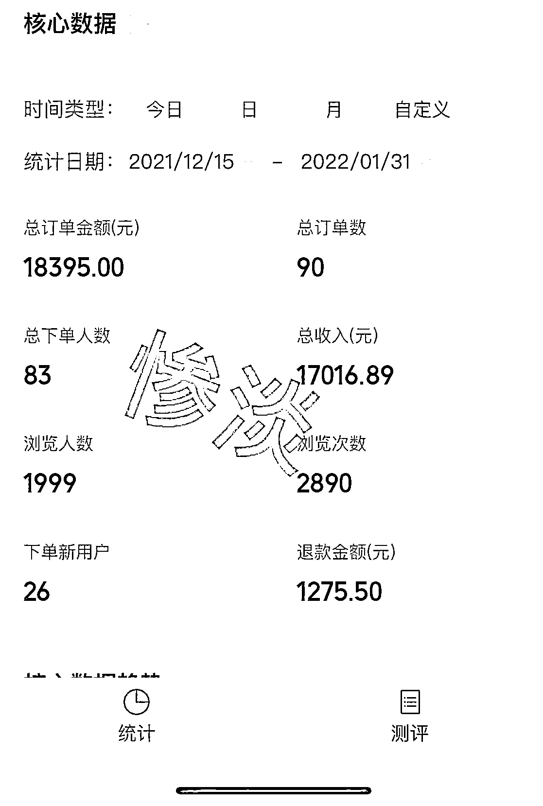

## 调整：把供应链和流量补齐

过年时冷静想：手上没别的项目，这个也没整明白；一遇波折就换，以后还会卡在同一处。于是决定补两块短板——后端货源太少、品类太单；前端需要源源不断的新客。

货源怎么补？我研究同行团购页上架的品，倒推他们从哪拿货，再带着目标去市场找对应商家。同行敢上，说明那家供货商认社区团购这种模式。这样找货不再乱撞，而是拿着品去问怎么供。打交道时我摸到一句管用的话：直接问老板“你们团长下单的链接有吗？”听懂的就知道我是来拿货的，会拉群发链接；没链接但供货的，也能进群。省了很多解释，不会被当散客。密集跑了一个月，同行有的品我们基本能对上。当然也遇到坑供货商，后面说避坑。

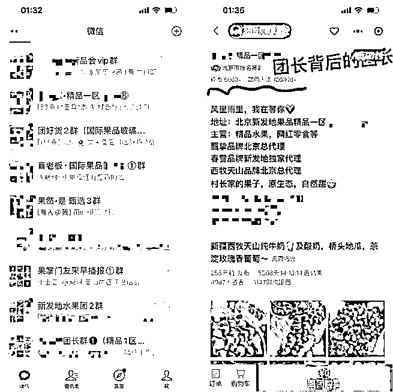

流量端也改。私信留号被限流，就改为把联系方式放主页。我用置顶笔记挂🛰️号，从一月用到六月；中间被关过几次七天，影响有限；后来置顶帖被判违规隐藏，这条路又断。安全导流我还在摸索，这次参加📕航海，里面列了十一种思路，我会继续试。说到底是在和平台打游击，方法得常换。

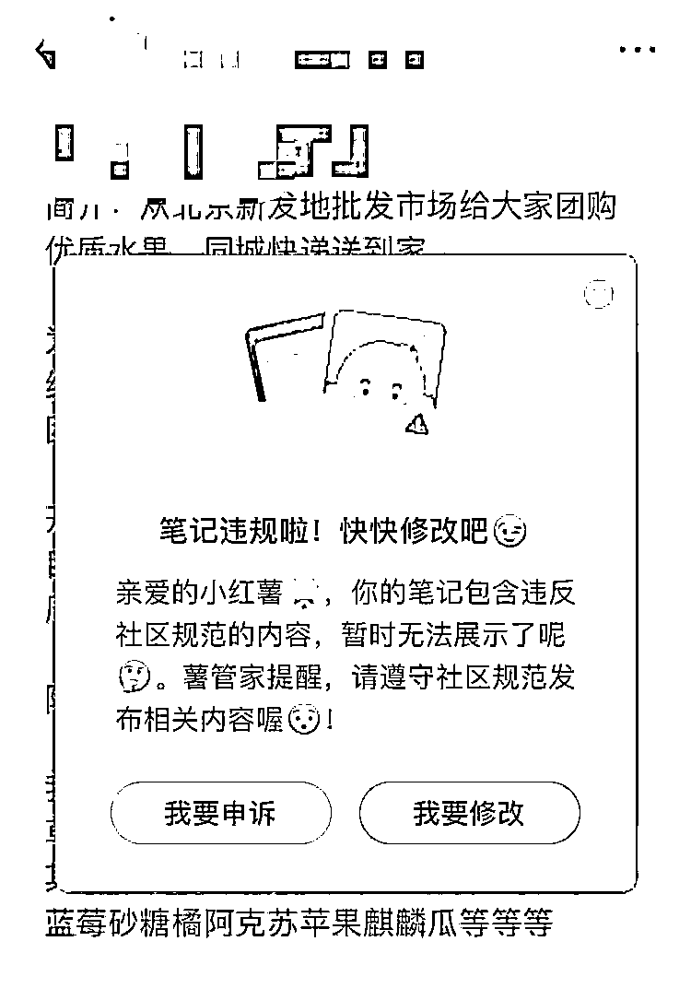

引流稳一点后，就是发帖拿更多曝光。我的笔记质量一般，走直给路线：告诉大家我从新发地团水果。数据最好的一篇一万多浏览、几百互动；十几篇累计浏览约五万，往私域导了一千五百人，加上原有共两千左右。因为定价实在、售后靠谱，复购不错，五月流水冲到十六万。📕的客人目的很明确，就是来买水果；消费力也比我想的好。

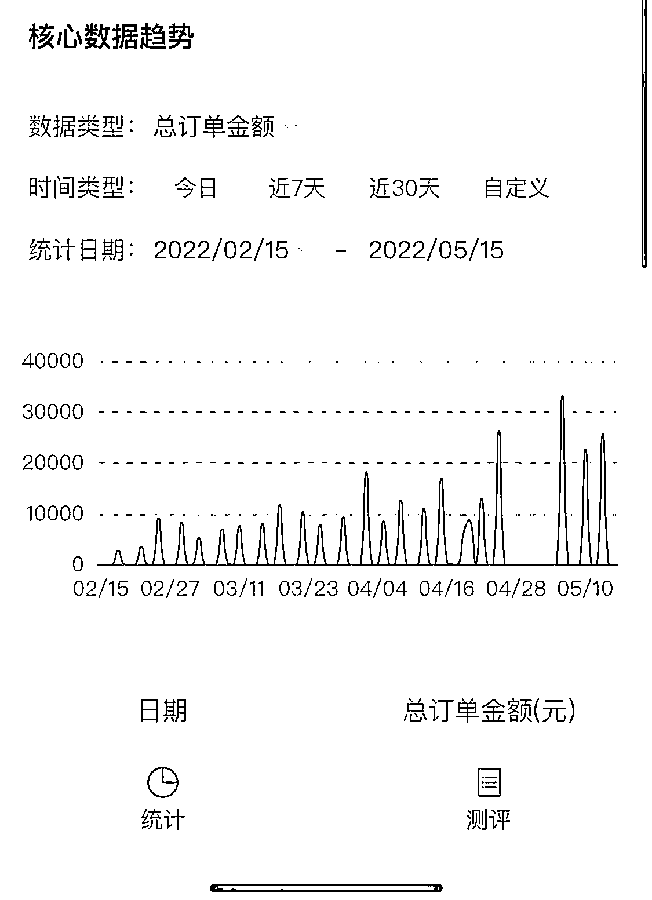

我的平台运营仍很初阶，精华帖看了不少，看帖不等于会做，还得实战。这里只强调一点：持续发，按反馈调方向，会有突破；若没有，把精华帖再看一遍照着做。另外，我算是稀里糊涂拿到一些同城精准流量，帖子质量不高却有人加，说明路子有对的地方。我的判断是：还没怎么发力就有成效，方向大概率对；已经做得很好却不来客，可能方向本身有问题。

## 转化：轻运营，重选品和交付

流量和货源理顺后，中间转化反而花精力最少。副业时间有限，大头在流量、选品、交付。我们在转化上只做几件事：每次开团，先在群里造出有人跟的气氛，第二天引导买家晒图、写好评，平时朋友圈发新品、自己吃着好的水果、客户反馈。这些加起来不到总精力5%。现阶段我认为不该做太重：选品差、质量松、售后烂，顾客买一次就走，运营再花哨也留不住。还有一条：盯住一个强竞品，把她的细节抄到位——几点开团、群里发什么、朋友圈怎么发、选什么品、走什么快递、怎么包装。我们先自己瞎试，后来发现竞品那套就是答案，绕一圈又回到她的动作。起盘关键就两点：会找流量，能做好交付。售后率低、水果好、交付稳，复购自然来；有的顾客第一次不下单，看大家反复买，也会慢慢信任。现在转化约一成，还有空间，但先继续磨交付。

## 交付：最重也最烧钱的环节

水果团购和很多轻项目不同。别的项目搞定流量和转化基本就跑通；这个后端极重，累且难标准化，处处有坑。日常要跑市场、找货源、盯行情、选品、处理售后，琐碎得很，但正是这些决定顾客回不回来。水果复购高，把老客守住比拉一个新客重要；老客维护得好，几千私域也能过得不错。行业毛利看着高，损耗和售后是黑洞。损耗方面，有库存就有损耗，所以我们坚持预订：顾客先下单，再去批发商那里订货。这也让价格能低过水果店——省了店租和库存损耗两个大头。我们只发整箱，不拆零；会劝退一些消耗量小的顾客，但发货流程轻，也少零头损耗。坏果率目前很低，重点讲售后。

### 第一类：拿到烂货

最致命的是拿货时品质就不行。市场里常讲：只要价格够低，再差的货也能出手。比如怡科莓蓝莓限量版，平时零售三四十一盒，正常一箱12盒约240元（3到5月），有的大团长供货价150元。听着像捡漏，其实货往往放久了，部分发霉；低价收回去，工人挑掉霉果，把好的重新拼箱当好货卖。外表难看出，顾客吃时才发现硬度差、新鲜度不够。新团长辨不出，低价拿回去，注重品质的客户就来售后；即使赔到位，人大概率也走了，因为没达到她的标准。

还有一种是水果已到临坏边缘，批发商低价甩。整箱封着，拿货只能抽检；恰好抽到好箱就发走，常温快递一路折腾，到顾客手里全烂。我们遇到一两次，售后全赔，口碑也伤。怎么避？第一，熟行情，对异常低价保持警惕；品质相近的货，几个大团长报价通常差不出5%，明显低就绕开。第二，出过烂货的供货商坚决换掉。出一次往往还有下次；我们售后最密的几次都栽在同一家。她品类全、价格低，是初期重要渠道，我第一次没下决心换，后面又出事。手里要有替代货源，换人才不犹豫；平时看售后态度，爱推诿的也要留心。第三，当面验货。再熟也要开箱看，樱桃、蓝莓这类每天新到，新鲜度必须现场确认；货不好宁可不拿、退款给顾客，也别发。磨合久了，供货商知道你要什么标准。

### 第二类：运损

第二类售后是发出时好的，顾客收到时坏了。做同城快递的才会遇到，社区自提没这问题。生鲜快递还比较初级，没有冷链，搬运也难保证轻拿轻放。草莓、蓝莓、桃子、葡萄都娇气，磕碰、晃动、延迟都会造成损伤甚至腐烂。所以选品时就要判断：适不适合快递？包装能不能改到能扛？不行就别上。否则顾客收到烂果，成本多半自己扛——快递只看外箱破没破，里面稀碎常常拒赔。别抱侥幸，你就想象快递员一路乱扔，再问自己的包装扛不扛得住。

还是说怡科莓蓝莓。它原包装不适合快递，我们前期只在外面加纸壳就发，没出大问题。

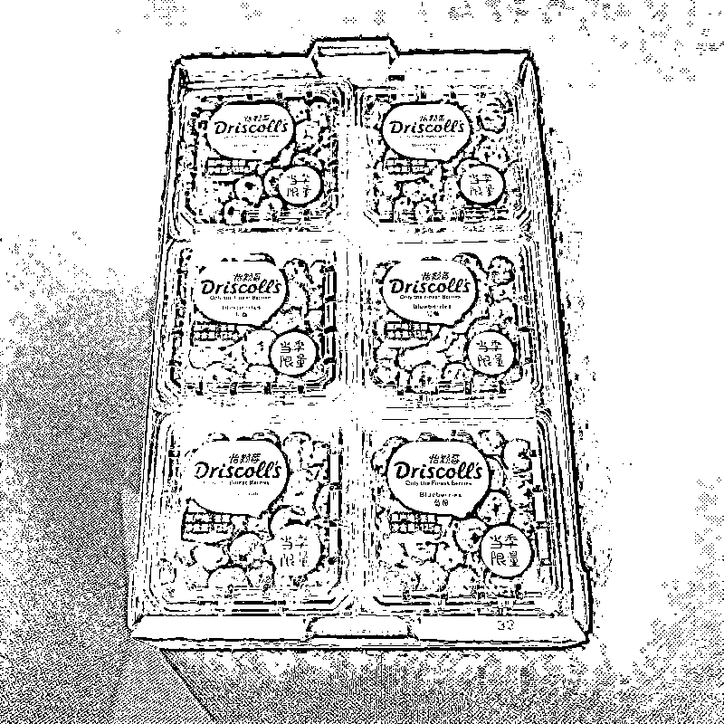

有一次做活动，正赶上北京疫情、快递爆单。包装不到位，发出去60箱，最后35盒不同程度损伤，有的全烂，有的烂两三盒。那回售后赔了三千多，利润全搭进去，口碑和信心也受打击，情绪差点崩。一天三十多人来找售后，语气都不会好，很考验心态。解法不复杂：每小盒蓝莓垫海绵，别让它晃；再把12小盒从原包装取出，装进泡沫箱发。拿货时就要想好怎么发，要么水果本身耐运，要么改包装，否则宁可不卖。

### 第三类：缺货发不出

我们做预订，顾客先付钱再订货，缺货很难完全避免。批发商走货快，上午有下午没；有的同时供很多团长，库存管理粗，容易超卖。谁先订谁拿，后来者退款；批发商稳了，团长却要解释为什么没货、再安排退款。这个问题我们还没彻底解决，只能做几件事：开团前再跟供货商核库存，优先上库存足的品；团购页写明个别缺货默认退款，让顾客有预期；缺货量大就下次补发，并补一次运费，顾客下次跟团能省点，心里也舒服些。

以上是我从0到1的全过程，以及交付里最该防的坑。后面有新进展，我再来更新。

有一种情况其实算不上售后，但很值得单独提一下，那就是快递时效。

现在很多做同城水果的商家，中午十二点之前把货装上车，北京五环以内的客户当天就能收到，水果状态自然更好；一旦过了这个点，就只能等第二天。这里面的差别，直接决定了客户收到的水果新不新鲜，也决定了一个售后单要不要出现。

所以，我特别想提醒还没理顺发货流程的朋友：流量别急着放大，更别盼着什么一夜爆单。爆单听起来爽，可后端发货跟不上，随之而来的就是一堆售后问题。你能稳定在时效内发出去50单，就先把流量匹配到这个量级；等一天能处理100单了，再往更大流量池里冲。

前面絮絮叨叨说了这么多，核心其实是一个词：交付。现在大家买水果的渠道实在太多了，如果你的交付环节总出问题——今天烂货、明天运损、后天缺货，那你价格再有优势也没用，客户照样留不住。流量来了接不住，再大的数字都是虚的。

换句话说，这个项目的交付环节很重，我才会花这么大力气来写。决定做之前，一定要想清楚：你能不能承受这些琐碎，能不能把售后当日常。

【总结】

先把项目整体盘一下，也说说我自己的纠结。

从我的实际感受看，这个项目比较适合在一二线城市做。为什么？因为真正能拉开价差的基本都是精品水果，也只有这类产品，才有批发市场团购的土壤。客户找你，要么是想用更便宜的价格买到同样的水果，要么是想买到水果店里没有的品种，说到底都逃不开精品水果的消费逻辑。

再看项目本身的特点：水果属于日常刚需，购买频率高，复购意愿强，客户决策成本又低，你只要服务做好，现有流量就能持续变成销售额，不太需要天天焦虑找新客。这是它的好处。坏处也很明显——利润低，交付重，特别消耗精力。想让大家体验好，选品、包装、快递、售后每个环节都不能放松，还得有一颗特别能扛事的心。再叠加门槛极低，人人都能进场，规模化反而更难。

顺带说说两种模式相近的玩法。

一个是社区团购。同样去批发市场拿货，但客户自己去小区自提，相当于省掉了快递运损，也不用考虑怎么打包发货，交付轻松很多，能上的水果种类也更多，还可以快速扩展蔬菜、海鲜、零食等品类。不过它服务范围有限，一般只能覆盖周边几个小区，扩张性比较差。批发市场里其实很多团长都是这么干的，像我们一样做同城快递的反而少见。

另一个是一件代发。要么找产地一件代发，要么给大团长做帮卖团长，你要做的只有引流和转化，发货售后都交给批发老板或产地。优缺点是反过来的：交付很轻，不太占精力；但利润被压得更低，对后端也没太多把控力，踩坑几乎是概率问题。

接下来说说我的困惑。

做这个项目时，很多瞬间都挺难受的。交付太重，不断侵占主业精力，还要每天处理售后，讲真，幸福感很低。也是因为这个，我特别理解水果行业的人有多不容易。上次我在评论区说拿这个项目练手，盗坤老师直接回复：练得差不多就尽早换，太累了。这句话让我一直很纠结。

作为副业，我的真实体感是：只能让项目勉强跑起来，很难再有精力去把它放大。比如，我能不能做📕矩阵号，大规模获取同城流量？能不能把渠道扩展到视频号、抖音直播？如果流量真起来了，后端怎么承接，而不是停留在一次只能发100单？货源那边还有没有压价空间？私域能不能做得更精细，把转化率从10%推到20%以上？这些想法我都有，但就是没有精力落地。

但要说现在放弃主业全职做，我又有点不敢。一方面，主业收入尚可；另一方面，这个项目门槛太低，我的差异化优势到底在哪？能不能做到十倍体量？都存在很大的不确定性。想着主业也没什么增长空间了，可万一这个项目到头来收入只跟主业差不多，辛苦程度却高出好几倍，那就真是得不偿失。

我把这些写出来，一是遵循赚钱“真诚利他”的原则，二是真的想听听大家的建议。它未来有没有规模化的可能，比如做到一个月100万营业额？下一步我该往哪个方向使劲？什么情况下才适合全职投入？如果想做大，需要攻克哪些关卡？还是说它只适合当练手项目，长期看并不是好选择？我是不是该换个更轻的模式，比如一件代发；或者试一些其他项目，比如在📕上带标准化产品，而不是水果这种非标品？

这些天我就在两种状态中反复横跳。一会儿觉得放大十倍比上班强太多，一会儿又觉得这么累门槛又这么低，是不是该早点换项目。就像盗坤老师当年那篇帖子一样，希望评论区也能像正文一样精彩。

谢谢大家看到这里。

————————————————

补充一段最新进展：帖子写于六月中旬，所以正文里主要放了截至五月的营业额，现在把六七月的情况更新一下。

六月北京疫情反复，天堂酒吧那波传播链里，我所在公司有一例确诊，我作为密接被隔离了14天，根本没法去市场选品发货，副业半个月没开张，当月营业额只有五万多。好在这是近乎零成本的副业，不然在家干坐半个月，心态早就崩了。

七月又迎来水果行业最难熬的淡季。批发老板说，从六月底到九月中旬前基本都属于淡季，天气热、水果易坏，大家都不敢多进货。而且夏天的水果种类非常单一，基本就是瓜和桃。蓝莓、草莓、樱桃以及各种进口水果几乎消失，大家整天吃瓜，西瓜才几块钱一斤，自然没什么预算买其他水果了。

所以我们营业额降得很明显。之前开团平均一次能有100单，现在只有四五十单，月营业额跌到六万左右。我翻了翻同行的快团团链接，也找快递小哥聊了聊，大家的单量普遍都在下滑。据说新发地直播基地以前一天三五千单，现在只剩一两千单；一个做得好的同行，从原来的一天1000单掉到500多单。

这两个多月只能靠熬。淡季你不在，旺季赚钱就没你的份。把这个信息补进来，是想让大家看到一个更完整的样本：这个副业的营业额并不是一路上涨。也想提醒后面想入场的朋友，现在这个时间点可能不太友好。一上来可能没有正反馈，也找不到一个好启动的品类。除非你敢碰榴莲——但我劝你别碰，太容易亏。反而是去年冬天那个节点，我误打误撞赶上了草莓，项目起步时机还算不错。

评论区：

评论区里，万里说“很真实的经历”；高建中问发货是自己拖回家发，还是批发商代发？我目前答复是在批发市场直接发，所以模式比较重。石头头表示想加🛰️交流。

关于是否要加大投入，龙哥的建议是：主要还得拿主业做参照，看副业能带来多大空间、多少机会。如果副业空间够大，有机会发展成主业，那可以适当多投入。我在这条回复下也说了自己的情况：主业教育行业已经没增长空间，但收入暂时还行，只能说有可能哪天被裁。水果副业目前的转化和复购都不错，只要流量做到一定规模，按现在的淡季行情，流量扩大五倍基本能和主业收入持平；等到了旺季，两三倍流量就够了。但我担心这个项目门槛低，非标属性又强，究竟能不能规模化，我心里没底。现在主业还不算太忙，所以能兼顾一下，但也只是维持，没有余力去扩大。

盗坤老师也给了看法：这个项目比较难放大，交付和售后太重。建议做到一定程度、有固定客源后，可以把它当成引流工具，再去做其他产品。他还提到以前做过社区团购，当时利润还行，因为有平台供货；后来美团这些平台进场，客单价被压得很低，都是一斤两斤地卖，累人利润又低，就不做了。一件代发也做过，靠平台供货，但价格比较高，在三四线城市不好卖。

另一位做食品行业的Tony说：水果这个品类复购率很高，只要好吃就会一直买。难点就在售后，得有一个很强的团队撑着，不然一个人处理售后真的会哭。