# 六号并进日加三百：小红书企业号矩阵选品、引流与变现全记录

大家好，我是Ben，去年加入生财。今年五月起，我同时运营六个小红书企业号，用一套几乎零门槛的内容复制方式，最多一天给微信端拉来了三百多位新好友。这套从公域往微信导流的方法，可套用在知识付费、实物电商、招商加盟、微商和实体店获客等场景，希望能给你启发。

核心逻辑其实只有两句：让企业号矩阵以极低代价批量产出优质内容，同时把私域里从触达到成交的路径压到最短。获客和转化这两段，你完全可以拆开来做。刚入场的新人，我建议先专注前端获客，后端直接找CPS合作方。

企业号矩阵的价值在于四件事：内容可复制、能放大；营销向内容不容易被打回；变现路径短；同时企业身份能增强信任、加强专业背书。

我按三条线讲：选择、执行、复盘。“选择”讲的是我为什么转投小红书；“执行”覆盖个人号到企业号再到矩阵号的完整放大过程；“复盘优化”会分享可复用的玩法和给新人的建议。

## 一、先介绍下我自己

### 1. 十年电商老兵，换赛道再出发

我2010年还在读大学时就碰了淘宝，从此一直待在电商行业。毕业后进了一家女装淘品牌公司，负责运营，公司一年广告投放上千万。2016年初，我以运营合伙人身份加入朋友的淘宝女装团队，花了三年，把年营业额从百万做到了亿级。

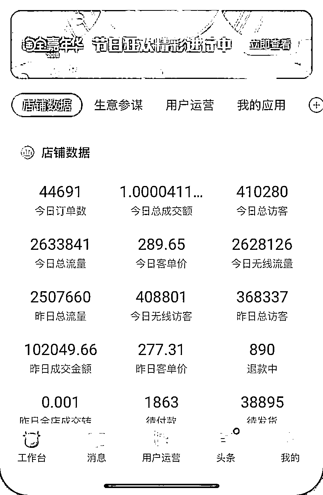

2020年初，一切被疫情按停，团队连618都没撑到就散了。我不死心，又开了一家淘宝店单干女装。后面的事说来都是泪，2021年前后做女装创业，基本是往火坑里跳。折腾半年，临近618又遇上广州疫情，全公司隔离了一个月。解封后我关掉公司，前后亏了70万。

再后来看好直播卖货，那时候流行凌晨起号。我组了小团队、租场地，每天凌晨1点开播2小时，下播后复盘，到家已经4点多。白天备货、想活动、磨话术、拍视频，晚上再去播。三个月折腾下来，销量一直不稳定，供应链也拖后腿，最后在年前散伙，又亏了20万。

这段时间我刷到了木易那篇神贴，进了生财。和很多圈友的反应一样，我整个人愣住了：原来有这么多小项目能赚钱。那阵子我每天刷精华帖，慢慢找到了方向。

### 2. 进了生财之后，一路试错

我是去年12月进的生财，每天从精华帖里挑项目。年后报名抖音IP大航海2.0，跟着要求打卡开播。手里既没项目也没产品，直播讲什么，确实困扰了一阵子。卖过专注力工具书赚佣金，也直播卖过生财日历，虽然都没做出什么成绩，但总算顺利下船了。

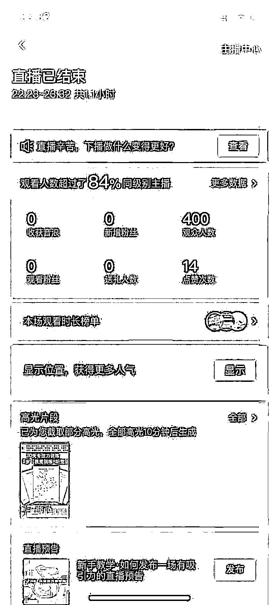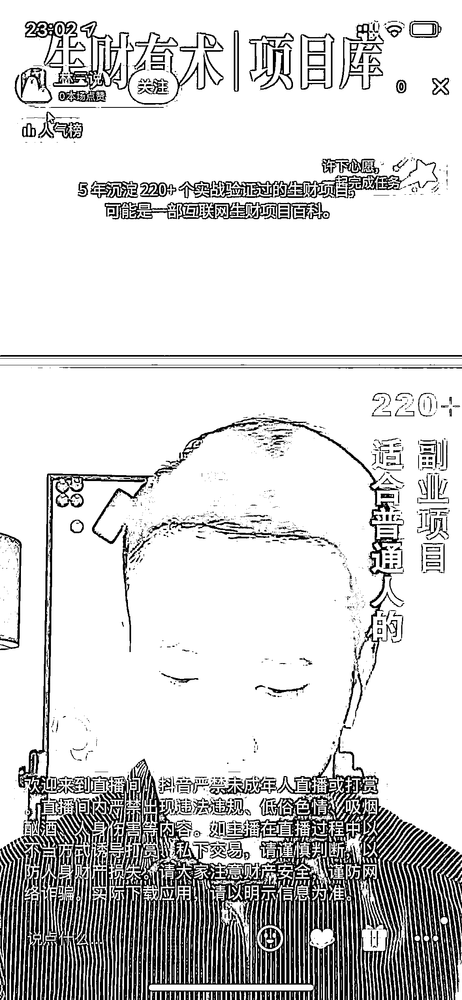

大航海期间，我刷到一篇讲小红书的帖子，正好那会儿也有小红书小航海，我就把相关文章全翻了一遍，从此开始每天研究小红书。

### 3. 抓住机会，专注放大

我先做了个小红书个人号，内容讲复盘。半个月涨粉一千多，感觉这个平台对新人还算友好。但复盘号没法变现，我转头想拿女鞋试带货。

观察了一圈，发现女鞋同行都在用企业号矩阵。我也注册了一个企业号，发了一周，阅读量只有几十到一百，完全没法跟我之前的知识号比。我反复测试，一周后女鞋号总算有了起色，每天私信几百条。

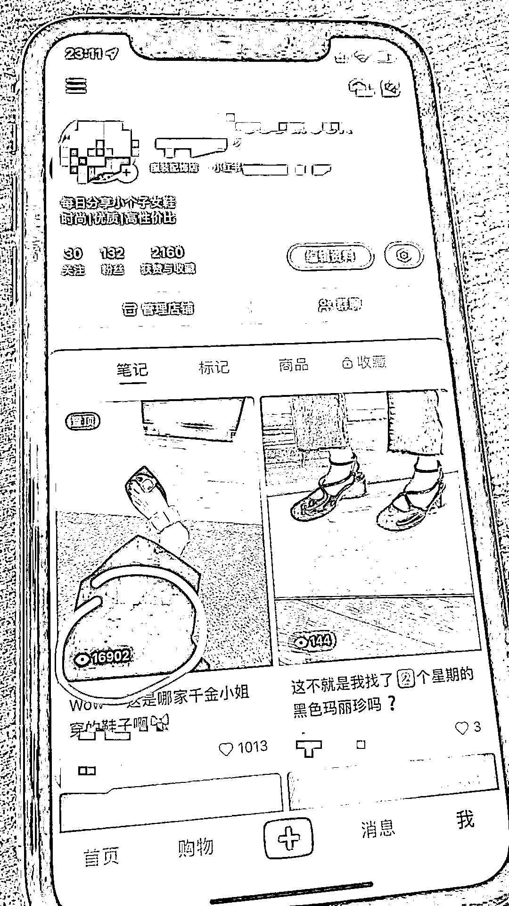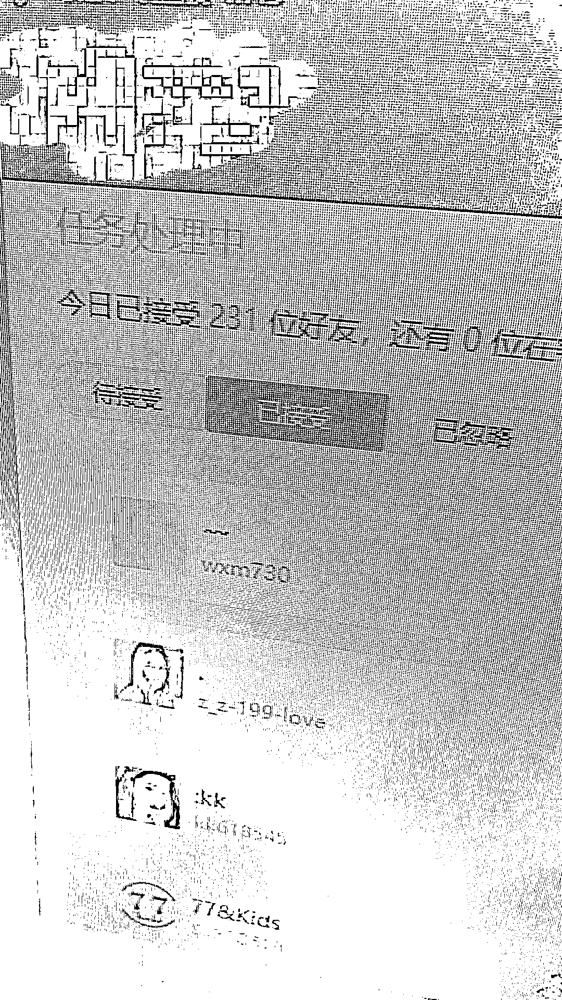

女鞋号每天至少更新五条，高峰时一天能收到四五百条私信，最终进入微信的约有三百人。私信流量太猛，账号被警告限流了7天。狂奔一个月，微信里累计加了一千五百多人。趁着限流空档，我链接了生财圈友，试着做知识付费导流。我负责前端拉人，圈友负责后端承接，买了6部手机就开干。

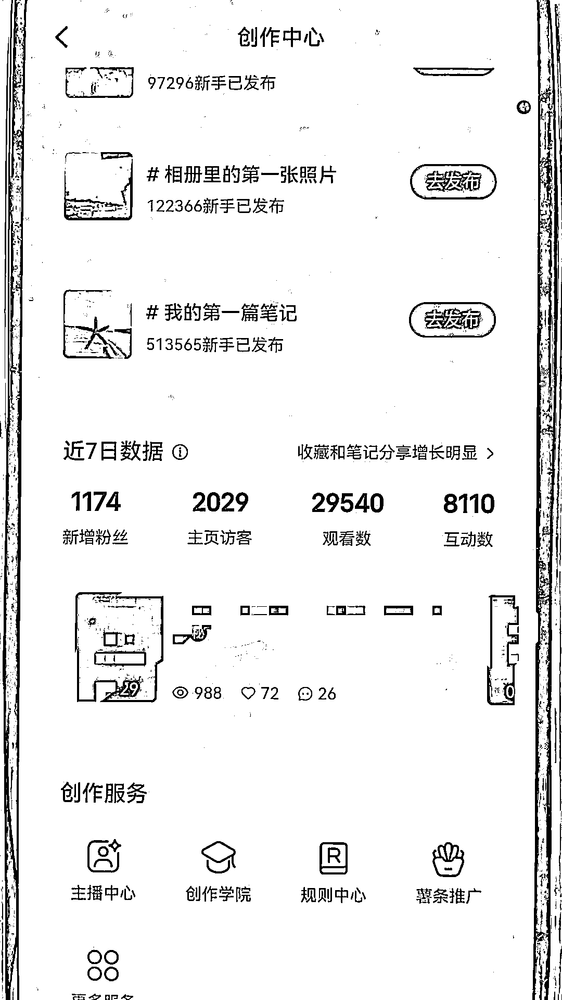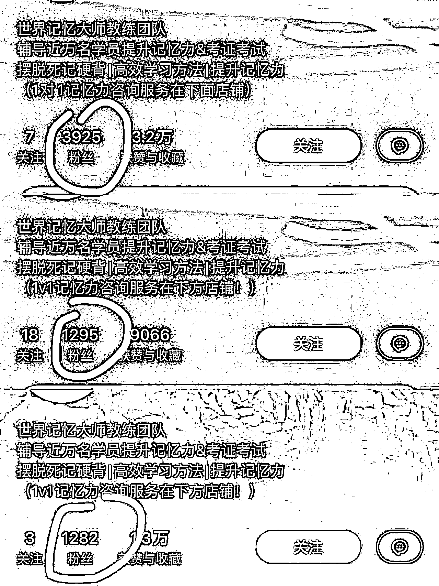

靠低成本内容、快速复制，再配一点轻度投放，总算跑通了闭环，最高一天加满三百个微信好友。稳定运行一个月后，我确认这套方法可以复用，所以今天把全流程公开，请各位老师指正。

## 二、如何挑选可变现内容：不懂业务也能做？

如果你想让知识付费业务获取新客户，学会下面几个方法就能上手，不需要真懂那门生意。

### 1. 判断行业的流量规模

选赛道前，先看这个行业在小红书的总体流量。第一步：确定行业关键词，不确定就多搜几个；第二步：在小红书搜这些词，看笔记总量，大概一万条以上的都能做；第三步：用千瓜、新红、蝉小红这类第三方工具，查关键词热度、单月笔记发布量，再看近一个月有没有爆文以及爆文赞数。如果有几千赞的爆文，说明这个关键词的流量不会差。

### 2. 找评论区热闹的内容

小红书上有大量高赞藏低评论的笔记，甚至几千赞却零评论。这说明什么？说明大家觉得内容有趣或有帮助，但也仅仅停留在“觉得”，并没真正戳中他们的痛点。带货型笔记的评论区画风完全不一样：“求链接”“求分享”“想了解”“求带”刷成一排，这些全是需求信号。这里的“货”不限于实物，一切付费产品和服务都算。

找高评论笔记，可以用小红书下载助手。把类目关键词的笔记导成Excel表，按点赞数和时间排序，逐个点开近期高赞笔记，挑评论多的记录下来。这种笔记评论区通常全是需求型评论，代表了很强的导流潜力，选题和内容方向值得反复研究。

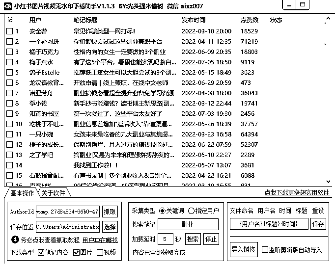

另一个办法是新红数据的豪华商务版，新注册可试用一天，淘宝闲鱼上约200元/月。激活后从左侧栏“流量分析-趋势查询”进入，输入类目词，查看最近每天评论数前三的笔记，点开看内容形式和评论类型，合适的记录下来。

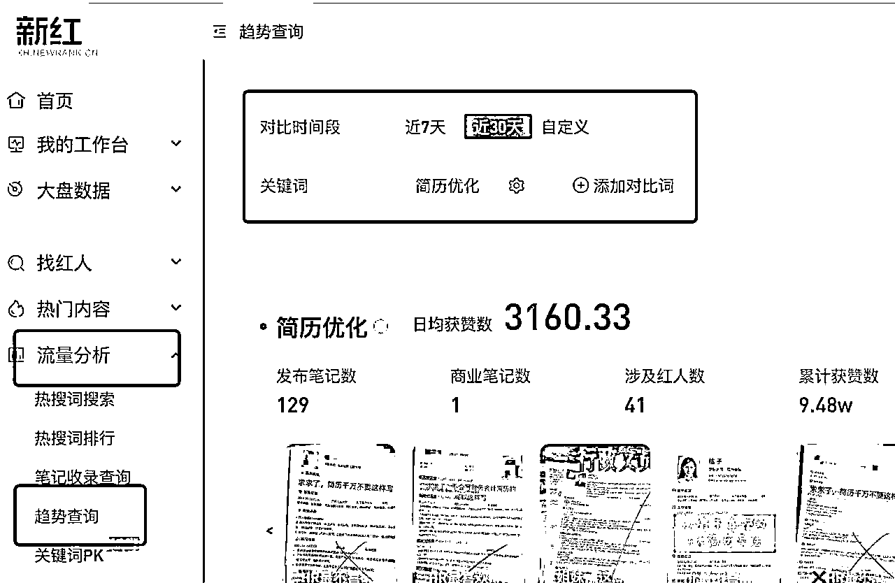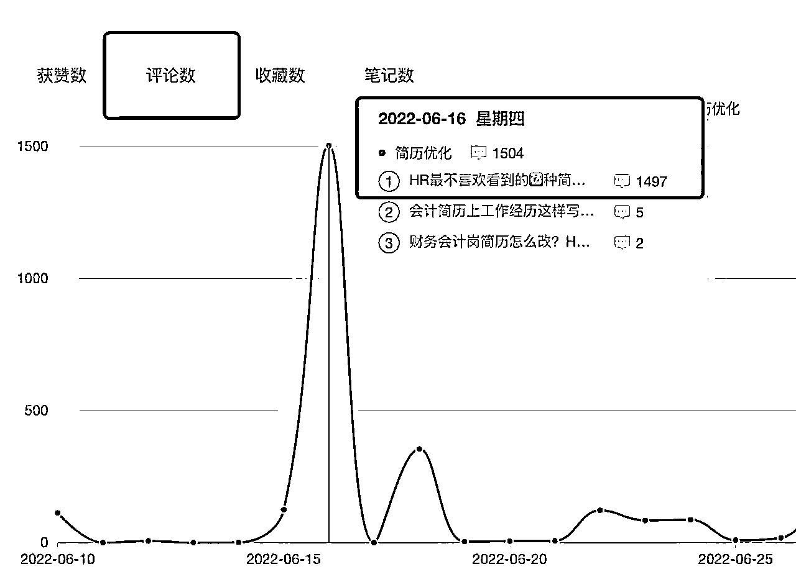

### 3. 没有业务？用交付外包找后端

如果手头没有产品也没有业务，可以找后端合作。先看身边有没有做卖货或知识付费的朋友，跟他谈：你负责导流，他负责转化和交付，按比例分成。前期多沟通，建立在互相信任的基础上。我更推荐和生财圈友合作，现在卖货卖课的人都缺流量，你可以挑感兴趣的类目，去生财资源区发帖找合作。先看他类目在小红书上的数据，再谈分润。前期主要成本是硬件——手机、个体户执照、手机卡、企业认证费，一个号约一千块。

## 三、矩阵号怎么批量搞流量

### 1. 低成本做内容：找参照、仿封面、攒标题

低成本做出优质内容，关键是找参照、模仿封面、收集爆文选题和标题，最后形成自己的素材库。

先说找封面模板。

方法一：在小红书搜类目关键词，多打几个词，切到“最热”再点“图文”，翻赞数高的笔记。找几个你能复刻的封面，时间越近越好，点进主页看这个博主是不是一直用同类封面。如果是，存下来当作一个参照样本，分配到一个企业号上测试。按同样方法给其他号找模板。如果类目词比较冷门，最热Tab里数据很差，可以换相近行业的词来找，类似行业的爆文封面照样有参考价值。

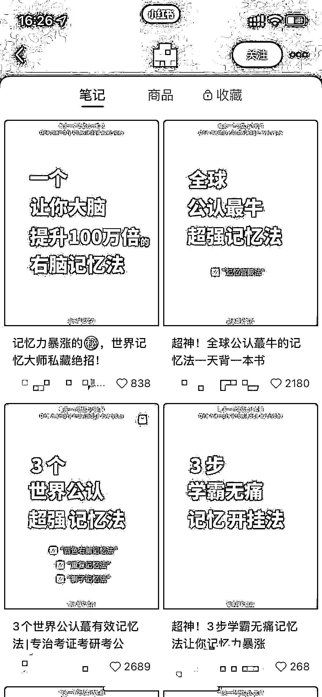

方法二：还是用小红书下载助手，导出类目关键词的笔记表，按点赞数和时间排序，选近期高赞笔记，打开链接收集封面，再按前面的方法建立参照样本。

方法三：在小红书搜类目词，切到“用户”Tab，只看粉丝多的企业号。进主页看看封面有没有固定风格，如果看不出来，就专看高赞笔记，只要好几篇高赞封面类似，就可以借鉴。

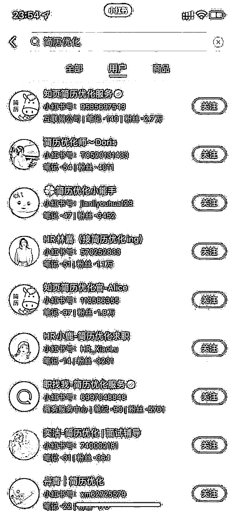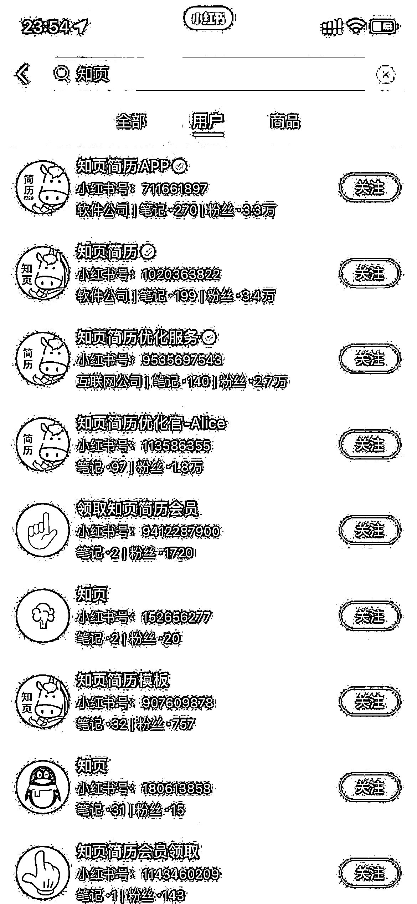

然后是收集爆文选题和标题。方法还是上面找高评论笔记那一套，把爆文选题和标题整理成库，随时调用。

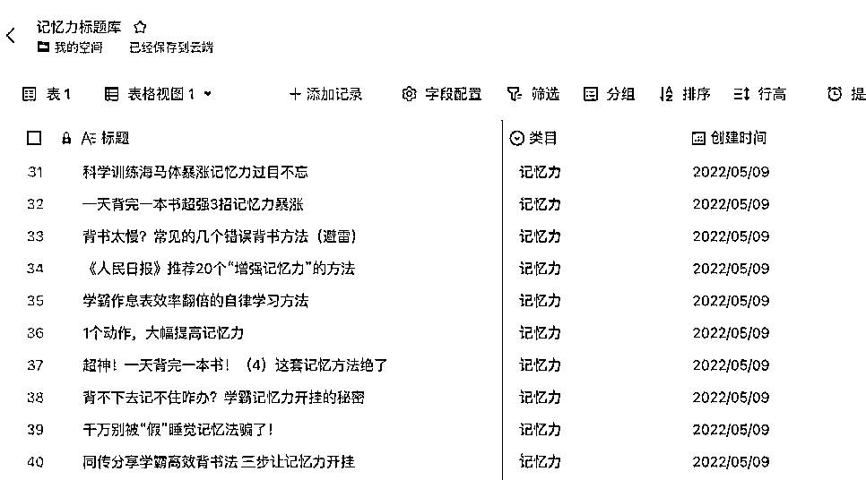

（标题库）

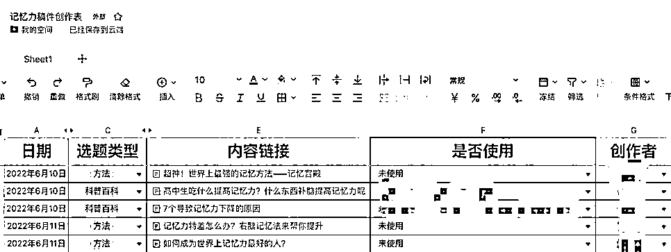

（选题创作表）

### 2. 矩阵式复制，提高爆文概率

建议一开始就注册3个企业号。给1号定好封面模板后，按同法给2号3号各找各的模板，同一个选题可以三个号共用。每个号单独做主图和标题，平台对图片查重管得没那么严，标题和正文微调一下就没问题。等于一个内容发三份，矩阵成本极低，爆文概率却高了不少。

务必做到每台手机配独立SIM卡和网络环境，切断账号间的关联。一旦有一个号违规，别让其他号跟着陪葬。矩阵号之间也别互相点赞，尽量物理隔离。

### 3. 怼量，大力出奇迹

等所有号都换上爆文封面模板，用近期爆文选题做图，从标题库取词写标题，这条笔记的基础数据通常不会太难看，是有爆文潜质的。接下来就是坚持发：一天2到3条，不出几天大概率有一个号跑出爆文，导流数据自然不差。

这个阶段，就是把前两步固化下来，每天铺量、不断更，然后根据每篇笔记的反馈去微调封面和内容。也可以在原有封面上吸收其他优秀封面的优点，再结合数据表现和平台近期热点更新选题。

企业号起号是有成功率的，同行经验大概50%，供参考。不用强求每个号都出成绩，3个号里有1个能打就很好了。表现好的号重点维护，每天多发内容；表现差的保持更新慢慢优化。一两个月还起不来，就注销重新注册，进入下一轮测试。企业号矩阵的常态就是不断起号、测试、注销、再来，把成功账号一点点沉淀下来。只要起号流程跑得通，新号源源不断，就不用怕违规封号和数据波动。

## 四、怎么把小红书流量导到微信

### 1. 笔记里学会留钩子

方法一：图文里埋钩子。用小红书下载助手找高评论笔记，看看同行们用什么钩子。针对目标人群的痛点设置诱饵，让用户主动来联系你的，就是好钩子。钩子的任务只是把人引过来，能不能成交要看私域本事。所以，先想清楚什么样的钩子能让目标用户忍不住找你。比如我是记忆力培训老师，产品是记忆力课程，客户是想提升记忆力的人。那我分享记忆法干货，末尾留一个“加v无偿领记忆法资料”的钩子，想提升记忆力的人是不是就会加我？一份免费电子资料、一次免费咨询，都可以是钩子。

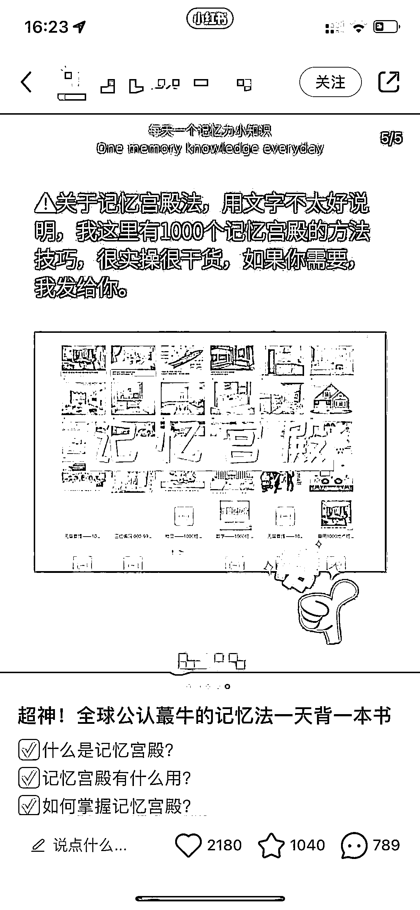

方法二：评论区留钩子。除了图片和正文，评论区照样能放钩子。分享干货后，在评论区置顶一条钩子评论，既能导流，又能给笔记和账号加权，提升曝光。这里得知道小红书算法评分体系CES：点赞、收藏都得1分，评论和转发得4分，关注得8分。想拉权重，关键是引导评论和关注，赞藏权重很低。所以在评论区号召“点赞+评论+关注”，权重收益最大。结合导流需求，可以让用户点赞关注后在评论区扣关键词，比如扣“求带”“想了”“求分享”。再安排几个水军带带节奏，后面的人就会跟着评论，评论区越热闹，笔记热度越高。比如：“👍+关㊗，底下扣1，發记忆法资料给你呀~”

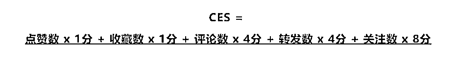

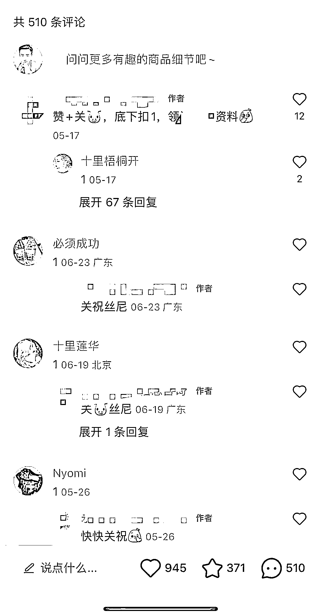

### 2. 几个安全有效的导流姿势

① 主页简介@小号，小号主页发带微的笔记；
② 评论区@小号，或者小号评论后大号置顶；
③ 评论区放群聊口令，引导大家进主页群聊，群聊里用小号发微；
④ 私信发乱码图片，别直接发账号，也别用字母缩写。

## 五、意向用户怎么变成成交用户：私域转化

### 1. 设计一遍完整的转化链路

适合个人或小团队的链路是：小红书公域——微信——直播快闪群——视频号直播——私聊催单——朋友圈运营——视频号直播。

① 先通过私信、群聊、主页、小号这些渠道把小红书用户引到微信。
② 用WeTool这类群控软件自动过好友申请，自动发欢迎语，询问简单信息，方便打标筛选。
③ 机器人客服引导用户进直播群拿钩子资料，群公告再引导预约视频号直播，写明直播主题和福利。
④ 开播当天群发一次直播时间和内容，提高预约率。
⑤ 用视频号直播做成交转化。它本质上接近私域直播，适合按会销思维设计SOP，比如：线上会销=锁客+谈判+气氛+流程+嘉宾+案例+数据+成交+福利，有会销经验的圈友欢迎交流。
⑥ 直播结束后，群发催单信息，问观看情况，没空看直播的预约下一场，群发后根据回应做一对一跟进。
⑦ 平时朋友圈发案例、金句、人设内容，顺带预告直播引流到新一期快闪群。如果是日播，可以不用快闪群，直接引导预约视频号直播。

这轮流程跑顺之后，前端导流和后端转化就形成了顺畅的循环。没成交的用户仍然留在你的微信里，只要不拉黑删除，就能持续触达，但频率要控制好。千万别对同一批人反复群发，容易被举报或系统判违规，搞到封号就得不偿失。

### 2. 微信接待：问需求、打标签

高客单知识付费的转化周期通常很长。除了反复触达，我在加好友时就用群控软件给用户打标签、改昵称。一般标注加好友时间，再根据聊天记录补上年龄性别、意向等级（A/B/C），后续群发或聊天就能用对应话术精准触达。

### 3. 快闪群拉高直播预约

视频号直播特别看重开播前预约，预约数据好，开播在线人数才有保障。所以要尽量把预约动作嵌入每个环节，替用户多想一步，点击率才高。两个小技巧：一、朋友圈和群聊话术都把“#视频号: xxxx”带上，方便一键点进主页预约；二、群发预约提醒时附上一张引导图片。

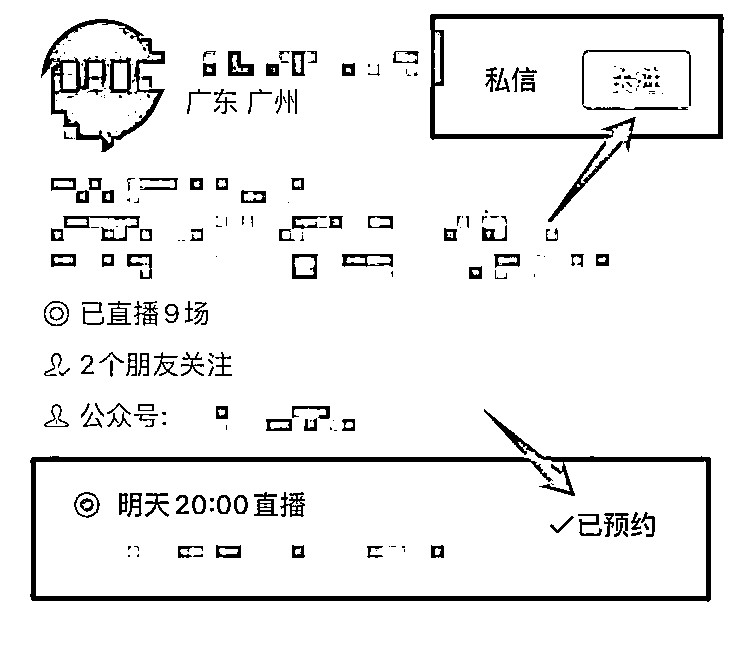

### 4. 变现产品的几个建议

① 高客单产品最好配一个低客单引流品，把交付做得超出预期，再低价转高价。比如99元短期训练营，加盟产品可以设低客单的一对一咨询。
② 价格梯度要不断往上试，找到利润最大化的档位。
③ 宣传物料别省：课程海报至少做两版，一版给朋友圈转发，一版做详细展示；多参考优秀同行，取长补短。还可以把老学员、老顾客发展成分销员，设计佣金机制和专属物料文案，让他们帮你扩大获客。

### 5. 知识付费与招商加盟：视频号直播收口

这套玩法的收口是视频号直播：先通过私域引流，用视频号直播承接转化，本质是私域直播。但它也能撬动公域流量——私域池够大，直播初始数据就好，系统就会推流，完成从私域直播到公域直播的跨越。我用“跨越”这个词，是因为视频号近期的商业化速度比预期快，背靠微信的流量池，体量不输抖音。一旦拿到系统推流，增长可能是指数级的。所以我们始于私域引流，终于公域放大。

## 六、新人入局的门槛与建议

新手入局，第一要务是别跟单个账号死磕，营销类内容直接走企业号路径。这套方法启动成本很低、上升空间却很大，方法论也没什么深奥之处，真正决定结果的是执行力和资源整合能力。想清楚就可以动手了。

# 小红书引流，优先企业号矩阵

做小红书私域，账号类型别选错：个人号引流限制更多、违规风险更高，还要花时间养号，起号成功率大概只有三成。更稳妥的做法，是一开始就用企业号。

开局不妨直接搭企业号小矩阵：一张营业执照开出3个企业号，三号同步更新，先把营销笔记的整体流量做上去。接着持续试选题、试封面，跑出首篇爆款为止。

**2. 第一个粉丝，就是变现起点**

不少人做个人号时会掉进一个坑：总想先涨粉，等粉丝多了再引流成交。现实常常是，粉丝涨了不少，单篇赞藏也漂亮，私信却没人发，评论也寥寥，私域变现更无从谈起。

账号既然以变现为目标，第一个粉丝到来时，变现设计就该同步启动。小红书上的粉丝数量本身不等于价值，能沉淀到私域的粉丝才更值钱。注册账号、发出第一篇笔记之前，就得规划好：用什么内容吸引目标用户，又如何把他们带到私域。只有进了私域，变现才有可能。

**3. 用矩阵放大流量，能复制就复制**

某个账号的内容数据跑起来后，就该考虑把它复制到更多账号。底层逻辑可复用，呈现方式可变化。比如同一爆款选题，换一种图片表达、换一个标题，再次跑出爆款的概率依然不低。所以，把验证过的内容模板沉淀下来，再以矩阵方式批量分发优质笔记抢流量，效率会明显更高。

**4. 多连接多交流，懂引流就不缺货，生财是资源池**

选项目、选业务当然重要，但真正能让人在变化的市场里找到机会和突破口的，是方法和思维。所以别被“没有项目、没有产品”困住。只要你会引流，或者具备掌握新技能的能力，很多资源都能为你所用。生财有术聚集了各行各业优秀的创业者和实干家，还担心找不到合作资源吗？把你能够提供的服务、技能真诚表达出来，自然会有需要的人来找你。利他思维放在哪里都适用：先真诚付出、先帮到别人，好运气也会随之而来。

**七、最后想说**

围绕小红书企业号矩阵，我还设想过别的玩法，比如：①用RPA把内容生产到网页端自动发布；②最近也在测试小红书的投流玩法。

感谢一路上遇到的贵人。先谢生财有术，这个充满利他氛围的平台让我能持续吸收养分。另外感谢@星城，@涛神，@建议哥，@杉木，@无敌，@良辰美，以及其他帮过我的大佬们。

涛神的魅力不用我多讲，我始终相信涛哥说的“凸性探索”：只要还在牌桌上，就不算输，也把这句话送给还在探索路上的你。还有一句名言——“想不明白，就干明白”，希望明白老师别生气~也感谢其他大佬，在我困惑、自我怀疑和探索的时候给了我很大帮助。

我也没料到会写这么长。毕业之后就没写过这么长的内容，这次也算逼自己一把，把东西输出出来。回头看这两年，更多是因为前几年过得太舒服。舒适圈待久了，向上生长的劲头就淡了。有位大佬说过，在小地方，几百万就足以让人废掉。人还是得把目标放远一点。感谢生活给的打击，让我在低谷里把自己练强，再往上爬。

最后借一句话送给大家：学习要有目标，总结要有针对性，和优秀的人同行，把正确的事做成，咱们顶峰见。欢迎交流~