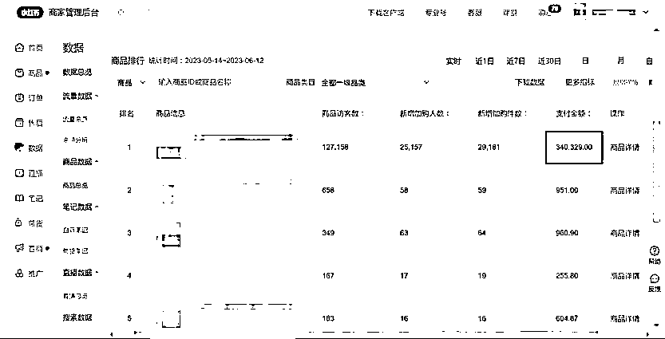
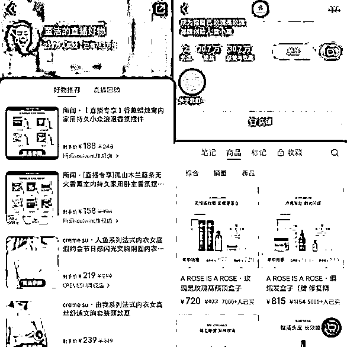
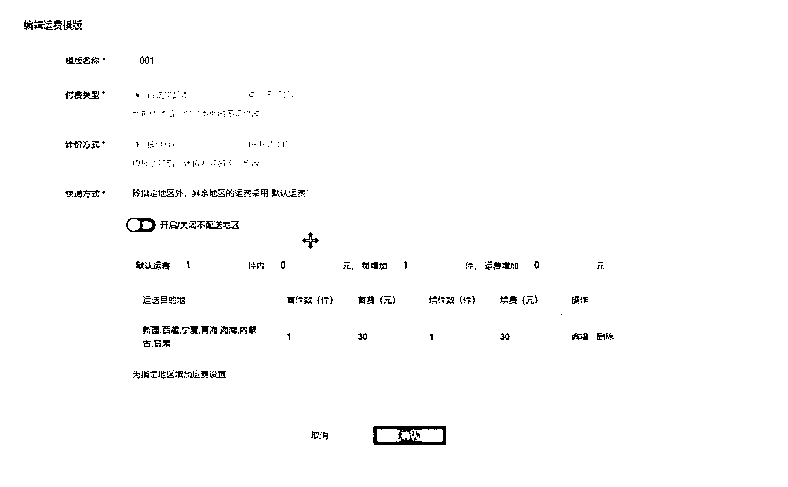
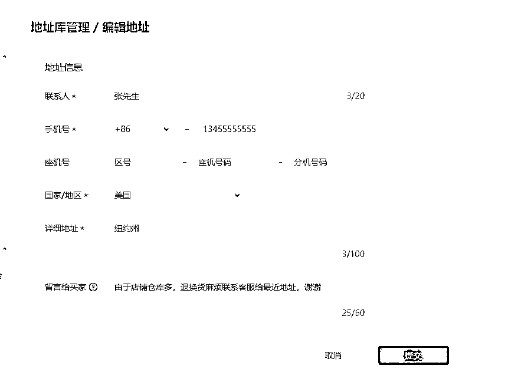
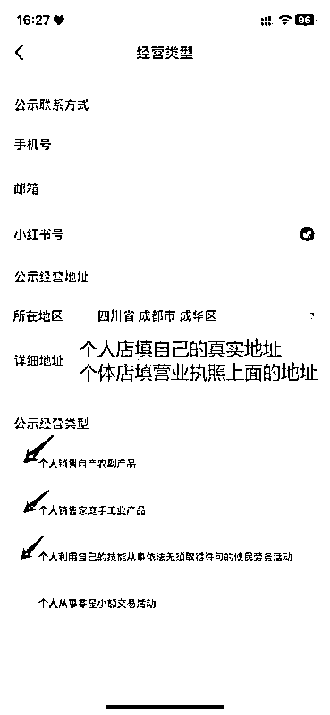
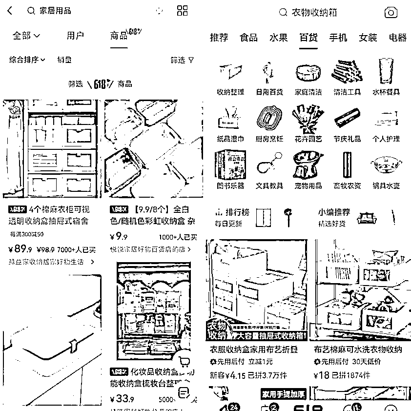
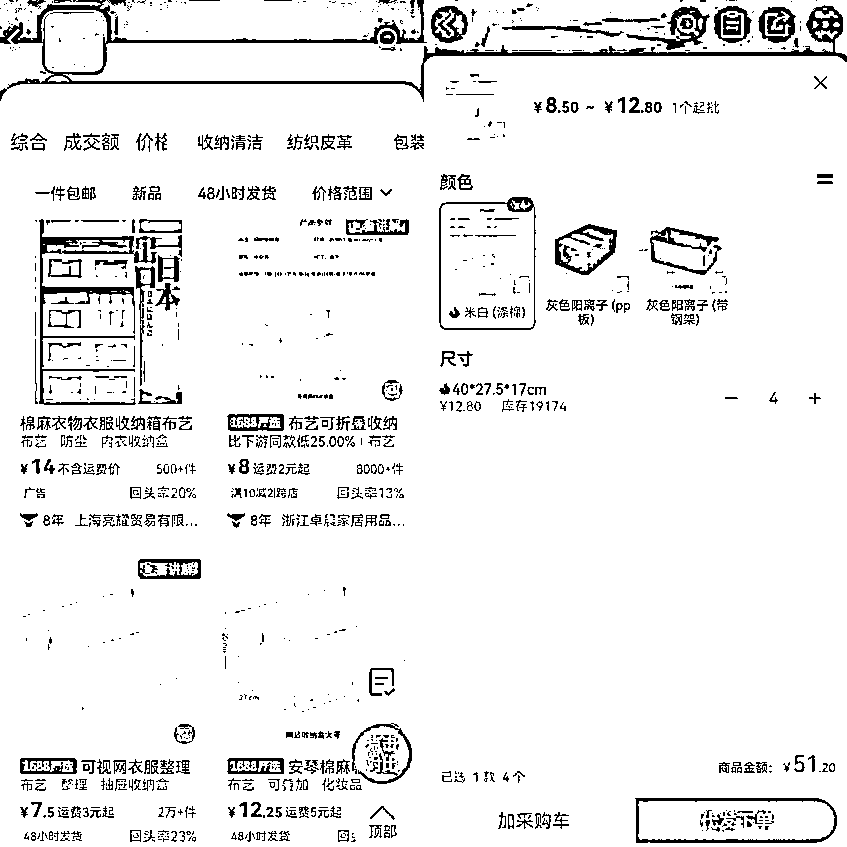
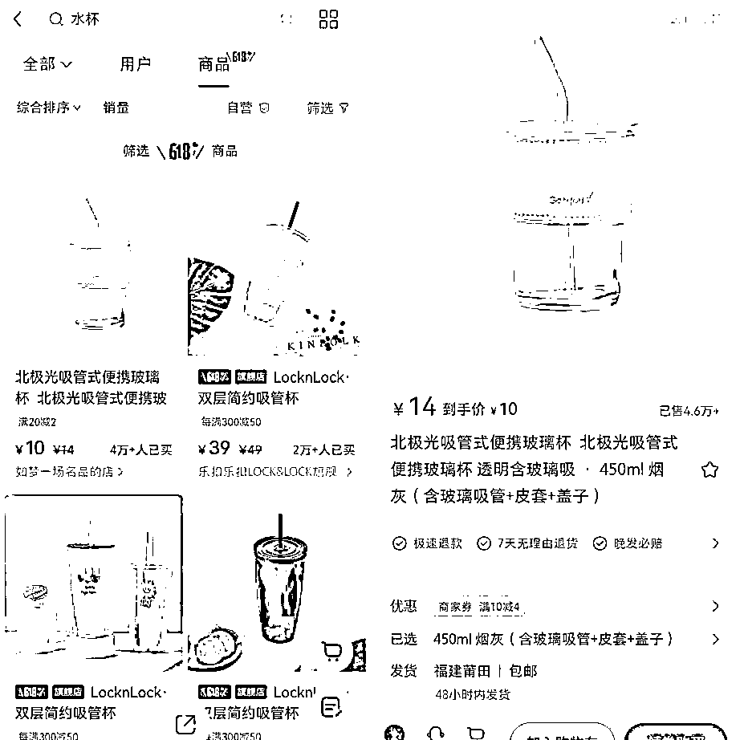
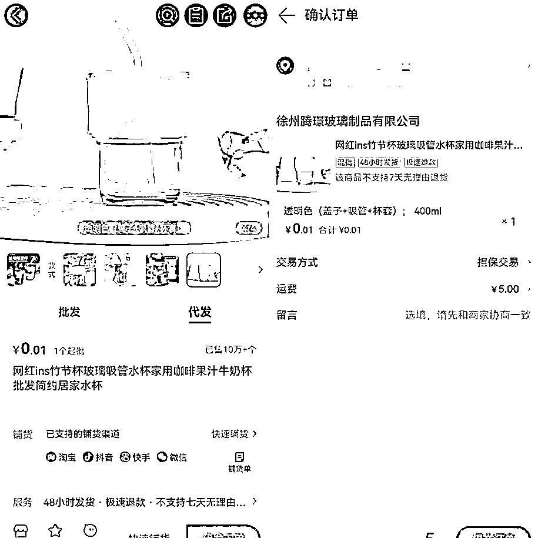

# 零库存起盘：单链接月流水三十万的实操拆解

赚钱的伙伴们好，我是周恩俊。五月那篇📕店铺全流程的分享，意外拿到一枚龙珠，也是我进圈两年第一次获奖。感谢每一位认真读文、愿意交流的朋友，圈里高密度的经验帖，确实帮我打开了不少新视角。

上次讲的是店铺怎么整体转起来，这次换个切口：单个商品如何从没有销量，一路推到月流水三十万。同时把我对平台走势、数据特征的观察一并交代。

全文围绕八件事：

1. 直播风向与数据观察
2. 用户画像与平台长处
3. 开干前的准备清单
4. 账号定位与对标方法
5. 选品：用家居日用品做样本
6. 供货渠道与批量上架
7. 爆款笔记怎么编
8. 售后处理与客服话术

## 1. 直播风向与数据观察

一提直播带货，多数人先想到淘宝李佳琦、快手辛巴、抖音广东夫妇。📕有谁？很多人一时答不上来。

但今年一月董洁首播，成交额300万；第二场直接放大到十倍；第三场超过6000万。618前，章小蕙在📕第一次开播，单价过万的美容仪被抢空，整场成交额破5000万。

这说明该平台的购买力真实存在，而且还在往上走。再往前，姜思达的直播间已经出现LV、戴森、始祖鸟等品牌。公开统计里，董洁前三场平均每单677元左右，章小蕙那场也高于500元。

反过来看抖音：赵雅芝最近一场平均每单15.44元，柴碧云94.97元，贾乃亮124.35元。

📕绕开了淘宝、抖音、快手的惯常路线，主打中高端品牌与高单价商品。也正因为能卖出溢价，商家在这里做电商，利润空间往往比传统渠道更舒服。

## 2. 用户画像与平台长处

董洁、章小蕙能跑通，除了个人影响力，选品和平台用户的消费口味对得上也很关键。

该平台月活2.6亿，约一半用户来自一二线城市，90后占70%，女性同样占70%。这群人花钱理性，却不肯在生活品质上将就，是典型的中高端消费力量。所以2023年，直播和笔记两条带货路径都在快速起量。

再往细看，核心年龄带是18到35岁，20到30岁最集中。她们常看时尚、美妆、生活方式，爱分享穿搭和护肤；对健康、健身、美食、旅行也有兴趣，愿意为体验掏钱。

把这些特征翻译成商家语言，就是一份选品指南。我们实际跑过、反馈较好的方向包括：饰品、防晒用品、水果、家居日用品、厨房小物、宠物用品、零食、美妆护肤、女性用品（内衣内裤丝袜等）、女装、花茶养生茶。

现在的📕，有点像两年前的抖音小店，但用户标签更精准。它天生是种草场，人群质量高；今年又被叫作电商元年，门槛降得很低——零粉丝可开店，千元级保证金能启动，一张身份证也办得下来。

所谓无货源，说穿就是低价进、高价卖，再让上游直接发给买家：顾客在📕下单，我们去代发平台拍单，供货方把货寄给顾客，中间差价归商家。这是一门靠流量差和信息差吃饭的生意。

📕属于兴趣电商，笔记有流量，成交就有机会。下面按步骤拆。

## 3. 开干前的准备清单

先备一部手机、一台电脑。新号旧号都能开店，但都要先养一养。

店名要方便搜索、方便传播，别用繁体字和生僻字；头像贴合定位，干净清爽；名字尽量有记忆点，别太随意。

店铺有四种：个人、个体、企业、旗舰。新手建议先从个人店试水——以前要先交保证金，如今平台发力电商，个人店开得快，很多类目千元保证金就能跑，成本低、好操作。手头宽裕些，可以考虑个体店：一张身份证只能开一家，一张个体执照能开三家，适合做矩阵。

### 账号注册

注册逻辑跟抖音类似：一机一卡一号。前期个人店一张身份证够用；后期铺矩阵，可用家人身份证或办个体执照。一张执照开三间：首间免认证费，第二、三间各600元，合计1200。

注册前先想好店名，去平台搜有没有重名。个人店撞名后要等7天才可再改，提前查清楚能少耽误时间。

### 开店流程

路径：📕App—我—左上角三条杠—创作中心—更多服务—开通店铺，按提示填信息、传证件。店开好后补物流模板、发货地址、退货地址、公示类型。发货地址可填真实地址，退货地址可选海外地址，公示类型一般勾前三个。

 

### 养号流程

新号先养3天，这期间别急着改昵称，重点刷对标、定赛道。3天后发一篇笔记看基础流量，50左右算正常，就能开店。

第一天：注册完不动头像和昵称。

第二天：像真人一样刷目标领域。打算做服装，就多看服装同行的笔记，适度点赞收藏评论，每次操作前停30秒。

第三天：继续刷，刷到发现页基本都是你的领域内容，垂直号就算养成。

赶时间：上午继续养，下午做账号包装，发干货或普通笔记测流量，过50就正常。

不赶时间：第四天上午再改头像昵称，发笔记测流量。

干货笔记可做衣服清洁、衣服保存；普通笔记可用风景、生活、争议话题。

养号期每天早中晚刷，累计两三个小时，图文视频都看。每天关注三五个权威号或对标号，喜欢的内容就点赞收藏评论，保持真人状态。

平台有账号等级体系，按官方任务逐项完成，能提升等级。

尽量守住一机一卡一号，同一设备别频繁切号，系统会识别异常。权重越高，推荐流量越大。

## 4. 账号定位与对标方法

定位就一句话：一个账号只服务一类人的一个具体需求。平台用户画像集中，年轻女性占大头，从她们身上找一个点——水果、内衣、美甲、手机挂饰都可以——选定后只做深。

这件事最好在养号刷对标时一起完成。当然，如果你对某类产品本来就了解，也可以直接拿来做定位。比如你平时爱研究某类好物，天然适合种草，那就是方向。

### 对标怎么做

新手做项目，最省力的办法是模仿。但很多人只模仿表面，一深挖就露怯。

真正会模仿的人，会把同行内容看透，细节不漏，再换成自己的话讲出来。用这个标准去找对标，看他们的笔记、选品、封面、详情页，思路就通了。

找对标有三条路：

第一，从笔记摸店铺。搜产品关键词，找近期点赞多的内容，短期破100就算不错。不管挂没挂车，爆款笔记都值得拆；如果挂了车，进店铺按销量排序，把销量过千的品记下来，作为爆品备选。

第二，从产品反推笔记。一个产品能牵出一家店，一家店又能带出几件爆款，再从新爆款找到更多店，循环下去能挖出大量好品。每家店背后都有不少优质笔记，爆款后面至少藏着一篇数据不差的笔记，对标素材库就这样填满。

第三，用发现页找同行。账号刷垂直后，首页会持续推同领域内容，质量通常不差，还常出现低粉爆文。看到好账号，用小号关注，研究它的发文节奏和爆款套路。

## 5. 选品：用家居日用品做样本

对标和产品库就位，进入选品。可参考的平台有拼多多、淘宝、京东、抖音、快手，都面向终端消费者，销量有参考价值。比如拼多多同品类10W+销量的商品，可以进备选池；📕攒下的品，也建议挨个到电商平台搜一遍，找出销量最好的款和链接：一是备胎，二是参考主图、标题、详情页。各平台都支持以图识图，扒同行成本很低。

### 容易起量的类目

001、功能性半标品：瑜伽服、防晒服，防晒、减肥都是真实强需求。

002、红海里的蓝海：专注特定人群，比如大胸显小或小胸显大的内衣，专做小个子女生的鞋。

003、美妆护肤：有货源和资质，在📕做笔记带货很合适。

004、自带话题的：情侣内衣、JK制服、汉服，天然有讨论度。

### 颜值权重别忽略

平台以女性用户为主，商家愿意上高颜值商品，因为拍照好看、适合发笔记，用户也买账。有拼多多商家说，拼多多流量按价格分配，谁低推谁；📕却出现按颜值分配的迹象。刷久了能感觉到，平台整体偏网红风、ins风。选品时把颜值当硬指标，踩坑概率会低很多。

### 家居日用实例

📕能做的类目很多，前面列的是我们跑过且有效的。拿家居日用品展开：

定好类目后，先在📕搜“家居用品”，靠前且销量不错的是收纳盒；再去拼多多看，收纳整理栏目前面也是收纳盒。两个平台指向同一个品，说明需求扎实。

接着去1688识图，找支持代发的供应商：4个收纳盒拿货51.2元；📕上卖98.9元，618期间89.9元。差价好算，这个单品总利润在28万到34万之间浮动。一个品折腾下来，30万到手。选对品，在这个平台确实能做出大动静。

 

平台人群消费层级偏高，对生活品质有要求，所以好的生活用品、家居日用品和刚需品都值得布局。

再补一个水杯案例。搜水杯，靠前且卖得好的基本是吸管杯，颜值比普通杯子高，随手一拍就出片，符合年轻女性晒生活的习惯。这款杯子在📕定价10元，1688识图查到同款进价5.01元，平台销量4.6万件，单件利润4.99元。粗算总利润约23万，收益也很能打。

 

## 6. 供货渠道与批量上架

选品讲完，货源怎么接？普通人没有稳定供应链，最省事的就是无货源代发：不压货，在网上找供应商，1688是很好的起点。

筛上家看四点：

001、辨真假。看生产许可证、授权证书、质量保证，再进店看信用评价；没验证过的商品不要碰。

002、找匹配。按自己的品类和目标客群，用1688搜索栏的“筛选”功能，从类别、品牌、价格、评价几个维度收窄范围。

003、谈价格。先收集几家报价做对比，谈判时守住原则但别太硬。可以翻历史成交数据、看供应商对市场的判断，推测让价空间；再结合市场需求量，估算对方心理底线，在合理范围内慢慢磨。

004、看长期。资质、信誉评分、成交记录、买家好评都要看，筛掉不良商家，优先选实力强的头部供应商，或能稳定合作的上家，省心很多。

### 批量上架

进📕商家后台的“服务市场”，用“摸鱼铺货”“蚂蚁搬家”“欢乐逛”等工具，从1688、拼多多、淘宝采集商品并批量上传，单店可挂500个以上产品。

### 一键发货

同样在“服务市场”，用“逸淘”“爱推”这类工具，自动核对订单、下单发货。费用不高，有免费试用期，之后每月二三十元，多平台通用，能省下大量重复劳动。

## 7. 爆款笔记怎么编

笔记形式怎么选？图文适合起量，但视频带货能力更强。选品时不能只看货，还要连带挑带货视频，两者是一体的。

选定商品后，去抖音、快手、视频号搜同类视频，尽量避开真人露脸的内容。比如搜“连衣裙”，看看有没有可用素材。前期靠混剪搬运，后期拿样品自己拍。

找素材重点看三点：

001、有没有专门做单一品类的达人——有，说明素材源存在；多，说明可以优中选优。

002、某达人的视频数量够不够多——太少的话，比如只有10条，一周就发完了，撑不了几天。

003、他的点赞和销量数据如何——判断他在抖音的表现。

视频调性必须贴合📕。同样的品，不同场景、话术、人物，转化天差地别。所以要挑适合📕的素材，该混剪就混剪。想测得更极致，可以准备四个账号A/B/C/D，发同一个品，话术不变，只换场景，看哪个出单。

内容也能流程化生产。我的图片结构固定：每组图里基本都有产品整体展示、细节特写、客户反馈；文案也有相同骨架。照这个模板，一天能产出10篇以上笔记文案。前期多试几套模板，别怕发多限流，只要内容不完全重复就行。

标题更简单：直接套数据好的带货句式。常用词可以分组使用，比如“被问了x遍”“今年最火”“我又挖到宝啦”“无限回购”适合放开头；“我要安利给所有”“私藏”“我后悔了”“直接炸裂”“每天都”“被问爆了的”适合拉互动；“还可以这样”“这也太好看了吧”“真想安利这个”“我发现了”“啊啊啊啊”适合制造好奇；“宝藏”“绝绝子”“yyds”“神器”“天呐”“真香”“拯救我的”适合收尾制造情绪。这就是一套文案标题的通用语气库。

## 8. 售后处理与客服话术

售后会直接影响店铺能不能持续跑。退换货、物流、商品咨询这些高频问题，最好提前写好标准话术，统一回复口径。顾客体验顺了，店铺评分才稳。

做📕笔记，除了视频和文案框架，图片也是绝对不能忽视的一环。很多人在发布图片时会忽略一些小细节，其实这些细节直接影响到笔记的观感和数据。今天就把发图要注意的几个点捋一捋。

01. 图片的视觉观感
图片好不好看，是用户的第一印象。清晰、有质感、构图舒服的图，能让人愿意多停留几秒；相反，模糊、阴暗、没有重点的图，很容易让人直接划走。拍照的时候，多注意光线和角度，尽量让画面看起来自然、立体，带一点艺术感，效果会更好。

02. 图片的尺寸与格式
📕对上传图片有硬性规定：单张最大不能超过15MB，格式只支持jpg、jpeg、png、gif、bmp、tif、tiff这几种。如果图片不合规，轻则上传失败，重则被压缩得没法看，所以发布前一定要检查清楚。

03. 水印与版权
给自己的图加上水印，是防止被盗用的有效方式，但水印也不宜太多太密，否则用户看着心烦，反而影响浏览体验。另外，如果要用别人的图，一定要先拿到作者授权，否则一旦涉及侵权，可能面临高额罚款甚至被起诉。

04. 标题和描述
图片的标题和描述，是吸引点击和互动的重要入口。标题可以玩点有趣的字眼、追一下热点，或者用一点巧妙的表达，再适当加些引导互动的话；描述则可以用讲故事的方式，或者围绕图片本身展开来讲，但千万别写得太长太啰嗦，否则读者很容易失去耐心。

以上是发布📕图片时要重视的几个细节。如果想把无货源店铺做起来，每个环节都不能将就，图片尤其要精挑细选，这样才能得到更多正向反馈。

8. 📕售后问题如何处理？常见客服话术分享

做电商，最头疼的就是售后。出单、爆单之后，退货退款都是难免的，商品不可能件件完美。那么遇到售后问题时，怎么处理才能把损失降到最低？

比较稳妥的做法是：该给买家兑现的承诺要兑现，同时要及时跟上家沟通，了解清楚上家的退货退款流程。先跟买家说明情况，向上家要到退货地址后转给买家，买家按地址退回后，拿到退货单号再补录给上家。这样两边都退，我们基本不会有什么损失。如果上家还送了运费险，那就更省事了。

📕自己也有运费险，不过平台里叫“运费宝”，可以在物流工具里开通。凡是容易因为尺寸退货的品类，比如女装、鞋子，都建议开上。因为买家要自己掏运费退货，往往就会犹豫，开通运费宝后，反而会促成下单。某种程度上，这也是在提高转化率。

再就是7天无理由退货。上架商品时，就可以设置是否支持。像水果、生鲜、农产品这类，可以不勾选；但女装这种退货率高的品类，后台一定要勾选支持7天无理由退货，这同样能拉高店铺转化率。

📕的自动回复和关键词功能，也和其他电商平台类似。设置路径是：登录📕商家版后台，在“客服—智能客服—欢迎语设置—自动回复问题设置”里操作。

下面整理了一些常用的客服话术和促单话术，可以直接参考使用。

欢迎语：
“亲，在的哦！看中哪款宝贝了呀？我可以帮您介绍哦～”
“亲，您好呀，有什么可以帮您的吗？”

尺码问题：
“亲，我们家的尺码都是标准码，按您平时穿的码拍就行。如果不确定，也可以把身高体重发给我，我来帮您推荐最合适的款式~”

色差问题：
“亲，我们保证宝贝是百分百实物拍摄，但光线和显示器不同，实物和图片可能会有轻微差别，我们已经尽量把色差降到最低啦，还请您理解！”

质量问题：
“亲放心，发货前我们都会仔细检查，质量有保障的。您也可以看看评价，很多买家都反馈不错的选择。万一真的出现质量问题，我们也支持7天内无理由退货哦~”

发货时间：
“亲，每天下午4点半前付款的订单，当天就能发货；4点半之后的，会安排到次日发。我们会尽量快点给您安排的~”
“亲，一般24-48小时内发货，我们会尽快安排，请放心哈。”

物流问题：
“亲，我们默认发申通，您那边申通能到吗？”
“正常2-3天能到。如果遇到节假日、自然灾害、交通意外或者偏远地区，可能会延迟一些。”

促单话术部分：

利用“怕买不到”的心理：
“这款是我们家卖得最好的，经常断货，现在这批只剩3个了，喜欢的话抓紧哦，不然又要等很久。”
“今天是优惠价最后一天，明天就恢复原价了，喜欢别错过。”

利用“想快点拿到”的心理：
“如果真的喜欢就赶紧拍哦，快递员马上要来取件了，现在付款的话，今天就能寄出。”

当顾客犹豫不决时，用“二选其一”：
“您是要第6款还是第11款？”
“是给您发平邮还是快递？”
只要顾客选了一个，其实就是在帮自己下决心了。

帮顾客挑选，促成订单：
很多顾客虽然想买，但不会立刻下单，喜欢在颜色、规格、样式上反复比较。这时候可以先不聊订单，而是热情地帮他挑颜色、选尺码、推荐款式，等这些细节定下来，订单自然就落实了。

巧妙反问，促成订单：
比如顾客问：“这款有红色的吗？”如果刚好没有，不要说“没有”，可以反问：“不好意思，红色没进到货，不过我们有黑色、紫色和蓝色，您更偏向哪一种呢？”

积极推荐，促成交易：
当顾客拿不定主意、需要推荐时，可以一次多推几款符合他要求的款式，每个链接附上理由，不要找到一个才推一个。
“这款是刚到的新款，市面上还不多见。”
“这款是我们最受欢迎的款式之一。”
“这款销量很高，经常卖断货。”
这些都是不错的促单话术。

以上是今天的分享，希望对你有所帮助，也欢迎一起交流讨论。

最后想说：
每个人的成长，都是能力和欲望不断匹配的过程。当才华撑不起野心的时候，就该静下心来学习了。坚持走下去，结果一定不会太差。感谢正在看的你，一起龙哥盟！

评论区：

低调创业说 : 男哥，牛逼！

静水 : 男哥 666[强][强][强]

3 先生 : 我咋感觉在这篇文章里看到很多我看到过的文章呢[擦汗]

Lion : 牛逼

Lion : 这个才是最近浏览这么多📕店铺分享最好的最详细最具体的，其它的分享看是不错都比较空

宅男，（周恩俊） : 谢谢，一起加油[玫瑰]

宅男，（周恩俊） : 感谢认可，一起加油[奋斗]

宅男，（周恩俊） : 我们这边的玩法分享是比较早出来的，不过有些内容确实被许多博主拆分过多次了