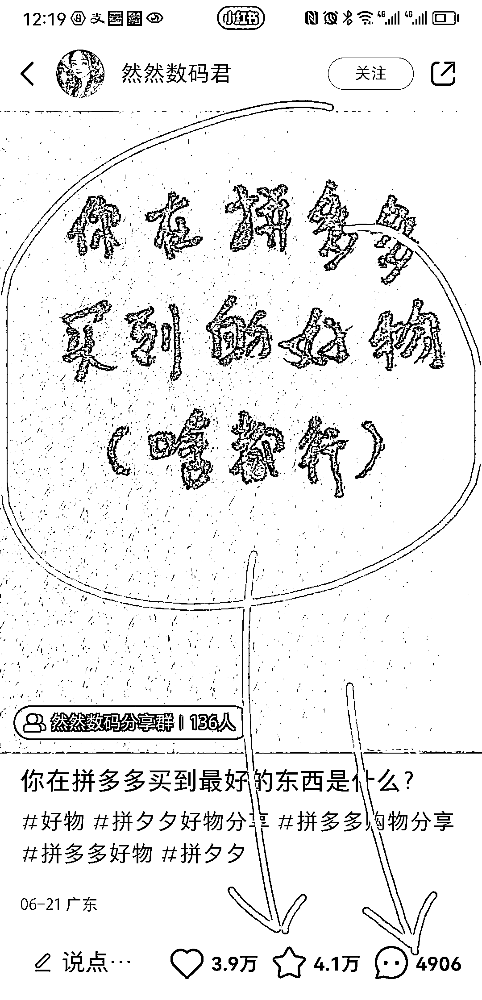
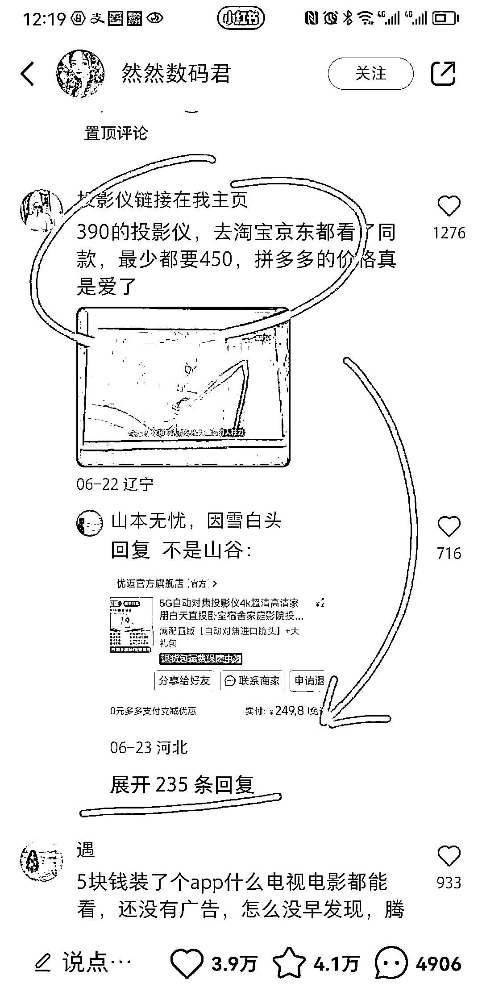
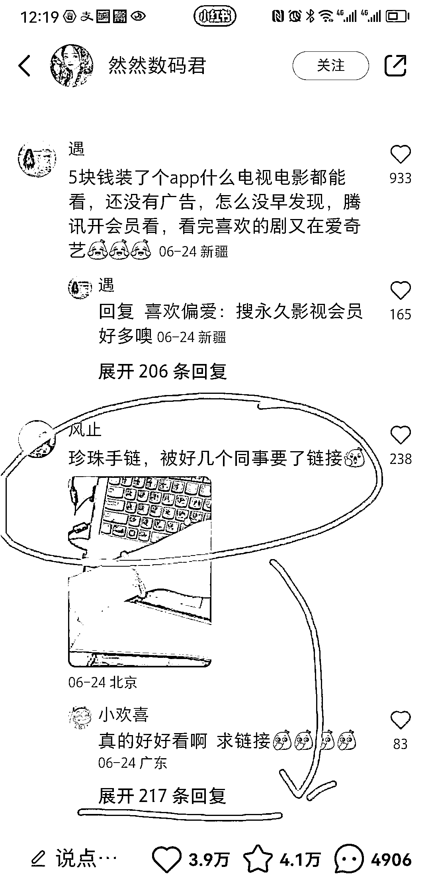

# 📕用户爱买什么？答案藏在评论区

作者：大勇非勇

日期：2023年7月13日

你有没有发现，📕上总有些笔记，点赞和评论多得吓人？我刷的时候也经常看到，但今天想聊的重点，其实不在笔记本身。

滑到评论区后，重点留意那些排在前面的热门讨论，你会发现很多之前完全没想到、但📕用户却特别感兴趣的产品。从这些讨论里，能获得不少关于挑产品和洞察用户需求的参考。

再简单一点的操作是：在📕店铺直接上架这类产品，货源就去拼多多找。

评论区：
龙哥：中标，术值+1。在上方专栏点击 #中标，可查看所有中标风向标。
星空：一个选品思路哦🤓