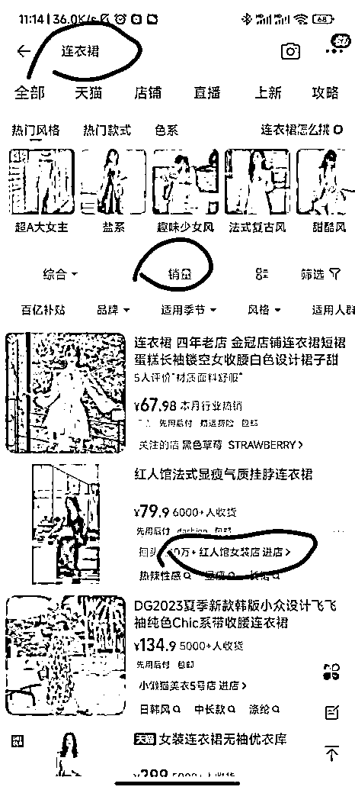
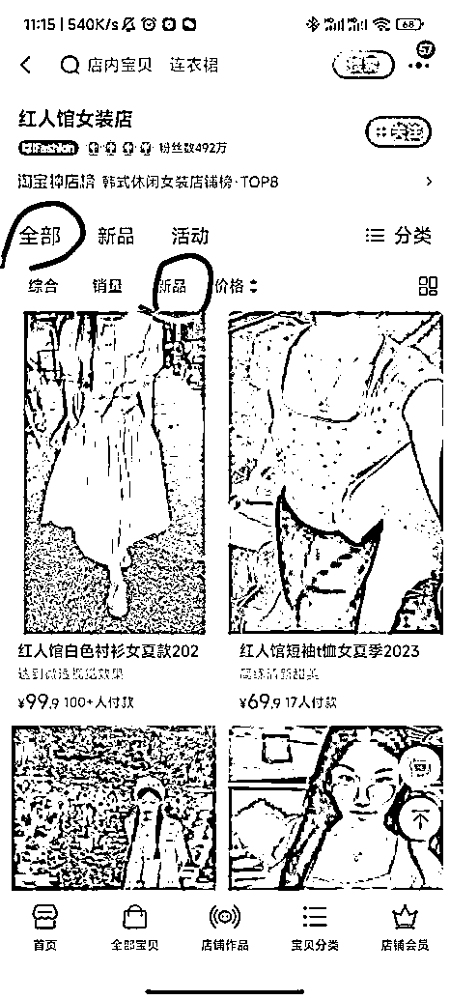

# 女装无货源选品：去淘宝盯新品

作者：书豪｜2023-07-07

朋友们好，我是书豪，人在杭州，95后创业者，创业这件事做了四年，也连续四年做到年入百万。前面聊过📕无货源低价百货怎么挑品，这次把我自己店铺做女装的选品思路拆开讲讲。

先给结论：女装选品说到底还是在“跟款”，只是参照的平台换了。低价百货那套，是在📕找粉丝不到200、近7天带货笔记点赞超过100、对应商品销量超过100的品去跟。女装则不同，我们很少在📕找对标，而是每天盯淘宝天猫里排名靠前、体量较大的女装店，重点看它们的新品销量有没有超过500单。进店后要注意，别直接点【新品】，要先进入【全部】栏目，再点下面的【新品】，这样才能看到销量。当然，用之前那套低粉爆款思路在📕挖到的女装，也可以拿来跟。

 

为什么这么选？

**一、选品能力：借头部卖家的判断**

要承认一件事：能在淘宝做到头部、腰部的女装店，选品水平大概率超过普通卖家，也超过一般人。尤其我们团队多数成员是男生，对女装的敏感度有限，更值得借他们的判断来跟款。

做法是搜关键词后按销量排序，关注前30家、50家左右的店铺，每天看它们上了什么新品。新品通常是店家的主推款，有的品前一天刚上还没流量、没销量，第二天再看可能就爆单了。所以上新情况和最近的新品销量，要持续盯。精力够的话，也可以把范围从50家扩到100家，多关注腰部卖家。别被固定框架绑住，我们的方法只是方向，具体执行按自己的情况来。

**二、选品素材：解决混剪难题**

做无货源女装，很让人头疼的一点是视频混剪素材。一般在📕有爆款潜力的百货，在淘宝、抖音往往已经爆过，混剪资源多，批量做带货视频更方便。女装受成本、模特、拍摄等限制，视频素材少很多。如果只在📕选品，很容易和其他博主撞素材，流量受影响就不划算了。

从淘宝天猫选品，能在一定程度上解决这个问题。大多数非批发女装店，全网新品通常会先上淘宝，再分发到其他平台。所以淘宝天猫上的女装新品视频往往是最新的，甚至在抖音都找不到。拿来做去重，就能直接用于制作，省时省力。也可以扒商品主图和买家秀图片做图文笔记。百货常要靠视频展示功能，女装则可以用图片展示产品。但图文笔记一定要二次原创，不能直接搬运图片。

**三、爆款潜力：有机会抢到首发**

用这种方式，比较容易发现潜力大爆款。前面说过，淘宝天猫的新品，除了部分在📕也有旗舰店的店铺，基本没在📕上出现过。你第一个上这个品、第一个用新品素材，就有机会大爆。但也要清楚，爆单是概率问题，淘宝上的爆品，📕不一定爆，心理准备要有。

我们之前就在春夏换季时用这个方法找到过一个爆款，因为第一个在📕发，几天就爆单了。所以一定要找30家、50家店铺，每天看新品内容和最近几天的销量，里面可能就藏着大爆款。

判断一个品适不适合上，有个简单办法：看用户评价。销量大几百、几千，评价却很少，或者全是默认好评，那很可能有刷单。这种品要不要上📕，看自己。我的建议是能上就上，不爆也没关系，当作测品，换个品接着发、接着测。

**四、大词长尾：让选品池不断更新**

女装虽然是大类目，但如果一直只搜【连衣裙】这种大词，按销量排下来，前几十名商品基本不变，选品局限就大了，也找不到新店铺去测品。

这时要用“大词+长尾词”的搜索方法，找到源源不断的店铺。比如“连衣裙”是大词，搭配“夏季”就是长尾词；换成“连衣裙 瘦身”“连衣裙 沙滩”也可以。长尾词稍作变化，搜索结果就不同，再按销量排名找店铺，可关注的店铺就丰富了。

之后还是按前面的方法，点进商品店铺看新品。销量不错的，发到📕测一测；销量不行，就换一家。

做个总结：做📕无货源女装，可以在淘宝天猫搜索对应女装类目，按销量排名，选前30家、50家或100家店铺，每天关注上新情况和最近新品销量。遇到销量超过500单的，马上跟款。

这套方法把淘宝天猫换成拼多多、抖音精选联盟也同样适用。选几家店铺、销量门槛定多少，按自己的实际情况来。希望对大家有帮助。一起龙哥盟，欢迎圈友交流，🛰️：wshinvest1。

往期内容回顾：第一个100万是怎么来的、单店月利润6000+的选品教程、无货源单品做到4w+利润的复盘、千川月耗百万的投流心得、2023幼教考编教程、低粉爆款案例拆解、新人月入100-1000的入门教程、抖音单品短视频带货千万GMV复盘，以及爆款视频拆解方法等，感兴趣可以回看。

圈友互动：有人问视频里模特露脸要不要处理，加个贴纸就行，模特不是特别火一般没事。也谢谢大家的认可。