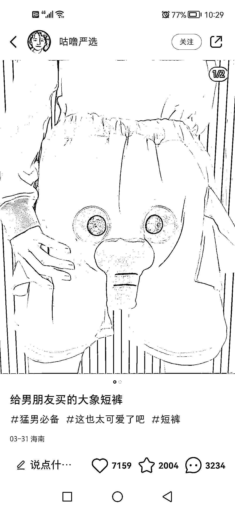
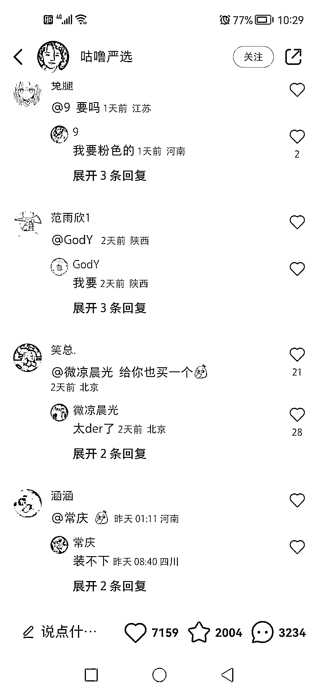

# 小红书选品：让另一半在评论区主动@人

小红书店铺这条线最近讨论度挺高，我来拆一个围绕推荐算法做选品的思路。

挑“买给男朋友/女朋友”的商品。用户刷到后，很容易联想到自家那位，于是会在评论区艾特对方；一来一回，互动量被带起来，评论热闹了，笔记也更容易被推起来。

评论区：

Aaron：挂商品链接，流量是不是会减少啊？

亦仁：中标，术值 +1。

点击最上方 #中标 专栏，可查看所有中标风向标。