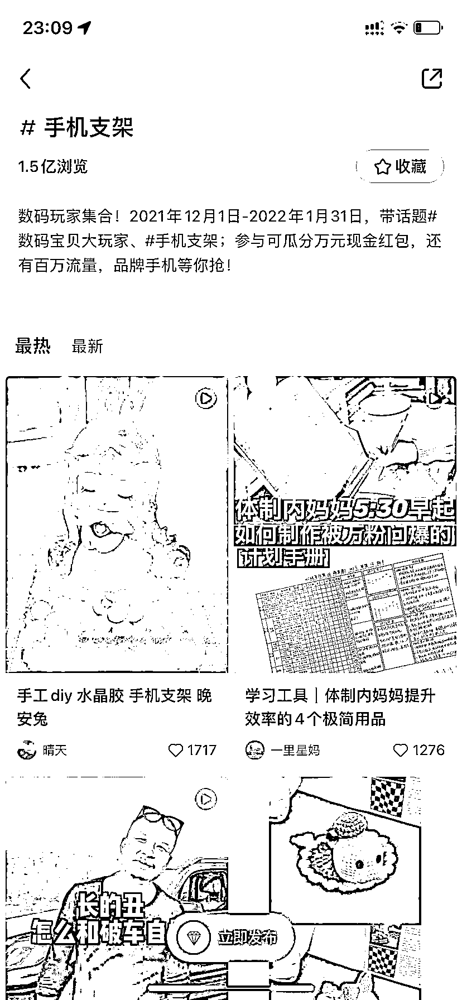
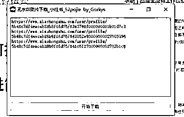
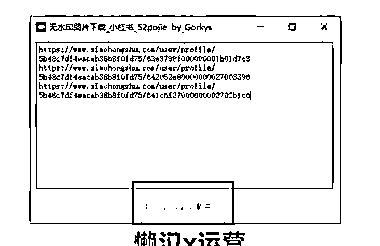
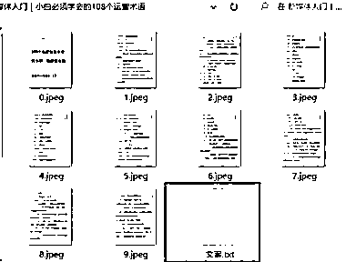
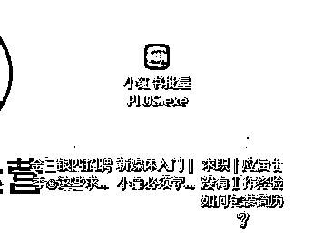

# 选品提效：小红书笔记成批抓取
分享人：西哥｜2023.04.11

做选品时，如果一条条翻热门笔记，时间很容易耗在搜集素材上。最近我一边摸这个平台的选品门道，一边练文案拆解，顺手整理出一套成批抓笔记的流程，给同样想省时间的人参考。

操作顺序可以这样走：

1. 先确定一个品类词，点进热度较高的话题页，找到那条笔记的分享入口，把地址复制下来。
2. 用后奕，切到智能采集，让它自动收集页面内容。
3. 若觉得工具操作不顺手，另一个办法是装个浏览器扩展，靠手动往下滚动来收集。
4. 想把正文和配图一并存下来，可以用导出工具：把地址粘进去，把配图和附件一次性导出。运行时最好先关闭安全防护软件，避免拦截。

下载地址和文件信息我整理在下面：

文件一：《小红书批量 PLU....exe》  
网盘码：c6c9  
下载地址：https://pan.baidu.com/s/1eaVgq1yK597asjo4pBMPtA?pwd=c6c9

文件二：《链接批量提取插件》  
网盘码：1629  
下载地址：https://pan.baidu.com/s/1omxGuQx5k_Sdah5LNngnyQ?pwd=1629

在网盘 App 里打开，输入网盘码就能下载。

   

互动留言：  
西哥：想做这个平台的朋友可以一起聊，我还在学习。微信 DUM321，加好友时写“生财”两个字。  
亿安：这两条分享其实指向同一份 plus 内容。  
西哥：扩展文件再补一份，网盘码 7BW9：  
https://pan.baidu.com/s/1k3bO7YhbGpPHas5JAfoMLQ?pwd=7BW9  
SayNothing：这条地址已经打不开。  
boarding：我这边也失效。