# 门店引流新生意：把线上热度变成到店成交（2023.08）

> 资料出处：[飞书文档](https://remhu1p2pr.feishu.cn/docx/ErBjduNuCorKBBxrDm3c6fAPn0e)

整理时间：2023年8月24日

阅读提示：这份材料会带你看清项目里还能怎么玩，也方便直接照着做。想快速找到某个话题，按 Ctrl + F 或 command + F 搜关键词即可。

## 开篇：这本册子能帮你什么

💡八月这期航海实战内容，聚焦一个方向：帮实体门店把线上流量转成到店生意。接下来我们会围绕它反复碰面。

抖音、📕、大众点评等入口日渐成熟，实体老板最关心的，是线上热度如何变成门店流水。按《2022年抖音生活服务数据报告》，抖音上的本地商家已经突破100万家，年交易额约7700亿元，增幅接近30倍。实体门店自身的经营底子，常被不少人低估。可不少店主仍不知道客源怎么来。若你手里有获客办法，再与实体商家合作做流量服务，这就是一门可以试的生意。

整本册子围绕“跑完一次合作”所需的能力与步骤来编排，你可按自己的情况挑着读。

第一章说明这个角色是什么、行业眼下有哪些机会，帮你建立整体认识；第二章谈入行必须有的获客能力，并列出常见打法和案例，看看别人怎么操作；第三、第四章讲如何找到首家商户、谈成合作并把一次引流活动落地，希望给你一些可参考的经验；第五章给出业务放大方向；第六章收录13个常见行业案例，方便理解。除玩法拆解外，最后一节还整理了门店私域运营团队的搭建方法。若商家能持续做引流，我们也能协助它把团队搭起来，这也是可延伸的业务。

需要提前说明：目前这份航海手册，是把龙哥盟星球上该领域的精华帖、干货帖收集起来，经过拆分重组后形成的实战手册。阅读时可能会有拼凑感，但内容完整度不受影响，也请大家理解。

我们这样做，是为了把一个项目更多的可能性展示出来。希望大家看完不同圈友的经验后，能从多维度、多视角理解线下实体引流，更清楚地看到一次引流活动从筹备到落地的各种路径和玩法。

受篇幅限制，部分玩法不会在手册里详细展开。希望你能从中发现新颖玩法，也保持好奇，去对应的原文帖里找答案——这也是每一小节都附上“内容来源”的原因之一。

**怎么读这本册子？**

前文说过，册子内容按“引流到交付”的执行步骤编写：

若你是初次做引流，按顺序推进更稳妥，书里给了不少可选项；若已有基础，可跳到自己缺的章节。更推荐通读，很多方法彼此通用、能互相借力。路不止一条，愿你在适合自己的方向上跑通更多获客路径，拿到更精准的客群。

书中多取重点，帮你去掉噪音；每处也标了内容来源，点回去就能看原帖细节。

还有一点很关键：多问、多聊。册子覆盖不到的地方，尽管提出来，我们一起找更多解法。愿这趟航行既有收获，也能交到一群同行伙伴。

本资料由龙哥盟与圈友共同整理，仅限航海成员及星球圈友学习使用。实践中有反馈欢迎随时提，我们一起把它补得更完整；修改建议可发给鱼丸（yuwan387）。

## 一、这门生意到底做什么 @孙策、@宗霖

💡本章要点：先大致认识一下线下流量服务商这个项目。

瑜伽馆、口腔诊所、医美机构、餐厅等实体业态，都可能成为它的合作对象。这类服务方凭经验丰富的流量策略，为门店提供账号运营、活动设计、获客引流等支持，正逐渐成为线下商业的有力伙伴。

它的收益模型也很清楚，主要来自和商家合作的服务费与佣金。尤其按成交分成、按效果返佣两种方式，把收益和实际结果绑在一起，让双方利益都能落地。

下面深入探讨这个角色的功能与价值。一起走进这个融合线上线下的新商业模式，看看它给现代商业带来了哪些突破性变化。

## 1.1 业务边界在哪里？

这门生意属于代运营的一个分支，但它不局限于线下，而是帮实体商业在线上线下同时做增长，最终把流量转成营业额。

比如，和瑜伽门店、少儿培训、口腔、医美、餐饮等个体或连锁实体店合作，用成熟的流量打法帮商家扩大进店流量、提高转化率。如果商家品牌比较成熟，还可以拓展更多业务，系统化的商业流程升级就是方向之一。

服务范围包括：替门店做账号运营、活动设计、获客引流、线索供给以及成交转化等。

收入主要来自商家支付的服务费和佣金，结算方式常见两类：

CPS，英文是 Cost Per Sales，按实际销售结果分成。实践中常采用“底薪式服务费+成交抽成”；前期为了更容易谈成合作，也可以不收基础费，只拿成交佣金。

CPA，走效果付费。只要把用户带到店，推广方就能拿到钱，不要求用户一定消费，这种模式在医美场景更常见。

## 1.2 现在入场，机会在哪？

### 1.2.1 商家端需求充足

只要平台存在，代运营就有空间，既包括汽车之家、美团这类行业平台，也包括抖音、📕这类全类目公域平台。

线下商业正处在数字化需求很强的阶段。线上跑得快，线下走得慢，中间落差很大；老板们对新渠道大多一知半解，却又不得不做，所以市场需求很旺盛。

线下商家的优势在于产品成熟、团队成熟、商业模式成熟。若能换用更高效的流量方式和变现方式做运营，会拿到更大的结果。

### 1.2.2 起步负担轻

这门生意启动成本低，一个人加一部手机就能开干，本质是靠技能换收入；即便没做成，损失也有限。

### 1.2.3 赛道尚未拥挤

先看目前市面上主要的代运营服务商：

平台区域代理商，比如美团、大众点评；抖音本地生活服务商，如联联周边游、千千惠、旅划算等；某些行业还有专业第三方服务平台，比如汽车之家、懂车帝向经销商输送购车咨询，土巴兔、齐家网及区域平台向装修公司送单，新氧、美呗替医美机构导流并抽佣或给线索。

这些渠道，多数是中大型门店才会配置的选项。

对个人或小团队来说，不妨先选美团、抖音、📕或🛰️裂变中的一个入口，围绕单店做定制方案，再给出可感知的效果承诺，谈合作会顺很多。

### 1.2.4 能做长期，也有增长空间

线上赛道挤得厉害，线下反而没那么卷；同时线下盘子大、生命周期长。可以判断，即使是新人入行，也有足够时间从首店起步，边做边磨团队和流程，把这件事养成自己的主业务。

# 二、项目跑通的四步

这一节，我们一起了解跑通线下流量服务商项目要经历哪些环节。册子的编排，也照着项目推进顺序来，因此一并讲讲怎么使用。

第一步：先练熟一项能拿得出手的获客技能。

具备获客能力，是做这个项目的前提。你会在“三、必须练熟的引流基本功”中看到各种具体方法，这会影响你后续能承接怎样的服务。

第二步：通过线上或线下方式找商家谈合作。

有了获客能力之后，就可以通过线上搜寻或线下拜访，找到可能需要引流服务的商家。因此，“四、如何找到合适的商家”会展示从找到商家到达成合作的完整流程。

合作形态可能只是两周的裂变活动，也可能是整年的抖音号代运营，取决于你手里的能力和商家想要的结果是否匹配。

第三步：和合作商家敲定引流方案，并开始执行。

和商家达成合作后，就正式进入为商家引流的环节。具体会在“五、如何做好交付”中展开。大致要经历这些部分：

先摸清门店当下的经营状况与卡点，找出真正想解决的问题，再确认双方认可的目标；随后结合门店条件、产品特点和可调动资源，做一份能落地的方案；执行时盯数据、做复盘，遇到偏差及时沟通。

第四步：当前业务跑通后，开始放大生意，并整理合作案例，为后续合作做准备。

完成这次引流合作之后，你就已经初步跑通整个项目流程了。

不过，线下流量服务商的生意空间很大。如果你有意向在这个领域深耕，建议看看“六、如何放大生意”。通过找到更多商家、放大服务范围，来扩大自己的业务。

相信你已经大致了解成长为一个线下流量服务商的大致路线了。接下来，我们就正式出发吧！

# 三、必须练熟的引流基本功

💡本章要点

平台方正加码下沉市场，可不少店主对线上运营并不熟，既缺方法也缺经验，于是更需要外部团队帮忙做推广和代运营。

抖音之外，📕和视频号也在做本地生活；大众点评、美团仍是消费者找店的高频入口；各地还有本土活动平台。下面按五类入口拆开讲：

✅ 内容类平台：抖音、📕，快手、视频号也能做；
✅ 团购入口：大众点评、美团；
✅ 同城流量：本地生活号、同城活动平台；
✅ 线下动作：海报、异业联动、地推、分销代理；
✅ 🛰️裂变：借上述流量和门店老客再扩新客。

各入口的用户心思不一样，诱饵也得跟着变，钩子要按人群特点设计。

打法没有唯一解，按门店情况挑选并组合，跑出适合它的方案；你若有新招，也欢迎补充分享。

## 3.1 内容平台获客怎么做

💡小节要点

读完这一节，你会对内容平台的获客方式有整体把握。

正式展开前，先看实体店做这类平台的通用思路。3.1.1 拿抖音当样本，围绕平台流量、人群标签、卖点内容化、快速铺量四个点说明。该思路也可迁移到📕、快手、视频号，按平台调性微调即可。

之后会分别从自营账号、达人合作两条线，讲抖音和📕的引流做法。现在开始。

### 3.1.1 内容平台获客的底层逻辑 @董十一

做抖音，可以先拆成两件事：渠道与内容。

渠道这件事不复杂：不管卖什么，最终都要有人把顾客带到你面前。过去靠纸单页，今天把传单换成短视频和直播间；抖音、📕、快手、视频号，本质都是获客通道，并不神秘。

内容则是另一面：在这些新媒体通道里，你得用视频或直播把顾客引来。

实体店在抖音要做的，归结起来就是让内容把刷到的人变成进店的人。

所以第一原则是先看终点：以终为始。

真正有效的路线有两条：

（1）持续产出能带客的短视频；
（2）持续做出能带客的直播。

投流与爆款，是在这套有效动作上再加码。做任何事都先跑通闭环；在抖音，闭环就是从曝光走到成交。下面从流量这一端拆重点。

#### 3.1.1.1 先盯成交，再看播放

不少店主会问：视频明明有人看，怎么没人买？

因为你的内容没有让看的人产生购买念头。所以实体店做抖音，第一步不是冲流量，而是从成交倒推流量。

你要让刷到视频或直播的人，愿意买你店里的货，而不是只盯播放量和互动。对实体店来说，追着平台推流数据跑，意义最小。

当然，我们并不是不做流量，只是爆款和热门不该成为实体老板的目标。为流量做流量，最后只得到流量；为成交做流量，才会得到成交。

抖音的去中心化算法意味着：除了粉丝带来的基础曝光，谁的视频都要在同一套规则里竞争。今天刷到你的人，明天未必还在。因此实体店做抖音的核心是：让流量和成交同时发生。

用户看到视频或直播的那一刻，就要给他一个立即下单的理由。

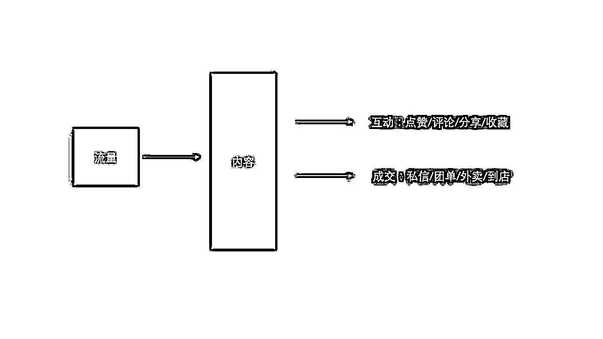

一句话收束：我们图的是顾客，所以流量要按成交来设计；流量归平台，转化就得抢在用户刷到的那一秒。

#### 3.1.1.2 标签打准，人群才对

开头把标签打对，系统推来的人会更接近目标客群，流量也更容易放大。真正值得争取的，是附近刚好有需求的那批人；别被播放量牵着走，要让流量替你筛客户。

那么，怎么让流量变成客户？先完成零到一：拍出一条能带客的短视频。

假设你在常州经营一家社区花店，货、人、场地都就绪，只缺客人。你注册了抖音、快手、视频号，准备认真做一场。这家店的短视频怎么拍？

先回到生意本身：买卖靠一笔笔交易发生，市场也是交易堆出来的。看花店成交路径：一天有1000个人从店门口经过，其中100人进店想买花，最后10人付款。

找到更多想买的人、让更多想买的人下单，就是核心。放到抖音上，内容要干两件事：一是找到同城有买花需求的人；二是把这些人转成到店客。

所以第一步，是用内容吸引同城目标客，而不是盯着播放量本身。

内容是什么？一条二十秒短片，由声音、字幕、画面按段落拼成。

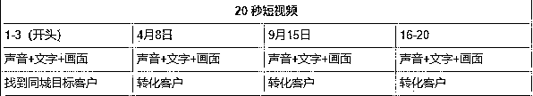

比如在常州卖花，一条二十秒视频可以这样起头：我在常州做鲜花零售已经十二年。

开头只要反复用“地域+行业”组句，再配画面，前几秒就成立了。

把二十秒拆成四小段：开头三秒、四到九秒、十到十五秒、十六到二十秒。前三秒只服务一个目标——让常州想买花的人刷到并停下，而不是把播放量冲高。可以这样写：

常州想买花的朋友，刷到我常来店里挑；
为什么这家常州花店下午就卖空；
同价位，常州不少人更愿意到社区花店买当天到的花；
谁说常州找不到花材新鲜、价格不虚的花店。

所有这些开头，都是为了让平台把片子推给常州的花客，并让他们愿意多看一会儿。

截图里文字没写地址，是因为左下角地点定位（POI）已经挂上了。标签可以落在文案里，也能靠技术和画面完成。

说到底只为一件事：让附近可能掏钱的人刷到你，并且留下来。

#### 3.1.1.3 卖点要藏进内容里

做抖音最终要落到成交；而成交的关键，是让目标顾客看见购买理由。

第一步：产品广告化。

顾客买一束花，可能是因为花材新鲜、当天到店、包装用心、价格不虚、街坊口碑稳、服务贴心。这一步要做的，是从视频里提到的到店产品中提炼卖点并归纳出来。比如“花材新鲜、当天到店、包装用心、价格不虚、街坊口碑稳、服务贴心”。

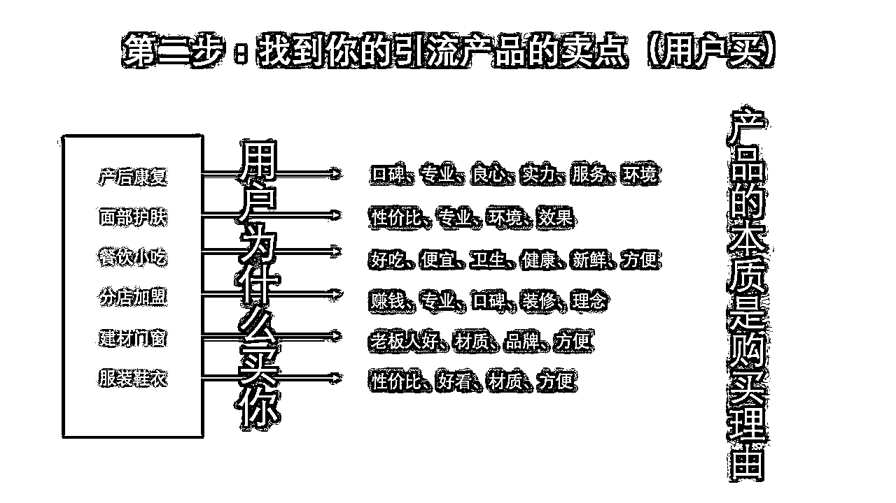

第二步：广告内容化。

若直接对用户喊这些卖点，吸引力并不够。

平台用户爱看内容，内容负责拉流量，广告负责促成交。于是要换一种说法：

打广告＝这家店口碑稳；
广告变内容＝买过花的街坊不少成了熟客，还会拉着邻居一起来。

两句话接在开头三秒之后，配画面就是四到七秒的段落。其余卖点照此处理：

街坊口碑稳：不少买过的人成了熟客，还会带朋友进店；
花材新鲜：昨天有老顾客说，早上买的花到晚上还挺括，家里人都喜欢；
价格不虚：商场同款花材进价差不多，卖价却高不少，可以现场对比；
做生意实在：社区花店靠回头客，搭配顺眼、价格公道，下次还会来。

把标签和广告拼在一起，一条完整视频就有了：既能带来目标顾客，也能推动下单。于是整条片子有了骨架：

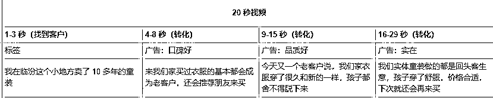

内容拉人，广告劝买，有人看也有人买。再收束两点：

（1）别被播放量绑架，要从流量里筛出足够多的目标顾客；
（2）用地域加行业的标签，把同城目标顾客找出来。

## （3）产品先变广告，再变内容：让目标客户刷到你并下单

很多实体老板都卡在同一道坎：货有了，广告也投了，内容却带不来成交。说到底，就是怎样让潜在买家刷到视频，还愿意掏钱下单。只靠投放技巧不够；素材本身得准、得有效，再把数量做上去，才可能撞出大结果。素材不精准，预算再足、操作再细，也难见效。

#### 3.1.1.4 模板化生产，把视频产量提上来

小门店一周挤出几条视频已属不易，想靠数量取胜，就得借助模板。

以“我在临汾卖童装十多年”为例，把“临汾”当地域标签，“童装”当行业标签。换一条视频，开头可以变成：

- 最近不少临汾宝妈刷到抖音，专门来店里挑童装；
- 上个月这款童装在临汾小店走了上百件；
- 这两天来临汾店买这款童装的家长，都得排队。

把这些词收进表格，就成了标签库：

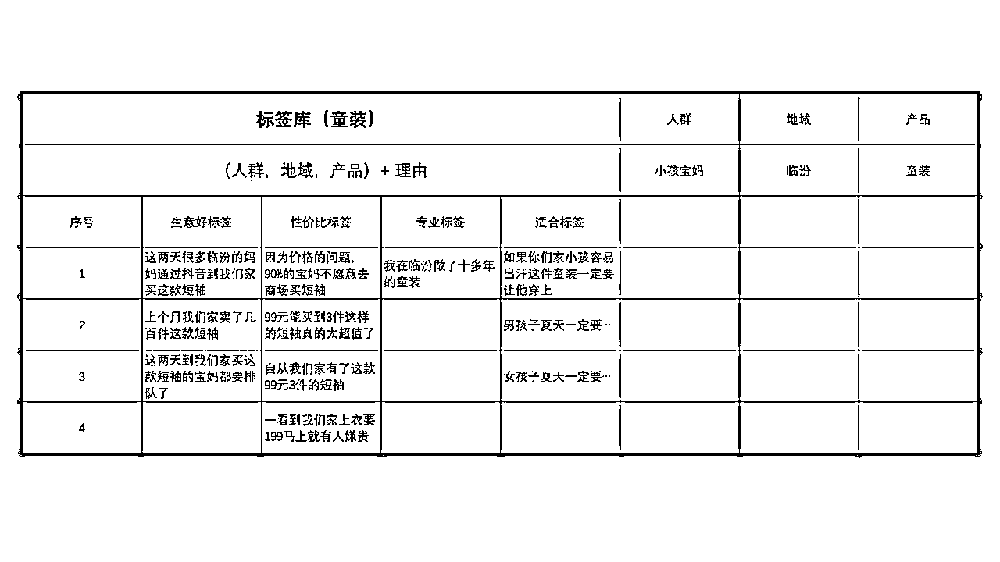

再用同样思路整理购买理由库：

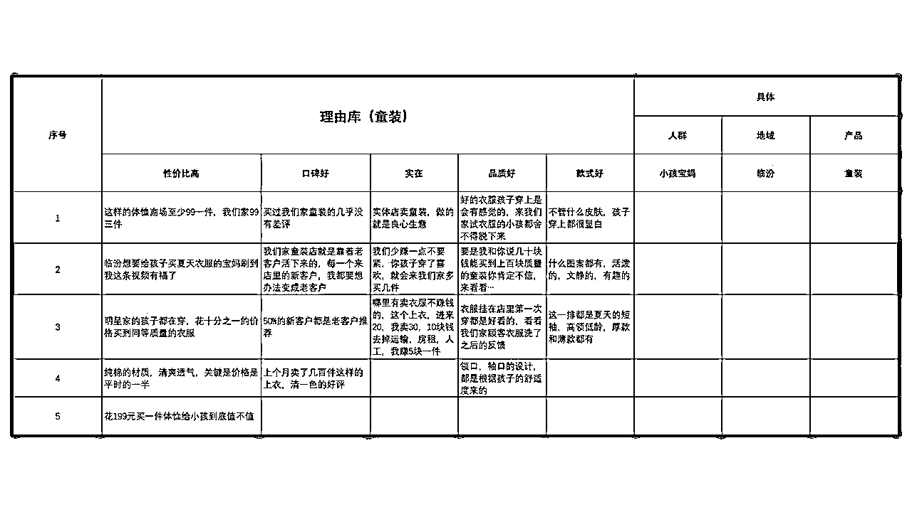

两个库一拼，组合就出来了：

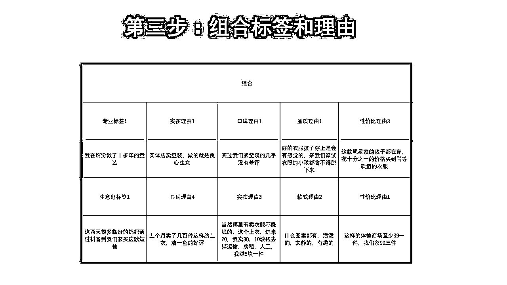

拍摄时从库里挑素材，例如地域标签＋实在理由＋口碑理由＋品质理由：“我在临汾做童装十多年”（让附近想买童装的人刷到），“实体店卖童装，拼的是良心”（实在），“买过我家童装的，基本没差评”（口碑），“好衣服上身孩子有感觉，来试穿的孩子不愿意脱”（品质）。

这条内容换个说法拍十遍，就是十条；再做排列组合：1＋1＋1＋1、1＋2＋1＋1、2＋1＋1＋1……每组各拍十条，两个库就能裂变出大量能引客的短视频。内容跑起来后，账号运营剩下的就是技术动作。

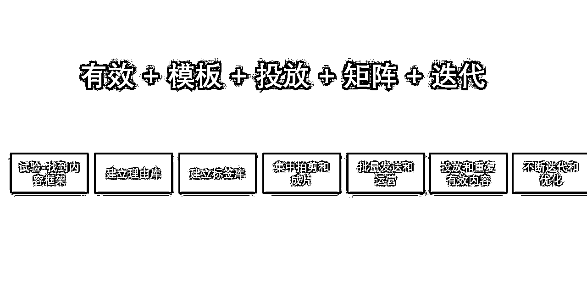

参考内容：《为什么实体店做抖音这么简单？》

#### 3.1.1.5 市场与平台怎么选 @不语

市场判断：

核心城市竞争太挤，大牌已有长期合作方，小牌被反复收割，新玩家不建议硬闯；省会级市场还有空间，老板们大多被“教育”过，但有效线上推广仍是刚需，只要专业度够，可以重新做一遍；县域和下沉市场开发度低，已经有人入场，但专业交付能力普遍偏弱，机会仍然很大。

平台判断：

抖音在核心城市渗透率高，用户追潮流、爱娱乐，短视频和直播能聚拢年轻群体与商业品牌；下沉市场同样有热度，只是稍弱一些，随着智能手机和网络普及，用户规模还在涨。

快手在核心城市也受欢迎，但声量通常不如抖音；它的内容更接地气，对普通用户吸引力强。到了县域市场，快手反而更吃香，生活娱乐内容离当地人更近。

📕在核心城市表现突出，女性用户和时尚人群尤其活跃；平台主打生活方式、美容、穿搭，所以追求品质生活的一二线用户更认它。下沉市场目前热度偏低，但消费升级和品质需求在增长，后续空间值得关注。

落地建议：

总体把主战场放在二三四线。抖音在核心城市最强，快手在下沉市场更旺，📕适合时尚生活方式人群，在核心城市更占优。

二线城市可参考高粉达人∶低粉达人∶素人＝2∶3∶5，主推抖音＋📕，大众点评和快手同步；二四线城市（按原文口径）可用低粉达人∶素人＝5∶5，主推快手＋抖音＋📕，大众点评同步。具体比例仍要看实际资源。

参考内容：《探店15天 门店由亏损到日利润6000+，浅谈3年探店心得》

### 3.1.2 抖音同城号怎么做号引流

线下门店的成本盘子正在变。过去房租能吃掉营收的两三成，如今可以压到一成左右，把省下的那部分投到同城号建设和营销里，换回更多客流。连锁和加盟品牌，尤其容易吃到这波同城红利。

这一节拆成四块：先讲抖音本地生活到底是什么、为什么值得做；再讲门店认领流程，以及短视频定位、同城页、直播间怎样挂出门店入口；接着看几个同城号案例，拆内容打法；最后给六个避坑提醒，并附几种入局思路。

就算不自己拍内容，开通本地生活后也能让达人按分佣帮你推店。所以，门店认领这件事可以尽早做。

#### 3.1.2. 抖音本地生活：把三个词拆开

“抖音本地生活”可以拆成平台、区域、类目三层。

平台是抖音，也能换成📕、快手、视频号；区域是本地，对应异地、海外；类目是生活，对应职场、教育等方向。

合起来就是：消费者在抖音下单生活服务类商品，再到本地实体店完成核销。说直白点，它像短视频版的美团点评——本地吃喝玩乐商家把套餐、代金券挂上抖音，靠兴趣推荐的信息流完成销售。

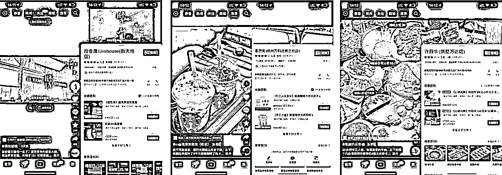

本地生活这件事，是跟着互联网平台一路演化的：最早是58同城这类信息平台，后来是美团点评的图文推荐，再往后是抖音、快手、📕的短视频兴趣推荐，现在连支付宝、地图类App也想分一杯羹。

抖音、快手、📕、京东、支付宝都在加码。平台争抢的战场，对店铺主来说就是必答题，而且得尽量拿高分。

2022年这轮抖音本地生活起势后，和上一轮相比有几个关键变化，说明它值得做、必须做，而且要重投入：

（1）除了曝光数据，还给出成交维度的清晰反馈，投放ROI可以更直观地衡量和优化。只要愿意做系统优化，早入场的玩家大概率能吃到流量红利。

（2）团购达人在部分城市试点0粉开通，其他城市1000粉也能开，门槛很低。开通后可在任务广场接本地生活带货链接赚佣金，也能在同城达人群、商单群接剪辑发布任务赚服务费。

本地生活偏“品带人”，电商带货偏“人带品”。品足够好，视频质量普通也能带来不错的分佣，这会明显提高素人创作者的带货积极性。

参考内容：《为什么说抖音本地生活是道必须拿高分的必答题？》

#### 3.1.2.2 本地生活如何给线下门店引流？ @宋威

可做类目包括休闲娱乐等，最终以平台审核为准。

第一步：单点经营生活服务的实体商家，如果公司或门店主体还没在抖音企业号开通团购，就去抖音来客App申请入驻并认领门店。

第二步：打开抖音来客官网 https://life.douyin.com/ ，或下载抖音来客App。注册登录后查看所需材料，备齐信息和资料，点击入驻抖音门店，搜索目标门店并核对信息。

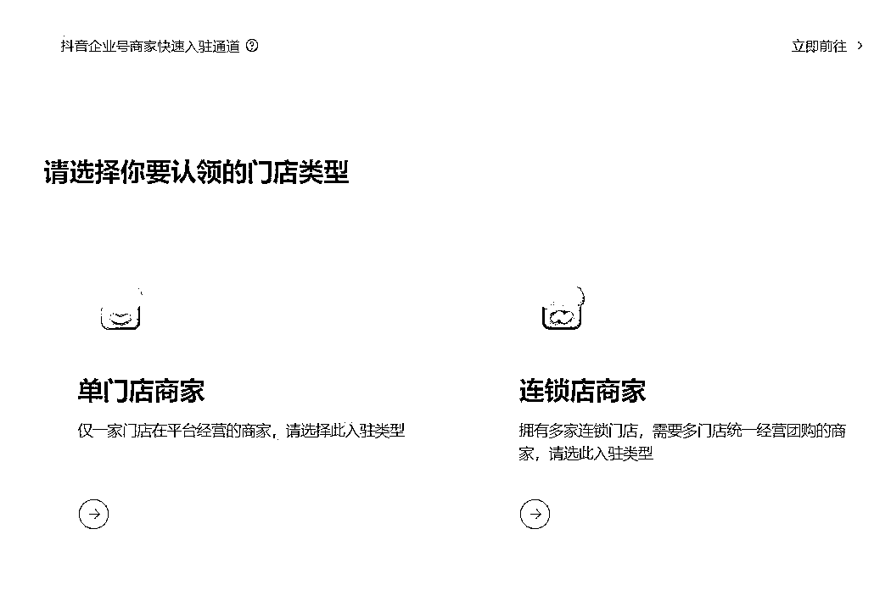

选好门店后进入资质提交页，按提示上传材料等待审核。通常需要企业法人营业执照等平台要求文件，具体以页面说明为准。

第三步：认领完成后，绑定收款账户、绑定抖音号、创建团购商品。

商家认领门店后创建团餐链接，流程和入驻美团类似。顾客在抖音直接买套餐，购买后拿到二维码，到店凭券核销用餐。

那顾客怎么看到并下单？目前有四个流量入口：

第一个：发布作品时挂门店POI定位。

这也是眼下约九成商家最看重的流量口，因为操作简单，本地团购达人数量也够用。我这边这个入口约占总GMV的四成。

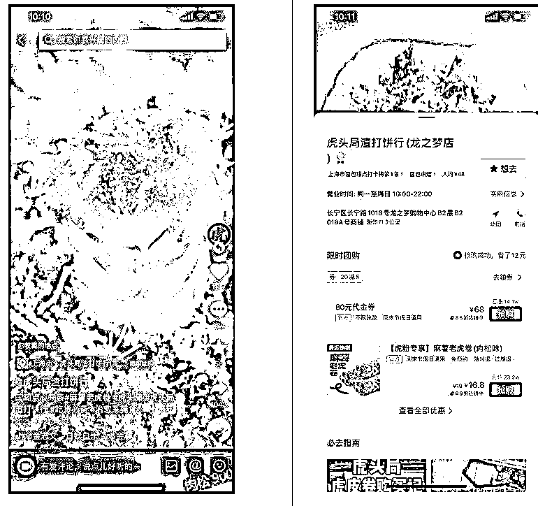

第二个：商家主页＋搜索流量。

这部分来自品牌声量、粉丝，以及线下门店引导。有人会在抖音搜品牌号，也可能被门店引导到主页买套餐。

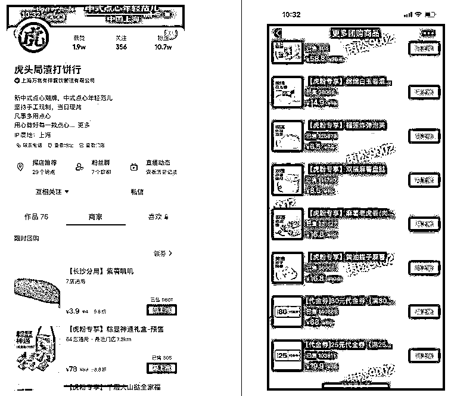

所以加盟商或特许经营者，可以拿品牌授权书认证账号，借官方影响力和搜索流量。举个例子：某品牌抖音排名里，一个个体户冲到了全国第三。

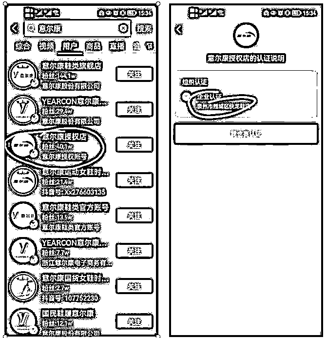

第三个：直播间挂本地团购小房子（小程序为小雪花）。

这是本地直播带来的流量，分品牌自播和达人直播，属于需要强运营的板块。直播门槛比短视频高，对商家能力要求也更高；目前本地直播达人偏少，官方头部达人不足5个，还集中在北京，其他城市刚起步。但潜力很大，我这边达人直播和品牌自播合计约占总GMV的54%。

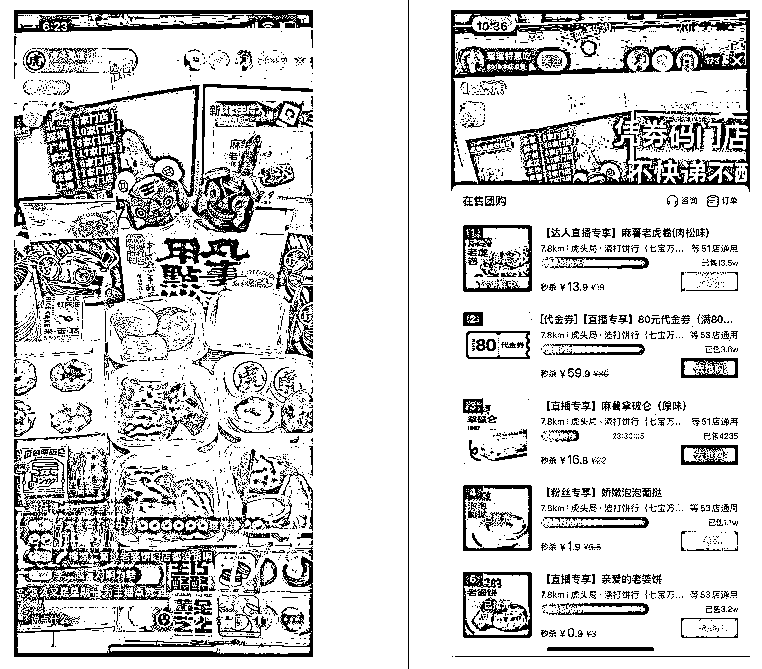

第四个：抖音本地同城页流量。

也就是平台同城生态自带的流量，页面逻辑接近美团点评。用户想吃什么会先去美团点评搜；抖音同城入口目前流量一般，同城页下还在内测商城等子页面，流量更小。总的来说，这个入口要等用户习惯养成才有潜力，现在几乎可以忽略，我这边占比最多1%。

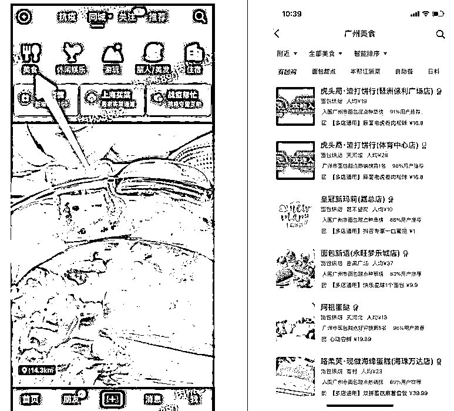

参考内容：《虎头局抖音本地生活从0到1半年做到3000万GMV实操分享》

#### 3.1.2.3 同城号内容怎么做 @西撒、@乔合

我们的打法是把开店过程直接记录下来，做成连续剧式的日常。账号从选址就开拍，装修一步步跟进，配上轻松逗趣的聊天文案。

店还没正式营业，同城曝光已经跑到二十多万。结果也很直接：装修结束进入试营业，第二天门口就排起队。这个号到现在只花了几百块Dou+。

底层逻辑并不复杂：同城餐饮门店号的用户画像本来就宽，不需要像其他行业那样做极细的定位和画像分析。门店吃的是三到五公里内的客流，目标是在附近持续露脸，让街坊知道这里新开了一家店、老板是谁，再把人引到店里消费。

内容方向上，我们没打算日更美食，那种视频交给素人矩阵探店去引爆就行。我们更想让账号留下记忆钩子，做成同城小IP。测试下来，用开店日常确实能把流量带起来。

同城流量不必盯着全网爆款，本地播放能到几万，偶尔冲进本地热门，就足够帮到门店生意。这个店现在在当地人气榜稳居第一。

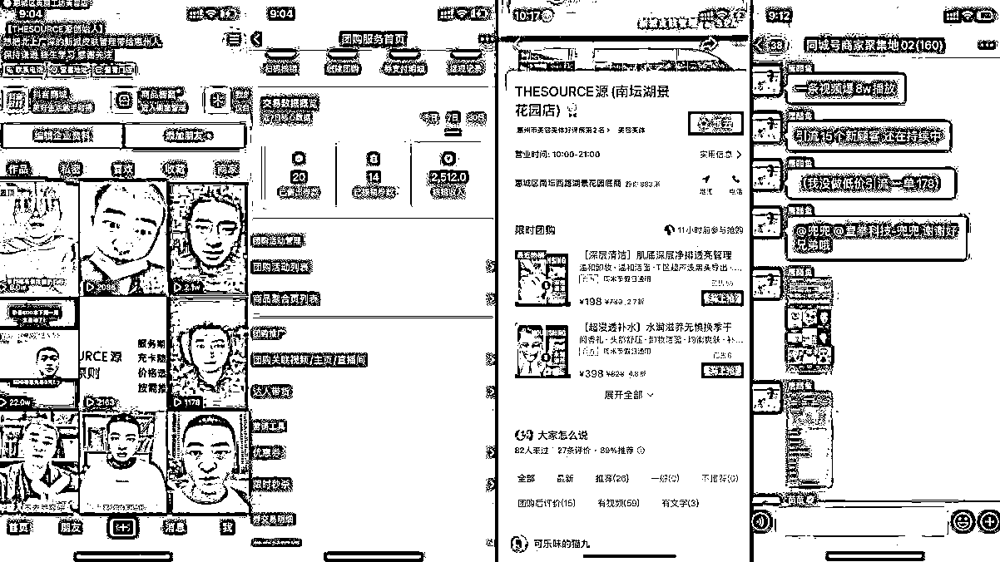

这位圈友镜头感好，状态也松弛。我们帮他优化脚本后，视频拿到8万同城曝光，因为挂了团购产品，卖出二十多单。后来又爆了一条20万播放，基本覆盖周边10公里，到现在还在持续带客，同时也做到本地美容美体榜第一。

3. 电子烟门店同城号

短视频是成本最低的流量入口。我不往私域引，只要门店在同城有曝光，让附近人知道店在哪、卖什么、开业有什么活动就够了。

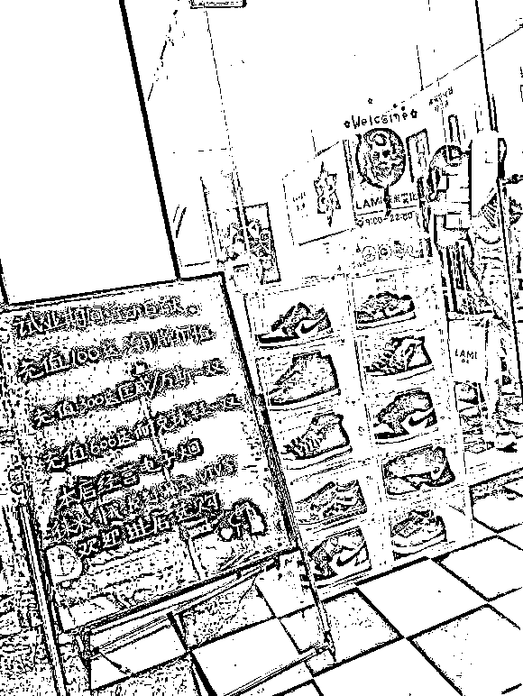

我把牌子往店门口一放，拍视频投豆荚并挂门店定位，两条视频投500元，合计1000元，定向附近30公里，本地曝光48万，让周边人对新店形成第一印象：有活动、划算、电子烟品类全。

开业活动：充值满100赠潮牌T恤；满300赠匡威或万斯；满600赠AJ。成本其实不高，T恤从广州拿货8到12元，鞋子找莆田渠道成本也低。反正只送不卖，没人会较真真假。

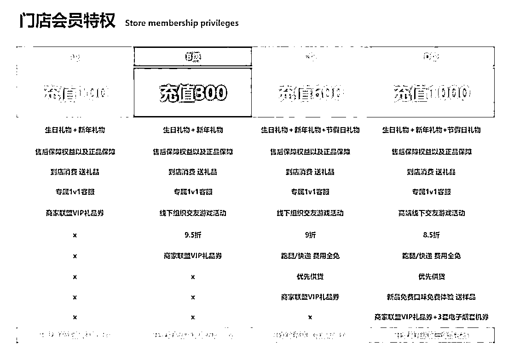

五月底试营业期间做了充值活动，开业前两天陆续来了几拨人，后面充值的人越来越多，觉得划算就互相推荐，口碑慢慢传开。后来我们又拍了数十条视频推这个活动，每条投100元流量，人气很快起来。

营销上，这家店用了“排队”这个经典打法。视频拍得很简单，画面只传递一个信息——这家大排档天天排队、场场爆满，文案用“创业第XX天”加一句走心话做标准输出。开业时请亲朋好友免费来吃，从不同角度拍完，简单剪一下，用他们的抖音号发出去，每条通投100元DOU+，有效果再追加。

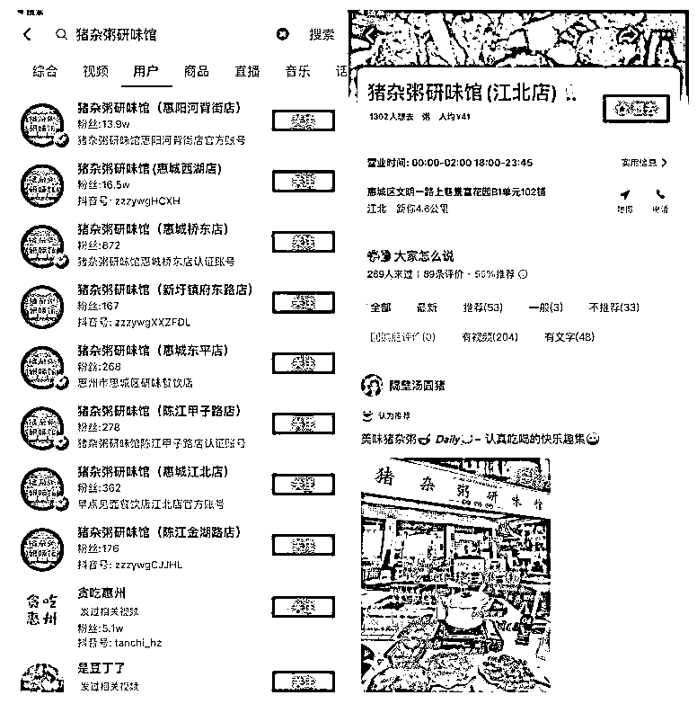

5、小吃摊位同城号

为了把视频数据做上去，我也拆了不少同城热门账号。最近地摊内容火，我就重点研究了烟火气小吃的拍法。

我主要发两类视频：

1、卡点型：多用特写，3:4竖屏。
2、剧情型：镜头先移动，再跟老板对话，然后拍制作过程（剧情类用全屏）。

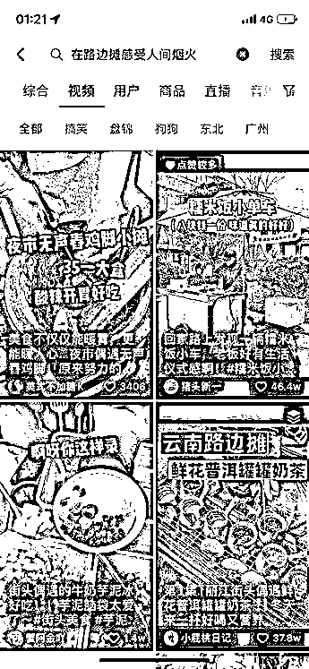

发布时一定挂定位，标签带本地城市名，再加“XX（城市名）探店”，用来吃同城流量。

标题也能蹭热度，比如：偶遇XX夜市的XXX，也太好吃了吧！

视频内文案可以去📕找爆款改写，或者直接套结构。文案尽量站在顾客角度，像在跟别人分享。例如：

示例一（顾客分享口吻）：“别问了，真就在XX城！隔壁买蛋糕时才发现，哎这不是我在XX城吃过的XXX吗😭 之前吃过一次就一直惦记这个XX。品种挺多，我最爱XXX。外皮🐧弹弹，芯子甜甜的，绝了。手里拿一个吃，再打包几个回家，幸福感直接拉满。糯叽叽的东西我真的爱惨了。建议晚点来，晚上才出摊，人少些！不过我们只抢到几个😭，后面想买都没了。”

示例二：“想安利给全世界的XXX。偶然在超市看到，颜值高就买来试。入口真的惊艳。红豆肉松蛋黄，红豆味浓，肉松香夹着整颗蛋黄🥚，越嚼越香，口感很棒。姐妹们冲，这组合真绝，期待新口味～”

视频发完后还有一个动作：在评论区留言，写店铺名、地址、营业时间等。除了拍视频引流，我也会在抖音开直播。每次出摊前先更一条视频，照常是卡点或剧情类，用视频给直播间带点人气。

参考内容：《如何看待抖音同城流量的红利？以3类门槛低，变现空间高的项目展开讲讲》、《00后实体店创业者：用互联网思维破局疫情影响》、《我做了哪些操作，摆地摊也可以60天营收20w+》

#### 3.1.2.4 同城号六个注意事项 @大芽

注意：内容只打一个点，用户才容易记住你。绕太多，大家反而记不住。

2. 发布前挂POI位置信息。

起号阶段一定要带地标。门店还没地址，可以先借周边热点，比如附近小区、酒店都能挂。我一开始挂的是离店500米的一家酒店，也没关系。有地标，本地流量推荐才更精准。

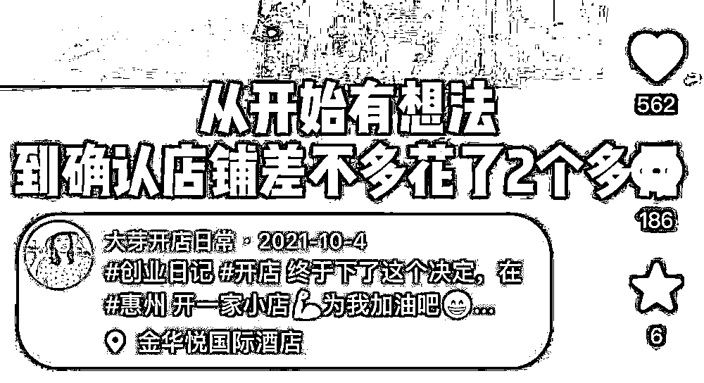

发第一条视频时，我就是靠这个办法选到一首上升期的BGM，之后一直沿用。长期用同一首BGM，也能成为用户的记忆点。

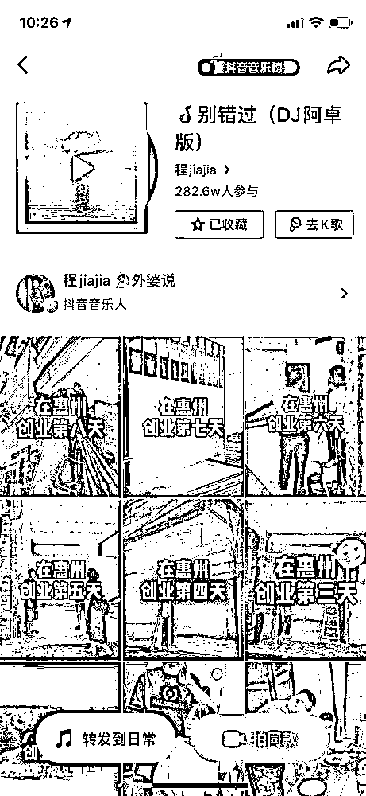

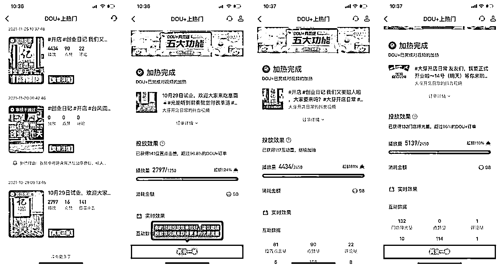

参考内容：《3公里内最少有500人看到，抖音同城号做到热榜第一，132W播放》

#### 3.1.2.5 入局前，先想清楚九件事 @曹聪 ᴄᴏʟɪɴ。ᴄʜᴀᴏ @老胡

（1）先定阶段性的战略需求，再配战略目标
终极目标：把当前经营状况良好的门店，变成能够持续创造利润的“长期引擎”，在抖音上保持稳步增长。
如果追求 GMV，就把正价商品的成交作为主攻方向；如果要做品牌，就把品牌形象和用户心智放在第一位；如果想获客，就集中火力把人吸引到店里。

（2）三个基础认知，越早知道越好

a. 商品设计要“三赢”
“货带不动人”的设计，商家没利润，达人不愿推，用户不买账；好的商品设计让商家算得过来账、达人愿意带货、用户乐意下单。
利润维度：把折扣、毛利和“玩法”算清楚；
流量维度：让商品有看点、有话题、有真材实料；
服务维度：核销率、履约能力和复购钩子都不能掉链子。
“做生意就是自己把账算对，让客户算错账”，利润才能产生，但前提是不骗人。

b. 把成本控到极致
利用员工账号矩阵、顾客账号矩阵、云剪达人矩阵，再配合半自动剪辑分发工具，就能低成本批量生产内容。成本管不住，表面数据再好看，核销账一算还是亏；虚假繁荣能忽悠圈外人，忽悠不了自己和账本。
员工侧：卖点清晰、培训到位、激励合理；
顾客侧：物料、流程、奖励要跟上；
动作侧：话题、模板、文案要统一。
至少店主和员工账号要成为团购达人，持续为门店做视频分发和带货。关于达人资源获取和低成本剪辑分发方案，后面再分享。当一条短视频从拍摄到分发的成本降到个位数，投放跑正的概率就大大提升。

c. 直播值得做
直播没有想象中难，别给自己加戏，别还没开始就退缩，否则没人看。实体门店本来就是天然直播间，也是建立信任感最直接的地方。
多个“日不落”的线上销售渠道，何乐不为。前面已经说得很清楚，本地生活是平台级战略，POI 倒流倾斜是必然，多入口流量汇总，能拿就拿。
POI 倒流对本地连锁效率最高；不是连锁怎么办？往下看第（4）条。

（3）把“超级红利”拆成具体入口
抖音本地生活的团购逻辑不是一个简单维度，收藏数、GMV 数据、核销率、视频数量都要纳入考量。把每个维度拆开分析、逐项突破，服务才能做扎实。比如算明白 1 元 GMV 对应 100 热度，再把账算给商家听，帮商家上榜。
搜索流量也同样重要。SEO 依然是目前最容易实现的“广告”，团购排在页面首位的黄金位置，不信可以亲自搜。
抖音作为搜索平台已经是“明牌”，位列搜索市场第二，且同城搜索匹配高度精准。排序通常是本地生活商家第一，其次才是商品、直播、短视频、广告。Tag 匹配度、短视频数据、用户习惯都影响结果。SEO 词怎么定是有门道的，赚钱开过航海，建议去看资料，别自嗨——你的品牌没人搜，大家搜的是产品和场景。
榜单机会也别放过。榜单直接影响曝光和流量倾斜，要好好研究规则。参考点评：黑珍珠一个值千万，必吃榜一个值百万，抖音的榜单价值不会比这个弱。商家分、POI 分、产品分，人气、好评、收藏、热销，所有维度都有操作空间。

（4）服务商必须把矩阵放在最前面
矩阵可以组合素人、KOC、KOL，关键看怎么搭配。为什么矩阵如此重要？因为抖音的流量分配逻辑已经变化：约 5000 播放以内，本地流量占比在 50%-80%；一旦超过 5000 播放，本地占比就会快速下降，大部分变成外地流量。
本地生活要的是有效本地流量，所以要通过矩阵分散窗口，获取更多有效曝光。

（5）垂直深耕比“什么都做”更容易跑出来
本地生活里有很多细分赛道，深耕其中一个，冷启动会明显更快。比如我们三个 BD 就能签下大量商家、服务好大量商家，一年收入相当可观。把一个赛道做透，冷启动快，成本也控得住。
有了方法论和 SOP，再做第二个赛道会更快；电商背景的团队尤其有优势，切入大赛道更轻松。
千万别人家推什么业务就做什么，今天餐饮，明天足浴，后天电影票、景区，最后什么都做不深。选一条垂直赛道，一直做下去。

（6）渠道要多点开花
不要只盯抖音。大众点评、美团的逻辑相对简单，把供货量管好、做好基础数据，就能形成闭环，可以纳入服务包。📕做电商也比较快，🛰️本地👸号和视频号推私域也可以并行。
地推也不能丢。去年有个 150 万的案子，楚川公司每天请 20 个学生，每人日薪 100 元，去门店三公里内的地铁站发传单，一单提成 20 元，不少学生一天能赚几百。
只有把每个渠道做深做透，才有资格帮商家做全平台运营，也才收得起高价。现在抖音生态里，商家觉得给你 1 万已经很多；但如果你能做全案，收 20 万-30 万他也会愿意，因为你的服务是深度的。

（7）和官方亲密，但别沦为“工具人”
可以主动靠近官方，拿方法论、资源、案例，但别做狗腿子，要学会利用平台资源。

（8）变现方式可以更野
电商品牌本地化已经是一波明显机会。线上卖酒、卖化妆品护肤品的品牌，很愿意贴钱换线下渠道。服务商可以借势：给我 100 万曝光，兑换产品或者流量费，我帮你铺渠道、获取用户。
大的 KA 渠道也很有想象力。把一个产品铺进 1000 家便利店，流量入口就是巨大的，引流效果也会非常惊人。
电商和本地生活之间，确实藏着很多玩法。楚川去年接了一家精品化妆店，服务费 8 万，长沙 6 家店；上架一个 19.9 元的化妆服务，外送 128 元护肤套装，半个月卖出 6 万多份。商家说那一单赚了不少钱，大批用户也沉淀到了私域。
本地生活和私域结合、和电商消费品结合，都是很大的增量机会。

内容来源：《为什么说抖音本地生活是道必须拿高分的必答题？》、《价值百万的抖音本地生活创业血泪史》

### 3.1.3 抖音达人怎么借力 @蛋解创业 @宋威

💡 核心提示：自己养号之外，还有一种效率更高的玩法，就是花钱找达人。
这一节会聊：达人从哪里找、选哪种、怎么合作、内容怎么拍；再看 ROI 怎么算、怎么用数据把效果放大；最后讲团购达人的直播合作。

#### 3.1.3.1 关键一：达人从哪里找？

第一步：先定选人标准
团购达人按带货等级 1-6 级划分，核心考核实际带货能力，粉丝量不占权重。所以高粉丝达人未必比千粉达人效果好，成本却高得多。
无论大品牌还是小店，建议优先看带货等级而非粉丝量；优先合作内容优质的 KOC，投产比更高。
如果按粉丝量粗略分：
20 万以下，可以海量联系，不要坑位费、愿意分佣的，就让他来店里拍；
20 万以上还要坑位费的，谨慎选择。
推荐顺序：先找不收坑位费的，再考虑收坑位费的。自己还没经验时，别一上来就砸钱，容易一步错，步步错。等有判断力了，再找收费达人。
候选去哪里找？最省事的是服务商，现在每个城市都有团购达人服务商，手里资源很多。想省钱，就打开抖音创作者服务中心的“团购达人”，按城市筛选，挨个私聊；也可以付费请某个达人做招募，成本更低。
另外，商家可以自己创建招募计划，设置好达人要求。达人会在团购中心的合作广场看到，主动报名联系你。

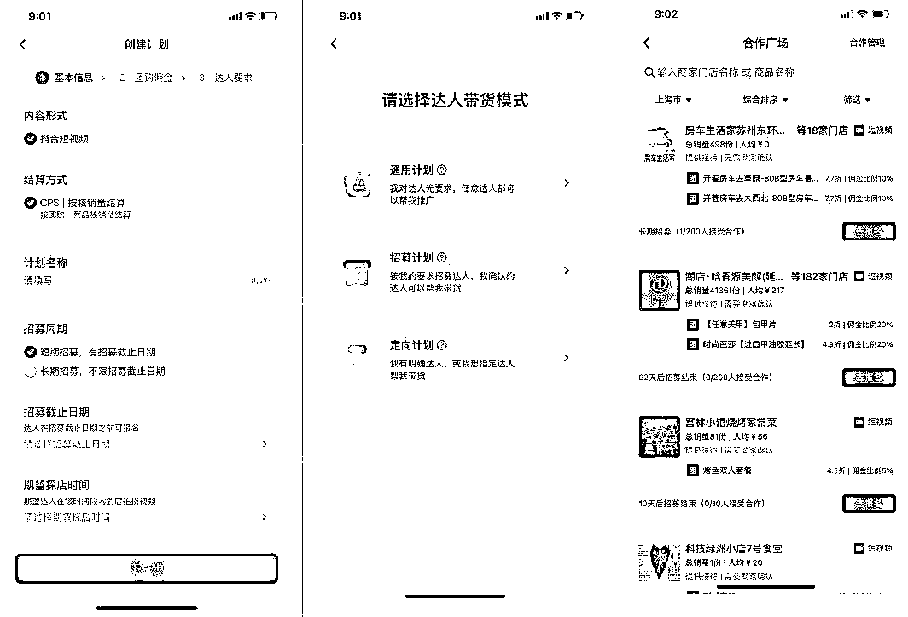

第二步：把合作方式谈清楚
团购达人有分佣机制，能把一口价成本转成效果付费。所以不要只上架商品，一定要设置佣金。有了佣金，谈判成本更低，也可能吸引“自来水”达人主动来推。
目前达人的合作方式主要有三种，包括坑位费/一口价、分佣、置换，可以按目标选择。

第三步：内容只打一个点
每个达人都只突出你门店最核心的卖点：招牌菜、金牌服务、必体验活动，别的不用多拍。所有达人都在放大同一个点，效果才聚得拢。

第四步：投 Dou+ 要会拆
我花了几十万投 Dou+ 的经验是：手里有 1000 元预算，不要一把 All in。同一时间段拆成 5 笔 200 元去投，比一次性投 1000 元效果提升 20%-30%。

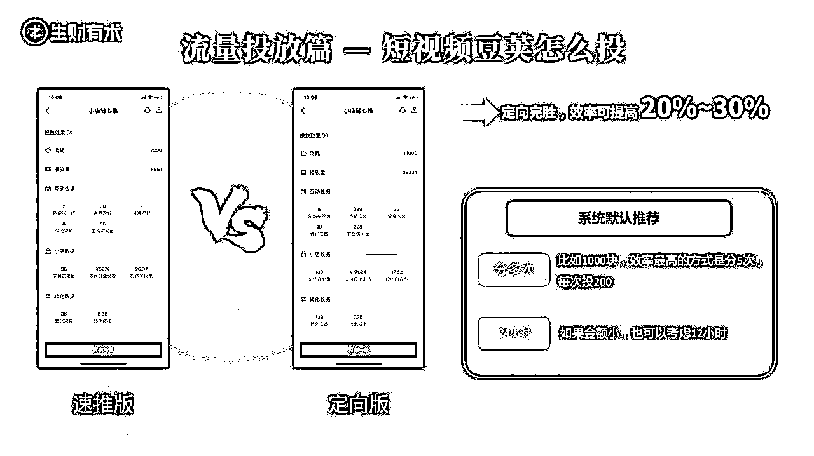

再提供一个圈友 @宋威 的投流方法：前期基本用第三种置换模式——给达人 80 元代金券采买产品，再加 10% 分佣；视频到 1 万播放时投 100 Dou+，到 5 万播放时追投 100 Dou+。这两个 Dou+ 的核心目的是“追涨”，卡在 1-10 万播放区间，助推内容进入 10 万流量池。
Dou+ 投放直接选“门店点击”效果最好，范围选门店 6 公里内，性别和年龄按你的用户画像选择。这样做既能降低推广成本，也能提高推广效果。

#### 3.1.3.2 关键二：算准 ROI，再放大效果

达人拍完视频，只是第一步。接下来要盯数据：这条视频有多少播放量？多少人领了店铺优惠券？领券的人里多少真正到店核销？
算清楚这个比例，就是转化率。如果转化率够高，客单价也够高，ROI 就能算。
举个例子：卖一个 99 元套餐赚 30 元，达人带来 5000 播放、300 人领券、100 人到店核销，也就是卖出 100 单，赚 3000 元。
这相当于每投 100 元 Dou+，能换回 3000 元。那当然应该加码：投 1000 换 3 万，投 1 万换 30 万。这就是一道算术题。
所以，找达人探店只是同城号长征的第一步。如果后续数据一概不看，那就成了天天被白吃白喝的老板。
下面这张图可以说明问题：老板对达人说，你这条视频的自然流量要是停了，跟我说一声，我帮你投 Dou+。

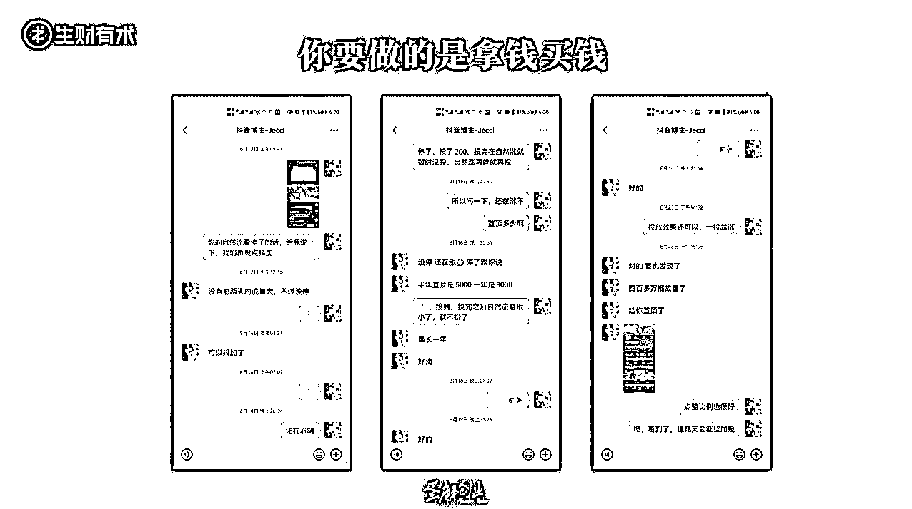

换句话说，你找一个 500 万粉丝的账号探店，比如 2000 万粉的「大 LOGO」，探一次 20 万起步，还不包播放量；效果不好，20 万就打水漂了。

#### 3.1.3.3 进阶：团购达人的直播玩法

团购达人直播也是很大的增长点。和电商商家一样，你可以让全网达人直播带你的品，合作模式还是前面那几种。
想做专场直播，更适合门店数量多、受众广的连锁品牌。中小商家则更适合本地拼场直播，目前抖音官方会撮合：设置好给达人的直播品，上报给官方，官方组局安排本地达人直播。

内容来源：《如何通过抖音同城号，把自己的门店打造成网红店？》、《虎头局抖音本地生活从 0 到 1 半年做到 3000 万 GMV 实操分享》

### 3.1.4 📕引流怎么做

💡 核心提示：📕同样可以做自有账号或达人合作。部分行业的目标人群在📕更集中，比如艺术体验门店、露营、民宿、个护产康等，完全可以把它当成主要发力场。
除了自有账号和达人合作，下面还整理了一些引流注意事项。

#### 3.1.4.1 自有账号引流的实战经验 @怡伶 78667 @Nico 酱

去年 10 月开始做艺术体验门店，我的📕个人号到现在也只有 700 粉，询单爆发时不足 500 粉。但店里 90% 客源来自📕，其中不乏单价 1 万+、2 万+的企业单。
我的闭环很简单：从公域引流到私域，客户在🛰️预约，再到线下门店消费成交。📕来的客户非常精准，来一个成一个；私域不需要太多维护，我几乎不怎么发朋友圈。
注册、定位、主页设计、私域维护这些内容，赚钱里已经有大量分享，我不重复。这里重点讲种草引流的思考和踩坑。

我把主营业务调整为 Tufting 类目后，主要发两类笔记：个人引流名片和案例作品种草笔记。这两类都给账号和门店带来了稳定曝光，也吸引了不少精准成交客户，属于高转化笔记。实战营同学验证过，很多类目都能用。
我的评论区词云图（高频词：预约）：

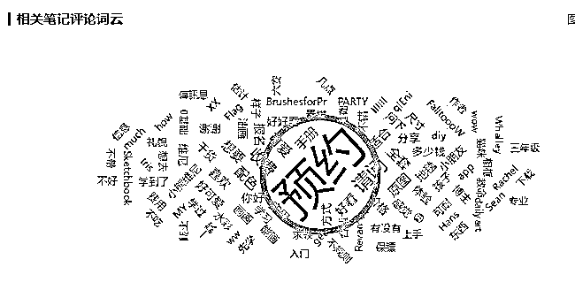

方法一：置顶“个人引流名片”笔记
这篇是我写的第一篇 Tufting 笔记，也是询单、预约量最大的一篇。在📕搜“上海 Tufting”或“Tufting 上海”，它基本排在前十（不同账号的搜索结果会有偏差）。
引流名片笔记，本质是软性植入自家的产品和服务。写法从两个角度看：笔记类型和写作技巧。
笔记类型有三种：故事经历型、硬广介绍型、伪真实体验型。

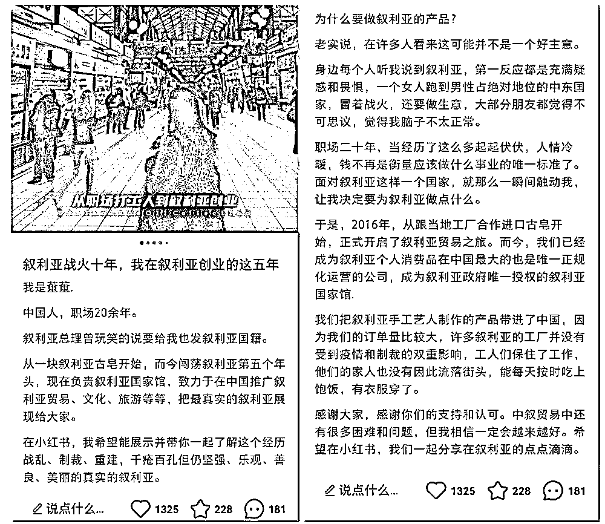

真实体验型：我一开始写得很硬广，后来改成探店笔记的口吻，直接放了门店地址，也没有被判导流违规。有店的可以试试伪探店口吻；没店的可以模仿素人体验口吻，系统未必能识别出是广告，挺好用。

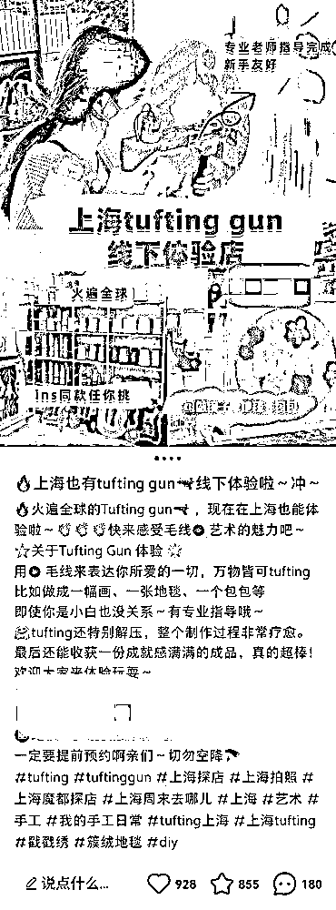

硬广介绍型：简单直接地介绍我是谁、提供什么产品和服务、流程和理念是什么。这种更适合企业号；个人号写不好容易违规。

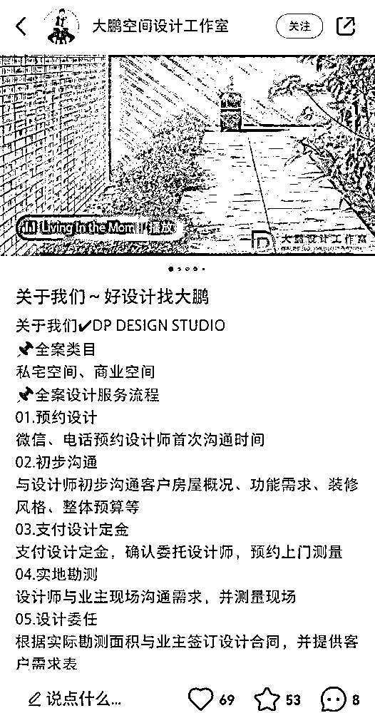

三种都可以测试，然后一直置顶在主页（发布满 20 篇笔记解锁置顶功能）。
我这篇笔记的互动数据基本来自自然流量，评论区询单很多。如果前期互动不够，可以人工控制冷启动，错开布局“怎么联系”“怎么预约”“店在哪”这类询单评论，效果会不错。新用户进来第一眼看到自我介绍和评论区，有需求自然会问。

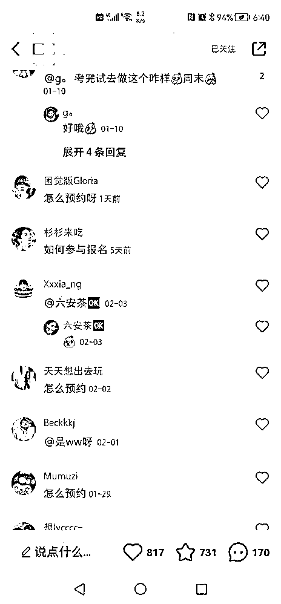

写作技巧分图片和文字。图片要跟工作、产品、服务相关，最好真人出镜；不想露脸就拍侧脸或真实场景。文字用大白话，就像和朋友聊天。越接地气，📕的用户戒备心越弱，越愿意询单。

方法二：案例作品种草笔记
定制、客定、设计类商家 IP，基本离不开客户作品种草。比如我必须发客户的 Tufting 成品，才能吸引到体验型用户。
但这里有两个问题：容易写成干巴巴的硬广；个人号又不好一直扮演消费者。
调研了很多优质账号，结合实战，我的解法是：
第一，直接告诉用户你就是老板，用老板视角描述客户体验和作品；或者立一个工作室员工人设。

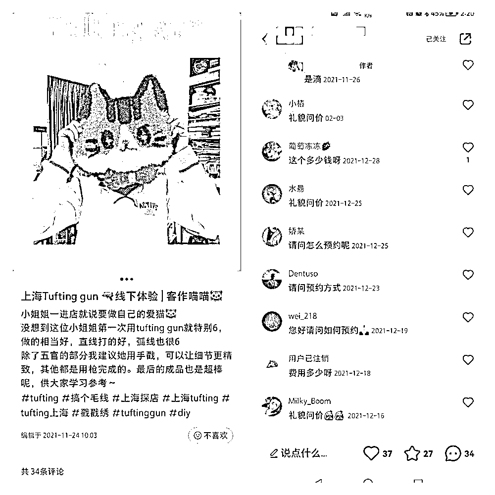

比如小浔溪那篇，就用了“踢脚线工厂打工妹”的角色，又爆又精准：

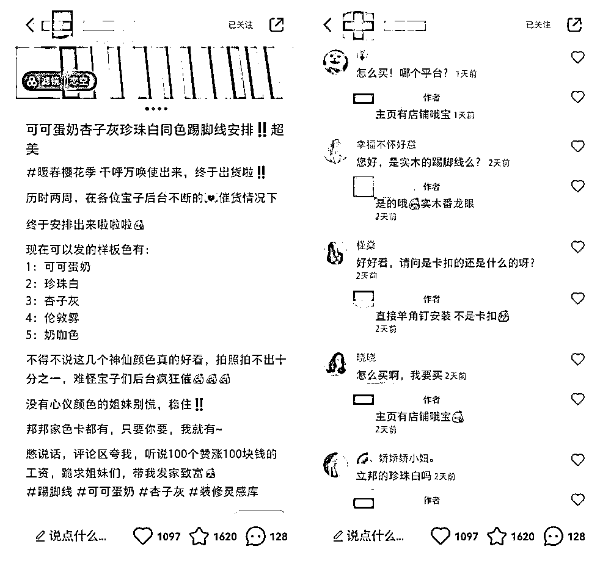

第二，无论老板还是员工视角，都要用聊天式口吻，像街坊邻居唠嗑。文字不用太长，语气可以俏皮。举两个例子：
生硬版：冬日上新 这款实木餐桌真的很值得买买买
聊天版：客户全家都夸爆的实木餐桌！姐妹们快给我冲！
口吻真的很重要。哪怕明说你是企业、你是老板，只要接地气，用户也不会反感，反而会因为“真实”“坦率”而种草。

其他📕引流方法：
方法三：个性签名留🧣，用🧣做跳转引流。
方法四：评论区剧本式引流。比如我发美业门店资料时，安排小号在评论区求分享、求完整电子版，造成从众效应。
方法五：私信自动回复，相同内容不能超过 3 次，提前准备带联系方式的图片。
方法六：笔记收藏式引流。用小号发布带联系方式的笔记，大号收藏，别人看大号主页时就能看到联系方式。
方法七：把📕名字设置成🛰️号，效率最高，客户咨询时直接回复“看我名字”。

种草笔记的其他细节

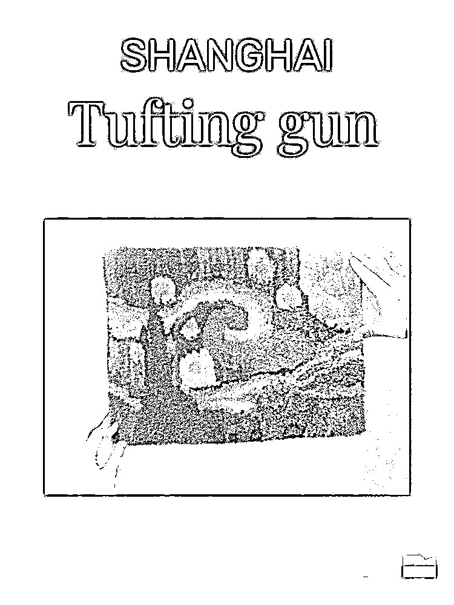

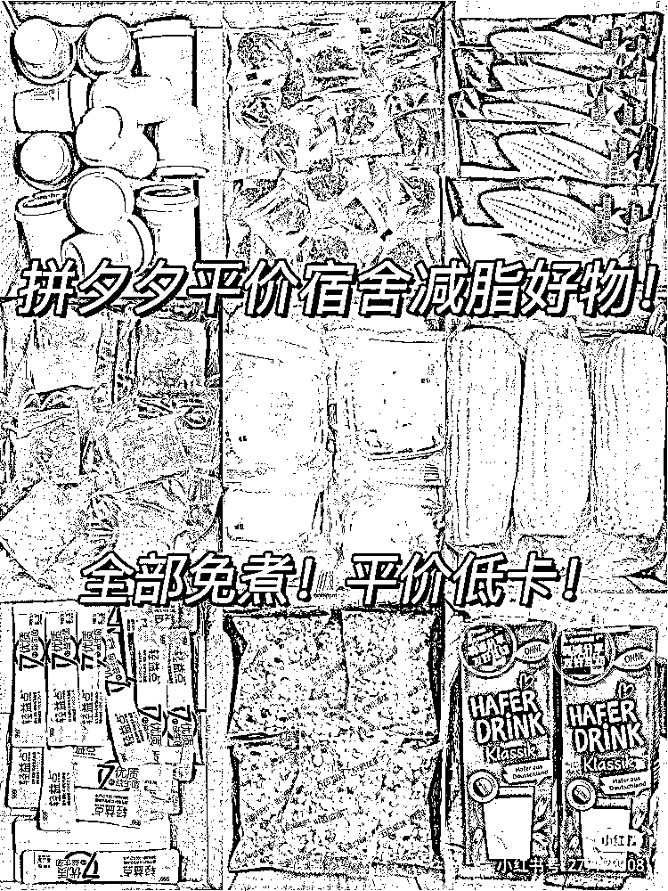

# 同城小店获客：种草与团购双线跑

封面大致分两种路子：图里左侧偏精致唯美，右侧偏生活化。首图工具可以试试美图秀秀、黄油相机，字体和贴纸素材挺多；稿定设计里也有现成的📕版式，新手直接套用就行。

先找出本行业中搜索需求旺的产品词。拿“画画”在📕搜一下，结果页圈出来的位置会列出一串关联词，挑适合自己业务的，平时写笔记自然带上。继续往下翻，圈中区域还会出现更细分的词，也能参考。另一个来源是对标账号：把同行爆款笔记里的词抄进小本子。

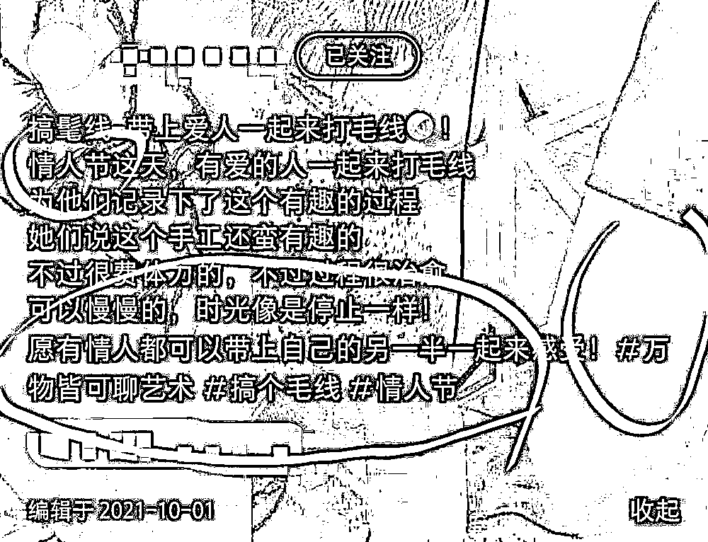

企业号后台能查看搜索词投放、买量以及搜索表现，这项专属能力确实省事。我刚升级企业号，等有新经验再补充分享。

词库备好，就开始铺词。我的习惯是标题、正文、收尾三处都安排，同城词尤其不能落下，比如“上海 Tufting”这类。标题用“地名＋领域精准词”的结构，能接住本地流量。📕靠算法分发，粉丝体量不是决定项；封面首图够抓眼、互动数据有底子，用户搜索时系统就可能把优质笔记推出去。

冷启动阶段，泛词和精准词搭配着放。泛词是覆盖面更广的热词，像探店、上海探店、周末探店；精准词贴着产品细分走，像 Tufting、上海 Tufting、戳戳绣。我一开始只放精准词，流量比较平淡；叠加泛词做曝光后，整体效果明显不一样。当然，前提还是笔记内容能留住人。这套思路放到大众点评也适用，做点评的老板可以试试“店铺名＋团购”的组合。

另外，圈友 @温州土老板 在星球分享过传统行业📕获客模板，覆盖家政、茶叶、二奢、培训、服装、零食等十个领域，想拓展思路可以翻翻：《📕 10 大行业，引流获客模板》

内容参考：《千粉不到月入 10W ，我如何通过📕救回濒临倒闭的艺术体验门店？》、《200 家日式皮肤管理加盟店背后，我是怎么把美业生意和互联网运营结合的》

#### 3.1.4.2 同城达人置换引流 @Mage

我做轰趴别墅，会到📕找本地探店博主谈资源互换：免费请对方来玩，条件是在📕发一篇笔记。

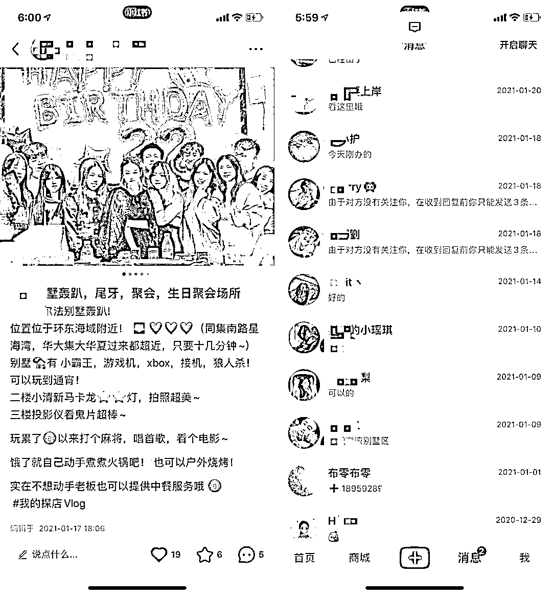

置换流程可以这样拆。第二，先看这位博主发的是不是同城吃喝玩乐；若清一色美妆、护肤，那多半是泛粉，本地精准受众偏少。第三，看拍照和文案功底，至少刷到时能勾起点击欲望，不能像随手拍。第四，也是最关键的一步，看粉赞比：通常 5000 粉要有 10W 以上获赞与收藏，也就是“粉丝：获赞与收藏”约 1:20 以上，这样的博主算比较优质。

然后进入打招呼环节。我一般会说：哈喽博主你好，关注你很久了，我这边是位于 XX 地区的 XX 别墅轰趴馆，觉得你在📕上的内容和照片都不错，想诚邀你和朋友过来体验，不收费～要求是你帮我们在📕发一篇宣传文章～～～之后拿账号批量联系博主。有意向回复后，把场地照片、位置和可体验时间发过去，再加🛰️约探店。通常发 10 个博主有 3—4 个同意，最终到店 1—2 个，其他可能说没时间，或等下次朋友过生日再来。

博主到店时，我会拉一条横幅，写上“欢迎 XXX 前来探店”，成本 10 元。动作虽小，对方感受却不同，会觉得被重视，也更愿意认真拍图宣传。

内容参考：《从亏损 8000 到盈收 3W+，轰趴别墅通过精细化运营实现转介绍率 70%》

#### 3.1.4.3 📕引流避坑 @怡伶 78667

坑一：盲目追爆款。早期做油画体验时，我在📕写过几篇爆款，以干货分享为主，比如绘画接单 App 合集、油画棒选购攻略、绘画教程等。互动数据不错，一篇千赞、一篇 800 赞，但吸引来的是白嫖党或交流同好，几乎不是来消费的，意向很弱。

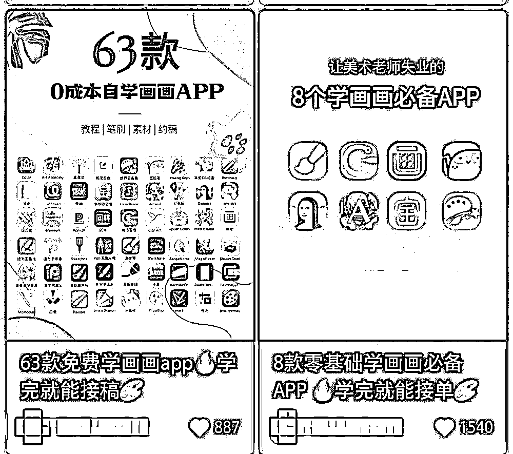

虽然也能留钩子导私域，但更像广撒网，不够精准，种草到转化链条偏长。后来改写成 Tufting 种草笔记，爆款不多，询单和成单却迅速上涨。所以做产品种草不必死磕爆款，精准转化更重要。选题和笔记类型时先想清楚：用户看完会做什么，是来交流还是来询单消费。

坑二：缺少闭环思维。📕这类公域引流只是获取流量的一种手段，能否成交仍取决于产品或服务本身。比如早期油画体验，赛道已是红海，同行低价恶性竞争，我也没差异化优势；即使客户从📕过来，也很难成交。当时我把精力放在内容优化上，实际是整个闭环有问题，尤其变现端。产品不行，内容再精致也白费。所以做任何平台 IP，都要有闭环思维，在运营中反复审视和优化“定位—内容—引流—变现”每个环节。环环相扣，错一环可能满盘皆输。

内容参考：《千粉不到月入 10W ，我如何通过📕救回濒临倒闭的艺术体验门店？》

## 3.2 团购平台如何承接流量

💡

小节概要

用户平时搜门店，或刷完视频找评价，常会去这两个平台了解商家信息，再决定是否消费。所以不管有没有做抖音、📕，大众点评和美团都是多数实体商家会入驻的本地生活平台。

本节按流程讲：✅ 入驻方式与注意事项；✅ 商家账号搭建；✅ 商品团单设计；✅ 如何通过运营提升权重、拿金牌、升星级、进榜单。如果你服务的商家还没入驻大众点评，这一节值得看。

### 3.2.1 团购平台怎么入驻 @封伟-自动化变现 @Mage @芷蓝

想把店挂上美团或大众点评，费用没有统一标准，行业和城市不同，报价也不同。我那会儿是一年七千八，又配了三千块推广预算，合起来一万零八百。所谓推广通，可以理解成平台内的竞价直通车；另外每笔成交平台还要抽佣，因此很多商家会把最终成交放到🛰️里完成。

大众点评上线路径不复杂：先打开“我的”，找到“合作/入驻”，选好入驻形式，再点“立即开店”。

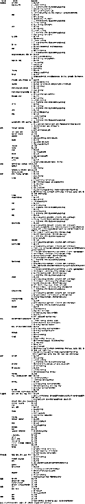

2、哪些行业进不了？

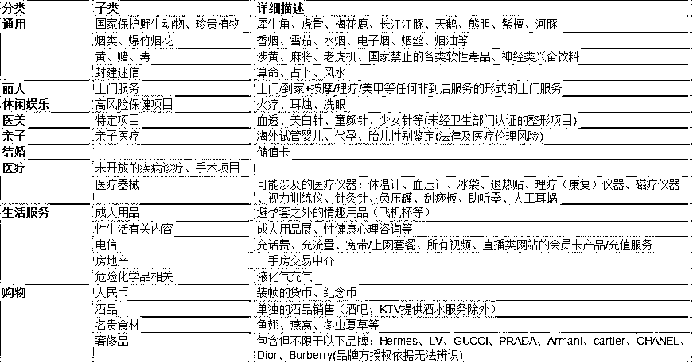

入驻后，手机号和🛰️号可以直接留在页面上。平台会提示不要使用第三方交易，但一般问题不大。做民宿、酒店这类生意，途家、小猪民宿、爱彼迎入驻也简单，提供租房合同和基本信息即可，统一扣点 10%，有时一单 3000 元抽 300，比例不低。这几个平台不能发🛰️和电话，审核严，被查到会罚款，不管这一单是否成交都一次罚 50，严重可能降权。为规避检测，也试过各种方式给客户留联系方式；相对不易被查出的做法是：地址写成“135 街道 660 路 138 号 XXX”，把🛰️或电话掺在里面，仍可能被检测，但概率较低。除美团和抖音，再说一个免费的：支付宝口碑。开通后会同步到高德地图，可在高德直接付费。类似的飞猪、同程也会同步到高德，做酒店住宿的别放过，其他业态也可以去高德搜一搜。

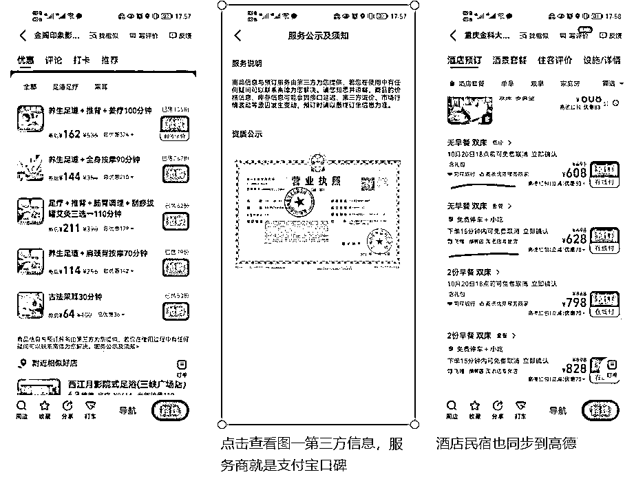

内容参考：《从亏损 8000 到盈收 3W+，轰趴别墅通过精细化运营实现转介绍率 70%》、《实体店如何有效互联网化，90% 的老板容易忽略的细节》、《门店私域运营 | 小航海学习手册》

### 3.2.2 账号搭建公式 @米菲

门店基础信息包含店名、地址、头图、标签等。店名可以套一个结构：品牌或店面＋主打产品＋所在商圈。比如我的店名是：MY＋空中别墅轰趴馆生日团建聚会＋乐汇城店。

这样做的好处是：

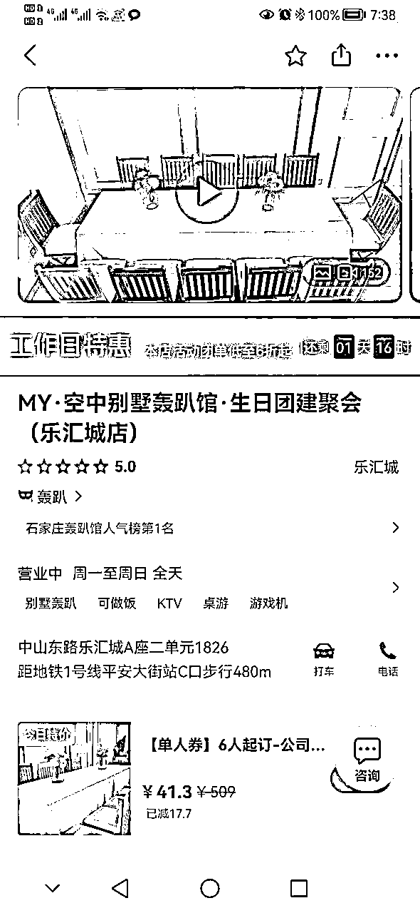

内容参考：《如何让店铺在美团运营上进入榜单、拿到金牌》

### 3.2.3 挂载商品怎么排 @米菲 @温州土老板

先别急着上套餐，拿美团点评把周边同行摸一遍。平台把商圈拆成城市—行政区—商圈三层。轰趴算小品类，同城对手的数据都值得看；若只做区域生意且商家密集，就聚焦某个行政区或商圈。按销量或人气排序，挑 5—10 家，重点看：半年卖了多少、有销量的套餐长什么样、有没有金银铜牌、是否进榜、评价攒了多少、星级多高。然后结合自己情况，设保本套餐、限时低价套餐、主推套餐。

价格体系要站在顾客角度，先让他们愿意第一次下单。以摄影店为例：引流款量大但不赚钱，儿童体验 239 元、儿童证件＋形象照＋表情包 193 元；利润款量中较赚钱，送宝爸合影 799 元、超划算 999 元、新春全家福 899 元，另有加照片另付费；锚点款量小很赚钱，底片全送 1888 元、特色马场 3888 元。正常商家首次触达主要靠引流款——顾客没体验过，即便有消费力，也大概率先选引流款和利润款，不会一上来选锚点款。到店后，商家再按顾客情况推荐调整，部分人会从引流款转向利润款，比如换套餐或加照片。

内容参考：《如何让店铺在美团运营上进入榜单、拿到金牌》、《📕 300 粉丝的账号，如果让开在郊区，1000 平儿童摄影，爆满？》

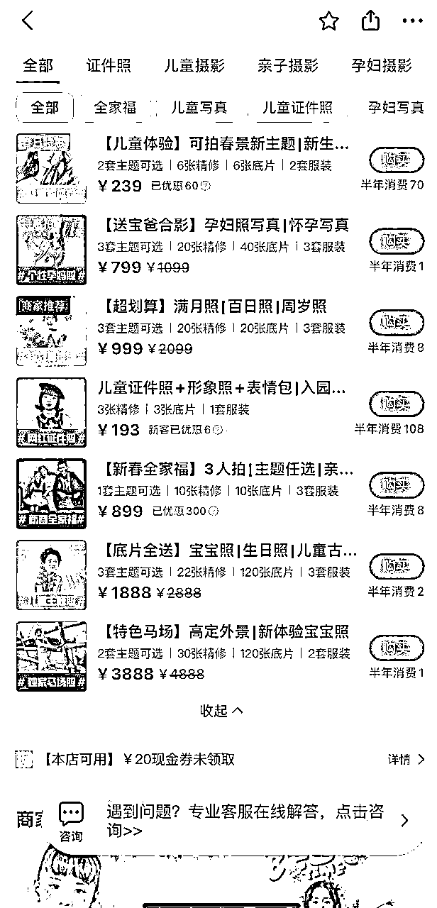

### 3.2.4 流量怎么往上抬

#### 3.2.4.1 免费流量四招 @米菲

第一招：蹭平台活动。在美团报名免费活动，多拿一个流量入口。

第二招：把点评当📕发。在大众点评发布笔记，模仿种草风格，增加曝光。

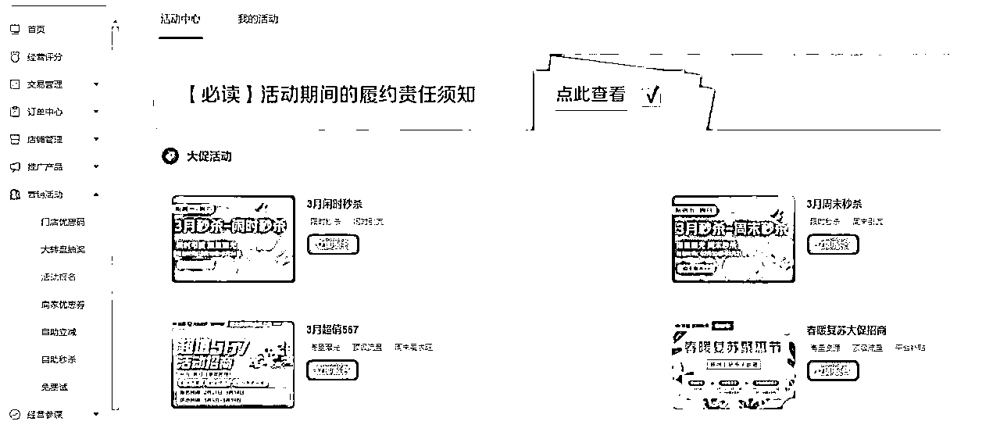

第三招：门面装修。入口图和头图要重视，提升客户兴趣和浏览时长。店铺入口图展示在列表页，直接影响进店率，优质入口图能吸引用户点击进入。

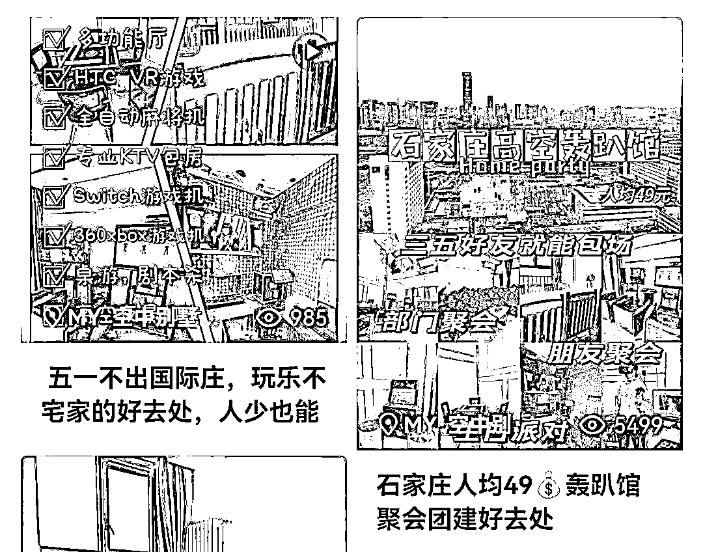

【品牌店铺】

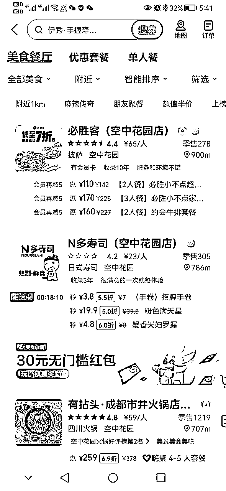

【普通门店】可以用：1. 活动图，例如女神节活动、春季活动、折扣活动等，上图中必胜客低至七折。

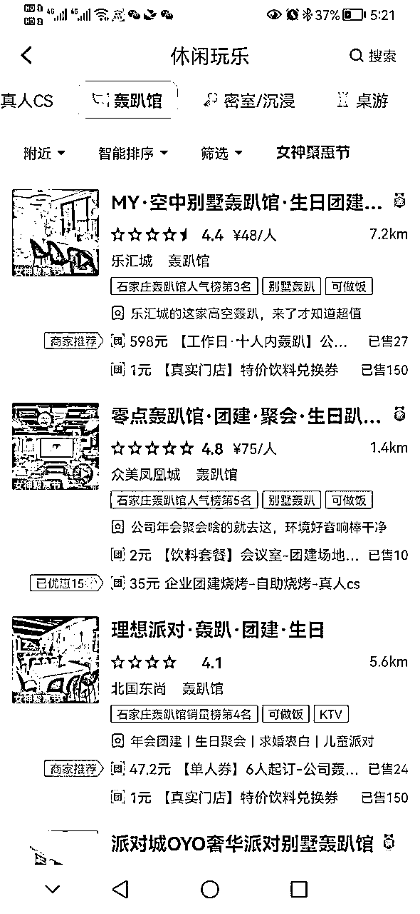

店铺头图展示在店铺顶部，客户点进店第一眼看到的就是头图，可以放五张。头图可以展示：第四招：冲榜单排名。进入榜单后自然流量更多，门店被看到的几率更大。免费进榜的一个方式是：鼓励进店用户打卡、收藏店铺，可用收藏赠礼、收藏店铺给优惠等方式引导。还可在用户体验过程中观察或询问满意度；如果满意度高，可引导客户在美团点评下单并核销，再引导真实评价（注意：不能直接要好评）。这两个动作会影响商家在人气榜和热销榜的排名，排名越高，自然流量分配越多。

内容参考：《如何让店铺在美团运营上进入榜单、拿到金牌》

#### 3.2.4.2 付费投放拆解 @hp @米菲

先把目标拆开：一是让更多人看到门店，二是让看到的人愿意点，三是让点进来的人有消费意向。每个目标再往下拆，就能知道具体该优化哪个小版块。

想提升曝光，先弄清门店会在哪些位置出现，再按不同展位调整。第一步，了解展位分类。1、搜索展位。

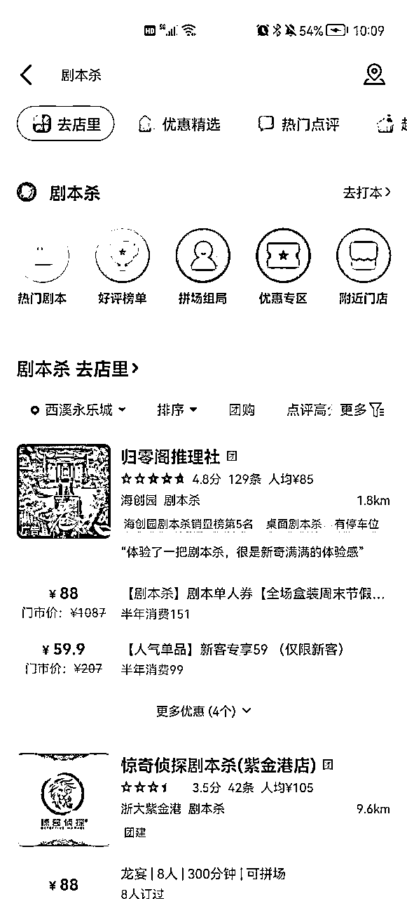

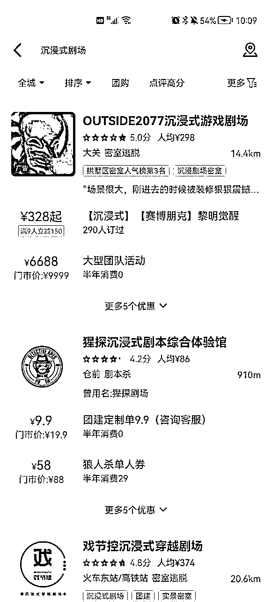

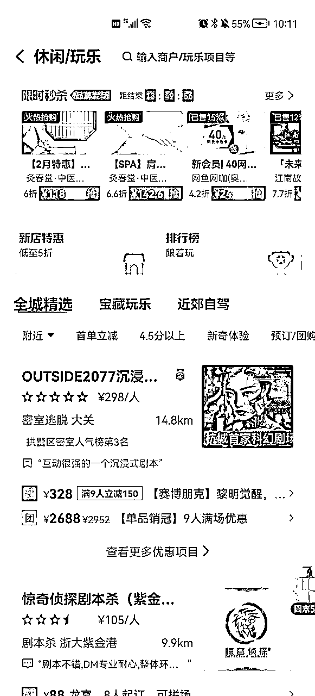

看到这里，至少能得出三件事：1、搜索词要铺开，店名、套餐名、评论热词都别漏；2、门店数据要持续攒，评价、星级、销量、金银牌都算；3、新店最快补数据的方式是投广告，后面细讲，这里先说投放。

第二步，了解怎么有效投放。普通门店常用广告主要两类：1、推广通，偏搜索流量，用户目的性强，后续转化高；2、智选展位，偏信息流，做标签曝光和造势，偏长线转化。

推广通按点击扣费，点击率低，平台不会给量。逻辑不难懂：A 点击率 10%，单次 2 元，给 1000 次曝光，平台收 200 元；B 点击率 2%，单次 5 元，给 1000 次曝光，平台收 100 元。所以出价高不代表有流量（暂不看店铺权重）。头图决定点击，品牌强可用 logo；品牌一般，就把门店特色亮出来，促使用户点。

比如我们店做的是赛博朋克未来主题，和民国风、古风店比偏小众，核心人群肯定是对科技感、赛博朋克氛围更感兴趣的人。所以头图用文字＋科技感人物，套餐名加【赛博朋克】，门店自荐写超大沉浸式 RPG，还强调 1600㎡。素材是否合适不能拍脑袋，投放前都是自嗨，跑出数据才知道，所以要持续测头图。

出价这里，尽量别排到第 7 位之后，用户前面已经看到很多表现好的店，为什么还要点你？

所以压在第四位之前比较稳，当然不必争第一。出价不等于真实扣费，实际可能更低，不用太纠结，盯住转化数据即可。

基础价之外还有搜索词出价，通常比基础价高不少。不同类型词要分组，因为转化率不同；后期可给高转化词加价。

多记录多分析，算清不同词一块钱能换来多少浏览、多少评论查看，记成表格，后续降成本有帮助。

更多设置里，建议关掉其他曝光机会，也就是非美团大众的平台露出，这类流量转化往往很低。

# 美团投放：智选要不要开，先看两类店

信息流广告里的“智选”有使用门槛。商家先判断两件事：货架上的套餐是否属于即兴下单型，像短视频团购里那种刷到就想买的爆款；或者店铺是否真要把品牌声量做大。满足其中一条，再考虑开启。它按点击竞价，一次点击常见一到两元，和带着明确目的主动搜索的顾客相比，投产并不占优。手里没有能带动进店的尖货，不建议贸然开。相较另一推广产品，它的人群标签更细，找对口顾客会更准。

投放物料一变，顾客点进来看到的承接页面往往也跟着变。

首屏素材依旧决定成败。信息流位置给创意的发挥空间更足，也逼着商家反复筛选最划算的版本；旧素材跑不动后，要尽快补上能接力的新内容。

优化至今，我们的展现量已达到竞对平均线的两倍，但离头部仍有距离。这个缺口不是加钱就能补齐，后面要靠成交转化慢慢攒。

## 第三步 提升点击率：让展现转成点击

先看顾客刷店铺时，同一屏还能看到什么。列表页按广告位分两类：
单图模式：

多图模式：

单图位放主图，多图位露出首图前三张。影响点击的要素可归为八项：评分、等级牌、推荐语、抓取词、套餐标题与价格、距离、人均、已售数。前五项商家能主动做。

### 1、评分
分数只和高质量评价量有关。五星好评与平台判优内容，对分数拉动大。许多代运营方的主要精力就花在评价维护。注意：顾客最好先搜过同类店，再到店消费核销；否则评价一多，容易触发平台风控，反受其害。我们手上有达人，会安排达人在线下单写评，所以分数升得快。另一个办法是引导顾客收藏打卡。直接索好评违规，收藏打卡不违规，不少商家在做；收藏多了，分数上去，平台会认为店铺品质高。

### 2、等级牌
 规则不复杂，照后台清单补齐设置，先拿底分50。 关键在经营数据维度，与成交额、进店人数挂钩。尽量让顾客线上成交，别为省20%平台抽佣走线下；该交的费用有时是“入场券”，否则平台难判断你是优质商户并持续给流量。投放稳定在开，进店人数加10分不难，银牌压力小；金牌可能要智选助攻。

### 3、推荐语
 没太多花头，找到编辑入口，把最有说服力的卖点填上即可。

### 4、抓取词
较难左右，但非完全无能为力。若能较多影响评价内容，高频词会被平台抓成标签，挂在店铺下方。

### 5、套餐标题与价格
标题里放“全国金奖”“杭州首发”“招牌”等词，看似普通，却能在顾客心里形成轻微暗示；虽是自夸，仍有点用。

### 6、进入排行
美团休闲娱乐排行分“成交排行”和“热度排行”。成交排行按过去180天商户成交单量排序，单量高就能进，不看评价等其他条件，所以可人工较快冲进去。套餐设计上，可加低门槛套餐拉单量。案例1：增加特价饮品兑换券，用醒目展板贴冰箱门，鼓励购买，每账号限兑3瓶。 案例2：设置单人尝鲜项目，可先临时上线，进成交排行后再视情况下架。 热度排行按过去7天商户热度排序，提升思路可参考冲金牌。

## 第四步 提高点击后的成交意愿

最后最关键：展现靠投放，点击靠首屏，这两步操作空间有限；顾客进来后愿不愿成交，才是店铺优化核心。顾客在意：环境如何、剧本类型是否对味、评价怎样、预期时段有无正在拼的场次（拼场），或有无空场可开（开团）。当环境、剧本、评价这些基础项大家都做得不差时（太差早被淘汰），亮点呈现就格外重要。装修好看、演绎不错、评价一致，打开美团前十家基本都这样；这些不会成为顾客选你的理由，但没有会被筛掉。基础完善后，最要紧是提炼区分点与亮点，并在装修各处做强提醒、强曝光。详情页描述、店面照片布置、优质评价布局，如果只停在“好看”，店铺只是过了第一关，进入备选池；真正推动顾客下决定并成交的点，才是页面设计要反复传达的。

另外，圈友 @缄默 分享了《大众点评与新店一般做法的简单说明》，可给新店额外启发。内容来源：《如何让店铺在美团运营上进入榜单、拿到金牌》、《线下门店联合经营日记（二）——美团店铺运营》

### 3.2.5 避坑点 @怡伶 78667：三类雷区，越早绕开越省钱

雷区1：套餐没吸引力，一上来就砸钱。我一开始摆的货架品是油画体验，冷清时一天进店三四十人。急了乱投医，听大众工作人员建议充值开推广通，平均每小时烧掉不少预算，累计投入五位数，成交几乎挂零；来的要么不是对口客群，要么对产品没兴趣。复盘看，套餐不吸引、店铺初期评分又低时，砸多少钱都难见效。大众是帮用户找好吃好喝好玩好去处的平台，也提供优惠套餐和活动价；用户主要比谁价格低、哪家好评多。上架产品没吸引力，运营动作再多也难有客户。雷区2：评价必须盯。大众用户做消费决策前会看评分。我起初没太管，因为基本在私域或到店成交，也没让顾客写点评。生意火起来后，同行来恶意差评，平台帮忙拦截过几次，但评分仍明显下滑，影响店铺形象，接下来得靠运营手段优化。雷区3：图太精修会赶客。📕对艺术类精致度要求高，图片要高颜值；大众更需要真实用户体验封面，过于精致美好容易被当成广告。发大众的图尽量不修，保留真实感，文案软一点、客观一些，更有机会爆。内容来源：《千粉不到月入10W，我如何通过📕救回濒临倒闭的艺术体验门店？》

## 3.3 同城流量从哪里来

### 3.3.1 线上同城流量怎么抓
线下生意受地域限制，客流大多来自周边或本地。所以同城群、本地活动平台这类更聚焦本地的渠道，很值得用。常见线上获客方式有：✅老客的社交圈：从老顾客朋友圈里找新客；✅本地生活群：🛰️企微群、🐧群、豆瓣小组等，比如快递群、团购群、连锁店群；✅本地👸号：类似杭州美食、联联周边游杭州站等；✅同城活动平台：豆瓣、🐧、本地生活团购平台等。按自身需要挑合适的平台引流。

#### 3.3.1.1 让老客发朋友圈 @乔合、@Mage
很多获客方式最后都能落到朋友圈转发上，这也是比较好用的一种宣传方式；但硬要求客户转发，容易引起抗拒。通常两种做法：第一，客户预订时想要优惠，就事先谈好——所有人转发朋友圈12小时且不屏蔽，给优惠打折，直接省事；第二，每场给客户拍短视频记录，最后带上宣传二维码。运营数据显示：平台用户忠诚度不高、选择多，私域效果最好，平均复购率可达10—15%（指二次复购），部分喜欢风格的客人来过3次以上。也可找网红到店打卡，发朋友圈加定位。内容来源：《从亏损8000到盈收3W+，轰趴别墅通过精细化运营实现转介绍率70%》、《00后实体店创业者：用互联网思维破局疫情影响》

#### 3.3.1.2 本地社群推广 @乔合、@封伟-自动化变现、@尹基跃
最多的是企微群、🐧群、豆瓣群组，找到后进去引流。重点说开放式的同城🛰️群，可直接找到并100%进群。常见有：银行（招商银行等）、出行平台（高德、滴滴等）、连锁门店（瑞幸、唯品会等）、本地生活（罗森、哈罗等）、商超（沃尔玛、永辉等）、商场👸号、社区团购（美团等）、快递驿站、餐厅点餐码（有些会设置关注进群）、业主群等，按用户画像找社群。如何一个码加多个群：企微群多用活码，用多个号多次扫码会扫出不同当地群，获得群数量远大于二维码数量。举例：滴滴同城群、瑞幸同城群、永辉同城群。

若目标用户是年轻人，可去本地酒吧群、密室群、剧本杀群做活动宣传，达到覆盖传播。怎么进群？把本地这些店玩一遍，店主通常会拉你进群（打广告记得发完红包）。具体找群、混群和引流，可参考圈友 @尹基跃 的《同城进群SOP》及其小航海分享《搭建门店流量池与快闪发售模式》。同城进群 sop 2.0.pdf 内容来源：《实体店如何有效互联网化，90%的老板容易忽略的细节》、《00后实体店创业者：用互联网思维破局疫情影响》

#### 3.3.1.3 本地👸号投放 @芷蓝
新店可用这招做冷启动。以我的舞蹈室为例：在望京开店，就在🛰️👸号搜【望京】，找几家本地自媒体，看文章阅读率，平均能到3000—5000以上，说明粉丝质量还可以。然后设置新店活动，比如开业大礼包：199元=10节课+新人大礼包（水杯、舞蹈鞋、速干毛巾等）。注意：新店启动不建议加裂变机制，容易招羊毛党；你需要快速积累第一批学员的上课素材和成功案例，再发到大众点评，所以用户精准度和质量很重要。精准用户是想学跳舞的人，不是来拿礼品的人；不要搞免费领取，一定要付费。推广费用看头条还是次条，像我的舞蹈室推一次头条约4500元。投放时注意：①和本地媒体沟通时，问清是否给相同定位商家做过推广、效果如何，最好有达到率或后台转化率数据；②索取👸号后台用户画像，按性别、地域等判断是否适合本行业；③投放时间尽量选周二到周四晚上8—10点，最大概率触达用户。内容来源：《门店私域运营 | 小航海学习手册》

#### 3.3.1.4 同城活动平台获客 @封伟-自动化变现
内容来源：《实体店如何有效互联网化，90%的老板容易忽略的细节》

内容来源：《实体店如何有效互联网化，90%的老板容易忽略的细节》

### 3.3.2 线下同城流量的入口
多数实体店的主要客流来自周围3—5公里，这部分人更容易到店体验和消费，所以线下引流不能轻视。线下获客常见有：✅线下海报张贴；✅和其他商家异业合作；✅发传单；✅找代理分销。下面看具体操作。

#### 3.3.2.1 地面海报张贴 @Mage
在距离周边0—8公里的写字楼楼下/高校张贴海报，一般和老板谈100—150元/3个月。好位置一周能被动添加3—5人，主动扫码添加的用户意向度较高。再根据添加客户位置优化，好位置继续续费。内容来源：《从亏损8000到盈收3W+，轰趴别墅通过精细化运营实现转介绍率70%》

#### 3.3.2.2 商户联盟合作 @芷蓝、@乔合、@尹基跃
联盟合作分同业联盟和异业联盟。异业联盟：联合不同业态商家设计一张权益卡，对外销售98元/张，可包含洗车店几次免费洗车、家政公司几次免费擦玻璃、餐饮门店折扣、教培体验课等，合计价值大几千，所有给优惠的门店都会帮忙导流。参加商家先付费5000元采购权益卡（有优惠，可给120张卡），只要推出去就能回本，所有商家有推广动力。好处是可在一个城市快速引爆全城；不好处是需要联合足够多商家才能跑起来。同业联盟：主要针对教培行业，不同品牌联合，如篮球、油画、音乐等细分品类各出引流套餐课程。比如联合20家机构，联盟卡对外298元/张，可任选5家机构课程，家长能以最低成本试错，给孩子多报几家。找商家时直接在大众点评按位置搜索，合作要找业务不冲突但消费人群一致的商家。沟通时注意：①在大众点评查看商家星级及最近半年产品销售量，判断客流量；②选择用户画像一致但产品服务不同的商家，比如我的舞蹈室消费者是20—35岁女性，她们也有美甲美睫、咖啡西点需求；③第一次沟通说明工作室就在附近，最好邀请商家来查看，必要时赠送自己的服务或产品，保证合作顺利。若找不到多个商家合作，还有两种方式：方式一，互换商品体验券——互换体验券放在自己门店，客户消费就搭赠一张；简单，但无法监督和捆绑利益。方式二，固定合作伙伴——找2—3家固定伙伴，制作类似【29.9元=美甲一次+中国舞体验课一次+xxx】的通券，用户会觉得更有价值感。

# 电子烟门店的资源互换打法：先在酒吧跑通，再放大 @乔合

这个案例来自@乔合：门店先挑了几家酒吧验证合作模式，确认有收益再复制放大。酒吧愿意合作，是因为他们也需要我们手里的年轻客源；双方各取所需。合作方式一般是酒吧给酒水储值卡，我们自己付台位费就能去消费。

但几个酒吧带来的客流很快见顶。为了谈下更多伙伴，我每天在地图App上翻找剧本杀、奶茶店、密室逃脱的联系方式，加客服慢慢聊。当时接触的小店老板大多没有互联网运营概念，只会开店、挂美团、等团购单。试过一轮后发现小商家难推动，于是我们调整策略，专攻大店，而且体量越大越好。这类公司通常有互联网思维，也明白互利共赢，简单几句话就能讲通，合作成交率明显更高。连续跑了两个月的线下市场，累计合作60多家商户和20多个摊位。对摆摊的人，我们不送优惠券，改为给礼品券，请他们顺带派发，代价是送几套电子烟。摊主发一条朋友圈“来喝奶茶送电子烟”，等于帮自己维护老客，还不用掏成本。顾客买杯奶茶，拿到一张电子烟兑换券，就能来我们店里领一套。这里有个提醒：千万别把这些摊主发展为代理，否则利润会被摊薄。

#### 3.3.2.3 派单推广怎么做更有效 @芷蓝

经常有开店的朋友问我：现在派传单还有用吗？我的看法是：依然可行，关键看两件事——你能坚持多久，以及派单的人是谁。先说结论：把钱花在积累品牌资产上，永远不会亏。选在店铺周边固定时段、固定点位，反复向路过的人讲出品牌名，本质上就是在铺设品牌与潜在顾客之间的连接，持续影响他们的认知。线下派单最大的优势是，开口的前几秒就能完全抢占对方注意力，这是线上信息流很难做到的。派单的目标不是逼顾客马上进店，而是等他们产生消费念头时，能想起公司附近或住处旁边有这么一家店。所以只要雷打不动地发，派单的人是自己或信得过的店员，并且一边发一边报出店名和详细位置，就一定会有回报。

关于单页的设计与投放，有几点实操建议：
① 别把传单做成产品手册，更别搞三折页，一张纸就够。每多一次翻页动作，都是在增加用户的阅读成本。
② 字号往大了做，别怕显得“土”。顾客可能只看一眼就丢，这一眼里能接收到多少信息，完全取决于字够不够大。
③ 单页只放三样核心信息：价格促销、品牌名、地址。其他内容统统删掉。我们只负责把人引到店里，而不是让他当场搞懂所有服务。
④ 做单页直接上淘宝找人设计，挑一个想模仿的样板，让设计师照着改就行。
⑤ 投放位置有三个思路：以店面为圆心500米内、城市的核心商圈、目标客群聚集地（如学校门口）。
⑥ 派发时最有效的说法是“促销信息+地址”。比如我当年在地推现场说的是：“19.9元体验中国舞，金街大厦11层，今晚就来！”如果能再加一句限时指令，比如“8点半前到”，转化会更好。

#### 3.3.2.4 借力分销与代理：校园和社区团购 @Mage @尹基跃

① 校园代理：当时我在高校贴招聘海报，招到一名学生做代理。这名同学在校内本来就有一些人脉，仅一两个月便带来了10个订单。校园关系链可以不断延续，一届学生毕业还有下一届，所以千万别低估校园渠道的价值。报酬方式有两种：一种是给出底价，让对方自行加价出售；另一种是按订单金额固定给10%佣金。

② 团长代理：除了校园代理，也能发展代理商、社区团长、个人分销员等角色；先把合作边界、时间周期、结算方式谈清楚即可。每个城市里做社区团购的团长很多，你可以在美团优选、多多买菜里按定位找到就近的自提点，上门去聊合作。我们曾服务过一家口腔医院，他们把洁牙等打包成68元的体验套餐，跟社区团长合作，每成一单给团长40元。某小区一位团长就卖出了近200单，后续正价项目转化也相当好。这类玩法的要点，第一是拿下团长，第二是设计出高性价比的获客套餐包，并让团长有足够的利润驱动。

#### 3.3.2.5 把线下客沉淀到个人号 @尹基跃 @佳佳

先把已经到店的顾客统一加到个人🛰️。老客、回头客通常已经认可门店或信任店员，所以把他们导入自有池并不难。实际操作中，最常见的方式就是朋友圈内容触达、一对一私聊关怀、邀请进群，在互动里不断强化品牌认知，并输出更多增值服务，促使他们再次进店或带来新朋友。

线下店还有一个天然优势：熟人之间的转介绍。朋友推荐来的顾客往往带着真实消费需求，只是对品牌还不太熟悉，更多是抱着“信朋友、来试试”的心态。这类人一旦进入私域，培养成深度用户的可能性很高，也会成为下一轮种子客户，继续帮助扩散。

## 3.4 在🛰️里做流量裂变

除了在各大公域渠道获客，🛰️生态也是一个非常重要的裂变场景。一方面，🛰️的社交关系更近，用户与熟人之间的连接更紧密，群聊和👸号又天然聚合了一群兴趣相近的人，因此触达更精准；另一方面，🛰️月活早已突破12亿，大部分人每天都在使用，非常适合把用户沉淀进私域池。这里我们把主流的🛰️裂变打法整理成四个环节：设计诱饵产品、选择裂变玩法、制作传播海报、完成宣发。裂变活动既可独立操作，也能在之前的获客手段之后再推一把，几乎每个线下店都适用。如果你刚开始做服务商，手头案例不多，暂时不敢接长期合作，那不妨先策划一场短期裂变，练一练对获客节奏的感觉。接下来看具体怎么做。

### 3.4.1 怎么设计裂变诱饵 @孙策

在传播增长的游戏里，诱饵是撬动流量的支点；诱饵选得准，用户才愿意参与。选什么产品来做钩子，要综合业务类型、目标客群、预算上限和长期规划来判断。判断标准包括：目标客群是谁，他们的习惯、偏好和真实需求是什么；投入产出比是否划算，小预算商家尤其要找低成本高回报的选项；是否与品牌形象、调性和价值观一致；是否容易操作，能不能按需求灵活调整；效果是否可以追踪，能否借助数据判断哪些打法值得继续；是否是长期可持续的，避免只火一阵的短期手段；是否合规，不触碰法律和隐私红线；用户体验是否顺畅；同行的真实反馈如何。

目前最常见的裂变诱饵大致可分为两类。

一是拆解门店自己的产品或服务。也就是从利润项目中挑出普适性强、单次成本低的那部分，做成引流款。例如瑜伽馆用体验课招新，美容院、口腔诊所把低成本的仪器体验或基础服务打包成超值价。这种方式更适合老客和那些对产品有一定了解的新用户。老顾客已经认可产品价值，可以通过拼团、邀请好友享受优惠来推动传播。以教培机构为例：单节课原价100元，一个人购买50元；两人拼团每人40元；三人拼团每人30元。老顾客本来认可课程，又能拿到实惠，自然愿意拉新。

对只了解一点的新客而言，他们通常有兴趣但还没下定决心，如果能用一个低门槛体验产品把人请进店，后续转化利润品就容易得多。因此可以把服务拆成小份体验包，用极低价格吸引进店，体验后再引导升级。至于成本，因为选的都是店内本来就有的低成本项目——一节体验课、一次洁牙服务，只要整体不亏就可以跑。

二是按客群画像采购外部礼品。如果自家产品优惠不够有吸引力，或目标用户对品牌还很陌生，可以额外采购礼品来提升活动的吸引力。选礼品要注意“价值杠杆”：成本价50元的东西，要让用户感觉值100元。同时必须契合目标客群的喜好。

选择引流产品需要仔细研究和验证。建议先小范围测试，再根据数据反馈调整，让每一分投入都花在刀刃上。

### 3.4.2 裂变引流玩法

#### 3.4.2.1 九种常见增长玩法 @Nico酱

这一块要解决的是老客转介绍问题，核心是激发口碑传播。下面9种玩法可以组合参考：

- 任务型：用户完成后领福利，最常见。通常要转发自己专属的推广图，邀请若干好友助力，借助第三方工具来统计。
- 分销型：设提成或奖励，让人人都愿意帮你卖产品、带单。
- 打卡型：用户每天打卡并在朋友圈晒进度，从而带动拉新。教培行业经常用“打卡0元学”来激励用户持续分享。
- 测试型：适合筛选精准客群。比如“测测你是哪种时尚达人”，A把测试发给B，B完成之后双方都能拿奖励。
- 红包型：用户领到红包后再发给好友。瑞幸买完咖啡能发红包，外卖点完餐也能发。
- 文章型：内容读到一半或视频看到一半，必须分享给好友或朋友圈才能继续看。
- 解锁型：集卡、集碎片后解锁权益，支付宝集五福就是典型。
- 助力型：好友帮忙点一下就能多拿福利。例如每天默认一次抽奖机会，分享给好友并让TA关注后，还能再抽一次。
- 砍价型：适合卖货，找好友帮忙砍价，最后以更低价成交。

用公式概括：裂变=基础客群+诱饵+传播物料+分享链路。拿美业举例，老客邀请X位好友帮忙助力，就能兑换一份奖品。

#### 3.4.2.2 一场裂变活动的四个落地步骤 @尹基跃

第一步，做店内的活动海报，扫码入口直接落到门店客服🛰️。
第二步，定福利：把海报转发到朋友圈，进店立享5折，或者送一杯饮品。一杯饮料的成本换来一次朋友圈曝光，相当划算。
第三步，写话术：让顾客添加客服🛰️后回复关键词领取海报和转发文案，提前把引导话术备好。
第四步，跑流程：借助群管理工具提升活动效率和顺畅度，避免手动操作卡壳。

这样，一个简约的裂变闭环便搭好了。

#### 3.4.2.3 裂变海报怎么设计？@芷蓝

设计传播海报可以套用AITDA成交模型：注意力→兴趣→信任→欲望→行动。下面用我当时在舞蹈室做的《15天线下减脂训练营》来拆解。

海报上的大标题是抓眼球的第一步，作用和👸号标题类似，但区别在于：标题党只负责把人骗进来，海报却必须真的承载内容。

我当时给海报定的大标题是“14天减脂训练营”，用具体天数给用户一个心理暗示：14天后我能瘦下来。无论什么行业，有4个大标题模板可以参考：
① 冥想5分钟等于熟睡1小时——靠数字反差制造好奇；
② 如何在家练出好身材？——降低操作门槛，放大收益想象；
③ 怎样用普通手机拍出专业级照片？——同样是反差对比；
④ 免费收听茶艺入门——“免费”两个字自带吸引力。

但只有大标题还不够，用户很怕“标题党”，如果看不到进一步解释，注意力马上就会收回去。

所以我给那张海报配的副文案是“每天60分钟，练就迷人好身材”，既解释了大标题，又让用户觉得每天只要投入一小时，就能看到结果。这里有几个现成的搭配可以参考：
- 大标题“冥想5分钟等于熟睡1小时”，底下配“1小时搞定轻松冥想术”；
- 大标题“如何在家练出好身材？”，底下配“不去健身房、不请私教的健身方法”；
- 大标题“怎样用普通手机拍出专业级照片？”，底下配“3节课玩转18个实用手机拍照技巧”；
- 大标题“免费收听茶艺入门”，底下配“1小时让你从喝茶到懂茶”。

第三步是建立信任。没有信任，标题再诱人也只是空话。信任来自两个要素：专业背书和社会认同。专业背书可以是老师拿过奖、有专利，也可以请同领域有知名度的KOL联合推荐。社会认同则很直接：把报名人数放上海报，数字越大越能带动，比如“99位小仙女已报名”，就是典型的从众暗示。

我当时的老师并没有多出名，只是普通教练，所以我在海报下方放了一行“已报名9人”，用真实报名数补足社会认同。专业背书和社会认同可以单独发力，叠加起来更有效。

我还把减脂用户最关心的细节列在海报右侧，这些具体利益点会直接刺激报名冲动。这里还有几个可套用的文案示例：
① 一课时拿下中国舞的4大基本手势；
② 3小时掌握吉他的5种基础和弦；
③ 六块老婆饼19.9元带回家。

顾客能直接感受到的收益，通常落在两个维度：速度与数量。要么“很快能得到”，要么“不用花太多钱就能拿到很多东西”。因此，整张宣传物料里最不能少的就是扫码入口。很多海报颜色、版式都做得不错，用户看完也动心了，结果翻遍整张图找不到报名入口，还得回头问发海报的人，这会让裂变效果大打折扣。

我自己的海报也一样：如果不放二维码，对方看完只能来🛰️问我，多这一步就会流失很多人。最后总结，一份合格的裂变传播页至少要有五个要素：①字号大、颜色抢眼的大标题；②解释标题、引发兴趣的副文案；③专业背书或社会认同带来的信任感；④具体到价格、数量、时长的利益点；⑤方便用户扫描的二维码。除此之外，优惠信息、门店信息、门店客服号活码和地址也要放进去，并提前准备好推荐话术。

#### 3.4.2.4 裂变宣传的流程 @孙策

做🛰️裂变，可以参考“浪潮式发售”的节奏：先造势，再预售，随后发售，最后追售。四个节点走下来，活动的声量和转化空间会被放大不少。

造势与预售这两步，本质上是在探测市场对产品的接受程度，同时勾住用户的好奇心。通过“憋单”把购买欲攒到某个节点集中释放，反而能带动更多新客一次性涌入。

造势的具体做法，就是把现有流量池充分利用起来：对外大量放出活动预告，吸引潜在用户提前进入活动群，让大家知道这场活动正在筹备中。朋友圈预热是其中一个有效手段：连续发布动态，把活动背景、目的、裂变品的卖点和功能讲清楚，让用户在活动正式开始前就已经心中有数。

当然，浪潮式发售不是机械走完流程就结束。真正重要的是和目标客户建立真实连接，理解他们的诉求，用高价值内容去回应这些诉求。

## 3.5 更多引流方式

### 3.5.1 视频号裂变：老客户点赞评论就能带新 @阿 may

可以策划一支《我的十年》主题视频，请老客户在视频号下点赞、写评论，写得好的还可以鼓励分享。

这里的机制很简单：视频号的天然裂变动作是点赞。只要老客户在视频号里留言+点赞，就相当于在帮你做传播。如果视频内容足够出彩，还会激发客户主动分享，同样能带来新流量。

内容来源：《美业获客 8 大有效玩法》

### 3.5.2 地图引流：被忽视的细节 @封伟-自动化变现

💡 小节概要：地图是一个经常被忽视的引流入口，但它的作用不小。一方面能帮用户更快找到店面，另一方面地图评论也会影响用户对门店的判断。

我们把可以收录地图的平台整理了一下，还有具体收录步骤，按需申请即可。

#### 3.5.2.1 支持收录的平台有哪些

日常使用较多的平台是百度地图（在百度地图App中标注）、腾讯地图（通过“腾讯位置服务”👸号操作）、高德地图（在高德App中标注），这三家基本够用。

想覆盖更广的话，还可以考虑：高德地图、百度地图、腾讯地图、🛰️位置、苹果地图、朋友圈位置、企业🛰️位置、🐧地图、🐧空间、TM、滴滴出行、闲鱼、西瓜App、携程旅游、高铁管家、花小猪打车、货拉拉、陌陌、哈喽出行、饿了么、快手、🧣、📕、大众点评、曹操专车、快狗打车、哈罗顺风车、58同城、T3出行、凯立德、阿里巴巴。抖音位置也能尝试，但存在行业限制，部分行业不做收录。

#### 3.5.2.2 地图收录怎么操作

把资料提前备好，到对应平台提交申请就行：

①门头照片：左、中、右三个角度各1张；
②标注名称：尽量和门头招牌一致；
③详细文字地址：按“XX省（市）XX区（县）XX街XX号”填写；
④营业电话或联系手机；
⑤具体位置信息。

整个流程自己动手就能完成，只要资料填写准确，工作日当天通常就能通过。

内容来源：《实体店如何有效互联网化，90%的老板容易忽略的细节》

### 3.5.3 多平台联动引流 @缄默

💡 小节概要：实际引流很少只靠单一渠道，通常是几个渠道同时推进，比如这里提到的大众点评+📕+👸号。具体怎么组合，要依据自己的实际情况来设计，这里只提供一个参考样本。

很多实体老板对引流的认知，还停留在电视广告、👸号投放、大众点评、📕、电梯广告这些传统渠道上。但从效果和性价比来看，大众点评+📕的组合明显更突出。电视广告和👸号投放带来的人气很有限，通常只对网红餐饮、医美这类店有些作用。

对线下门店来说，大众点评基本是绕不开的阵地，但多数人只会上架，不会维护。团购会抽取6到12个点的服务费，所以不一定要开团购，只做口碑评价也能行，关键在于持续积累点评量。这套做法在二三线城市打知名度和跑量都相对轻松。另一边再配合📕种草：批量用矩阵账号铺笔记，挑一两篇刷赞、刷评论，把排名顶上去，和大众点评同步操作。

大众点评的评论撰写也有门道：通常一半以上用V5等级账号，这类账号的评论能拿到首页流量扶持；约10%用V8账号来评价，打分控制在4.5到5分，视频要发150字以上，并且做自顶自评。📕也是同一套路：铺60到90篇笔记，把数据做起来，制造一种“网红必打卡”的假象，吸引真实用户跟风发布打卡内容，再趁机把其中几位用户的真实笔记数据也推上去。

后期再找区域👸号推一波，网红店的人设基本就立住了。线下门店在线上获客最有性价比的入口，九成以上都是这么操作的。

内容来源：《门店的一些引流套路》

# 四、线下流量服务商怎么开拓商家资源

💡 章节概要：做线下流量服务，第一步是找到合适的商家并促成合作。每个实体店看起来都不一样，但仔细研究会发现，小吃店也好，高端酒店也罢，都有相对固定的运营方式。本章先把商家分分类，再讲不同类别商家的特点与诉求。分类清楚之后，服务起来更精准，也能更深入理解他们背后的生意逻辑和盈利模式。后面还会介绍如何快速发现潜在商家、如何推进合作。无论你是新手还是已经有些经验的从业者，相信都能从中得到点启发。

## 4.1 商家有哪两类 @宗霖

面对形形色色的实体商家，可以从客单价和消费频次入手，划分为低客单高频和高客单低频。这个分法能帮助我们更准确地把握不同商家的引流需求。

### 4.1.1 低客单、高频次

这类店单次消费金额不高，但顾客来得勤。常见的有：餐饮店（快餐、咖啡、甜品），景区门票（主题乐园、博物馆、自然景点），酒店民宿（城市酒店、度假村、乡村民宿），以及休闲娱乐场所（电影院、KTV、体验馆）。这些“吃喝玩乐”型商家，客单价低、容易成交、复购率高，所以通常愿意采用CPS方式和服务商合作：服务商帮忙导入客流，商家按每一笔成交支付一定佣金。如果服务商还负责长期账号运营，收费可能由基础服务费加CPS佣金组成。

### 4.1.2 高客单、低频次

这类商家刚好相反：单笔金额高，但顾客很少频繁购买。具体包括：装修公司（家装、工装、景观设计）、医美机构（整形、皮肤管理、激光去痣）、口腔与植发医院（牙齿矫正、种植、植发）、房产中介（买卖、租赁）、各类车行（新车、二手车、名车）、会展招募、招商加盟、金融贷款等。

因为成交周期长，真实交易数据也不容易核实，服务商更建议采用CPA模式，也就是按每条有效线索收费。也有人用CPS，但验证难度较高，CPA相对更稳妥。

## 4.2 开发潜在商家的常用方法 @宗霖 @不语

主动寻找商家并建立联系，是线下流量服务商必须迈出的第一步。目前常用的建联方法有四种：

一是从周围熟悉的商家找起。彼此有过互动和信任，对方给合作机会的可能性更大。二是通过朋友转介绍。和区域商家保持友好往来，可能问几个朋友就能联系到某家店的员工或管理层，再顺藤摸瓜找到决策人。三是参加行业展会。多留意展会排期，主动报名观展，现场收集商家的🛰️、名片，之后安排上门拜访。四是搜集信息后陌拜。可以从行业平台、抖音、美团等渠道找到商家信息，拜访前先做好功课、准备好方案，到店后再通过前台联系负责人或决策者。

如果有了商家信息，却接触不到老板，还有几条路：用企查查等工具查找老板或负责人的联系方式；通过合作过的财税公司搭桥，他们通常手上有不少商家资源；先和店长或店铺管理层沟通，他们既有一部分的决策权，也能帮忙引荐老板；和商场招商部门搞好关系，对方可能会推荐商家，并协助联系决策者。

内容来源：《探店 15 天，门店由亏损到日利润 6000+，浅谈 3 年探店心得》

## 4.3 怎么跟商家谈成合作 @宗霖、@不语、@hp

想顺利达成合作，拜访前就要做好准备：搞清楚对方有什么困扰，我们能怎么解决，并且让对方相信我们足够专业。这几点一旦展示到位，合作的成功率会明显提升。

### 4.3.1 拜访前的准备

展示内容里，数据和案例必须真实可靠。如果没有太多成功案例，也可以把自己此前做相关平台的成绩摆出来，重点呈现专业度。

这里有一段话术可以参考：

xx总，您好，我是xx。某某把您的🛰️/电话推给了我，我之前负责过某某店的流量运营。想和您约个时间，当面聊聊线上流量运营，互相认识一下。

### 4.3.2 沟通中的关键点

与店家沟通的最终目标是达成合作，所以既要确认商家的需求能否被满足，也要判断服务商自身的诉求能不能实现。可以围绕门店的线上经营展开提问：美团和抖音目前在做吗？效果怎么样？店里谁在负责？做不好的原因是什么？您觉得要不要做抖音？……

尽量只问与合作相关的问题。拜访前可以准备一份问题清单，既能保证问到点子上，也能更好地控制节奏。交流时，一个问题一个问题地插入，不要一次性抛完，否则商家会不知道从哪回答，也很难聊得细。

商家说话时不要打断，也不要主观猜测。等他讲完，把重点复述一遍，跟对方确认。过程中可以随时给一些正向反馈，让对方感受到被认可。但赞美要自然、及时，具体到某个细节，措辞也要贴合实际，否则会显得很刻意，反而不如踏实聊天。

接下来，根据商家反馈的需求展示我们的服务，重点突出诚意和专业。要让商家理解推广的规则，也看到我们和其他服务商的差异。更重要的是，传递出希望长期共生共赢的态度，而不是做一单就走。

服务周期怎么定？建议倾向较长的周期，尤其是在冷启动阶段，双方都需要时间磨合。比如抖音、📕、大众点评、美团等平台的运营，一般签半年到一年；一轮🛰️裂变活动，服务周期可能是一到三个月。

合作模式怎么谈？大致有服务费+佣金、纯佣金两种。前期更推荐服务费+佣金。服务费可以一次结清，也能按月支付。有了这笔钱，服务商更容易度过前期没有营收的阶段，心态稳，合作也更稳。但要注意，一定要在初期就和老板确认未来的分佣方式，否则后面会很被动。我们是先到店考察，试运营半个月后，才和老板正式确定方案的。

我们的收费是门店总流水的30%，营销费用由我们自己承担；如果门店日均营业额低于5000元，我们就不参与分成。照常理，一家门店的合理营销预算应为总收入的10%-15%，所以我们的设计其实相当于毛利是门店交易额的15%-20%。营销能力越强，这个比例还有上升空间，反之亦然。

整个过程中，真诚沟通始终是关键。我们做的不是一次性引流，而是长期互惠的合作。要让商家明白，我们是合作伙伴，而不是单纯的服务供应商。

内容来源：《探店 15 天，门店由亏损到日利润 6000+，浅谈 3 年探店心得》、《线下门店联合经营日记（二）——美团店铺运营》

# 五、线下流量服务商如何交出好成果 @孙策 @宗霖 @hp

💡 章节概览：与商家签完合作，就要进入交付阶段了。整体可以拆成五个环节：

✅ 现状调研：先找准商家的痛点和期待，后续策略才有方向；
✅ 目标对齐：和商家确认清楚引流目标，执行才不会跑偏；
✅ 方案设计：具体怎么做、每步怎么分工，都体现在方案里，越清晰越好推进；
✅ 到店成交：引流最终目标是成交，如果成交结果比之前更好，活动就算成功；
✅ 数据记录：每个细节、数据和反馈，都是后续决策的重要依据。

拿到合作后，就可以按这五步开始交付了。

## 5.1 商家现状怎么盘点

盘点商家现状分三步：先在外面看，再到朋友里问，最后和老板直接聊。第一步，到各平台去了解商家目前的运营状态；第二步，找身边的朋友，尤其是去店里消费过的人，打听服务流程和体验；第三步，直接和商家沟通，见面时多提问，问题最好提前准备。

这一步和前期调研的观察维度差不多，但直接沟通能挖到更真实的经营数据和部分内部信息。调研可以围绕几个维度展开：

产品和人群：了解产品、摸清用户，后续营销活动设计起来更顺手。

业绩表现：通过几个关键指标，大致能判断现有资源能支撑多少成交。比如一家瑜伽店有1000名在籍学员，其中200位是愿意支持商家、也愿意推荐朋友的铁杆粉。推一个199元的瑜伽课包，200人都买了，且每人再推荐2人，就会带来400位新客。200+400=600，所以基本可以推断能卖出600个体验课包。

团队情况：主要了解团队配置和人员能力。这一项能反映现阶段运营卡点在哪，也决定引流活动能做到多大、能调动多少人力，是判断引流目标时的重要参考。

还可以参考圈友@hp整理的信息收集维度：

内容来源：《线下门店联合经营日记（二）——美团店铺运营》

## 5.2 服务目标怎么和商家对齐

和商家深度沟通后，我们已经掌握了客单价、转化率、团队规模等关键信息，这为制定引流目标提供了基础。基于这些信息，建议设定两个层面的目标。

第一个是商家的经营目标：引流到店人数、正价产品转化率、各客单价档位的成交数量。例如：引流1000人进店，转化率20%就是200人成交；平均客单价3000元，整场活动预计能带来60万元营业额。

第二个是裂变产生的新客目标：老客户推荐带来多少新购买。例如：私域池有1000人，500个老客买了引流品，又推荐了700个新客。引流品定价199元，并已和商家谈好这笔收入完全归服务商，那700个新客就能贡献约14万元。

目标定好之后，再倒推每一步策略，确保各环节都往同一个方向使劲。但目标不能拍脑袋，要参考商家在当地的品牌影响力、门店人手和销售实力、对活动的配合程度、愿意投入的营销资源，以及服务商自身的引流能力，不能为了拿单而过度承诺。

所以，与老板保持沟通非常重要。双方要明确商家能提供哪些支持，也要对齐预期，保证互利共赢。

## 5.3 给商家量身定制引流方案

在竞争激烈的市场里，能持续吸引用户并留住用户，是所有企业都绕不开的课题。也正因如此，专门策划一场有目标的引流活动很有必要。

把背景、目的和目标都搞清楚后，就可以进入方案设计环节了。方案做得细，双方才能提前确认每个环节的支持和预期，后续执行也更有序。

一份方案通常从背景和目标写起……

**合作共识，先书面确认**

和商家聊完，第一件事就是把双方的预期与目标落成书面结论，作为后续推进的依据。前两轮沟通已经反复核对过，本节不再重复讨论，只做归档。

**先讲清楚：我们打算怎么带客**

方案正式展开之前，用一段话交代清楚本次获客的主渠道是什么；具体怎么落地，回到第三章对照即可。下面按赛道给出常见做法的参考，可以单选，也可以叠加组合。

对于客单价不高、消费频次高的行当，目前优先考虑“抖音同城号＋点评/美团”的搭配玩法。拿餐饮来说，多数店已经开通过点评和美团，接下来可以增开抖音企业认证号，并组织内容创作者到店实拍；如果自己手上有达人渠道，可以向老板申请推广经费，由我们收取对接服务费。休闲玩乐类，可以走“抖音同城人设号孵化＋美团店铺托管”的路线，这个品类在美团上的代运营竞争尚不饱和，投放跑出成绩的概率较高；📕的本地生活板块虽未完全成熟，但其推出的“100家探店计划”值得试一试，该平台人群和这类门店天然匹配。酒店民宿及景区门票，同样是“抖音同城＋美团”的组合，但要提醒一句：旅行社性质的主体在抖音同城入驻，需要先缴纳十万元保证金并完成报白流程。

对于客单价偏高、消费频次低的行业，装修公司可以优先布局抖音和📕。账号跑两条路线：一条是设计师个人IP，内容更有温度和个人色彩，聊设计理念、讲思路；另一条是商家蓝V号，营销阻力小，配套的企业线索后台能把所有咨询客资归拢起来，方便我们逐条跟进，短视频内容以已完工案例展示为主。目前已有大商家在做信息流投放，但还没有出现真正意义上的头部玩家，窗口期仍然存在。医美机构、口腔医院、植发医院想入驻抖音同城，同样绕不开十万元保证金与报白流程；现阶段入局的多为大机构，中小门店如果能拿出这笔报白费用，换来的是一个规模可观的流量池曝光机会；此外还可以帮中小门店代管美团店铺，把评分拉上去、把线索量做起来。房产中介现阶段建议先做抖音同城IP号，大家应该都刷到过代看房、探盘一类的账号，这类账号运营分短视频和直播两块：短视频实地带看房源，直播则以地图为工具讲透整个片区的房源状况。新车、二手车、名车馆，当前比较适合做抖音直播，但开播的车商越来越多，竞争有所升温，机会窗口依然不小；可以先用短视频起号，再用直播间承接转化，同时在📕铺短视频，开拓新的流量来源。

上述这些赛道，都可以把老客户和有意向的新客沉淀到私域，再通过裂变活动带来更多可转化的流量。刚入行的新手，不妨先跑一次短周期的裂变活动，练练手感，也攒一点拿得出手的成绩。

**成交收口：人来了，转化设计不能少**

合作不能止步于获客。商家买引流服务，最终看的是成交结果；我们与商家的合作，大概率也会用成交数据来衡量。所以，只要合作里头带了成交目标，转化环节的设计与优化就必须同步跟上。

想把成交做起来，先拆解失败原因。表面上无非是嫌贵、一直拖、挑毛病，但归拢一下会发现，客户真正在意的核心顾虑其实就那么几个。

对于低客单价、高频消费的行业，线上把活动信息亮出来，再设置一个限时条件制造紧迫感就够了，不需要投入大量人工去强跟进。对于高客单价、低频消费的行业，通常会经历邀约、摸需求、到店谈判等环节。线下门店与直播间的成交逻辑相通，都绕不开“人、货、场”三要素：锁定特定客户群，拿出匹配的产品，放在合适的场景里推动，三者咬合到位，交易才稳。

前面的获客动作已经带来了客户群，产品也已具备，接下来要搭建的就是转化的“场”。线下门店的转化场一般分两种模式：集中式能快速消化大批客户；一对一能坐下来深聊，拿下高价值订单的可能性更大。

促进交易还可以叠加以下打法：分层定价，前几位给特别优惠，人数增加后优惠逐级收窄，比如前10人九折，接下来20—40人九五折；赠品分层，不同消费档位配不同价值的赠品，满100元可在10元赠品中选，满500元可在50元赠品中选，所有赠品摆出来，按消费金额划档、先到先得，让客户感到紧迫；现场氛围营造，店内布置尽量活跃热烈，有新客户报名或完成购买就拉礼花、放欢快音乐，增强节奏感，带动其他人跟单。

🛰️动态脚本、社群快闪、单人私聊等成交方法的具体步骤，在门店运营小航海手册的“3. 门店成交杀手锏”里有详细拆解，可挑适合自己情况的方法参考。圈友@尹基跃还分享过浪潮式发售，可点开直播回放《搭建门店流量池与快闪发售模式@尹基跃》查看。

**执行推进、预算与风险**

引流活动不仅拼策略，更拼执行。方案这一部分，要把接下来要做的事项和阶段性目标按时间顺序列出来，可参考圈友@hp的表格呈现方式：

做预算同样关键。礼品、引流品、付费推广等看得见的支出要算；人员投入时间、人员培训等不容易看见的投入也要考虑。提前了解并预测成本，决策才更明智，资源分配的回报率也更高。

风险预案要提前预警，活动中保持警惕，真遇到时才能更快应对。虽然无法把所有风险都规避掉，但准备越充分，推进越顺利。有内容就写进方案，没有可以不写。

方案完成后即可进入执行。过程中记录数据和异常值，随时调整，积极和商家老板沟通，为完成引流目标努力。

参考：《线下门店联合经营日记（二）——美团店铺运营》、《门店私域运营 | 小航海学习手册》

## 5.4 数据盯什么、复盘靠什么

提前明确要盯哪些指标：执行时可以随时监测调整，后续也能作为案例复盘和展示依据。结合活动与行业特点，通常要记录以下数据：

单价偏高、复购偏低的行业，除表内维度外，还可看线索成交率、到店成交率，用这些指标判断引流素材是否合适、销售转化能力强不强。

单价不高、复购频繁的行业，如果在抖音或美团设计了团单引流，可从后台看到相关数据。

🛰️裂变主要关注以下维度。

当然，不同渠道、不同门店要看的指标并不一样，除上述维度外，还要按实际情况增减，比如产品平均客单价、视频播放量、点赞数、赞评比等。

## 六、流量服务商怎样把盘子做大 @孙策、@宗霖

客源盘子能不能扩大，决定企业和工作室能走多远。数字化时代渠道丰富、业务多样，可能性和选择空间更多。本章讲如何用多渠道策略扩大客源：从熟悉的线下地推，到线上IP建设，再到电话销售等；也提供跨地域复制成功案例和经验、进入更多区域市场的思路。跟着往下看，找更多商业机会，释放潜能，争取更大成果。

## 6.1 拓宽客源，多接商家

可以扩大地域范围，寻找更多需要流量服务的商家，接更多业务、增加营收。

多找同类商家：完整做完一家店的探店和代运营后，梳理一套完整SOP，套到任何实体店铺都能用。这时可组建工作室型团队，自己抓大方向战略，执行交给其他人，多个店铺同时展开，一份时间卖出多份价格。在同城多找几家同类型商家，几家同时收费运营。

跨区域经营：在某个平台某个类目拿到结果、有成功案例后，梳理自己的方法论，到其他区域招募合伙人，用这套成功方案在更多区域再做一遍。

可放大的获客方式包括以下几种，按自己的资源和能力来选：1. 增加线下地推。上门推广服务，优势在本地化，当面沟通效率高于电话、高于🛰️，可以不断跟老板当面谈，这和“3.3 和商家达成合作”里的建联方式类似。

3. 电话销售。若觉得线下地推效率不够高，可用电话销售快速初步沟通商家意向，再约线下面谈，或直接电话推送服务。但电话销售难度比线下地推当面谈更大，要做的话，会面对话术迭代、销售团队打磨和考核等工作。

## 6.2 升级本事，服务更多商家类型

做好当下单次引流活动、积累一定精准客源后，观察他们更多需求，考虑往杠杆更大的商业服务发展，比如品牌咨询、私域体系搭建、公域流量获取搭建、加盟等。这些难度更高，但能拿到更大结果。

可扩大的方式有：和同一家店做更多服务类别合作。尤其新店开业，第一波线上推广后能延伸不少项目，比如美团大众点评代运营、店铺装修、主账号运营、直播挂链接。探店只是第一步，后面还能延伸不少利润点，探店本身利润也不低。做培训：整理方法论做成课程，做知识付费。和商家联合运营：合作效果不错时，可谈技术入股，或商家出资成立新公司占股。自营门店：拿成功案例和运营数据，跟身边有钱的朋友聊，拉投资成立一家同样的店，运营自己的门店。

# 七、十个实体行业引流实操案例

到这里，大家对线下实体引流流程应该已有一定了解。为帮助代入理解，我们收集了星球上的实体店引流实操案例，作为一套案例大餐。涉及赛道包括餐饮、休闲娱乐、个护产康、珠宝、学习培训、商超等。每个案例都有自己的特色，认真看完会有不少收获。航行期间还会邀请更多正在实操的老师分享经验，如果你有更多引流经验，也欢迎一起交流。

## 7.1 餐饮：用私域把到店和口碑做起来

关键词：到店需求、老客带新、品牌口碑、达人筛选 @椰子青青

餐饮很考验运营人员的营销意识，因为餐饮往往客流大、服务链条重。下面以一家连锁餐饮门店的私域搭建方案为例，展示私域方案的方法和思路。

搭建框架：先按用户进入私域的路径做模拟，从进店流程、各个接触点，到店员接触后用户的行为和结果，顺着这条线走，很快就能搭出社群门店方案。思路如下：

注意：餐饮拉新要选对引流诱饵，日常运营则重在长期维护和把人带到店。

在整体思路里标清节点、时间、人员安排、统筹和执行，就能形成项目管理图。搭建时要有闭环意识：从引流、承接人设、私域内容、话术到私域定位来定方案，同时做A/B测试，盯数据变化并分析调整。

方案很少一次就过，总有优化空间；换时间、换人、换条件，效果都可能变。操盘者和参与者要接受这一点，随时改进迭代，这也是互联网人该有的心态。

参考：《不同行业私域如何搭建社群体系及运营团队》

【案例一】私房烘焙店 @沙拉：老客带新，社群从1个到5个

开店前做了3年私房烘焙，攒下150人的种子客户群，平时在群里用小程序接龙卖面包。疫情封城时大家注意力转到线上，她开始拓客：

面包品质过硬，疫情期间不少顾客主动带朋友进群。她把每个带新并邀友入群的人登记下来，送一份面包大礼包；同时死守质量关，让产品好到顾客愿意介绍，名单持续增加。

靠老客带新，社群从1个变5个，日订单从十几单到60—70单，线上日营收从200多到3000多；线下客单价约20元，线上能到40—50元，客户质量更高。

拓线上客户有几个小技巧：A. 找美食群群主，主动送面包蛋糕，商量在其美食群发接龙活动；B. 找客户里的超级连接者，通常是情商高、人缘好、人脉广的宝妈，我的顾客群里就有这样一位邻居宝妈，介绍了不少熟人来买；C. 找懂面包、会拍照摆盘、有生活仪式感和格调的美食达人顾客，他们常在群里发精致食用图，能带动其他顾客兴趣和购买。

🛰️动态内容分几类：专业内容——烘焙知识、资讯、自己的观点思考、帮面包学员解决问题的成功案例；生活内容——亲子阅读、育儿趣事；个人成长——运动打卡、读书笔记、冥想分享、和高能量圈子互动，展示自信、坚韧、勇气、真诚、用心、努力等正能量；好评案例——顾客好评截图（征得同意后隐藏头像昵称）、顾客购买小故事；动态互动——主动点赞，发真心评论和夸赞。

顾客打标签写在🛰️好友备注：名字、居住地址、几个小孩、爱吃什么面包、其他喜好特征。熟悉顾客情况，关系更好，服务更合适。

参考：《深圳疫情封城期间，我如何通过私域运营，让实体面包店扭亏为盈》

【案例二】椰子鸡火锅店 @不语：全平台铺开，素人＋低粉博主探店

1. 项目概况

项目周期半个月：6月1日开张营业，因新店铺和位置问题，每日单店营业额3000元左右；6月5日合作；6月6日开始安排达人到店推广，📕是主体，抖音和大众点评属附赠项目；6月15日商家排行迎泽区第一、太原市第四（大众点评榜单），曝光增加，每日单店营业额超过10000元；6月21日完成整个探店活动。

推广方案：市场上常见平台几乎都在抖音拍视频，我通过全平台、一鱼多吃的方式，全方位铺设实体店铺。好处是短时间内在各平台、各形式让看到店铺存在，不同爱好的人都能用常用平台了解。

主要把推广放📕也有原因：常见博主探店价格高、效果差，老百姓对所谓博主信任度很低。我的想法是低粉博主＋素人铺量推广，原因有4点：📕笔记内容正常的话，素人或小号发布容易爆；平台现在流量很好；用户对探店美食博主没信任度，素人内容可信度更高，人们更认可；结合这三点，探店推广思路就变成用素人＋低粉博主推广。

优点：利润高，基本无固定成本，只需置换；方法对了很好找；手里有素人资源后很快能开展项目；素人不像博主难约难联系，服从安排。缺点：素人图片或文案可能不够好，但主打真实；老板对文案有要求，可用ChatGPT产出。

利润率80%，到店三次，主打短平快；一次性探店利润6000+，更多利润在后期长线代运营，把一家店做起来后能实现被动收入。

参考：《探店15天门店由亏损到日利润6000+，浅谈3年探店心得》

## 7.2 休闲娱乐：先划客群，再找流量

【案例三】轰趴别墅 @Mage

轰趴分大中小类型，客群定位不同，对应流量来源也不同，主要有公司部门团建、家庭朋友聚会、学生部门聚会、节假日游客。针对不同客群制定不同推广方案，雨露均沾。

# 十则真实操盘记录：从新客到老客的完整闭环

做生意的难点，从来不只在“把东西卖出去”。流量从哪来、来了怎么接住、成交之后如何让人反复回头，每一步都有门道。下面十个案例来自不同行业的真实操盘复盘，主线始终是同一件事：先找对渠道把客引进来，再用体验和机制把一次交易变成长期关系。

## 轰趴别墅：约三分之二订单靠🛰️推荐

先拆客源结构。公司团建要找场地，拍板的多半是HR或老板。早期我们把附近写字楼的物业群、HR招聘群加了个遍，隔三差五发条广告，再跟一个红包。家庭聚会这条路一直没有太顺的切入口，目前基本靠团购平台和熟人介绍撑着。游客方向的做法是入驻各类平台、多挂房源，让线上曝光面足够大；学生市场则在校园里设代理，和社团部门合作。多渠道负责把人带进来，细节负责把人留住，现在约三分之二的订单来自🛰️好友推荐。

轰趴这门生意，本质是按服务收费，不是按场地收费。除了场地预订，我们也接订餐。一单套餐的毛利能有15%到20%。有时场地费才两千出头，客人通过我们订餐、再点些酒水，利润能做到一千多。

后续能提供什么服务，取决于你对客人的了解到什么程度：今天是什么类型的聚会、食材酒水有没有备好。如果没备，顺势推出自家的套餐和酒水就很自然。同行之间也能互相帮衬：比如周六场地已经布置好，客户又急着订周六，把客人推荐给同行，一般能拿10%到15%的返佣。

出处：《从亏损 8000 到盈收 3W+，轰趴别墅通过精细化运营实现转介绍率 70%》

### 【案例四】儿童卡丁车@后山人：一条尚待开发的细分赛道

1. 选择儿童卡丁车的理由

成人卡丁车很多人都开过，不算新鲜。但行业现实是：场馆占地大、租金和车辆成本高，除少数一二线城市外，大多数场馆很难盈利。经过前期调研，我们判断儿童卡丁车属于细分领域，行业里还没有出现寡头；几家入场较早、规模较大的公司，基本没有自产能力，车辆设备全都依赖代工厂，整体运营水平也一般。可市场需求明摆着，说是蓝海并不夸张。

出处：《从 0 开始打造一家盈利的儿童卡丁车门店》

## 7.3 个护产康行业 @椰子青青：高客单价的拓客与升单

关键词：客单高、充值升单、导购激励和培训、用户转介绍裂变。

这类门店客单价高，拓客是长期刚需。短期活动中，社群邀请、任务宝、分享卡等手段效果不错，因此市面上也有公司专门把“帮门店拓客”当成合作业务来做。客单价越高的生意，越要及时把导购动员起来做销售，激励跟上，后期升单的空间和效果才会好（这招谁用谁知道）。不过门店导购的文化水平参差不齐，活动方案必须提前培训，把操作方法一步步讲清楚。拓客裂变说到底是在利用人性，贪婪、虚荣、炫耀这些情绪很容易驱动人分享和转介绍。做方案时多站在人的心理去想，设身处地问自己：这个活动换成我，愿不愿意参加？这个关键点想通了，方案基本不会差。方案里最重要的，是把门店现有的资源用足；如果手头没有资源，再通过地推、线上投放等方式去补流量，同时推动用户做二次分享和裂变。

长期做产康社群，重点在IP人设：服务要做好，态度要到位，顾问要有温度。每次和客户接触，都是打标签的机会；框架方案里把这些细节写进去，执行时才不会跑偏。

出处：《不同行业私域如何搭建社群体系及运营团队》

## 7.4 珠宝丽人行业：DR把“爱情承诺”做成体验闭环

【案例五】DR 珠宝@李宏

DR的渠道布局几乎全部押在线上，品牌传播和营销推广都不碰线下，🧣、👸号、📕、B站玩得风生水起。多年前从🧣起家时，珠宝行业正在疯狂砸钱开线下门店，DR却把预算集中到买热搜上，在🧣把“一生只爱一人”的话题营销做到极致。官微下面质疑声很多，但争议本身就是热度，是品牌营销想要的东西。所以无论外界持什么观点，官微始终不动摇。更难能可贵的是，官微几乎逐条回复粉丝留言，认真互动。这一来，品牌不再是高冷的广告牌，而像一个随时会回应你、@你的朋友。交流机制建立起来之后，珠宝这种靠情感驱动的行业，慢慢在用户心里有了温度。其他平台崛起后，DR转向📕做理念种草：刻意不谈产品，反复强化“一生只爱一人”，把忠贞的观念种进用户心里。有用户写下这样的体验：23岁收到男友送的DR，问男友知不知道含义，男友结结巴巴地说，这表示这辈子只宠她一个人；还有人说，拒绝表白后的第二天收下DR，对方让她先留着，说这是认定要共度一生的承诺。这分明是锁定了女生的心。把最难揣测的喜好研究透了，变成最懂女人心的品牌，销售自然水到渠成。在抖音和B站，DR活成了翻版农夫山泉——用第三方视角讲故事。一个镜头里，年迈夫妻白发苍苍、重病缠身仍不离不弃，病床前双手紧握，回想着年轻时白头偕老的誓言；另一个故事里，二十多岁的素人男孩出镜，拍摄云南深山里一位耄耋老人，因为生活拮据，没送过爱人别的，只修好了百年之后的居所，要和爱人葬在一起。DR为老人戴上象征一生的婚戒，配上文案：“你敢不敢牵了一个人的手，一辈子都不放开。”这类视频的目的只有一个：我们不生产钻戒，我们只是爱情的搬运工。

理念要落地，就得让用户看得到、摸得到、感受得到。带用户走进线下门店，是品牌和产品最好的体验方式。那线下体验的核心是什么？仪式感。和情感挂钩的东西，不能吃不能喝，更要靠仪式感来烘托。想想追女孩时送花、送巧克力、当众表白，为的是什么？就是制造氛围，让她沉浸式地感受到你对她的好。DR的线下店，一切设计都围绕仪式感展开。男生来取戒指，必须和女生一起，还要带上身份证原件；销售顾问在系统中核查完身份信息，会通过区块链技术打印一张永久信息留存表，让用户签字。双方还要签署真爱宣言——一本又大又厚的册子，签字、摁手印；店里备着拍立得，现场拍照，装裱进册子里，并要求两人发朋友圈向世界宣布爱情。最后，在征得用户同意后，销售顾问会采访两人的相识相爱过程，写成粉丝故事上传官网；公司后台挑选经历独特的故事，进行多次采访，撰写成普通人的爱情故事，再做成文案和vlog，发布到各大平台，让粉丝看到真实的普通人。整个链条用仪式感串起来，线上线下完全打通，新零售的终极目标也就实现了。

出处：《珠宝行业如何用互联网思维建构自己的轻资产企业》

【案例六】美业店家 @陳大妹 May

美业海报在📕上开始有词条时，涌进来的同行也越来越多。这个局面我早有预期：蛋糕太大，一个人根本吃不完。硬碰硬不是办法，我一个人的精力再充沛，多开几个账号也扛不住整个圈子的竞争。所以我换了一条路：借助素材库，把护肤品牌的团队成员和优秀代理们聚到一起，发起联名推广素材库的号召，让大家各自去📕做引流。那时候素材库已经积累了上千张精美海报，除了我之外，很多成员也在往里传作品，素材库基本成熟。经过筛选，我授权给一部分优秀代理对外售卖素材库的权利。很快，美业海报圈里就有很多人同时在卖这套素材库；他们拿提成、引流量，我们也顺势进入了抖音圈。

出处：《通过在📕输出美业素材精准引流，售卖素材库+加盟+建立会员机制实现变现》

## 7.5 B端：自动化设备如何用短视频IP找客户

【案例七】自动化设备 @Roy

做抖音之前，我们的获客方式还是传统电销。接电话的人往往做不了主，大量时间成本耗在沟通上；上门拜访客户时，对方获取信息的渠道还停留在转介绍，效率很低。原来的业务链路是电销、拜访、客户来工厂参观、项目沟通，一个项目跑下来3到6个月很正常。所以我们急需新的手段和营销打法来提效。

为什么能靠抖音？可以把抖音理解成一个物理世界，我们只是其中的一个原子。持续输出内容、投流，就是给原子不断加能量，让它运动得越来越频繁，撞见目标客户的概率自然变大。

3. 行业时机

制造企业当前最头疼的是人工问题，行业普遍缺人。政策端在鼓励智能制造，一些项目还有补贴。制造业越来越内卷，头部企业已经用大规模机器生产来压成本，后面的企业如果不跟上，差距只会越拉越大。

具体怎么打？

另外，圈友@封伟-自动化变现曾分享过食材批发行业的私域模型案例，涵盖了线上线下引流、提升购买体验和服务价值、联合分销、快闪活动等实操细节，因为篇幅较长，手册里不做完整展示，可以点击链接了解：《疫情逆增长，我找到了可复制的食材批发行业私域打法》。

出处：《通过打造细分行业的短视频 IP，引流精准粉丝到私域成交，实现变现 3000W》

## 7.6 学习培训：书画机构用一张定金卡撬动160万

【案例八】书画机构 @孙策

这套玩法帮我们裂变了约4000人的🛰️群，95%以上是宝妈，等于积累了近4000个家庭。领礼品有一个条件：留下手机号和姓名。也就是说，一份礼品同时完成了个人号沉淀和家长信息收集两件事。

动作2：把活动链接推送到1000个同城群。前面的动作已经积攒了一波宝妈流量，这时候把活动链接发出去，完成活动曝光。推送要持续做，不用怕被踢。

抖音常态化输出没问题，打造IP也没问题，但一家实体门店如果没有成熟的抖音号，想靠它撬动同城流量并不现实。涓涓细流汇成大江大河，先得有细流。前面提到送了大量小凳子和保温包，宝妈要到店领礼品，正好利用抖音爆店码，让宝妈们每人发一条抖音视频：1000位宝妈来领礼品，就有1000多条视频散出去。宝妈们的抖音号权重相对高一些，看视频的又多是身边人，1000多条素人视频发出去，这个位置的热度自然就上来了。想再往上推一把，可以找V3-V4的博主来加热，挂上团购引流品，短时间内在本地就能形成一波流量基础。

配套福利上：课时方面，全场立减500到3000元，目标是在现场完成高价转化；礼品方面，送康巴赫锅、骑行拉杆箱这类价值感强的产品。裂变设计是2人团，拉一个人支付66元，得几节课加礼品。老用户先买66元定金卡，再做裂变，私域流量就这么滚了起来。

前面讲到，我们有4000多位宝妈进群、1000多名宝妈加了🛰️，符合条件的人会到店领礼品。基于这个基础，做三个动作：1、在群里售卖66元定金卡，买卡的人再去裂变；2、给新加🛰️的人推66元定金卡，买卡的人再去裂变；3、到店领小凳子的人，也推66元定金卡，买卡的人再去裂变。

3. 转化到店流量

通过公域同城群流量、抖音流量、自有私域流量以及私域裂变，66元定金卡一共卖出624张。接下来要做的，就是把624张卡消化掉，把到店流量转化掉。这时候门店要造节促销：现场氛围要做出节日感；成单速度上设计紧迫的支付节奏，用老用户带动新用户，所以做群接龙，谁成交谁接龙，互相影响；方案上做阶梯成交，价格有阶梯、礼品有阶梯，早买的客户优先挑礼品、享受更低价格。三步走完，20多天收款160万。这套方案适合瑜伽、水育、教培、医美等行业，把逻辑复制过去，做出几十万问题不大。

出处：《20 天帮助实体书画门店收款 160 万》

【案例九】自习室 @王燕楠：先把一个渠道打透

第一家店从筹备到开业只用了15天，调研、选址、定位、装修、上平台全算进去。会员排得差不多后，第一个月我有点松劲，基本没做运营，结果全月营收只有4200元。当时引流也迷茫：今天在抖音拍条视频，明天在📕扔几张照片，这里碰碰那里碰碰，跟小老鼠找钻石一样。后来想明白一件事——握紧拳头，集中火力打一个点，先在一个渠道做出成绩。我前期的主战场选在美团和大众点评。

实体店引流小技巧：

有人说拒绝的人太多。但拒绝本来就是常态，别人不愿帮你、不愿配合，别怨别人，是自己黏得不够紧。
2. 大众点评不买东西也能写评价。可以一对一邀请到店客户打卡写好评，送日卡。更省力的办法是发动身边人：录一段操作小视频，发给七八个关系好的朋友，每人认领5个任务，一周就能把门店评分抬起来。其他客户看到评论这么多，自然会上门。
当美团和大众点评的销量、排名、好评都用人力做到前面之后，再开始尝试其他平台。📕点开“附近”，每天抽点时间刷一刷，看到发备考、学习内容的账号，就点赞、走心评论、给鼓励，长期坚持。📕昵称可以直接用店名；资料里不能放联系方式，但把主页背景图做成联系方式，就能绕过去。
4. 抖音同城流量现在也不错，值得试试。我一开始总想把视频拍得高大上，压力特别大，结果迟迟没动手。后来涛哥发来一篇文章，讲怎么拍短视频，我就简单粗暴地拍了起来。再后来刷到同城其他自习室的抖音号，点赞和评论都很多，我的斗志一下被点燃。我想了个办法：对方既然在抖音上舍得下功夫、舍得花钱，那我就把他抖音评论区里所有问地址、问价格的客户统统点一遍赞。我的抖音号就是自习室的名字，首页就有联系方式和相关介绍。大多数客户自己的抖音没多少人点赞，你一点赞，他们就会好奇地点进你的主页；再私信一下，精准客户就导过来了。这招非常好用，唯一的副作用是会让竞品气得吐血、恨得牙痒。

出处：《谁说实体一定困难，半年内连开四家店，店店盈利的一些心得》

## 7.7 商超行业：把导购变成传播节点

关键词：客单低，利用门店导购，注重导购赋能、宣传效应。

这类门店客单价不高，关键在盘活门店导购。做方案前，我会先画一张思路导图，把框架理清楚，一般按照基础流量运营、用户运营、活动运营、平台支持几个模块画成闭环。框架定了，做方案其实就是优化流程、填充内容的事。

活动进入路径也要像餐饮门店项目那样一步步拆解，从用户进入的触点和路径出发，设计两套不同方案，供测试或讨论。基于这套设定，我撰写了完整的活动方案。

整体方案里，邀请话术、邀请时间、活动节点、培训计划、风控计划等细节都要写进去；经过二次讨论确认，就可以进入执行层面的项目甘特图了。

出处：《不同行业私域如何搭建社群体系及运营团队》

【案例十】临期食品门店 @Bester：开业传单+私域预售

开业前三天到一周，适合在门店周围大量发传单，把人吸引到店；条件允许的话，用大喇叭循环播放话术，比如“xx店开业，全场3折，30元带走一大包”“xx店开业，xx产品原价xx元，现价仅需xx元”——挑大众都熟悉的产品，把价格打到极低。

3. 门店引流私域

把流量引到私域，好处很明显：产品可以持续种草、活动能直接触达用户；短保产品能做预售，提高周转率，减轻库存压力。

4. 会员体系

会员可以做月费、年费或永久会员，但一定要收费。收费能提高粘性，人都有损失厌恶心理。办会员卡时的权益要够丰厚：会员永久95折、88折，首次办卡送50元无门槛代金券，会员永久享受xx服务等，权益写得越有分量越好。平时还可以不定期准备会员小惊喜，刺激一下活跃度。整套会员体系不用搞得太复杂，积分体系视情况可加可不加，折扣和福利给足就够了。员工培训要做好，尤其是服务环节：不要和顾客争辩，不管谁对谁错，有则改之，无则加勉。如果要做私域和会员，收银员的培训、激励机制也要提前规划好，确保每个结账的顾客都会被“推销”一次，把人引导到私域、会员体系或会员群里。

出处：《临期食品店玩法：多 SKU+高坪效》

## 7.8 民宿酒店：探店只是引流手段，私域才是长期底牌

【案例十一】抖音账号：抖宿@大江💡

民宿的流量增长本来就慢，复购频率也低，所以业内普遍把探店当成主要出路。这里就拿@抖宿这个账号做样板，带你看看民宿酒店和达人合作大概是怎么回事。

先讲句实在话：达人的流量并不便宜，如果民宿本身缺乏特色和记忆点，达人就算来了也带不来多少精准客人，合作效果自然打折扣。所以在打磨民宿亮点的同时，私域和个人IP必须同步做起来，把流量牢牢攥在自己手里。

@抖宿的视频，活脱脱一个“自然搬运工”，镜头一路把人引到山水之间，酒店与风景被装进同一帧画面。这类片子还有一个屡试不爽的配方——让美女出镜。人站在风景里，美人配美景，观感直接拉满，勾起无限遐想。

正因为内容核心是自然风光，取景基本都落在旅游景区，翻翻它的视频合集就能明白。总而言之，这类内容会从各个角度撩拨你，让人忍不住“想去看看、想去住一晚、想去亲近大自然”。

民宿商家运营自己的抖音号，也可以照着这个思路拍。

视频带货分佣：视频内嵌团购小程序入口，只要成交就能分钱，卖得越多赚得越多。

朋友圈分佣合作：达人的朋友圈挂出民宿信息，末尾带上团购链接，客户完成下单后按单结算佣金。

内容来源：《民宿酒店探店号，怎么做？》

## 7.9 大健康门店：社群蓄水、门店收网，一场活动做到400万

【案例十二】线下大健康门店@李雪梅

我当时的安排是：每位销售都自建一个🛰️群，把手里的客户尽可能全部请进去。

考虑到有些客户年纪大、用的是老人机，我下了硬指标——进群率不能低于各自客户量的八成。人手、资金、精力都由公司兜底，员工们大都愿意配合。

团队里六十多人，新人手头客户少，就先慢慢攒，攒够30个再开群。就这样凑出41个群，后来逐渐扩到60多个。之后的益生菌专场，全靠这41个群撑起来。

为了摸清客户底细，我发了一条通知：每人每天至少把5户客户资料录进CRM，内容细到家庭成员、喜好、职业、消费习惯、脾气，甚至习惯接电话的时间点，一项都不能缺。

2. 启动与预热

41个群加起来约8000人，全是消费过高端产品的那批——产品分普通和高端两档，既有绿色有机食品，也有保健品。换句话说，这些人都为保健品买过单。

单算保健品，人均消费就在六千以上，再算上零售，基本都破万了，妥妥的VIP。没碰过高端的客户，则另开群慢慢养，每天更新不同内容帮市场部攻单，之后再升为VIP。进群的人，对产品至少不陌生。

我打开CRM，把去年没买益生菌的客户筛出来，又把常年购买、反馈很棒的也调出来。反馈好且愿意当分享嘉宾的，就成了种子用户。

当时五个城市都有分店，便一个城市建一个群。头回操作，不敢铺太大，先小范围试水。各城市的负责人先把员工拉进群，员工再把种子用户，以及从CRM里挑出的、买过高端却没试过益生菌的客户拉进来，五个群的阵仗就此搭好。

3. 引流与裂变

群工具选了「火把助手」，每群每天5块钱，说不上划算，功能少还总闪退，但头一次用只能硬扛。第一条群规很快立起来：邀一位本地客户进群，奖10元代金券一张，每次限用一张，邀得越多拿得越多。

群因此飞快满员，而且成员基本都是本地居民，为日后线下活动埋好了伏笔。门店就在本地，券又只能到店使用，可信度自然高，冷清的线下也被重新点燃。当天晚上八点左右，五个群齐刷刷满了。要不要继续开新群？我们果断收手——第一次搞，一切都要在自己能掌控的范围里。这批代金券实实在在带动了线下：门店恢复了疫情前的人气，每天都有客人来领券消费。老客户的关系更稳了，新客户也借机有了第一次接触。

第二天，红包开始刷屏。买我们产品的客户大多是四十多岁的阿姨，闲暇时间多，抢红包不为钱，就图个热闹。先造势：各店负责人依次发言，感谢大家，再讲讲疫情期间该怎么防护，然后红包雨就下来了。

投递红包的节奏也有讲究：早上九点、十点各一波，下午两点、三点各一波，晚上十点睡前再一波；发完立刻禁言。这么一来，客户慢慢养成了准点上线的习惯——只有准时，才抢得到大红包，才不会错过福利。

红包首日（也就是线上操作第二天），十个店的负责人每人发了10个，一个群当天就有100个红包；加上助手的预热和睡前红包，一共106个。客户们抢得尽兴，第三天还没到点就乖乖守着手机。

第三天还是红包加礼品，礼品要亲自到店里领。这天的红包明显更大，发完还在群里随机抽幸运客户送特色食品，木耳、东北大米、粉丝、豆浆这些卖得好、口碑好的都在名单上。抽奖功能设定成约一半人可中奖，中奖率不低，大家热情极高，客户和员工都兴奋得不行。

下午五点，主角登场——讲益生菌课程的老师。小助理随即公布后三天的规则和奖励：认真听课、把要点记在本子上，再把笔记晒进群里，工作人员核验通过就送一包豆浆。上课时间固定在上午九点到十点、下午两点到三点，因为要写笔记，每个人每天得在群里待上三四个小时。

第四天开课，开课和收尾都有红包暖场。客户记笔记的认真劲远超预期，一记就是好几页。有人晒出笔记领到豆浆后，原本懒得动笔的也被带动起来，有人半夜十一二点还在补写。三天的课，每天晒笔记换的礼物都不重样，大家既学了知识又能拿礼品，群里基本人人都在好好听。

课程第二天（整个环节第五天），话题绕回产品，开始植入讲解；第三天（第六天）讲产品优势、拿下的国内专利、哪些人正在使用，随后在群里放出购买政策：现在报名的人，能免费再拿三天益生菌试饮装，还能赶上买一送一，但现货有限，要锁定资格，得在群里打出「我报名」。结果一下就爆了，几乎全员报名，个别没报的看到这阵势也跟着报了。

5. 线下成交

我们邀大家次日到店领取，但得等员工通知了再动身。一次性涌来太多人怕招待不周、体验变差，加上疫情还没过去，只能分批接待，顺便把几天攒下的礼品一并兑掉。

第七天，下单客户差不多400家，当场业绩约240万。后续几天还在不断出单，又回款一百多万。整场算下来，400万销量是实打实的。那些没买益生菌的客户，到店领礼品时销售继续接待、经营关系，信任一点点建立起来，后来也买了其他产品。

过程中和售后的关系维护一样不能松劲，客户粘性就是这么养出来的。粘到什么程度？每次上新品，老客户基本必买，有人家里一整面墙都是我们的产品。回购率超过80%，满意度超过98%。

内容来源：《以大健康线下门店为例，从快速梳理客户、获得第一批客户、裂变到客户成交这 4 点详述线下门店获得自己第二增长曲线的方法论》

## 7.10 儿童摄影：7天社群玩法拿下5252单

【案例十三】儿童摄影门店@文文

Part1｜活动前：定价格、定产品、定噱头

动手之前，我们对目标客群和存量客户做了系统盘点。这家店客户盘子本来就不厚，还零散躺在员工🛰️号里，没有统一管理，也没做标签分组。

筛选后发现：一部分老客完全可以唤醒、激活并促成复购；只要裂变机制设计得够强，就能做到1:2甚至1:3的转介绍。基于此，活动目标定得很直白：借一场线上活动，把🛰️上散落的用户整理激活，既撬动复购，又带来新客裂变。方案也由此展开。由于重点是引流和锁客，真正的转化要等客户进店拍完照才做，所以主体设定为体验拍摄的引流套餐。我们挑了几个爆款主题，又筛了一批市面上较新的产品，用“新品发布会”当噱头。朋友圈则全面铺开造势、提前预热，把客户的注意力叫醒。

Part2｜快闪群：唤醒老客，收割新粉

店里的🛰️号长期缺乏系统整理和维护，所以第一步是先唤起客户关注，再用福利圈一批新粉。我们建了一个为期两天的快闪群。

入群就能免费领99元的宝宝最美证件照拍摄，再邀5位本地宝妈进群，还能多拿一个网红泡泡机。这一步藏着三重用意：唤醒老客的关注、用福利吸纳新粉、给种子用户留出拉人空间。执行上，先发朋友圈造势，点对点邀约种子用户；每个员工按🛰️好友数量建一个福利群；群里的种子用户控制在70到100人，给新人腾位置。

群名、群公告、群欢迎语这些配套一步到位。17个社群就此搭好，48小时内种子用户全部就位。

Part3｜发售：群内拿下首批订单

福利群落定后的第二天晚上，进入售卖时段。工作人员统一转播，公布优惠政策和福利玩法，同时通知大家按时到店领礼品。

政策讲完，直接把成交价格和活动内容亮出来。每个群里都提前埋了气氛组，发售时活跃氛围，促成快速下单。

为了让客户当场拍板，我们还设计了一个促单礼品：当晚前300名付款的，额外送安抚大象一个。

这个礼品的成本本来就算在套餐里，选在发售当晚抛出，利用的是客户损失厌恶的心理，推动他们尽快成交。

同时，大家的朋友圈统一更新客户见证、订单截图和好评，再烧一把火，把还在观望或没进群的人也勾起来。群内则用订单接龙，带更多人上车。

Part4｜裂变一：阶梯团购

首批客户成交后，重头戏是快速裂变，这才是老板最关心的。第一个裂变工具是团购。为了方便成团，我们设了三个阶梯的团购内容和对应奖励，人数越多，奖励越厚。对宝妈来说，2人、3人、5人成团是实测最好完成的档位。

活动报名走H5链接，客户点开填好信息就能直接付款；我们也会引导客户把链接发给好友、邀请下单。拼团成功，客服第一时间通知，并鼓励他们冲击人数更多的档位。

如果不用H5、改走🛰️红包收款，那一定要把客资统计清楚、做好信息登记，同时请客户把客服🛰️推给一起拼团的人，🛰️端同步打好备注和标签。

不管走哪条路，本质都是在用团购福利推动客户裂变。

Part5｜裂变二：朋友圈转发

第二个裂变玩法，是让客户转发朋友圈来拉曝光。顾客只需要把我们配好的内容发出去。

操作不难，而且礼品是到店后才兑换的，客户不会轻易删掉或屏蔽。赠送门槛也定得不高。

这两套裂变下来，活动新客占比做到了70%。介绍人和被介绍人拿到的福利一样，过程中提醒和监督不能停。我们每晚都会催一遍：记得转发朋友圈，记得拉身边想拼团的小姐妹，快来领福利。

Part6｜倒计时：制造紧迫感

活动进行到第六、七天，接近收尾，就要给客户制造紧张感了。每天定时放出700个名额，抢完即止，朋友圈同步倒计时。

对已经下单的客户做最后一轮提醒，催他们赶紧成团，否则活动一结束、团没拼成，福利就领不到了。一到这个节点，不少还在观望犹豫的人都麻利下单了。

Part7｜复盘：客户归档与到店邀约

最后一步是把客资统计归纳好。引流只是手段，把用户分好类、做长期转化才是目的。标签、备注、分组、客户来源都理清楚后，再开始邀约客户进店。

最后看战报：

原本计划9天完成的目标，7天就冲破了5000单，最终停在5252单。

内容来源：《活动复盘：7 天线上活动，为儿童摄影门店拓客引流 5000+》

## 7.11 附：案例拆解方法论 @Nico 酱

💡小节概要

前面给的行业案例，未必能照搬，毕竟每家门店的处境都不一样，引流方案得照着自家情况来。所以这一节，我们补充了圈友@Nico酱的拆解思路。

但凡你觉得出彩、值得借鉴的行业案例，都能拿来拆。拆完结合自己的行业，挑出能复用的玩法直接用，形成正反馈。

那具体怎么拆呢？

怎么快速锁定拆解对象？

第一步：刷APP排行榜，优先拆排名靠前的实体门店。
第二步：朋友圈、社群、广告里，朋友愿意转发推荐的，凡是让你有点击冲动的都值得拆。
第三步：按行业或运营目的定向搜索，专门去找想看的活动。
第四步：看看别人拆过的案例——每个人的视角不同，换一个角度重新拆一遍。

我会去深挖对方背后的运营套路，把每个环节的设计逻辑都拆开看，找找有什么能学的。通常按五步走。

第一步：把案例的具体流程写下来。站在体验者的角度捋一遍，再拆它的运营目的。
第二步：想想这个案例的亮点和短板分别是什么。
第三步：琢磨哪些亮点能移植到自己的行业，该怎么结合着调整。
第四步：如果由我来设计，案例中的不足要怎么优化。
第五步：想想这个案例带给我什么启发。

日常看到不错的案例，我会用印象笔记的剪藏功能收起来，拆完归档，以后找起来也方便。

拿百草园来说，我简单拆一下它的亮点和可借鉴处。今年初到8月，百草园近5000家门店已向企业🛰️社群导流410万用户，平均每家门店的社群规模接近千人；用户进群后，月消费涨幅达到7倍。

亮点1：开店前靠线下门店抓住了精准用户。
亮点2：打造真实场景，给消费者一个非买不可的理由。
亮点3：营造决策氛围，推着客户做决定。

迁移到美业门店可以这样做：新店装修时，在门口支张小桌，送美妆蛋、女孩喜欢的可爱玩偶等小礼物，条件只有一个——进群。老板进群后每天播报装修进度、分享日常心情，持续输出护肤干货和互动答疑。接着用“真实消费场景”的打法，在群里搞新店特惠限时接龙秒杀，拿面膜、护理项目做物料，把图片、使用场景、效果对比、客户反馈都丢进群里参与接龙，满足条件还能直接免单。开店前就把社群建起来，这一招既解决了开业前零收入的焦虑，也解决了新店开业没人进店的难题。

前些天，我照着大众店铺排行榜，走进一家粤菜馆。刚进门，台卡上“收藏并打卡，赠南瓜沙一份”的字样就撞进眼里；点餐时，服务员也很自然地顺着这个动作做引导。

那一瞬间，我脑子里接连冒出几个问号：

为什么要让顾客收藏、打卡？答案指向门店在平台上的权重。  
权重为什么重要？权重高了，排名更容易往上走，店铺获得的曝光也就更多。  
曝光多了又怎样？自然会有更多顾客愿意进店。  
那为什么偏偏选在点餐环节？为什么出面引导的是穿着典雅的小姐姐？她当时用了哪些话术？再往下想，美业门店是否也能借用这套玩法——用收藏、打卡兑换增值项目，或换成特惠充值优惠？

这些问题，正适合用5W2H和5WHY不断往里追问。

这个案例本身并不复杂，效果也一眼能看见，可真正把它用起来的美业门店却少之又少。

所以，门店在思考怎样和互联网结合时，不妨先从拆解商业案例入手：边学边用，逐步搭起自己的案例拆解框架，再往深处琢磨背后的商业模式和设计逻辑。

内容来源：《200 家日式皮肤管理加盟店背后，我是怎么把美业生意和互联网运营结合的》

