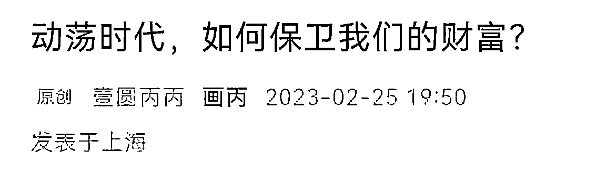
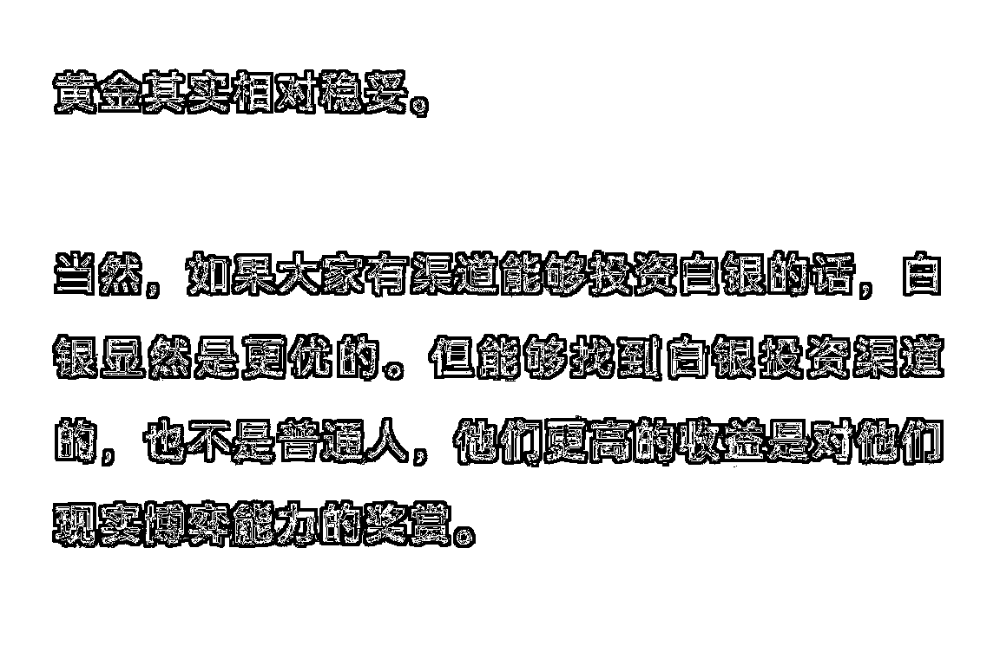
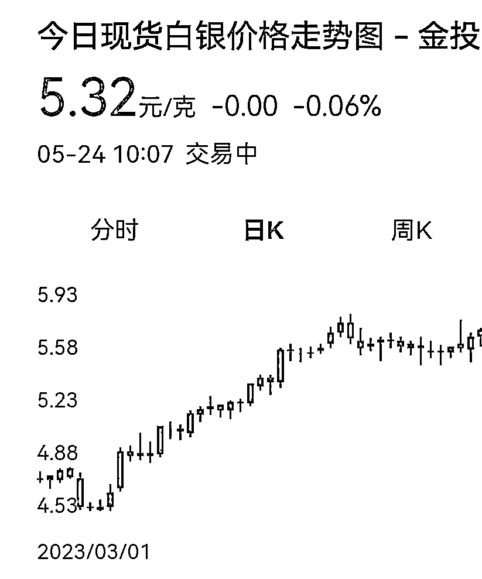

# 钱为什么总往少数人兜里跑

文｜丙丙 2023年5月24日

我是丙丙，职业做投资，个人账户曾做出七位数回报（工资收入另算）。2018年岁末，我交过一份内部报告，判断义务教育阶段的校外培训会迎来监管重拳，劝公司绕开这个赛道，替老板挡掉了至少八位数的亏损（推导过程写在《认清现实，别再逼孩子无效内卷了》）。这些年我也反复从零做项目，跨境奢品代购、线下剧本娱乐，再到如今做商业与政经内容的付费专栏。

来到这个社区后，我一直在想能拿出什么。我的长处是看长期走势、拆底层机制，所以投资结果还算拿得出手——二月下旬，我提前判断出贵金属那一轮历史级行情，付费专栏的读者因此拿到七位数利润。

  

金融投资是我的科班领域，政治与历史我也长期钻研，慢慢搭出一套自己的分析框架，做判断时能互相印证。（我曾与一位粉丝量两百万的时政意见领袖合作过趋势预测，也跨考进入清华、北大的政治理论方向博士项目。）

不过，这些东西偏重底层规律，不是马上能上手的操作，我一直怕在这个社区讲会水土不服。

前些天，在靠谱老师和醒醒老师指点下，我做了 Gallup 才干测评。结果排在最前的两项，一项叫战略，一项叫行动。解释里说，这两项恰好互补，能彼此放大。

我这才意识到，自己那种“看方向”的长处，或许也能给执行很强的朋友一点参考。

于是我把公众号上一篇付费文章《把握财富的本质，实现阶层跃升》搬过来，从一级市场、二级市场和政治学的角度，聊聊资本偏爱什么样的生意。希望这个视角对大家有用。

以下为原文，略有删节：

不少人把钞票当成财富本身，追得很辛苦。可钞票只是表面的一层皮。

真正决定一个人有没有钱的，是他能不能长期从社会总产出里切走一块。

多数人盯着存款数字，却没意识到那只是存量，是过去事情留下的结果。

那财富到底是什么？

有钱，不是账户上躺着一串数字，而是外部资金持续向你汇聚。你变富的过程，就是别人的劳动成果被重新分配到你手上的过程。

怎么让别人心甘情愿掏钱？

除了违法那条路，基本法则只有一条：

你能给别人好处，或者你具备让别人吃亏的能力。

你服务的人越多、提供的价值越大，或者你能让越多的人承受损失、损失越重，你能调动的财富就越多。

沿着这条法则，常见的赚钱路径有三条。

第一条，出卖体力和时间，换的是血汗钱，投入的本钱就是自己的身体和精力。

八成的人走的是这条路。

困在这条路上的人，习惯把今天的收入直线推到未来，既看不清底层机制，也想象不出别的可能。

因为他们大多在做机械重复、不需要动脑的工作，时间被填得满满当当，根本没空深入思考。

日复一日面对重复琐碎的事，认知被磨损，对时代的变化也越来越迟钝。

于是他们总把眼前的状态当成永远。

去年十一月初，我在《大部分人都是“底层画师”》里推演过这群人的处境。

赚钱这件事的根基，在于你对旁人是否具备价值，或是否具备威慑。

处在第一条路径上的人，在老板眼里，他们的价值体现在完成那些技术含量不高、谁都能顶上的活。

老板的时间更贵，要拿去做更值钱的事，所以把这类边角工作外包出去。

用一笔小支出，换走那些时间估值更低的人的光阴。

这些活还会吞掉人的大部分精力，却只产出很低的价值，让人没余力学习、积累、往上走——

干得越久，讨价还价的能力越弱。

从组织角度看：

恰恰因为这批人缺少谈判筹码，公司才能压缩成本、提高效率，资本主义体系的运转效率也由此增强。

而 AI 掀起第四次科技革命之后，很多这类岗位已经不需要人了。

机器做得更快、更便宜，效率更高。

这批人注定被边缘化，很难再分享财富。

当然，这种下滑是相对意义上的，而非绝对意义上的。社会要避免失序，就得托底，提供基本保障。

第二条，占据既稀少又不可缺的资源。

这套玩法跟生产资料私人占有制度一起出现。

正因为有“私人占有”，才可能排他地把某些关键资源攥在手里。

什么叫社会性资源？可以粗略理解为社会运转和日常生活离不开的东西：看得见的有厂房，看不见的有技术、数据。

我要强调的是“稀”和“缺”这两个字，缺一不可。

稀少，说的是总量有限，最后只能落在少数人手里，大多数人连入场资格都没有。

不可缺，说的是社会离了它转不动，需求巨大。

当你握有这种资源，那些没有资源、又极度需要它的人，就只能受你影响：你能给他们好处，也能让他们受损。

回到前面的定义，财富的实质，就是别人为了得利或避害，不得不跟你交换，把劳动成果的一部分交给你。

看几个实例。

最典型的是房地产，尤其核心一线城市的房子。

房子是劳动力再生产的基础条件：打工人得有地方睡觉，睡好觉才有精神继续第二天的工作。

所以房子属于“缺”，需求硬。

“稀”在哪里？核心城市土地面积有限，这是物理约束。这块地占了，别处就没了。

这就是“稀”：只能少数人持有，不可能人人都有。

于是持有房产的出租方，对高收入打工人就有了议价权，甚至某种控制力，能从他们的工资里切走一大块。

你不租，总有人要租。市场一调节，稀有资源的价值就兑现了，房租就成了持有者的收益。

当然，房子作为稀有资源的逻辑属于上一个时代，如今已经被撬动。

读者可以拿这套框架自己推一推，哪里出了问题。以后可以在星球继续聊，这里先不展开。

再看一个看不见的例子：移动互联网普及后，线上关注度也成了既稀少又不可缺的资源。

它怎么改变生产和生活？

当手机和各种应用成了日常入口，购物、消费、娱乐、社交都在里面完成。

每打开一次应用、多停留一次，就是在贡献注意力。

注意力跟生产者和消费者绑在一起，成了“缺”，背后是巨大的需求。

“稀”又在哪里？

注意力的总量有限。

全国十几亿人，每人每天同样只有二十四个小时，时间被社交、短视频、种草社区、问答和电商平台分食，所以巨头们才那么焦虑。

这就是“稀”：只有少数平台能拿走绝大部分注意力，谁都担心对手多占一分，自己就少一分。

微信为什么忌惮小红书，要把公众号往图文种草的方向改版？就是为了留住用户时间。

很多头部博主很清楚，自己的壁垒——也就是赚钱的根基——是手里那批关注者。

他们守得很紧，绝不让注意力轻易流到外面去。

因为他们明白，关注度意味着影响力，意味着能触动多少人的认知。

而人的认知容量有限。一个新博主冒出来，切走一块市场，守成者就会紧张，尤其是风格定位接近的新人。

顺带说一句，科技是当今最关键的稀有资源。谁握住技术，谁就拥有让别人向自己输送利益的核心权力。所以技术领先的国家会想尽办法保持“稀”，把关键技术攥在自己手里。

这里不展开。

还有一种常被提起的稀有资源：人脉。社会运转、价值创造都要靠人，把合适的人凑到一起做事，本身就是一种关键能力，这是“缺”。

“稀”则来自人的天然限制：精力、注意力、活动半径都有限。一个人能直接认识、深度来往的对象并不多，所以优质人脉天然带“稀”的属性。

优质人脉稀少的另一个原因，我在《真正的狠人，收割富人》里讲过：

越往金字塔上层走，信任成本越高，这又会进一步放大优质人脉的“稀”和“缺”。

举这些例子，是为了说清什么叫握有稀有资源。

那么，手里有没有这种资源，会分出两种打法。

一种是守成者：死死占住资源掌控者的位子。比如头部博主要守住关注度，把壁垒做深，让更多人更依赖自己，从而持续获得利益。

个人精力有限，但产权制度给了解决办法：用股权做“分身”。

比如注册一批公司和账号，招写手生产内容，自己给矩阵导流，反复收割注意力，把资源价值吃干榨净。

用股权结构复制自己。

这样既能吃到更大的份额，也能挡住对手来抢。

所谓壁垒，说到底就是让手里的资源始终维持“稀”和“缺”，再用分身把利益放大、把竞争者挤出去。

这也是很多公司做大之后四处投资、并购的原因之一。

另一种是挑战者：手里暂时没有稀有资源，但嗅觉灵敏，能发现时代变了，也具备接住新需求的能力，能借上大势。

挑战者往往靠创新完成超车：

当新的稀有资源取代旧的稀有资源时，谁先入局、谁迭代得快，谁就先握住新资源，完成对旧利益格局的换血，成为新的掌控者。

这就是踩中了时代切换的节拍。

互联网头部博主对传统报刊的冲击，就是抢占了新的稀有资源——线上关注度，替代了旧资源——书报亭、纸媒渠道。

而踩中时代切换的节拍，往往是普通人改命、向上跃迁的关键。

我们这代人的运气在于，AI 才刚起步。

从现在往未来看，大量新稀有资源正在生成，旧稀有资源正在消失。

先占住新资源的人会起来，守着旧资源不放的既得利益者会掉下去。

再说第三条路径：靠立规矩赚钱。

它是第二条的升级版。前提是你已经在一定程度上握有稀有资源，然后由你来写游戏说明。

换句话说，立规矩意味着你建构并握住了更深一层的稀有资源。

打个比方：第二条路径里，你可能是筹码更多的玩家；第三条路径里，你经营的是整个牌局。

在你的地盘里，规则由你解释。你是设局者，你定规则，你养生态，你是绝对的主场。

建这个局的时候，要让更多人的利益跟你站在同一边，靠分享收益，让更多人——特别是能人——在你的局里获益。这样你才能借他们的力量把盘子铺大，让自己立规矩的能力更强。

（我此前专门写过一篇，讲资源是怎么被握住的，可作参考。）

等你的地盘聚起足够多的人，生态自然长出来，大家玩的是你设计的游戏，每个参与者都在给你的盘子添砖加瓦，你就能坐收其成。

因为你是裁判，是规则本身，你对所有参与者拥有最大的给予好处和造成损失的能力，所以总能从他们创造的价值里抽走一份。

现实中，这套玩法很多。

小到电子游戏：生态建起来、规则定下来，不管付费玩家还是免费玩家，都得向运营方输送利益。掏不出钱，就掏时间和注意力，再不然就为生态添人气。

再比如 CFA 这类证书体系，制定认证规则、握有对考生的裁量权，而考生又需要证书找工作，于是能稳定地从考生身上获利。

这就是设局者的思维和能量。

再比如各类互联网平台：社交、种草、短视频巨头，都是先建生态，再成为规则制定方。对平台上的玩家来说，它们就是持续抽成的设局方。

那些年互联网行业冒出估值翻几百上千倍的独角兽，让资本赚得极厚。

因为“建生态、立规矩”是最能深刻影响参与者利益分配的生意。生态一旦成型，就会自我复制、自我扩张，形成累积效应，强者吃掉大部分市场，把直接竞争者挤出去。

比如社交软件做到微信这个程度，基本没有同量级对手。

做风投时，我跟创业者反复讨论的就是这一点：先把盈利逻辑想透，最好让它能自己生长，让你有机会成为定规矩的人。

大家可以顺着这个逻辑推一推：当今世界，最厉害的规则制定者是谁。

当然，设局听着爽，威力也大。但要提醒一句：任何东西都有代价，世界到处是利益拉扯。

设局方能长期抽成，是因为它同时给了参与者一套秩序和实际好处。

不然局面撑不住，参与者可能联手推翻你，也可能有后来者夺走设局权。

比如电商平台向商家收佣金，但它也得持续升级，把服务和曝光做上去，降低买卖双方的信息差，才能长期收下去。

不然就会有新玩家找到缺口，来夺设局权。

从这个角度看，也能理解为什么要约束垄断：

因为市场里总有人盯着设局权，这些挑战者盯着机会，会逼着当前的设局者持续提供更有价值的服务。

否则，让优势巨头随意收购、收编所有可能挑战它的人。

一旦外部威胁消失，巨头就可以躺平，服务变差，公众利益受损。

以上是三条常见的赚钱路径。

除了这三条，还有一种，我叫它“赚短期红利的钱”——哪里热就往哪里扑，捞到就走，做的是“一锤子买卖”。

这种钱来自对需求迁移和趋势变化的快速反应，趁新旧资源换挡，伸手抓了一把新东西。

可本事、眼力或运气差一口气，最终没握住真正的稀有资源，所以形不成累积效应，也建不起壁垒，缺少能沉淀下来的东西。

很多频繁换赛道的生意人，一波一波追热点，吃的就是这碗饭。

最后总结一下赚钱的三重境界，把财富拆到最里面，只剩两个字：

“拿捏”。

物质上的拿捏，精神上的拿捏，都算。（奢侈品卖的就是精神层面的拿捏。）

你能拿捏的人越多，拿捏的对象越有能量，拿捏得越深，你掌握的财富就越多。

由此也更能理解马克思讲过的那句话——财富即权势。

说到底，权势玩的也是同一套东西。

所以往金字塔上层爬，本质上是在训练自己、也在读懂别人，既要管住自己，也要影响他人。

影响别人固然关键，管住自己才是前提。

否则，迟早会被更老练的收割者算计。（这一点我另有文章细讲。）

对没有背景和资源的普通人来说，要做到拿捏，路径是：

第一步，先给别人实在的好处，解决他的问题；第二步，设计一种连接，让关系不容易断，把更多人的利益跟你缠在一起，让越多的人对你形成依赖。

这样你就拥有了给别人好处、或让别人承受损失的能力，不管是在物质上还是心理上。

比如某手机巨头，用流畅的设备赢得用户，再靠封闭的操作系统把人锁住，让全球大约三成用户被它黏住，只能持续交“通道费”。

一边抱怨一边离不开，痛着也乐意付钱。

这套打法不只适用于生意，放到人际关系和感情里同样成立。

它真正教你的，是怎么拿到影响力。

说到底，人间万事都绕不开权力二字。

这次就聊到这里。最后留个小问题给读到这里的朋友：这个社区属于哪种模式？它为什么能做得这么好？

谢谢你读到这里。我是丙丙，想聊可以留言或私信。