# (精华帖)(144 赞)教培关停后，直播卖课做到40W+

作者：汤鱼儿  
日期：2023-02-03

先做个自我介绍：我叫汤鱼儿，交大硕士，拿过两个硕士学位，也是抖音学浪平台认证的金牌讲师，做学习规划已经六年多，线下带出过三千多名学霸。

但前一年，我的日子并不好过：刚进赚钱那阵子，两个多月摸不到方向；教育行业又碰上双减和疫情；家里二宝出生；工作也丢了。

从对线上几乎一无所知，到一年多时间线上收入累计超过四十万元，这段经历确实该好好复盘。

至于为什么选家庭教育，是因为我跟着 @沐文 和 @花爷 学做个人品牌，慢慢确认了教育博主这个方向，也看清了靠课程收钱的路径；后来又参加抖音账号直播主题的那期航海，边学边干。起量比我想的快，前十场直播就有家长陆续下单。

产品面向 3 到 15 岁孩子的父母，定价 299 元，用录播课承载，把幼儿园启蒙到中考之间该抓什么、怎么安排讲清楚，再配上能直接照做的办法，帮家长把孩子往学霸方向培养，最终平稳越过中考，不被 55 分流卡住。

成交路线是：先在直播间卖课，再把客户沉淀到粉丝群，其中一部分继续导入私人🛰️。

下面把这段路展开说说，也整理一些经验和感受。

内容不短，我先摆一张导图，大家看清结构后，再挑重点读。

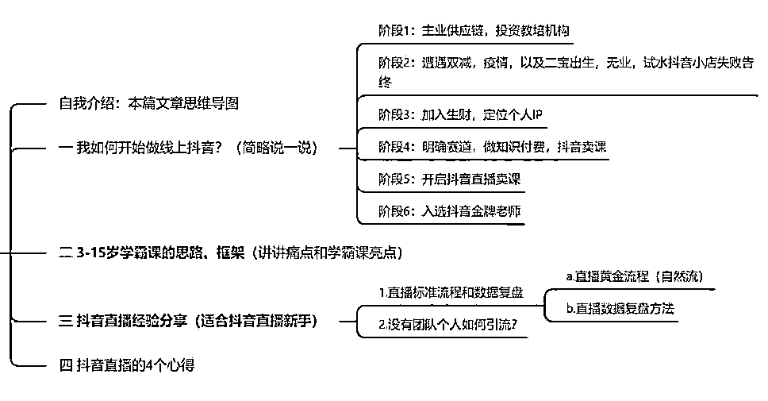

**一、线下机构退场后，我怎样一步步走到抖音镜头前？**

整个过程可以拆成六段，我也画了导图，方便大家看清我是怎么转身的。

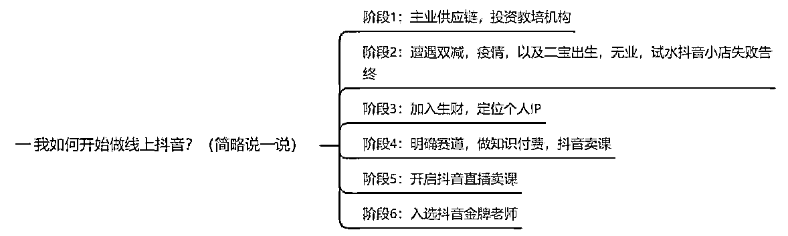

阶段一：

我早年的工作不在教育口，而是在供应链行业做管理。后来孩子出生，我的注意力慢慢挪到教育上。大宝今年十一岁，换句话说，十一年前我就开始琢磨教育这件事。

2015 年我考进交大读硕士，毕业后把主要精力放到教育相关业务上。那会儿线下培训市场还热，我同时投了上海两家机构：一家做幼儿兴趣课，一家做中小学提分课。起初只是兴趣型投资，后来也确实赚到了一些钱。

阶段二：

这一段，很多教育从业者都不陌生。2019 年起双减落地，接着疫情来了，家里又添了二宝，几件事叠在一起，成了我人生的转折：投的两家机构实在撑不住，只能关掉；二宝太小，加上疫情，我成了一个没有工作的中年人。

我本性闲不住。在家带娃那些日子（其实也没完全闲着，我还试过微商，但没赚到钱，哈哈），我把注意力放到了抖音上。

像我这种毫无网感的人会盯上抖音，是因为当时抖音正大力铺商业版图，推出抖音小店，还有工作人员打电话劝我开店。我连小店是什么都没弄明白，就随手花了 2000 元买了 1500 个粉丝，开始琢磨怎么变现。

我当时做的是无货源模式，2020 年初起步其实不算晚，但我始终没弄懂其中门道，小店就一直闲着。

那时我对新媒体的全部认知只有🛰️。我自己开过👸号，虽然没赚到钱，但相比抖音，🛰️好歹算我的舒适区（见笑）。

所以我一门心思想在🛰️上找机会，天天翻各种技术帖。2021 年，我通过 @铭则 的引流帖进了他的群，正好赶在 4.18 之前；到了 4.18，铭则推荐龙哥盟，我那时也真舍得掏钱，花 1500 多入了赚钱。

（说实话是稀里糊涂进的，当时也觉得贵——对新媒体毫无概念的人，花 1500 多进一个群，确实肉疼。）

阶段三：

进了赚钱后，发现里面高手如云，干货多到眼花缭乱，看了两个多月仍找不到自己的位置。我试过饿了么 CPS，发现自己不适合；也考虑过 shopee 这类跨境电商业态，但既没经验也没团队，最终没启动。

转机来自赚钱大航海。具体哪一期记不清了，只记得船长是 @沐文。那时我仍什么都不懂，但隐约感觉账号品牌这个方向值得走。跟完沐文船长那期，我最大的收获是把商业品牌这件事想明白了，但定位究竟怎么定、自己适合哪条路，依然没底。

于是我继续泡在赚钱里，找到了 @花爷。知道花爷擅长个人品牌打造，我咬牙花 1800 元报了他的个人品牌入门训练营（当时真觉得是巨资——现在看，认知差有多可怕）。花爷的课彻底打开了我：我知道了什么叫个人定位，也找到了完整成交链。按花爷的方法，我把自己定在 3-15 岁教育博主这个方向。当时抖音图书很热，我想先立一个学霸人设，从带书做起。

阶段四：

这一阶段的起点，是蝉妈妈的一次数据分析。通过赚钱，我了解到抖音有数据分析平台。供应链出身的人对数字比较敏感，那阵子我特别爱泡在蝉妈妈里看数据。

我做了一件挺有意思的事：把认为值得参考的对标账号数据整理了一遍，大约找了 100 个做教育、母婴的抖音博主，查看他们的销售额和利润。结果让我意外：抖音带书真正赚钱的只是头部，而且头部效应极强，行业集中度很高；中腰部博主赚得并不算多。

但有一个人的数据非常抢眼——“博士晴妈”。她当时粉丝量不算大，印象里十几万，但利润比不少粉丝三四十万甚至七八十万的带书博主还高。

我很惊讶，后来发现她的利润款其实是课程。从那时起我才知道：抖音上可以卖课，而且卖课利润很高。

有了这个认知，我才把自己的定位和成交链画清楚。我决定卖课（带书反正没优势），自己开发课程。为了尽快见到收入，我还把链路缩短了——花爷教的是“引流-私域-朋友圈运营-课程售卖”，但我觉得从抖音往私域引，再靠朋友圈卖课，链条太长，对我这种半路出家的门外汉不友好。我直接改成在抖音卖课。

随后又幸运地赶上赚钱一次大航海——抖音个人品牌主题，带大家做爆款视频。我没做出惊天动地的成绩，但拍了一条“我的十年”，把个人定位的基调定下来了。

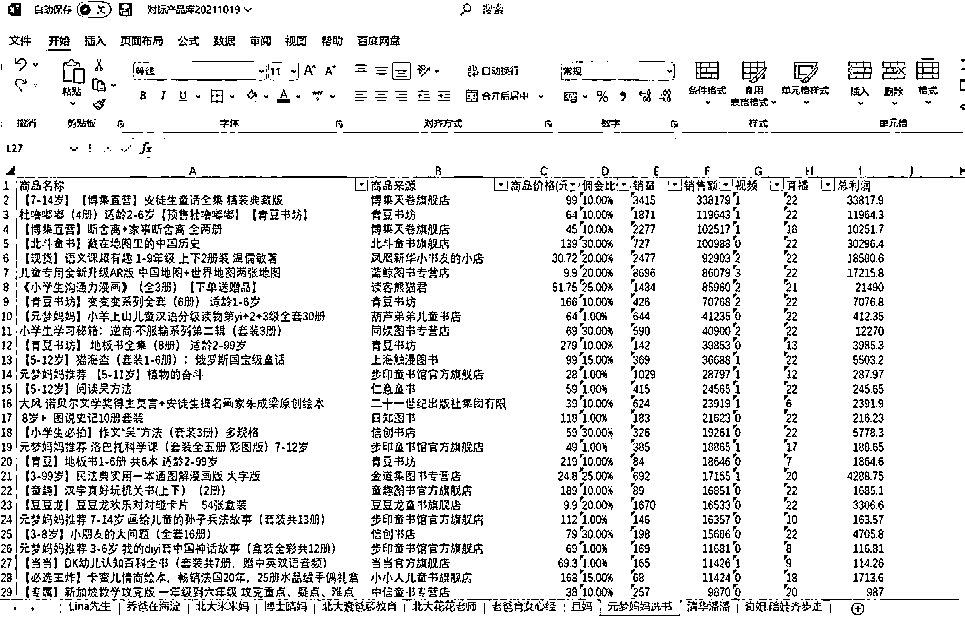

这张数据是我当时从蝉妈妈导出的。路径是：蝉妈妈官网→达人详情页→带货分析，大家自己也能找到。

阶段五：

这个阶段从直播开始。2021 年底直播风头很劲，我想着能不能再把链路缩短：靠爆款视频卖课概率偏低，不如直接开播。

当时我盯了几个对标直播间，比如“付付老师教育圈”“北大花花老师”“博士晴妈”，但基本是看热闹，没摸清门道。

结果 2022 年 3 月，赚钱又开了一期大航海，主题正是抖音账号直播。

哇，我运气确实好，一路上的每个节点都跟着赚钱走，每期大航海都像我的里程碑。4 月我开始跟着大航海正式做直播，变现很快，前十场就有家长陆续买课。到 5 月，场观约 2000，每场销售额在 1000-3000 元。我自己都挺意外。

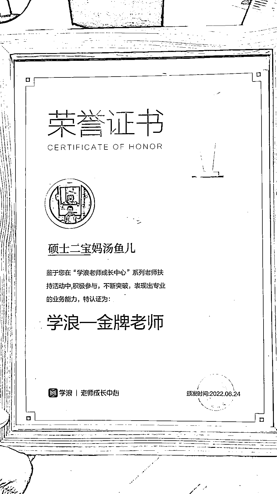

晒一下证书。

阶段六：

这个阶段来自抖音对个人主播的扶持。播到 5 月底，我入选抖音金牌老师培训，通过考核后拿到“学浪金牌老师”称号。

经过这次抖音内部培训，我终于弄懂了免费推荐流量和付费流量大概怎么玩；如果做免费推荐流量，关键环节和注意事项有哪些（后面干货部分会细讲）。

我一直做免费推荐流量，虽然不算多好，但从 6 月底到 12 月，也经历过日入 2 万的“高光时刻”（对我这种小虾米来说，日入两三千才是常态，能上万真的算高光，大家见笑）。

贴一下数据。

好了，上面啰嗦这么多，就是我的完整经历。感谢看到这里。我之所以讲这些，是想提炼两点：

**1.** 进了赚钱，干货帖一定要看，大小航海一定要跟；

**2.** 我做得不算好，但一个半路出家的新手从完全不懂新媒体到跑通成交链，说明确实踩对了一些点。

所以接下来讲我理解的干货，希望对知识付费、直播感兴趣的朋友有点启发。

以下内容只适合入门级朋友。

**二、3-15 岁学霸课怎么设计（我找定位的过程）**

我的抖音账号叫“硕士二宝妈汤鱼儿”，目前粉丝 3.7 万。主要收钱方式有两种：1.直播卖课；2.视频带书。现在精力主要放在直播带课上。

这里重点讲我怎么找到定位。我的体会是：刚开始做账号的人，想找到特别明确的定位确实很难。想通过账号定位快速跑通成交链，赛道必须切得足够细。

我讲一下自己的定位方法，方法来自 @花爷 的课，再次感谢花爷。

第一步，先确定大行业。

自媒体大行业无非资讯、财经、教育、娱乐、科技、商业、体育、母婴这些。既然要做自媒体，大行业类目总能很快定下来。

就像我当时准备做账号，虽然还不知道怎么跑通成交，但我知道自己一定做教育——因为教育行业我有资源、有经验，而且离钱近（妈妈们在教育上特别舍得花钱）。

这正好符合花爷说的：优先选离钱近的，或自己资源多的方向。

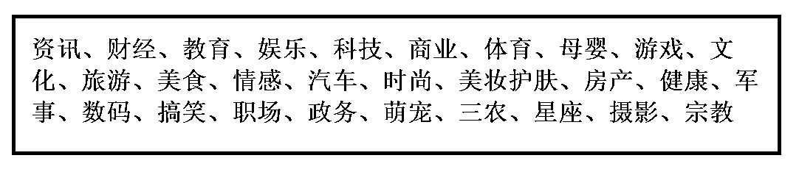

自媒体大行业，大概就这些。

第二步，有了大类目，就要切细分市场。

什么是细分市场？就是消费者的需求。

细分切得越细，消费者越愿意干脆地掏钱。比如教育市场：有学龄前、K12、考研考公等各种细分。但你说“我是做小学生教育的”，这个范围还是太大——家长一听等于没说，没法在你身上形成具体印象，自然没有掏钱的理由。

所以在细分定位上，我有个小诀窍：做逆向工程。去看对标账号。我当时在抖音上搜了几十个跟我定位差不多的博主，带着下面 10 个问题去拆解：

1.他们是谁？（给自己贴的标签是什么）  
2.他们的专业能力在哪里？  
3.标签和专业能力怎么挂钩的？  
4.他们是怎么火起来的？（这个很难还原，但靠抖音视频能看个大概）  
5.他们的加分项是什么？  
6.目标群体是谁？（越细越好，细化到年龄、省份、收入、职业）  
7.他们怎么跑通成交链？  
8.定价多少？  
9.利润如何？  
10.产品解决了什么问题？

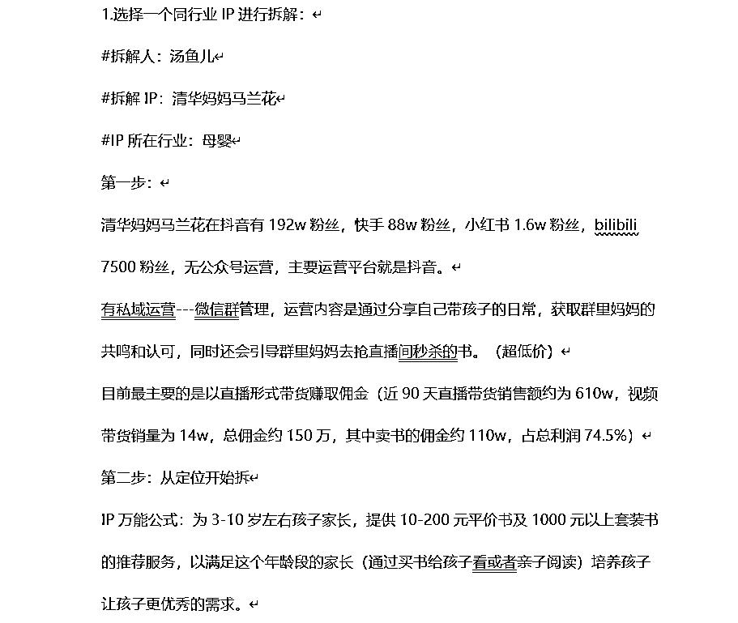

这是我当时拆解“清华妈妈马兰花”的部分内容截屏。

我的体会是：对标不能只看一两个，数量要够。用这十个问题反复拆同行，行业里的常见打法就会浮出来；把打法总结出来，你才能判断自己吃不吃得下。

（比如我起初想走带书路线，拆了几十个账号后才发现：带书真正肥的只有头部，中腰部收入一般；直播带书还得靠团队，没有团队很难跑；加上供应链门槛，谈判能力要强，或者本身是大号、特别能卖，才拿得到一手货源和信息。这些条件对新手并不友好，所以我后来放弃了。）

第三步，了解同行、有了细分定位之后，就要明确自己的账号定位。

这个定位用一句话概括后，要让客户愿意为你掏钱。如果对方没心动，说明咱们没戳中痛点。

我的学霸课定位，一句话说就是：

面向 3-15 岁家长，定价 299 元，用录播课形式，提供从幼儿园启蒙到中考的完整学习攻略，让家长清楚知道每个年龄段的学习重点和安排，同时给出可实操的方法，帮家长把孩子养成学霸，最终轻松过中考、不被 55 分流。

这个定位包含这几个要素：1.目标客户；2.价格；3.提供什么服务；4.帮客户解决什么痛点。

这些是最基本的要素。如果还能更具体，比如把路径、亮点都想清楚，基本就能开干了。

第四步，最好再加点 PLUS。

账号背后是活生生的人，一直秀专业性不够，还得用真实感打动人。如果用户能说出来你是个什么样的人，基本就成了。

所以很多博主特别能怼人，有些特别能哭，有的特别贴心——这些都是在专业之外贴的个人标签。互联网时代，有这样的标签更容易火，不是吗？（这点我没及格，哈哈）

这就是我找定位的全过程。

当时定位时非常模糊，甚至很焦虑，不知道到底该怎么办。我甚至问了大航海的老师：拍视频穿什么？要不要画精致妆？

老师回了一句：别管这些，先做起来再说。现在想想太对了——先干起来，才知道怎么调整。所以做账号，第一重要的是先想好基础成交链，第二重要的就是想好了就立刻动手。

接下来讲讲我的学霸规划课。

课程框架：

围绕学霸培养这个中心，课程从中考分析讲起，基于中考特点告诉家长每个学科怎么从幼儿园、小学就开始有步骤地准备。内容分为中考分析、学习方法、学习动力三块，又按不同年龄段分别详细讲。（如下）

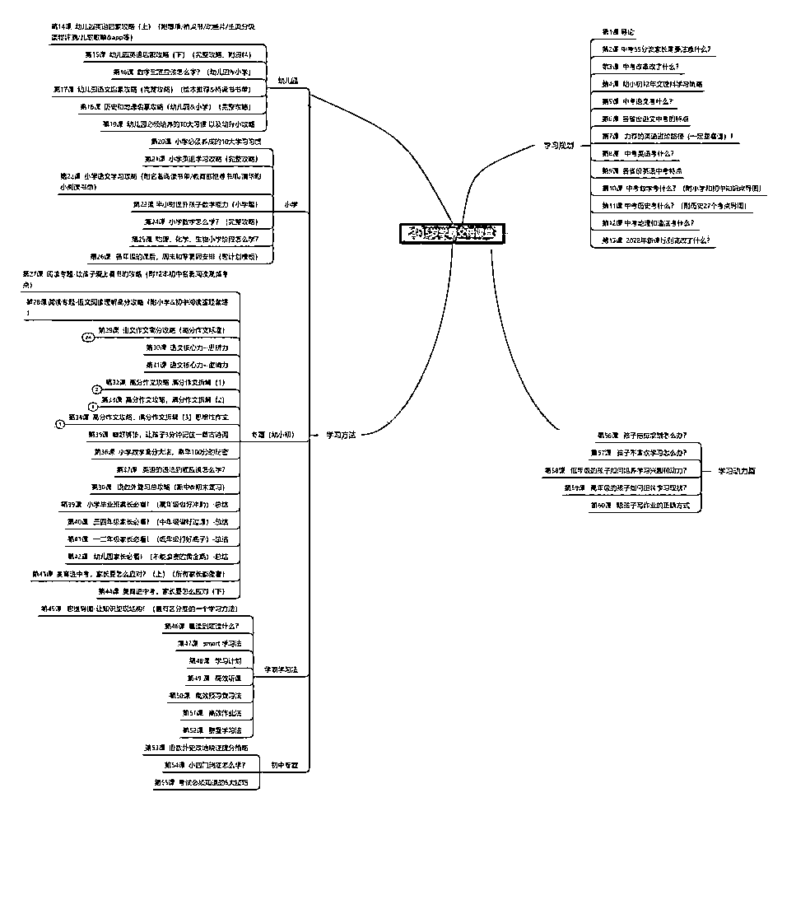

课程亮点：

1. 12 年更新 + 12 年答疑服务。

目前市面上 199、299 左右的课，很多是一锤子买卖。我觉得客户留存不会太好（这只是我的个人看法）。所以我目前能力有限的情况下，先把客户留住。想留住客户，要么引流到私域，要么持续提供价值。引流到私域我精力不够，所以选了第二种。

对家长来说，能 12 年持续更新，还带着孩子从幼儿园走到中考，性价比非常高了。

2. 课程给的是系统攻略。市面上很多学霸课是零散解决问题，我的课程是成体系的、逻辑清晰，而且是完全可落地的攻略，家长反馈都不错。

目前转化路径：

抖音直播卖课→客户进粉丝群→部分引流到个人私域。私域这块还没完全做起来，现在准备组个小团队，把私域做好。

抖音引流我一直很小心：用的小号在群里说话（绝对不用大号！），再用诱饵（比如赠送资料），引导粉丝加我🛰️号。

**三、抖音直播经验分享**

下面讲讲我这 8 个月的直播经历和积累的经验。

上图是我在蝉妈妈截取的自己账号 180 天直播场观趋势。基本场观在 3000-4000，有个异常值在 11/20 前后，是我有个视频小爆了一下。

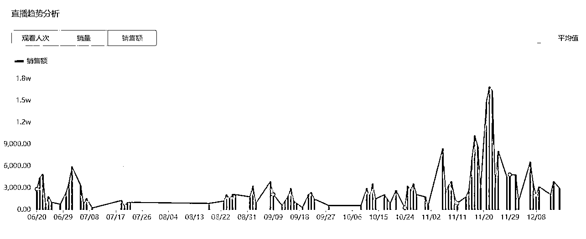

这是对应的销售额变化。

成绩不算漂亮，但稳中有升。我来讲讲直播里的一些经验，希望对大家有用。

讲两点：

1. 免费推荐流量下的标准动作与数据回看  
2. 没有团队时，个人怎么引流的一点小经验

**1. 免费推荐流量下的标准动作与数据回看**

以下内容基于免费推荐流量来讲，是抖音给金牌老师内训时给的攻略。我自己实操下来确实觉得好用，值得大家一看。

**a. 免费推荐流量下的起量流程与规范**

抖音知识付费主播想撬动更多免费推荐流量，有个起量流程。流程可以归纳成下面这张图：

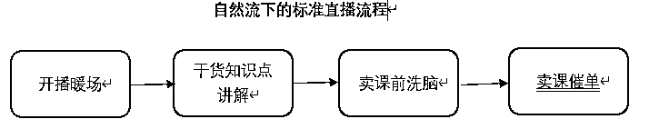

第一阶段开播暖场：让路过的人留下来，快速建立信任，再通过快速互动让系统推人。

开播暖场 7 步法，给大家贴一下：

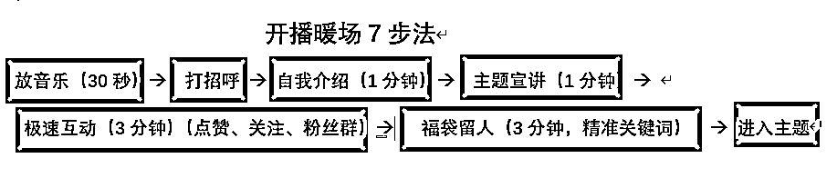

这个环节最重要的是快速互动——尽量让用户跟你做短平快的互动。如果能快速互动 3 分钟，系统就会推人。快速互动指点赞、关注、进粉丝群。所以要尽可能准备一些诱饵，让用户愿意跟你互动。这一点我自己一直没做好，惭愧，但大家可以去找优秀对标学一学。

第二阶段干货知识点讲解：这个阶段基本是秀肌肉。要让客户通过干货内容留到卖课环节。系统会先重点考核客户停留时间，再考核持续互动情况（点赞、关注、粉丝群）。如果这些都 OK，系统就会持续推人。

第三阶段卖货前铺垫：这个阶段非常重要！很多博主会漏掉。这块内容是放大需求、营造价值感的。简单说就是戳用户痛点，让用户痛哭流涕，然后告诉他你的东西很好，他就会心甘情愿买单。

方法如下：

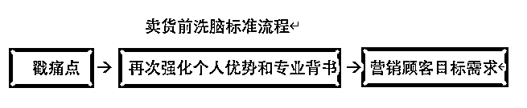

如果觉得不好理解，我把流程细化成 7 小步：

①干货讲完，先问有没有收获，让扣“有收获”。（先获得认同感）  
②开始展望未来：你是否想达到 xx 的目标？  
③把顾客打回现实：你们目前的情况是这样的（糟糕现状，即痛点）  
④个人背书理由：我的成绩  
⑤建立预期：直播间时间有限  
⑥是否真心想学，让扣“想”  
⑦怎么学？现在准备和我报名

我研究过很多博主，都有这 7 小步的影子。我自己学了以后是按这 7 步走的，把“卖前铺垫”加到直播稿里，收效非常明显。大家也可以试试。

第四阶段卖课促单。促单的目的：一是让想买的尽快下单，二是让犹豫的减少犹豫时间，今天一定要买！

留在直播间的客户分三类：一类是必买的（5%-10%），第二类是犹豫的（90%-95%），第三类是不买的（非精准用户）。卖课促单环节，就是要拿下前两类用户。

所以重点在那些犹豫的客户身上，去研究他们到底在犹豫什么。基于研究，再给客户上促单话术。

**直播话术别背死，复盘和引流才是关键**

催单时用到的话术，大致可以分成促销型和情感型两类。促销型里有：限时、限量、秒杀、加赠、额外服务、售后、倒计时、库存告罄这几类话术；情感型则包括换位思考话术和血泪史话术。这些话术必须背到滚瓜烂熟，但背熟只是前提，关键是用得活。每场直播遇到的人都不一样，把流程定死，效果往往有限；一定要根据现场互动随机应变。

好，自然流直播的标准流程，我前面只是大概讲了一遍。我写得比较笼统，想直接照搬一套马上能用的方法，基本不现实。当初我们学这套东西，花了一个月，每周两小时，我实在没法把每个细节都摊开写在这里。再说我自己也只是半桶水，不少地方做得恐怕连及格线都没摸到。

我把这套流程放出来，是希望刚入行、经验不多的直播新手能多看看，然后拿着这个框架去拆解对标账号。心里有没有这个框架，会直接决定你从对标账号身上能学到多少。即便只是模仿，你也知道人家为什么这么做，后续才有能力改进和优化。我甚至觉得，拆解对标账号，可能是做抖音最关键的一项能力。

**b. 直播数据复盘：盯紧这些关键指标**

下面说说直播数据复盘。做运营的都很看重复盘。虽然我自己一直没把复盘做扎实，但这句话我是认的。接下来讲讲怎么看自己的直播数据，以及怎么根据数据做调整。

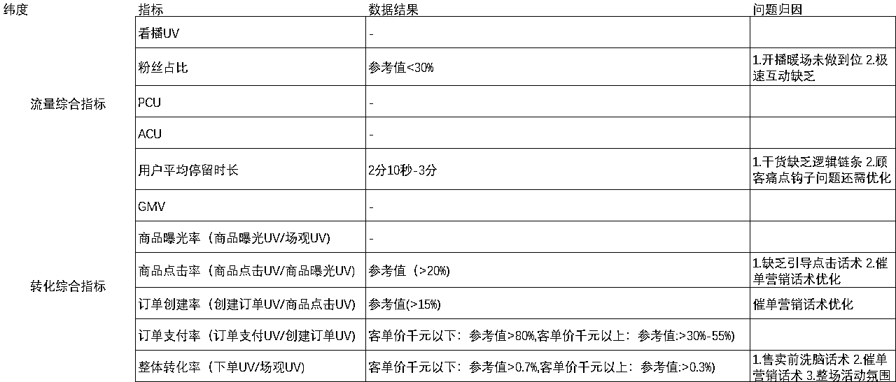
每场直播关键数据与分析参照表

这场直播里最关键的数据，我都放在表里了。标红的部分要重点盯，它们会直接影响下一场平台给你推多少流量。没挂小黄车时，平台主要看流量综合指标；一旦挂上小黄车，转化综合指标也会纳入考核。这些数值在巨量百应后台都能查到。

粉丝占比：并非越小越好，可一旦超过30%，就说明本场粉丝来得太多。粉丝占比过高会拉低转化率——粉丝进直播间，有的只是来薅免费内容，有的已经下过单，纯粹来撑场。出现这种情况，多半是开播前10分钟的暖场极速互动没做到位，没能触发系统推流。

用户平均停留时长：干货主播建议做到2分10秒到3分钟。时间太短，说明你的干货逻辑链没搭好，用户听不下去；也可能是钩子没放对。主播要一直留人，就得不断下钩子，让用户知道现在讲得好，但后面还有更值得听的。时间太长也不见得好，我看过停留十几分钟的，那往往是把干货讲得太实在，用户光薅免费内容。讲干货要讲一部分、留一部分，让用户明白付费买课才更能解决问题。

商品点击率：商品卡弹出来后，用户点进去的比例，参考值要大于20%。不达标，通常说明你缺少引导点击的话术，催单话术还得优化。优化思路就是拆解对标，很多同行做得很到位，比如现场演示怎么点开商品查看。这个数据为什么重要？数据好看，系统会默认你的产品比别人更有吸引力，从而给你推更多流量。

订单创建率和订单支付率：现在巨量后台把它们合成了一个指标，叫“商品点击-成交转化率”，也就是用户看过商品后最终付款的比例。这个参考值我暂时没有，我自己一般在25%左右，仅供大家参考。比例太低，说明用户看了商品却没付钱。要去找不付款的理由：可能是催单话术不过关，让他觉得没必要现在下单；也可能是商品本身不够吸引人。所以得自查：催单行不行、商品详情页行不行、商品评论行不行，这些都要优化。

整体转化率：客单价超过1000元，合格线是0.3%；千元以下课程，达标线是0.7%。数据偏低，就从源头找原因。整体转化率等于最终付款用户数除以场观。那么多人进直播间，有人听一会儿就走，要查为什么只待这么短：内容不够吸引人？讲得不好？还是没钩子留人？也有人听了很久却没买单，那可能是你没营造出“这门课买了一定有用”的氛围，或者催单时没让他觉得必须今天下单。所以整体转化率不高，得从多个环节找原因。就我自己来说，有时能达标，大部分时候不行。我自查时就看：是干货内容的问题、成交氛围的问题，还是催单的问题。我最弱的是催单，所以主要优化催单内容。当然每个人特点不同，还是要按自家情况自查。

**2. 一个人没团队，怎么给直播间引流？**

适合入门级别、目前没有团队的伙伴，一个很小的经验。

到现在我还是一个人做直播，一个人应付一场直播其实挺手忙脚乱，有时会觉得势单力薄，尤其在引流上。我不懂投流，这块非常弱，直播投流到底怎么弄我压根不知道，一直想了解也没真正行动，流量问题一直让我头疼。不过11月底有几个异常值，最好的一场场观到了4w，原因是有一条视频小爆，给我带了一波流量。

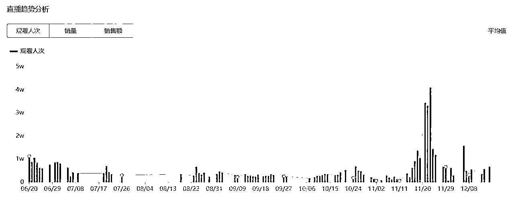

所以给大家一个经验：一定要重视视频内容输出，能做到日更最好。我之前有段时间把精力全押在直播上，很久没认真拍视频。大家别像我以前那样，把直播和视频当成两个赛道，钻牛角尖。我现在的做法是，尽量优化视频质量、提升发布数量，争取做到5秒完播率>30%，然后在开播前投DOU+，用DOU+的流量把直播间流量抬起来。这个方法相对好用。跟运营高手比，我这招可能算小儿科，但作为一个硬着头皮一个人撑到今天的直播人，我觉得它对刚入门的新手还是有参考意义。等有了团队、有了运营，自然有更高端的玩法；眼下先用这个方法做点小引流。

**四、几点实在心得**

到这里，核心干货基本讲完了，希望对大家有点帮助。最后说几点心得，作为结尾。

直播很考验心态。有时候播完一场，一单没成，人会很沮丧。我7月就因为这样停了两个月，9月才重新开播。现在我有个挺有意思的做法：觉得沮丧时，就上蝉妈妈看对标，找一个能力跟自己差不多的人，看他的数据。你会看到人家一路过来也是跌跌撞撞、很不容易，然后自己又有动力继续了，哈哈。

直播还是需要团队。至少得有人在直播时管管评论、带带气氛；卖课时如果有几个托自然最好。别小看这些，我看到有些博主就是靠水军把成绩拉得很漂亮。

说实话，直播不是长久之计。它属于干一天吃一天，今天不播基本就没收入。所以直播的同时一定要布局更多收入方式，把流量用起来。我现在还很被动，准备往私域走：一边直播一边往私域引流，再用花爷的方法运营私域、上高价课。目标就是哪天不直播，也能有正常收入。

把身体练起来。直播很吃体力，话说多了整个人气都上不来。我看到有些博主说话大口喘气，特别费劲，我自己有时也这样。所以平时一定要锻炼，身体是大本营。嗓子不行的话，推荐一个叫“通州化橘”的，去某宝搜，润喉感觉不错。

就这么多，感谢大家看到这里，也感谢赚钱一路带着，感谢一路遇到的贵人。

评论区：
龙哥：一个人破圈，常常是从咬牙花一笔以前不敢花的钱起步的。没有外力介入时，人大多会待在一个平衡圈里，圈内一切都与自己的认知相匹配——穷得稳定，富得也稳定。直到某天，战战兢兢花了一笔让自己肉疼的钱，然后大概率被割。有人马上缩回去，有人胆子大些，继续战战兢兢再花一笔，又被割。运气好的，会进入一个全新圈子，看见完全不一样的世界。我今天还和朋友聊，啥时候能有大突破？大概要从多招几个以前根本舍不得招的贵的人开始。
小新：深有同感，总得敢迈出那一步，人生才会不一样。选择塑造命运，新的选择会带来新的命运。
孙哲：666
波叔：厉害了
星星：同为教培人，这份复盘很优秀，非常实用。
汤鱼儿：哇，龙哥大大回复了。感谢。
洪智「突围一只鹰」：打破稳态，才能获得新生。