# 从失业妈妈到千万课销：我靠一套笨办法跑通了

作者：阿佳 bonnie  
日期：2022-06-16

知识付费这件事，很多人只是消费过。过去流行收徒弟，如今更流行把内容打磨成一门课，挂到网上卖给天南海北的人。这跟你有什么关系？关系不小——只要你手里有能帮到别人的经验，就可以照这条路走一遍。我入行时什么都不懂，几个月后录出第一门课，卖了一千多万；之后用同一套打法又做了几门，营收从几十万到几百万不等。

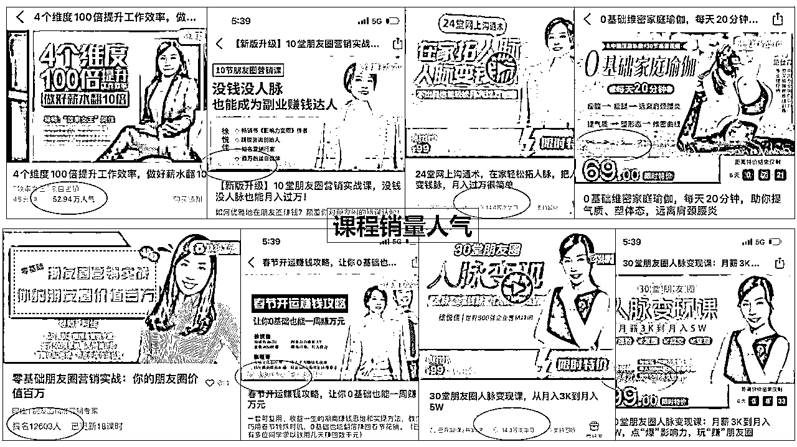 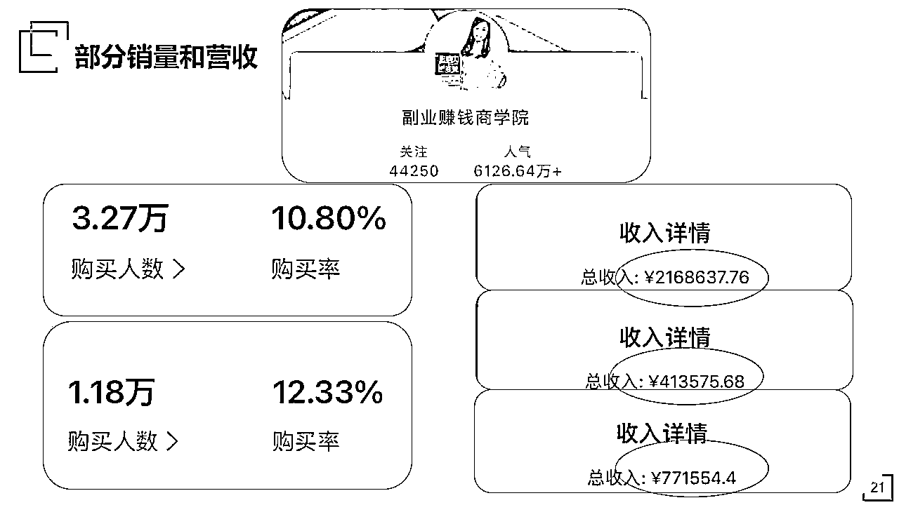

目录  
一、正式录课前，我用哪些小产品试水  
二、爆款课程的六个关键动作  
三、写在最后

一、正式录课前，我用哪些小产品试水

腾讯游戏推一款新品，上市前要走立项、内测、封测、公测好几轮，还要做用户调研、看数据、盯留存和付费率，反复调整才敢正式公测。知识付费同理——它也是产品。方向怎么选、题目怎么定、用户怎么调研、市场怎么看、小范围怎么测，一步都省不了。我出身营销策划，平时就爱用调研和数据去摸用户的真实需求、判断市场有没有空间。所以真正录第一门课之前，我先后拿好几个轻量产品去试了水。

1. 免费公开课  
一开始我真不知道自己能卖什么。看别人靠知识付费月入十万，眼馋得很；可我刚丢了工作，带着孩子，既没粉丝也没流量。那时候唯库、职场充电宝这类职场号在招讲师，我图的是先攒讲课案例、练讲课手感。我在腾讯做过培训相关的事，但真正站上讲台的次数并不多，于是主动报名免费讲。具体做法是：盯着各家知识付费平台的公众号，看有没有讲师招募；报名时要交代清楚自己的从业背景、擅长的方向、有没有讲过课或现成课件，这些都得提前想明白。我投了好几家，最先回我的是职场充电宝。跟对方运营对齐了分享主题和时间，我挑了自己工作里最熟的题——《如何策划一场刷爆朋友圈的营销活动》，那一场来了1600多人。如果你也拿不准讲什么，不妨结交几个平台运营，多问一句最近哪类课走量、哪个话题有市场。

2. 付费咨询（699元/小时）  
我在行平台申请了行家身份，挂出两个话题：一是如何转行互联网，二是线上线下营销怎么做。定价都在几百块一小时，结果营销那个被约得更多。来问转行的，多是传统行业想跳进互联网的职场新人；来问营销的，不是公司里的策划，就是创业者和小老板。一次付费咨询，其实就能测出你的“产品”有没有人肯掏钱；聊的过程中还能看清客户是谁、痛点在哪、你接不接得住。聊下来我明白了：帮小白转行这事我不来电；但营销、获客、转化这些，我张口就能讲，说明这条路对。

3. 付费授课（1万/小时）  
免费分享做了几次后，陆续有平台找上门。虎嗅和91运营愿意按一小时一万的价码请我讲运营。听课人数我记不清了，两小时最后分到我手里两万多，但反馈并不理想。这次让我确认了一件事：想学运营、想提升职场技能的人很多。可运营不是我的强项，做起来费劲，也不是我热爱的方向，于是果断放弃。

4. 19.9元21天打卡社群  
那阵子有人在做时间管理社群、打卡社群，我看了一眼觉得不难，加上公众号和微信上攒了些关注者，就试着招了一期，居然有几十人付钱。可真运营起来我一点也不享受，这个产品后来也被我砍掉了。

5. 99元课程，卖出10万+份，营收破千万  
没有做课底子，一上来就想憋个又大又全、又贵又精的课，不现实。原因有四：你没经验、没案例；用户需要一层层筛；你的策划也得先验证、再看数据。更聪明的做法，是先做一个最小可行（MVP）课程。创业就像去远方，不是先造一辆汽车——先滑板车跑起来，再换自行车、摩托，最后才是汽车。

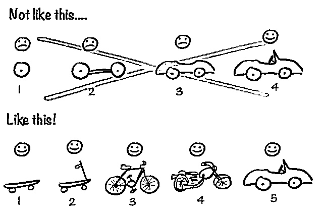

任何产品都得先验证。最轻的验证手段，就是引流课、公开课、付费咨询，控制在半小时到一小时。我录第一门课前那四次MVP试水，你可以直接参考；已经有粉丝的人，也可以拿直播来试。做张公开课或直播海报，丢到朋友圈、社群里，看有多少人感兴趣：来的人多，选题就对了；来的人少、最后也没人买单，那就得掉头，去找粉丝、学员、用户聊，访谈出他们最急的需求。我当初判断朋友圈课能成，是几组数据凑到一起的：一场1600人、45分钟的公开课，证明需求真实存在；偶然看到有人一节45分钟的朋友圈课卖出一千多份，证明有人肯付费；一位线下企业内训老师，一年260天排课，九成讲微信营销，企业几万块一天请他；当当、京东上微信营销的书卖得俏，还有人出了系列；而知识付费平台上当时没有成体系的同类课，微商自己做的培训又多是文字加语音加图片，缺理论缺体系，质量不高；我在荔枝微课挂了个banner和大纲，课都还没做，转化率就过了30%，数据好得出奇，我才动手做课件。所以你也可以先出一张海报，用咨询或直播去试探朋友圈里有没有人愿意问、愿意付。等真有人掏钱了，再走下一步。千万别闷头开发几个月、录好几十节课，最后发现没人买，那才叫尴尬。

二、爆款课程的六个关键动作

我把打造爆款课拆成六步。  
第一，选题定位——课能不能卖动，九成看选题。  
第二，数据分析——市场分析和用户调研做透了，才找得到会爆的题。  
第三，用户调研——让内容贴着学员预期走，满意度才高。  
第四，内容填充——理论模型、贴切案例、PPT、动手练习，一个不能少。  
第五，MVP测试——看转化率、看市场反馈、看有没有人愿意买。  
第六，营销推广——把课卖得更多、更远。

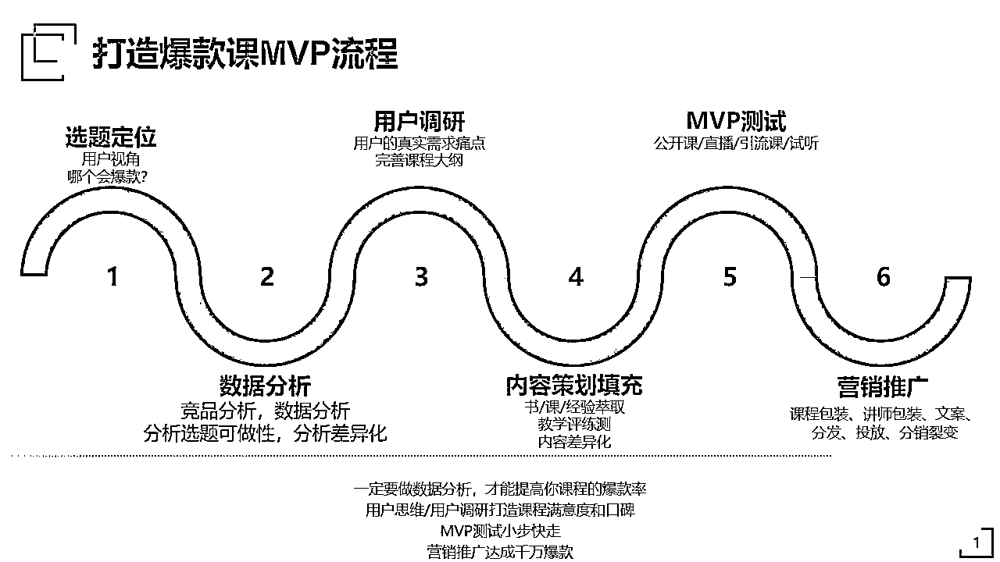

1. 选题定位怎么做  
四个测试产品跑完，我摸清了自己的牌：最拿手、最多人买单、自己也最来劲的，是营销。可营销盘子太大，跟已经有名气的人正面刚不划算，于是我拆开营销的细分赛道，看自己能切哪一块，最后落在微信营销。小白也是同理，先盘自己的家底：是不是名校出身？不是，有没有名企履历？没进过名企，有没有服务过名企、手上有没有名企客户？这些都没有，那有没有在某个领域做出过拿得出手的成绩、常被人夸？上过什么培训、拿过什么证？哪个行当摸爬滚打多年？会买房？会理财？懂财务？英语溜？特别会聊天？求职时offer拿到手软、面试一把过？……你觉得不值一提的那些事，背后往往都站着需求。你眼里的常识，可能是别人眼里的绝活，所以优势得一条条捋。当然，不是所有优势都能变成好卖的课，这是实话：有些知识太冷门，受众窄；而做课的人又容易当局者迷，手里数据不够，做了几门都不温不火。一门课能不能卖好，跟受众、市场需求、热点都挂钩。瑜伽课和杠铃课、副业课和Java课，受众和需求天差地别。想做爆款，赛道不能太窄，最好是大众普遍有刚需的：变美类，减肥、瑜伽；技能类，PPT、Excel、销售、文案；赚钱类，副业、理财。但我列的这些词未必适合你，还得结合你自己或你的讲师，挖出需求大、受众广、你又讲得了的方向；要是还能踩中当下的趋势和热点，那自然是锦上添花。关键词怎么挖？照着下面这张图，把你的词写下来。从学习经历、工作经验、业绩荣誉、兴趣爱好、特长、成功经历六个口子入手，写下六到十个你擅长、能输出的词；再拿去对照爆款选题，看哪些跟你的经历、经验、背书对得上。

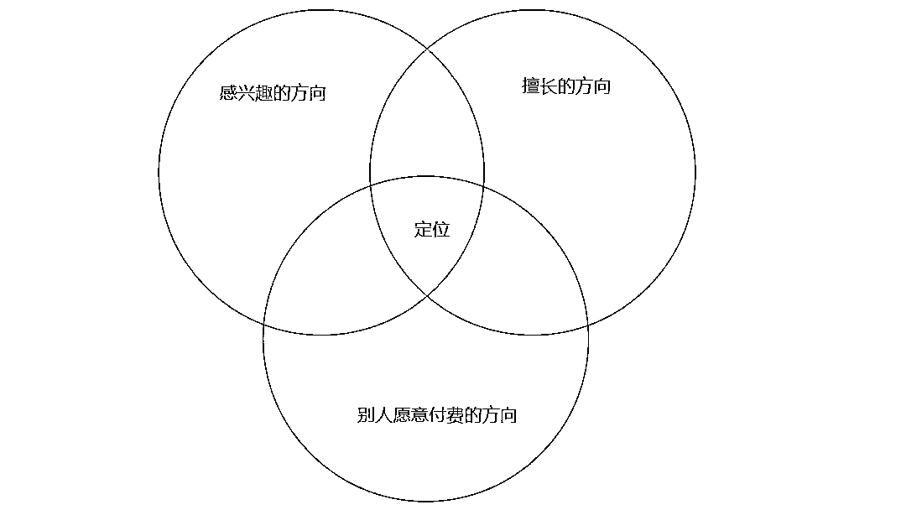

我待过腾讯，副业做过几回，卖羽绒服八天进账五万，二十四岁靠信用卡拿下两套房；干过地产置业顾问，也在腾讯做过BD经理，管品牌营销传播。我捋出来的词有：副业、时间管理、营销、销售、商业模式、信用卡、房产、社交、人脉、升职加薪、创业、新媒体、短视频、直播等等。划重点：盘过去的成绩、成果、经验，尽量用数字说话——几岁（或多久）做了什么、拿到什么结果；帮过多少人、做成什么事；服务过多少客户；在公司做出过多少业绩；学习上用多短时间拿到多亮眼的成果；在某个行当干了多少年、拿过什么证或奖。小结一句：不管线上课、训练营还是线下课，选题定位都是核心里的核心、第一步里的第一步。短视频同理，选题九成决定它火不火；卖货也一样，选品定生死。

2. 验证关键词，全网挖数据  
我定“微信营销”之前，做了大量数据分析、市场需求和用户分析，确认这是高热度、真痛点的方向，也搞清了课要卖给谁。手里有了关键词，你未必知道哪个需求大哪个小，这时候得借工具验一验。把行业关键词列出来，去京东、当当、淘宝，去微信指数、百度指数、阿里指数，去线下企业内训的盘子，找出你所在行业的搜索爆款、销量爆款、需求爆款。一个选题只在一个地方火，未必真火；但如果大家都在用、都在搜、都在买、都有需求，那它大概率会爆。人群和关键词要反复交叉验证，跟看百度指数一个道理。

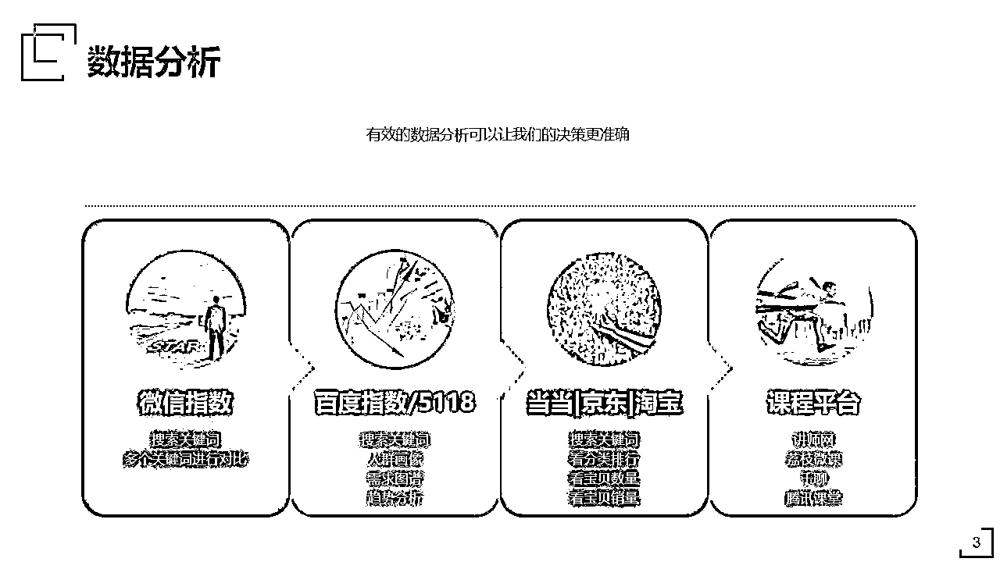

拿微信营销这个选题来说，我用微信指数分别搜“微信”“朋友圈”“社交”“人脉”，看哪个更热；又翻当当、京东、淘宝，发现微信营销的书卖得很好；再上讲师网，看到“微信营销”的内训需求特别旺。我认识一位讲师，一年排课260多天，专讲微信营销，年课酬几百万。可用户调研里，用户觉得自己跟“朋友圈”更贴近。所以正式录播课的选题就定为“你的朋友圈价值百万”“朋友圈营销”，这门课后来卖出十几万份，销售额破千万。建直播间时，我搜了“副业”“业余”“兼职”，发现“副业”热度更高，直播间就取名“副业赚钱商学院”，后来成了所在平台比较能打的直播间。我不觉得这种成功可以照搬，但经验能迁移：数据分析、搜索、拆解成功案例、找爆款共性，最要紧的是行动力——去跑最小MVP，别怕试错。

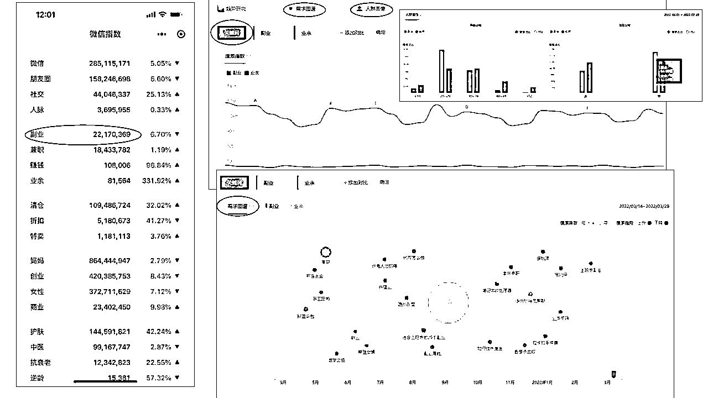 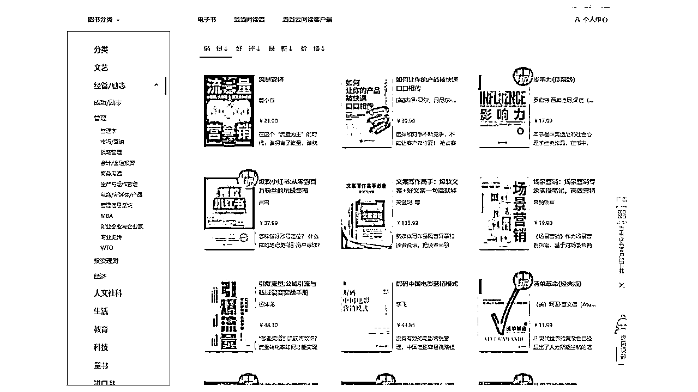

选题敲定后，我把当当、京东、淘宝上排在前面的微信营销书全买回来啃。啃什么？标题、副标题、目录，都是作者反复磨过的；再看正文体系，查漏补缺、知己知彼。比较卖得最好的和卖得一般的，内容差在哪；同时用百度指数看核心需求点，弄明白企业和销售为什么需要这门课；再看看别的平台有没有同题课程。想知道哪些类目走量、有市场，还可以翻知识付费平台和讲师网的类目怎么分，通常排在前面的需求更大。平台可以看荔枝微课、千聊、小鹅通、有赞、学浪、小红书，或你所在行业的知名课程网站、讲师网，比如中国讲师网，它们都有检索栏、类目栏和排行榜。举个例子：某知识付费平台和讲师网的导航里，需求大的课一般靠前。个人学习端，变美、个人成长、赚钱、理财、婚姻情感需求最旺；企业内训端，企业管理、销售服务、职场提升、财务管理、人力资源需求最大。可见个人和企业两端的需求差别不小。抖音上，个人成长、赚钱、理财、情感需求大；面向公司或企业管理端，企业管理、商业模式、销售服务、职场技能、财务人力管理的课更吃香。

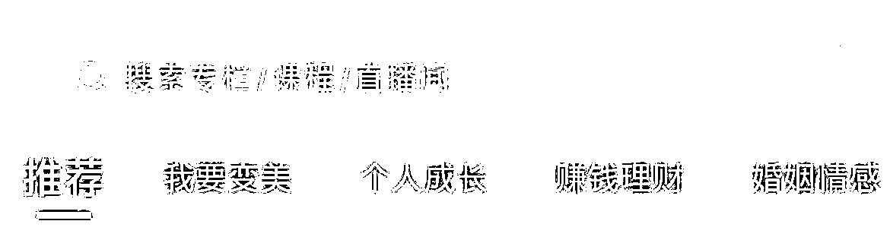
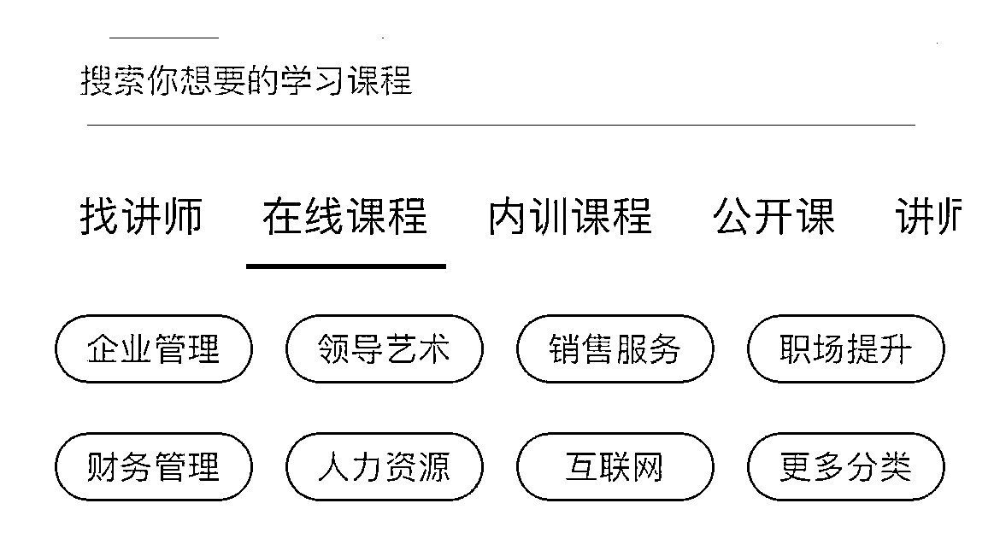 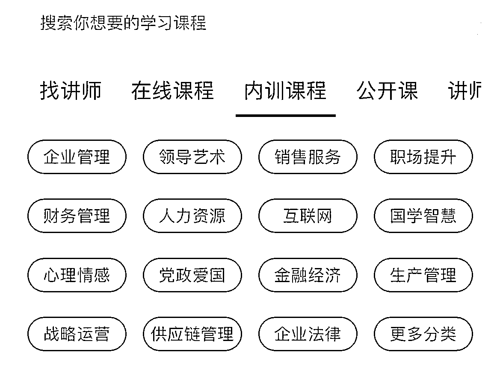
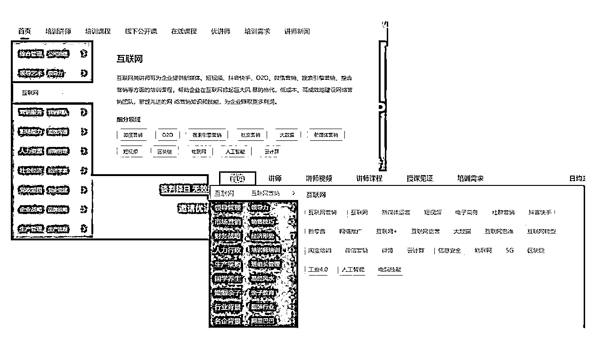

数据看下来会发现，这几类方向大概率卖得动：通识类、热点类、变美类、技能类、财富类、亲子类。另外要留意，to C（个人）和to B（公司）的课程需求是两回事。

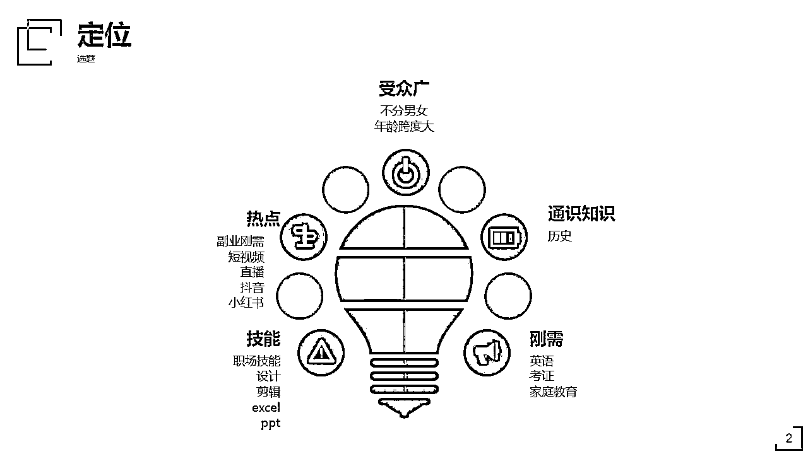

平台属性不同，用户画像不同，课程需求也会变，策划时得把这些算进去。要是你能拿到平台内部消息，知道哪个类目正被扶持，而你手里刚好有对应资源，那更是如虎添翼。

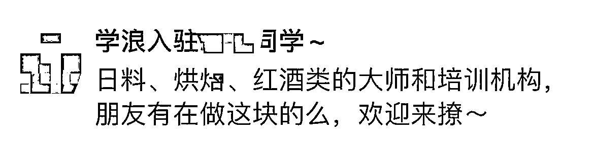 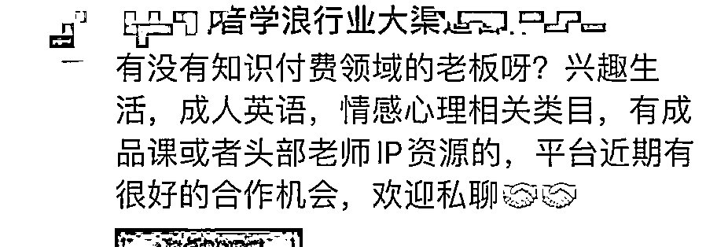 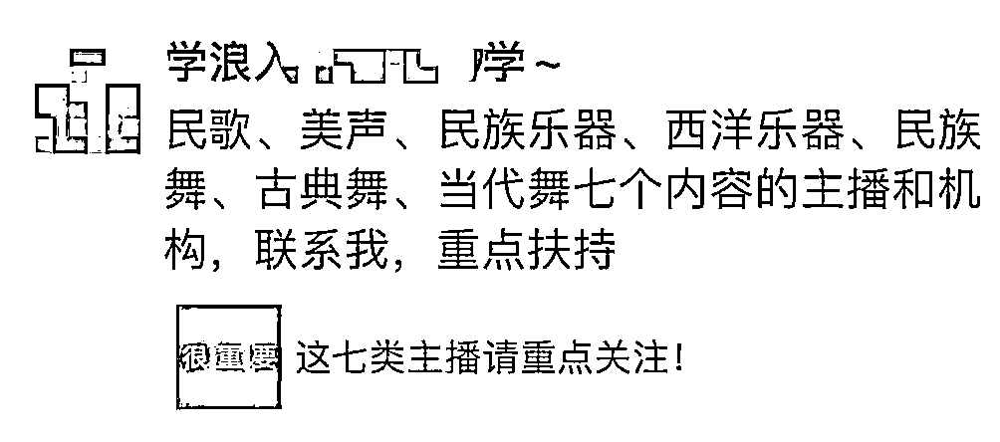

这是抖音学浪近期官方在找、在扶的方向。小结：数据分析一定要做，而且要重视。没有数据撑腰的商业动作，多半以失败收场；没数据就是瞎干、靠蒙，蒙对的概率能有多高？

3. 竞品分析  
用SWOT盘一盘：优势、劣势、机会、威胁。拿我自己举例，优势是：在大厂做了十年市场，懂营销懂品牌，有副业经验和成功案例，接触过微商、知道他们的痛。劣势：进在线教育偏晚，授课经验不算多，品牌和营销比我强的大厂人大有人在，细分市场从哪切？市场细分上，营销包括文案、公众号营销、微信营销、小红书营销、社群营销、营销策划；品牌包括产品品牌、个人品牌、品牌策划、品牌传播。机会：新冒出来的知识付费品牌和自媒体不少，那边还没出现头部，能不能借新平台、新渠道找到缝隙？威胁：会不会有人做得比我好？怎么快速找准细分定位、快速提升授课能力、攒下学员案例和口碑？

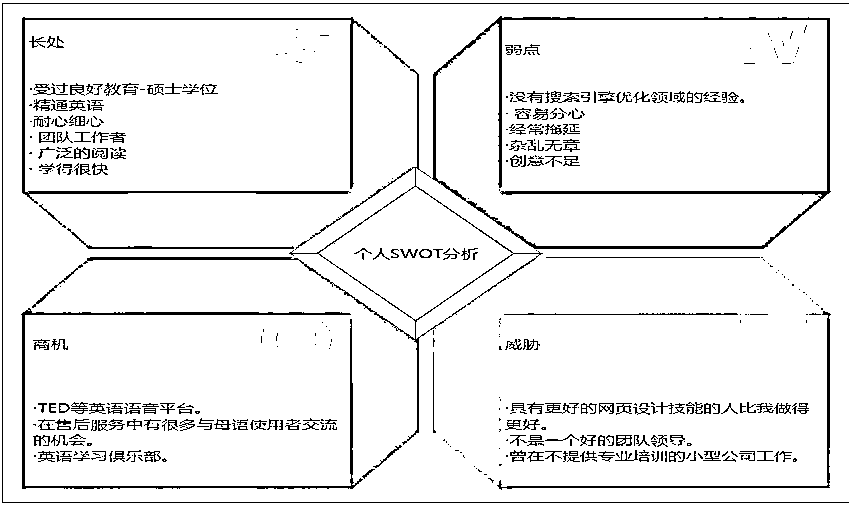

方向定了，就得做竞品分析——说白了就是把对手和同行拆开看：他们强在哪、弱在哪，哪里能学、哪里能补，你在定位和内容上能做出什么差异。要看课程标题、讲师包装、大纲、详情文案、销售渠道、引流转化方式、增值服务、社群运营等等。比如我当初那门课市面上没人做，只能从书、线下企业内训、微商培训这些方向去找差异；再跨课程研究人家的标题、大纲、详情页、文案怎么打磨。这里拼的是拆解能力，360度无死角地拆。

4. 用户分析  
用户分析的核心是摸清需求，让内容更贴用户，我一般靠用户调研来做。调研分定量、定性、访谈。最省事的办法是收集用户问题、提炼共性，反过来优化大纲和内容。举个例子：做朋友圈课时，我先把买课的人拉进微信群，用群接龙收集问题，挖共性、挖底层痛点、挖根本需求。最后针对这批人抛出的问题来开发内容，课程口碑和反馈都很好，好评率97%。

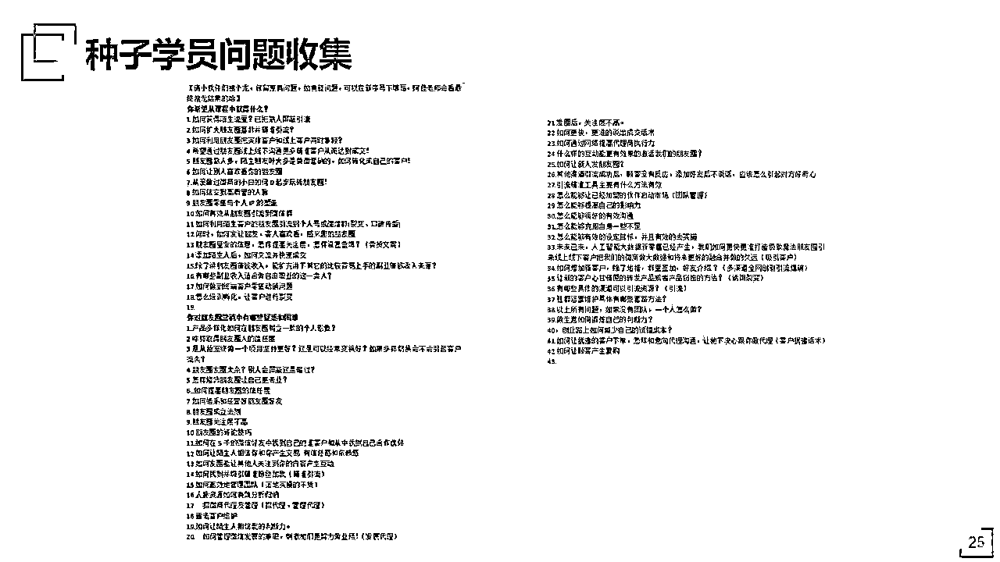

洞察需求的手段很多：痛点问题收集、马斯洛需求层次理论、Kano模型、多维度尺度方法、用户画像、客群定位、用户标签、角色细分等等。小结：一定要了解市场、了解自己。不了解市场，是不敬畏市场；不了解用户，是不敬畏用户，早晚要栽跟头。

5. 内容策划填充  
这是我策划第一门课时列的大纲，十节课。我的办法是：找同选题的畅销书和课程（线上线下都行），拆它们大纲的设计逻辑、顺序、版块，再拿自己的经验去判断哪里好、哪里不好、哪里能更好，你有什么不同见解和案例，然后捋出自己的版本。用Excel或思维导图整理大纲，会更清晰、更有条理。先写初版，再一点点打磨润色；一般来说，没到上架那一刻，大纲都可能改，不必强求一次到位。

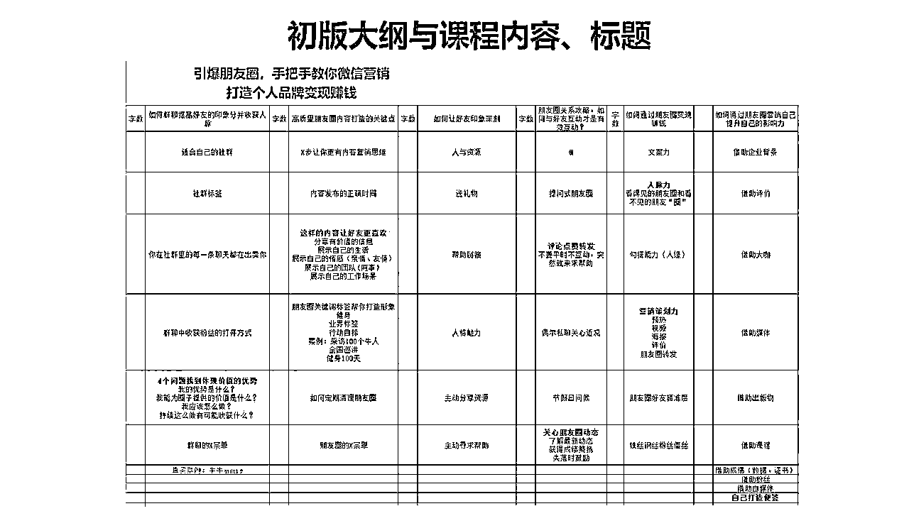

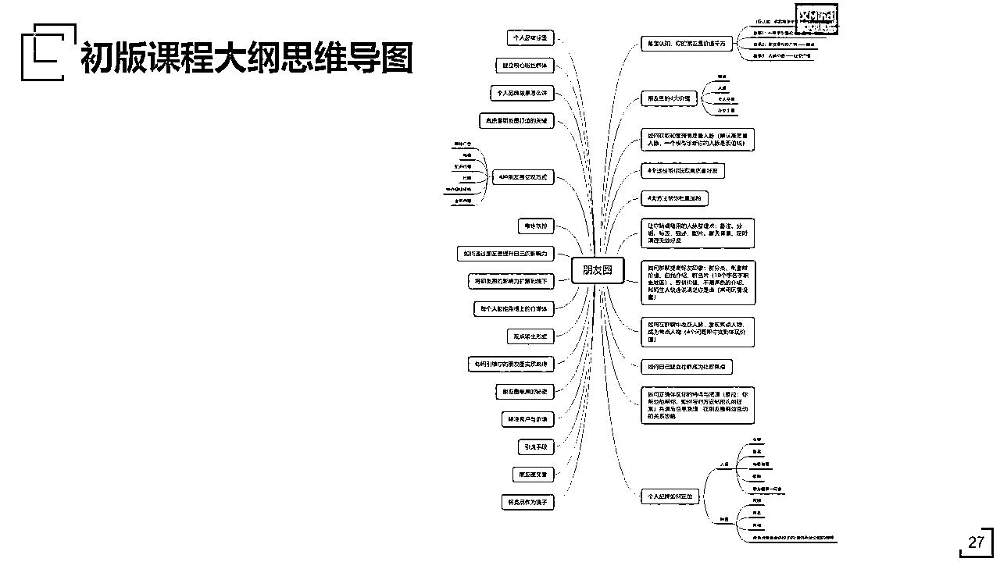 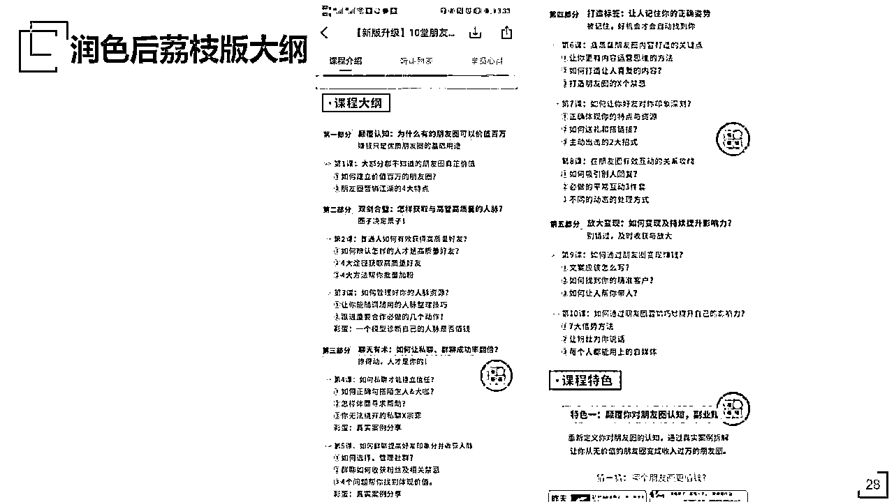

知己知彼，内容填充可以靠大量同主题系列书找灵感；如果有足够多的对标课程就更好了，耐心细看一遍人家的大纲、内容，听一遍课，看看有没有能借的，再结合自己的经验，用思维导图搭出知识框架、理论体系和案例集。PPT不会做，可以上淘宝买模板，再把知识往里填；需要模板的话也可以留言。

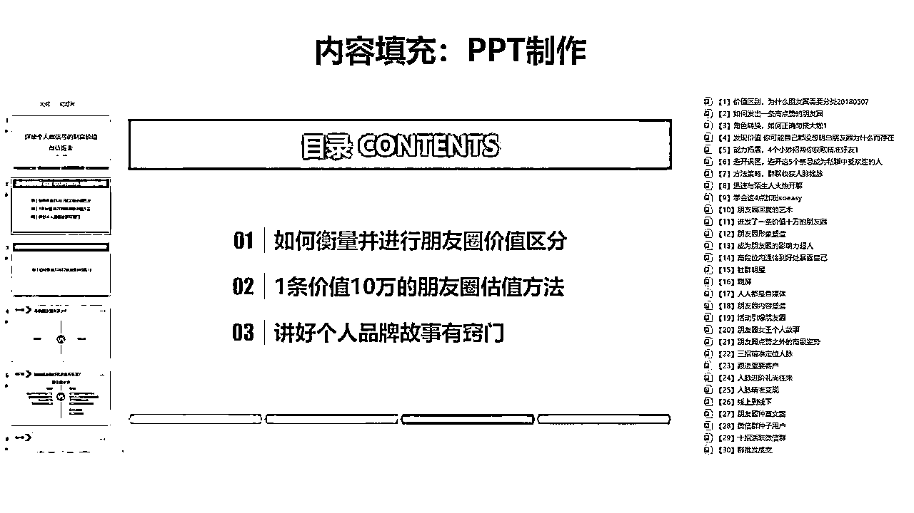

逐字稿不是硬性要求，但好的录播课一般都会提前备稿，这样讲师录课、讲课时更顺、更有逻辑、不卡壳。下面是我录课前准备好的文字稿，用Word或有道云笔记存好。

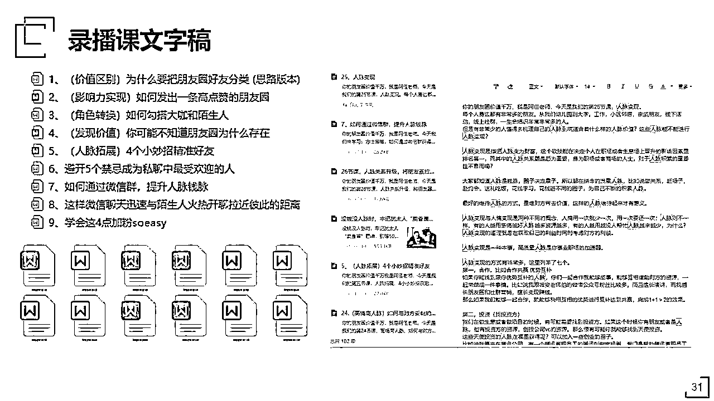

小结：怎么做出内容还不错、有逻辑、不挨骂、不易过时的课？把同选题的好书好课都过一遍，你的课才不会偏、不缺体系、不掉逻辑，还能知己知彼、查漏补缺。

三、写在最后

整套打法可以压成一条链：先用最小MVP探需求，再用数据验关键词，靠竞品和用户调研校准内容，最后用体系化课程加营销推广放大结果。选题定生死，数据打底盘，用户给答案，行动力决定你到底能不能跑起来。

课程想长期卖，别一开始就死磕流量

做课、做知识付费，很多人第一反应是先攒粉丝、先搞流量。但更稳的顺序，往往是先把产品想明白，再用内容和测试去验证。下面把写稿、发布、放大销量和常见卡点拆开聊，都是能直接上手的实操。

**先把课程骨架搭稳**

动笔之前，先用思维导图或Excel把课程大纲的逻辑列出来，把各部分串成一条线，看看前后衔接顺不顺、结构有没有缺口。PPT可以用现成模板，既美观，也方便讲课时让文字稿有画面、有逻辑，还便于写稿时延伸案例。

文字稿里尽量绕开具体年月日，否则课程很容易显旧。比如2020年录的课如果反复提“今年是2020”，两年后再听就明显有旧课感，不利于持续销售。

**怎样高效又高质量写出文字稿？**

先列大纲；做PPT时把能想到的理论、案例都先填进去；对着PPT试讲一遍，可以用EV录屏；再把语音转成文字，工具可选讯飞语音、网易见外工作台，转好后复制到Word、有道云笔记、印象笔记或飞书这类笔记工具里修改一遍。

**6. 完成发布上线**

营销不只是发一条朋友圈，它还包括课程包装、讲师包装、首发安排、渠道分发、营销活动、公开课、推文和试听等。上线时，先把课程卖点、营销方式梳理清楚，再通过公开课和测试用户收集口碑；用朋友圈、社群做冷启动，借势、造势、预热。新课有口碑和基础数据，后续转化会更顺。

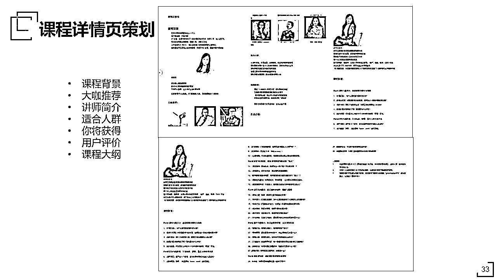 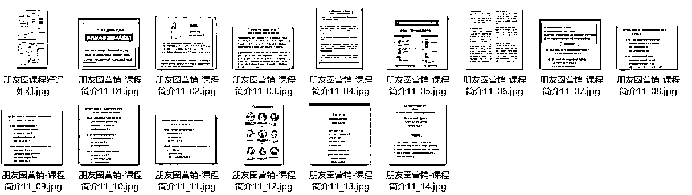

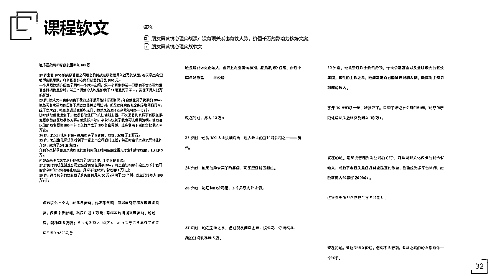

课程如果赶着仓促上线，直播呈现往往不够理想。想让它长期卖，录制时就不要带具体时间点。

等课程卖到3万份，我把学员反馈、好评和案例收集起来，重新做了banner、详情页和文案；又把直播内容整理成文字稿，删掉冗余口水话和带时间点的表述，重新录了一版。到这一步，课程才更适合长期销售，也方便铺到多个平台。

不会做详情页、不会包装课程，就去拆成功案例或竞品。拆得越细越好，对标他们的包装策略、标题、副标题、banner、广告语、详情页、讲师包装、选题包装、增值服务和卖点等。案例不在这里贴，自己动手搜，也顺便练搜索能力。

**7. 怎样让销量持续增长**

把课铺到其他平台时，别直接复制，要按平台调性改包装，例如调整大纲、更换讲师形象照、重拟课程标题、改写软文文案等。比如针对某个平台调整后的大纲标题图、详情页修改图，以及一张课程分发平台对照表，都可以提前备好。

也有不少MCN会主动找已有成品课的老师，负责重新包装和分发，最后按比例分成。这类机构不少，像博闻、简知、个人发展学会，荔枝微课也有专门部门做这件事。如今单平台卖出几万份已经很难得，更常见的做法是多平台一起卖，把总销量推到过万甚至几万。

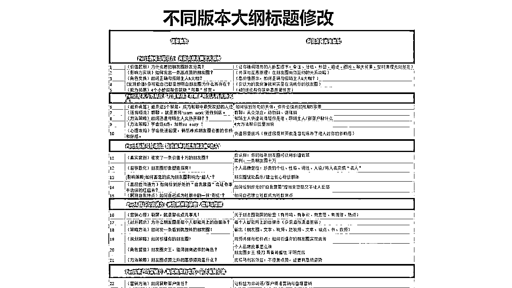

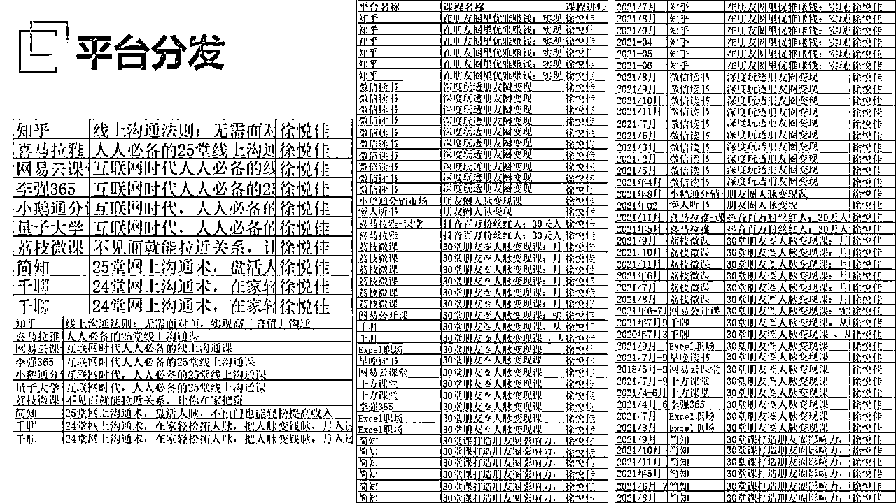

**小结：流量、包装、平台运营和新课数据都没有，怎么破？**

流量不会从天上掉下来，要主动去造。平台本身有流量，就去找运营问清合作门槛，再想办法达到；也可以翻公众号有没有商务联系方式、讲师招募入口或合作邮箱。

不会包装，先研究同行怎么做；不会设计就用免费设计站，像创客贴、图怪兽，模板多，改文字和图片就能出图。

如果课程够自信、手里也有数据，可以联系MCN。很多课同时出现在多个平台，连直播阵地都不同，背后往往是MCN把成品课接过去重新包装上架。找他们的方法很多：公众号留言、买课加课程里的联系方式、加群里的运营等等。

新课没数据，可以先请朋友圈好友帮忙转发，用免费送出做裂变。如果连这一步都做不到，不妨想想是脸皮太薄，还是平时关系没处好；发个红包，多数人不会拒绝。

对普通人来说，这个时代依然友好：在多个平台经营个人品牌，就能拿到流量和曝光；个人品牌是长期复利，投入不高，回报会慢慢累积。

**三、最后总结**

**1. 先做产品，还是先追流量？**

做副业、做课程变现，最常见的误区是先追流量。很多人忙了很久没流量；也有人做了几年、攒到十万百万粉，却不知道怎么变现，少数能变现的也不稳定，粉丝时间一长粘性下降。别迷信“粉丝攒到某个数才能开始卖”，先保证自己不饿死更重要。

**2. 你准备拿什么来变现？**

副业本质是先把产品立住，再搞流量，或者边做产品边搞流量。变现、赚钱、商业的底层都是生意：商品交换、价值交换。只有粉丝没有产品，别人想付钱都找不到入口。有实物产品，定位通常清晰；做虚拟产品，比如社群、服务、课程，就要先设计好产品是什么。

**3. 用最小MVP验证市场需求与可行性**

MVP可以是免费产品，也可以是超低价产品。免费都没人要，说明市场可能不成立；低价产品很多人要，就可以继续设计系统化、阶梯式产品。前提是粉丝是你的目标用户，足够精准。

**4. 从知识付费小白到大神，要走过四个阶段**

1）小白阶段，不知道怎么定位、做什么课程或服务。梳理学习经历、工作经历、兴趣爱好和特长，把关键词写下来，删掉不擅长、不喜欢的，再从市场里挑最有需求的一两个方向留下。不知道哪个方向有需求，就去微信指数、百度指数、淘宝、拼多多、京东、当当搜关键词；数据低、销量低通常意味着需求少，反过来则需求更大。

2）新手阶段，定位确定后，开始设计并打磨最初级的产品雏形，这个过程需要测试。拿时间管理举例，产品和服务可以有很多种：打卡群、每日早起、早起陪伴、早起攻读、时间管理课程、时间管理训练营、高效能、时间管理工具等；人群也有职场人、宝妈、学生党、高管。人群不同，产品设计也不同。

3）打造属于你的“里程碑”“冠军”“第一”“首个”事件。比如短视频播放量累计100万、XX万粉丝、XX平台签约博主、获得XX奖、分销第一名、畅销书第一名、XX平台最XX的博主等。这个阶段赚钱靠IP影响力。

4）打造系统。课程系统可以这样搭：免费引流、低价成交、会员产品、高价产品、超高价合伙人/代理人产品。这个阶段赚钱靠团队、靠系统。举个例子：免费送28个时间管理工具表、9.9元7天时间管理课、999元XX金币会员、3999元XXX年社群、9999元私董/合伙人/轻创客。走到这里，不光要有团队，还要有好的服务、交付能力和带团队能力。

文末也把评论区的声音带一句：有人质疑这波是吃到了2016年前后的知识付费红利，如今平台都难活；也有人觉得方法天花板高、没法实操，直接跳着看。作者回应说，感谢生财团队一起打磨分享；抖音、小红书等平台依然能做知识付费，依然有空间，各平台仍有机会，低转高价课市场也不小；不要只看表面，业务已经在向低转高转型，还有很多想不到的领域。还有人问是不是口播课、纯图文是否难做，作者回答是口播；也有人建议多分享小红书一线实操，认为唯库、荔枝、喜马拉雅更多是风口造就，说服力有限。