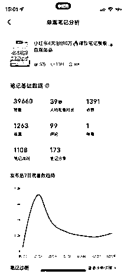
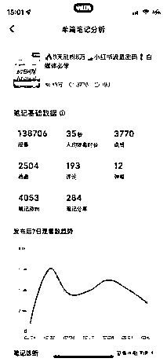
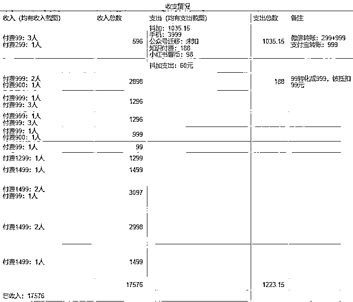
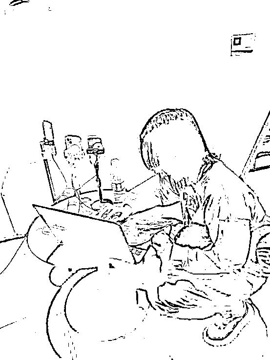
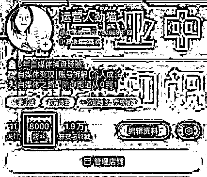
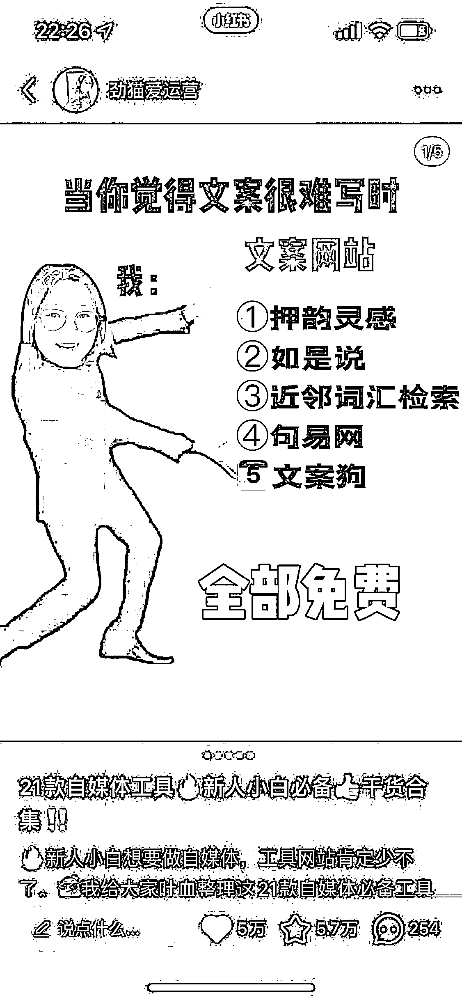
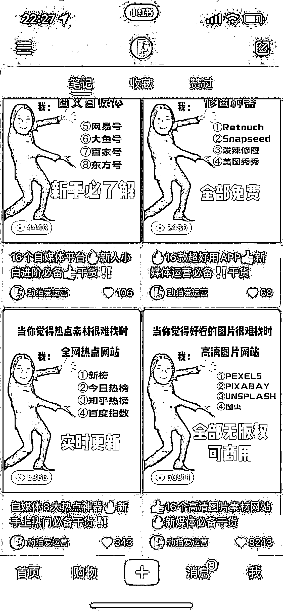

# 3个月做到8000粉、变现5万：一个自媒体小白的完整复盘

进赚钱这个圈子三个多月，我一直属于潜水的那类人。但这篇帖子的原则很简单：不说废话，只丢干货。所以，把我在📕上从0到1、三个月内积累8000粉丝并变现5万的整个经过，拆开揉碎了分享出来。

先看结果。我总共发布50条视频笔记，其中2条大爆文（点赞破千），20条小爆文（均赞200），粉丝数8000。

变现端靠的是账号诊断和📕一对一陪跑这两个产品。第一个月的具体收支我放在下面，图片太多这里就不全放了。

一、我的背景故事

严格说，我不是那种完全没经验的自媒体新手，但📕对我来说确实是零基础——在这之前，我甚至一次都没刷过这个App。不过做内容这行，我前前后后已经干了5年。

我是劲猫，97年的女生。大三那会儿就开始做今日头条，搞了一个叫“劲猫街头采访”的号。那阵子没赚到什么大钱，却帮我搞懂了自媒体的基本玩法，拍摄、剪辑、文案这些本事全是那时候练出来的。后来我又折腾过不少项目：抖音取名、淘宝客、风水、淘宝拉新、菠菜、薅羊毛……加起来林林总总赚了差不多50万。其中风水项目赚得最多，半年时间带来近40万，直到后来平台打压，这个项目才停了。

赚到钱后，我做的第一件事是给老家的爷爷奶奶翻修了房子，然后和朋友跑了很多地方旅行。再后来，我大学毕业去了深圳，成了一名硬件工程师。本来觉得这辈子大概就在这个岗位上一眼望到头了，没想到命运给我开了另一扇门——我偶然成了一本黑的粉丝，也正是因此认识了郭拽拽老师。

他的文章写得非常厉害，加上他说的很多网赚项目我都亲身经历过，于是我主动加了他🛰️，把自己过往的经历整理成一段长文发过去。聊完后，他问我愿不愿意兼职帮他写稿。说实话，当时我还在上班，并没有转行的念头，但在高薪诱惑下，我开始白天上班晚上写稿。写着写着，对自媒体平台的理解越来越深，对各路套路的把握也越来越熟练，于是我越来越不想再当打工人了。到最后，我干脆辞了职，第二天就直接到拽哥公司做全职写手，后来又和他一起做IP课程。自媒体这条路，就这么越走越深。

二、真正的契机

真正的起号契机，是赚钱的抖音直播大航海。

我本来就对这个航海特别感兴趣，加上拽哥是赚钱私董会成员，他就带我进了这次航海。我的IP“劲猫”就是那会儿开始做的。当时我们计划的是📕、抖音、视频号三个平台同步推进，内容统一分发。拽哥和我一起把定位定了下来，选题方向也一并梳理清楚。内容更新走上正轨后，三个平台的直播也跟着开了。

第一次开播，紧张得直冒汗，但后来发现这事儿也没想象中那么难。

赚钱的直播航海安排得特别扎实，我一次课都没落下。那时候我们组长是月正哥，队长是Y024老师，两位都特别负责，监督和鼓励从来不含糊，所以我每周的任务都好好完成了，心得和反馈也写得很用心。三个平台的IP号就这么慢慢进入了稳定更新状态。

不过，每个平台的调性完全不一样。结果没想到，我的内容竟是在📕上火了。拽哥一看这个情况，马上让我集中精力研究📕的爆款规律和底层逻辑，抖音和视频号暂时放一放，只专注📕。那时候大概在二月底，我手上还没有任何变现产品。

三、落地执行

二月开始发笔记，到三月初拿到第一笔收入，前后不到15天。说真的，我自己都吓了一跳，原本预期怎么也得三个月才能看到钱。

但事后复盘，当时变现之所以来得快，原因其实就三点。

**1**，定位非常清晰。

我的定位是“自媒体操盘手”。头像、名字、简介全都围绕自媒体运营来设计。任何人点进我的主页，第一反应就是这人在自媒体方面肯定有两把刷子。所以来主动私信我的人，问的基本上都是怎么涨粉、怎么变现。

直播时我也注意到，大家的问题高度同质化，无非是“帮我看看号”“账号不涨粉”“不知道怎么发内容”这几种。于是我的笔记主题越来越垂直，每篇都贴着粉丝的需求走，粉丝质量自然也越筛越准。

**2**，价值很明确。

定位清楚以后，我从粉丝的普遍需求中挖出了他们最渴望的东西，也就是账号诊断。这就是我的第一个产品。做法很直接：帮对方分析账号的现状，指出哪里需要优化调整。定价99元一次，后来涨到了299元，销量一直不错。

**3**，认真经营朋友圈。

私域产品的成交特别依赖朋友圈的打造。我一天大约发5条：📕干货1条、日常生活2条、学员案例反馈2条。这样的结构既让别人知道我有诊断服务，也让人总能看见我的实际价值。从📕加进🛰️的人，看到这样朋友圈，信任感很快就能建立起来。

有了这三点打底，99元的账号诊断越卖越多。过了一阵，就有学员来问有没有陪跑服务。于是，陪跑业务顺势诞生了。

最初的陪跑定价999元，周期180天，目标很简单：帮学员跑出一个能稳定变现的账号。当时我自己也没有很复杂的课程体系和权益设计，用的就是笨办法——先给学员做初步规划，再做账号装修，然后逐篇设计选题、逐篇修改笔记。说白了，我几乎就是在帮他们做号。

那是真的很辛苦。我同时只带了4个学员，就已经忙得晕头转向。白天要拍视频、要直播，晚上还要给学员逐个解决问题。好在效果非常直接：有做减肥赛道的学员两个月涨粉1万；有做育儿赛道的学员一个月涨粉6000、变现将近1万；还有做同城摄影服务的学员，直接干出了20万业绩。

这些案例让我对📕的信心越来越足，因为它们证明了我手里的逻辑是真的跑得通的。于是我把自己摸索出来的经验，加上从学员身上总结出来的方法，花了两个月时间整理成一门课。有了课程之后，陪跑的价格也跟着水涨船高，现在已经涨到3899元。

就这样，靠着“账号诊断+课程+陪跑”的组合，三个月时间，我从0做到了5万。

四、操作细节

肯定有很多朋友会问：账号定位到底怎么做？笔记应该怎么发？爆款都是怎么来的？引流有安全的方式吗？成交话术要怎么说？下面我把这些细节一个一个摊开讲。

先说定位。

定位有两大核心，一个是价值定位，另一个是身份定位。

价值定位，就是提炼你能给到别人的东西。对我来说是运营经验，对别人来说可以是穿搭经验、美妆经验、装修经验、育儿经验、摄影经验、画画经验、游戏经验、成长经验，等等。

身份定位，说白了是给你的价值加上一个可信的身份背书，让它更容易让人记住你。比如我的身份是“有5年经验的自媒体运营者”。做穿搭的人可以是“设计专业的大二学姐”；做美妆的人可以是“工作3年的化妆师”；做装修的人可以是“装修公司的主管”。

价值和身份一旦想明白，别人很快就能记住你是谁。粉丝会精准，变现路径也会清晰。

再说笔记怎么发。

📕的逻辑和抖音完全不一样。抖音的核心是内容本身，内容可能占到70%的重要性，剩下的才是封面、标题、账号装修这些。但📕的流量主要来自两个渠道：搜索流量和推荐流量，两者几乎各占一半。所以，把标题做好，就相当于接住了搜索流量；把封面做好，就相当于接住了推荐流量。只要内容不算差，标题封面到位，就有机会砸出爆款。

我那时在标题和封面上花了大功夫。我把近千个自媒体方向的爆款封面和标题全部翻出来，挨个提炼出现频率最高的关键词，然后把关键词堆在自己的封面和标题里。效果确实明显，这也是为什么我50篇笔记能出22篇爆款的原因。

另外还有一个心得：不用太在意笔记能不能投薯条。我的50篇笔记里，大概有45篇都是违规状态、不能投薯条，但靠自然流量照样能出爆款。只要官方没有单独发消息让你修改，就不必手动去动它，继续按自己的节奏更新就行，专心把封面标题做到位，爆款早晚会来。

第三，引流怎么引。

这一度是让我最头疼的事，因为我特别担心辛苦做起来的账号被官方盯上。我到处扒📕的各种引流方法，结果发现几乎没有零风险的。反复琢磨后，我挑出了三个相对安全的引流方式。

第一个是直播引流。这个方法在我这里最稳。具体操作是：先注册一个📕小号，在小号首页发布一篇带🛰️号的笔记；开播时，让小号在直播间发弹幕；然后我在直播间里说“想学习的小伙伴可以去看XXX”，XXX就是小号的名字。效果还不错，亲测一场直播下来，就算场观只有20人，也能稳定引流10人左右。

第二个是大小号配合。当有人私信我的时候，我就把小号的笔记转发给对方，或者直接用小号主动私信那个人，让他去看小号第一条笔记。

第三个是用手写🛰️号拍图。很简单，把🛰️号写在纸上，拍一张照片，发给来主动私信的人就行。

这三个方法我轮换着用，目前账号还算安全，没有出现什么违规情况。

第四，变现话术怎么说。

我的成交话术大致分三个阶段：第一，主动询问对方的账号情况；第二，指出账号当下的问题，然后推荐合适的服务——是诊断还是陪跑，同时把价格说清楚；第三，刻意营造自己很忙的氛围。这样既能迅速结束闲聊，也能传递出“不接受白嫖”的态度。

不过说实话，话术本身只是表层，真正决定成交的还是朋友圈的打造。咱们赚钱里有一位朋友圈打造的大佬，前两天刚分享过100条朋友圈的细节，我就是照着她那一套学的。这里真心表示感谢！

五、几点感想

**1.**后续规划。

目前这个号还处在早期爬坡阶段，粉丝量没过万，变现5万也算不上多牛，后面还有大把提升空间。笔记内容要进一步精细化，变现系统得慢慢完善，私域流量的运营也还有很长的路要走。好消息是学员案例在一点点变多，我自己对📕的信心也在不断增加。感觉离“成功自媒体人”的身份越来越近了。

**2.**一定要信自己，信数量能带来质量。

从开始做📕到真正赚到钱，时间确实很短，但这不代表📕好做。想在这里赚到钱，离不开足够多的尝试和坚持。尤其是在前期，数据不好、自我怀疑是家常便饭：为什么同一个选题，别人发就能火，我发就没动静？为什么同样的直播时长、同样的主题、差不多的粉丝量，别人转化就是比我好？为什么同一种内容，第一篇能爆，第二篇就沉了？

这些心情我很懂。我也在各个平台吃过亏，被数据按在“小黑屋”里摩擦的感觉一点都不好受。但真的，只要坚持住，爆款只是时间问题。数量堆到一定程度，任何方法都拥有100%的成功率。所以别急着怀疑自己是不是哪里做错了，前期最大的问题，往往只是数量不够。

**3.**想靠自媒体赚钱，变现模式必须想清楚。

这算是我这次踩过的一个坑。我的变现模式其实不是一开始就规划好的，产品都是被用户需求推着走的：有人问有没有陪跑，我才做了陪跑。虽然没耽误赚钱，但整个过程确实手忙脚乱。比较理想的做法，是在项目开始前就把变现模式想透：是接广告还是卖产品，是知识付费还是卖课，是做训练营还是做咨询、做陪聊。把这些想清楚，后面做起来会顺手很多，流量承接也会顺畅不少。

**4.**有新想法的时候，一定要自己亲手试一试。

这是我做小号总结出来的经验，特别有意思。我在新红上看📕数据时，发现有位博主涨粉速度极快，涨粉方式也很与众不同——靠一张PS表情包就火了。我当时被那个涨粉数据惊到了，第一反应是：不至于吧？这么猛？于是我用小号照着做了一张自己的表情包，把内容换成了自媒体领域相关的干货。结果刚发出去就爆了，直接冲到10万赞藏，妥妥的大爆款。

趁热打铁，我继续更新同样形式的内容，结果几乎篇篇都是爆款。靠着这种内容形式，小号直接吸了6000个粉丝。

当时我就把这个方法分享了出去，没过多久就有人跟着做，而且无一例外都火了。后来我也不断在这小号上测试我对📕的各种思考，比如标题关键词、封面痛点这些，有的成功，有的失败，但正是这一连串尝试让我对📕的底层逻辑越来越有把握。所以，有什么想法别憋着，直接动手去试，收获往往会超出预期。

**5.**一个人也许跑得快，但一群人一定跑得远。

当年我做硬件工程师的时候，自己也在私下折腾一些小项目，能赚点钱，但都是小钱。直到拽哥把我领进自媒体的世界，又参加了赚钱的直播航海，认识了一帮又拼又优秀的小伙伴，我才真正意识到团队和同行的力量有多重要。比如我有段时间不想开播，但只要想到拽哥每天都在播，航海群里的小伙伴就算没流量也在坚持播，我就觉得自己没什么理由偷懒。这些都是我坚持下来的动力。

六月份我又参加了赚钱的📕垂直IP航海，还毛遂自荐当上了答疑官。回答别人的问题，反而给了自己很多做📕的动力。

最后，真诚地感谢郭拽拽老师，没有他，就没有今天的我。同样感谢赚钱的各位大佬，没有这次航海，我可能根本不会有进入📕的契机。如果这篇分享能给你带来一丁点启发，我就特别满足了。谢谢你看到这里！

我是劲猫，带你从0到1做好📕。