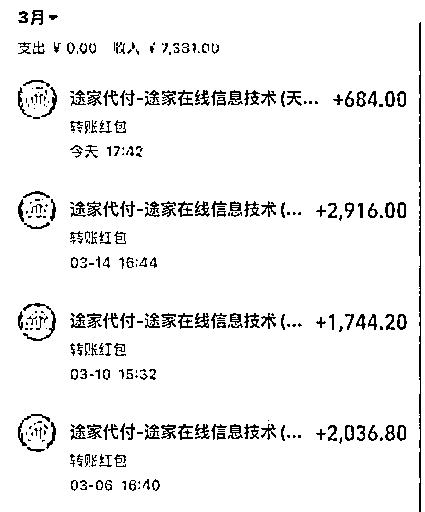
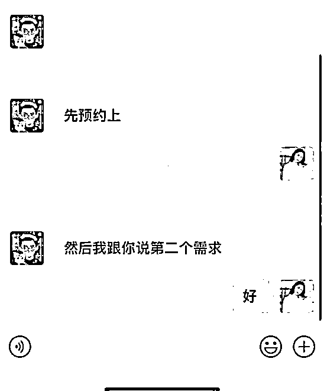
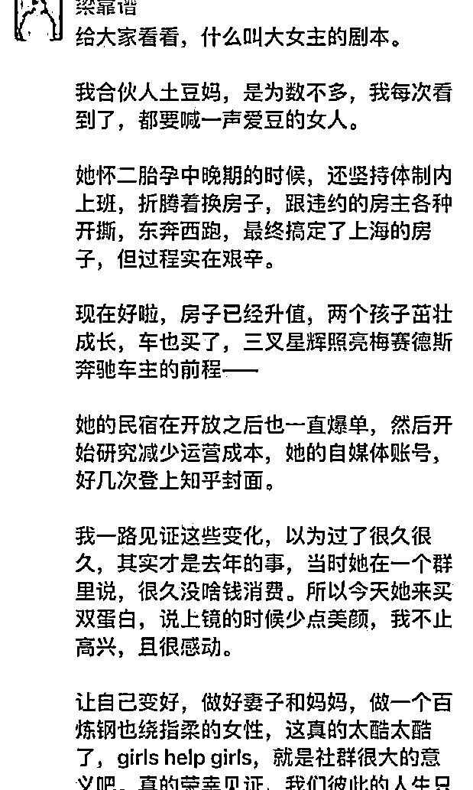
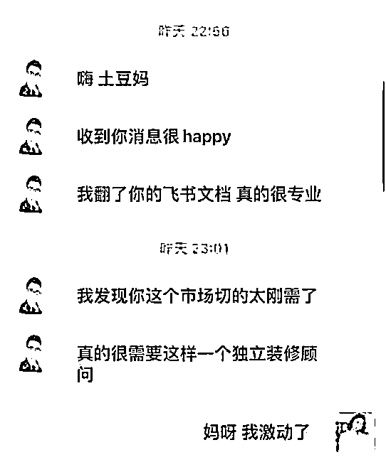

# 从安稳到多元：一位公职宝妈的搞钱实录

见过太多想搞钱的人，第一步就被自己卡住了：担心被同事看见，不敢发社交动态；觉得卖货没面子，不好意思做生意；怕被人认出来，连镜头都不敢上。这些状态，在端着铁饭碗的群体里尤为普遍。顾虑越多，人就越难迈步。如果你也被这类情绪困扰，不妨读读土豆妈的真实经历——她靠下班后的折腾，一年额外入账20多万。也许你会发现，日子完全可以有另一种过法。

## 关于我

先介绍下自己：上海幼师，编制内，入行14年，现在是管理岗，负责招生。私底下我特别能折腾房子，五年交易6套，还亲手翻修过3套。想了解更详细的故事，可以翻翻我写的那篇超长复盘。

## 这些年做过的事

光说思路有点虚，讲几个我做过的事吧。

**1、跨境母婴代购**

2012年怀孕那阵子，本来只是给自家娃囤点东西，在社交账号上招呼了几个人一起拼单，结果口碑越传越远，慢慢做成了一门生意。从境外网站下单进货，到了货再分给大家，赚点差价。那几年孩子所有的花销，基本都是这么来的。赚了多少，我还真没细算过。后来因为一些客观原因，2018年前后这门生意停了。最可惜的是，一个300多人、回头率极高的客户群，当时说不要就不要了。

**2、短租民宿**

我也做过短租，规模不大，最多时同时运营4套，现在缩到2套。把郊区的闲置房和一套40平米的学区老房利用起来，租金直接翻倍。过去几年行业太冷，无数同行退场，尤其去年最难，好在没放弃。2022年12月慢慢暖了回来，3月这20天，光一个平台就进了7000多。

**3、家居社群**

2021年6月，我开始装修自己住的二手房，顺便开了一个群记录过程，引来不少人围观。今年2月，我把这个群正式升级为会员制，收了第一笔群费。开放第一周就来了30多个人，现在有120多位成员，目前还是199元早鸟价。

**4、付费问答**

2022年年底，我尝试做付费问答，领域是买房、择校和装修。收费标准一路变化：起初免费，后来大家随意发红包，再后来199一小时，如今是999三小时。把自己的经验卖出更好的价钱，这感觉很棒。前几天还接了紫菜大神的咨询单，聊房产、聊装修——在编制内的人做跨领域的知识服务，一样有人买单。

## 我的心态与思路

很多人问我，在主业之外做这些事，是怎么兼顾的？我的答案是，先想清楚几条原则。

**1、先认清哪些事不能做**

在单位有硬性规定的事，比如直播带货、和学校有关的资金往来，都不要碰，绕开就好。

**2、给自己设置禁区**

我给自己立过一条规矩：不做同事和家长的生意，尤其是家长，就算孩子已经毕业也不行。这份工作每年会让我经手一百多户人家的资料，利用它们很容易，但我不想。有关升学、买房的问题，凡在职责范围内，我统统免费答复，不收一分钱。

**3、把兴趣当成入口**

想多一份收入，兴趣是最顺手的切入点。我试过折纸，做成礼盒也能卖钱。现在的心思主要花在家居上，靠装修话题做输出。生活类的内容永远不缺观众，公职人员也能从这里下手：警察晒训练打卡，老师晒育儿心得，医生晒健康餐。八小时以外的时间完全属于自己，展示出来并没有那么可怕。我也就是下班后收拾收拾房子，收点租金，跟我的职业有什么关系？领导也管不着吧。

**4、能力不足就用行动补**

有热情还不够，基础能力也得跟上。不方便直播，可以拍短视频；不方便露脸，可以走图文；图文都费劲，学学前辈们起个笔名专门码字。别动不动就说自己不行，先动起来，跑通一个最小闭环。星球里那些跟学活动，选一个感兴趣的报名，哪怕先挣到一元钱也是好事。我从2020年进龙哥盟，2022年又来玩赚星球，陆陆续续摸过TIKTOK、知乎好物、📕。收益不多，但每条路都完整走了一遍，培养起来的网感、编辑、剪辑、写作这些本事，会让我越来越值钱。

**5、准备好一个人走**

最后想说的是，这条路少不了孤独。单位的日子太安稳，一眼望到头，待久了人会变钝，有段时间我甚至怀疑自己是不是不合群。同事聚在一起聊的是公婆、老公、孩子、衣服、化妆品；我脑子里翻来覆去的是买房、装修、社群、ChatGPT。彼此都听不懂对方在说什么。有位同事，手里好几套安置房，却一套也不肯卖，全家挤在一套小房子里，还整天抱怨公婆，我想帮她，可人家根本不愿意动。还有人问我：怎么又买房了？又装修了？花20万出去租房住，你图什么？现在在单位我只谈工作，午休尽量避开人群，自己找个角落看看群消息、学点东西、写点东西，反而觉得踏实。

## 几个实操方法

**1、把一件事做久**

从0到1，绕不开一个“久”字。持续写、持续发、持续练、持续拍，哪怕只是一个小小的动作，长期下来也会有回声。@梁靠谱 为什么知道我这个普通人？就是因为我每天写记录，一写600多天，最少时不过20个字，最多时能到2000，生二宝那天都没断过。这么长时间，她一路看我买房子、装房子、生娃子，自然就记住了。

**2、有什么收获，大方晒出来**

晒得越多，认识你的人就越多，机会也随之而来。我写的那篇五年置换6套房、赚到上百万的文章，就引来过好几个付费咨询。紫菜大神也是因此加了我，聊置换、聊装修。前几天听说龙哥老大家里正好在装修，我就主动去聊了自己的社群构想，得到了他的认可。最近一个月，社群运营格外有干劲。被这些厉害的人看见并认可，价值比金钱本身更大。

**3、放下不值钱的面子**

许多人放不下的，是面子。但赚钱这件事，堂堂正正。怕被熟人看到？把通讯录好好打理一遍，加上标签：一组是【看广告】，一组是【不看广告】。拿不准的先丢进第二组。分完组，你就不用纠结了。

**4、边做边找到答案**

常有人说：我什么都不会。其实只要在圈子里，就不缺练手的机会。每个月都有各种主题实战，挑自己有兴趣的边做边学。芷蓝告诉我，做内容最终要建立自己的品牌和后端产品。最容易起步的，就是先搞一个会员群。我那个群无门槛地开了一年半，今年过年才改成收费，最早定99元一年，心里还没底，做了一段时间反而觉得，这个价格定低了。

## 写在最后

无论你端着铁饭碗还是已经下海，先放下顾虑去做。最坏也只是损失一点消遣的时间，想想也不亏。

以上——今天，你折腾了吗？