# 家庭教育创业：2000好友如何做出25万净利

先说背景。我明显感觉到，父母在孩子成长上的投入正在变重。很多家庭碰到教育难题时，并不具备足够经验，第一反应往往是找懂行的人。这个缺口，就是我做家庭教育服务的机会。

围绕父母的不同需求，设计能落地、能定制的服务，用知识付费的方式在私域获客，帮他们处理习惯养成、亲子沟通、择校等麻烦。只要对方觉得值，付费就是自然结果。下面复盘我从零启动的路径。

我是杨晶晶，家庭教育方向的早期创业者，2022年4月18日加入赚钱。之前一直看知识付费没动手，2021年10月开始正式做。到目前营收25万，基本是净利。全文分五块：

1.赛道选择过程
2.产品与服务设计
3.流量来源
4.成交转化
5.带学员做副业的思路

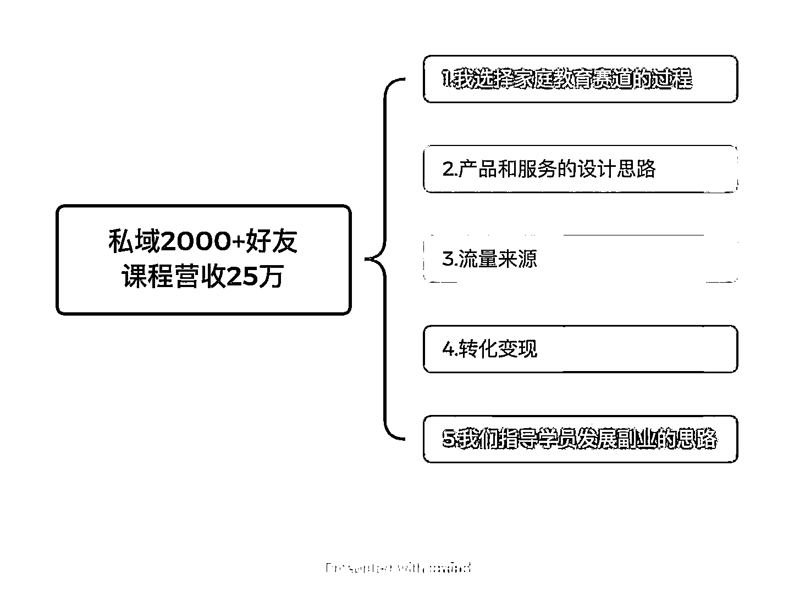

一、我为什么进入家庭教育

（1）起点是热爱

没生娃之前，我常被师妹当成倾诉对象。有了孩子后，研究疫苗怎么排、生病怎么护理、辅食怎么配、绘本怎么挑、亲子共读怎么做得更好；再往后系统学家庭教育课，跟很多父母交流、答疑。一个人愿意持续投入时间、精力和钱的方向，通常就是热情所在。

赚钱日历2022年1月9日聊过“如何找到使命和热情”，给了两个判断：从爱好里挑最感兴趣且坚持最久的事；想想有没有贴钱也愿意干的事。

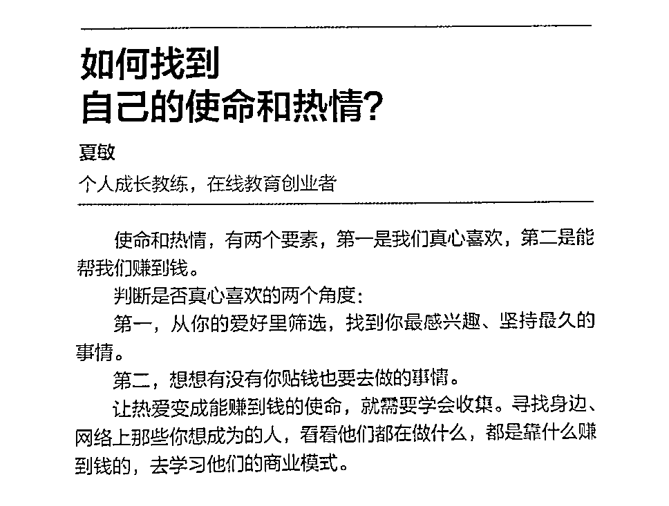

后来我关注知识付费，接触到三圈交集定位法。热情已经比较明确，下一步就看能力优势和市场需求。

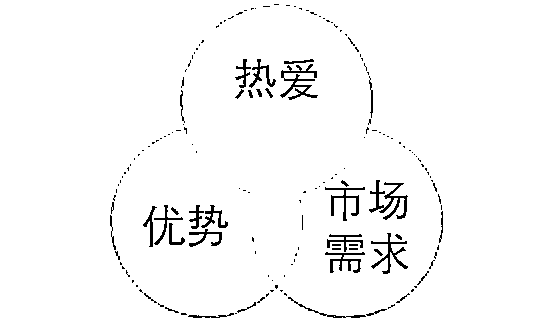

（2）优势要落到具体场景

最初我列的是985本硕、学习能力强、做事细心靠谱。可这些太泛，放到哪个行业都成立。后来我做盖洛普优势测评，写近20年成就事件，记录优势观察日记，把具体经历翻出来，才看清哪些优势跟家庭教育真正相关：

① 名校标签能增加信任；
② 我天然喜欢聊家庭教育，平时关注得多，也愿意写、愿意讲，渐渐有人愿意听，遇到问题会来找我；
③ 帮父母缓解养育焦虑、处理实际难题后收到的反馈，让我有很强的成就感、满足感和价值感。比如有孩子从睡前必看动画片，变成主动拿绘本让妈妈读；有朋友原先跟老公教育理念不一致经常生闷气，后来放下焦虑不再抱怨；有家长因为孩子写作业磨蹭总发火，后来找到办法，家里恢复母慈子孝。这些反馈既证明我能帮人，也说明我的满足点就在这，能长期做；
④ 我爱学习、联想能力强、做事细，对喜欢的事肯深挖，所以分享时能落到实操，不空谈。家庭教育很吃实操：有学员觉得自己理念没问题，但孩子不买账；我能结合具体事件判断，不是孩子听不懂，而是方法不对，并给出正确操作示范。

所以优势不能悬空。后来我重新梳理：教育背景好，这个标签要用，容易获信任；学习力强、细心、能深入研究，可以帮别人把知识用出效果；多年混妈妈群、自己建群，让我具备解决家教问题的能力；帮别人解决这类问题带来的满足感，超过其他事情。赚钱日历2月22日《怎样发现自己的优势》（作者醒醒）给了四个思路，很实用。

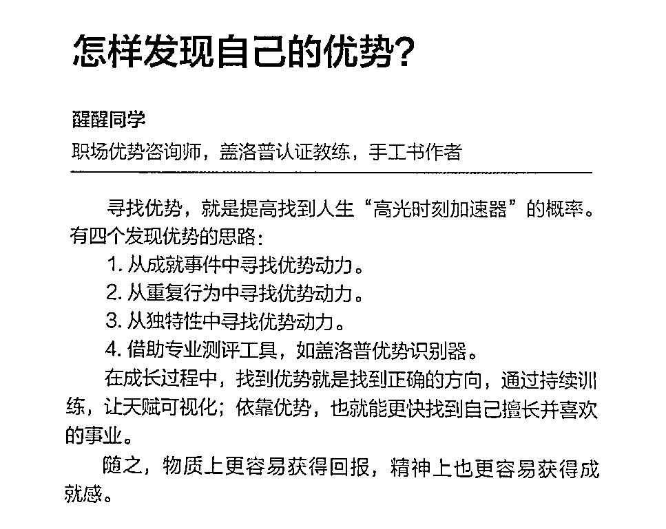

（3）市场需求不能只靠感觉

线上线下的学习经历让我从感性上看好这个方向，但创业不能只凭直觉，所以我做了行业调研。常用工具是👸号“发现报告”，它聚合各行业研报和数据。

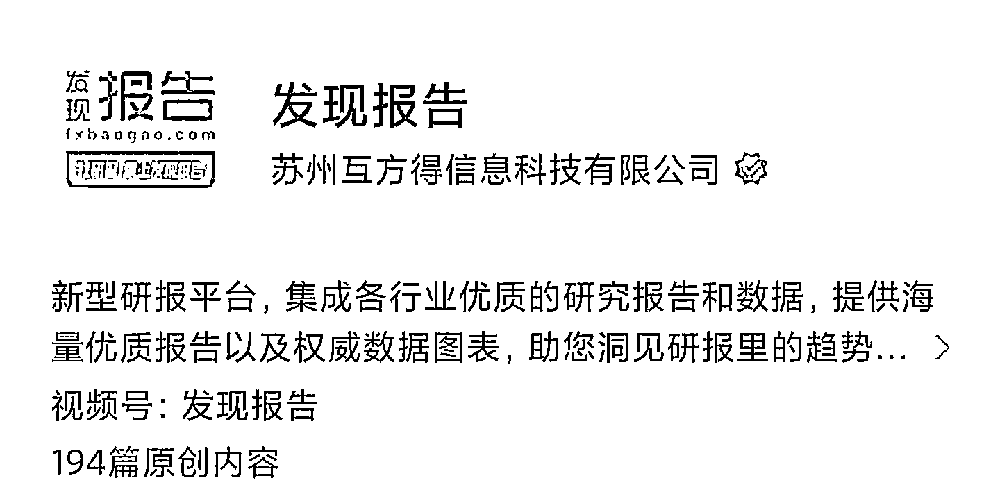

2022年，国家在素质教育和家庭教育上的政策继续完善，家校社协同育人被推进。“双减”落地后，2022年1月《家庭教育促进法》颁布，4月又出了《关于指导推进家庭教育的5年规划》。行业重心出现变化：过去盯着成绩拔尖的学生，现在开始重视把家长培养成合格的教育者，帮父母更懂孩子，最终落到素质教育。

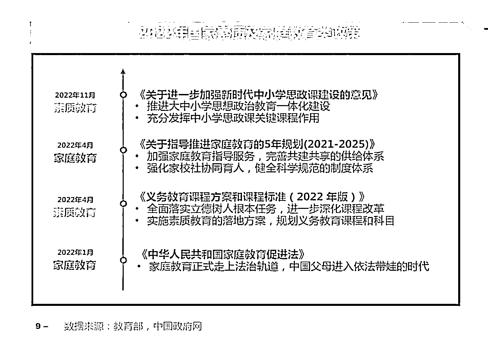

报告里有一组数据：2021年下半年以来，38%的父母增加了亲子陪伴时间，平均每天在1到2小时。

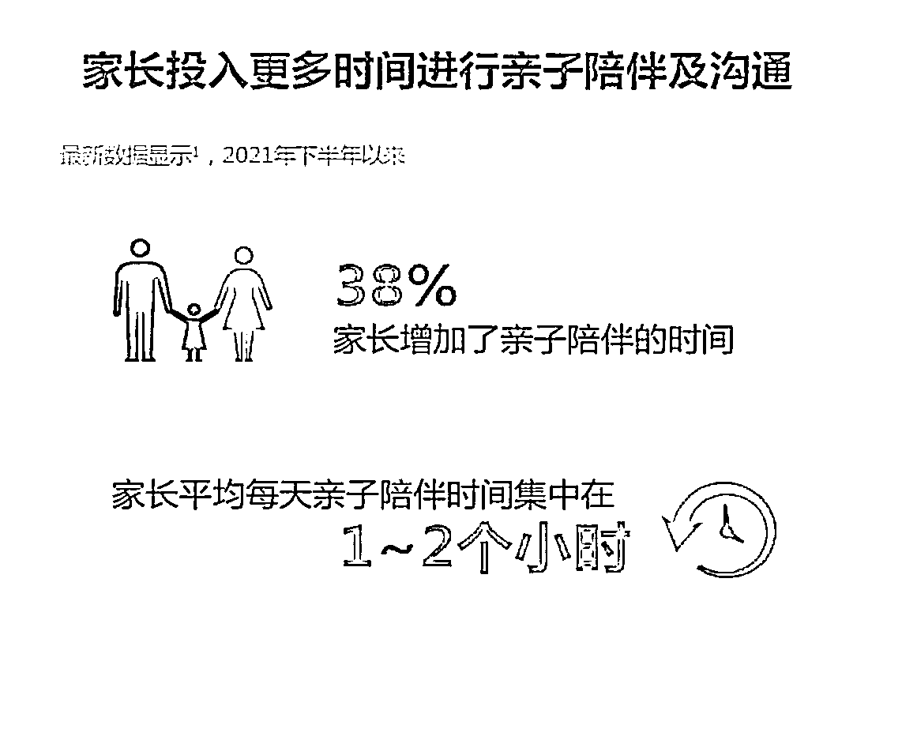

生活场景变了，需求就冒出来。这38%的父母每天陪娃一两个小时，会遇到大量具体问题。亲子关系是强链接，很多问题躲不开。以前可以把孩子送去校外机构，矛盾被暂时转移；现在陪伴时间回到家庭，问题就绕不过去。沟通只是表面，底下是教育目标怎么实现：父母希望娃心理素质好、抗挫力强、价值观正、表达力强、社交能力好、时间管理强。过去陪得少，矛盾不突出；现在陪得多，实现这些目标的压力就上来了。相应地，父母想弄懂孩子成长规律、掌握亲子沟通方法的需求也在上升。

巨量算数上，“家庭教育”搜索指数涨得很明显。

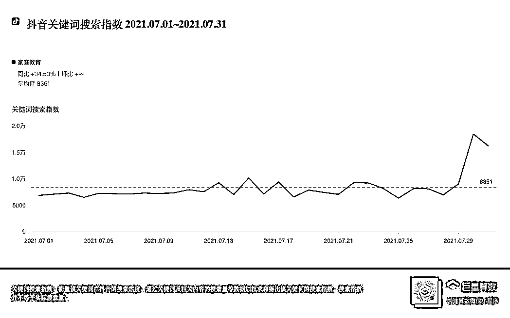

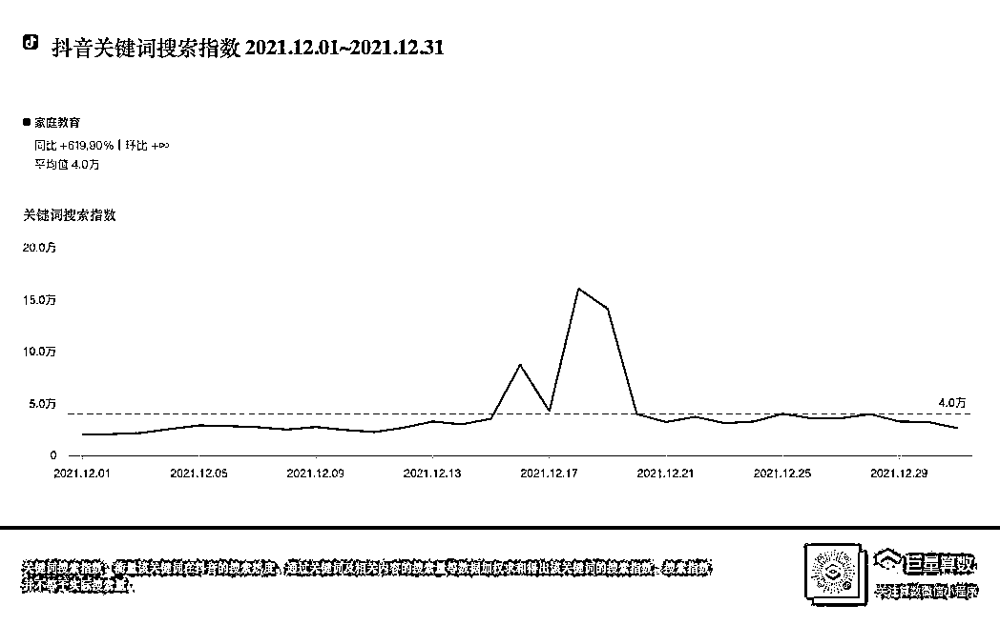

2021年1月是5051，7月8351，8月1.1万，10月2.8万，12月4万；2022年6月16.8万，12月18.7万。我2021年10月开始准备，当时只是嗅到一点热度；数据也证明热度持续爬升，两年关键词指数翻了37倍。说实话，2021年10月起步时，我对能挣多少心里没底，市面上也没有成熟模板可抄，基本是带着热情，看着政策和市场关注度先试起来。

二、产品和服务怎么搭

接下来要回答：卖什么？用什么形态把能力变成收入？父母在什么场景下愿意掏钱？

数据显示，面对亲子陪伴和沟通难题，多数父母的学习方式前五名是：看家教类👸号、上网搜、读家教类书籍、向同辈请教、找教育专家咨询。

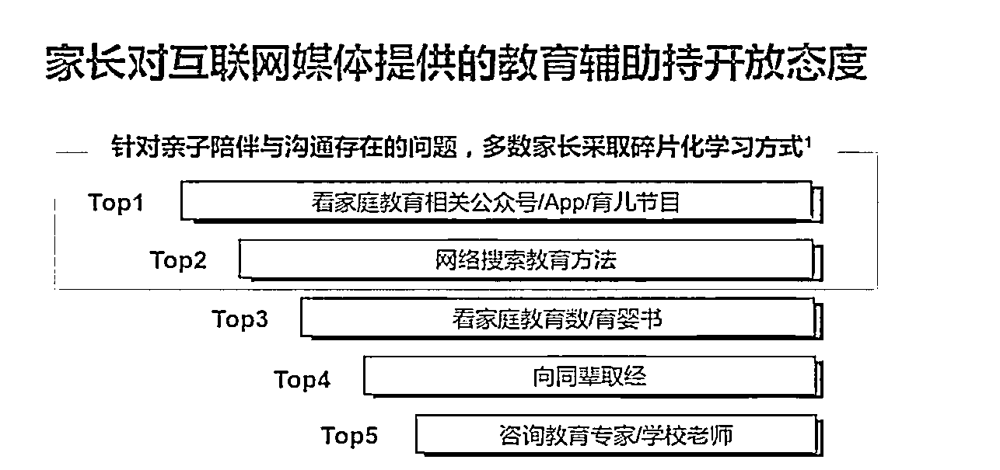

结合多年妈妈群经验和学员沟通，我把父母大致分成三类：

① 自助型：习惯问百度、社群、闺蜜、📕、👸号。日常小麻烦不愿花钱咨询，觉得没必要；平时没有学习习惯，付费意愿弱。
② 有学习意识型：愿意上课，三位数到小四位数的课程比较容易接受；认为课学得多、学得全，学完就能解决问题，带证书更受欢迎。教育结果在未来才显现，当下痛苦不明显时，他们对未来结果不敏感，付费意愿有限，更看重“学得多而全”。
③ 高认知型：愿意通过自我提升给孩子未来铺路，对当下养育问题敏感，或者已经出现较严重的状况，比如娃厌学、亲子关系紧张经常冲突、自己情绪烦躁疲惫。他们想系统深度学习，也需要有人陪伴指导，提升直面问题的能力，但缺少系统、全面、便捷、高效的路径。

所以我们的设计是：主攻第三类，兼顾第二类，给他们“可请教的专业老师+高质量同辈交流圈”。主打产品是一套系统、全面、精简的课程，加上长期陪跑指导，帮父母解决问题；如果想拿证，也可以对接授证。

（1）产品形式

① 录播课：5门家教系统课+1门心理学基础课（积极养育课、沟通课、青春期家长课、父母自我疗愈课、教育规划课、心理学通识课）。
② 社群服务：每周固定直播答疑；每周固定收集养育反思并做单独回复；不定期安排导师单线通话。响应频率高，能持续跟踪问题解决过程，及时纠偏。
③ 授证服务：学员想要心理咨询师、高级教育指导师证书，我们可以对接。授证不是重点，大家不是为证而来，看重的是系统学习和陪跑；有学员问证书，我们才对接，帮他们省钱省事。很多人对“证书”有认可情结，原以为只有做副业的学员需要背书，后来发现不打算做副业的也觉得有证不错；既然需要又能满足，就服务到位。高客单市场里，差异化很关键的一点是：服务是否完整。

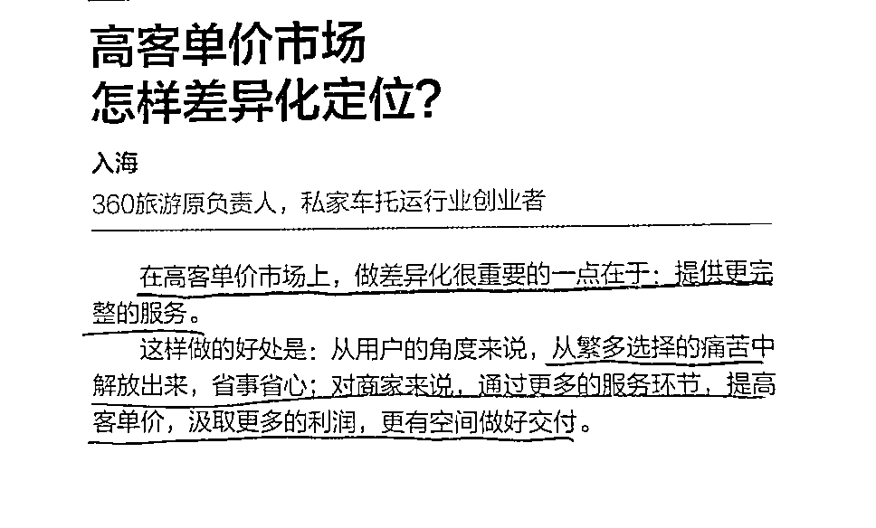

（2）产品差异化

1）别人没有的，我们有

家教实践高度个性化：孩子不同、父母不同，娃在家庭系统里受到的影响也不是单方面的；类似行为问题，解决方法和切入点可能完全不同。比如写作业拖拉：有的孩子评估后确实缺任务意识和时间观念，需要父母帮着培养；有的孩子有能力做却不做，是因为亲子关系紧张，跟父母陷入对抗，故意不做。两种情况的解法不一样。

我们的产品用三个板块把问题拆准，再陪大家在实践中调整：

一是学员每周提交实际难题，导师用语音单独回复，分析问题并给针对性方法；
二是每周直播答疑，在互动中判断个性化成因，给出方案；
三是根据学习和实践进度，约单独通话，处理比较私密的家庭和个人成长问题。

三个板块配合，目标是让学员从“知道”走到“做到”：急问题及时处理不积压，需要时间的问题有陪跑，家长不焦虑、不放弃、不走偏，直到情况改善。

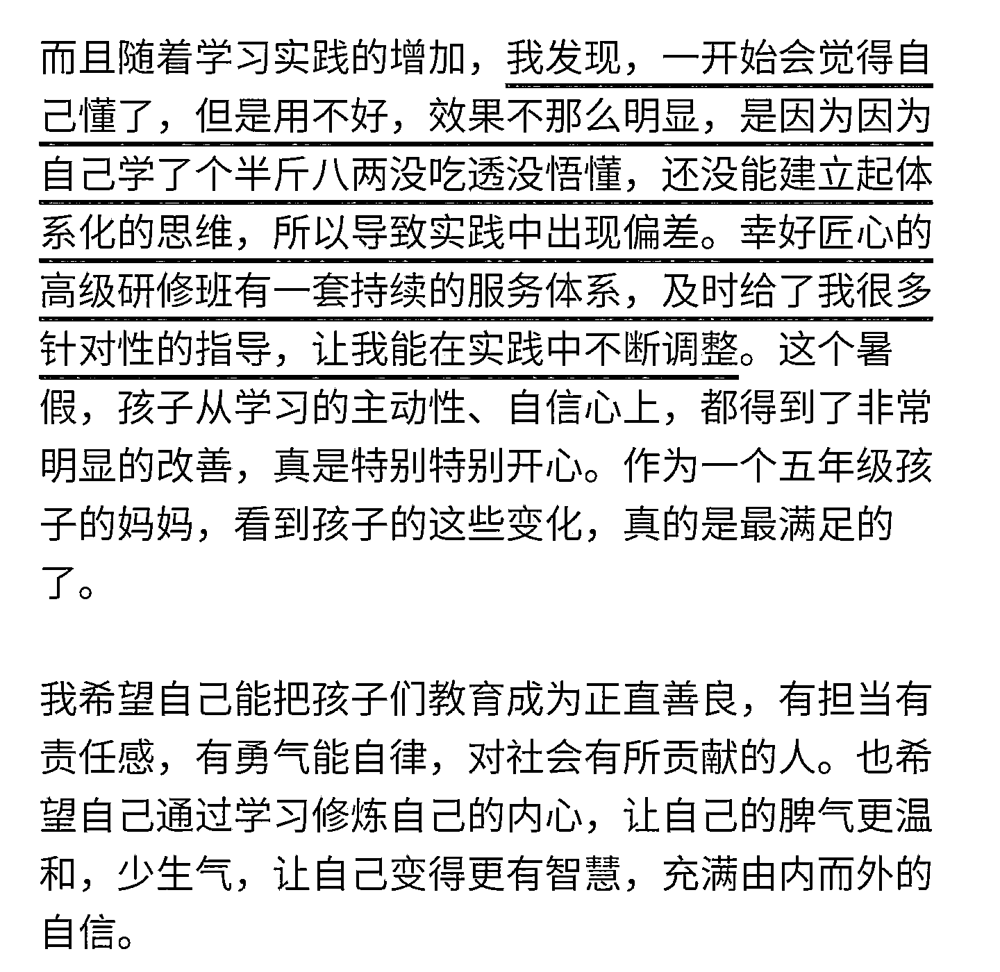

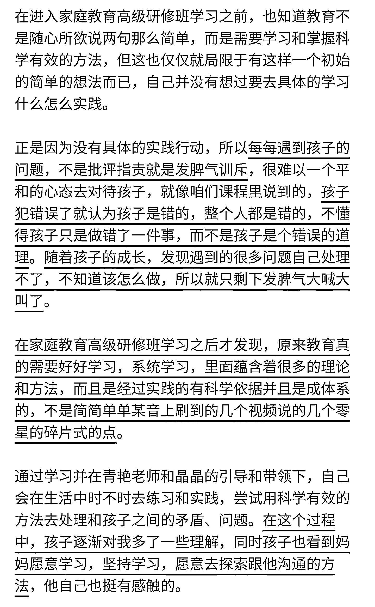

服务做到这个程度，目前市场上我们还没见到，但需求确实存在，所以这块算别人没有的。

2）别人有的，我们更划算

我们也对标了市面上的家教机构和IP，发现大多数只打一个点：这个老师讲情绪，那个老师讲沟通，还有老师讲学习力……父母学起来是散点式的，资源不成系统，实操效果差，成本反而更高。我们的课程系统、全面、精简，一站式学完；表面看价格不低，但相当于打包买整套课程，再加陪跑指导，其实很划算。

想把家教做好，让娃好好学习、具备积极乐观等品质，底层逻辑并不复杂：懂孩子、懂自己、懂家庭成员之间如何相互影响、做好教育规划。我们以这个主干来设计课程：

① 积极养育课：讲家教底层逻辑，是基础课，所有父母都可学也需要学；学完能了解孩子心理发展规律，知道有哪些方法可用。
② 智慧父母课：帮父母自我成长、自我疗愈；学完更懂自己，看清“原件”怎样影响“复印件”，并处理“原件”的问题，提升“复印件”的质量。
③ 高情商沟通课：以亲子家庭沟通为主线讲方法。教育要通过沟通落地，了解孩子和自己之后，掌握沟通方法，才能掌控亲子对话，实现养育目标。
④ 青春期父母必修课：青春期挑战大，所以在积极养育课基础上单独开一门，帮父母更有针对性地理解青春期孩子，提升应对能力；如果家长自己的青春期发展不完善、有遗留问题，也能通过这门课得到疗愈。
⑤ 教育规划课：“双减”后，教育责任有一部分回到家庭，父母不能完全把孩子交给学校，急需提升教育规划能力，这也是当前热点。
⑥ 心理学通识课：家教理论和方法的底子是心理学，有些父母想补心理学基础，用起方法来更有底气。

以上任一方向的课，市场价从1000+到5000+不等；我们全部打包，再加陪跑指导，定价12800，对学员来说很划算。

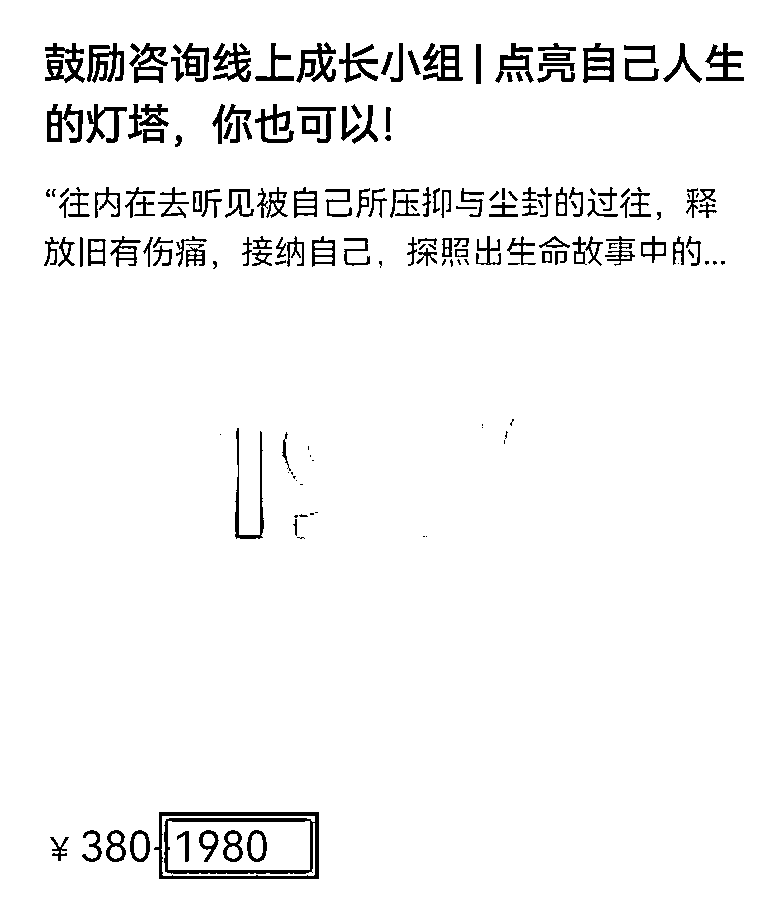

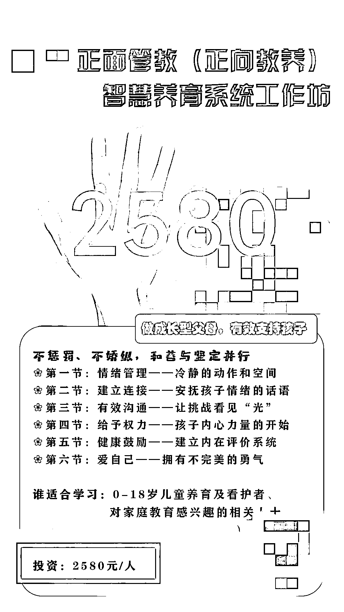

 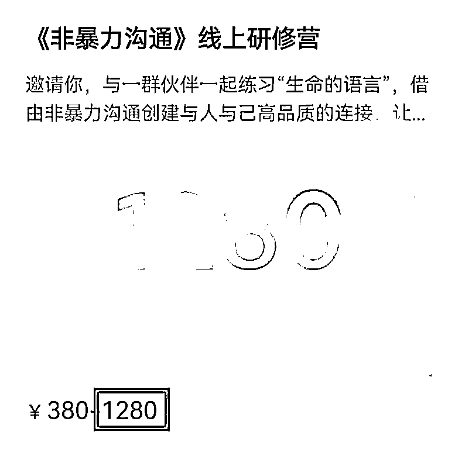

也有父母说没时间学这么多，只想快点解决问题。没关系，课就在那里，有空就学，没空慢慢学；按自己的节奏提问、听答疑，也能处理问题，有余力再挑合适的课，效果更好。课程不设期限，一年听不完，两年三年接着听，不存在三个月没学完就过期的问题；孩子成长也有过程，不是一夜之间长大。有学员说，之前也报了不少课，仍觉得问题没解决；跟我们学两个月，抵过去一年，而且把原先零散的学习串起来了。

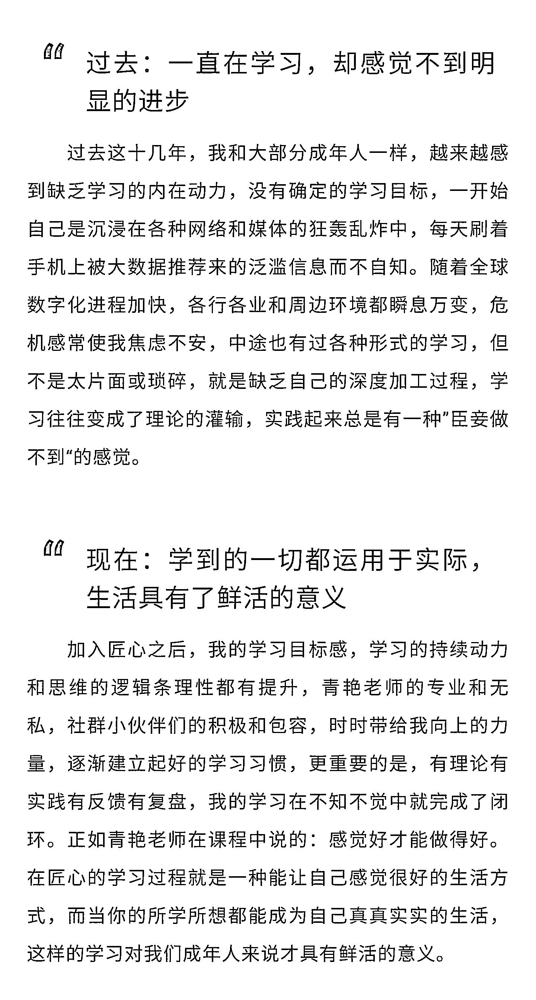

还有学员孩子才两三岁，暂时挑战不大，也买了服务。他们的说法是：慢慢学，不着急，学了能避坑，避坑就是赚。所以别人有的，我们更划算。

3）高客单价顺势出现

利润产品通常是高客单价，这一点很多前辈文章都提过，我们也走这条路线。决定主攻第三类客户后，产品价值就撑得起高价格。实际做下来感受很好：价格先筛掉大量无效客户，来问的人基本花得起；产品和需求匹配，成交率就高；当时没来的，后面也会来。无效营销少，学员性格和个人素质都很好。

三、流量从哪来

（1）2000+私域做出25万营收的原因

我们目前的私域底盘约2000+人，人数不算多，但人群质量不错。第一，之前办过几期线下课和沙龙，这批人信任基础好；第二，有孩子后我建过几个妈妈群，断断续续分享养育学习和实践经验，常有妈妈介绍其他妈妈来加我；第三，我长期在朋友圈记录家教路上的学习、感悟和思考，有一部分人是一路看着我成长的。这三块叠起来，信任基础就比较扎实，高客单也能成交。

（2）高价付费社群带来的流量质量较高

后面我也做了一些获客动作，主要是高价付费社群和视频号。比如我考过教育规划师，看到助教岗位招募就去应聘；教育规划师本身是5000+的付费社群，里面的人付费意识先过关，引流质量比较好。

四、怎么转化成交

（1）免费送一次养育问题1V1咨询

一次咨询其实解决不了问题，所以免费咨询的真正作用是：梳理问题、做归因、强化痛点，同时让对方意识到“我需要学习和指导”，再顺势告诉他我们有匹配的产品。沟通主线如下：

① 先问对方遇到什么难题；
② 问这个问题持续多久；
③ 引导对方回忆一个关键事件，把痛点唤起来；
④ 问他做过哪些努力，分析问题为什么还在，让他看到自己的能力缺口，把需求暴露出来（这时可以植入成功案例：学员也遇到过类似情况，描述事件，经过我们的学习指导，现在达到了理想状态）；
⑤ 如果不改变会怎样，要聊到不改变的危害，把当下痛点放大；对教育产品来说，这一步不算制造焦虑，因为教育结果本来就在未来显现，这是客观事实，所以必须沟通；
⑥ 最后问：保持现状，还是想办法改变？推动对方自我说服。

（2）免费送一次亲子关系测评

# 亲子育儿IP，如何把客单做到五位数？

先请客户做一份客观评估，让结果替我们说话，比自己直接指出问题更有分量。团队里一位同学做完评估后告诉我：“你说的每一条都像看穿了我。”随后顺利签下一万二千八。

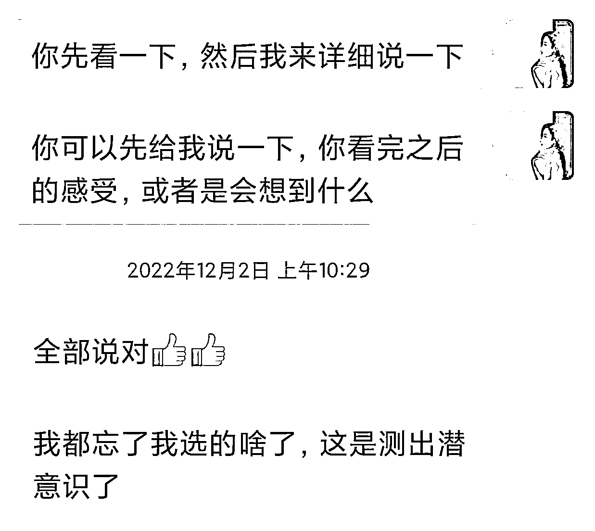

## （3）0元试听课怎么玩

当我在社交动态里分享学员故事时，常会在留言区埋个钩子：“想学会带出情商高的娃，直接回复‘666’，我送你一节0元试听课。”一旦有回复，就把报名入口发过去；偶尔也会建一个三五天的临时交流群，再把人拉进来。

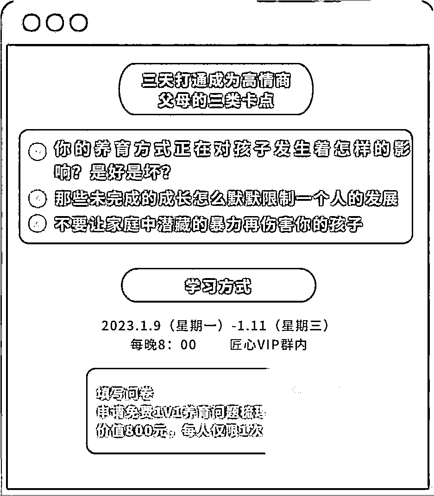

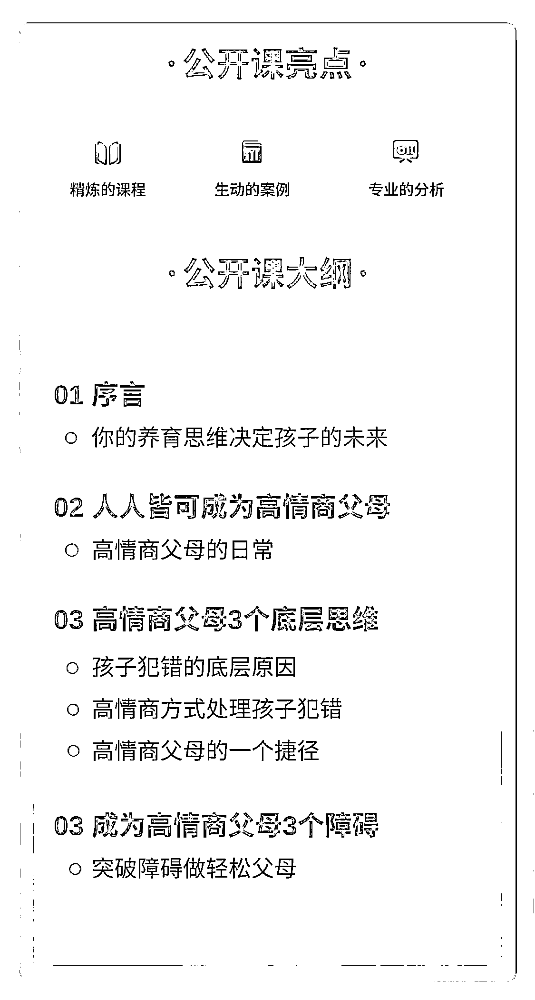

这堂课主要讲三块。

第一，先展现常见的高发育儿场景，多数人一听就会自动代入，然后再勾勒理想父母画像，唤醒那份向上的期待；第二，点出妨碍大家成为情绪成熟父母的几类思维定式，用实例印证理论，让每个人对照自身，察觉自己也有类似卡点；第三，亮出团队过往成绩和成功故事，并请老同学现场分享他们的转变。

整场内容有方法、有故事、有可落地的思路，但它的定位不是当场拆解难题，事实上也拆不完。它更像一面放大镜，把很多人的困惑同时照亮，也让他们知道：有路可走。课后我们会送一份家庭关系评估，把评估结果和作业放在一起看，软肋、需求、卡点全变得立体，购买欲自然被点燃，至少能让他们记住我们。

## （4）社交动态经营术

关于社交动态的运营，我总结了三条心得：用真实故事自带共情力，靠长期输出累积信赖，以多元内容连接情感。

**1）真实故事自带共情力**

晒订单截图，大家都会，也确实能刺激围观者的购买冲动。但我的经验是，最有力的素材永远是具体的人：每个故事背后都有真实的挣扎，那些软肋最容易让人共情。曾经我盯上一位准客户，连着几天专门发贴合她境遇的实例，因为她正处于纠结期，结果其中一条正好戳中她的要害，她果断付了费。

**2）长期输出累积信赖**

线上交流天然比线下淡薄，想让人信服，长期稳定输出是最有效的办法。我成为父母后，就开始在育儿这行不断学习、实践和复盘，从当初的泛泛分享，慢慢变成有辨识度的专业人设，这段看得见的经历本身就建立了信赖。首期内测学员招募时，不少人主动报名，最快的一位通了二十分钟电话后直接转账。他们说：“看你这些年一直没离开育儿这件事，我信你。”也有人讲：“咱们都是当妈的，你一路学习、实践、思考、升级，我也想成为你这样的人，所以必须跟上。”还有只围观了几个月的新朋友说：“你发的每一条我都认真看过，收获很大，想继续跟你学。”

**3）多元内容连接情感**

知识型个人品牌，价值绝不只是信息与技能。如果只靠这些，大家直接买书、看课件就够了。我们真正的价值，是帮用户把学到的内容内化，再把方法真正应用到日常里，实现知行合一。这就要求我们给出比信息和技巧更远的体验。我观察到大家爱看我聊学习心得、时间安排、思维模型和生活态度，就持续写这方面的内容。这种额外养分，让用户觉得我不仅是个讲师，更是一个并肩成长的伙伴。跟着这样的人学育儿，他们觉得踏实、丰富、走心，距离感也就消失了。

**4）社交动态的栏目化思维**

再分享一个私人经验：我的账号粉丝量不算多，但能拿下高价位订单，和动态内容的栏目化有很大关系。自己心里要有一张清晰的栏目表，我的账号大致分成四类：

- 热点金句：围绕某句金句、某个热点事件，聊聊看法和经历，传递育儿理念；
- 专业与产品：发布课程能解决的困扰、用户反馈、成交记录等；但这类内容常常不充分，尤其是高价位产品，初期不可能天天有成交，我就会改发专业成长痕迹，比如报了哪些班、读了哪些书、和朋友探讨了哪些议题；
- 生活日常：晒积极的生活状态、遛娃片段，让人觉得你是真实的、有情感温度的，也符合用户心里期望的讲师模样，用户黏性会更强；
- 增值内容：结合自身优势和用户兴趣，再给出一些对用户有用的东西，比如学习技巧、时间安排、思维模式、生活态度等，这样的内容才能真正打动人心。

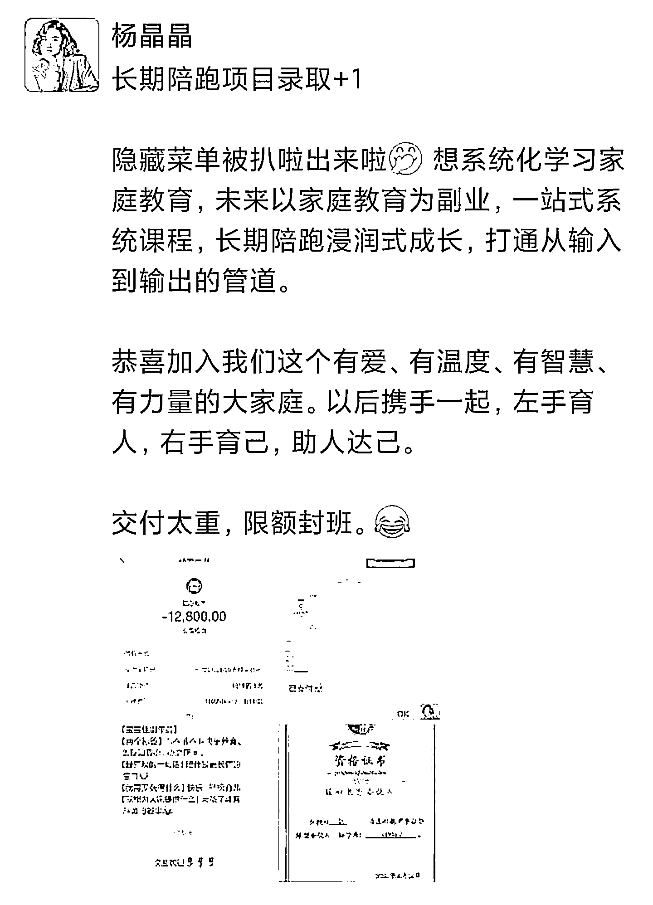

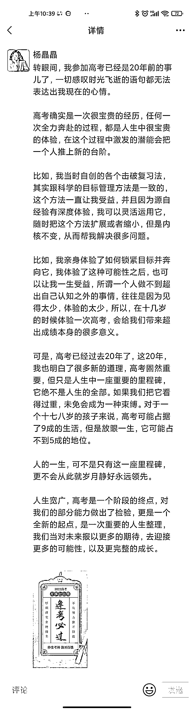

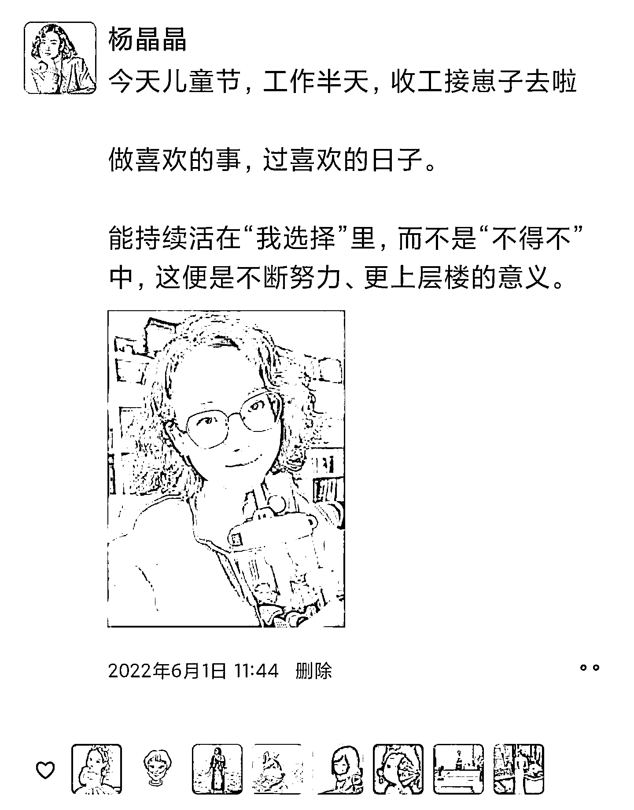

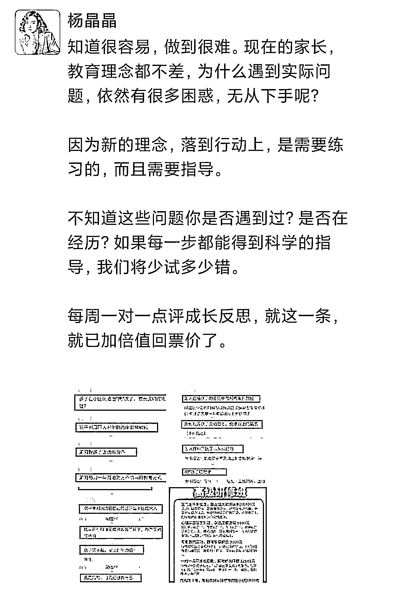

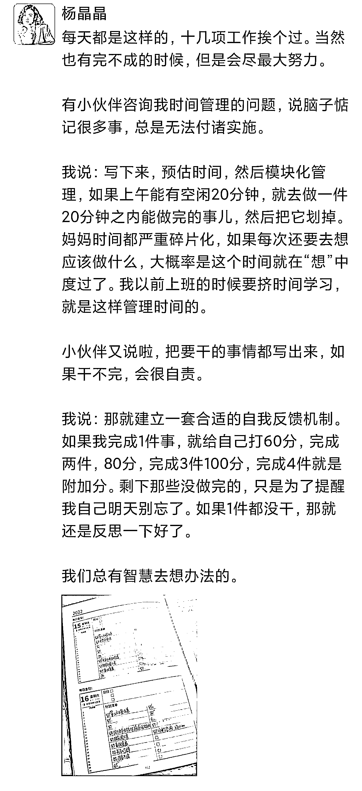

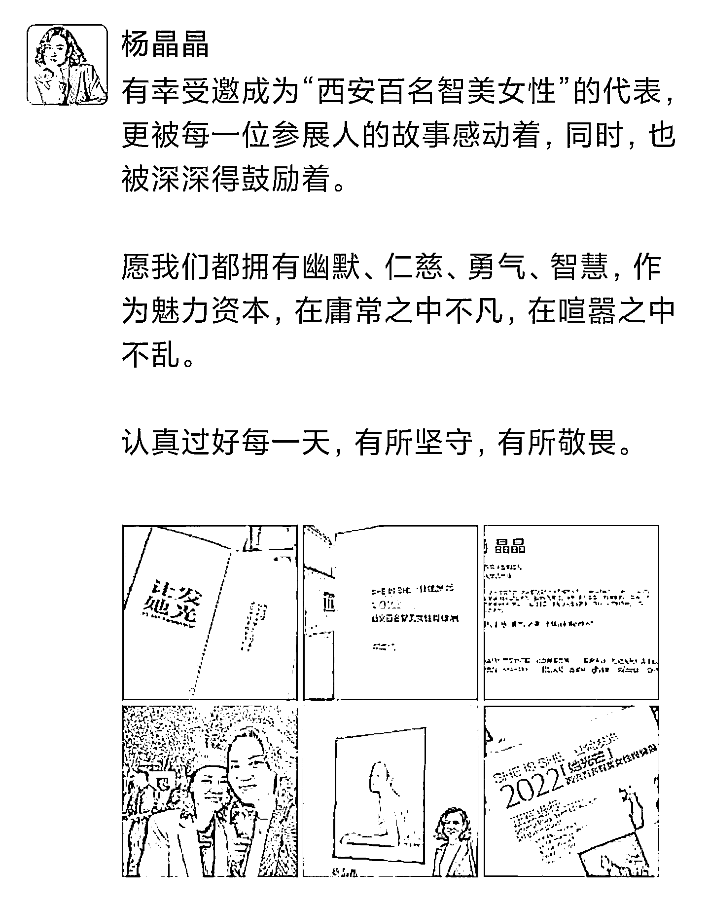

最完美的节奏是每天四类都出现，但太忙时挑着发也没关系，关键是心里始终有这根弦。我的经验是：暂时断一下也没事，记得回来就好。把时间轴拉长，你依然是那个一直在场的人。

## 五、带学员开拓副业的打法

总有人问：育儿赛道好进吗？满大街都是“宝妈博主”“亲子博主”，真能赚到钱吗？就我目前的观察，入行容易，但做高价位产品很难。

### （1）为什么入行容易

因为现在愿意系统学养娃知识的人，大多是宝妈。只要稍微会读书，翻几本书，把内容整理成体系，再融进自己的带娃心得，做一门两三百块的轻量课程或社群并不难。而且宝妈手里多少有几个家长群，起步流量并不缺。

### （2）高价产品难在哪

高价产品难做，是因为它要求你具备两种硬功夫：一是能不断升级内容体系，二是能处理各种意想不到的真实困境，说白了就是要有稳定的交付能力。愿意掏上万学费的父母，多数是遇到了必须解决的麻烦；没有明显状况就提前投入的人只是少数，大部分人都是被逼到墙角才来“补课”。孩子没出明显状况前，很少有人愿意投入这么大一笔钱，所以这个行业还要继续暖场，从认知转变到行为改变，也需要时间。目前大多数父母只肯花两三百块听个课，与其说是在学习，不如说是买个心理安慰。

为什么？因为教育的效果指向未来。孩子的心理和性格根基不是一天长歪的，毛病没到一定程度，父母就感觉不到痛，自然不舍得掏高学费；毛病变重了，又不可能一两天看到改善，反馈慢，更让人下不了决心。

愿意付高学费的父母大致有两类：一类是认知层次高、愿意为未来买单的人；另一类是状况已经很糟、痛到必须行动的人。但无论哪一类，都对课程质量和交付能力要求极高。各家情况不同，孩子也各不相同，再加上父母各自的来路千差万别，很多状况根本不可能靠读三五本书、上几节课、拿亲生孩子练手来解开，这本身就是很高的坎。

拿团队里一位同学来说，孩子校内已经出了大状况，她痛苦万分，跟着我们学了一段时间后，她本人的状态，以及孩子的境况，都明显好转。这背后是极强的交付能力：课程内容直击根本，每周有集中答疑，作业会得到单独批改，这样才能把方法真正落到行动上。

可能有人会说，这类父母为什么不直接求助心理专家？确实有人这么做，但父母普遍有个习惯：总盼着改变孩子，却不愿改变自己。可现实是，哪怕孩子在专家那里得到了调整，回家后如果父母的养育方式不变，老毛病还是会犯，甚至换一种方式重新出现。所以，最终总有一部分父母会决定先动自己，让孩子本人与自己都进入持久的良性循环。

也有人说，那些头部导师同样很厉害啊，但他们基本不提供这种贴身陪跑服务，就算有，多数人的钱包也吃不消。这样一来，我们这种能拿到实际效果的陪伴式指导，就找到了自己的生态位。

能做出高质量内容产品，又能解决具体问题，这两项能力叠加，就是那道高高的墙。

### （3）带学员做副业的思路

如果你专业底子够厚，能长期提供单人定制的指导，完全可以走“课程+深度服务”的路线，把服务做成核心卖点，客单水平自然水涨船高；如果底子还不够，自己研发课程和做深度服务都会很吃力，这也是不少同学做副业时会遇到的困境。我们通常给出两条路：

一是以学习者的身份做知识带货，赚取佣金；

二是做二次整理型的内容产品，像《青春期孩子常见问题100个》这样的，从书里或课程里提炼100个真实案例，定价199元，若能卖出一万份，收益相当可观。这也是我们今年打算带同学重点尝试的方向。

最后，想谢谢在线上相识的@梁靠谱、@醒醒、@芷蓝。从入手赚钱日历，到加入赚钱社群，我学到很多；在醒谱大队和玩赚新媒，也收获了许多意想不到的惊喜。以上是我们2022年在育儿赛道跑通高单价产品的一些实战复盘，希望能给大家带来启发，如有不足，也欢迎留言交流。祝各位一直龙哥盟。

留言区也很热闹：纪玮问怎么联系；重楼说“有意思”；詹伟平留下一句“何以解忧，唯有高客单”；谈谈心和小夏都在求联系方式。还有一段关于写作的话值得分享：对没有背景、没有人脉的人来说，写作是打开机会之门的那把钥匙，能帮你进入更适合自己的圈子，从而获得更多收入机会。杨晶晶也留下了自己的🛰️（VX：Amy20120906），表示希望一起学习、一同在龙哥盟的圈子里继续探索；她也提到，精准流量这件事还要好好研究，她会在赚钱圈子里继续取经。