# 朋友圈，会自己成交

我是醒醒。静伟来邀我，就借这个机会聊聊——怎么把朋友圈养到能自己收钱，而不是靠你天天在后台追单。

这几年我真正用到的工具就两个：微信，和朋友圈。靠它们，我把收入做到了七位数。我的看法可能偏直接：在微信里连七位数都挣不到，这门生意恐怕谈不上及格。

付款这件事本身没难度，微信转账本来就通着，不展开。

前面几点是地基，但做起来得讲手法。举着喇叭喊，没人爱听；真正起作用的是互动。

几种反例我见得多：
——天天晒学习晒专业，就是不亮身份，客户根本不知道钱该打给谁；
——只顾发广告、秀战绩，不管别人爱不爱看，越使劲越没人搭理；
——好友三百来个，卖几十到几百块的东西，收入上不去，时间一长自己先泄气。

接下来我主要讲两块：我写内容的心得，以及怎么让用户自己下单、省掉跟单的功夫。我的产品价位依次是499、899、2199、10000、26999元，全是对方主动转过来的。效果如下👇

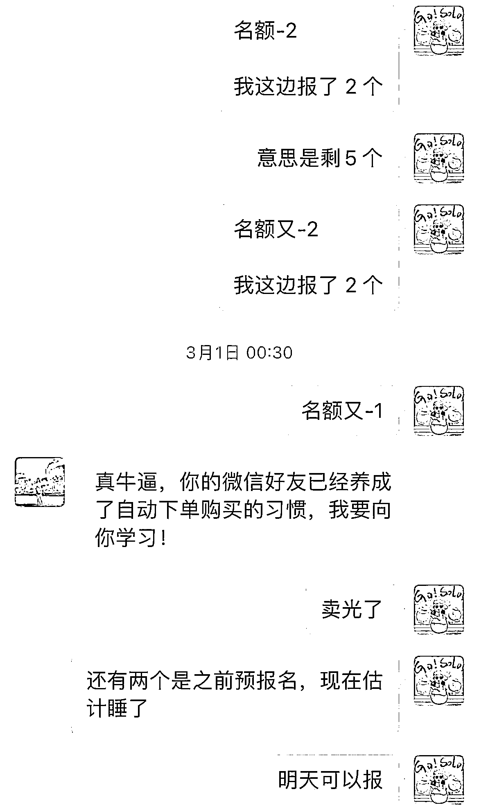

先交代背景，方便大家对照：我做自由职业四年多，一直在知识付费这条线，从带训练营到带团队，跟公司一起做到行业头部；后来全职做个人成长教练和优势教练，业务以咨询为主。

此外我也给自己喜欢的星球做推广，同样只靠微信和朋友圈：
知识星球@生财有术 第五期拉新第五名；
知识星球@生财有术 第六期拉新第二名；
知识星球@Caoz 的小密圈 拉新第一名；
知识星球@平民创业手册 拉新前三名；

三家星球做分销，加起来销售额过百万。所以说，朋友圈对普通人来讲，商业价值依旧在。你有产品在卖、又没有上万粉丝打底，只要能把朋友圈坚持写好，让客户自动成交完全可行。

先给一个自查的小公式。好友数量相同、卖的是同一个还算能打的产品，最后能收多少钱，取决于你内容的质量和发圈频率。

质量高、发得少——能赚到钱
质量高、发得频——赚得更多
质量低、发得频——被拉黑
质量低、发得少——赚得有限

这里的"质量"不是文笔多华丽、多专业，而是别人能不能听进去、听得懂、被打动，跟你卖的东西有没有关系，有没有人愿意一直点赞、留言。

频率就是发圈的勤快程度。

如果你跟我一样是素人起步，第一条底线就是别掉进"质量低、发得频"，努力往"质量高、发得频"去。可以参考我朋友梁靠谱，她的朋友圈几乎没人能躲开。

朋友圈说白了就是小区门口那个小集市——想赚钱，定位、选址、选品、活动、服务，全得盘算。这些大家多少听过，今天时间有限，我只拆开讲一件事：朋友圈怎么写，才能让人信你。技巧就一个：把用户拉进你做事的过程中。

最近有朋友要上新产品的吗？你们一般发什么？

我先讲一个办线下活动的例子。大家去餐厅吃饭，有些店厨房是明档的，比如西贝莜面村，你能看到食材怎么处理、怎么下锅，信任感一下就上来了，敢吃也敢买单。外卖为什么总让人心里打鼓？很大一个原因就是后厨看不见，怕黑心厨房。

发朋友圈逻辑一样。你把产品从零到一的过程摊开给人看，用户会更踏实，有人甚至会像看自家孩子一样，越看越顺眼，不买反而别扭。这不是玩套路，是用公开的方式反过来逼自己把事做好。

拿我前两周第一次办线下沙龙举例，从冒想法、定活动、备物料，到落地执行，全程都在朋友圈里走了一遍，报名火爆到换了两次场地。

第一步，先宣布我要办这场活动。不用等所有物料齐了才开口，你准备到哪就说到哪，包袱越轻，后面越有空间，别人也越能看出你是在认真推进。

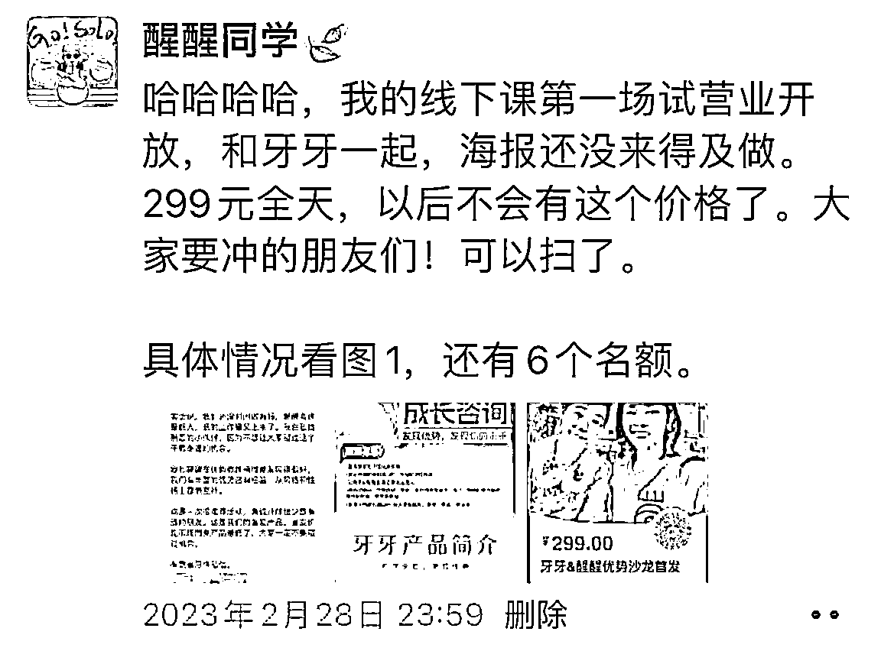

顺便问问大家场地、海报、物料怎么选，把朋友圈的人拉进来。做朋友圈，真正可怕的不是内容粗糙，而是压根没人打开看，消息发出去跟扔进黑洞一样。

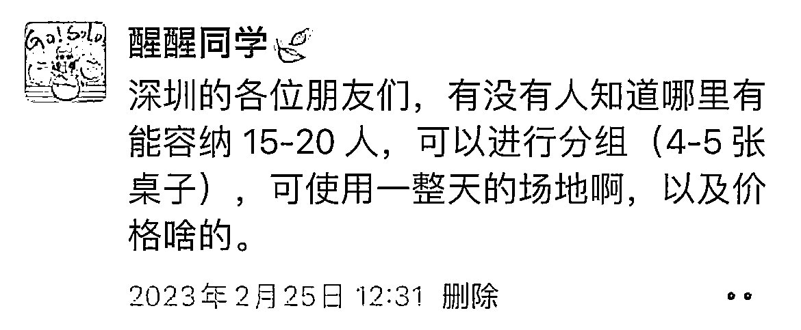

这一条帮我一下子收到四五个场地线索，还有人直接来问怎么报名。每次能跟用户对话、能拿到资源的机会，都别浪费。

筹备期间，关于活动的思考、进展，都能往朋友圈放，跟用户同步。我会问海报哪张顺眼、某个环节怎么设计大家更喜欢，甚至问朋友我穿哪件衣服。

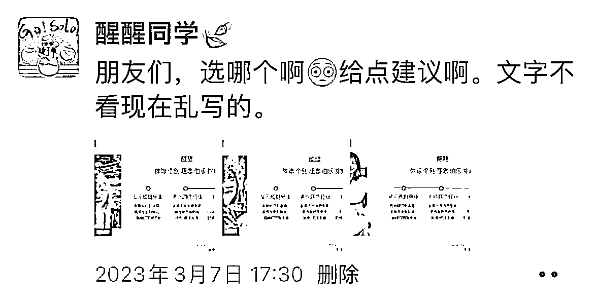

这条底下几十条回复，参与门槛很低，回个数字就行，不用动脑。这种轻互动可以多发。

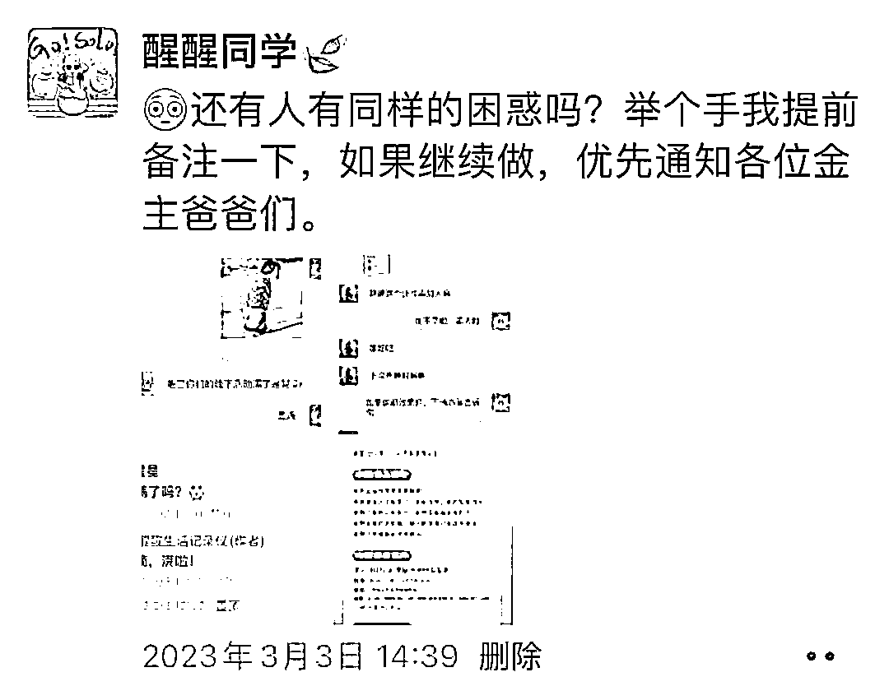

还有报满之后有人想加位子的，也可以发出来问。既能再拉一波报名，也能稳住已经报上的人，还顺带让没抢到的人感到被在意。

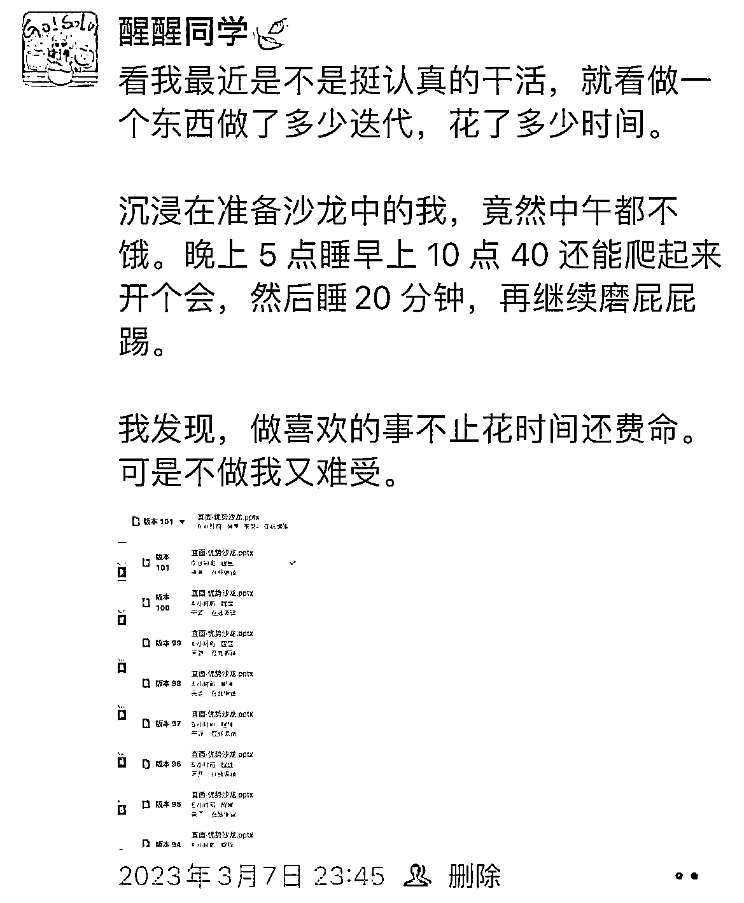

这条是我改完PPT后随手发的，当时有感触。也正是因为这些过程被看见，活动当天有同行朋友送了蛋糕，还有人送花。

世界有时候挺妙，你一张口，就容易跟人连上；连上了，就有记忆、有惊喜、有意外的收获。人和人的感情没法拿秤称，交易做完感情还在，多半是交易之前感情就已经在了，成交是水到渠成的事。

活动正式办的时候，也可以适当转播，让大家看到阶段成果。

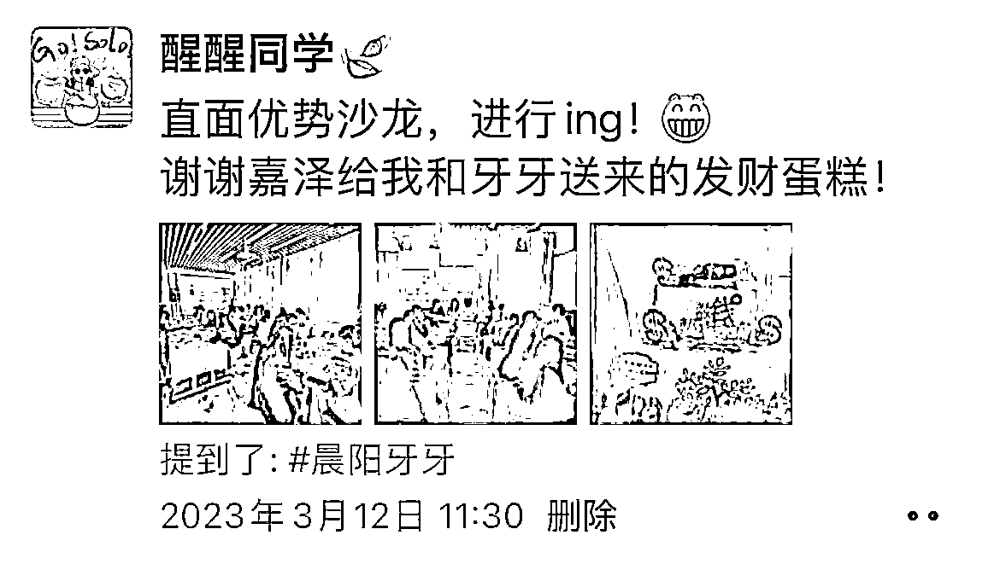

活动结束，最好做一次总结。方向可以是当天的感受、复盘给别人参考、或者拿用户反馈当宣传素材。

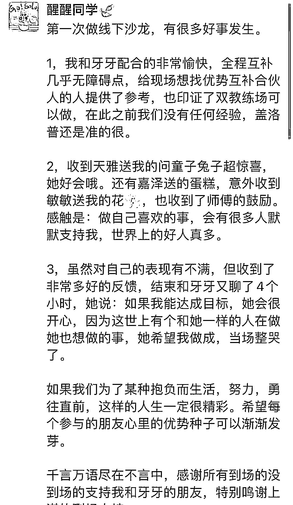

别的截图先不放。这条发出去之后，又来了三位想报名线下的，还持续带来专栏和咨询的客户。后来我打算再试别的场次，发了一条朋友圈，几个小时就报了十五个人。在那之前我从没做过线下活动，海报也是临时赶的，但"把过程摊开"这件事，帮了我很多回。

业务型朋友圈其实很好写，方向包括：专业学习、咨询心得、用户案例、同行观察、职业价值观等等。

高频，且真实：

有句话我挺喜欢：做不到让你过目不忘，那就让你过目、过目、再过目，最后记住我。

一直拿六七十分的东西出来，比偶尔交一次满分更能撑住。觉得写得不好就不发、总想等满分再出手，杀伤力反而有限；两百分当然震撼，但太难。长期写下来，偶尔几个八九十分，足够让人记住你。坚持输出有价值的东西，给对的人、也给更多人，收钱就成了顺理成章的结局。

有人问素材从哪来？一招：去知乎或者用户扎堆的社群里聊天，帮人解决问题，再把过程整理成案例；或者翻同行的文章，把戳中你的观点拎出来，用自己的话写。灵感来的时候，立刻动手，别先给自己设一堆限制——打动人这件事，很吃情感共振。

比如前天我在飞机上琢磨跟朋友聊的话题，落地就写了一条：

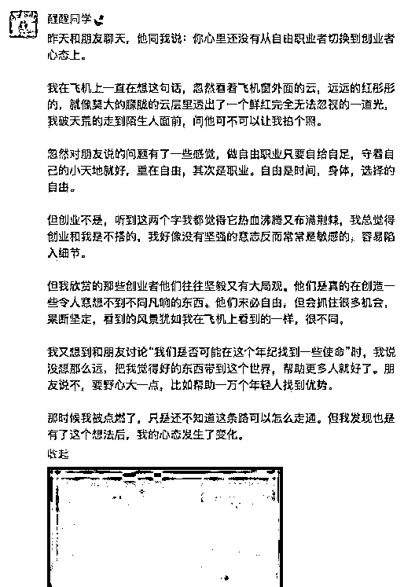

这条几十个赞，还有评论。有人说"看得热血沸腾"，有人说"这条可以写进自传，随喜赞叹"，还有人喊"股东报道"。睡一觉醒来，我收到了一笔咨询转账。

这笔钱跟这条朋友圈有没有直接关系，我不敢下结论，但跟长期分享肯定脱不了干系。你是真心想做一件事，文字里会带出那股劲和诚意，是能打动人的。

实在担心没东西写，可以用数据工具，比如极客增长、5118，搜你产品相关的关键词，挑搜索量大的题目写。我最放飞的时候，写过两版文案让用户投票哪个更心动，也让人帮我想怎么提高转化率，全在朋友圈里讨论。聊着聊着，有人甚至会主动帮我转介绍。

我说的"真实"也在这里。做宣传可以用技巧，但别遮遮掩掩，有时候坦白一点，用户反而买账。比如直接说：我要参加一个七天万元销售挑战，在朋友圈卖某某，大家多给我建议和反馈——这种不但不招人烦，有时还能拿到支持。说明卖东西本身不讨厌，讨厌的是让人不舒服的表达。

真实的案例：

案例是朋友圈的刚需，我差不多每周都能产出。我的习惯是，做咨询时顺手截图存进flomo；问卷里单独设一栏问用户：如果我把你的案例发到朋友圈，介意吗？目前绝大多数都说不介意——毕竟是在帮他们找优势，也挑不出什么难听话哈哈。

任何一个case、一段聊天记录，都能整理成内容，比如：

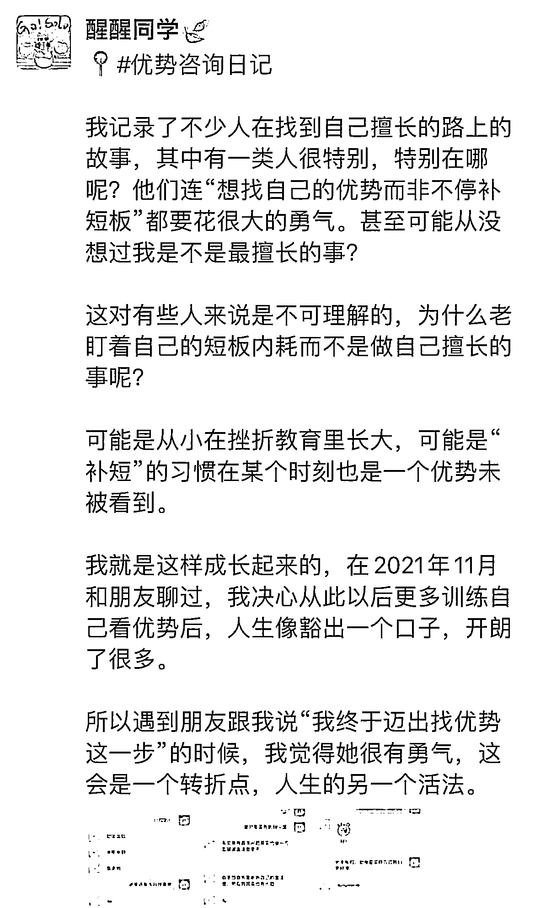

这条是用户刚预约、还没开始咨询时写的。用户走到你微信里的每个阶段，只要跟你的产品有契合点，都能写。不是非得等人家赚到钱、服务结束了才有素材。什么都能当素材。

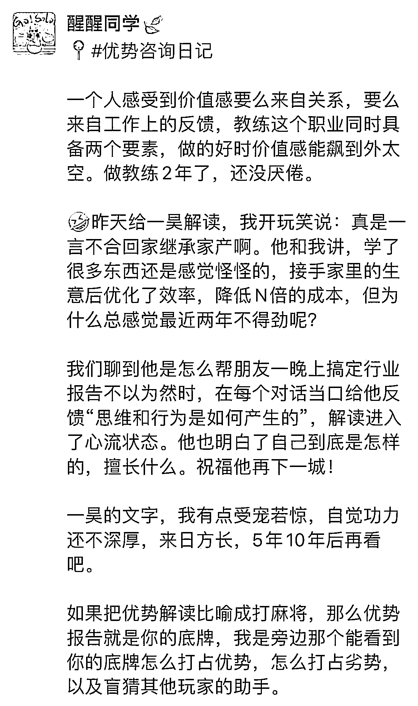

这条是解读完之后写的观察，配图是对方的反馈，发完又给我带来了新客户。做业务有时候说一百句，不如相似用户的买家秀。所以案例真的要发——同类的用户最懂同类，也最能打动同类。

我一直有个观点：靠内容吃饭的人，其实是在替一群跟你一样、但沉默着的人说话。你的胆怯、勇敢、改变、纠结，一旦变成文字，就等于替她们发了声。

（当然，发之前一定要拿到授权。）

多角度观点：

客户案例发多了，别人也会腻，觉得你天天打广告。所以要时不时换个身份、换个角度写，素材还是从案例里来。比如你做电商，不光能发产品文案，还能写对消费者的观察、对同行的观察、自己工作的心得，这样你这个人就立体了，能覆盖的人也更多。

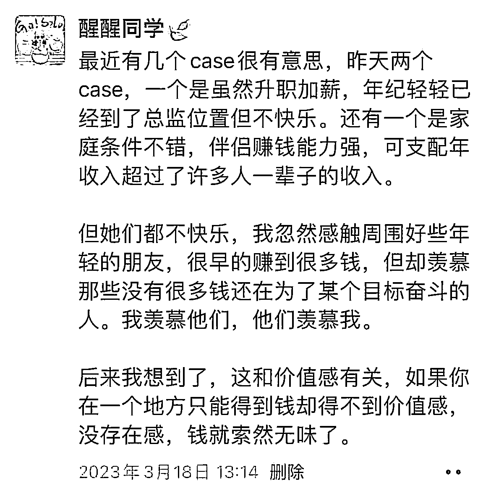

这条是我把几个案例串起来做的总结，有人开始互动，聊价值感是什么、聊这些富婆跟我们有什么区别，这些日常讨论都是加深关系的加分项。

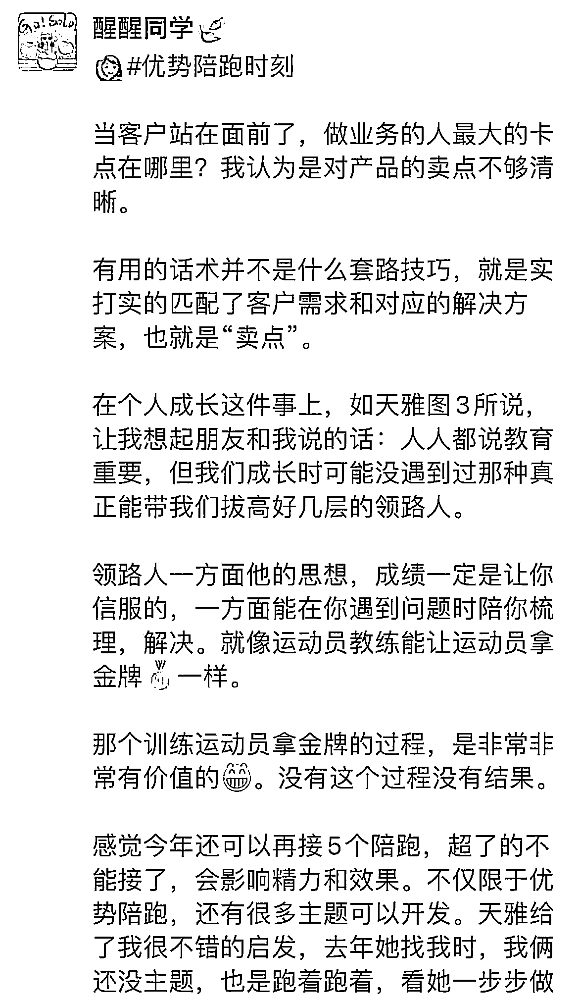

这条是以教练视角谈教练价值，结合个人成长销售卡点和我的陪跑业务发的。后面有三个人来问陪跑服务——先展现教练价值，最后再打广告。

很多人不怎么讲自己到底提供什么业务，光发行业观点，这就降低了别人来问单的概率，因为对方压根不知道你手里有生意。

三不原则：

朋友圈内容这块，我有"三不原则"，也分享给大家。

我2020年底开始写公众号，后来立了个一年写一百万字的目标，从那之后朋友圈就一直练、一直写。最早99元一小时的咨询，做到499，再到2199，早期那些朋友圈我现在自己都不忍看哈哈。

找我的人越来越多，客单价和产品数量也跟着往上走，内容能力也在涨。我几乎每一个高客单价产品，都是用户长期看我的内容、主动找上门后我才推出来的。第一个企业优势培训来自生财有术团队，当时激动坏了。

作为优势教练，我也看过不少人的文字，发现每个人的写作风格、写作习惯，跟天赋点关系很大。有人文字张扬外放、气势拉满；有人内敛含蓄、娓娓道来；有人写不长，有人写不短。

像我的盖洛普报告，体谅、个别、理念、思维这几个才干排前面，纪律靠后。所以我写东西带情绪是天然的，纯逻辑我写不来，观察别人我很顺手；让我每天定量发多少条，那真是要命，有灵感随时发才适合我——跟报告对得上。

看了很多人之后我越来越确定：朋友圈如果主要用来变现，那不管什么风格，你都得找到自己的核心卖点，找到对应人群，再把这个基数不断做大。还没形成写作习惯时，多给自己些时间，观察自己在什么状态下最能出内容；习惯成型后，上点工具辅助。

还有一点，微信好友不到1000人时，先把"对得上产品的人"加进来，比天天琢磨怎么发圈更重要。但不管人数多少，多写、多研究，永远不吃亏。

我帮不少同行和朋友打通了发朋友圈的卡点，总结就一句：坚持输出有价值的东西，核心是跟用户攒出长期的信任关系，做长长久久的生意，让微信这个渠道至少做出七位数的变现。开头会难，但后面复利效应会直接体现在收入上。

慢慢经营、慢慢迭代，不急着这一时。把朋友圈写成一本能翻的书，自动成交迟早会来。祝福每一位圈友。也谢谢生财有术，谢谢静伟来找我分享。我第一次真正感受到朋友圈的巨大价值，就是从做生财有术418推广开始的，后来它成了我做教练商业化绕不开的一环。野路子走到今天，挺幸运的。

我分享完了，接下来欢迎提问，也可以拿任何素材来，我们一起聊聊怎么发圈。

评论区：

小女巫忻忻：醒醒总能把不清醒的人喊醒

佳丽：跟醒教练学朋友圈~

鲸鱼🐳：醒醒牛逼🐮

诗农Hope：醒教练，有点东西～

林深：醒醒子牛[啤酒]

董见一：醒醒太强了

觉迟：慢慢经营，慢慢迭代，把朋友圈写成一本能翻的书。学到了！

芷蓝：赞！朋友圈是私域的第一道关口，作为超级个体，是占领用户心智的基础工具，把静默成交的通路搭好，收入能翻番～