# 零基础全职妈妈，20个月线上变现170万+

赚钱的圈友们好，我是港妈金侣。

先亮一下成绩单：从2021年1月到2022年8月，这20个月里，我的线上副业累计进账超过170万元。同期，我们一家住在香港一套四室两厅的海景房里，宁波那套背了11年的房贷也彻底结清。

起点说实话并不好看：没有硬核专业，没有清晰方向，连拿得出手的爱好都没有。下面这份复盘断断续续写了3天，全文约15分钟。能给你一点启发最好，若觉得像听故事，也无妨。

先把大框架列出来：
1. 到香港后，我从职场人变成了零收入的全职妈妈。
2. 我先后跑过哪些副业？钱分别是怎么赚的、赚了多少？
3. 普通人从零起步，需要先夯实哪3块地基？
4. 缺专业、缺技能的普通宝妈，可以往哪些方向试？

## Part 1 抵港之后，我先成了零收入的全职妈妈

2008年我从德国哥廷根大学硕士毕业，之后在外企老老实实上了多年班。2020年9月，为了让孩子到香港读小学、接受更开放宽松的教育，我们全家通过香港优才计划迁居，我辞了职，家里少了一份收入。

当时不知哪来的勇气，我隔着几千公里就在香港租下一套所谓“千万豪宅”，月租三万多港币，一年房租一次付清，夫妻俩的积蓄瞬间少了一半。抵港后我没有工作，先生又受疫情影响，收入大幅缩水。钱，成了家里最尖锐的矛盾。都说金钱买不来一切，但那段时间，我家真的因为缺钱，几乎走到了散伙的边缘。

2020年下半年，我急着找收入。先在LinkedIn投简历，几乎没有回音；年近40再求职，比想象难得多。另一条路是拿芳疗这个自以为擅长的领域变现，可进账既慢又少，房租和开销却按月追着跑。2021年初，我干脆放下“精准专业定位”，把自己归零：没专业、没方向、没爱好，从线上副业重新找路。

那一年，我调研40多个项目，亲手试了20份副业，最后留下8份能长期做的。2021年1月到2022年8月，20个月累计收入170万+。在香港高消费下，我们住四室两厅海景房，宁波11年未清的房贷也还完了。

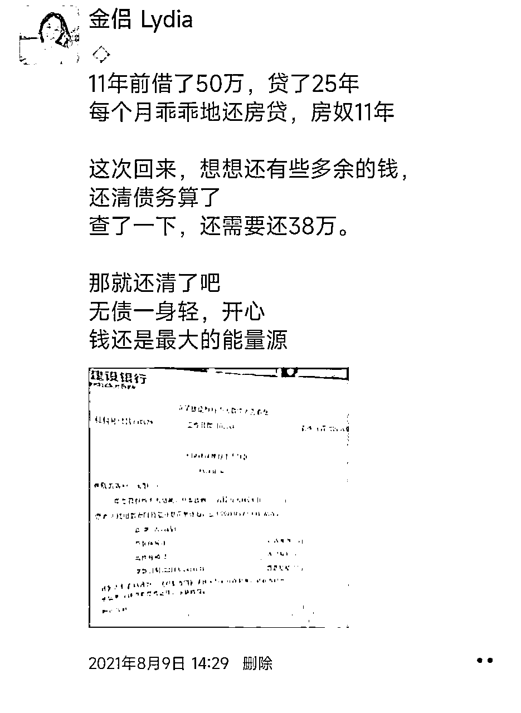

这次我花3天梳理这20个月的起盘经验，也是复盘迭代。全文约15分钟。希望圈友有几分收获；没有的话，全当看故事。

### 一、第一次做知识付费，没跑通

学芳香疗法是从2016年开始的。那些年我跑了全国上百场小型沙龙，拿下了国内外多个权威证书，成了国际认证芳疗师，还在宁波电视台讲过芳疗知识。按原计划，我想把线下课改成线上训练营，或者做精品录播课。

于是花了两个月，在荔枝微课录了一套《家庭芳疗护理师的60个配方》。课是做出来了，可上线之后，陌生用户一个都没买。

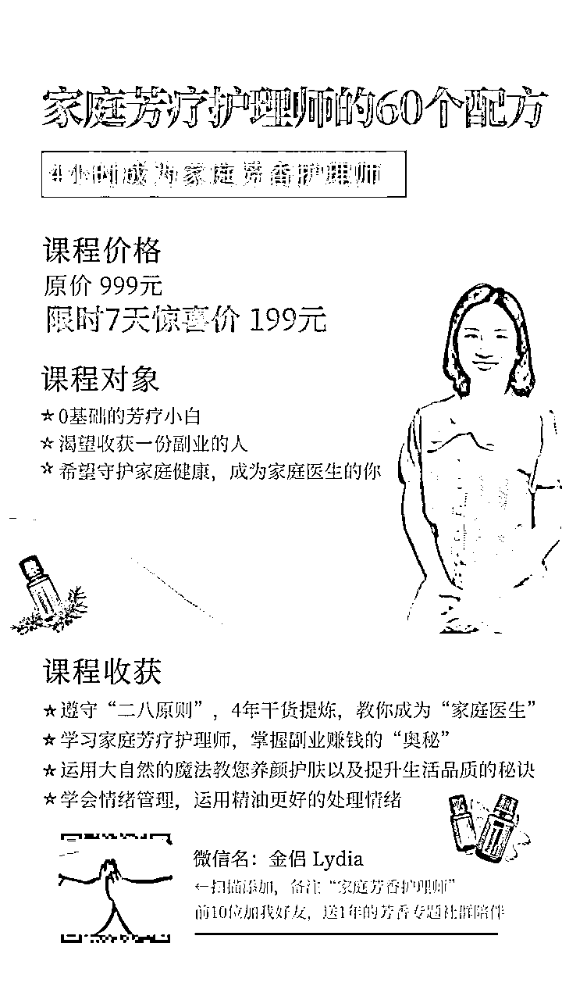

接着我又试着在视频号发专业芳疗内容，把看的人往私域引。前后折腾两个月，内容做得费劲，流量也拼命去抓，效果还是不明显。那阵子我很受打击，开始怀疑能力、方向和未来，迷茫又无助。

现在回看，我踩了一个致命误区：闭门造车。不学习、不向专业的人求助，只靠原有狭隘认知硬解问题，结果从一个困境掉进另一个困境。

### 二、情绪失控的那段日子

2020年12月，香港第四波疫情让全港中小学停课，孩子整天待在家，我对变现方向也越来越没底。那段日子，我们母子俩每天自然醒，吃完饭各干各的：我窝在床上刷小说、追剧，孩子自己涂涂画画。按理说互不干扰、没有压力，关系该更融洽才对，可事实并非如此。

圣诞前某天，我正看小说，孩子画画。他开口：“妈妈，你能坐我旁边陪我画吗？”我回他：“我不是在沙发上陪着你吗？”我没搭理他，他就一遍遍喊：“别玩手机了，坐到我旁边看着我好不好？”我心里莫名来火，觉得这孩子怎么不懂事——我在沙发上玩手机，不也是在陪他？至于为这么点事大呼小叫？我甚至觉得他性格自私又偏激，火气越积越旺。他喊的时候，我冲过去扇了他一巴掌，瞪着他吼：“不能好好说话吗？再叫还打。”那是他出生以来我第一次动手，孩子立刻爆发出伤心的哭声，眼里满是恐惧。

就在那一刻，我猛然惊醒：我根本控制不住自己的情绪了。那个积极、会规划的自己不见了。每天看着一笔笔开销，却找不到出路，高消费的焦虑压得我喘不过气。表面上我装作平静，内心其实慌乱不堪，一点小事就能引爆情绪。伤的是我自己，也是我最爱的孩子。全职妈妈若在日复一日的循环里慢慢找不到自己、找不到意义，情绪迟早会崩。当初为了孩子我才选择做全职妈妈，希望给他更好的教育和家庭氛围，可一个情绪失控的我，根本做不到。

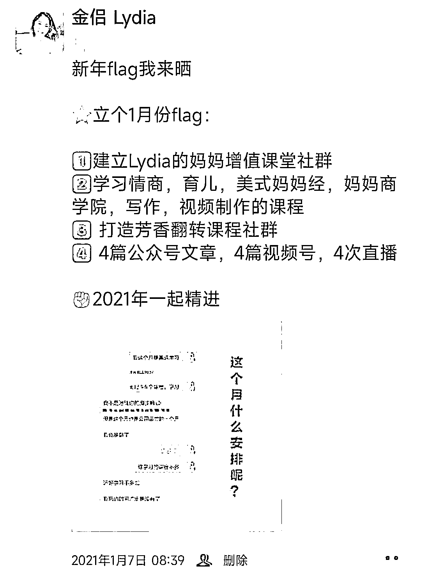

“靠自己不行，那就试试付费学习，跟着别人从0开始。”2021年1月，我一次性报了9门线上课，建了一个“妈妈增值”🛰️群，用输出倒逼输入。回头看，这就是我线上副业的正式起点，而“先学习”这一步，走对了。普通人跟大咖比专业、比资源、比能力、比技术、比经验，样样都输。唯一能弯道超车的本钱是什么？是时间。肯花时间学技能，去赚那些大咖看不上的小钱，石头缝里也能透出光。

## Part 2 我做了哪些副业？各赚多少？靠什么方式赚？

走过的副业可以归为三大类：一类是平台合作型，代表有多特瑞、群买买、妈妈不烦；二类是技能服务型，包括国际采购、香港资源、平台兼职；三类是自主运营型，比如付费社群、训练营和荔枝微课。

### 第一种模式：平台合作型副业

借平台起步副业的人很多，这也是新手最好上手的类型，卖的东西可以是实体产品，也可以是知识付费课程。赚钱的关键在于：你有流量、有销售能力，就能拿到推广佣金。

#### 1.1 多特瑞精油推广

2016年，我的第一份副业，就是替美国精油品牌多特瑞做推广。

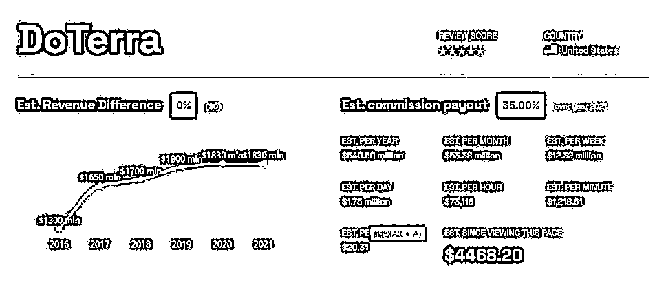

那会儿主要靠线下讲座和沙龙，让用户买精油，再提供后续服务。这是会员制直销，新客开发难，但老客复购不错，对现在的我来说算一份低管道收入。这份副业一直做到现在，前几年每年大约20万进账（精油佣金加芳疗认证课）。疫情后线下活动少了，加上2020年9月搬来香港，如今一年少了四五万。

建议：直销产品多集中在保健品、美妆、减肥代餐这几个类目，底层逻辑是学习→体验→分享→事业。刚入行必须大量学习，自己先买来用，有了真实的用户见证才好推给身边人；专业能力上去、分享的人多了、收入起来了，再考虑全职做。如今好产品满天飞，直销好货的优势不如从前，推广难度大了不少。但如果产品跟你的亲身经历强相关、有说服力，你也愿意长期深耕这个领域，仍然值得一试。

#### 1.2 社交电商——群买买

去年8月，我做起社交电商群买买。零投入、零风险的分享型副业。利用碎片时间推广，至今赚了约7.4万元。

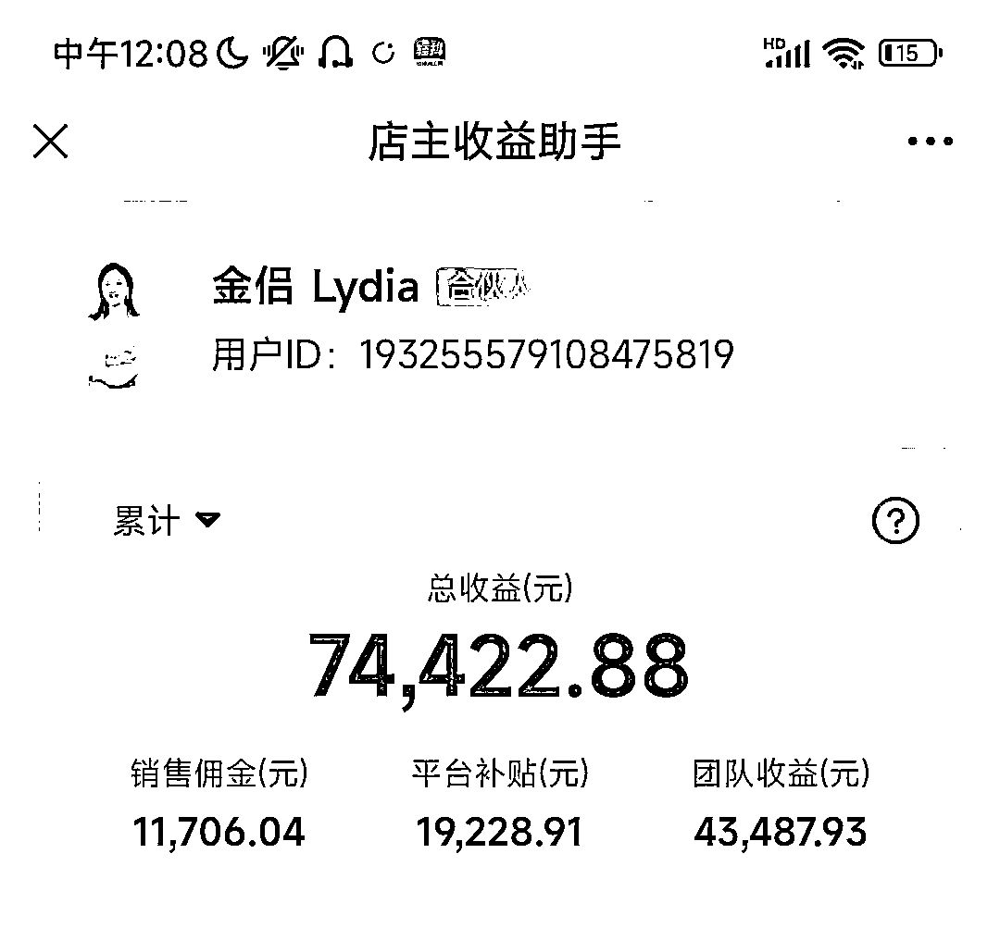

建议：跟微商比，社交电商零门槛、零投入、零风险，产品线像超市一样齐全。想做好，需要稳定获取流量的能力和选品眼光，是个大浪淘沙的项目。绝大多数是自用用户，只有极少数在推广。不需要多强的私域运营技巧，沉没成本也低。

#### 1.3 妈妈不烦平台

妈妈不烦是一个女性商业教育平台，付费女性用户有50万。它是我去年1月报的9门课之一。在这里我掌握了私域变现的几项核心技能——短视频直播、社群运营、顾问式销售，同时把课程推荐给500多位女性朋友，赚了近38万。

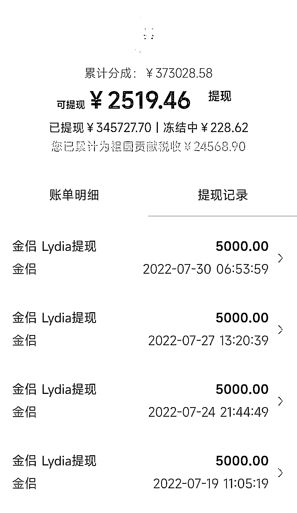

建议：在私域推知识付费课，说到底靠的是你本人的吸引力。别人先认可你、信任你，才会选你推的课。所以人设、你的收获和所推课程的匹配度至关重要。自己先真正从课里获得知识或技能，再去推才有说服力。

平台合作型副业的共同点是：交换价值——产品和服务是人家的，我们靠转化流量来换收入。

### 第二种模式：技能服务型副业

这类副业，本质是拿时间或技能替别人解决问题，换取报酬。我主要做三块：

#### 2.1 香港资源

香港疫情让很多习惯来港扫货的朋友过不来，本地不少商品又在打折，于是我做了香港代购。这是我到香港后的第一个线上副业，进账近10万。

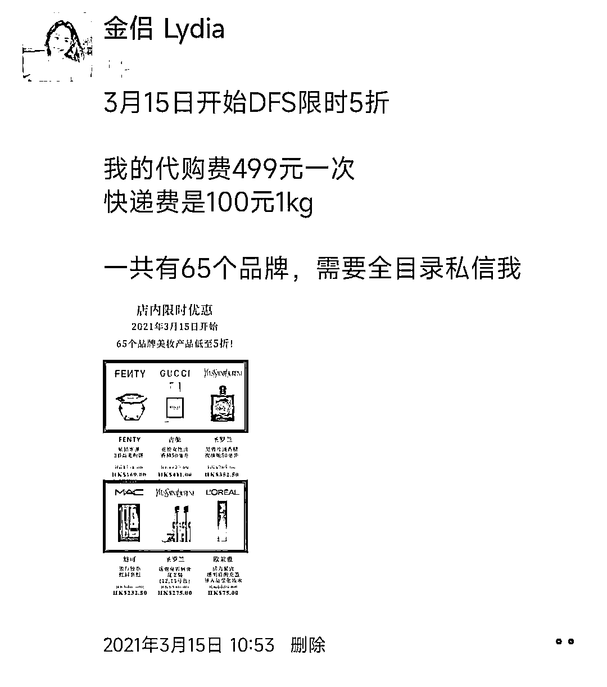

同时我在研究香港保险、海外教育、移民、医疗这些领域。虽然还没正式变现，但攒下了不少用户需求。这类副业表面是服务，底层靠的是信息差、地域差和人脉。建议平时多跨行业接触信息，靠地域差和信息差，找到替别人提供价值的机会。

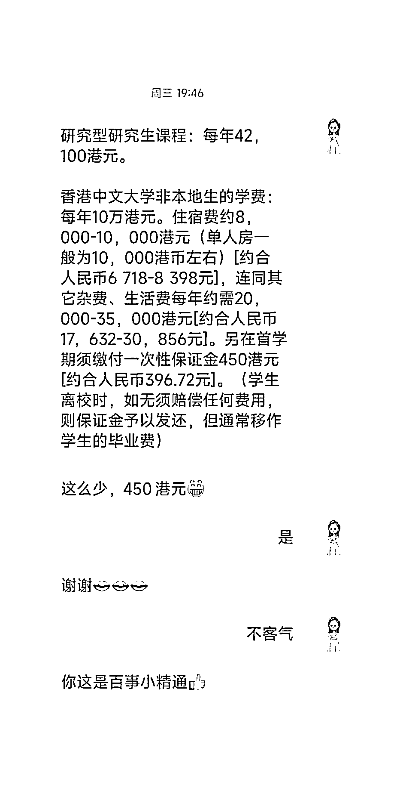

#### 2.2 采购技能

凭以前积累的经验和能力，我找了些采购兼职。这部分收入不太稳定，所以要不停找新机会，同时给几家公司兼职来平抑波动。工作以项目制接单，收佣金或咨询费，时间相对自由。我主要采购宠物用品和户外家具，今年开始碰美国电子芯片。目前这块占我总收入一半以上。

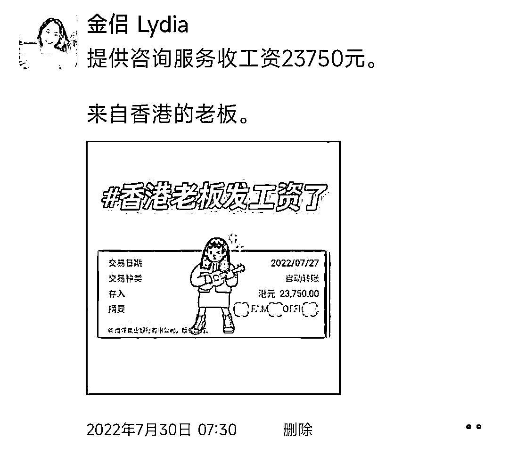

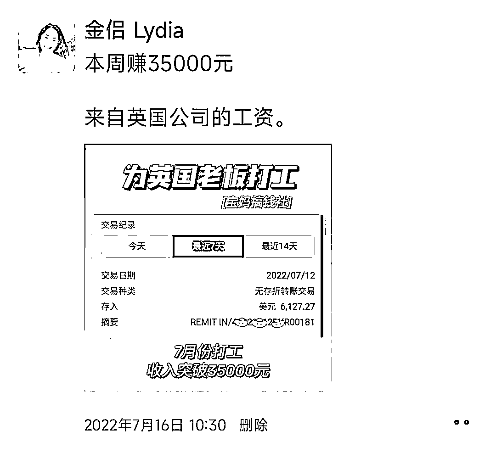

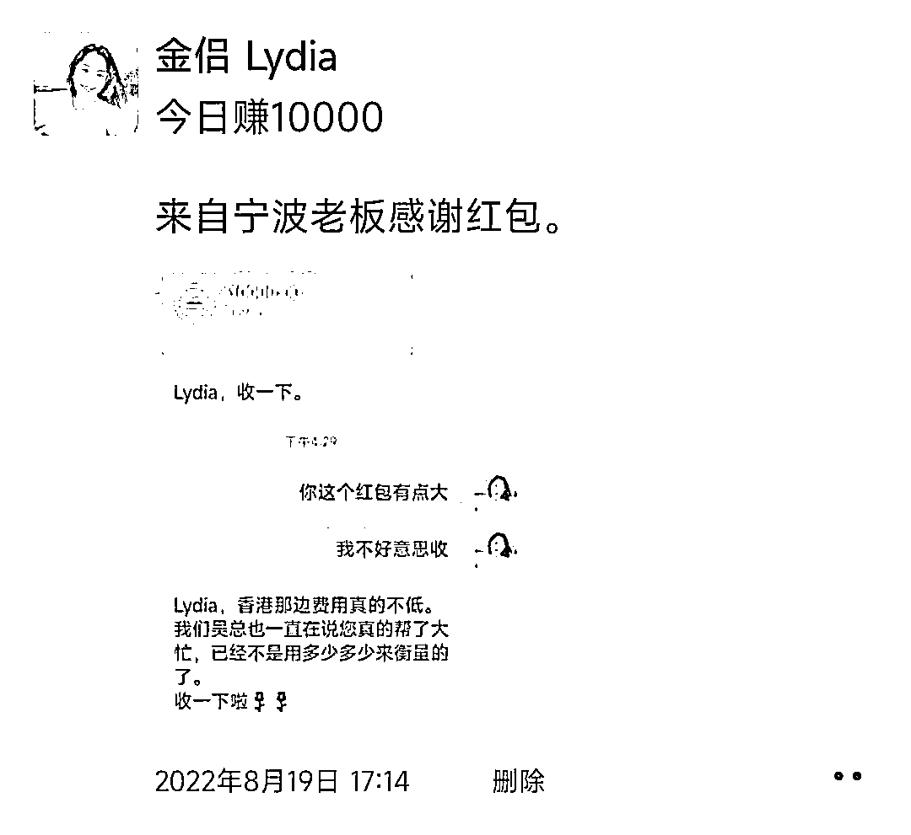

来香港后我没了全职工作，但过去的能力和经验还在。即便是兼职，我也会把老板交代的每件事做深做透。所谓“近者悦，远者来”，我的机会就是一个老板推给下一个老板。建议：这类工作本质是兼职，需要基本的职业素养。做事要有耐心、有条理、少抱怨；沟通要主动、逻辑清楚、能换位思考。最关键的是靠谱——长期靠谱，人品会替你带来红利。

#### 2.3 平台兼职

不少线上知识付费平台，学完课程之后除了推广，内部还会放出一些有报酬的岗位，比如社群运营、主播、私域操盘手、课程咨询、助教等。去年10月起，我在一家女性商学院做课程咨询服务，帮迷茫的女性答疑，赚了2万元。

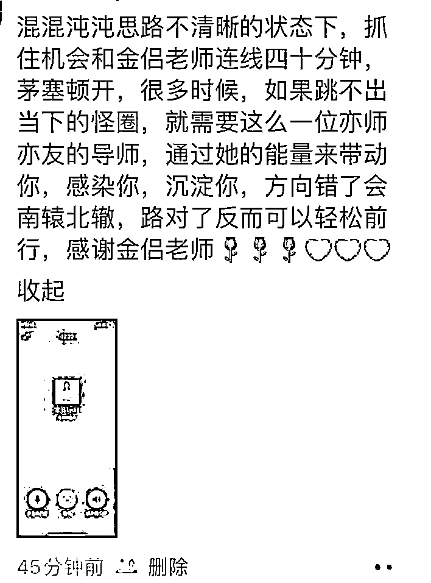

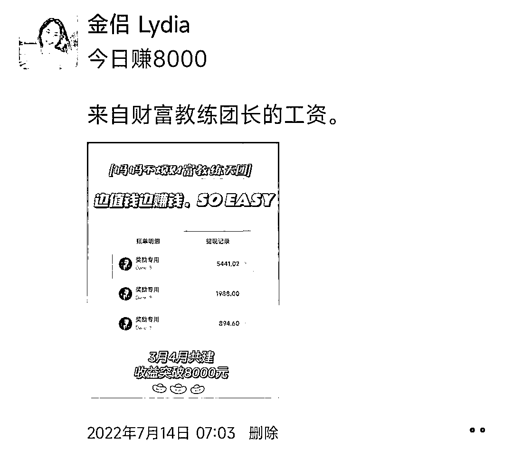

建议：平台兼职赚得可能不多，但能最直接摸清平台的运营模式，还能在输出中倒逼输入、快速成长。先让自己值钱，再谈赚钱。

### 第三种模式：自主运营型副业

第三种更接近个体创业，难度比前两种都大。一个人要撑起一家自运营公司，产品、流量、销售、服务全靠自己。

最初我想靠芳疗专业变现，走的就是这条自运营的路。但我对线上变现缺乏全局的商业思维，单凭固有认知蛮干，没得到想要的正反馈，反而迷了路。

学习之后，为了尽快变现，我换了思路：从现有用户出发，贴近她们，发现她们的多种需求，再去做对应的产品或课程。好比工具箱里多放几样家伙——看见钉子用锤子，看见西瓜用菜刀，摆脱单一工具思维，变现路径多元化，速度也快了，经济压力随之缓解。

补充一下，“锤子思维”指的是：脑子里只有一种工具或方法时，遇到什么问题都拿它去套。从变现角度看，就是产品课程单一，还不肯变。

思维一换，我很快铺开多个知识付费小课，找到了适合自己的最小变现闭环。比如面部塑形训练营、面部瑜伽俱乐部、7天小白赚钱班、妈妈医生小课堂、女性增值社群、21天生命故事写作营、副业项目拆解年度会员、闺蜜星球、视频号启动营等。

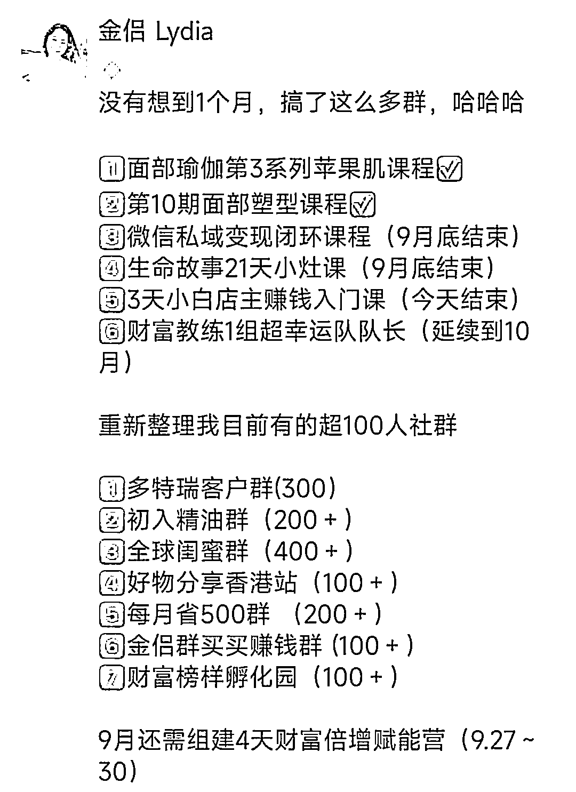

其中面部塑形训练营，我报了别人的课，听了不到三天就同步开自己的招募，边学边教。这个营做了13期，一月一期。多数训练营定价365到899元，同时运转两三个知识付费课，基本我一人操盘，忙不过来时请一个助理，这块带来30万收入。常规安排是荔枝微课加一对一指导、社群答疑、每日腾讯会议教学，每期招20人上下。

建议：这类副业不必等很专业才动手，关键是抓住用户需求——想变美、变健康、变有钱。定价定在客户愿意承受的区间，真心对待每个用户，把课程做细，小步快跑、快速迭代。缺点是极耗时间和精力，而且多数付费课程没有复利。

## Part 3 启动副业的3大基础

### 一、用“爱”找到你的驱动力

龙哥的收藏夹里分享过一篇文章，讲人生有两种驱动力：一种叫愿景，一种叫痛苦。原文说，真正被愿景驱动的人很少，被痛苦驱动的人却很多——大多数人是因为痛了才改变。对我而言，“爱”和“恐惧”就是最原始的发动机。

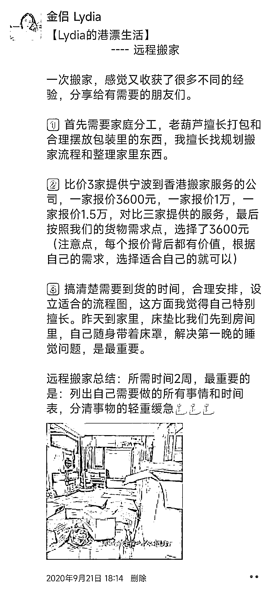

对孩子的爱，让我从宁波搬到香港、辞职做全职妈妈；而对未来经济的恐惧，又逼我在香港开启线上副业。没有爱与恐惧这两股力量，就没有今天的我，我大概会一辈子留在宁波，当个领固定薪水的上班族。如今我在多个副业里扑腾，也是想靠自己的努力，少一点对将来的恐惧，多一点对人生的掌控，守住有“爱”的生活。

我见过不少宝妈，兴致勃勃想做副业，没多久就撂挑子，多半是驱动力不够。看别人赚钱眼热，自己也试，做一阵发现不如预期，就撤了。动手开副业之前，先想明白：我为什么开始？推着我的是爱还是恐惧，是痛苦还是愿景？比如当你想让孩子过上更好的生活、接受更好的教育时，母爱的力量会非常强大。

### 二、用“驱动力”开启你的改变

做副业最难的心理关卡，是不断突破舒适区——改变本身就是反人性的。比如：

身份上的转变。2016年7月我开始做精油推广，一个在外企温水里泡了十年的白领，突然成了精油推销员，遭遇过无数次不解和嘲笑。我父母甚至说：你搞这些偷偷干就好，千万别推给亲戚，太丢人了。

还有学习关。为了把产品推好，只能往专业里钻。于是我开始啃医学、健康管理、植物学这些学科。白天上班，晚上带娃，剩下的时间全泡在学习上——而我原本是个极不爱学习的人。

回头看同龄人，大多有稳定工作、无经济之忧，安安稳稳待在舒适区。能不能迈出舒适区，关键还是内心的笃定和驱动力。所以，请不断给自己加燃料。

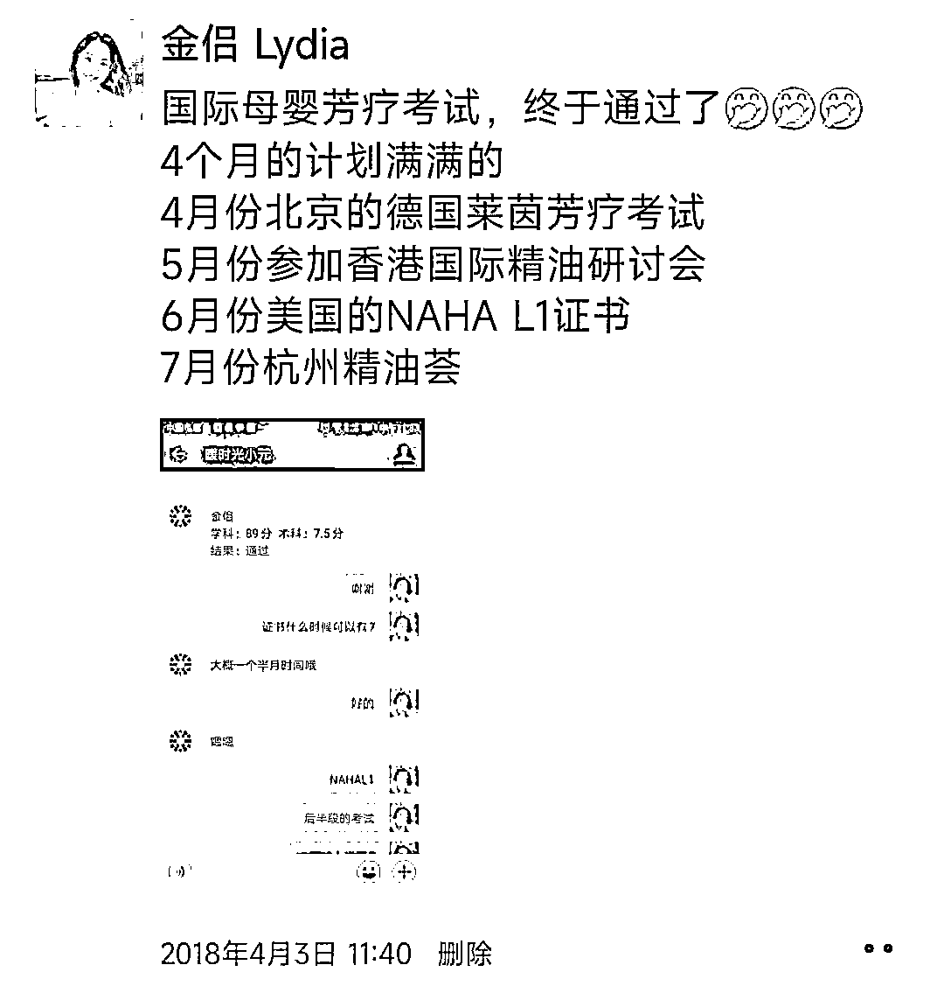

### 三、用“真诚”和“互惠”打通信任

线上副业最难的，是跟陌生人建立信任，再发展出互惠关系。流量其实不难搞，最笨的办法——像我一样——在🛰️群里一个个加人。去年1月我开始报各种付费课，一个月就报了9门。之后私域每月涨300到400人，6月大约6000人，现在接近7000人。

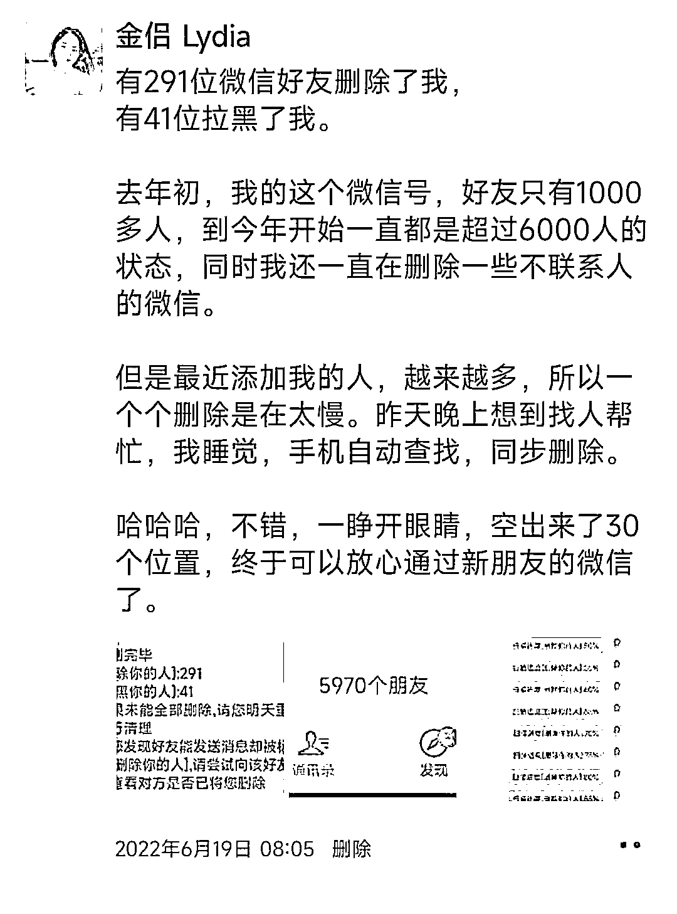

进了🛰️群想扩流量，大家都会加新朋友。通过之后，多数人发一段自我介绍，写明自己能提供什么价值。但普通人光靠一段介绍，很难让新朋友对你产生有分量的信任。而信任恰恰是私域变现的核心。我的办法就两个字：真诚、互惠。

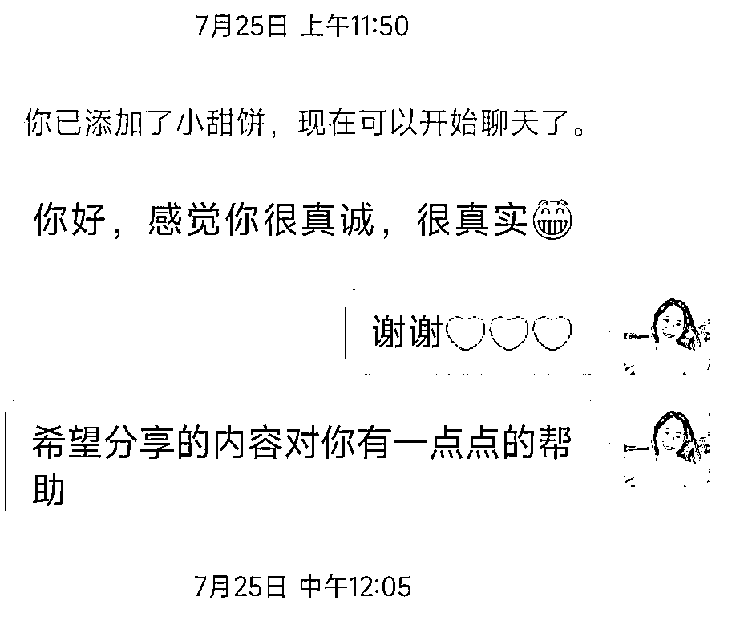

听过水牛和“黑卷尾”的故事吗？水牛在河边慢悠悠吃草，甩着尾巴赶小虫和苍蝇。一种叫黑卷尾的小鸟喜欢落在牛身上，吃牛身上的虫子，累了就在牛背上休息。牛能感觉到小鸟在背上，但不反感，甚至挺喜欢——小鸟替它除虫，还时不时帮它挠痒。黑卷尾和水牛就这样形成一种和谐的依存关系。自然界这种相处方式，就是互惠原理的生动样本。

**先搭桥，再谈生意**

草原上，牛让小鸟有食可啄，小鸟替牛清走身上的虫子，两边各取所需，日子过得相安无事。人类社会里也藏着类似的隐形杠杆：你给别人一点好处，对方心里就记下一笔，总想找机会还回来。这种“受了恩惠便惦记回报”的心理，正是文化中最能撬动人的力量之一。

想让人愿意信你，不妨先挤进一个靠谱的圈子，比如龙哥盟，报名做航海志愿者，踏踏实实替大家跑腿办事。这等于先替信任开了一扇门。

别把“我的项目怎么回本”写在脸上，也别带着算盘去加人。先建立联系，再不带功利地相处，像小鸟与牛那样，自然而然形成互相成全的往来。

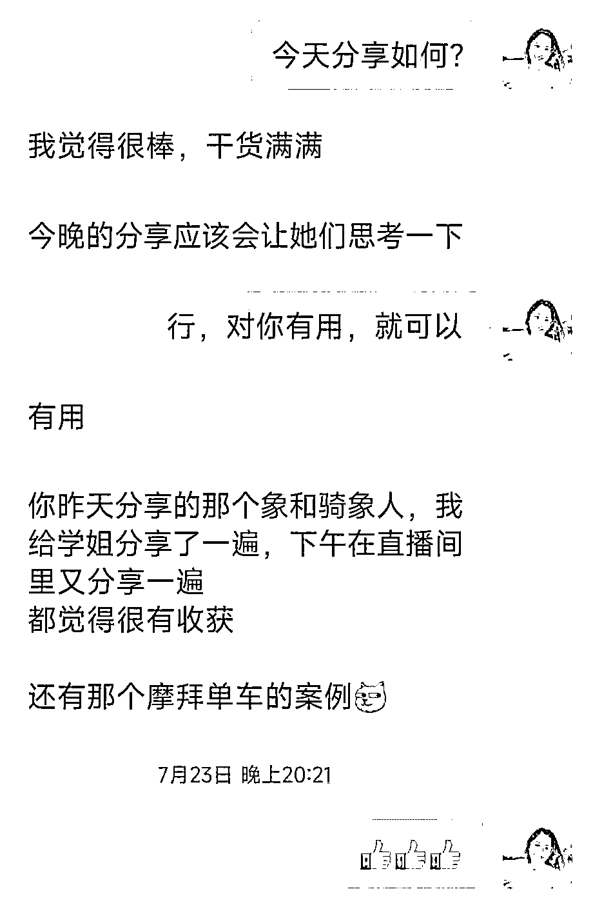

真正推着人往前走的，是心里那个**“WHY”**。当这个**“WHY”**足够响，你才会愿意改变，愿意一次次迈出舒服区；这两点属于内因。

向外看，坦白和实在像一把万能钥匙；但想靠套路换到别人的真心，根本走不通。我的经历也是如此：先拿出真心去连接别人，慢慢织起互相帮忙的网络，再从客户真正需要的东西里筛选副业方向，收钱的路子才逐渐清楚，选择也多了起来。

** —— Part 4 ——**

**女性想靠副业增收，先分清自己要的是哪一种**

手头没有硬技能、暂时找不到热爱、也缺现成经验的人，在琢磨怎么多挣一份钱之前，先得给自己当前阶段定性：你是准备做一门生意、守一份主职、添一项副业，还是只做短期零工？

目标不同，你愿意砸进去的时长、投入的精力、心里的期待值都会变，最后的收获当然也不会一样。

拿我自己说，初到香港那阵子现金流紧张，急着看到收入，最快的方法就是先谋一份固定薪水的主职。

固定工作没落定，我又琢磨用芳疗付费课来收钱，这实际上已经踏上个人创业的路。问题在于我盼着陌生访客立刻成交，以为录好的课程一上线就会有人排队付款；期待脱离了实际，后面自然碰壁，也陷入过迷茫。

后来我调头很快，转向不依赖专业背景的零工与小副业。

要是你眼下的处境与我前一年相似，那就先别在兴趣、情怀、个人长处、市场定位或行业远景上打转。把注意力放回你能碰到的人，从他们真实的需求里挖出收钱的可能，找出自己够得着的信息差。

下面我按三条路来拆解——卖知识、借平台做流量转化、出售服务。这三类对女性朋友比较友好，也正好是我启动副业时走过的路径。

**一、卖知识：现学现教**

前一年，我的线上芳疗课没能带来收入。后来刷🛰️动态，看见一位老师开了面部塑形的线上课，我掏钱报了名。

才学了三天，我就意识到这门课与我通讯录里的那批人很匹配——身为芳疗师，我🛰️中聚集了不少偏爱自然养护方式的女性。

于是我每天在🛰️动态里记录练习进程，把自己的真实变化摆出来，让大家直接看到效果。

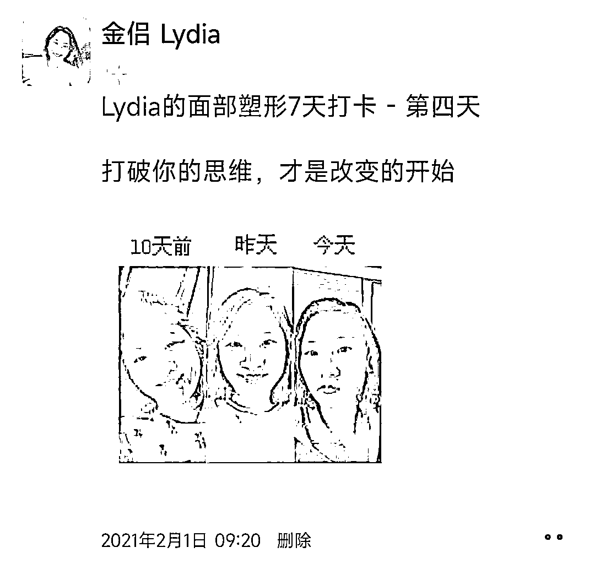

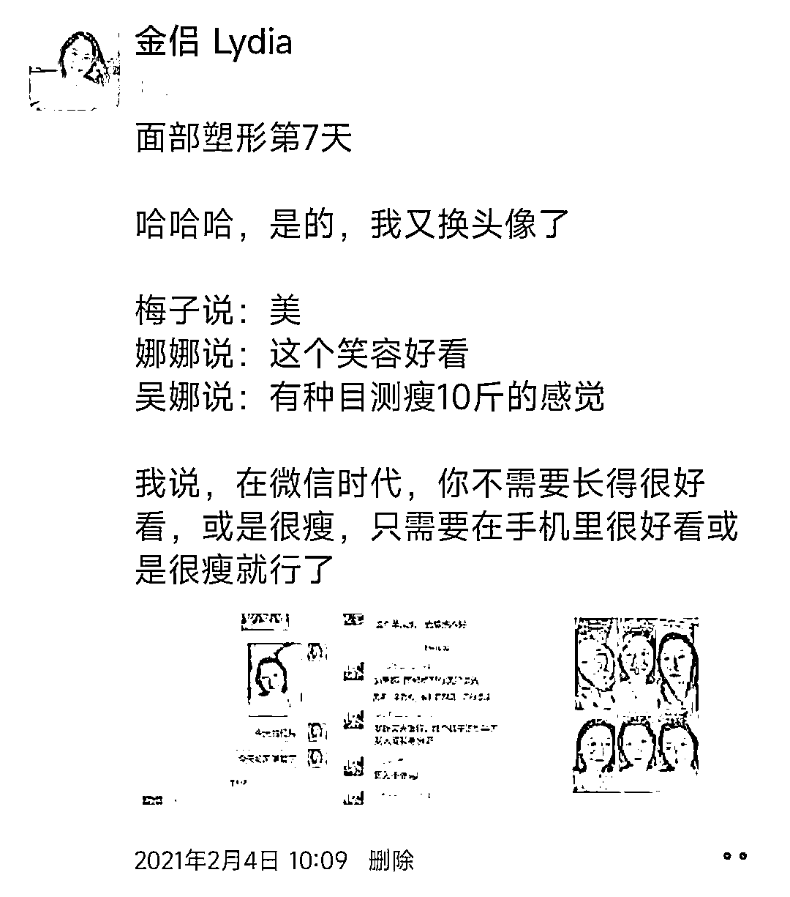

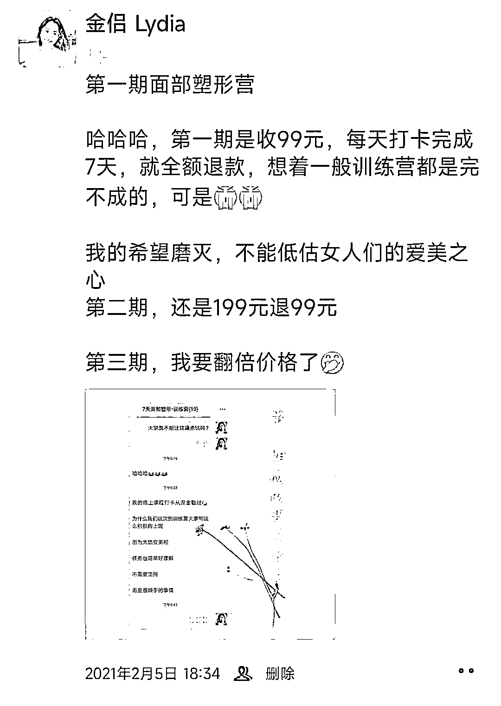

这种“先学后教”的知识生意，门槛不算高，很多一般人都能试；可真要开口收钱，有两道心理关必须先过：

**1.** 🛰️里的熟人大多信得过你，于是不少人卡在“跟朋友谈钱伤感情”这一关。

**1.** 不妨先问自己：我为什么要把所知所会交给身边信我的人？答案通常只有一个——这些东西对他们确实有用。

收费也在做筛选：课程标好价发出去，真正需要的人会主动来；同时，钱一付，双方都会更把这件事当回事，教与学的效果反而更扎实。

**2.** 另一道关是总嫌自己不够专业，怀疑自己能给出的东西不值钱。

我当初的起步办法很朴素：收九十九块，坚持完成记录就把钱退回去；等口碑起来，再一档一档调价。能力还没到火候时，用返还机制先攒下最早那批愿意相信你的人。

**二、借平台：让流量互相导**

时间拉到前一年七月，群买买在🛰️动态里突然火起来。那时我离开香港回到宁波，人还在维也娜酒店隔离。

那阵子我把主要精力押在视频号做直播上，连续播了三十一天，确实攒下一波关注。但我同时发现，卖课程很难形成持续复购，想让收入滚动起来，得找到能让同一批人反复消费的东西。

于是我把群买买当成摸清社交带货平台的一次练手：微商怎么运转、淘客靠什么赚钱、平台规则和佣金规则如何设计，我都顺着看了一遍。

这种跨行补课只花了几天，却把我的思路又撬开一层。二〇二一年八月二日，我正式下场做群买买，把它列为当月重点推进的副业。

我当时的盘算是：不投本钱，三十天若能挣到一千块，这事或许也能复制给其他妈妈。结果首月进账三千，远超预期；如今我带领的妈妈店长团队已接近三千人。

做流量转化最难的一关，是今天推这个、明天推那个之后，自己在大众眼里到底是谁。我的解法是：在公开平台发内容时，赛道要窄、人群要准、标签要清。

但在熟人圈子里，一般人不必把标签钉得太死。比起当只会发广告的“工具号”，你更该露出真实生活里的样子；熟人关系能成交，底层靠的就是信任。

所以我后来换过好几个副业方向，只要别人还信我，而我拿出的东西又能解决他们的实际问题，不同渠道的流量就能彼此导流、一起收钱。

**三、卖服务：把时间卖得更聪明**

卖服务是一般人最快能上手的线上增收方式之一，像社群管理、在线客服这类岗位，培训一个月左右就能接活，眼下需求也不少。

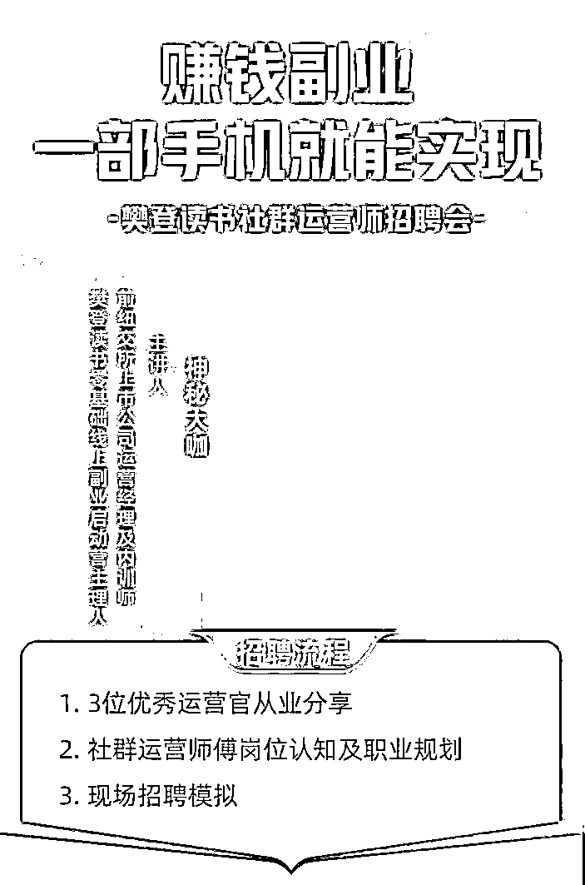

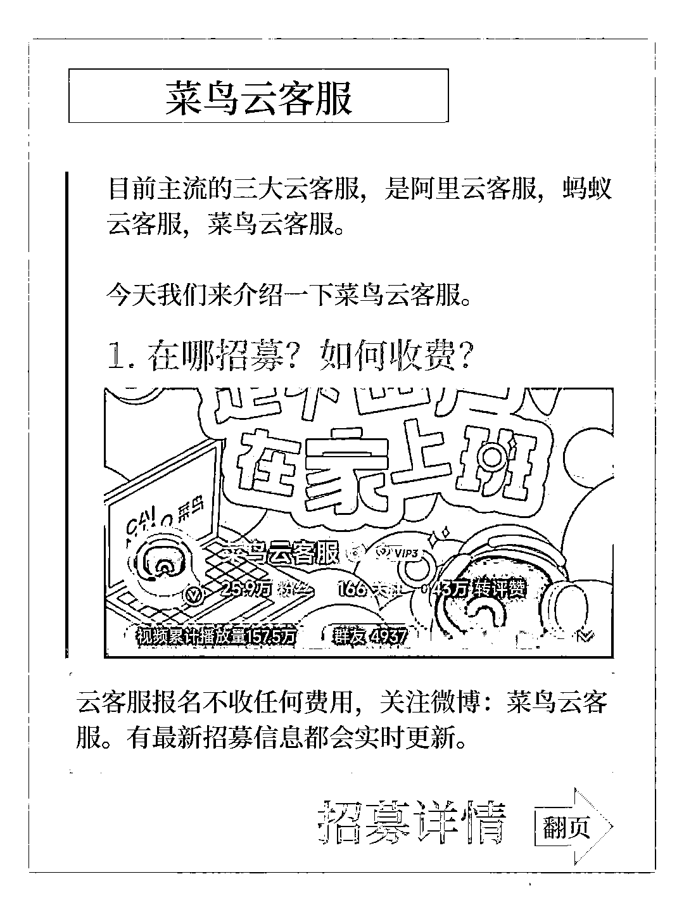

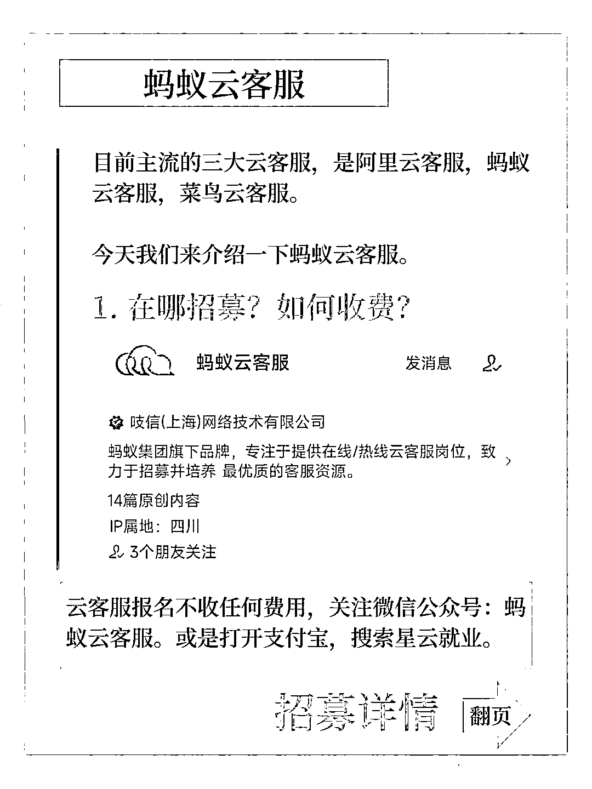

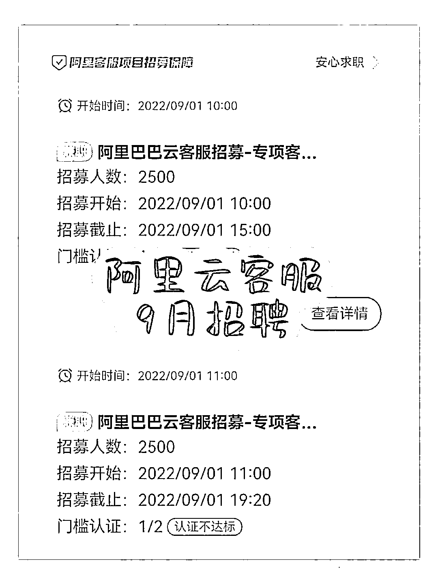

不过它说到底是拿时间换钱，单小时回报有限；做这种活，第一要务是把自己的日程管住。

耗时的零工不适合一直做，却很适合作为副业的起跑动作。

把眼光放长，真正该做的是把精力投向能积累、会滚雪球的方向，并尽量让几份副业彼此借力，而不是各干各的。

妈妈群体的时间和电量都有限，我习惯把不同副业塞进不同的时段，下面是我常用的几招：

**1.** 自己能说了算的时段

我上午脑子转得慢，夜里安静，反而能沉下心处理难活。所谓自己说了算的时段，就是挑电量最足的时候啃硬骨头。

**2.** 把零碎时间捡起来

煮饭时我会放课程当背景音；通勤坐车就处理不用死盯屏幕的事，比如在群里顺手分享好物。

你也可以给手头项目分个类：写👸号这类要整段安静时间；群内卖货可以切碎做；还有些事能并行推进——我就常同时开几个群会，场面相当热闹。

**3.** 给任务排轻重

我手上项目不少，但每件的急迫程度不一样，得按自己的节奏来排。

必要时也要敢砍：前一年我办了许多短期训练营，今年几乎停了，把精力挪到能长期积累的事情上。

**4.** 管好能量，比抠时间更关键

不少妈妈明明有空，却怎么也提不起劲。与其继续挤时间，不如先学会调节自己的状态；在精神最足的时候干最要紧的活，本身就是省时大招。

**收个尾**

先谢谢龙哥盟。今年我是经@走心小姐姐和@醒醒引路进来的，不过这个圈子我早有关注；前一年还曾以嘉宾身份，在香港参加过一次赚钱夜话。

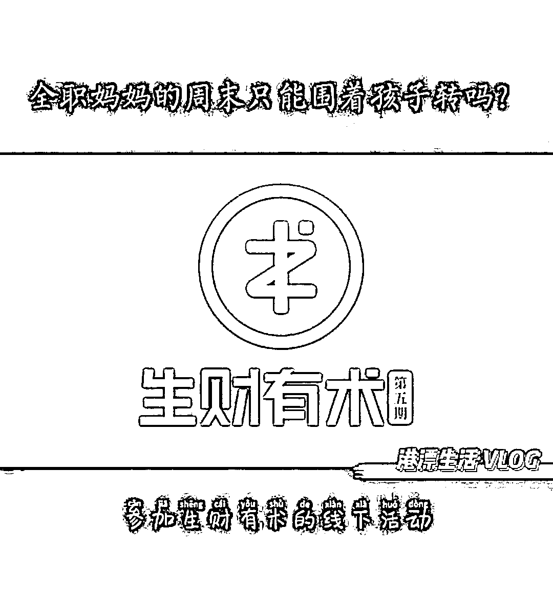

进来之后，我跑了两趟小航海，结识了几位能打的实战派船长和不少靠谱圈友，也补上了对各类副业平台的了解，还收获了一些新鲜的搞钱思路。

到这里，我的经历就聊完了，最后收成一句：从零起步的人，先把时间和力气花在长本事上，让自己形成别人短期追不上的落差。今天踩下的每个脚印，都会在未来显形。

谢谢你读到这里。我也会继续追赶，希望这些内容能给你一点参考和触动。欢迎圈里的朋友来聊，多多连接。

评论区：

凯：赞一个

海程：内容很实在，妈妈群体会有共鸣

葫芦妈妈：收到，谢啦

葫芦妈妈：[玫瑰]

温妮：太强了吧

葫芦妈妈：收到，谢啦

Aron.Li：佩服

阡墨：强[强]