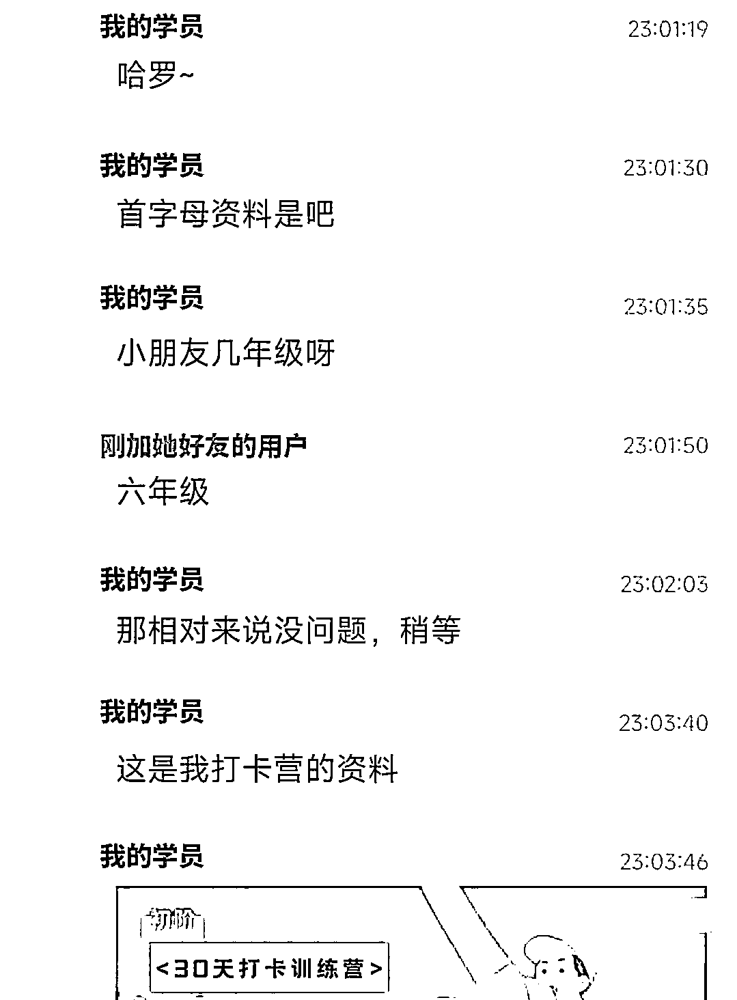
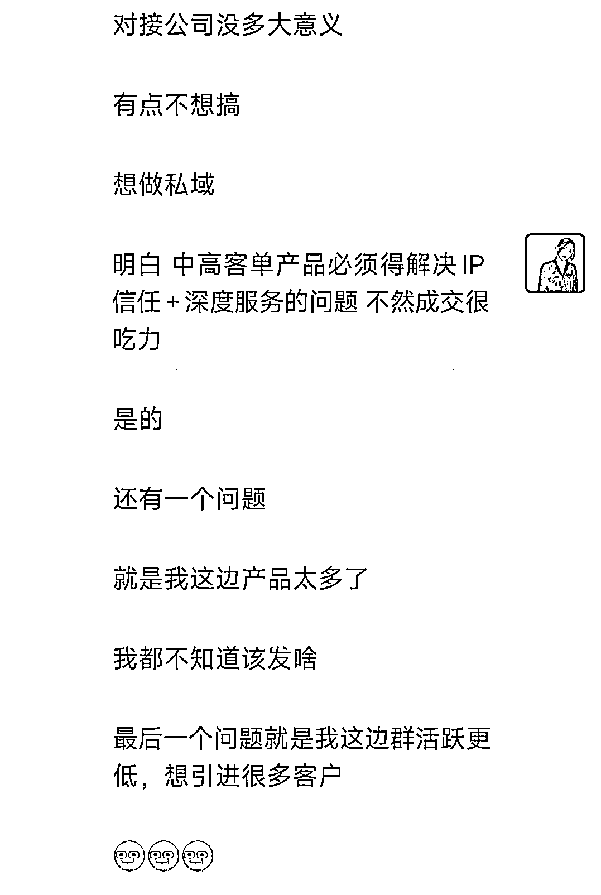
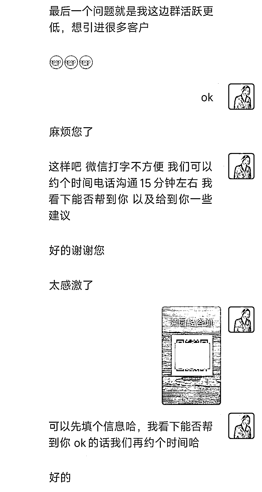
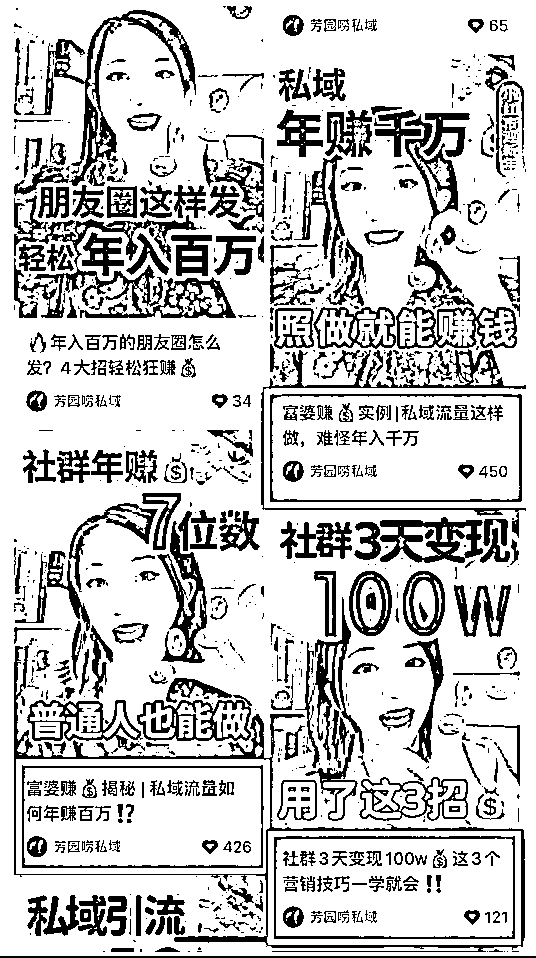
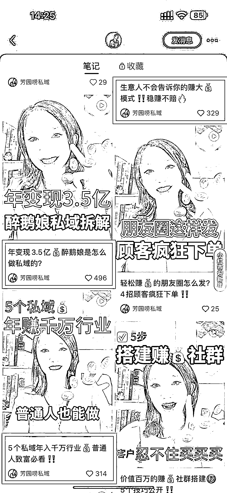
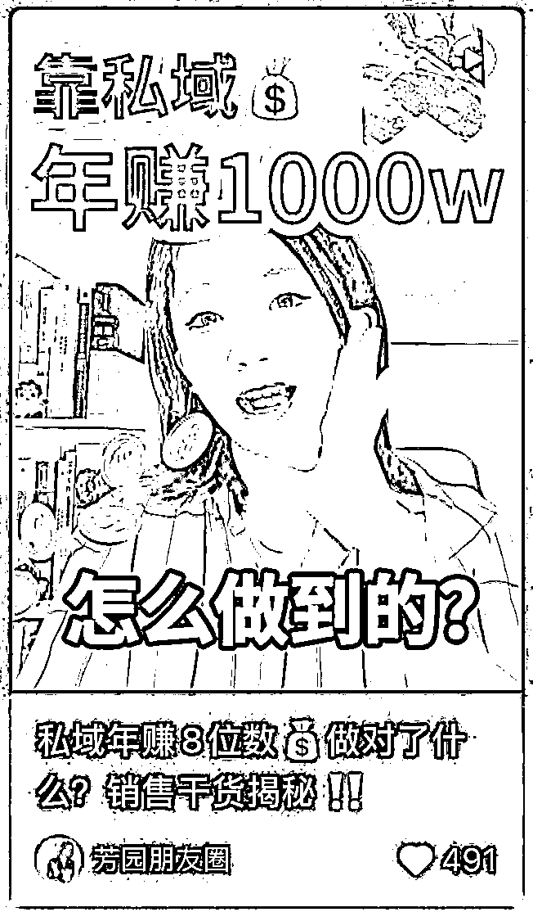
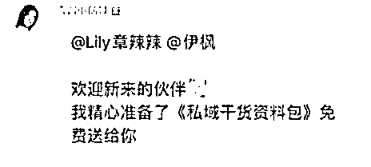
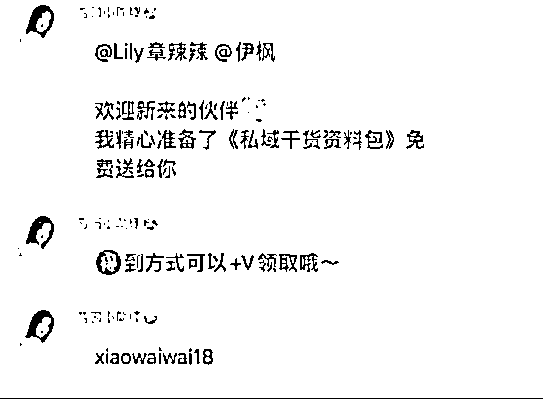

# 4千粉首月入账10万：小红书私域IP怎么做

聊到小红书变现，很多人第一反应是冲流量、涨粉丝。可粉丝量不大，IP怎么把收入做高？账号怎么设计才吸来对的人？人来了靠什么接住？又怎样导进私域完成成交？这些问题，比单纯盯着粉丝数更影响结果。

更顺的顺序是：先把私域里要卖的产品设计清楚，再把承接成交的基础动作搭好，最后才去放大红书流量，把精准用户引到私域。顺序反了，容易白忙。

生财圈的朋友们好，我是芳园，6年亿级私域操盘经验，曾在大厂带近10人团队负责私域业务。2022年4月底，我从某互联网大厂裸辞创业，6月底正式运营小红书，定位私域IP顾问，主要帮创业者做私域变现和精准引流。账号做到4000精准粉，第一个月变现10万，三个月累计20多万。这次就从“粉丝不多也能高变现”的角度，拆解我的做法。

很多人有个误区：只要小红书流量起来、把人导进私域，钱自然就来；还有人觉得流量起来接广告就行。现实是竞争很激烈，起流量本身不轻松。更怕的是流量来了，私域没有成交能力接不住，或者只等广告，那些本来能转化的用户就浪费了。别在私域成交还没跑通时猛冲流量，也别把接广告当唯一出口，否则回款周期会拉得很长。

下面按三个环节讲：怎么设计私域产品、流量来了怎么快速成交、小红书怎么精准引流。

## 一、先设计好私域变现产品

先问一句：标题写着第一个月变现10万，如果我卖的是几十块、几百块的课，对一个刚做自媒体的人，可能吗？几乎不可能。所以第一个关键：手里要有高利润产品。

只靠低价品，不行。只靠低价品，真的不行。只靠低价品，尤其在你用户还少的时候，更不行。

用户越少，越不能只靠便宜货。人少还只卖低价，很难赚到大钱。

我当时设计了3款付费产品：

1V1咨询500元；  
28天训练营1980元；  
全年私教9800元。

起步阶段，价格就不低。实话是，我重点卖的是9800元私教，这也是首月能冲到10万的核心原因。

高利润产品怎么设计？做知识付费，别只停留在训练营、1V1咨询这类中低价，也别只卖几十几百的课。它们的主要任务不是贡献利润，而是建立信任：让客户先体验、感到超预期，认可你之后，再购买更高价产品。

所以，在中低价之外，可以增加私教、私董、弟子班等高客单产品。私教常见周期和价格：2个月3980元；3个月4980元；6个月6980元；一年9800元或12800元。不必四档全上，选1到2档即可。每个人赛道和交付能力不同，这只是参考。私董、弟子班更适合已有成功案例的人，这里不展开。

产品结构建议分三层：引流产品、信任产品、利润产品。

举三个行业例子，只作参考，不局限于此：

知识付费：引流品可以是免费资料、9.9元公开课、99元年度会员、知识星球等，用来当钩子并建立初步信任；信任品可以是1V1咨询、训练营、年度付费社群等中价产品，体验超预期后更愿意买高价；利润品是私教、私董、弟子班等高客单，真正贡献利润，不能缺。

我自己的三层是：引流品为免费私域干货资料包、15分钟轻咨询；信任品为500元1V1咨询、1980元28天训练营；利润品为9800元全年私教。

零售如护肤品：引流品用小样/中样体验装，既引流，体验不错也容易转正装；信任品用面膜、面霜等口碑爆款，体验超预期会回购，也愿买更高价；利润品是精华、套装、胶原蛋白肽等，利润高且容易周期复购。

微商如减脂：引流品可用小样/中样，或99元减脂打卡营，入营得体验装，社群分享减脂干货，用户完成30次一日三餐减脂餐打卡可退99元，还能拿赠品，买正价产品可带走赠品；信任品是减脂套餐，成交后给针对性指导，体验好可能升级更高价甚至代理；利润品是代理、事业合伙人，是主要利润来源，也该重点投入精力。

总结5点：

（1）流量有限又想高变现，必须有高利润产品，不能只卖低价；  
（2）产品要分引流、信任、利润三层；  
（3）引流品负责当钩子，并让客户建立初步信任；  
（4）信任品让客户体验后觉得超预期，愿意买更高客单；  
（5）利润品真正贡献利润，不可或缺。

## 二、流量来了，怎样快速成交

这里重点讲高客单产品如何快速成交。

刚加好友的人，信任很弱。你不了解他，他也不了解你，不可能一上来就成交。钱不是天上掉的，人也不会轻易掏。

我常看到学员发来聊天记录问：“老师，我是不是说错话了？对方怎么不理我？”一看记录，聊没几句就报价、推产品。给大家看一张学员聊天记录：

看完什么感受？你会马上掏钱吗？大概率不会。需求没摸清，价值没给到，信任没建立，直接推产品还指望付款，很难。记住：报价和推产品，要放到最后。

正确思路是什么？以小红书引流来的用户为例，讲高客单私聊成交。

先判断对方是不是潜在精准客户。当下不是，就别耗太多时间，放在微信里，通过社群、朋友圈、直播慢慢养，未来可能转化。

怎么筛？我引流前会准备一个引流品，比如免费送《私域干货资料包》，作为加好友的理由。通过后先问：“某某你好，你是想领免费资料，还是想了解私域、引流相关项目？”对方通常说先领资料。若一上来就说想了解项目，通常两种可能：非常精准，要重点维护；或是同行来打探。

接着问：“你目前遇到什么困难？我看哪份资料更适合你，资料类型不同。”对方一般会说困难。从他的回答判断你能不能帮到他、他是不是潜在客户。

如果帮不了，直接把资料发过去，之后靠朋友圈、社群、直播养着。

如果能帮，就给一个大概方向，注意只给方向，不给具体解法。目的是让他产生好奇，想进一步了解。若直接给具体方案，他会有获得感，觉得已经拿到答案，就不咨询了。这点很关键。举个例子：

给了大方向后，对方往往想知道具体怎么做。重点来了：别继续在微信里聊。第一个月做到10万，主要靠这招。用好它，高客单成交就成功80%。直接约电话。

为什么？信任建立深度大致是：见面>直播>电话>私聊。电话比文字私聊更容易建立信任。注意，这是高客单成交方式；如果产品只卖几百、千把块，不必电话，因为时间成本高，利润低不划算。具体看个人情况。

还是用刚才聊天举例：

给完方向，我会说：“这样吧，微信打字不方便，我们先电话沟通15分钟左右，我会给你一些相关建议。”然后让对方填问卷。问卷很关键：一方面筛掉不符合要求的人。连问卷都懒得填或乱填，基本不会付费；填了信息发现不是精准客户，也没必要电话。比如我不接负债客户，对方填了负债，我就不继续聊。

可以这样回复：“亲爱的，很抱歉，看了你填的信息，我暂时帮不到你，实在抱歉。送你一份资料表心意，我们保持联系，或许以后有机会帮到你。”

如果初步确认能帮，就约15到30分钟电话。

电话成交的核心做法：建议用飞书或腾讯会议约视频，你开摄像头。效果更好：露脸能加强信任，也方便录制复盘。

三个关键步骤：

第一步，提前准备。根据私聊和问卷判断对方问题，提前准备相关建议。仍然只给大概战略方向，不给具体解决方案，否则对方会觉得不必付费。

第二步，了解需求。虽然私聊和问卷有初步了解，但还不清楚具体情况。电话里补充提问，一方面更了解他，便于给建议；另一方面让他回忆，放大痛苦和需求。

第三步，给建议。对方讲完痛苦和需求后，给大方向建议，同时强调痛苦和好处：不解决会有什么后果，解决后能得到什么好处。

比如结合截图可以这样说：丽丽，你当前最该先解决的是用户信任问题。你现在直接在群里推商品广告，用户信任感很差；如果继续只推商品，信任会越来越低，业绩很难起来。反过来，如果信任问题解决，用户会更关注你推的商品，更容易被种草，成交自然更顺，业绩也能上去。这里最好称呼对方昵称或姓名，更容易拉近距离。

对方认同后，再说明你能如何帮他解决，并可举2到3个成功案例，增强吸引力和信任。注意：对方没进一步问产品时，不要急着介绍产品，否则推销感重，对方会防备。

等对方问产品，或问如何得到你的帮助，再介绍具体产品。以上是电话销售三个关键步骤。

做好这些，爽快客户可能当场购买。但多数人不会那么快决定：价格不低，刚加好友，信任还不够，当下拍板不容易。

接下来关键动作是回访。电话成交的客户里，约70%是通过回访成交的。电话结束后，对方需要时间思考：到底需不需要？你是否值得信任？所以要在电话结束15分钟内，趁热度还在，微信私聊发成功案例、个人故事、销售信（产品介绍）。这能进一步帮他了解，加强信任和需求。

如果当天没决定，第2天回访，选对方休息的时间，比如中午或晚上。注意，别问“你考虑得怎么样了？”这是大忌，会让对方觉得被推销，产生抵触，很可能前功尽弃。

第2天回访要再次提供价值，放大痛苦和好处，最后留钩子。回访公式：进一步提供价值+放大痛苦和好处+留个钩子。

建议发语音。之前电话沟通过，信任感更强，发语音不容易反感，反而拉近距离。

话术示例，不逐句发：“丽丽，昨天沟通后我又想了想，你这个情况，第一步建议先把社群内容安排优化好。现在社群里全是广告，以目前情况，内容安排不优化，很难成交客户，这也是成交率低的重要原因。”

“但如果你先把社群内容安排好，客户看了种草内容会更心动、更想买，成交率会明显提升。内容优化好，再重点做活动成交，变现速度会快很多。”

“我这里有一份社群运营资料，需要的话我发你参考。”

然后等回复。至少90%以上会回。剩下10%没回，可能忙忘了，也可能电话后完全没兴趣，不用在意，说明当下不是目标客户。

对方要资料时，发给他，再说“有问题随时联系我，我可以给你一些相关建议”。这是在处处埋钩子：资料发过去，他看完可能再次心动。资料也要设计，除了干货，还要放成功案例、产品介绍、微信二维码。你又说了随时联系，他再来找你，就重新建立沟通机会，也就多一次成交机会。

如果客户有顾虑，不敢直接买高价，可以退一步，先让他买中价甚至低价产品，逐步培养信任，再成交高价，这叫“环环相扣”。

更好的成交布局是：日常先筛潜在客户，低中价产品直接私聊成交，高价产品电话成交，再定期做直播成交、批量发售，这叫“多线布局”，变现效果更好。

总结5点：

（1）刚加好友信任弱，不要一上来报价；报价和推产品要放最后；  
（2）新用户先筛选是否潜在精准客户，是精准客户才进入下一步；  
（3）筛出精准客户后，用电话成交，成功率更高；  
（4）电话沟通后要创造下一次沟通机会，电话成交约70%靠回访；  
（5）回访公式：进一步提供价值+放大痛苦和好处+留个钩子。

## 三、小红书如何精准引流

这个题目很大，篇幅有限没法全讲，但这次分享一个更有用的大招。掌握后，你做小红书的引流效果会比别人好10倍以上。我就是靠它，小红书4000粉引了近1000人到微信。很多没掌握的人，哪怕做到4万粉，引流数量和精准度也不如我。

具体有3个关键步骤。

第一步，小红书选题要能吸引精准用户。像我的账号：

这些内容目标受众喜欢，所以转粉率、引流率都高，也更能带来精准客户。当然，可以有20%到30%的笔记蹭热门话题做流量，或讲个人故事做人设；但至少70%的内容要垂直，要吸引目标受众。

第二步，怎么写出容易爆的短视频文案？以干货型短视频为例，在选题吸引精准用户的基础上，文案要给用户带来新认知：要么知识点颠覆他以往认知，要么方法是他此前不知道的。这个很重要。如果你讲的东西他以前听过，他很可能不感兴趣；如果你给的是非常具体、能直接拿去落地的方法，他会很有获得感，忍不住收藏关注。

比如我有篇视频笔记讲“私域年赚8位数，做对了什么？”

里面分享了3个方法：

第一步，每个销售每天至少找50个客户聊天；  
第二步，每条朋友圈，都必须有用有趣有共鸣；

这次先拆到这里。先别急着追粉丝量，把产品梯度、私域承接和精准选题这三件事连起来，粉丝不多也能把变现跑顺。

小红书低粉高变现：引流三步

先看第三步的一条底线：如果某条内容你自己都不愿意发到朋友圈，那它也绝不该出现在客户的朋友圈里。

这三步之所以管用，是因为每个动作都足够具体，连话术都替你备好了，用户可以照着参考，干货获得感会很强，自然更容易收藏和点赞。

接下来这一步极其关键：当目标受众已经注意到你的内容，怎样让他们愿意加微信？不少人的引流效果差，问题就卡在这里。不绕弯子，直接给答案。

眼下在小红书，最稳妥、效果最好的引流渠道是群聊。群聊里直接放微信号同样安全，不会影响账号；所以一定要建群，并在群里把用户导到微信。若是通过私信发微信号，账号很容易被封。那群里具体怎么操作？下面三步很要紧，很多人正是没做好，效果才不理想。

第一步，先准备一个目标用户感兴趣的钩子。比如我的钩子是免费送《私域干货资料包》——我知道不少读者就是冲着这个资料包来的，哈哈。

第二步，有人进群后，第一时间@他并欢迎。原因很简单：每个人都希望被看见，被@后会产生好奇：“我被@了，去看看”，注意力就被你带过来了。为什么必须第一时间？若隔几天才邀请进群或才@，对方早把你忘了，加你的兴趣也没了。昨晚分享也提过：用户刚加你时，是对你兴趣最高的时候；同理，用户刚关注你时，也最愿意了解你。

话术示例：

第三步，关键来了，比第二步还要紧。我有个学员过去引流效果很差，症结就在这一步；后来我帮他把这一步优化，引流效果直接翻了3倍以上。具体做两件事：

（1）明确告诉他：想拿这份资料，需要加微信。你不说，很多人根本不知道，别让用户猜你的心思，大家没空。
（2）把微信号单独发出来，方便复制粘贴。这一步是重中之重。很多人引流效果不好就败在这里：把带微信号的图文笔记扔进群，或把微信号写在图片上再发群，让用户去微信里一个字母一个字母手动输入……结果不少人嫌麻烦就不加了。你又不是大咖，别人凭什么为你费这个劲？所以，让用户省事很重要。下面是我群聊引流的完整话术，供参考：

总结三个关键点：
（1）小红书选题要能吸引精准用户，内容配比可参考：约七成做垂直内容，牢牢抓住目标受众；约两到三成蹭当下热点拉流量，或用个人故事立人设。
（2）写出容易爆的干货短视频文案，抓两点：①给用户新认知，别老生常谈；②方法要非常具体，能直接拿去落地。
（3）群聊是当前小红书最稳妥的引流方式：用户进群后第一时间@他，用他感兴趣的钩子明确说明加微信号即可领取，引导加微。

以上就是我结合自身变现案例，对小红书“低粉高变现”三大步骤的分享。按这三步执行，你的私域变现价值有机会放大N倍以上。

谢谢你看到这里，希望有启发；如需咨询、合作或深入交流，欢迎联系我。

评论区：
强哥手记：写得太细了，必须点赞。想问：1）小红书目前更新频率怎么安排？2）这类目标用户视频如何批量生产？
强哥手记：怎么联系你？特别棒
金彩：能留个联系方式吗？
小花：太良心了，马上去关注你小红书领资料[呲牙]
芳园朋友圈：谢谢老铁支持。这两个问题得看具体赛道，不同赛道差异不小。
芳园朋友圈：我的 v：xiaowaiwai18
芳园朋友圈：哈哈，谢谢[呲牙]