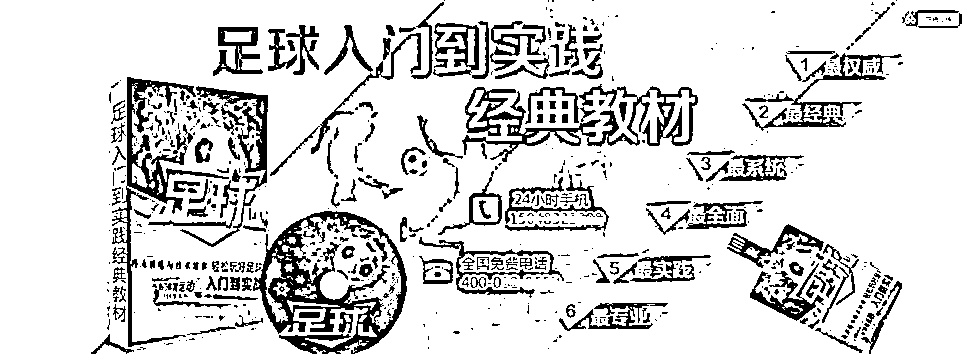
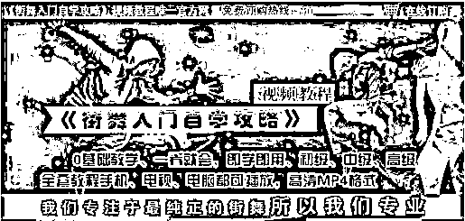
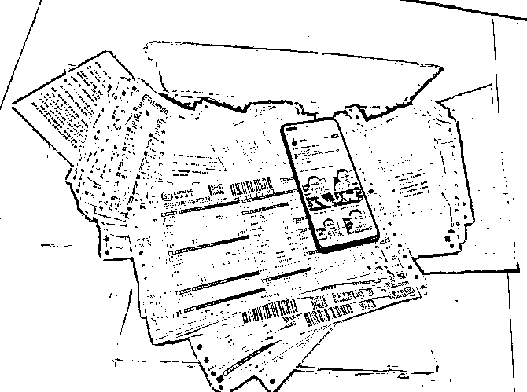
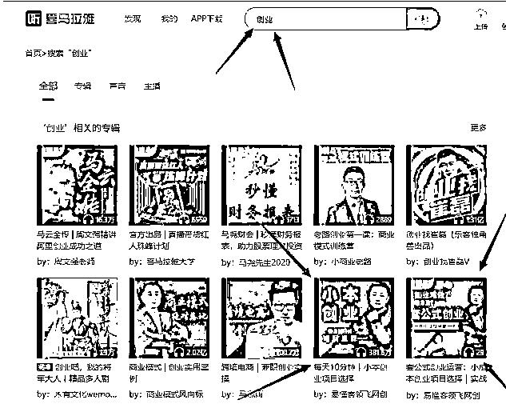
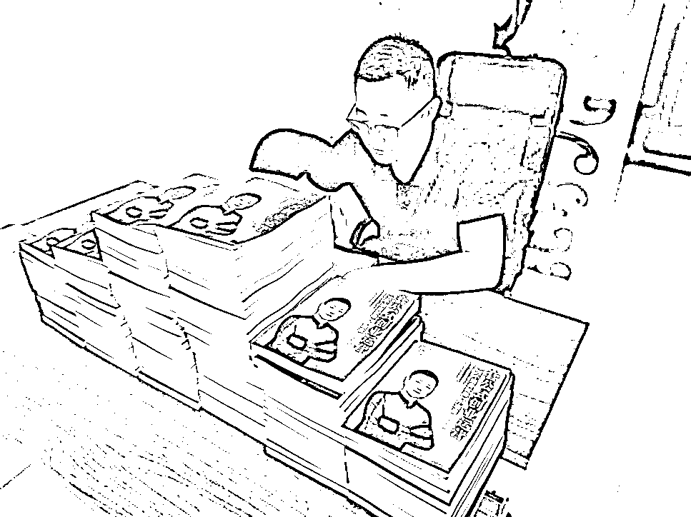
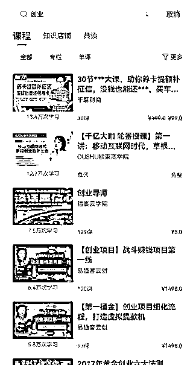

# “教人赚钱”这件事，我从矿工做到了八位数

我是领飞。这篇文章的目标读者，是想通过输出“赚钱类内容”做出一番成绩的人。我在赚钱潜水近一年，眼看会员快到期，终于决定把这几年的经历写下来。文字水平有限，大家多包涵。

简单介绍：我原来是国企煤矿的普通技术员，辞职后一个人折腾六年，靠做“教人搞钱的内容”积累了约800万。没有团队，启动资金也只有五万。

## 一、安顿好家庭，再放开手脚

大学毕业，我被分回老家的煤矿（现在叫国家能源），当一线区队技术员。每天清晨五点半赶通勤车，晚上七点到家，大部分时间待在井下300米的地方，一干就是三年。这活儿听着稳定，可也真危险——我有两次差点没能从井下上来。

也就是这两次经历，让我决定先把人生大事办了。于是结婚，存款五万，房子没有贷款，开始盘算辞职创业。（老婆搞定了，后顾之忧解决一大半。）

## 二、先活下来，再谈做大

那时我完全不懂创业，在百度上搜“1万元如何创业”，刷到一个讲“百度产品竞价”的帖子。那个年代还没有自媒体，信息渠道很少。我联系上发帖人，进了他的🐧空间，看到他做的发单视频，一下子被吸引，交了3000元学费。

做竞价需要会建网页、写产品文案、做宣传广告，我几乎从零开始。好在师傅靠谱，通过🐧远程协助一步步带我。但我那时候太心急，总觉得交了钱就该马上来钱，没少让师傅头疼。

后来的半年，我基本宅在家里，研究产品、收集资料、搭页面，做了一大批“数字教程”：30天足球教学、零基础90天钢琴、修车技术大全、小白理财、街舞、太极拳……前前后后50多款，内容大多是网上整理来的。

 

这些页面早已被淘汰，就不拿出来了。

一个很重要的心得：只要肯整理，就能帮懒人省时间，这就是价值。

我后来摸清了师傅的产品方向，他当时专注“小吃教程”。这也是我一上来就做教程的原因。放到今天看，这就是卖知识、做虚拟产品。

第一单是【30天足球教学教程】，卖了300元，去掉竞价推广费50元、邮寄费23元、U盘10元，再扣掉3%的货到付款服务费，还剩利润。这个品属于冷门细分，单量不大，成本很低。后来其他课程也陆续出单，月入5000左右，能糊口了。

有了这点成绩，我开始疯狂尝试各种网赚项目：电影资源👸号、淘宝虚拟、朋友圈看广告赚钱程序、卖🛰️群、套利、微聊、脚本引流……报了很多课，踩了很多坑。也总结出一句话：虚拟变现去山东，电商去杭州，套路去广州，竞价去福建，讲师去深圳。

后来我投过实体店、开过公司，但真正让我完成原始积累的，还是靠卖内容赚钱这条路。

## 内容变现为什么值得普通人做

先看几组数据：2021年抖音知识类内容官方收入30亿，2022年预计到100亿；如果把其他平台也算进来，2021年整个市场的盘子有675亿。而电影票房才472亿。这说明大家越来越愿意为“学到东西”花钱。

大环境一般，投实体不容易见效，卖内容反而是门槛低、上限高的赛道。做法也不复杂：找准人群、持续搞流量、然后卖课。其中，“教人赚钱”这类内容又是所有知识类账号里最容易上手的，因为大众的焦虑大多和钱有关。你天天讲赚钱机会、赚钱案例、赚钱方法，吸引来的粉丝天然有付费意愿。能沉淀1000个想创业的粉丝，再去找个项目合作或出售，生意就成立了。

草根没有产品不要紧，要会借鉴、会对标、会“拿来主义”。课程、培训、社群、资源、线下沙龙、加盟、资源对接，客单价可以从9块9做到9万9。

下面按年份，把我的真实账本摊开讲。

**2015年**，我花2000元请一位刮腻子的师傅拍了套教程，靠百度SEO竞价跑了两年，进账40万。后来我又陆续挖了不少类似需求，现在还有两个产品在跑SEO，具体类目不方便说，怕给自己添对手。

利润从哪来？想学技术、靠手艺吃饭的人。

**2016年**，🛰️营销正火。我整理了一本《实体店🛰️营销秘籍》，扫街30天，🛰️里加了4000多个实体店老板好友，再配上电子书、教程和微营销软件，卖了10万。这个玩法放到抖音时代依旧成立，因为线下的小白群体真的很多。

利润从哪来？想学营销、扩大生意的人。

**2017年**，POS机和办卡业务很热。我把《信用卡技术，POS机金融实战秘籍》整理出来，送给之前沉淀的4000多位老板，顺手推了我代理的POS机，靠手续费分润赚了一年好钱。

利润从哪来？自有流量池。

**2018年**，社群淘客兴起。我花3000元做了个程序，可以一件转发淘宝天猫商品，也支持无货源开店。然后去学校门口扫码送礼，先圈了1000个宝妈，再裂变成8000个本地宝妈。靠卖软件、卖代理、接本地广告、谈商家联盟变现，最后整个盘子被本地一家公司收走了。经验是：先找能切入人群的产品，再扩展模式。

利润从哪来？想做副业的人。

**2017到2018年**，我同时在喜马拉雅FM发创业音频，从免费社群做起，社群费从498元每月涨200，一直涨到4980元，前后带了1000多个学员。账号到现在仍是创业板块前十。

**2019年**，我给👸号粉丝推荐了趣步、粉像生活等赚钱APP，三年下来被动收入不断。其中趣步没投一分钱，赚了50多万。还有个插曲：一款棋牌APP有五级线下收益，我当时没太在意，也不想让粉丝沾赌博，只轻描淡写提了一嘴。结果一个学员操作半年赚了80多万，他说如果当时把我的推荐码放出去，我也能跟着赚几十万。

利润从哪来？自有流量池。

**2020年**，疫情让我静下来，把经验和教学方法写成一本10万字的书《套公式创业运营》，核心理念是一万个项目背后往往是同一个底层逻辑。随后录成80节课，铺满网赚圈，不断带来创业流量，我再顺势把过去几年录的几百节课拿出来卖。千聊上，我的课长期排在创业板块前十，官方也来找我合作。

利润从哪来？内容分发带来的被动流量。

 

**2021年**，我休整、调养、陪家人。

利润从哪来？不焦虑、不缺钱、有能力持续赚钱。

**2022年**，很多人都在做抖音“商业IP影响力”，我盯上的是抖音“SEO内容分发”。前者太拥挤，后者还有蓝海空间。具体玩法以后细聊，赚钱已经有大咖分享过，可以考古。

回看这几年，我的原始积累基本都来自卖内容，只是每一年的人群需求和平台风口不同。每一次变现，我抓的都是人们“想赚钱、想创业”的念头；每一次产品，都是虚拟知识服务，成本可控，符合以小博大。

我的粉丝量不算多，公域加起来大约10万，成交主要靠私域。最好的记录是1000个主动加来的好友，变现60万。

当然，我也栽过跟头。2019年，我和一位书法老师合作推广“教孩子写好字”课程，我出流量，他出技术，还授权卖代理。后来他售后跟不上，方案也不落地，合作不欢而散；2020年疫情又重创教培，我的信用危机就发生在那一阵。细节不展开，创业没有不踩坑的，关键是长记性。

再看几个公开案例：

商业小纸条，抖音千万粉，每天讲创业案例，靠推自己引进的项目变现；

名正言顺，同样千万粉，讲别人的创业故事，广告、带货、项目嫁接都做；

李一舟，抖音130万粉，每天讲抖音运营，卖课做到上千万，但他讲的内容很多博主都在讲。

这些人的共同点，不是创意多厉害，而是内容持续输出，积累了信任他们的粉丝。有了人，变现是水到渠成的事。你分享内容，本质上就是在运营一个项目。

无货源抖音小店是项目，你教别人卖货；
书单号是项目，你教别人卖书；
抖音起号是项目，你教别人做号；
而“教人做上面这些”也是项目。

区别只是产品不同、受众不同，但引流和成交逻辑一样。所以做这类账号，既是项目，也是你拿得出手的成功案例。

做内容赚钱，这个行业名声两极，因为有人收了钱不交付，才被骂“割韭菜”。我不是鼓励大家当镰刀。价格由价值决定，价值靠交付力撑着。你可以把流量对接到交付能力强的产品上，自营或合作都行。

运营这类账号的好处有三点：

**第一**，每天接触创业项目、营销技巧和赚钱信息，相当于刻意学习，认知会越来越完整，也能避免乱投资交智商税。省钱就是赚钱。

**第二**，持续输出内容，会沉淀越来越多精准粉丝，等于用一件事练会了获客。

**第三**，积累一个粉丝鱼塘后，无论做什么项目都不缺买家。先有人，再变现，稳扎稳打。

过去很多人创业是先砸钱，再找客户。对没经验的人来说，钱和时间都容易打水漂。而做内容，主要投入是时间，本金还在。有流量、会营销、能持续获客的人，赚钱概率更高。花100万开店，一年未必赚回100万；不投资放银行，一年也有20万利息。花360天精力做内容，可能零成本赚20万，也可能远不止。

所以，草根创业只需要掌握一招：“拿来转售”。项目不用自己造，有了粉丝，可以去合作、去买断、去嫁接，甚至把别人验证过的东西拿来推。市场上永远不会缺项目，缺的是愿意买单的人，而做内容就是在聚拢这些人。

客源怎么来？同样是整合。全网有海量创业内容，你用自己理解重新表述，观点自然变成你的。信息差不会消失，你说出去的，就是你的积累。

## 为什么要做这类账号？多久能赚钱？

这是两个问题。

先回答为什么。

这类账号本质是建立个人商业品牌。商业IP偏重策略、模式、宏观；创业IP偏重项目、渠道、实操。两者边界并不清晰，取决于你怎么定位。比如我可以什么都讲，也可以只讲开店、抖音、闲鱼、自媒体、写文章、拍视频、地推。

项目跟着趋势走：抖音小店火就讲小店，知识博主火就做知识，闲鱼无货源火就说闲鱼。内容先发出去，比什么都重要。

举个例子：你每天只拆解抖音那些赚钱账号——这个视频为什么火，那个博主打法是什么？很多大号就是这么干的，把别人跑通的案例改成自己的内容，这就是“内容拿来主义”。普通观众没有精力深入分析，你帮他们提炼出有用的赚钱信息，他们就会关注你。有了粉丝，再去找案例中的博主谈合作，把他们的项目推荐给你的粉丝，变现自然发生。

这样，你每天只需要做两件事：输出内容，沉淀粉丝。内容越多，粉丝越多，慢慢你就是大V了。

个人IP放大还有很多方法。比如把抖音粉丝引流到🛰️，再配合👸号、视频号、搜一搜，形成闭环。👸号有1万粉，还可以找同行互推，流量池又大一圈。人群足够统一，全是想赚钱的人，什么项目卖不出去？

所以做这类账号，可以让你不再为项目、投资风险、长期方向发愁。

再回答“多久能赚钱”。

我第一年为了快速成长和增加曝光，每天至少发3条内容，全年1095条；同时每天看50个同行，一年下来有18250条信息进入大脑，再经过筛选、优化、排除，才逐渐有了今天的判断力。

每天投入多少时间，完全由你决定。一天一条和一天十条，粉丝增长速度当然不一样。内容量决定曝光，曝光决定粉丝，粉丝决定成交。

价格线在我身上是这么走的：0到198，再到498、1298、2498、3689、4980、9800。这条路我走了好几年。所以别总问带你的人“多久能赚钱、能赚多少”，先问问自己：现阶段有什么能力？愿意付出多少？会不会坚定走下去？

没有不赚钱的生意，只有不成长的人。搬砖和当老板的差距，最终是个人能力的差距。

这篇内容算是对之前文案的重新整理，谈不上完美，但应该把卖内容赚钱的逻辑讲清楚了。希望能认识更多同路人，也感谢赚钱这个平台，高手很多，我一个草根能在这里留下点痕迹，已经心怀感激。