# 四千校长名单，撑起单月二十万回款

圈内有人算过：与线下教培机构合作做拓客转化，月赚几十万、年过千万并非神话。但更耐久的玩法，是把这套本领交给校区负责人，让他们自己也能把收入做起来。

我叫黄东山，七零后，广东人，现居广州，经营艺术类培训与少儿体育培训校区，拓客转化一直自己抓。今年四一八前后，朋友引荐我进了生财有术；后来我又跟着“视频号IP”航海走了一轮。这个圈子里，我的客户不算多，同行倒不少，起初我犹豫要不要开口。后来想，若我的经历能让更多人受到启发，去走窄行业知识型个人品牌这条路，也是好事。下面分三段：先讲我如何转过来；再讲三条线怎么闭环，视频号怎样承担临门一脚；最后聊窄行业知识型个人品牌如何做到年营收百万级。

## 第一部分：从替校区拓客，到教负责人自己干

### 一、我怎么会走到今天

2016年前，我干过工厂，做过电商，也办过互联网营销培训，算是个不停换赛道的创业者。真正拐进“艺术类校区拓客”这行，纯属偶然。

2016年初，我还在做网络营销培训。一位开少儿美术校区的学员请我帮她做线上裂变招新。做完那场，我发现艺术培训老板大多真诚、简单，却几乎不懂营销。那时我对微商、社交电商那套已经厌倦，便觉得机会来了，于是转进艺培拓客转化。

从2016年到现在，我们让一千五百多家艺术类校区，在两天半里不扫街、不发单页，也不用出门，就招到一百到四百名新学员；还把手里的体验课转化流程教给她们，转化率普遍提高五成以上。

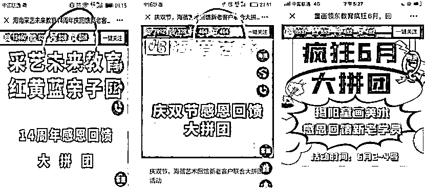 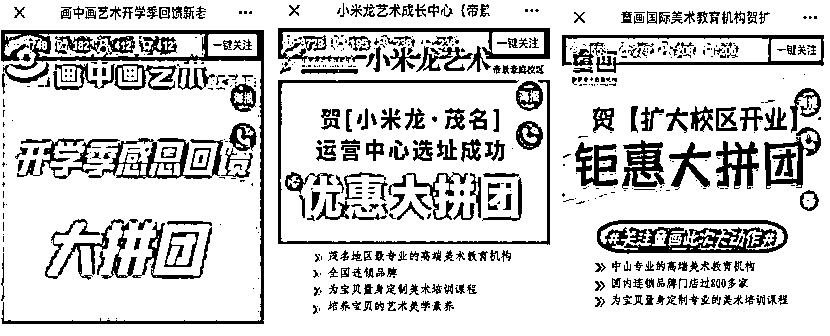

过去我们进校区做内训：带着老生做裂变活动，收尾再给两三个小时转化培训。一单收费两万到五万元，耗时三天。班子连我共十人，扣掉开销与分成，月利润三十到五十万元。

可今年五月五日，我把班子散了，不再接替校区招生的活。同行笑我：老黄跟钱有仇。其实我没疯，是两件事压得我受不住。

先是身体。元宵后到五月一日，我常夜里十一点收工，清晨五点又跳起来赶车赶飞机，中午十二点已经站在另一座城市的客户面前。有教练累到住院，辞职不干。我也四十多了，这样跑吃不消；夫妻俩常年在外，孩子老人顾不上，两头为难。

再是心里。2020年起，这行乱象多起来。一些不懂教培经营的人冲进来，只图快钱，方案越猛越好：几十家校区联营，每家出八到十六次课，家长花一分钱能挑五门；或者单店直接甩二十四次、四十八次甚至六十次课。家长薅羊毛的劲被点燃，一场活动回款十万到二十万，校区却在几个月后关门。

两三年里，我亲眼见小几百家校被这类团队拖垮。写这篇前，番禺又倒了一家，起因就是299元48次课的联营活动。

做艺培的老板多半善良、单纯，只想把才艺教给更多孩子，对营销的认知比别的行业落后五年以上，根本分不清方案好坏。我们不该坑他们，该帮他们。可不知从何时起，拓客团队从“雷锋”变成了“过街鼠”。我心里堵，想了几个月，终于在五月五日把旧班子彻底解散。

### 二、把“帮”改成“教”

我决定换条路帮这些有情怀的校区负责人。我的判断很直接：校长要摆脱对拓客团队的依赖，就得自己掌握整套策略与操作流程。于是，我把过去进校落地的方法，连同软件工具，打包复制给负责人。简单说，从“替你做”变成“教你做”。

一字之差，交付方式全变。这条路难，但值得。我原本估计转型要一到两年，所以先备粮，解散班子，把成本压到极低，只和爱人两个人全力打。我押注的是窄行业知识型个人品牌：先用半年跑出转化率较高、能复制的闭环，再重建五到七人的小班子。到现在两个多月，我感觉也许不用一年就能重新出发。

**1.《批量招生操盘手复制1.0》出炉**

五月五日散伙后，我们花一个多月拆流程，打磨成《批量招生操盘手复制1.0》集训，先找十九位负责人试。那一轮我不带跑，只想看他们照流程自学能不能出结果。

结果不错：有人最高招到二百四十一名新生，单店做到这个数很理想；弱一些的也招到五十来名，后续转化率多在五成以上，最高约七成五。

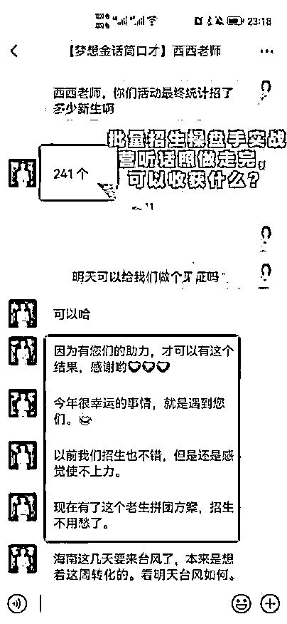

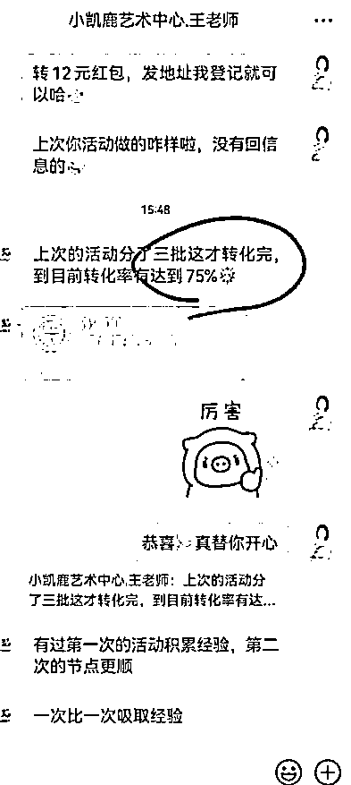

**2.《批量招生操盘手复制2.0》出炉**

首轮数据让我安心，我马上把流程拆细，按方案、物料、执行、演练四步交付，又加入带跑，升级为《批量招生操盘手复制2.0》。正好赶上生财有术的“视频号IP”航海，我直接在视频号开播做销售，又招了近二十家校测试。这轮带跑快收尾，数据也不差。参与2.0的负责人普遍说：这回心里有底。

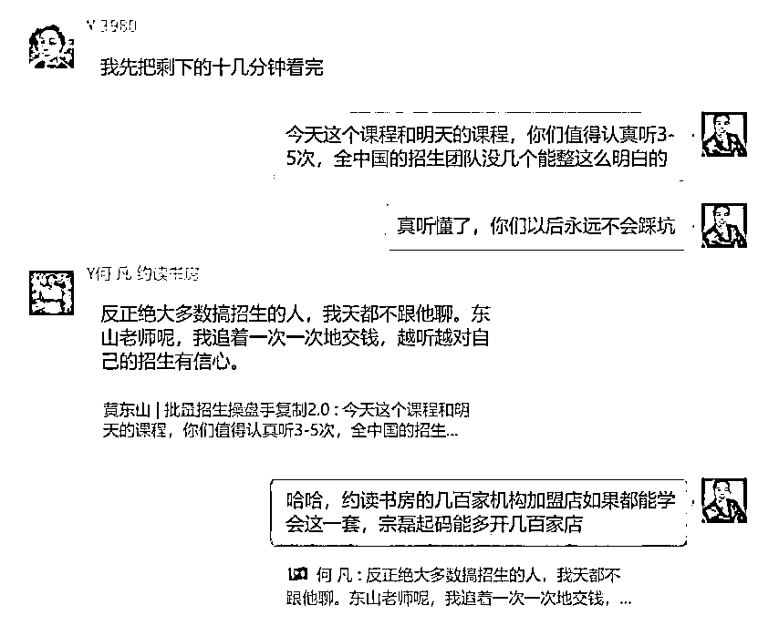

产品还会继续磨。等防控条件更稳，不排除改成线下课加线上带跑。形式怎么变，初心不变：让负责人自己搞定拓客与转化，用商业手段托住教育情怀，而不是把命门交给外包团队。

## 第二部分：三条线闭环，视频号只做临门一脚

2016年至今，我一边加人一边删人，如今留下四千来位精准校区负责人。这是我的底盘，也是底气。看头像我就知道对方是谁、在哪个城市、教什么科目、校区多大规模。搞不清来路的、朋友圈屏蔽我的、待了一年没说过话的，我都清掉了。

去年起，我零散做抖音、小红书，粉丝合计不过三千；视频号那时才两百来人。这就是我全部家底。

眼下，我只把视频号当成定向养信任和开播回款的工具，平台其他功能还没展开。因为产品还在边磨边测，营销没全面铺开，很多老客户甚至不知道我转了型。

我的窄行业知识型个人品牌，是三条线一起推：流量线、培育线、成交线。

### 第一条线，流量线

流量线是活水。我抓两点。

**1.公域转私域**

每天更视频，每周开播，所有内容只指向一件事：把《批量招生策略》纸质版送出去。送永远比卖好开口，现在一天能发二十到五十本，领书的人全进微信好友池慢慢养。

窄行业知识型个人品牌的核心，是用知识获客、用知识培育。我做了细规划，下一步按短视频、纸质书、付费课一步步落。

**2.老客户转介绍裂变**

转介绍我一直在做。2016年至今，我的经营信条就七个字：用心服务好客户。每接一个客户，我都会把这七个字讲透：我会用心，但前提是你得是好客户。

我们的好客户标准只有一条：愿意转介绍。你付钱我服务，那叫大客户，是交易，两不相欠；只有肯把朋友带来的，才算好客户。

好客户除了拓客转化，我还会帮其解决流量、管理和盈利问题，并送我自己写的其他书。我手里还有五本，只送好客户，外面花一万元也买不到。总之，好客户在我这儿，问题都不是问题。

我反复解释，有两个目的：一是希望负责人也把老生家长分层管理。她认了这个理，转介绍才做得好，我帮她做活动时执行也更积极。二是让她看懂我的做事风格，愿意把新客户递过来。

昆明呈贡有家圆萌舞蹈，任校长把认识的负责人都推给我，至今二十多家校通过她做了活动，这就是超级好客户。也有负责人直接拉群，把我设成管理员，让我在群里讲干货。作为回报，我不但帮她填满校区，还教她持续提价：校区从两百多人做到五百多人，年费从七千多提到一万二。现在我又支持她做知识型个人品牌，开始服务全国舞蹈同行。

这些年，八成客户来自转介绍，全国很难找第二家。转介绍动作也轻：帮我把书送给朋友，或者拉个群，我在里面吆喝送书。对方找不找我做活动，不怪她；若有人找我做，我还给她提成。

### 第二条线，信任培育线

培育线是核心。信任是批量签单的前提；没有信任，只能降价让利，我很抗拒。培育分三招。

**1.朋友圈剧本**

以前带团队进校，我忙到喝口茶都难，社交动态几乎不发。现在每天在广州办公室，八小时就干宣传。

我把朋友圈当一本校区拓客转化杂志来编，设四个栏目：东山招生笔记、东山转化笔记、东山生意经、东山随笔，再穿插日常、读书、客户见证，一天排得满满。每个栏目备了九十多篇，按序号连载，三个月发完。负责人看完这三个月，对拓客与转化的理解会深一层。

**2.会员社群**

对外，我一直在送书。负责人拿到书后，我建一个《批量招生策略研习社》，免费，相当于书友会。但不是有书就能进：得在前台举着我的书拍张照发群里，才算进门。

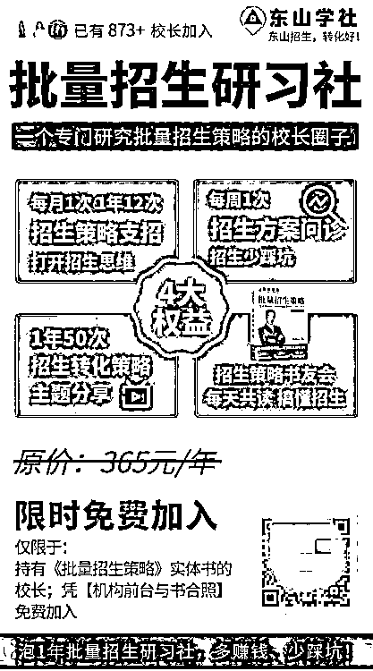

进研习社有什么好？

每周四我开“东山问诊”。周一到周三发公告，让大家接龙校区经营难题，周四晚上我统一文字答复。群运营里，答疑最见功底，也最容易让人服气。问题五花八门，没两把刷子真会被问住。到现在我答了上百个问题，既解了惑、攒了信任，也更清楚客户的痛点，为下一步做产品打底。比如按问题归类，我随时能攒个三次课或七次课的小课包，卖九十九元，赚个两三万并不难。

每周五我再做一次主题分享，比如暑假班、秋季班、双十一怎么招。会员免费；外部负责人想听，转发海报并拉两个人来学即可。学完他们多半会入会，因为会员以后不用做任务。主题分享既养信任，也承接每月销售。

我的销售都在内部群做，外面团队看不懂，只看见一个天天送书的“傻子”，还笑我钱多。每月我还会做一次大主题分享，本质就是主题销售；平时也在群里丢书里的金句。

**3.给特定客户拍定制视频**

以前很多内容，是我和客户私聊、或在会员群聊完，再总结拍成视频。发到视频号后转给客户看，对方会觉得这是专门为他拍的，容易感动，也容易信我。

有时我在朋友圈看到某家校区发的招生海报，就知道她踩坑了。直接劝，她未必听；我就拍一条讲她踩的坑，把底层逻辑和其他案例说透，发朋友圈并@她。她当时不吭声，后来却常感谢我，说幸亏提醒，少亏不少。这类人最愿意报带跑营，因为吃过亏。

### 第三条线，成交线

所有动作，最后都落到签单。我目前两种成交法。

**1.细水长流捡客户**

每次主题分享结束，总有负责人问《批量招生操盘手复制2.0》。我发一封销售信，她看完觉得行，先交钱，等开营拉群学。现在每月开两期带跑营，集中开营、集中结营。以后客户多了，我会按大家做活动的节奏，改成每周一期，循环开结。

**2.每月一期社群销售**

每次销售提前十天准备，按造势、预售、开卖、追单的节奏走。全部在内部群完成，主要面向已经养出信任的会员，外面同行不知道我在干什么。

我的精力这么分：五成送《批量招生策略》纸质书、在研习社做培育；四成半做交付、帮客户拿结果；剩不到半成做销售。我相信，只要价值持续输出、客户见证不断，签单并不难。

所以，视频号对我只是锦上添花，是定向养信任和开播回款的工具；抖音、小红书等平台，也只是送书和宣传的渠道。

## 第三部分：窄行业知识型IP，怎样做到年入百万

讲完经历和流程，再说假设你也想做窄行业知识型个人品牌，该怎么起步、怎么回款。这部分可能更有用。

**什么是超垂直知识型IP？**

我的理解：只盯一个极窄的人群或行业，给他们成套解决办法的专家型个人品牌。

私域、抖音、视频号等新平台起来后，确实成就了不少创业者。眼下主流创业方向有两类。

**1.第一类：有一手绝活，服务所有人。**

比如会做引流拓客，就餐饮店、美容院、微商、社交电商都接，甚至教别人怎么接餐饮店。这像一张药方，谁给钱给谁抓药，是当下主流。

好处是容易出名，容易成大咖，做到头部也容易赚大钱。坏处有两个：

1）太挤。你能想到的领域都挤，因为聪明又肯干的人不止你一个。互联网创业社群里，早些年多是微商、社交电商、个人品牌、文案、社群，如今清一色私域、IP、短视频培训。哪个风口热，昵称标签就一窝蜂跟上。两把刷子难出圈，五把也不够。面向所有人的定位，流量看似源源不断，于是大家追十万加、追百万粉。可真做到很难，流量越来越贵，也越来越精。

2）得不停换风口。任何风口通常前两三年好赚，随后就要换。总这么追，很累。什么热做什么，一群人追，总有追不上那天，焦虑自然来。所以不少社群里，前阵子还教抖音起号，现在纷纷研究视频号回款，因为视频号正是当下的风口。

**2.第二类：超垂直个人知识型IP。**

如果你觉得和千万人挤一个风口太累，不妨走人少的那条路。

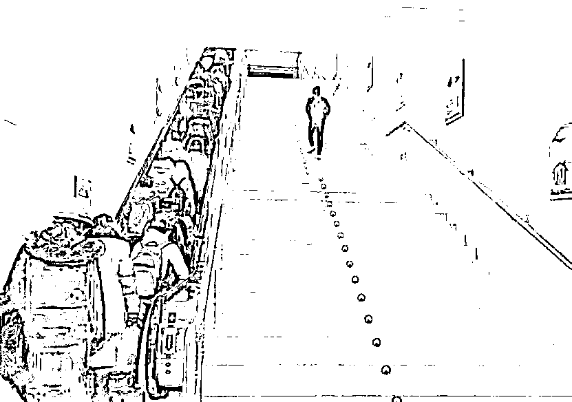

也就是只扎一个极窄人群或行业，找到最扎眼的痛点，给系统方案。

同样做拓客引流，什么人都接，很难把方案做透。只服务一个超细分行业，你才会真懂行，才能对症下药。

不少拓客团队进场后反而把校区拖垮，症结在哪？他们只会冲人数，不懂教培经营，靠联营、超长课时包、超低价把家长胃口吊起来，短期回款好看，后续交付与转化接不住，校区自然被拖垮。

# 赛道越窄，利润越稳：一个超垂直知识IP的实操笔记

有一类团队，业务清单拉得很长：教培机构招生他们接，美容院、健身房、瑜伽馆的推广也接。表面看左右逢源，实际却埋着雷——每个细分行业的水性都不同，他们却习惯拿一套最猛、最极端的打法到处复制。体验课确实能呼啦一下涌来不少人，可后续转化接不住，机构反而被折腾得元气大伤。

我的做法完全不同：只服务艺术培训类中小机构的招生拓客。长期泡在这个圈子里，校长们当下卡在哪、真正疼在哪，我摸得比较透。基于这些真实处境去给方法，命中率自然高，效果也更稳。

这也是超垂直知识IP诱人的地方：不必追求海量客户，转化却更顺，客户黏性更强，老客户还愿意持续转介绍。安静地把钱挣了，比盲目铺摊子舒服得多。

做这种垂直知识IP，客户规模真不是第一位的。手里攥着上千个精准用户，甚至只有大几百个，只要质量过硬，一年做出两三百万并非遥不可及。

我认识一位朋友，常年在昆明、普洱两头跑，只做高端定制茶，服务对象多是很有分量的人物。他的微信通讯录长期保持在六百人左右，个人一年却能有三五百万进账。这种小而美的状态，确实让人羡慕。

当然，这条路也不是没有代价，主要有两点：

**1**）体量有天花板。

小团队靠垂直IP把年利润做到九位数，我见得极少；但一年千把万的例子并不少，属于典型的隐形冠军型生意。

如果你和我一样，觉得两三个人一年挣几百万、上千万就已经很舒服，那这条路值得认真考虑。

**2**）做超垂直知识**IP**，专业必须过硬。

领域一旦收窄，就得往深处扎，把自己练成行业里的明白人。最好比那些老资历老板更懂行。

为了真正吃透艺术培训这行，我入股了6家机构，还亲自跑过上千家门店，跟客户面对面聊，才慢慢摸清门道。现在很少有校长能把我问住。

如果你准备走超垂直知识IP这条路，可以拆成4步：

第一步：挑对赛道

第二步：把精准客户筛出来

第三步：搭好产品体系

第四步：把知识IP跑通并变现

**第一步：挑对赛道**

我40多岁，连续创业过多次，一直鼓励大家去做垂直领域的知识IP。不然，这篇文章也没必要写。

为什么要选超垂直方向？

因为很多人正在走的路，其实更挤、更难，前面已经提过。

如今抖音、社群里讲创业的人一抓一大把。前阵子我去线下听了一堂门店流量策划课，现场八成都是讲师的同行，真正掏钱的门店老板反而没几个。

同行个个精明，想从他们口袋里挣钱，难度很高。

如果那位讲师只扎一个门店领域，比如专门教全国烘焙老板做流量策划，来的人大概率就真是烘焙店主。只要方案够硬，这些人自然愿意付费。

为什么强调知识型个人**IP**？

因为表演、娱乐这碗饭要靠天赋，咱没那条件。再看业务形态，不管你眼下做什么，其实都能按“商学院”的思路重做一遍：有的公司靠培训收费，有的公司靠内容引流、培育客户，本质相通。

用知识去教育市场、获取客户、建立信任，再完成变现，这条路可以长期走。等你成了行业专家，反过来给同行创业者赋能，个人、客户、行业三方都能受益，既得利，也得名。

那怎么挑一条适合自己的赛道？我分两种情形说：

第一种，你已经身在某个行业，怎么系统优化？

第二种，你想换赛道，怎么重新选对方向？

**1.** 你已经在某个行业干了很多年，想靠个人知识**IP**把产品卖得更好。

这种情况相对好办，关键是做一个视角切换：学会从行业高处俯视自己的企业或职业。

别再只从自家公司出发看问题，要站到行业层面去观察。

以前你总盯着自己的一亩三分地，眼里全是竞争对手，只看见客户和产品，结果把所有同行都处成了敌人，天天打价格战，累得够呛还挣不到钱。

一旦站到行业视角，原来的对手可能变成未来的客户，同行踩过的坑也可能变成你的机会。

举个例子：

我有个客户做少儿中国舞培训。过去她和多数校长一样，只关心自己的机构，以及周边两公里内的同行，竞争焦点就是抢生源。

后来她成了我的“超级好客户”。我引导她把视野打开，去看全国千千万万舞蹈机构老板共同的难题：管理怎么抓、产品怎么升级、招生转化怎么提效。

在我的建议下，她把自己的经验整理成系列文章，持续对外分享。

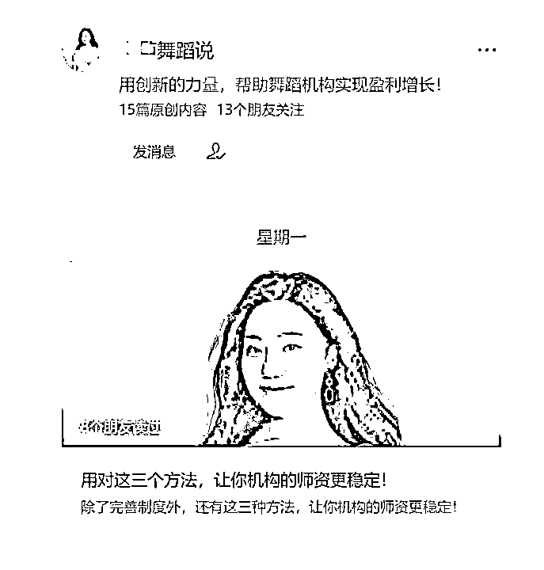

短短半年，六百多位全国少儿舞蹈机构校长主动加她交流。

最近她开始做会员社群分享、线下沙龙，还不断给我推荐招生客户，从中拿提成。

半年下来，这六百多位校长带来的利润，已经和她那家五百多人的机构相差不大。尤其疫情那段时间，她比周围多数机构都从容。

而且输出会倒逼输入。持续分享让她自己成长更快，知识体系也更成系统。疫情过后她多次调价，机构也跟着完成升级。

所以，不管你眼下在哪个行业、什么岗位，只要能抬高格局、打开视野，都有机会通过垂直个人知识IP重写自己的盈利路径。

当你愿意把最拿手的方法论主动分享给全国同行，帮助别人变好，别人也会反过来成就你。

我们不少客户都走上了这条路：有做跆拳道的，有做舞蹈的，也有做美术的，跑得都不错。在疫情后变动的环境里，这也算一条相对稳的新路。

未来继续支持客户走向“个人知识IP”，也是我的后端产品之一，相关方法论我已经打磨得比较完整。

**2.** 你厌倦了现在的赛道，想换方向做知识**IP**变现，该怎么精准选择？

这种情况很常见，我自己就是这么转过来的。2016年以前，我做过文案培训、个人品牌培训、社群裂变培训，什么热就追什么，看上去热闹，实际没挣几个钱。

后来我把方向锁在少儿艺术培训机构，用几年时间成为这行引流拓客和营销流程方面的专家。现在再遇到大难题，我心里也不慌。

眼下任何细分行当，都值得用超垂直个人知识**IP**的思路重做一遍。单一技能对应单一人群，全国市场足够大，你完全能在自己那一小块地里建起王国，竞争也没那么惨烈。

找新赛道，其实两步就够。

① 找出你最强的那项技能。

② 找出最容易变现的细分行业或人群。

过去你总跟风，每样都学一点，看似十八般武艺样样都会，但真上华山论剑，你得有一招如来神掌。

这招如来神掌，就是你的绝活，是你最能拿得出手的东西，是你能连讲三天两夜线下课还不重样的内容体系。

比如有人靠文案吃饭，也有人做社群很猛，还有人专攻裂变引流、成交转化，甚至只教人改微信昵称，都能成立。

选哪一样都有不小市场，但只能挑一样死磕。真实市场里，样样通往往不如一招绝。

找到技能后，下一步就是选赛道，同样分两种：

**1**）做**B**端服务

挑一个你熟悉的B端客户群，给他们提供能对症下药的整体解决方案，陪着他们走完实现梦想的过程。你帮他们圆梦，自己的梦想也会随之实现。

我有一位师傅，上海的张有为老师，六十多岁了，近十年只死磕工业品电商营销策划。

前几年他还带个助理，现在连助理都不要了，一个人一年服务五十来家客户，日常开销之外还能剩两百来万。既受尊重，又能给行业发展出力，状态很好。我希望自己六十岁后也能像他那样。

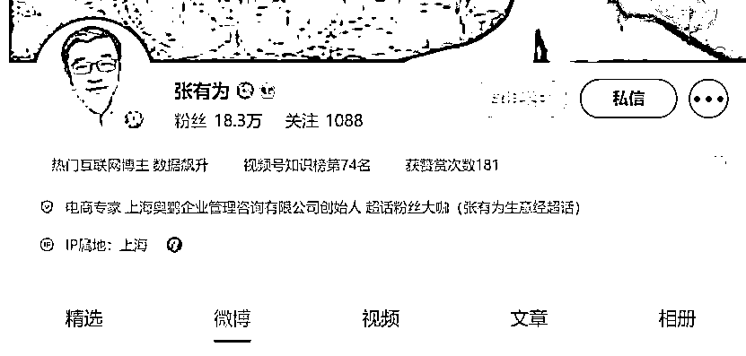

我还有个朋友做模具钢贴牌，一个人带两个助理，从全网SEO起步，如今拍了上千条短视频全网分发，成了模具钢类目里的小霸王，一年几千万流水，而且款到才发货。

他一个人的利润，就能顶不少模具钢工厂和门店。可见垂直个人IP一旦用专业建立起信任，机会确实很多。

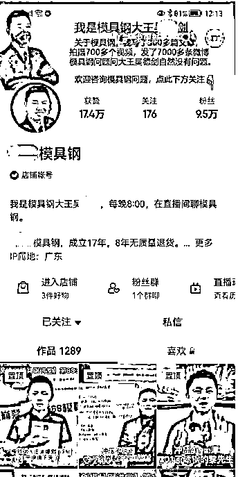 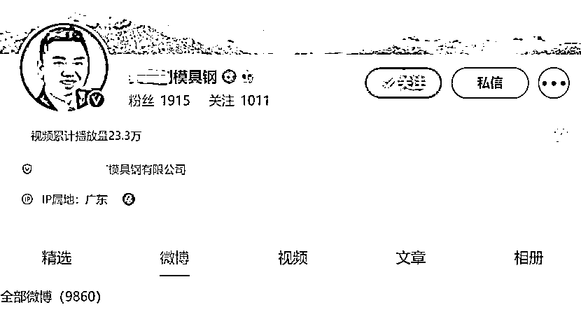

想不到吧？

一个工业品模具钢，居然拍了1200多条视频、写了9000多条微博。在很多人觉得根本不会有客户的平台上，他反而混得风生水起。

不少做工业品的人，比如罗茨风机、液压泵、锯片、制锁机等，只要产品够硬，围绕产品做非常细的知识服务，各行各业都有空间。

因为大部分工业品老板，脑子里还是十五年前、二十年前那套经营方式。你若用社群、短视频、私域这些新打法去开发和维护客户，几乎就是降维打击。

**2**）做**C**端客户

如果你没有工业品厂商资源，只是自己单干，那也要把人群切得非常窄。

我有个朋友庞老师，在广西玉林卖蜂蜜和现熬补品膏。按理说，蜂蜜人人都可能买，宝妈更是大客群。

可这些年，她就盯住练瑜伽的白领女性去开发、销售。定位足够准，她又和全国不少知名瑜伽馆老板合作，把产品直接送到客户手里。8年只做这一件事，也实现了日常开销之外年剩百万的小目标。

所以哪怕做C端，也要通过人群分析，找到对你的产品需求强、又愿意出更高价格的那批人，耐心培育、持续贡献价值，坚持三五年。不用追风口，一年挣个两三百万，日子已经很不错。

**第二步：把精准客户筛出来**

服务人群确定后，接下来就是积累客户。

做超垂直个人知识IP，不需要人山人海。我入行几年，也不过积累了几千人。我常想，那些私域里有十几万、几十万好友的人，真能一一照顾过来吗？

你要的是极准的客户，所以必须持续筛选、反复过滤。这个阶段最忌贪心。

我确定转型后，陆续删掉近两千个好友，退出近三百个无效社群。留下来的客户，我不看标签，只看昵称和头像，就能知道是谁、在哪儿、教什么科目、规模多大、需求是什么。

现在我每天会随机翻看客户朋友圈。发现不是老板的，删；判断未来不会成为客户的，删；以前见过面但聊得不顺的，也删。

我的每个营销动作，其实都在做筛选。比如免费送《批量招生策略》，也不是所有机构校长都给。朋友圈不开放的，一律删；业务太杂、既开机构又做微商的，删；收货地址不是机构名称的，也删。

我删人拉黑很果断。因为我信一条：好客户不是靠软磨硬泡谈来的，先筛出来，再慢慢培养。

做业务，我从不求着客户赏饭吃，只挑符合标准的人认真合作。

未来几年我的规划很清楚：不追百万粉，也不眼红十万粉，目标是把书友会做到5万个，用三到五年完成。对这个目标，我的信心是200%。

所以我的建议是：别只想着把客户数量做大，而要一边扩充、一边剔除不合格的人，最后留下的才是精华。

**第三步：搭好产品体系**

精准客户池有了，下一步就是产品体系。个人知识型IP，要把一个人当成一家公司来经营，再小的个体，也得有基本的产品结构。

怎么搭？顺着客户的信任阶梯，一层一层往上放产品。

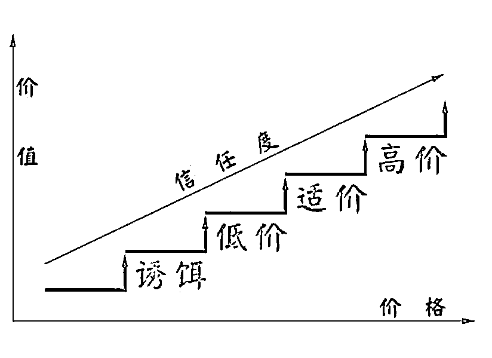

按信任阶梯，我目前搭了4级：引流品**+**培育产品**+**利润产品**+**超级赠品**

拿我自己举例：

引流产品

现在所有公开渠道里，客户和同行能看到的内容，都是我免费送《批量招生策略》这本书的相关信息。这本书就是我的引流品。

所有引流品里，“免费”的吸引力最强。但免费不能乱送，有两点要留意：

**1**）引流品也是过滤器

免费送出去的东西，本身就是第一道筛子。不够精准的人，你送她，她还嫌占地方；真正对口的客户，才会主动来抢。

像《批量招生策略》实体书，只有做艺培、开机构的校长才用得上，普通老师拿了也发挥不了作用。

**2**）引流品也是培育品

引流品千万别让客户拿走就失联，那样后端很难转化。

以《批量招生策略》为例，客户拿到书后未必全看懂，难免想找我指点。于是我顺势做《批量招生策略研习社》，之后每周都有触点，成交机会自然出现。要是对方拿了就跑，连聊天窗口都没有，那真成做慈善了。

信任培育产品

校长拿到书后，我们会请她做见证、做裂变。完成基础任务，就能免费进入《批量招生策略研习社》，也就是书友会。

这个社群对完成任务者是免费的，外部人即使给1000元，我也不放进来。因为群的核心用途是培育信任、促成成交。

我每周在群里讲一次课，内容围绕书继续延伸；每周固定时间开问诊答疑；每月提前在群里做预售，让会员优先报名，拿到更多优惠和福利。

从5月到现在，我陆陆续续招募了三百多个《批量招生转化研习社》会员。目标是2023年元旦前做到3000个，明年7月收尾时做到10000个。

真做到这一步，业绩会超过解散团队之前，而且更轻松，也更有意义。

赚钱的利润品

眼下我的利润品主要是《批量招生操盘手复制2.0》陪跑营，价格从3980到19800不等。这个陪跑营每月开2期，每期10到30人。

另外两个陪跑营还在打磨，等会员超过3000再推出。它们定价会略高，能直接帮客户拿结果，带0风险承诺，也敢做对赌。

所以利润品不能只有一个，否则风险太集中；但也不宜铺一大堆。我倾向于2到3个，且持续迭代。

你是个人IP，背后没有几十上百人的交付团队，产品一多就难做精。

超值赠品

超值赠品用来塑造价值，也用来辅助利润品成交。

目前我最大的超值赠品，是2天2夜的《3步转化密码》线下课。

这套课有380多页PPT、2本共32万字的配套教材，外加40多张执行表格。口碑很好，客户上完能直接拿到结果。

《3步转化密码》每2个月开1次，每期50人。现在它作为赠品送给陪跑营客户，外部校长给10000元我也不卖。

当然，在2天2夜的课程里，我也会转化19800元和98000元的课程，每次都能成交一些。

我还有一个赠品——《批量招生策略》这本书。我会让老客户把它送给自己的朋友，这样赠品又变成了新的引流入口。

**第四步：把知识IP跑通并变现**

产品设计完，最后要落到赚钱上。打造超垂直知识IP，我分成5步走：

1. 定位包装

2. 建立内容体系

3. 建立会员体系

4. 批量发售变现

5. 打造裂变循环模型

下面一步步说：

1. 定位包装

这一步不复杂：你是做什么的，就写明白，然后让你想吸引的那群人看到。定位包装主要体现在对外的微信四件套上。

比如我见过一位很厉害的朋友，专做快餐厅盈利菜单优化，昵称直接写成：XX--餐厅盈利菜单优化。

还有位朋友只做连锁药店私域体系，她的昵称就是：XX，连锁药店盈利教练。

我自己也一样，昵称是：黄东山 I 送你一本《批量招生策略》。

**2.** 建立内容体系

内容体系是知识IP的骨架，大致分三块：

1）对外宣传和引流内容

这类内容围绕客户痛点、行业现状展开，按系列方式1、2、3、4、5持续写下去。用视频、图文、朋友圈文案等形式铺到客户能看到的地方，慢慢影响他们，再用引流品把人装进私域流量池。

这部分是同行和客户都看得见的，属于明线。我自己就是全网慢慢铺系列内容，全力送《批量招生策略》。同行看了常常一头雾水，以为我疯了。

2）你的理论体系

理论体系用来立江湖地位。最好用导图讲清楚：你准备怎么帮客户实现梦想。

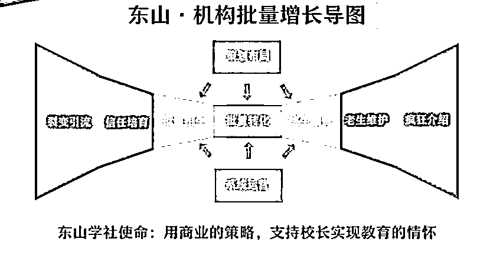

我就给自己做了一张增长导图。未来几年，我会围绕图上的每个节点写书、做课、研发产品。客户跟我们学招生和转化之后，前端后端都还有继续延伸的空间。

**3**）产品变现体系

包括信任培育、会员体系、发售体系等，这些都在内部运转，同行看不到。它们属于暗线营销，才是真正的核心竞争力。

比如我现在把免费领书的人用会员社群装起来，在里面落地第三步的会员体系。通过更专业、更系统的内容做培育和集中成交。

**3. 批量变现**

我目前每月做一次浪潮式发售，一次就能覆盖当月订单需求，够了。

线上批量发售我也踩过不少坑，现在总算总结出一套可复制流程，以后有机会再单独讲。

做知识IP变现，一定要学会集中发售，别一个个磨成交。那样太累，也容易掉价，做不成IP。

我对成交始终坚持一条：只靠宣传吸引，不追着客户求单。通常都是客户主动找过来，我们还要经过两轮审核才接。

**4. 裂变和循环**

最后是裂变和循环，这部分也在内部完成。

我的策略就是反复讲“用心服务好客户”这七个字，发动每个有收获的客户去分享，请他们帮我送《批量招生策略》这本书，然后我再把新来的人拉进会员群，形成持续循环。

关于如何做超垂直个人知识IP并变现，今天就聊到这里。

最后给你几条经验和忠告，希望帮你少绕弯路：

**1.** 坚决不做穷人生意

越垂直，越要瞄准高端人群。穷人本就拮据，赚他们的钱像剥皮，你会长期困在解释和讨好里，累死也难有利润。

大家都知道教培机构现在不容易，但我尽量选形象好、地段好、付学费轻松的客户来服务。

审核时我会把话说清楚：如果不是很轻松就能支付学费，别跟我学。我特别怕有人借钱来上课，看着励志，实际双方压力都巨大。

另外，有些人明明有钱，却不愿为价值买单。这类人比真正的穷人更让人头疼，他们只想占便宜、不断索取。遇到这种，直接拉黑删除，别犹豫，把时间留给愿意为价值付费的人。

2. 坚决不求客户讨饭吃

既然做知识型IP，就要够专业，把自己当成行业里的明星专家。你只管贡献价值，真正做到利他，吸引有需要的人主动买单即可。

# 别追客户，先筛客户

别把成交做成乞讨，追着客户要单子，姿态会很难看。

我只会持续输出内容与价值，不催不逼。对方当下没有需求也没关系，可能隔一两个月，甚至一两年后自然下单；前提是，这个客户本来就是你认真筛选过的。

若她跟你学习满一年，收获已经肉眼可见，却始终没有付费动作，那就别再留着，拉黑处理。

国内市场体量足够大，再窄的细分品类，也能容纳深耕者。别指望让所有人都满意，要反复筛选、持续过滤。

你对客户设的门槛越清晰，服务标准越明确，方案往往越有针对性，也越能真正解决问题；愿意为高价值买单的人，才会因此靠近你。

### 3. 别把价格压得太低

你的产品和服务，价格别定得太低。

假设一年目标收入200万元，客单价1万元，把200位客户服务到位就够了；若手上有约1000个精准潜在客户，这件事就有机会跑通。

可若客单价只有100元，就得服务1万人，这已经变成电商式打法，还谈什么个人IP？

真要做100元的产品，就必须有极强的复购能力，例如产品像每周都要消耗的东西，可以做成会员包来卖。

目前常见的成交区间在2000—20000元，这个客单价对垂直类个人知识IP相当友好。

### 4. 把时间拉长看

选定垂直赛道后，至少用三到五年扎进去。

如今网络环境仍有些急功近利，半年没起色就换方向，基本盘很难立住。

做垂直个人IP，要有一块自己的基本盘：哪怕大环境不理想，一年也能有百万元左右的收入，这是维持生活品质的底气。

但走到这一步，需要长期、专业的输出与影响。500到1000篇行业文章或视频，算是基本门槛；缺少这个积累，垂直个人知识IP只能停留在想象。

这次分享先到这里，等我做出更大成果，再向大家汇报。如果看完还有问题，欢迎联系我，有空我会回复。

也谢谢生财有术。希望我们未来在赚钱的同时，也能给行业带来一些正向价值；这样的钱，挣起来更有意义。

有些做招生的同行一年进账几百万，靠的却是拖垮几百家本分又缺乏经验的机构；这种钱挣得再多，也没多大意思。

最后送大家一段话：你我都还在创业路上，骨子里都有股不愿将就的劲。手头每件小事，我们都想尽力做到最好，怕的是辜负信任我们的人。原因很简单：招牌二字，比什么都重。尤其是一辈子要做的事业，更不愿凑合，这关乎脸面。