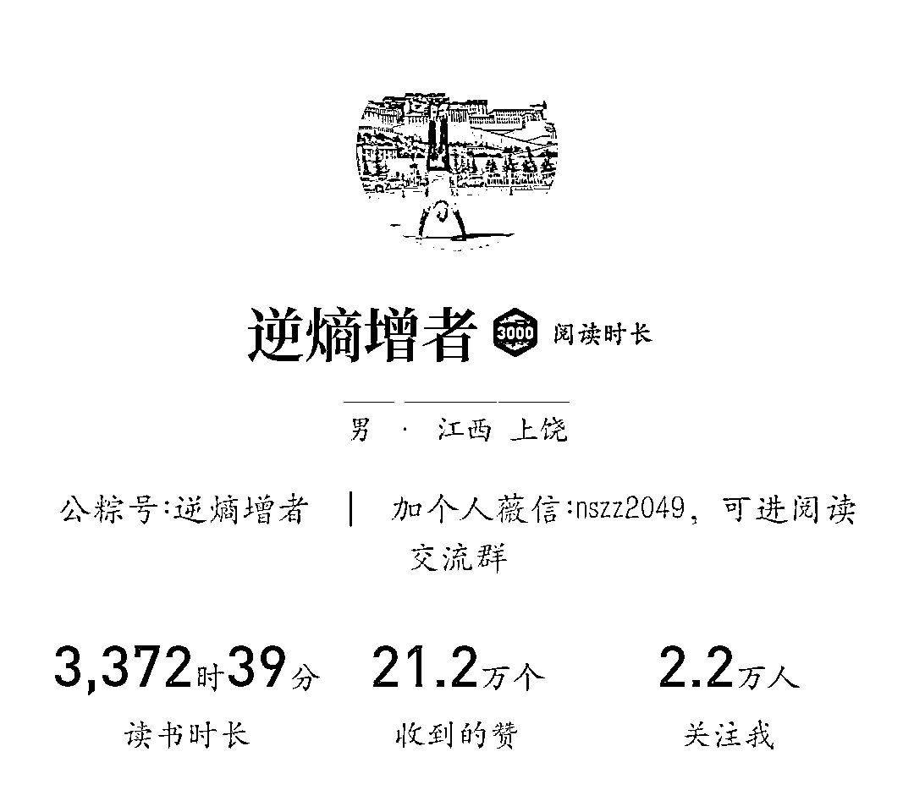
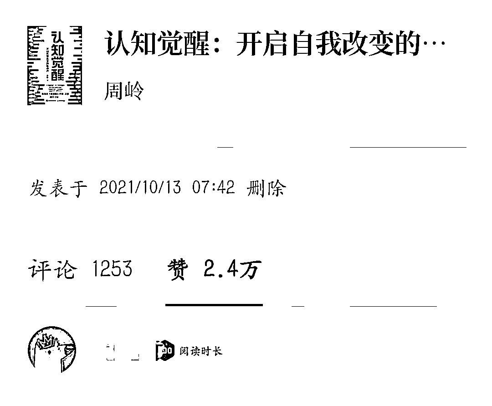

# 两年300本，副业月流水3万

圈友们好，逆熵增者，90后，主业之外折腾自媒体和社群。头一回在生财发帖，但愿能给正在找路的朋友一点参考。

先亮主线：底子普通，靠读书加写作，两年挣了40万。下面顺着时间线交代这段经历：

❶2020年以前，下班后的固定动作是连打六小时《王者荣耀》，标准的网瘾青年；

❷2020年开春，居家两个多月，闲得没事干，随手翻起书，阅读这个习惯就这么意外落下了。那一年干掉170本，整个人像换了个版本，网名也改成“逆熵增者”——意思很直白，跟熵增死磕；

2021年又扫掉130本。两年加起来300本的量，选书分布大致是：一半在个人成长，三成跟挣钱相关，投资理财、财商思维那类都算在里面。这些存货，后来全成了我做知识付费的原材料。

光读不够，还得写。2020年1月头一回在网上冒泡，简书、微信读书同步更新，写了整整十个月，粉丝还是惨淡，阅读量经常停在两位数。

转折在2020年10月——参加阿猫读书成长星球的日更100天打卡，顺手把公众号也开了。

❸2020年12月底，付费成长社群正式开张。到落笔这会儿，一年十个月，累计1000多位成员。

❹2020年10月到2022年10月，公众号连更700天，粉丝涨了1.5W，40万变现落袋；

❺一年多里，微信读书和公众号往个人微信倒进近一万人，两个微信号都满了；

❻2022年，一个人，五天跑出114单，把剽悍私域成交高手实战营的冠军拿了。

起点是清一色的“三无”：没背景、没人脉、没资源。能拿出手的也就几样：自律够狠、学东西快、读写能力过关、目标感强。两年多磕下来，副业月流水做到了3万。

今天想聊的重点是：早在加入生财有术之前，我怎么先把20万+装进口袋的。“之前”这个限定词后面会给答案。

框架如下：

一、生财有术怎样帮我打开商业认知？

二、项目从零到一是怎么跑起来的？

三、付费社群的实操经验

四、新人入局得跨过什么门槛？

五、我和生财有术的那点交集

六、下一步怎么升级、怎么放大？

一、生财有术怎样帮我打开商业认知？

**1. 亦仁的“亦无所知”与公众号公开文章**

最省钱的第一招：免费借高手的脑子。生财有术公众号每周会放出精华帖，对当时钱包不鼓、付费学习意识也没建立的我来说，是门槛最低的入口。

从亦仁大大那儿，我提炼出四条：

**1.1 表达和输出不能省。**

你在做什么、你认什么，总得亮出来。于是我转战微信读书、公众号、知识星球持续更新，把学习心得和价值观摆到台面上。

**1.2 挑一件事扎进去。**

做什么其实不打紧，打紧的是肯钻进去、边做边改。等有了结果，再叠加上表达，两头互相推。我选的是阅读、写作加社群运营，每天砸进去的时间和精力不少，但回报对得起付出。

**1.3 流量红利来了，怎么发觉、怎么接住？**

三样东西定胜负：赚钱的欲望、对机会的敏锐、落地的执行力。欲望是发动机，敏锐度是方向盘，执行力是油门。这比方精准得有点过分。我那时欲望和执行力都在线，缺的就是敏锐度，所以得一头扎进生财有术这样的圈子去磨。

**1.4 用算账和概率的眼光看问题。**

一篇文章拉长看值不值1000块？你的时薪到底多少？这法子我用过：公众号连更600天，变现30万，摊下来每篇500块，往后还可能更值。正反馈一旦转起来，坚持就不再是苦差事。

感谢亦仁大大这四条，拆到底就几句：利他、长期主义、会算账、扎根一个领域、知行合一、持续输出。

还有一句话，跟赚钱没直接关系，但我很受用——认知上最大的竞争，是信息输入量的竞争。道理不复杂：你吃进来的信息越多，看问题的角度越多元，分析越能往下走，洞察力自然就长出来了。

所以我下狠劲输入。每天三小时，连续1000多天，大年三十也没断过。阅读速度肉眼可见地涨，粗略估算每小时能吞两万字，平均一天至少六万字，一年下来输入超2000万字。这两年基本维持这个量，每年花在学习上的时间超过1500小时。回头看，视角、分析、洞察这些能力确实在不知不觉中变强了。

**2. 明白老师：赚钱兵器库**

赚钱四要素：需求、流量、营销、变现。

**2.1 需求**

别人的痛点、痒点、爽点在哪？哪些问题等着被解决？什么类型的事能赚钱？凭什么？怎么下手？

**2.2 流量**

搞流量的渠道和方式有哪些？为什么有效？怎样做才能更精准地引流？

**2.3 营销**

产品怎么推更好卖？为什么？什么样的文案更容易成交？信任感怎么加厚？

**2.4 变现**

不同类型的产品各自怎么赚钱？为什么？交付怎么做扎实？

这张清单就是高手的“赚钱兵器库”。我从中读到的逻辑是：想赚钱，先摸清别人的痛点和需求，再搞到精准流量和用户，做出课程或社群这样的产品，最后用营销技巧完成转化。通用法则就这四块。我的付费社群就是按这个骨架搭起来的。互联网上挣钱，说到底就是搞流量、搞产品、加转化。流量怎么搞，后面会拆。

**3. 曹大：赚钱的本质**

这一条来自《生财日历》。赚钱的本质是什么？核心在交易——只有交易才产生金钱。所以先在心里建个认知：一切皆交易。交易的核心就两点：你手里有什么资源；你能找到愿意为它掏钱的人。等价交换未必存在，但互惠交换永远有。

我因此想明白一件事：想赚钱，得有东西拿去跟人换，这个东西可以是自己的产品或服务。我也一直琢磨自己能提供什么价值。因为一年啃完170本书，学习力涨了，个人成长一年顶三年，就冒出个念头：把一年多学到的东西整理成方法论，打包成课程。这本质就是一个知识付费产品，再去找有需求的用户。于是我去各大学习平台分享读书笔记和心得——主要是微信读书、简书，后来加上公众号。

**4. 肖厂长私域5力模型**

这个模型相当能打，对我帮助极大。能做到今天这个盘子，靠的就是它。五句话加一个公式：

001 第一性原理：和粉丝维持长远而忠诚的关系，把粉丝当朋友处。

002 两大主阵地：公众号加朋友圈。

003 内容三要素：真实真诚；持续分享；干湿结合。

004 成交四步法：引导加好友；发圈建信任；活动造势能；私聊促成交。

005 五力模型：个人IP力；加微力；产品力；运营力；内容力。

私域变现核心公式：私域资产 = IP力 × 加微力 × 产品力 × 运营力 × 内容力²。

想立个人品牌，这五力得持续打磨，尤其内容力——五个要素里只有它带平方，分量摆在那。内容是私域的地基：内容是1，别的是0。引流要好内容，建信任要内容，成交靠内容，最后交付还得靠内容。

这两年多我一直在内容上使劲：公众号连更700天，每天约两小时，靠持续输出价值，慢慢攒到1.5万粉；微信读书那边书评没断过，读完一本写一篇，现在有2万关注；不到两年，微信读书和公众号往个人微信导了将近一万人，都是比较精准的老铁；今年1月1日起，朋友圈每天三四条，风雨无阻，累计发了1200多条。朋友圈一轮一轮刷信任，一年十个月下来，1000多位老铁付费进了成长社群。

结果摆在这。猫叔那句“持续分享，黄金万两”确实不虚。分享本身就是在输出价值、攒信任，这层基础扎实了，后端的私域成交才立得住。先给出去，才谈得上回报；利他，其实是最聪明的利己。

二、项目从零到一是怎么跑起来的？

**1. 为什么要做成长社群？**

建社群的念头大概萌芽在2020年8月。那时第一次知道有付费社群这回事，好奇之下参加了一些，随即觉得自己将来也能干。我掰着指头想：做一个付费社群需要什么？第一，得在某个领域足够硬；第二，得有一批愿意支持、信任我的粉丝。这两样当时都没有。

不过那会儿我已经读完100多本书，在个人成长、时间管理、高效阅读这些方面攒了不少东西，也搭起了自己的知识体系。后来2020年末做年终复盘，把阅读、写作、复盘、健身、早起和投资理财收益逐一统计，发现这一年的成长和收获远超预期。于是动了念头：能不能把这一年学到的知识和成长过程梳理一遍，打包成系列课程，卖给想成长、想改变的朋友？

说白了就是：自己读，不如带一群人一起读；自己写，不如陪一群人一起写；自己长，不如领一群人一起长。揣着这个初心，项目就启动了——帮别人的同时，顺手赚点钱。

**2. 产品和服务长什么样？**

年度成长社群，定位阅读写作和个人成长，365元一年。主要用微信群交付，每周末一场分享，一年至少52次，另外组织内部共读营。读的是自己的《逆熵增成长之路》，也读别的——比如《纳瓦尔宝典》《财富自由之路》《认知觉醒》。微信群之外还有知识星球，主要用来沉淀每周的分享，同时带小伙伴在星球上写作打卡，磨读写能力。

为什么用微信群交付？运营成本确实高，维护群要花大把时间和精力，但离用户更近，粘性更好，而且每周有固定时间做一次分享。

**3. 用户从哪里来？**

公域流量来源比较单一，主要是微信读书和简书，靠爆款书评和读后感往公众号和私域微信导。下面细拆我怎么用微信读书这个APP引流的。

引流说白了就是到有鱼的地方撒网。微信读书就是适合我的那片鱼塘。两年前开始用这个APP阅读，目前累计阅读时长3000+小时，粉丝马上突破2万关注。

**3.1 微信读书共有3个引流位置。**

**① 自我介绍栏**

这里可以留公众号和微信，但那些字眼不能直接出现，得用谐音替代，比如“公主号”“薇信”之类。还能埋个钩子促加微信，比如阅读交流群、电子书、学习资料。尤其是微信读书还没上架的电子书，很多人正需要，拿来当引流资料很顺手。

**② 每本书的评论**

我看完一本书就顺手输出一篇读书笔记或书评，发在微信读书里，末尾带上公众号。目前至少发了200本书的书评。其中有一篇成了爆款——在《认知觉醒》那本书的评论区，点赞数已经破了2.4万，据我观察应该是微信读书里最大的点赞量。

靠这篇书评，每天能进账200多个赞和评论，关注也跟着涨。如果某篇评论流量好，还能在评论区补一条，再做一轮引导，把人往微信和公众号引。话术可以这样：这本书我有电子版，要的加微信☞xxx；或者：两年啃完300本，我们还建了个免费读书群，想来的加好友☞xxx。

**③ 在微信读书里关注自己的公众号**

我每天把文章的精华部分同步到自己公众号的评论区，这样关注我的书友都能看见那条评论，顺势就会关注公众号。这一波操作下来，每天能给公众号带来20个左右粉丝，同时也有十几个书友加微信。公众号粉丝还得往个人微信导，这块生财圈友肯定比我更熟。

**3.2 简单分享3个可以引流到个人微信的位置。**

**① 文章底部**

留个钩子，比如加我微信，免费领价值999的《个人成长52条干货笔记》。这个资料目前用了两个月，引了1000+小伙伴加微信。

**② 关注后的自动回复**

除了文字，还可以直接放一张图。我设计了一张带个人二维码的图片。这招是参考了不少大佬公众号后做的优化调整，作用就是降低添加门槛——不用复制微信号再粘贴，扫码就能完成。

**③ 自定义菜单栏**

在某个栏里放个人微信，也可以放自己的产品，比如知识星球和成长社群。

**3.3 怎么转化变现？**

靠知识付费变现。日更公众号加朋友圈持续建立用户信任，一年多时间靠私域成交1000位付费用户。

三、私域操盘与成交的心得

**1. 朋友圈为什么重要**

这一块主要靠朋友圈。朋友圈的分量怎么强调都不为过。常听人说，做私域做到最后，拼的就是朋友圈。它等于我们亲手经营的一家店。

早先我没意识到朋友圈的分量，第一年基本没怎么发，主要靠公众号转化，而且一周才发一次社群和知识星球的二维码。一篇公众号推文，最多的一次才转化6个人进社群；但有时候一条朋友圈就能成交十几位。我记得最猛的一次，一天之内有25位小伙伴从朋友圈加入。

再摆一个数据：2021年一整年才200多个付费用户，但从今年开始，我每天发4条朋友圈，连着260天，到这会儿今年已经发了1100条。也就是说，这10个月靠朋友圈转化了600位老铁，比去年翻了一倍还多。朋友圈的威力可见一斑。

下面就细说发什么内容、什么时间发。

**2. 朋友圈发什么内容？**

**2.1 日常生活圈**

个人品牌首先得是个“人”，所以生活圈必须有。用户是跟人打交道的。任何成交都建立在信任上——如果你的朋友圈没有生活状态，微信好友只会觉得这是个营销号，没法深入了解你，也就很难跟你发生金钱关系，潜移默化的宣传效果自然无从谈起。优秀的成交者，都是在生活里把产品卖给用户的。生活内容可以从学习、情感、休闲这些角度切入，分享积极的生活态度、价值观、专业知识。让你的好友翻朋友圈时觉得有趣、有用、有能量，这是建立信任感的关键一步。我偶尔晒晒娃，偶尔晒晒出门旅游拍的美景，偶尔晒晒好吃的、好喝的。

**2.2 专业价值圈**

就我而言，经常在朋友圈发读书写作心得、学习方法、时间管理之类的内容，让用户看到我的专业程度。毕竟用户觉得你有价值，才会留下来变成忠实粉丝。专业知识也要跟自己的定位对齐，建议分享的内容能真正帮用户解决问题，有实用价值。给用户能直接吸收的知识点，比如自己的付费内容也可以截一段出来分享。

**2.3 用户反馈和成交截图**

这一点非常关键。以前我不好意思发成交截图，觉得营销味太冲，但看朋友圈里很多人都在晒，后来试了试，效果真不错。你想，如果你的朋友圈里都看不到有人下过单，别人凭什么相信你的产品真卖得出去？所以用户转账截图、好评截图、加入社群前后的变化对比，该发就发。（提醒：记得打码，或者先征得本人同意再发。）这些截图就像淘宝的买家秀，是站在用户角度证实产品效果——用户说好才是真好。人都有从众心理，适当发一些用户反馈，能撩起潜在用户的消费欲。当然频率别太高，免得刷屏。推新品或做活动时可以多发一点，让用户感受产品或活动的火爆程度，刺激消费欲望。这边可以用上浪潮式发售的方法，我最近正在学。

**2.4 产品圈**

我们在朋友圈发内容，终极目的还是带货，把产品卖出去。但产品内容不是简单甩张产品图就完事，更应该是用户口碑、故事、用户在社群里的改变——比如养成了阅读、写作、复盘的习惯。还可以适时发优惠活动和促销信息，我一般会借各种节假日推优惠。

**3. 朋友圈什么时候发**

发布时间也有讲究。内容规划好了，还得规划什么时间发。可以根据人的认知规律和生活习惯，比如大家每天什么时候玩手机，来安排每天的发布时间。根据朋友圈用户活跃数据分析，有四个时间段是浏览高峰期。我重点用三个：

**3.1 早上7点到8点**

大部分人刚起床或在上班路上，是个工作时间的空白点。很多用户早起第一件事就是刷朋友圈，看看有没有新鲜事。早晨适合发正能量话题，给好友打打气，给一天好心情。这个时间点我通常发一张早起打卡图加一句金句，或者读书学习相关的内容。

**3.2 11点到13点**

这是大多数人的午餐时间。可以发一些跟个人专业、知识、技能相关的内容，也可以晒成绩、案例和口碑，把个人IP和用户需求、产品价值绑在一起，形成真正有用的内容。我基本在中午转发前一天公众号的文章，加一句介绍语，相当于给公众号做二次触达和曝光。

**3.3 17点到19点**

这个时间段大部分人都在摸鱼或下班通勤路上。内容可以生活化一些，有趣的段子、诱人的美食、休闲生活都行。我一般晒晒娃，或者出门玩的照片。

**3.4 晚九到十一点：福利要发得巧**

晚九点到十一点，大家刷手机的密度明显上升。这个窗口发动态，重心应放在“实惠”上：互动、折扣、限时活动都合适。此时人容易被氛围推着走，冲动购买的概率更高。我自己的固定动作，是临睡前再补一条当天回顾。

**一天发几条动态算合理？**

我的看法是，不必照搬别人的数字，合自己的节奏才重要。我大体保持一天三到五条，安排在先前提到的那几个时段。时间一长，身体会记住这个节拍，连提醒都不用设，到点自然明白这条动态该讲什么。圈里也有不少动态运营做得很出色的人，比如王子冯老师、梁靠谱老师，值得借鉴。

**4. 社群招募内容，我是这样打磨的**

成交环节里，招募内容的分量很重。我没专门报班，主要靠读书，加上研究同行的动态和产品发布稿，边看边模仿、边改边迭代。归根到底，还是《影响力》里那套社会心理机制：稀缺、限时限量、权威、从众。

我的社群招募内容大致如下：

**逆熵增成长社群：一年能拿到什么**

一、在微信群里，全年安排不少于52次主题分享，围绕一条成长链展开：先读书输入，再深度思考，接着极致行动，随后写作表达，配合复盘反省，最后不断升级。具体包括：
①怎样读得更快更透？
②写作水平如何往上走？
③知识结构怎么搭？
④自律怎样不靠硬撑？
⑤时间怎么安排更有效？
⑥公众号怎样做起来？

二、全年带你精读12本自我提升类好书。
三、可免费参加一期共读营（价值66元）。
四、附赠我写的《逆熵增成长之路》。
五、知识星球里放着50万字自我提升资料。
六、与800位同频伙伴建立连接。

年费标价465元，现阶段立减100元，实付365元，均摊到每天大约1元，上述权益全部解锁。这档价格即将上调。本轮仅开放20个减价席位，现已锁定15席，还余5席，想上车要快。

**社群使命愿景**：用一个生命去触动另一个生命，帮更多人按下改变的开关；目标是让一万人喜欢上读书与学习，并借自律和行动走向丰盛人生。

欢迎你加入，与800多位同路人一道：
学习上互相带动，成长中彼此见证；
读书有伴，写作有伴；
行动有伴，自律也有伴；
认知与思维一起往上抬！

**四、新人入局，要过哪几道关？**

第一，能长期稳定地产出内容；
第二，懂得把流量沉淀到微信；
第三，具备把文字转成成交的基本功；
第四，愿意持续吸收新知识。

说到底，要肯下笨功夫、日日不断，哪怕每天只前进一小格、只写一小段。打造个人品牌，本就是慢生意，得先把信任一点点攒够，成交才会自然发生。若问最大门槛是什么，我的答案只有两个字：耐心。

下面说说我如何做到日更，以及内容是怎么生产出来的。

**内容生产心得：没底子的人也能写**

在正式做自媒体前，我的写作底子几乎为零：高考作文分数没过及格线，面对八百字的要求常常无从下笔，憋半天也凑不出内容。可即便如此，我依然能持续产出。方法归结起来，就是“借力”。

**第一，先从书里借材料。**

刚起步时，我主要靠阅读：把书里的关键段落摘下来，整理成阅读札记，先当知识的整理者。这是第一步。

第二步，让札记进化成书评。书评不能只做摘抄，要放进自己的思考，联系个人经验，再搭出逻辑骨架，最后附上行动项。

写书评可以套这个结构：
开头：最近读完某本书，挑三个最打动我的地方聊一聊。
主体：逐个展开这三点，把书里的观点和自己的经历、感受揉在一起。
末尾：补上一条或两条接下来准备怎么做的行动项。
收尾：收束全文，谈谈感受。

我的不少文章，都是按这个路子写出来的。

**第三，把知识体系搭起来。**

这一步是我能持续日更的关键。写作并非面对空白页从零起步，而要依托已有的素材库。我两年读完300本书，攒下大量素材，知识管理靠手机备忘录完成，目前已有3300多条笔记，合计约300万字。

我把它们归成六堆：
①读书
②写作
③时间安排
④学习
⑤个人品牌
⑥思维方式

我的公众号和这个社群都围绕这些方向更新，前端内容与后端交付的定位保持一致。

再分享一个搭知识体系的小技巧：先围绕一个主题写下100个疑问，再顺着疑问找答案、补阅读、做延伸。

整理知识像拼一座积木城：先有总图纸，再往每个小区域填零件，最终连成一座城；每个人手上的积木不同，成品自然不一样。

**第四，学会混剪。**

乔布斯讲过，创新往往来自把不同事物重新组合；旧元素换一种拼法，也能长出新东西。内容创作也能借这个思路：不是照搬，而是换自己的语言重讲，再嵌进自己的结构。

那写作中最该原创什么？猫叔有个观点：每个人的经历都不可复制，所以经历天然带着原创性。最该被写出来的，是你一次次突破自己、做出成绩的过程。这类故事对个人品牌最有加成。你的经历、故事、行动、案例、经验，都是别人拿不走的原创素材。

**第五，提前排好一周的输出。**

比如周日做一周回顾；一周写两篇书评，介绍值得读的书；再分别安排读书、写作、学习、时间安排四个方向各一篇。

以上是我生产内容的全部心得。

**五、我与生财有术的这段缘分**

大约一年多前，我是在明白老师的公众号里第一次听说生财有术——一个可以坦然聊钱、不觉得伤感情的社群。明白老师常提起它和圈里的朋友，每逢418会员日前也会做宣传。我正是今年418经他介绍加入的。

此前，我一直靠生财有术公众号和生财日历自学。后来读到《2021赚钱建议》里百位大佬的分享，又入手了《生财日历》，真是眼界大开，直呼过瘾。每篇篇幅不长，却句句点到要害，对我启发很大。

也因此认识了花爷、曹大、涛哥、芷蓝、盗坤、狗哥等人，随后关注他们的公众号，加入部分知识星球。那阵子我每天泡在这些做钱相关分享的圈子里，学一点、消化一点，赚钱认知逐渐被拉高，后来才一步步打磨自己的付费社群。

**六、接下来怎么优化、怎么放大？**

花爷前些天在文章里提到：对普通人而言，每月稳赚三万，是一道绕不过去的硬杠，基本也是单干自媒体的上限。我目前正好卡在这个收入水平，已经持续9个月，确实感到接近上限。

所以想借这个机会向亦仁老师和生财圈的前辈们请教：以我现在的状况，怎样优化、怎样做大做强、怎样赚得更多？

我先想了三点，请大家帮忙看看是否可行：

**1. 把产品做成阶梯**

眼下只有365元的年度社群，产品线偏单薄。可以补一个低门槛引流款，再做一个千元上下的训练营，另外加一个万元级的高客单服务，例如私教或合伙人计划。

**2. 把流量入口铺开**

目前我几乎只靠微信读书的公域导流，来源太窄。接下来可以把内容同步到小红书、视频号等平台，让入口更多元。

**3. 把队伍建起来**

这件事已经在推进。要完成上面两步，单枪匹马肯定不够，必须靠协作。

这些想法是否可行，还请各位帮忙参谋一下，先谢过。

评论区：
文林：很强
宋大刀：厉害～
🌲乐乐：叶老师这份分享很有价值，感谢！
西昂：这书评我有印象，质量真不错～
🔥逆熵增者💰：哈哈缘分，多谢支持
🔥逆熵增者💰：谢谢乐乐，校对也辛苦了
🔥逆熵增者💰：多谢大刀
🔥逆熵增者💰：感谢支持