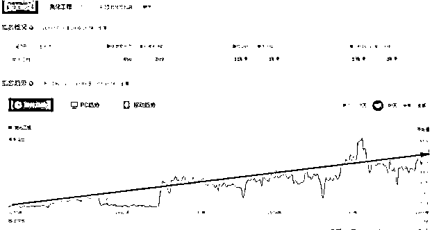
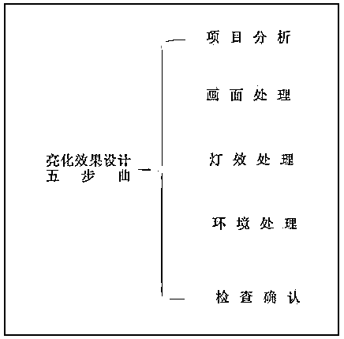
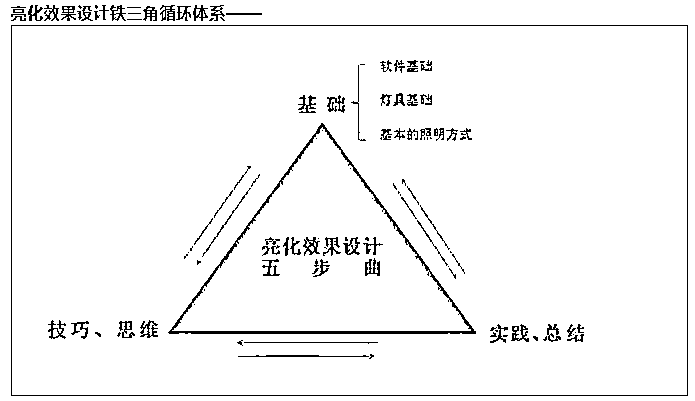
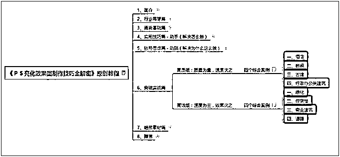
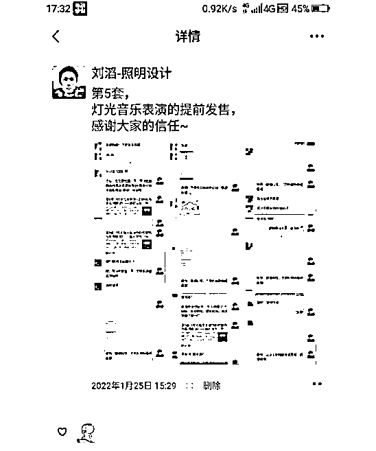
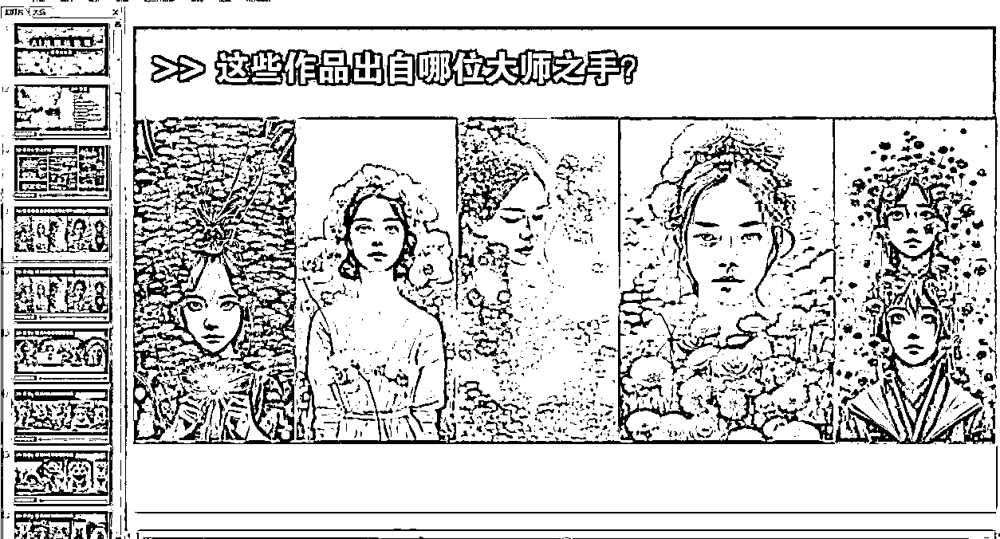
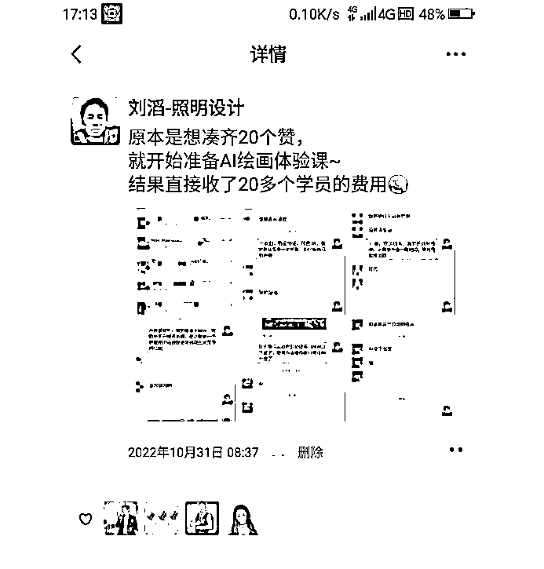

# 5门课年入52万：冷门亮化设计师的卖课全复盘

我叫刘滔，网名“照明邦”，一直在做户外夜景灯光工程，行话叫亮化设计。这行太小众，大多数人可能没听过，但我靠它额外多了不少进账。具体来说，我把自己的经验录成五门线上课，断断续续录了好几年，又卖了好几年，累计收到52万，平均每年多出16万以上。我不是营销科班出身，以下内容都是从实践中摸出来的，肯定还有改进空间，欢迎大家指正。

做设计这行的人都懂：接一个项目，只能赚一次设计费。就算你水平再高，报价也很难高出同行多少。与其这样一单一单卖时间，不如想想怎么把能力变成能反复卖的商品。我的答案就是录课卖课——一次付出，重复变现。

## 一、需求怎么发现的，又怎么验证

### （1）发现需求：找我求课的人不少

刚入那几年，我差点被淘汰。网上找不到系统学习资料，自己又什么都不懂，特别担心被辞退。后来给了公司设计经理五千块当拜师费，才算入了门。再后来开工作室，闲着没事搜了搜圈里的教程，发现内容少得可怜，仅有的几篇文章也很不专业。我干脆写了一篇《PS景观照明亮化设计效果图制作教程》发到行业论坛。没几天，论坛编辑找我要转载，我同意是同意，但要求必须署我名、留联系方式。没想到这个举动，让几十个人陆陆续续加我好友，其中十来个人都在问：有没有视频课程？一两个人问，我不当回事；十几个人问，我就觉得不对劲了——这里面可能有生意。而且设计费只能收一次，课程却能卖很多次，这不正是我想找的路子吗？

### （2）验证需求：这事看着能成

正式动手之前，我做了三件简单的事。

一是看竞品。翻了一圈全网，淘宝上有一门课，自学网上也有一门收费课，但仔细看了介绍和展示效果，质量都不行，不够专业，我觉得自己完全可以做出更好的。

二是查百度指数。亮化相关的搜索词每年都在往上涨，这给了我不少信心。

三是估行业趋势。那阵子亮化行业利润空间大，设计和施工水平参差不齐，但行业正在加速走向规范化、专业化。再加上一些地方领导偏爱亮化项目，因为半年一年就能出效果，既出政绩，市民也喜欢，还能带动夜间经济和旅游，一举多得。综合这些，我判断这行虽然不大，但还有明显上升空间。那时我连MVP的概念都没有，只凭简单判断和一股热情，就开录第一门课了。

## 二、课程怎么规划与制作

五门课不是我一开始就设计好的，更像是慢慢长出来的。第一门叫《PS亮化效果图制作技巧全解密》，光名字我就琢磨了好几天。“全”表示内容量足——68个视频、8类场景案例，外加我多年积攒的三十多G独家素材资料；“解密”这个词自带神秘感，让人想点开看看。后面所有课程，都用同一个核心思路来搭，我管它叫“认知方法论”。

### （1）做课的核心方法

什么叫认知方法论？其实就是两样：一是你懂什么，二是你怎么做。这里的“怎么做”不是临时起意，而是你反复实践后沉淀下来的固定套路。把套路教给别人，别人照着学照着练，也能得出差不多的结果。其实每个人身上都有这样的东西，只要你愿意把处理同类任务的方法步骤总结出来。拿亮化设计来说，我通常分五步走：先分析项目，再做画面处理，接着模拟灯效，然后处理环境，最后检查确认。每一步还能继续往下拆，拆到能直接照着执行。

光有方法还不够，还得有知识打底。知识分两层：一层是基础，比如PS软件基本操作、常见灯具类型、常用照明方式；另一层是核心，也就是你在项目里反复用到的思路、技巧和流程。如果能把整套认知浓缩成一个好记的概念，传播效果会好很多。我在PS课里提了个说法叫“亮化设计铁三角循环体系”，让学员一眼明白这门课要学什么、各部分什么关系。这种套路在写作圈也常见，什么“六脉神剑写作法”“12字爆款公式”，都是同一路数。

方法和知识有了，就可以用思维导图理大纲了。我习惯一边画导图，一边想每个模块配哪些案例。说白了，大纲就是把“认知方法论”摊开、加料，让它更具体更好懂。以PS课为例：前面是简介、行业展望、基础知识和独特思维，中间是实用技巧和实战案例，最后是素材讲解。实战部分放了8个综合案例，演示五步法怎么一步步做出项目。其中四个偏速度，四个偏质量。最后的素材篇，专门教大家怎么用那些资源包，不然很多人拿到素材根本不会打开。大纲不是一次定稿的，我反复调了好多天，直到确定新手学完能搞懂流程、重点和难点，才进入下一步。

### （2）录课技巧与做课心得

录屏工具不是重点，我用的Camtasia。重点是方法。我总结出四条经验：

1. 开录前把内容理顺。最开始我写逐字稿照着念，后来熟练些就对着思维导图讲，再后来脑子过一遍、配几个关键词就能讲。
2. 卡壳别暂停。一暂停，脑子就放松了，再回来录容易拖延。顶着头皮继续说，反而能逼自己快速组织语言，效率更高。
3. 控制单节时长。我特别受不了那种动不动一两个小时的视频，知识少废话多。所以我的课基本压在3到10分钟，案例太长就拆成几节，让学员每学完一节有反馈感。
4. 录制完要剪辑。把错词、语气词、停顿都剪掉，重复性操作可以加速。最后留下的都是高密度内容，学员反馈很好。

做课的过程其实挺磨人。先说时间：一个5分钟的成片，录制至少三四十分钟；加上准备案例、整理资料、理顺思路，总共要三五个小时。如果是10分钟的视频，基本一整天就搭进去了，还经常加班。有些技术点我会做但讲不清原理，又得查资料弄懂再讲。一个视频录三四遍才满意，太常见了。所以想出一门不糊弄人的课，真没想象中轻松。

最难受的还是畏难情绪。我的主业是接项目，项目一来就连轴转，项目一走又闲得慌。有人觉得挺好，忙时干活，闲时录课。但实际情况是，课录到一半被项目打断，再捡起来时根本接不上——记不清之前的思路，想不起下一节要讲啥，得重新整理一遍。虽然有思维导图大纲，但细化到讲的每句话时还要找资料，录的过程中又常有新想法，这节课该放哪也要纠结半天。这一堆事叠在一起，人就越来越不想碰。所以我的感受是：录课最好一鼓作气，千万别断。后来我做AI绘画体验课时，宁可推掉客户项目也要先把课录完，就是因为怕断。

还有计划外的诱惑。录完第三门课后，我跑去做了段时间自媒体，运气不错，百家号最高做到月入三万多。那会儿我反复纠结：已经有不菲的稳定收入，要不要把剩下两门课做完？最终我还是放掉自媒体，花了一年多业余时间，专心把第四门、第五门课做出来了。这两门课后来带来了大概18万收入。只看钱的话，自媒体可能赚得更多，但我心里有个声音：这份经验不录下来，将来一定会后悔。把五门课做完，既是使命，也是给自己这段职业生涯一个交代。换作是你，扛得住诱惑吗？

### （3）产品链：大家需要的远不止一套课

第一门课推出后，口碑不错，越来越多的人问我有没有动画或其他亮化课程。这时我意识到，大家需要的不是单个技能，而是一条完整的成长路径。小白到高手，每一步都需要有人指点，至少在这行是这样。顺着这个想法，我又做了从低阶到高阶的四门课，凑成五门。说是“规划”，其实没怎么刻意想，因为平时做一个高端项目，本来就会同时用到这五门课的全部内容。

这五门课之间是层层递进的关系，前一层往往是后一层的基础。比如第二门讲AE动画，想学它必须先会第一门的PS效果图；想学第三门，又得先把前两门吃透。我把这条线叫作“产品链”：每门课独立解决一个阶段的问题，又能和其他课连成一条线，带着人从入门走向高手。有了产品链思维，我在后面的课里会刻意埋下钩子，告诉大家后面还有哪些内容，想成为高手都得掌握。结果不少学员反而追着问下一门课什么时候出，能不能先出。这也让我后来能做到先收钱再做课。

这套产品链的逻辑，来自高端项目的真实能力需求。一个完整的亮化项目，最基本的是有效果图，这是新手必过的第一关，对应第一门PS课；效果图是静态的，但很多夜景灯光是动态的，静态图说服力不足，得做成动画，于是有了第二门AE动画课；图有了，动画也有了，还得向客户解释清楚设计思路，这就对应第三门《PR多媒体解说动画》，通过多媒体动画讲清方案、预期效果和安装维护。后面两门依此类推。

定价方面，前三门统一卖498，第四门卖998，第五门卖4800。前几门不敢定高，是因为亮化行业新人工资有限，一线城市七八千，二三线基本四五千。498一门，就算连买三门压力也不大。第四、五门更专业，而且全网没有替代品，有需求的都是行业内高手，卖贵点也承担得起。

## 三、引流与成交

我想来想去，目标用户无非三个来源：泡在行业论坛/社群的，在百度搜问题的，还有去淘宝找课程的。我不打算碰淘宝和论坛，就集中力量做百度搜索。当时知乎和B站在百度搜索结果里权重高，所以主要在这两个平台发内容。内容以干货、行业见解和个人感悟为主，这类东西没亲身经历过的人根本仿不出来。我的文章视频，往往切中新手最容易遇到的问题，也写得比较真诚，这可能就是为什么有些用户加我之后二话不说直接转账。

但做内容引流见效慢，非常考验耐心，我也只在自己觉得确实有价值的话题上动手。B站对导流很宽松，我在视频里放二维码都没问题。知乎以前不允许，现在不清楚，但放👸号信息是被允许的，比如“更多亮化设计课程，可关注👸号‘照明邦’”。所有引流动作里，只要有机会，我都会带上钩子，告诉对方关注👸号可以领专业素材资料。

流量进到👸号，等于过了一道筛子。👸号会引导大家加我私信，私信里有课程介绍。如果关注了👸号还愿意加私信，说明购买意愿明显更强；没加的，多半只是好奇。加了好友的人，一部分聊几句就买了，一部分觉得贵再想想，更多人会先躺在列表里观察。我不急着催单，主要靠朋友圈和视频号持续触达。这个过程就是孵化，时间长了，信任攒够了，真正有需要的人自然会来问。我遇到过好几个加了我好几年、一句没聊过的人，某天突然说要买课。

到了最后一步，主动来咨询的人，其实想得已经很清楚了，不用多介绍，简单聊几句就能付款。

# 亮化设计知识付费：从引流到复购

碰到还没翻课程介绍就来问的人，我一般先让他把说明看一遍，确认课程是不是他需要的。如果对方不想看文字，直接语音聊也行，很多疑问几分钟就能说清，成交往往更顺。

但有一种情况我会留个心眼：介绍链接发过去，对方不看，问题却不断。这类人学习主动性通常偏弱，我大多不太愿意卖。原因很现实——成交之后售后会特别多，大量时间被占住，算下来不划算。

做亮化设计这些年，口碑还算可以，大家也知道我这里有专业课程。所以同行、客户转介绍或者自己来买的情况不少，这部分在成交中占了相当比例。

引流到成交，大概就是这些。我在成交上比较随缘：不主动群发推课，也不做额外优惠。有人问价格，我就直说现在这个价已经是优惠价，一直如此。愿意下单，我好好服务；暂时不买，我也不催。

## 四、售后与复购：把信任延续下去

售后做得好不好，很大程度上影响对方会不会接着买后面的课，所以这部分必须认真对待。

### （1）售后怎么交付

售后主要抓两件事：小群答疑和课程免费更新。

**① 小群答疑**

不少新手买课前最担心的是：交完钱遇到不懂的，找不到人问。我的做法是，把学员拉进一个小群，群里有我、助理和这位学员。前提是先认真把教程完整看一遍；看完后仍有不明白的，可以在群里提出来，我和助理看到后会及时回复。这个安排基本能消掉他们“买完没人管”的顾虑。

当然，“先看完教程再提问”这个条件，我在咨询时就会讲明白，避免有人误以为买了课就有老师全程陪跑。

**② 课程持续更新**

我的课程会免费更新。只要发现学员提的问题有价值，或者行业里出现了新设计方法、新产品、新技巧，我就会找时间专门录课讲解。比如第一套课原本有68条视频，后来针对学员问题又补录了21条。

### （2）复购这回事

一开始，我并没有认真想过复购。当时按产品链的思路，觉得有需要的人自然会多买几套。现在回头看，还是有不少意外。

**① 复购比例**

这五套课构成一条产品链，想继续成长，就需要买下一套。理想很丰满，现实却有点冷：从第三套开始，复购率明显下滑。买完第一套后继续买第二套的人占58%，差不多每两位第一套用户里就有一位会买第二套；再往后，比例就少得多了。

原因也不复杂。对普通设计师来说，并不需要成为高手，第一、第二套课已经能应付大部分工作，后面的高阶技能费用更高，也用不上。这个结果其实在意料之中——能持续进步、最终成为高手的，始终是少数。把少数人服务好，也就够了。

**② 课未录完，款先到账**

录第四套课时，有位学员急着想学，隔一阵就来问进度。可能等得不耐烦了，他提了个建议：课程不必全部录完再卖，可以边录边卖。因为即便整套录完再学，也不可能短时间消化完；不如先放出一部分，学员看一部分、练一部分，等全部录完，说不定也掌握得差不多了。

这个建议一下子点醒了我。当天我就发布第四套课提前售卖的消息，采用录完一章上传一章的方式，让先买的学员同步学习。为了感谢信任，价格上也给了相应优惠。

就这样，我头一回体会到：课还没全部录完，学费已经收了两三万元。

到第五套时，我也用了提前发售的办法。提前拿到学费最大的好处，是它会催着我们尽快把课录完，给学员一个交代。没收钱时，学员来问进度，我心理压力不大；可人家付了款再来问，感觉就像有人来催账，怎么也不好意思拖太久。

### （3）信任打底，延伸产品也卖得动

当一个人在你这里买过好几套课，他对你的信任度就很高了。而在这个时代，信任本身就能带来成交。

五套课全部完成后，我在逛赚钱星球时看到了AI绘画的介绍，之后一直关注和尝试这个方向。等AI绘画技术越来越成熟，又看到赚钱里的高手已经用它变现，我终于忍不住，决定开发一套AI绘画体验课。

定价48元。为了验证有没有人需要，我先发了条朋友圈，结果当天就有22个人交学费。注意，那时候我还没开始录课，连怎么讲都还没想清楚，仅凭一个想法就先收到了钱，那种感觉很奇妙。

最后，这套AI绘画体验课在一周内卖出了80多套，收到3800多元。朋友圈打开率越来越低，能有这个成绩，我已经挺满意。除了课程本身的吸引力，我更愿意相信，是大家对我的信任在起作用。

有了这份信任，以后我再出售或推荐其他课程，应该也会有人买。但我不会随便推荐，因为信任很珍贵，辜负信任你的人，是最不明智的事。

## 五、写在最后

以上就是我在亮化设计这个小众领域做知识付费的全过程：从起心动念，到录制课程，再到实现变现。

做亮化课很辛苦，但我把它当成使命一样必须完成的事。每录完一节课，多少能收获一点成就感。要说最难受的，其实是看着赚钱的小伙伴又赚到钱了，而我的课还没录完，只能干看着机会从身边溜走——这种感觉，你应该懂。

当然，这有一点玩笑成分。我也清楚，不是所有赚钱机会都适合自己。它和每个人的能力、性格、认知都有关，需要尝试、筛选，也需要像前面说的那样，听从内心的呼唤和向往。一旦确认方向，就把心思收拢到一处，全力去做。

这也是我目前在做的事。也祝愿各位都能找到值得自己全力以赴的事业。

评论区里也有不少回声：有人觉得这些细节可以直接迁移；有人感叹垂直领域知识付费很香；也有人笑称万物皆可知识付费。还有读者把这次分享概括为：小众但专业，先靠内容被看见，再用课程和复利放大；前三套降低门槛，后两套面向专业人士；先收费也能倒逼交付。也有人提醒，屏蔽诱惑、沉下心做好自己的事，信任自然会来。