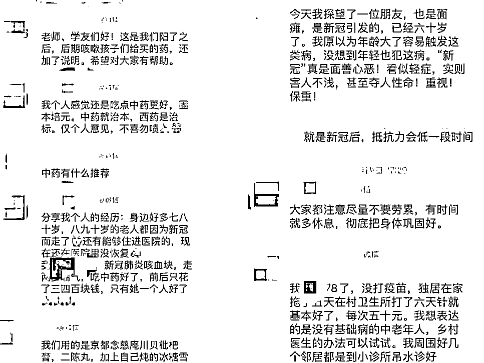
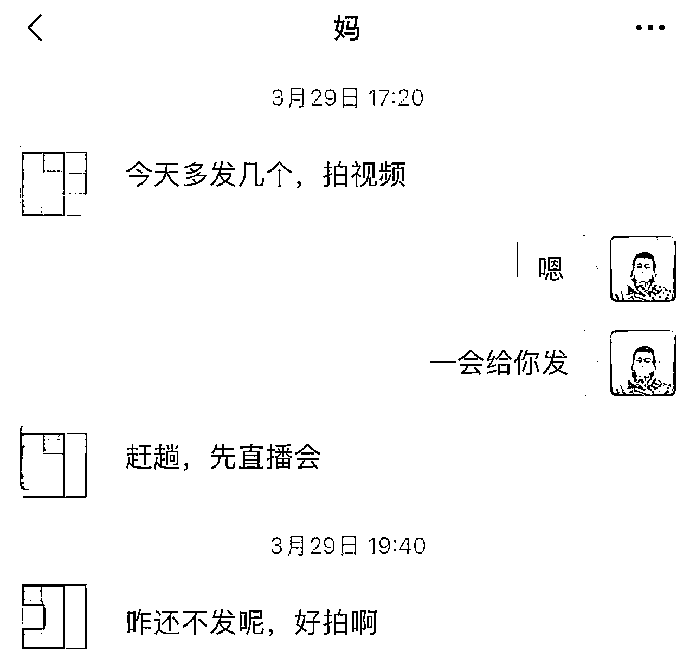
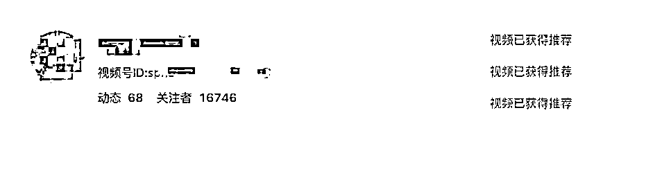
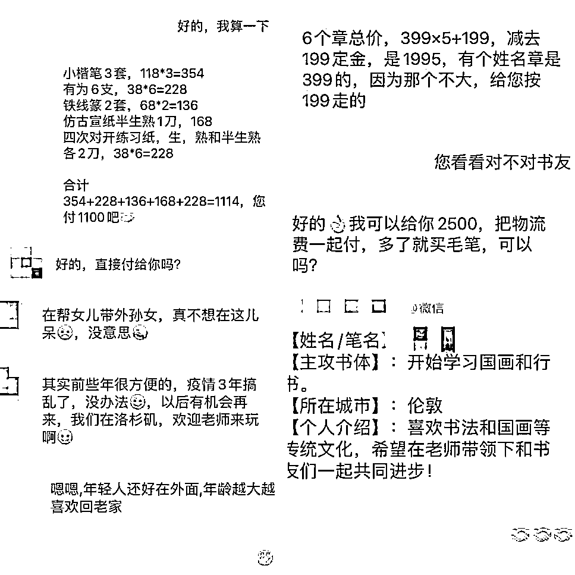
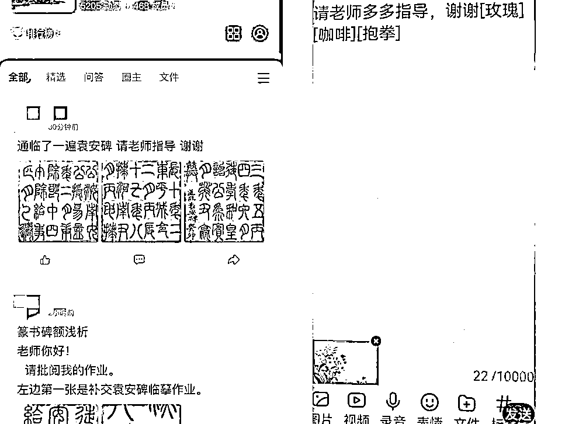
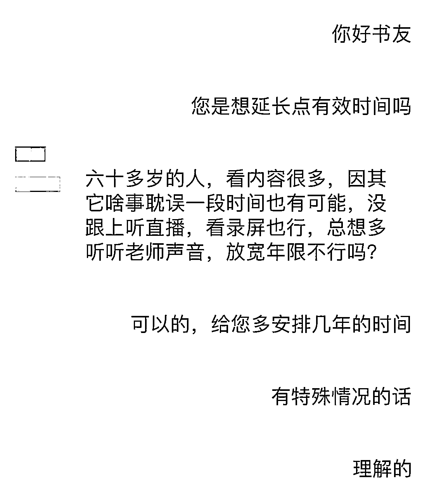
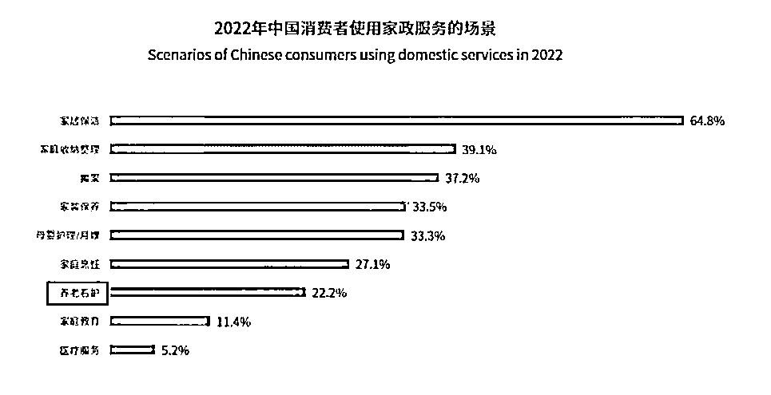
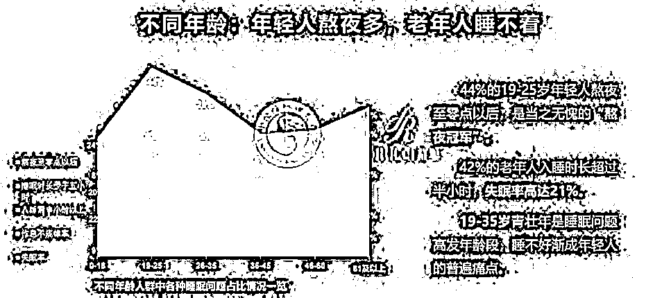

# 银发内容生意：小个体还能怎么切

先亮观点：面向退休人群的内容变现，最近两年正露出一个少见的窗口期。

圈子里有人把简谱带唱搬进直播间，一边领唱一边完成转化；即便没有音乐功底也无妨，换成书法、国画同样能跑。

我2019年起就专注这块，两年间投入有限，但营收和用户量都在往上走，还延伸出好几个面向长辈的内容变现与电商项目。关于这门生意，我攒了些实战体会。下面分四个问题，说说小个体切入高客单内容付费时，新的流量入口与机会在哪里。

一、银发内容生意值不值得做？
二、这批人的消费偏好是什么？
三、近两年市场发生了哪些变化？
四、2023年留给小个体的空间还有多大？

自我介绍下：渔火，创业者，还在路上。很久没动笔，先交代近况：2021年我作为联合创始人的项目拿到真格领投的千万融资；我自己主导的银发项目则始于2019年。

最近不少赚钱的朋友来问这个方向。我跟银发群体打了四五年交道，曾有83岁老人为我付费，多少攒了些心得。我也真心觉得这批长辈很可爱，只要认真交付价值与服务，一定会有回响。

（特殊时期，班级群里的相互问候）

所以今天重点聊2023年银发方向的机会，也简单说说这两年我观察到的变化。今天只谈银发内容变现，其他类目改天再拆。

回到2019年：我为什么选这个方向？当时找细分口子，我先看行业演进逻辑，我认为这是赚钱的关键。拿内容付费来说，成人领域从知乎时代，到罗辑思维会员、樊登听书、付费问答、订阅课，再到课堂专区、圈子；对应教培，则从线下、线上、一对一、大班小班、社群、AI课、训练营、行动营一路变化。能看出来，行业是随用户习惯与认知升级而演进的。

K12巨头的竞争强度大家都知道。寻常个体得找更好切的路。拿银发方向一对比就发现，这块还处在很早期，像未开垦的地。可以预判，随着时间推移，内容和形态会越来越丰富，这就是机会。人上了年纪，反而更有钱、更有闲为兴趣买单。

只看兴趣生活类，琴棋书画、诗词歌赋、针灸养生、摄影朗诵、茶文化、手机技巧、花艺园艺等，调研下来都有小团队在低调赚钱。我看准后便入场，一直做到现在。

再补一组官方数据：2022年收官时，全国60岁以上者约3亿，占总人口19.8%。45岁以上人群规模有多大，可想而知。

今年我明显感到，银发方向的关注度和入场者都多了不少。但很多朋友并不了解这批人，所以我先聊他们的行为习惯。

这几个月我蹲守各平台银发内容评论区，观察高频词，常看到"老人不网购""银发人群手机都搞不定""我开养老院亏了"之类说法。看完我意识到，很多人对这批人的行为和消费习惯存在严重误判。

都市银发属于抖音官方划分的八类核心人群之一，我原以为不少人会了解；小镇银发确实难做，但都市银发是有钱有闲的群体。我的项目把有效用户圈定在40到75岁、生活在一二线及部分三线地区的人群，效果不错。

觉得长辈玩不转手机？移动网络覆盖这么多年，山沟里都有WiFi。看看我母亲，1968年生，我替她开了个视频号，三十来天粉丝到1.6万。

（她天天催我给脚本）

（视频号跑了三十来天的数据）

她日常开播加上橱窗带货，一天能出八百到一千元的货。手上那台红米用了几年，至今没换。搁两年前还摆弄不利索的人，现在照样玩得转。所以别小看长辈们的接受力，也别小瞧下沉市场的潜力。

以为长辈只挑低价货？我的后台数据：单门课程五百到两千元，用户平均会买三门以上。书画方向的学员，光文房四宝和印章，一年就要花掉两千上下；艾灸这类健康向的客单价更高。退休之后，有人跟着子女漂在国外，有人在大都市帮忙带孙，也有人回了乡下，可这都不影响他们经营兴趣与生活。

（几张私域学员的截图）

概括起来：这批都市长辈刷手机很顺、手头宽裕、乐于转发、看重服务体验，线上买单也早已习惯成自然。

按我的经历来看，这一路可以分为三个阶段，只限以课程变现为主的方向，硬件、工具类产品、电商等今天先跳过。

2008到2015年算萌芽阶段。那会儿少有玩家摸清银发方向的门道，普遍走流量思路，到了后端变现却乏力。糖豆广场舞之类的垂直应用就在这段时间圈走大批流量。

2015到2019年进入野蛮扩张阶段。美篇这类社交产品，墨客、墨池、快乐50等垂直机构，还有养老家政、助眠服务等项目纷纷冒头；线下的老年课堂一座难求，音乐电子相册、天气类小工具一路狂奔，分走了红利。

2020到2023年则驶入高速增长段。巨头陆续下场：红松在短期内接连拿到蓝驰、经纬两笔数千万美金融资；知乎合伙人出走做老年项目；尚德、大鹏（后来倒了）、高途等也跟进。我感受很深，2015到2018那几年，面向长辈的内容付费实在粗放。

给个数字：早期做公号买量，不需要什么技巧，书法、国画类课程的ROI就能做到20，续报率也高。怎么理解？每月投五万块，能卖出一百万，客单价随手提到两千。核心是获客便宜，那时加群一个人才五块上下，还是精准的小众粉，不是泛粉。

同一时期，幼教与K12战场打得火热，优质母婴粉的市价从几十块一个蹿到上百甚至两百。而我这边的启动成本，无非是小鹅通的平台费、请老师录体验课的钱（最早卖期货，有体验课和长期课大纲就开卖），加上首月买量，全部加起来不到五万块，头一年营收就滚到了两百多万。

我复盘下来，这靠的是此前做儿童项目的底子。有K12或幼教背景的人转进老年方向，做课、服务、营销几乎就是降维打击。眼下，巨头下场培育认知，垂类内容付费的空间被进一步撑大。

别一说到银发，脑子里只剩养老院、暴利保健品、小礼品拉新、跳集体舞。如今这批长辈早不是几年前的模样，移动网络铺了这么多年，绝大多数赛道都值得拿银发群体重做一遍。社交、健康、吃穿住行、兴趣爱好、各类线上应用，处处藏着机会。

随手点几个眼下比较热的方向：银发版Keep、老红书、适老家政、助眠服务、银发文娱、营养健康管理、科学带娃课程，数都数不完。

在我看来，原因不外乎几点：

（1）流量端：触达方式更丰富，视频号这类长辈扎堆的短视频平台，加上美篇等垂类社区崛起，选择变多了。

（2）需求端：巨头涌入，认知与使用习惯被慢慢养起来；长辈更认服务感受，而非牌子光环。哪怕课程出自大公司，只要你服务到位、更贴需求，照样卖得动。在他们眼中，大公司跟小团队没两样。何况都市银发早就能熟练装App、转发留言、点开小程序，各类支付也玩得顺。

（3）供给端：市面上针对长辈的好产品太少。其他赛道卷到120分才摸得着门槛，这里考到60分或许就能立住。此前电子相册、天气工具短短数月圈几百万用户的事，不是没发生过。

但要提醒，流量阵地与产品形式得选对。老实讲，主流渠道我基本都试过，有了用户之后又反复测过多种打法。结论是：🛰️生态与视频号这条路最顺，抖音和线下也能走，这里不涉及卖货玩法。

（班级群的作业圈，大字版手机也挡不住分享欲）

对素人、小个体而言，无论抓流量还是做课程，空间都不小。若你缺产品与技术能力，我更建议单干做课，是真划算。

眼下我正围绕生活与兴趣两大板块铺开，批量跑轻课测试。有人觉得这行吃的是专业本事。老实说，我起初对书法、国画一窍不通，只懂人群与流量。课由对口专业人士来录，老师先给大纲，我再按用户需求调整把关；不少方向找在校生合作，花极低的成本就能攒出像样的课程。

拿我近期上线的电子琴课来说。早前有朋友讲，一说到电子琴，还是教老年人，感觉太小众，会有人掏钱吗？答案是：音乐类课程在银发内容变现里盘子不小，快乐50、红松学堂这些体量可观的机构都在做，客单价还高。

需求怎么挖，这里不赘述，可翻我早前在赚钱发的那篇长文：https://articles.zsxq.com/id_pt1urnv5g4ah.html 。需求找准了，下一步是快速跑MVP验证，把流量和供给两端打通，毕竟最后靠卖课收钱。

于是我拿视频号去试长辈音乐类内容，怀旧金曲剪辑、曲谱、带唱、器乐都跑了一遍，拉新效果可以，前期流量基本能照这个路子走。

供给端才是关键：做这门生意，最要紧的是摸透用户。大纲不一样，卖出来的结果可能差出十万八千里。我跟至少几千名学员一对一聊过。起初我执着于详情页漂亮、店铺装修精致、海报高级，后来才明白这些用户压根不买账。他们决定报名，看的是试听课内容、老师合不合眼缘、服务是否到位，以及长期课能不能下载、随时回看。有回做AB测试，淘宝上花一千块做的详情页，愣是输给我用懒设计十分钟拼出来的绿底、大字长图。

（比起品牌，不少人更在意能否下载、内容是否长期有效）

所以记住，东西不必花哨。多跟用户聊、摸清需求、把课程形式定下来——录播配直播，还是纯直播、纯录播——再定价格、开卖，思路就顺了，余下的边执行边调。

常规内容付费之外，再列几个我近期看到有团队在跑的方向，这几块我也重点研究过。

① 适老家政
家政盘子本就不小，近年势头也不错，圈里已有做得漂亮的案例。眼下这类服务多由子女替父母下单，内容涵盖保洁、营养餐、量血糖、涂湿疹药膏、陪散步聊天、陪诊煎药等。

思路类似云家政，差别在获客路径和细分方向。不妨看看天鹅到家里面针对老人的服务，订单量已经很可观，只是项目还偏单一。

② 长辈助眠
翻资料时看到，《国民睡眠健康白皮书》提到40岁以上群体的睡眠困扰普遍且持续加深。我顺手摸了下数字助眠赛道，好睡眠、享睡这类App已经不少，还有音乐加白噪音的组合产品。睡眠成因本就复杂，牵扯面很广。

素人想切的话，有三条路：一是教程向，用极低价课讲清各类助眠工具怎么用；二是心理与情绪疏导类课程；三是健康管理向，比如请营养师排晚餐，或教大家睡前做点什么运动。

③ 银发旅行
从数据看，长辈出游的增速相当猛。年轻人习惯先做攻略，长辈则怕踩坑，我母亲一聊旅游就担心被宰。素人能不能做适老的定制攻略，收点服务费？顺带为靠谱旅行社导流拿佣金？视频号上风景、旅行类内容有多火，翻一翻就明白。

④ 银发电商
这块不必展开，星球里很多书友都跑得不错，还有做图书推荐号的。跟几个团队聊过，目前跑得最猛的是女装与鞋，尤其鞋类，利润空间很可观。这里就不细讲，手上有资源的朋友可以琢磨。

④ 银发宠物
宠物赛道近年跑得很快，我总觉得幼教里验证过的东西，都能在宠物领域重来一遍。之前翻报告，全国一年新生儿约一千万，而宠物猫有五千万、宠物狗三千万上下。调研还发现，养狗人的平均年纪比养猫人大约十岁，在37岁附近。看到没？这个均值已经贴近中年往后，那中老年养宠的规模可想而知，养狗的恐怕更多。

宠物这条线确实值得试。我给母亲搭的就是宠物号，她1968年生人，亲自出镜更有说服力，跑了一个多月粉丝到了一万七。

（前文写1.6万，这里已是1.7万——成稿期间又涨了一千粉）

开通橱窗加上开播——我母亲纯闲聊，不讲技巧，人还在老家——一天能走八百到一千元的宠物用品，佣金三成上下。后台私信天天爆，问的全是养宠琐事，其实搜一下就有答案，可他们不会搜，更没养成习惯。这里头的需求与想象空间不小。接下来我可能不让她开播卖货了——直播终归吃能力，她学起来吃力。或许改成直播引流，引到私域再卖货做延伸。若接入AI，能不能做成个性化问答，当个"专属于长辈的宠物医生"？或者出面向长辈的养宠经验课？篇幅所限，先不展开。

以上都是我的个人视角，难免有对有错，只希望能给你一点启发。2023年素人在银发方向的窗口就聊到这儿，有疑问欢迎在评论区交流。

评论区：
Ray：我那位是音乐专业的，想带她做个人账号。
渔火：手上有专项本事的人，扎进银发方向会更占便宜。
控心：是不是非得有专项本事才好进场？
渔火：不必，把用户摸透就行，我自己也没什么本事。
阿顾、Jia：内容很扎实，学到不少。
Jia：关键在于你手上有能产出课程的资源。
渔火：你可能没留意，像近期的电子琴、宠物课，都是请对口的在校生录的。