# 教叔叔阿姨唱谱，一年进账30万

你刷抖音或视频号时，见过下面这种画面吗？

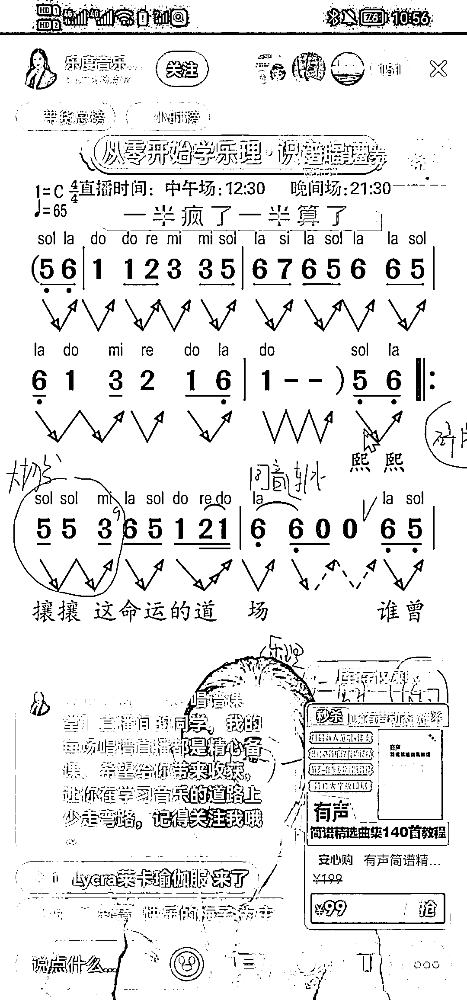

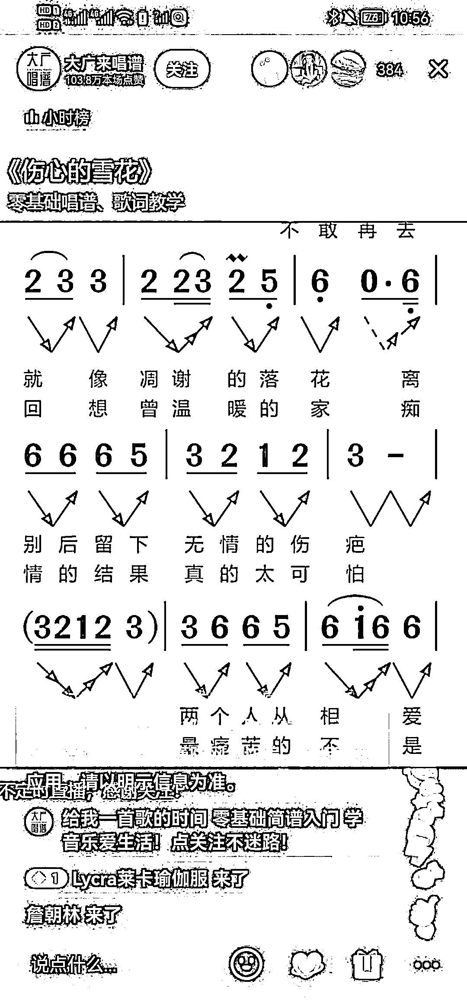

这行当不扎眼，市场空间也有限。玩法说来简单：用打谱软件带普通人认简谱，直播时领着唱，靠卖知识收钱。线上课有，但真正走量的是纸质谱册。来的人多是退休群体，五十岁以上，阿姨占多数，退休干部也不少；一单百元左右。我单枪匹马干了快一年，攒下三十来万。和赚钱大佬不能比，经验还是能拿出来说说。先晒2022年部分进账：

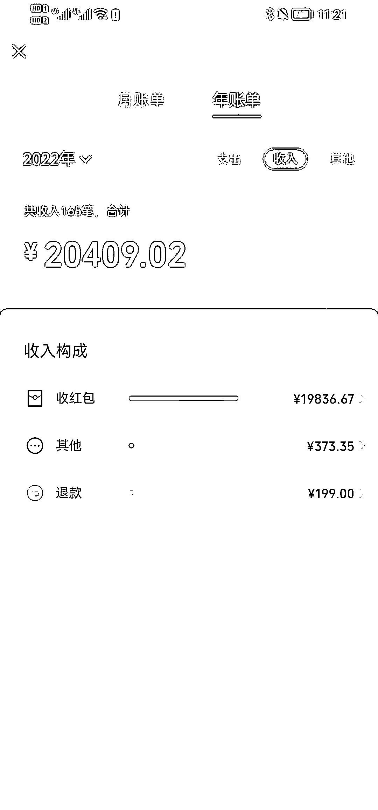

我是LLL，赚钱三年老潜水员；本职在十八线小城体制内，不算忙。2020年进圈，淘宝蓝海、视频号大航海、快手小游戏都试过，全没起色。去年3月跟抖音2.0直播大航海系统走了一遍，后来转去视频号，做简谱识谱，学员以五十岁以上女性为主。下面是我的实操记录，文笔普通，欢迎指正。

一、音乐技能直播有哪些门道

把音乐本事搬进直播间，先吸引人，再设计收费口。收费方式常见三种：打赏、带货、知识教学。本文只讲教学类。教学类里又分乐器课（钢琴、吉他、电子琴、电吹管、葫芦丝、二胡等）、声乐课、音乐基础课。

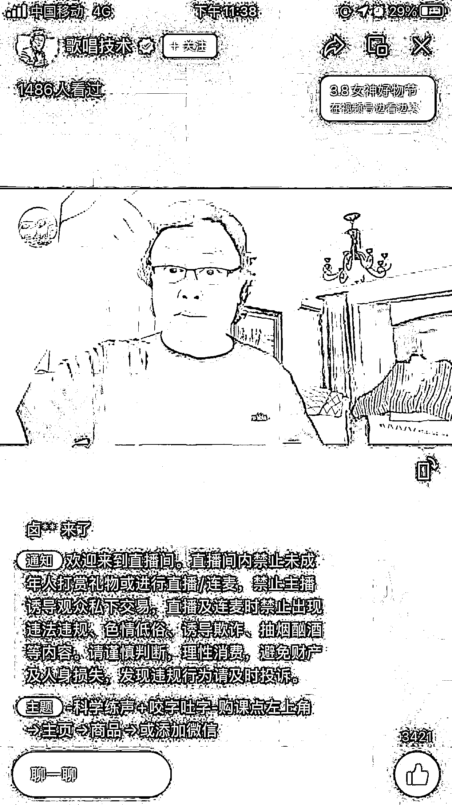

声乐课堂

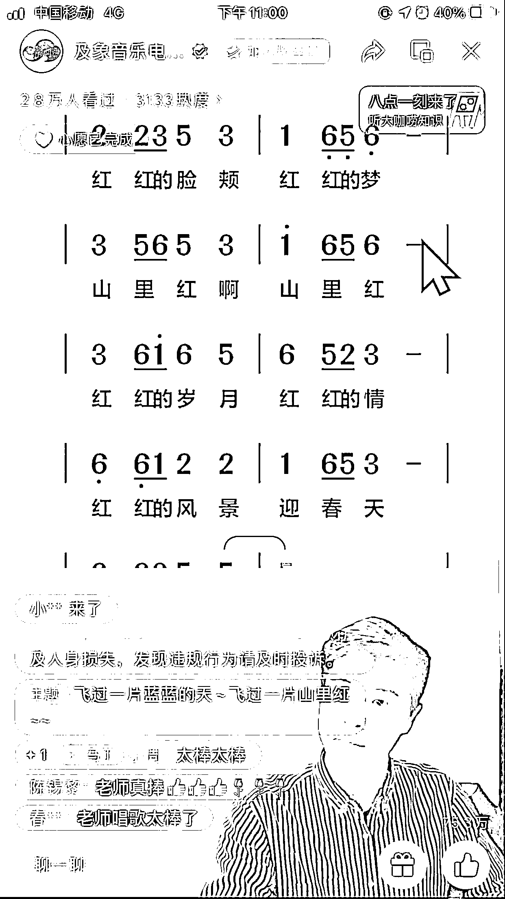

歌曲课堂

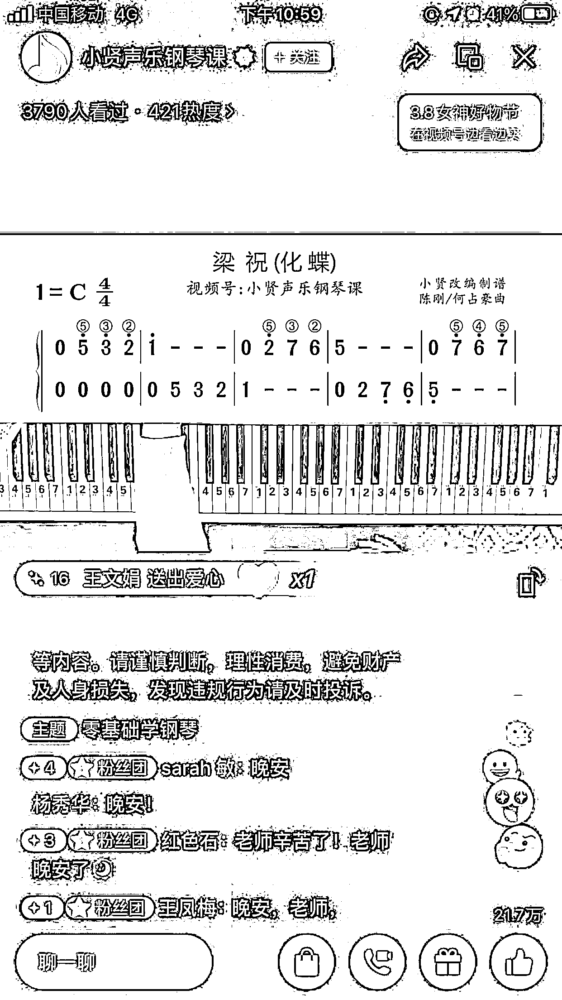

简谱钢琴课

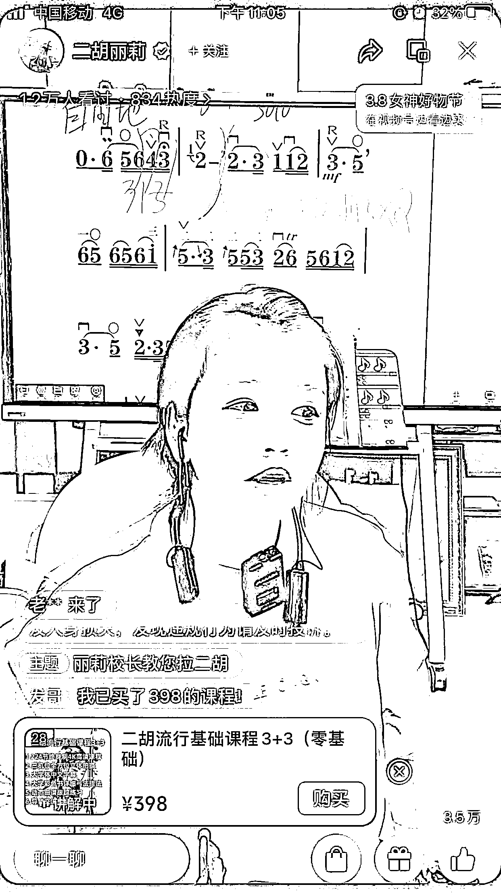

二胡课

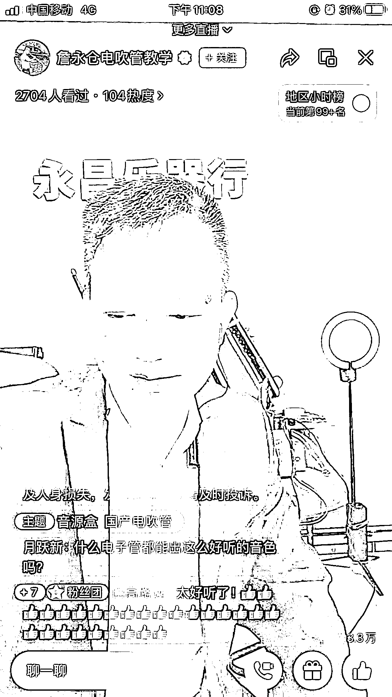

电吹管课

小提琴课

二、怎么选适合自己的细分方向

（1）先看自己手里有什么牌

先盘自己：哪样音乐本领拿得出手？对什么最有热情？哪怕边学边教也行。我科班出身，音乐学院毕业，也在教学一线待过，乐理、视唱练耳这类基础课不用临时补课，把线下课堂那套搬到镜头前就能用。

（2）测试成本要小

前期别急着搭班子，自己把“怎么播、人从哪来、卖什么、怎么收钱”串成闭环，主要花时间，现金越省越好。一个人能跑通，才适合小步试。

（3）蓝海里面挑受众最宽的口子

音乐技能五花八门，我为什么选识谱？因为谱子相当于音乐的汉字，学乐器也好，提升音乐素养也好，看谱都绕不开。对想提高音乐素质的人来说，识谱几乎是必经环节，算硬需求。国内常见记谱法主要是五线谱和简谱。多数人觉得五线谱入门偏难；简谱顾名思义，理解门槛低。于是简谱识谱成了不少人的学习目标，也是相对容易接受的基础理论课。

（4）对标账号怎么找

方向定了，别凭想象开干，先看平台上有没有人已经跑起来。有人做，就拆同行：直播间怎么搭、流量怎么来、产品长什么样、怎么成交、定价多少，每个环节都过一遍。

先在抖音搜索框输入“简谱教学”，依次点开上面的分组，看看有没有异常值。

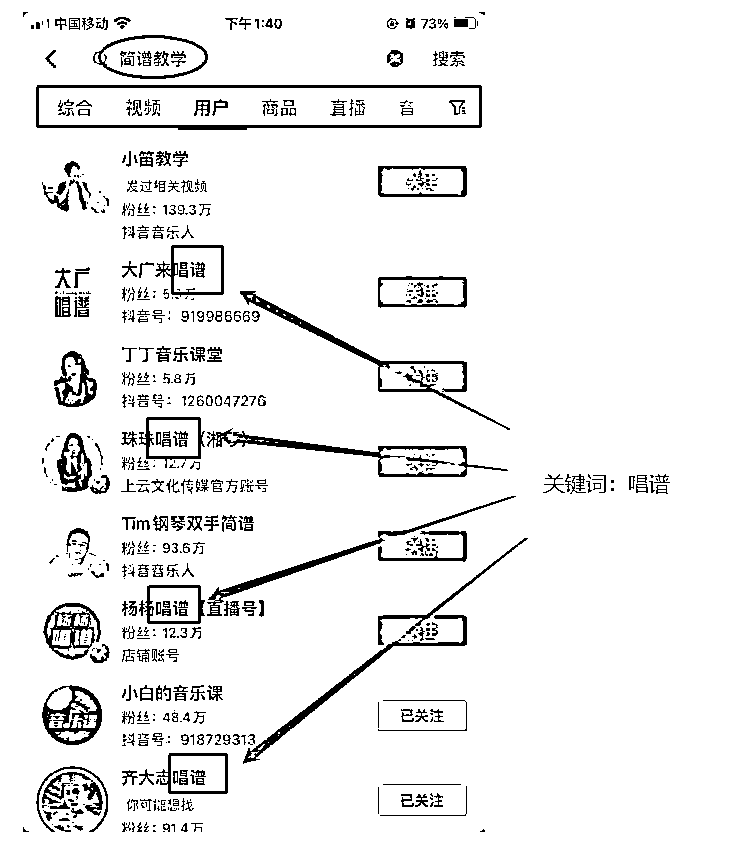

你发现了什么？

接着搜“唱谱”，在搜索框输入“唱谱”后切到用户，会看到不少唱谱账号。

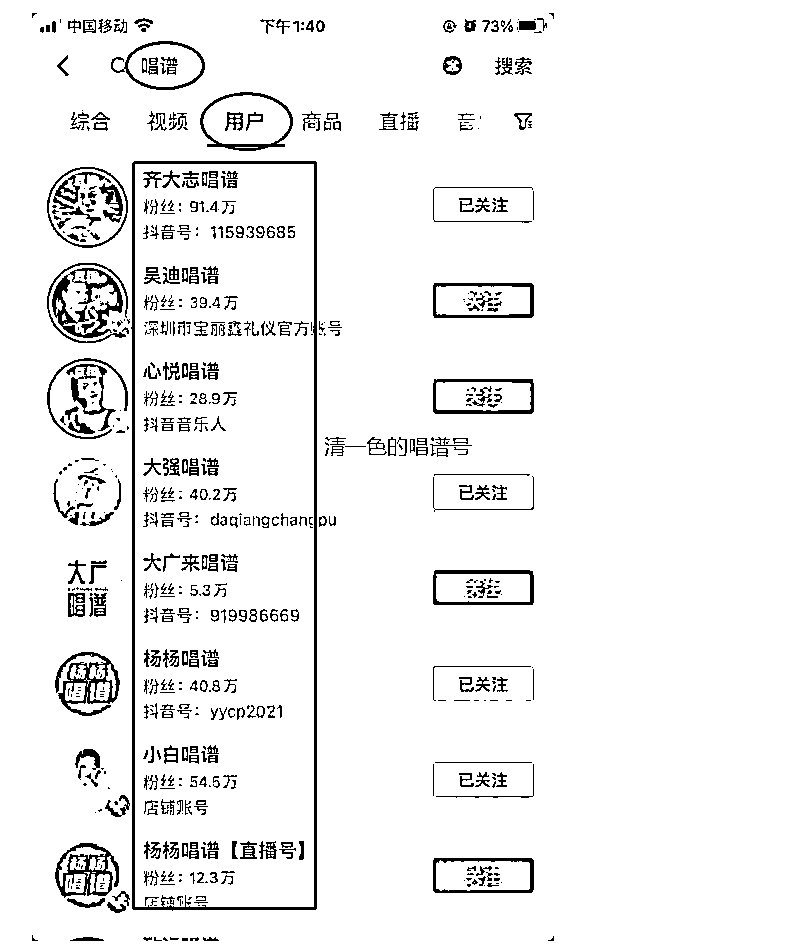

这些账号都能当简谱教学的对标对象。逐个点进主页，看看他们发什么视频、点赞量怎么样、留言区有哪些需求；正在直播的就进直播间观察，摸清行业的基本情况。

第二步，用蝉妈妈之类的第三方平台分析同行数据。蝉妈妈官网：https://www.chanmama.com/

打开官网完成注册并登录，左上角切换至“抖音分析平台”。

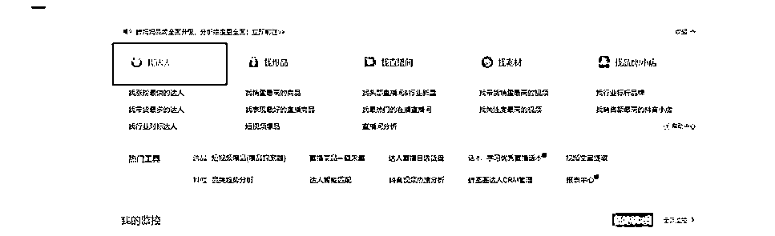

选择“找达人”。

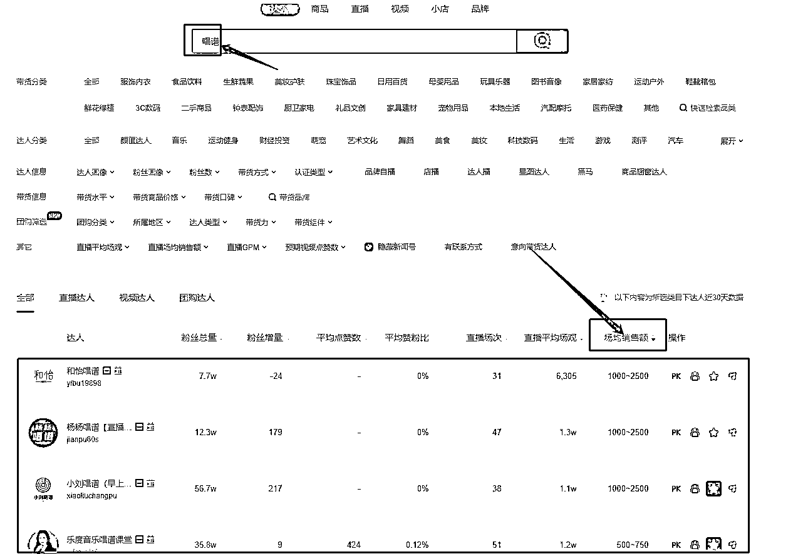

在顶部搜索框输入“唱谱”，再点右下角的场均销售额（详细数据要开会员），就能看到唱谱赛道头部的变现水平。挑一个账号作为对标，照着细节扒，先模仿再超越。

三、项目落地

（1）直播形态怎么定

研究对标账号后，我采用不露脸的做法：简谱软件加PPT就能播，一台电脑足够，设备并不复杂，如下图所示。

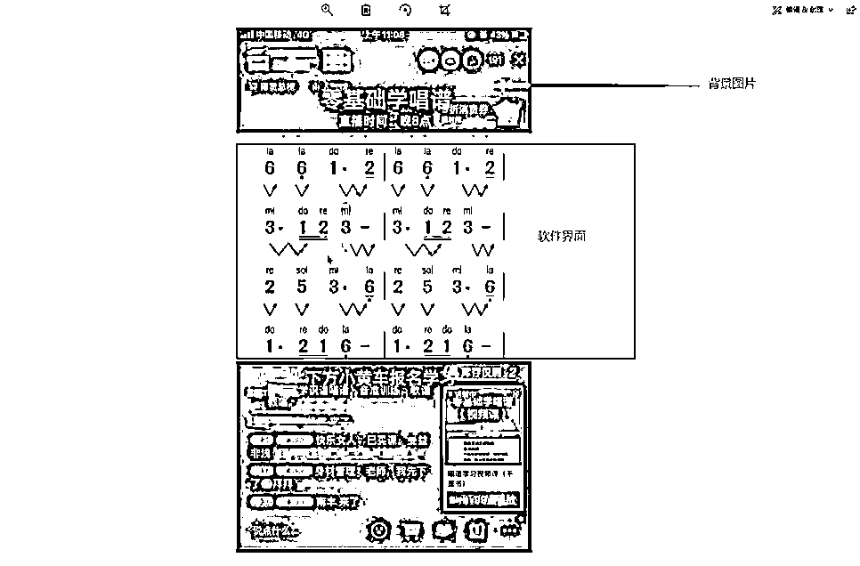

（2）直播工具怎么备

需要一台电脑、麦克风和耳机（耳机用来监听乐曲声）、OBS软件（直播软件，官网：http://www.obsproject.com.cn/）、教学PPT（讲基础知识用）以及简谱软件。

同款软件怎么找？最快的办法是以学员身份在直播间直接问主播，有的主播会告诉你软件名。同时用好搜索引擎；如果问了几个主播都没回复，就去百度、淘宝、🛰️、知乎等平台搜索并逐个对比。经过大量搜索和比较，我最终找到了JP-WORD（官网：http://www.happyeo.com/）。它是一款专业简谱打谱软件，能播放乐谱，唱谱时还有对应进度条。完整功能要付费，价格见下图。

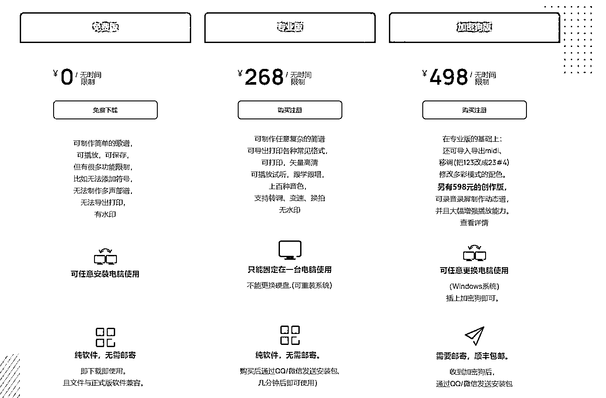

如果需要购买，建议选498元的加密狗版，可以在多台电脑上使用。

（3）内容流程怎么排

顺序我做成：自我介绍、基础知识讲解、节奏型讲解、节奏型练习、卖课，如下图。

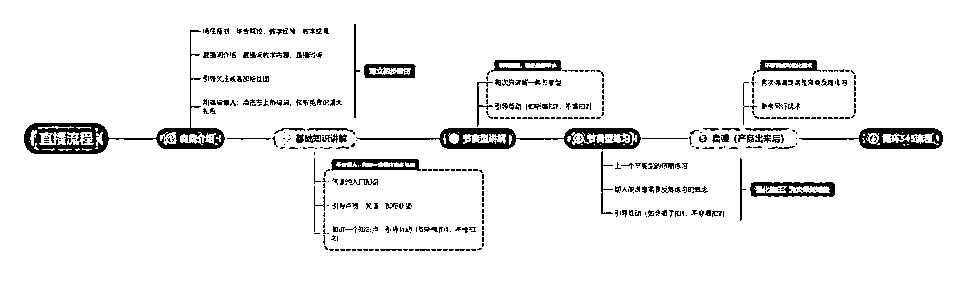

“基础知识讲解”要制作PPT。

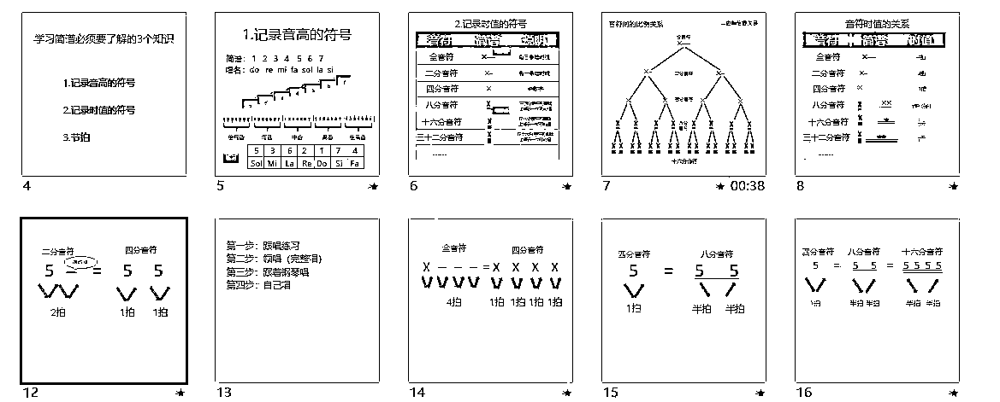

“节奏型练习曲”可以从市面上的视唱练耳书里找谱例，也可以自己写，把谱例录入JP-WORD，直播时随时调出来。

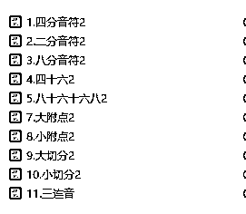

整套内容从零起步，一点点讲简谱知识，再配上足量唱谱练习。直播以带唱为主，像运动博主带操那样亲自示范，目标是让学员真听懂、真会用。

（4）开播设置怎么做

准备停当就能开播，流程如下。

先装OBS，点右下角“设置”，进入“视频”，设置“分辨率”：竖版填1080*1920，横版填1920*1080。

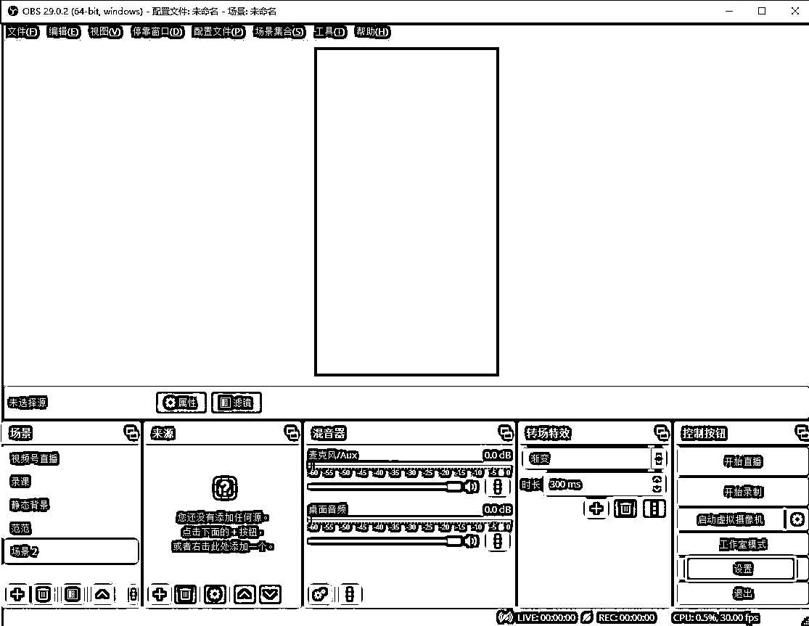

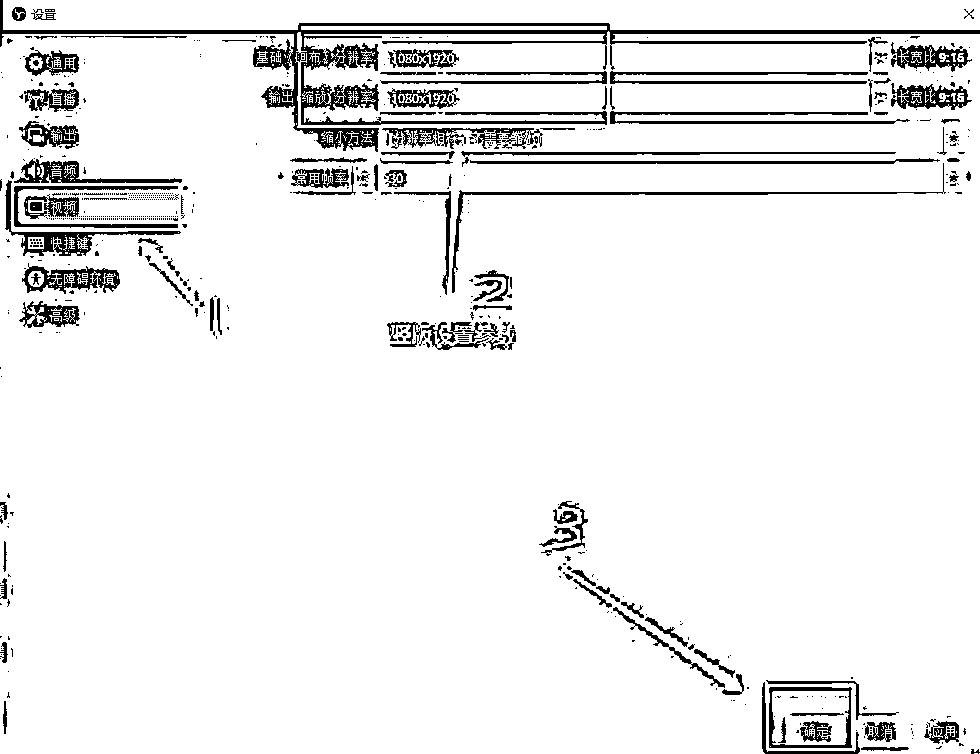

随后在“来源”里添加各种窗口，直播时切换更方便。

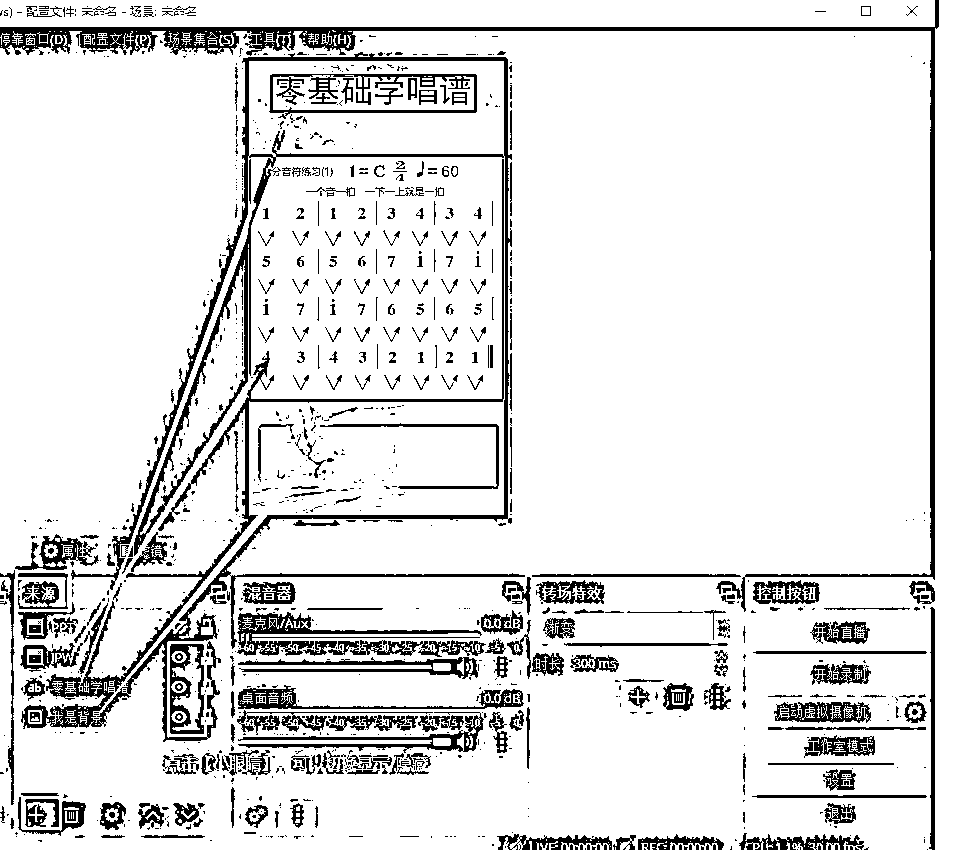

接着点“启动虚拟摄像机”。

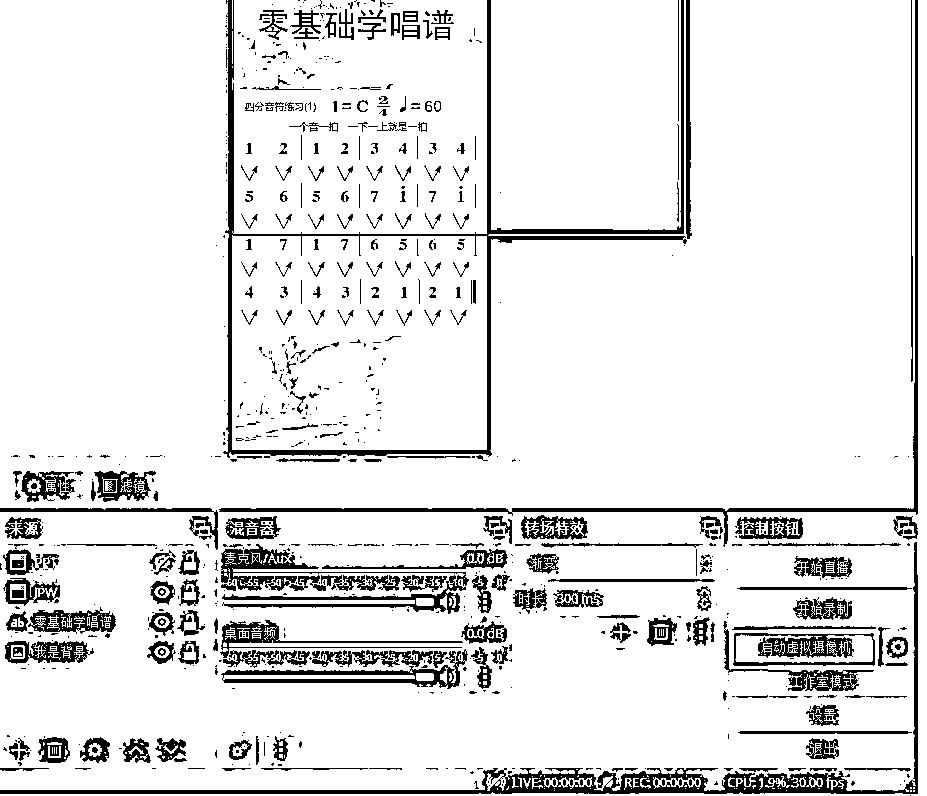

再在电脑上登录🛰️，点左下角三条杠，打开“视频号直播工具”。

最后点“添加画面源”，再点“摄像头”，选择“obsVitual Camera”。这样OBS画面就以虚拟摄像头形式出现在视频号直播工具里，接着就能开播。直播时只需在OBS上操作，同时记得打开视频号直播工具上的麦克风，否则没有声音。

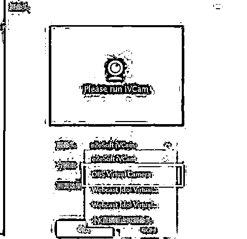

开播后，我把自己原先注册的企业🛰️绑定到视频号，直播中增加引导加企业🛰️的环节，为后续在🛰️里成交做准备。

（5）课程怎么同步做

课程也同步开发，用OBS录制后上传到“小鹅通”，用户购买后把邀请码发给对方即可。课程内容主要是录制好的简谱唱谱视频。唱谱这项技能必须靠大量练习才能掌握，熟能生巧；初学者即便在直播间学会了看简谱，不大量练也还是唱不好。这正是这个赛道的特点，也是我敢在直播间把课程内容完整教出去的原因。

四、音乐技能直播的几个阶段

第一阶段：直播和产品一起推，靠回看数据把流量抬起来

（1）直播这头：先把开播频率顶上去，再靠回看找原因

刚开播时，直播间通常没人，别因此泄气，坚持播下去流量会慢慢起来。每场结束后都要及时回看：结合回放和直播数据，分析哪个动作带来了在线人数增长、哪句话术拉高了互动量。这些回看很关键，下面是我当时的表格。

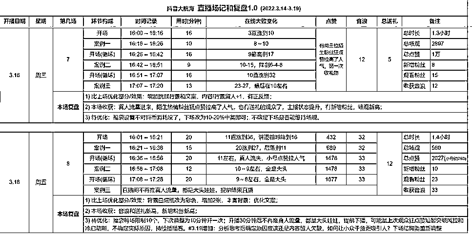

前期先看观众愿不愿留、愿不愿聊、愿不愿进粉丝团，具体方法可以看去年3月赚钱抖音直播2.0大航海的课程，内容很干。播了约一周，在线人数基本能到30到100人，按一场两小时算，单场观看人次很容易做到2000到3000。另外可以避开同行的直播高峰。这个赛道大部分主播在上午8点左右和晚上7点左右开播，所以我选早上6点到8点。一来8点后要正常上班，二来核心客群是50岁以上的中老年人，不少人睡眠短、起得早，6点开播基本不用愁流量。要注意尽量固定直播时间，增强用户粘性。

刚开始为了尽快看到结果，我每天5点半起床，眯着眼打开电脑就开播；有时还没睡醒，讲话磕磕巴巴，闹过不少笑话。比如播到一半困得不行，直接跑去卫生间用冷水洗脸；课讲到一半才发现PPT没切过来；评论区常有学员提醒看不到乐谱。随着直播次数增多，我慢慢适应了早起直播的节奏，播完还能以更饱满的状态投入主业。现在回头看，很感谢那段时间的坚持，正是持续早起直播，才让我快速拿到正反馈，有了今天这点小成绩。

（2）产品这头：先快速搭起来，有问题再迭代

做产品前先做全局规划：产品用什么形式交付？内容体系怎么搭？差异化在哪？怎么录制？如何快速产出课程？录制课程的SOP是什么？这些问题想清楚，否则会浪费大量时间做重复动作。我的产品规划大致如下：

1）内容体系：①基础乐理知识；②基础节奏型；③基础节奏型练习（跟唱练习+完整乐曲带唱+钢琴动态谱）；④综合练习曲（跟唱练习+完整乐曲带唱+钢琴动态谱）。

2）差异化：①练习曲加入“跟唱练习”，一句一句带唱，初学者更容易接受，我观察同行时没看到这种教法；②综合练习曲共110首。同行大多用当下流行歌，比如《梅花泪》《早安隆回》《红枣树》，这些中老年人很吃；但用经典老歌做教材的同行很少，所以我主要选《歌声飘过30年》里的歌曲。《歌声飘过30年百首金曲演唱会》是《中国音乐电视》推出的合集，收录了30年来流行于内地及港台地区的百余首代表性作品，梳理了改革开放30年中国原创歌坛的经典歌曲。另一个原因是客群多为50岁以上中老年人，这些经典老歌是他们年轻时的流行曲，拿到直播间教唱很容易引发情感共鸣。

3）交付形式：①抖音用学浪。我有教师资格证，资质没问题，开课后录完一课就上传一课，很方便。但即便这样，仍有很多客户每天问在哪找课程，所以录一个“如何观看课程”的视频很有必要，来问的人就引导去主页看视频。②视频号用小鹅通。视频号官方没有虚拟课程平台，只能通过第三方平台上传课程，需要把购买用户引导加🛰️，再通过🛰️发送。我用小鹅通，它可以直接上架虚拟课程并通过视频号卖货，比较方便。另外也可以开通视频号小号，把小号设为私密账号，课程传到小号，引导客户关注小号，后台通过关注申请即可。

避坑提醒：一开始为了省钱，我用了免费的“荔枝微课”，结果售后问题一大堆。荔枝微课广告多，每天都有大量客户问怎么找课程、为什么看不到课程。后来实在受不了无休止的售后，花钱买了小鹅通，用户操作方面的问题基本就没了。所以课程平台选择很重要，毕竟我们的客群不是玩手机的年轻人。

第二阶段：跟着市场反馈持续迭代产品

最初为了“轻交付”，我卖的是虚拟课程。但中老年用户眼睛不太好，长时间盯屏幕、字又小，直播时不断有人问能不能出书，这就是市场给我的反馈。后来我改成“简谱书+二维码”：每首乐曲上方印一个二维码，手机扫码就能看对应练习视频，用户可以一边看书一边练，很受中老年人欢迎。

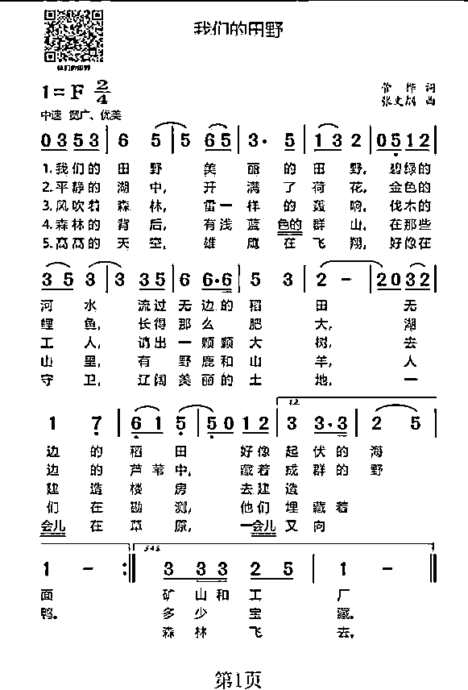

所以产品做出来后，要持续收集市场反馈，再根据反馈不断优化。

第三阶段：多措并举，把收益继续放大

（1）拉长直播时长，增加场次

产品有了、变现稳定后，就要想办法放大收益。第一种方式是提高单场直播时长。做过直播的人都知道，直播是体力活，连续讲几个小时非常耗体力和脑力。在体力允许的前提下，尽量拉长直播时长；内容讲完了可以再从头讲一遍，因为很少有人从头听到尾，有时聊聊天也行，不少客户就是在课后聊天阶段下单的。

增加场次也好理解：在力所能及的范围内，根据人群特点加场。前期我主要早上6点播，为的是避开同行。等直播间有一定竞争力后，我把场次增加到一天三场：06:00-08:30、13:00-14:30、19:30-21:30。

（2）无人直播不是长久之计

去年视频号的无人直播很火，基本不扣分、不封号，还能一直循环播放。那时我怕封号，一直没敢试。（当然，现在视频号上仍有很多录播，知识教学尤其多，只是被提醒的概率更高，也出现了扣分。）直到10月我才慢慢尝试录播：提前录好视频，或者干脆挂直播回放。那段时间收益几乎是躺赚，每天有2000到3000元。现在回头看，最后悔的是当时没及时放大，没多开几个小号放录播，否则收入应该能破七位数。

随着视频号发展，无人直播逐渐被打压，现在几乎寸步难行。即使放录播，也要保持直播状态，不然等哪天不能录播了，会发现自己的直播能力退步得厉害。更糟的是心态会变，不愿直播、畏难。所以跟平台规则硬扛要谨慎；即使做录播，也要保证有一两个账号正常直播，这一点很重要。

我测试发现，播放20天以前的直播回放不太容易被提醒，只要不频繁被提醒，一般不会扣分。如果因录播被提醒，也可以引导用户去主页橱窗买课程，这也是个办法。

（3）复制、复制、再复制，探索普通人也能播的方式，多平台同步开播

放大收益最好的办法是多账号矩阵化运营，把一个账号跑通的案例复制出去。可以请主播合作，打造多个直播间。但问题也来了：去哪找那么多会唱谱、有音乐技能的主播？这类主播本来就少，就算找到有专业能力的人，也要培养一段时间；等他们把主播技巧和商业逻辑摸清后，很多人会选择单干。圈内都知道，唱谱赛道门槛不高，很容易独立出去，所以靠有音乐技能的主播并非长久之计，天花板太低。

因此要探索一套普通人也能在这个赛道直播的模式。这里分享一个思路：把整个直播间拆成两部分。①讲解部分：把讲解逐字稿写出来，让主播反复练习，就能比较流畅地表达。比如讲清一个知识点或一个节奏型，这些都可以照着逐字稿念，只要用户能听懂就行。②唱谱部分：可以提前录成音频或视频，需要唱谱展示时直接播放。这个已有成功案例，可参考抖音号“大广来唱谱”。

另外就是多平台同步直播，一鱼多吃。具体操作是通过OBS“开启虚拟摄像头”，然后在视频号、抖音、快手（我没测试）等平台添加“虚拟摄像头”，详细步骤见上文“项目实操—开播引流—第五步”。

直播引流，先避开这个坑

多个平台一起开播时，最好别在口播或画面里点名平台；例如在抖音直接喊“加🛰️”，就容易触线。

（4）产品要成梯队，才能接住不同人

一套完整的产品盘子，通常要有获客款、主力爆款和高利润款。不同人有不同需求，产品越丰富，覆盖的人群越广。但开发新品很耗时间精力，想清楚再动手。

价格上，我的大致分法是：获客款9.9元、爆款99元、利润款199元，交付难度由浅到深。不同细分赛道各有各的情况，同行定价也千差万别。定价这件事很考验功夫，我这里没有万能公式；经验就是跟着需求变化走，多看看同行怎么定价，再按自己的条件来。

（5）先把底盘筑牢，再谈增长

各平台竞争激烈，规则也变快，不合规很快会被清出赛道。所以得持续学习、持续试错、持续适应平台规则。产品定位也不是一次定终身。就像前面说的，我最早做虚拟课程，后来做书本；现在同行普遍卖书，同质化很严重。这时就该往训练营、收费直播等方向想，开发新产品。我发现不少客户买了产品，仍然愿意来直播间听课，用户就是喜欢直播和互动。所以想提高生存力，条件允许就尽量把客群往私域引；团队的话，可以分一部分人专门做私域运营。私域运营我自己经验不多，基本没怎么运营过，但可以分享几个思路，放在后面章节。

五、把用户接进私域，怎么做更顺

视频号有个优势：把流量接到私域很顺滑。先注册企业🛰️，视频号完成认证后能直接挂在直播间；用户通过企业🛰️名片就能加🛰️。提前把企业🛰️的欢迎语设好，在欢迎语里引导用户进群；每次开播把链接丢到🛰️群，既增强粘性，也能拉长直播间停留。不少用户是先学一阵子，后面才下单。

六、用户进了私域，如何转化成交

私域成交之后，后续运营非常关键。这里给一些方案和思路供参考。艺术教育赛道里体量较大的团队，几乎都走录播，手里账号矩阵很多；直播间并不卖课，全部先把人引到企业🛰️，再到私域完成转化，客单价不低。

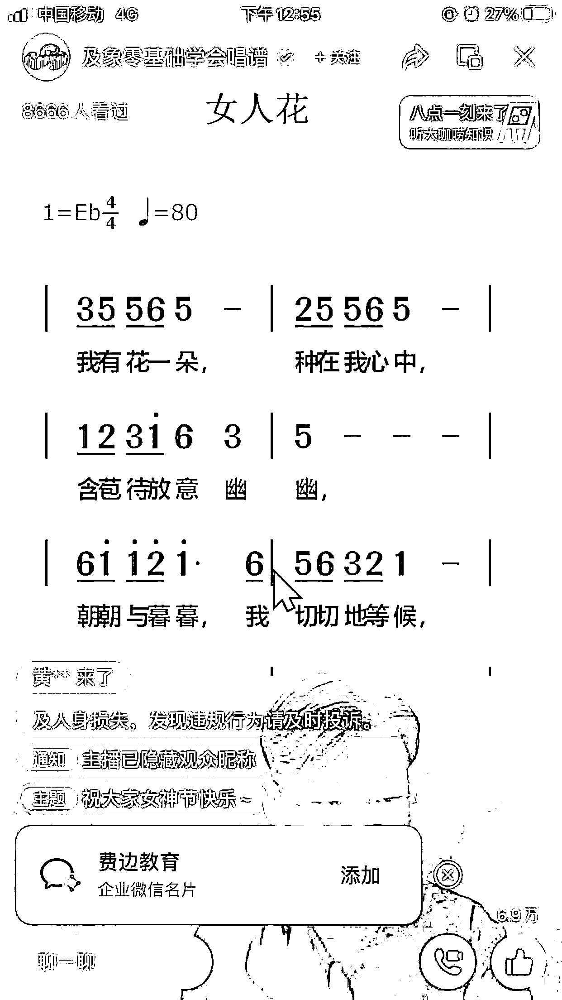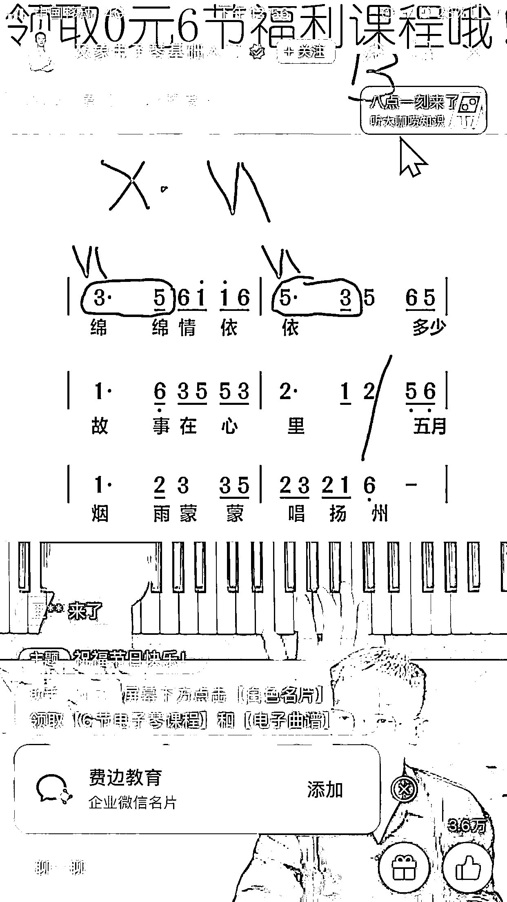

引到私域的话术是“免费领取XX节XX课程”。用户进私域后，他们会持续发消息，通知免费课，再引导买课，具体看下图：

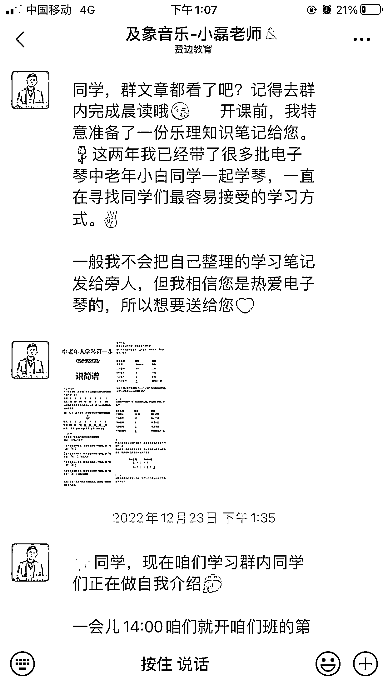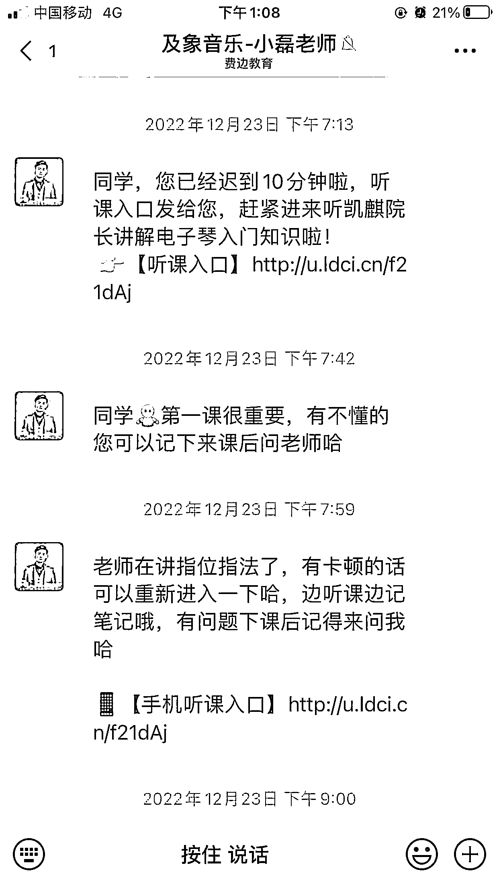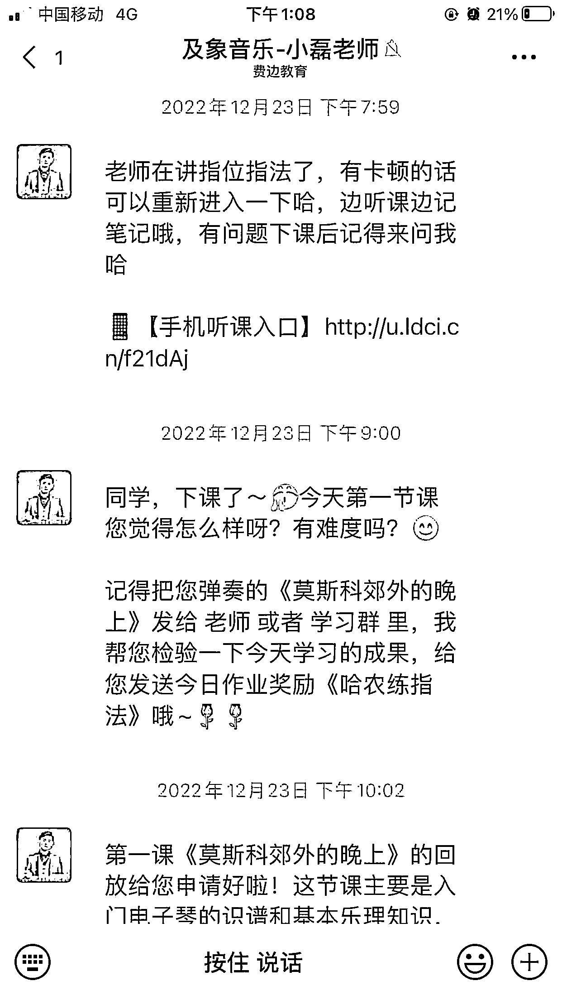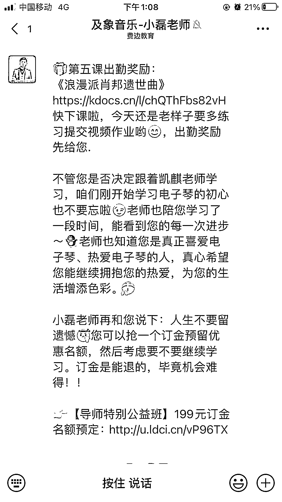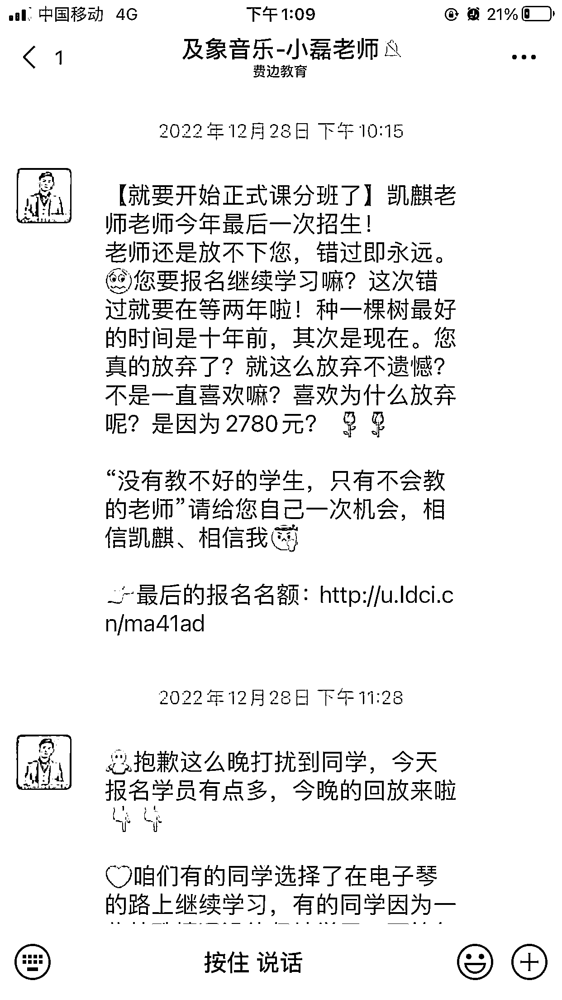

七、新手入场的门槛与建议

① 自己至少得懂基础乐理、会唱谱；本人不会的话，团队里至少有人会。

② 这个赛道转化率偏低，因为用户只要有时间，就可能一直蹭免费内容。

③ 先照着同行做，再争取超过；执行到位，边做边找思路。

④ 视频号录播眼下还能跑，但一定会越来越难，录播终究不是长久方案。

⑤ 没有音乐基础的人，可以提前录好唱谱环节，再配合预先设计好的讲解话术，同样能开播。案例可参考抖音号：大广来唱谱。

（1）延展方向：乐器类教学

乐器类教学实操性更强，学习过程需要拿具体乐器练，所以整体转化率通常更高；不像唱谱赛道有大量只蹭免费内容的用户。客单价也能做得更高，当然竞争同样激烈，有条件的社群朋友可以试试。落地方法还是先学同行再做出差异：先看别人怎么干，做近乎一比一的复刻，然后在实操中不断优化调整。下面给几个思路和案例：

1）电子琴教学

用简谱唱谱把用户引到私域，再在群里做电子琴录播教学，配合转化文案。

传统电子琴教学会展示电子琴+教材实操，转化率较高。

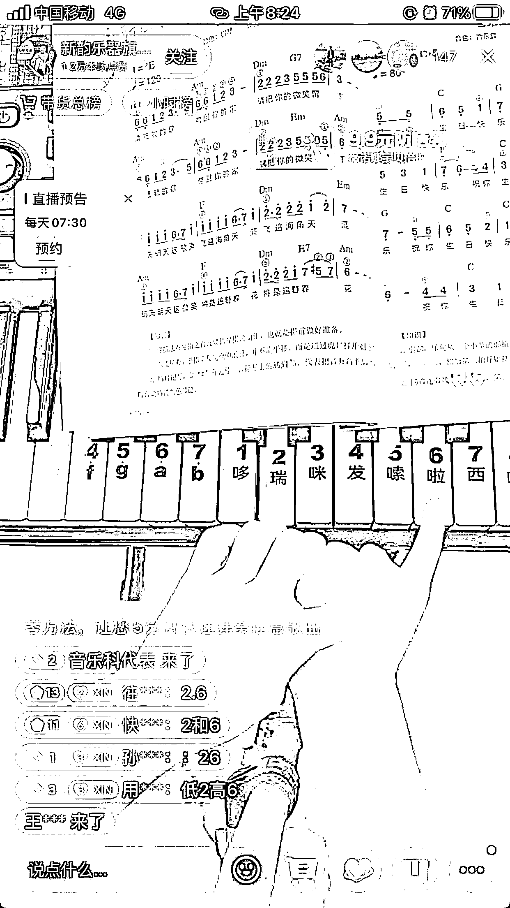

2）钢琴教学

赛道玩家很多，大致分两类。传统钢琴教学和线下教学差不多，直播时主要讲乐曲、练习曲的处理。

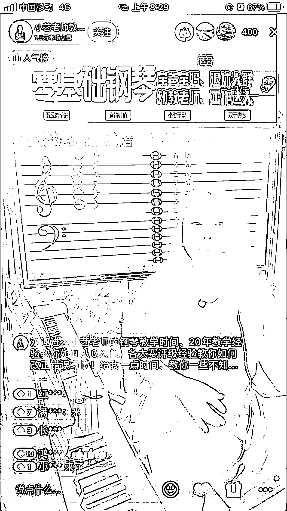

简谱钢琴教学对应大学里的即兴伴奏课，很受想学钢琴的成年人欢迎，入门也不难。

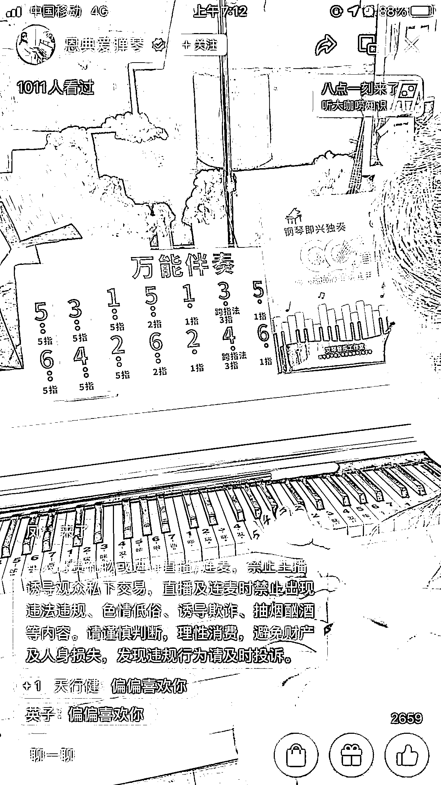

3）电吹管教学

相对蓝海。客单价高，但乐器结构较复杂，不太适合在直播间做教学；常见做法是直播示范演奏，再靠卖乐器变现。

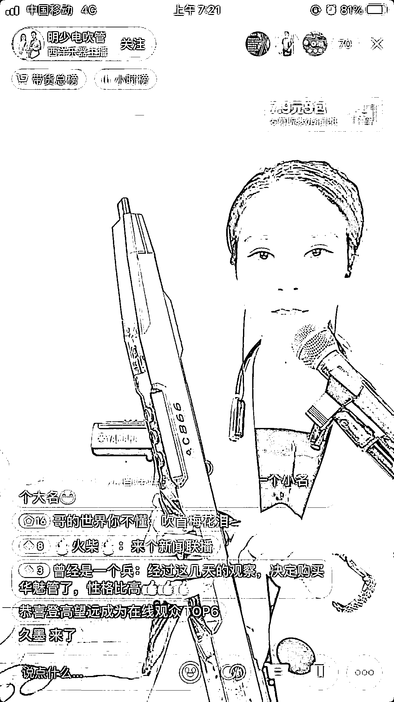

4）吉他教学

可以和带货结合，卖吉他和周边。

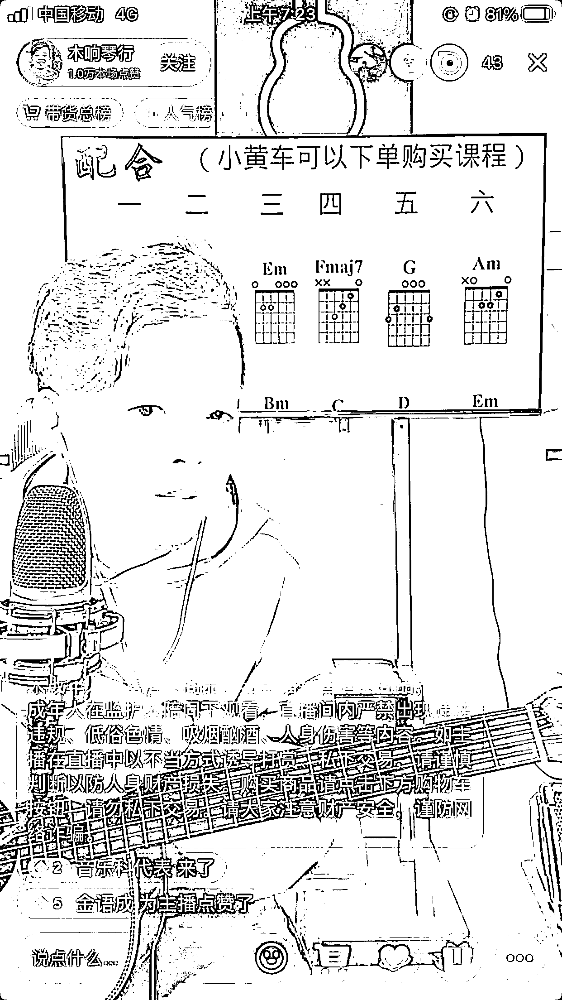

5）二胡教学

同样可以和带货结合。

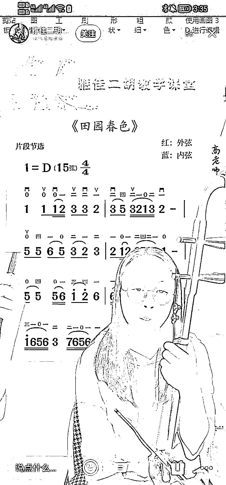

乐器类教学直播还有很多可挖的方向，有兴趣的社群朋友可以继续研究。这里只是先抛几个方向供参考。以上是我的实操心得，有讲得不准或不到的地方，欢迎补正，感谢。

互动区里，不少朋友给了鼓励：有人说内容里能看到不少自己的思考，有人点赞支持，也有人感慨音乐相关项目在社群里确实少见，连声道谢。谢谢大家的支持。