# 知识付费，2个月变现10W+：我的抖音无人直播实操复盘

我是Lucas zhou，base上海，平时给达人带货直播间做运营，月销接近千万。今年4—5月上海因为特殊情况大家只能居家，我利用工作之余跟朋友琢磨起了抖音的无人值守直播，想给自己开辟一条新财路。我们选了睡眠辅助和音乐两个方向，运气算好，前后累计赚了10万多。今天把这段经历完整复盘一下，给圈内朋友做个参考。

先摆一组数据：睡眠辅助号的直播人气日常能维持在3000以上，峰值冲到过万，收到的礼物打赏合计5000多；中间停了整整两个月没播，9月重新开播后人气依然有1000多。音乐号那边，同时在线同样能站上3000，每天大概有100万人次进直播间，来咨询付费学习的大约20人，最终每天能稳定转化三四个学员，累计已经收了200名学员。

这个项目的风险其实很可控，变现方式也算多样，可以开橱窗带货车载U盘，也可以挂汽水音乐的推广，号做起来后直接卖掉也能赚钱。唯一要始终提防的就是账号被封。投入方面更是几乎可以忽略，一台电脑加一部手机，再用企业号做个半蓝V认证拿到直播权限，就能启动了。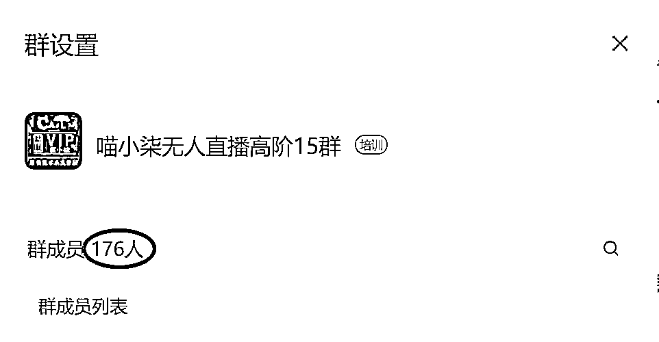 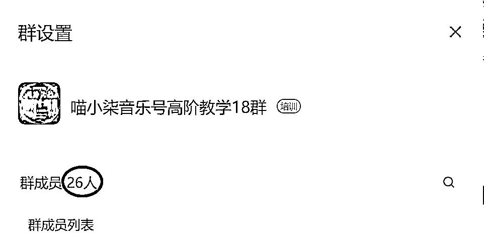

一、助眠无人直播间，具体怎么从零搭起来

睡眠类账号的原理很直白：靠白噪音这类助眠内容把用户留在直播间。由于这类观众停留时间普遍很长，系统会依据停留数据把它判定为优质直播间，然后不断追加推荐流量。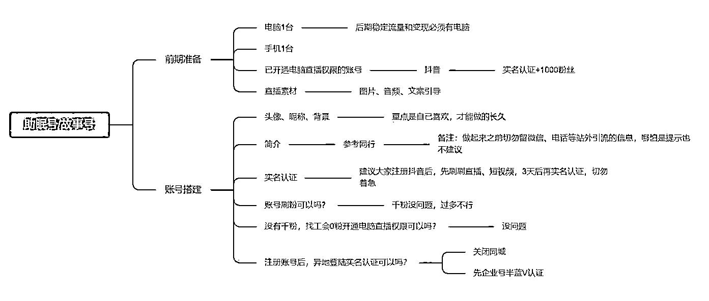

我们参考了圈友分享的保姆级教程，一步步跑通了全流程，核心步骤如下。

第一步，注册账号并花3—5天养号，期间有空就刷刷同行的直播间。养号的本质是过风控，让系统把你识别成一个真人，所以一切行为都要尽量贴近正常用户。具体做法包括：一个账号绑定一台设备、一个IP，注册时只用移动网络；每天挑不同时段、不同地点上线，比如通勤路上刷一刷，午休时在办公室用一会儿；内容也别太单一，泛娱乐、旅行、美食都可以看看；点赞、评论、关注、加粉丝团、买东西这些动作都做一些，每天累计1.5小时就能达标。

第二步，准备直播用的素材。画面可以到油管找睡眠场景图片，音频到喜马拉雅搜助眠白噪音，再用剪映合成一段适合直播间循环播放的视频。整理素材我有几条心得：画面必须耐看；声音不能杂；音画搭配要舒服；文案要埋互动点，引导用户说话。

第三步，完成企业号半蓝V认证，同时把粉丝做到1000，才能解锁电脑直播权限。注意，如果账号本身用的是个人实名认证，这一步可以省掉。营业执照要提前办，去当地工商局网站线上申请就行，嫌麻烦也能在淘宝上找代办，类目没有硬性要求，选【互联网服务】即可。认证路径是：打开抖音—我—右上角三条杠—企业服务中心—点亮蓝V，照着提示完成前两步，到第三步时点空白处退出，半蓝V就搞定了。1000粉丝是直播伴侣开播的硬指标，开播按钮那里会有提示；粉丝不够可以找刷粉渠道，价格会跟着风控松紧变动。权限解锁以后，哪怕开播时粉丝不足1000，也不影响正常直播。

第四步，把直播时间定在晚上21点到次日早上8—9点。操作方式有两种：一是把音视频素材拖进OBS场景，开启虚拟摄像头，然后在直播伴侣里选择虚拟摄像头作为画面来源；二是用“淦直播”这类付费工具抓推流码直接推流。下面重点讲第一种操作方法。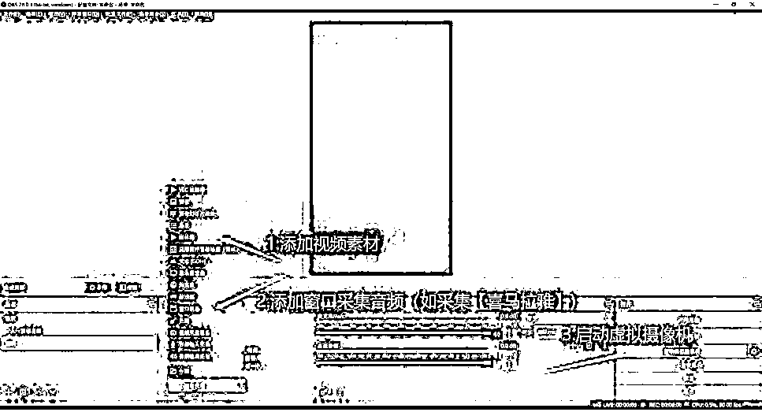 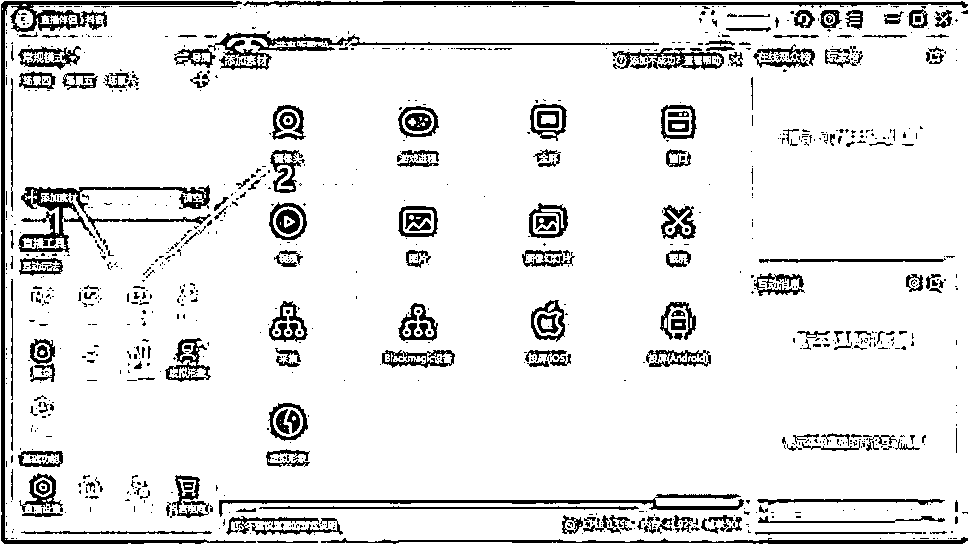

二、助眠无人直播间，日常如何运营

无人直播的流量基本靠自然推荐，所以决定成败的就两件事：账号风控状态和直播素材质量。这也是为什么我一直强调前期养号。注册后头三天，昵称和简介都不要动，就正常刷视频、逛直播间，在不同时间、地点和网络环境下模仿真人行为，点赞、关注、评论适度做一些。3—5天后再去包装账号，把昵称和简介改好。这里有个红线：账号做起来之前，千万别留电话、🛰️等站外引流信息，哪怕只是暗示都最好不要。

接着就是不断打磨素材，把停留时长做上去，系统才会持续给你放量。一份合格的素材等于直播间的地基，可以去视频平台搜同款下载，也可以直接花钱买。千篇一律的画面走不远，所以拿到素材后既要查重，还要做二次改编。比如画面太暗就调亮，加些有意思的动态元素制造槽点，像活蹦乱跳的小宠物、人物的奇葩睡姿，都能留住人。动态小动物可以通过绿幕素材加滤镜效果来添加。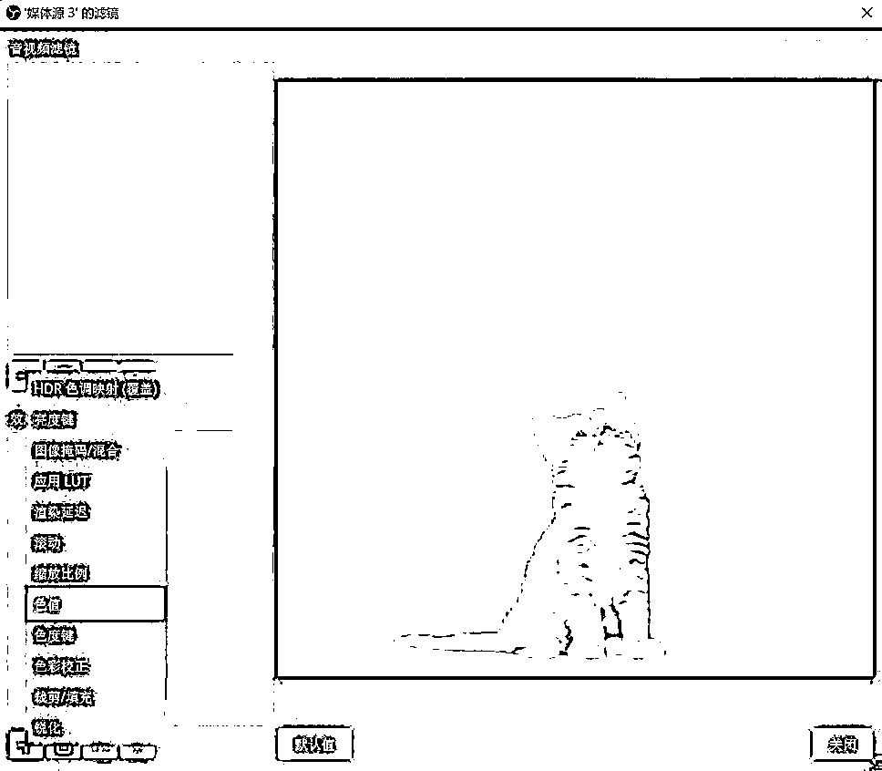 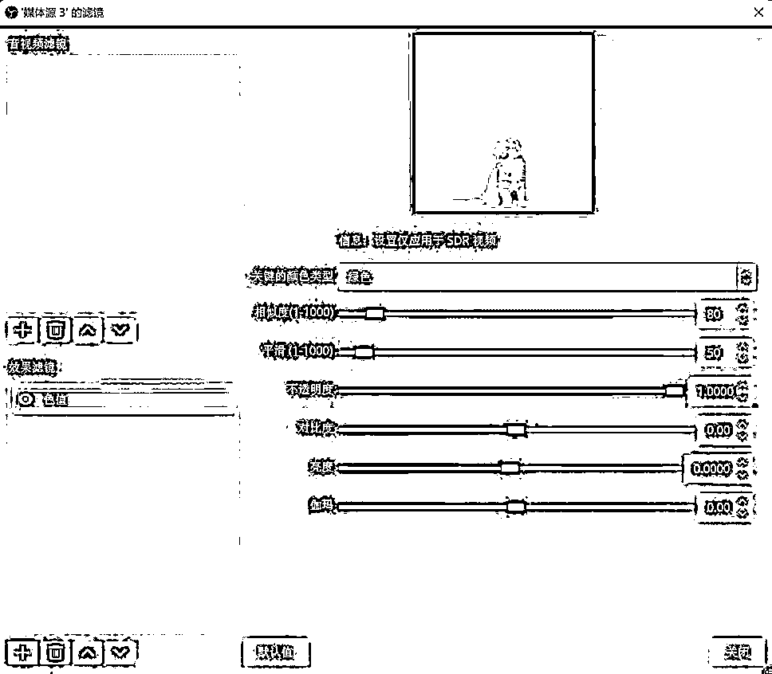 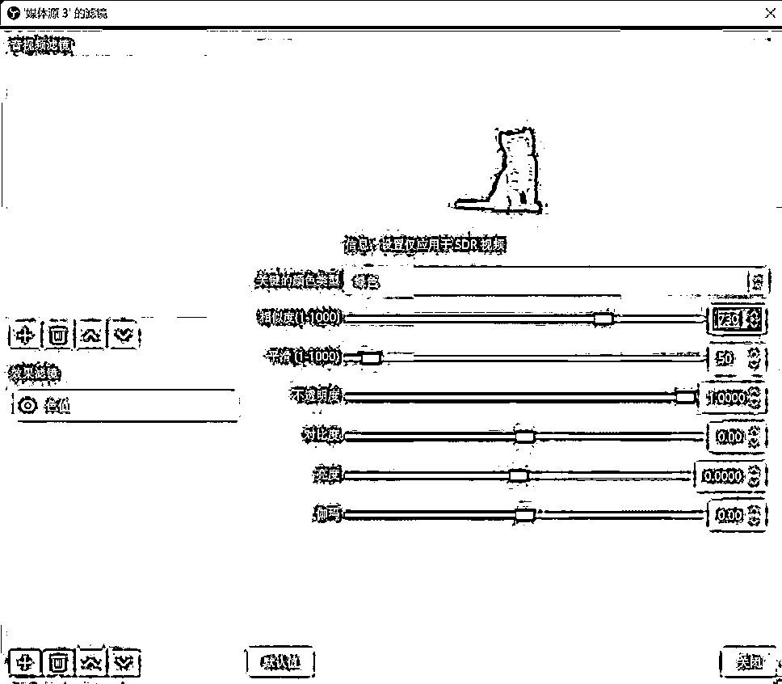

音频方面，可以用喜马拉雅等工具去搜。助眠音频大体有三种：雨声这类白噪音、脑波音频、哄睡声控，挑和画面气质匹配的就行。OBS监听播放软件的窗口，就能把声音源采集进来。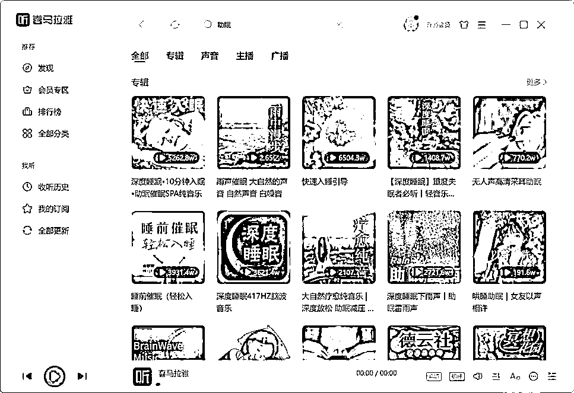

无人直播最容易踩的坑是“非实时直播画面”，也就是系统判定你在循环播放。想避开这个雷，一是素材尽量做长，二是主动加一些动态且不重复的元素，比如提前录好的飘屏素材、时间插件。 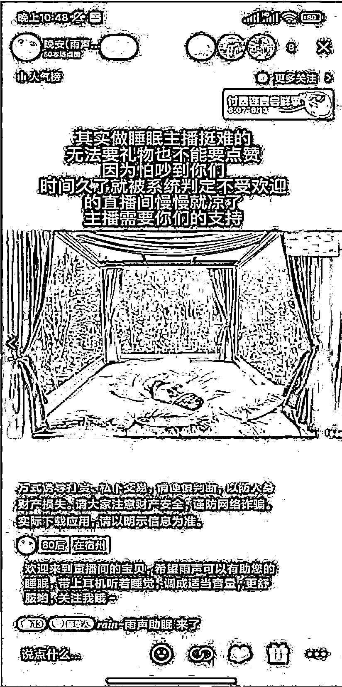 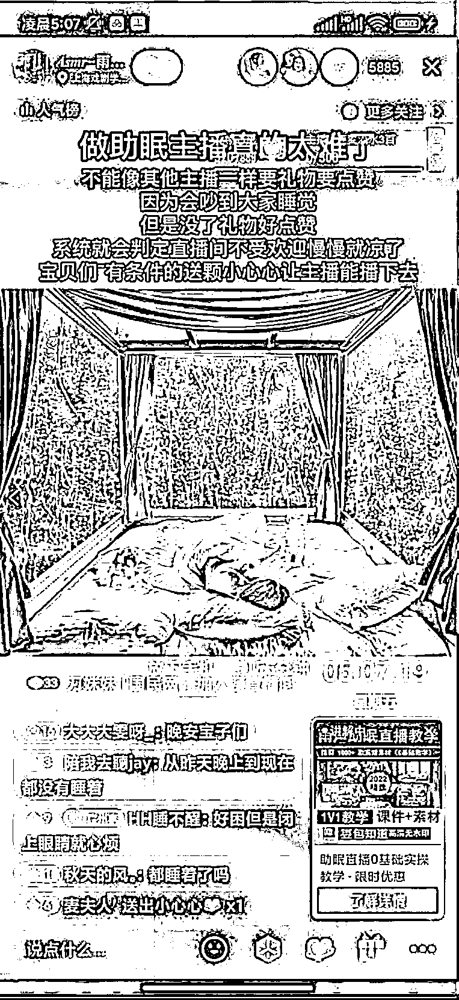 

对比就摆在那里：右侧的素材做了调色、锐化、填充背景、文案排版、加绿幕宠物动态和时间标签，人气和左侧那版差距悬殊。新手不知道怎么做，最简单的方式就是刷同行直播间，留意他们的画面构成，再按画面去找素材。早先用一张图加白噪音就能开播，后来大家都卷起来了，素材必须不断二创升级。我总结了一些避坑心得：

① 画面如果纹丝不动，很容易被判成无效直播甚至封号。睡眠直播间最重要的就是看和听，光有声音没有画面，观众体验会很差。

② 清晰度不达标，要么是原素材太糊，要么是剪辑时被压坏了。

③ 音画不同步，只能一次次试、一点点调。

④ 音量很影响停留，宁肯声音偏小，也别轰耳朵。

⑤ 画面显得假，透视关系脱离实际，P图痕迹太重。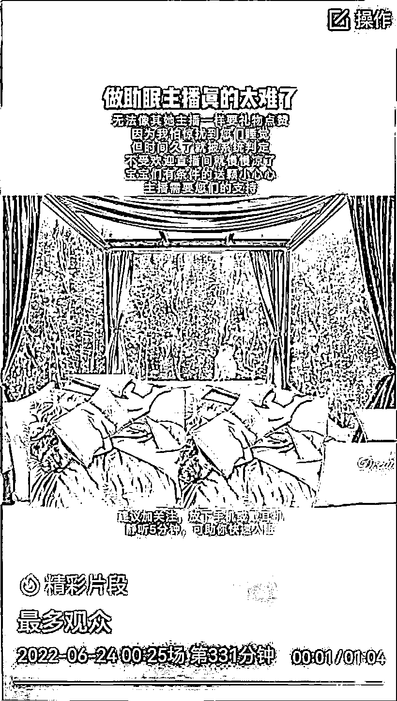 

⑥ 内容涉嫌违规，比如出现身体暴露部位；或者素材被用烂了，相似度过高、用的人太多。

⑦ 画面没看点，观感不适，比如黑乎乎脏兮兮、内容单调乏味。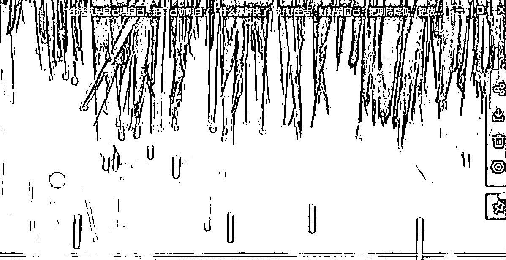 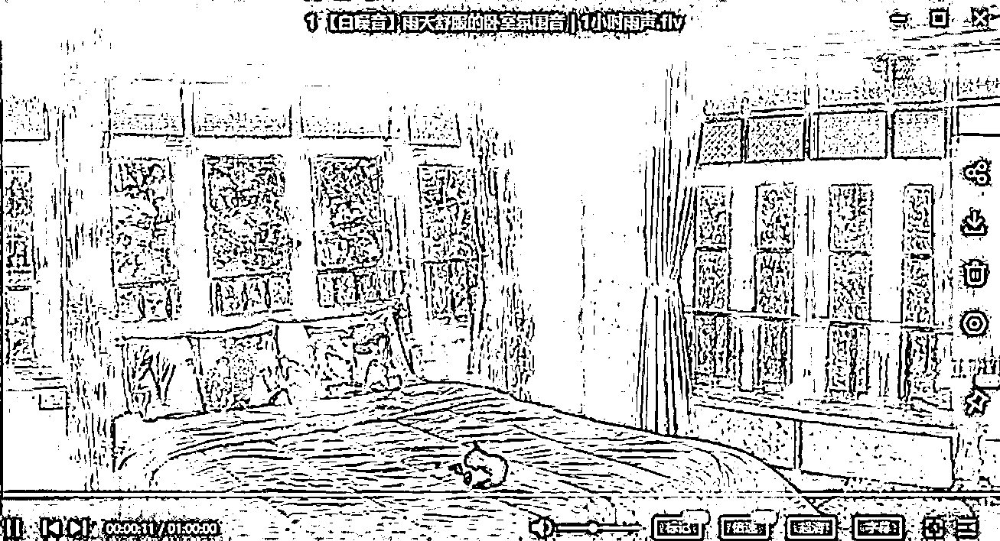

账号和素材都到位之后，怎么判断账号已经被养好了？发一条视频，正常情况下播放量不会低于500；或者随便开播1小时，场观应该在200—500之间。要是连100都不到，那就是异常账号，不解决基本做不动。异常原因主要有三类：第一是自然因素，比如账号从没播过，可以隔一两天再试，还是不行就注销重来；第二是账号不活跃，可能太久没登录，或者直播有过违规记录，建议停播几天把号养回来；第三是人为因素，比如互关互赞、刷粉、刷在线、刷互动，同样要停播养号几天再播。

账号和素材准备妥当，就可以正式起号了。新号开播流量少且不精准，这是常态。起号前3天记得每天定时定点开播，最好精确到分钟，每个类目的最佳时段不同。睡眠类建议凌晨0点到2点之间开。前三天每场播1小时内就行，下播时机看流速：开播40分钟后基本不进人了，就可以收，但整场别低于30分钟。

坚持到第4天，理论上会迎来一波极速流量，在线人数能到几十人。当在线人数过百，直播间可能会突然无法加热，这其实是限流信号，也意味着账号开始被激活，开播2小时内下播。隔10分钟再开一场，基本还会来一波极速流，而且比上一场还猛；第二场如果还是无法加热，就按在线人数决定播多久——人多就一路播到早上8—9点，人少就播1小时收工。之后每天按正常时段重复这套流程即可。

另外，当时赶上上海市民普遍在家闲着，账号稳定后，我每晚都会开同城定位，同城流量对直播间人气有明显放大作用。

三、助眠无人直播间，通过什么方式变现

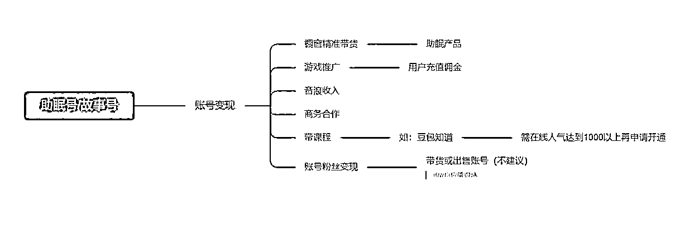

助眠号在直播间挂小黄车卖货，其实是件挺拧巴的事：用户来这里是求一个睡眠解决方案的，当下的诉求是“睡个好觉”，而不是买东西。所以我自己试过挂游戏推广链接，也挂过自制的课程链接，那套睡眠直播间搭建入门课卖了1000份左右。 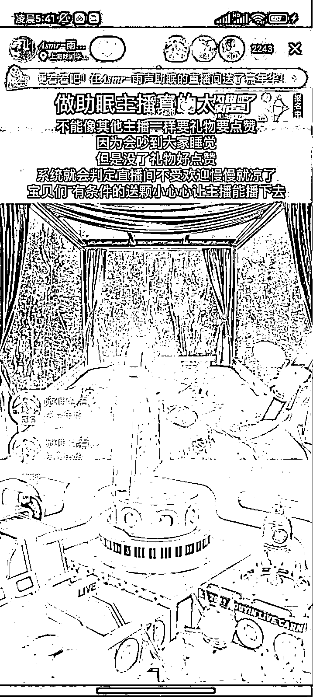

还莫名其妙收到过嘉年华，这够我吹好多年了😂。

当直播间能稳定保持千人以上在线时，最顺的变现方式就是知识付费，也就是收徒。我把整套助眠直播间搭建方法录成了课，定价29.9元，共10节，挂在直播间里大概出了1000单。课程末尾还埋了一节无人直播专业课做引流，把人引到私域继续成交。前期我每天固定发朋友圈做推广；等有了学员案例，宣传素材就越来越丰富。后来我们建了钉钉群，学员在群里交流，我们也在群里做更深度的转化，基本隔一晚就开一次群直播，挨个问大家的开播情况、帮忙解决问题，学员的信任感就是这么磨出来的。再后来我们做了音乐号无人直播教学，冷启动阶段就有10个人报名。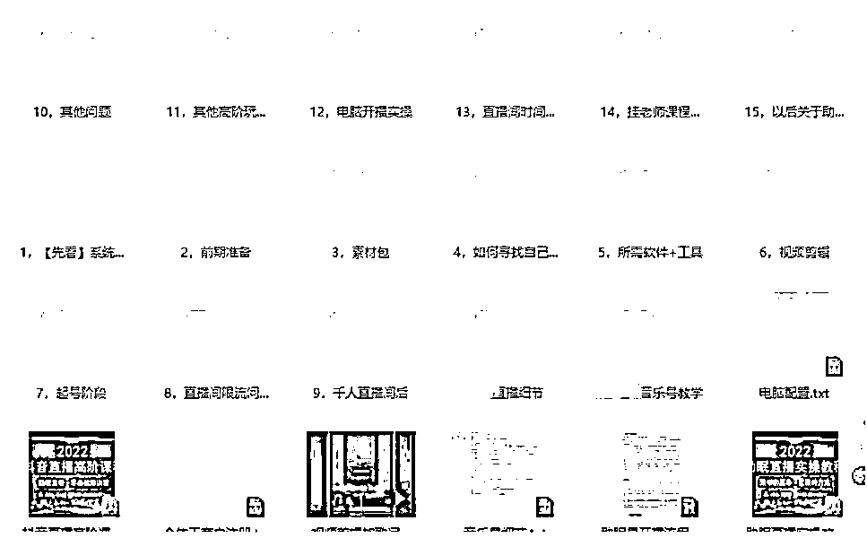

四、新人入局会遇到哪些门槛

无人直播有个规律：生命周期很短，内容必须不断更替。后来相继出现了音乐直播间（我们也做过）、影视直播间、云蹦迪、沙雕漫画直播间、游戏直播间……但底层运营逻辑始终没变：起号、突破流量层级、稳住流量、变现，都是同一套方法，然后在这个基础上不断研发新内容。新人最要紧的是掌握素材制作能力。一个优质素材，哪怕运营方面粗糙一点，也有机会跑出来；如果运营方法再跟上，只是加速这个过程而已。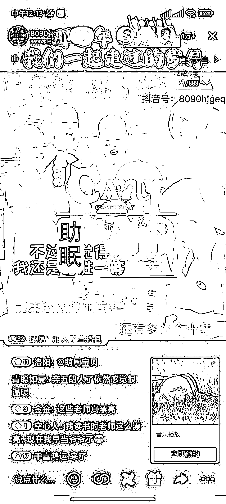  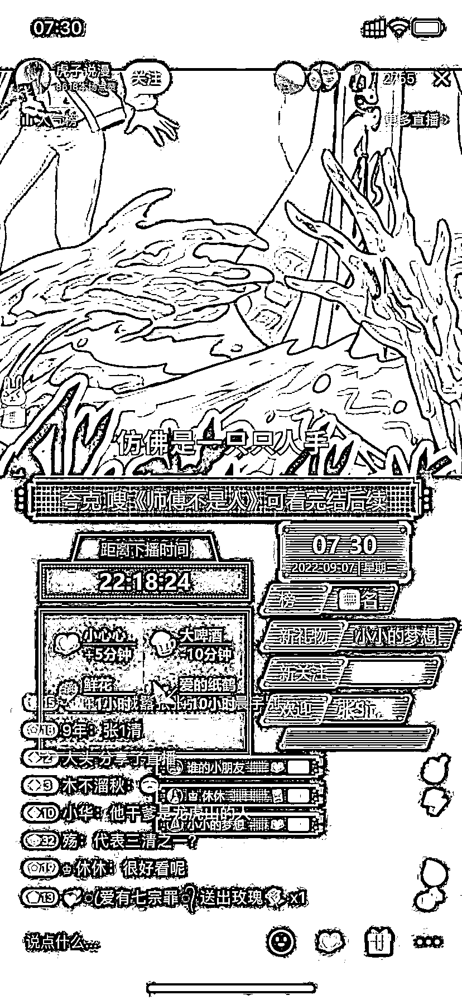  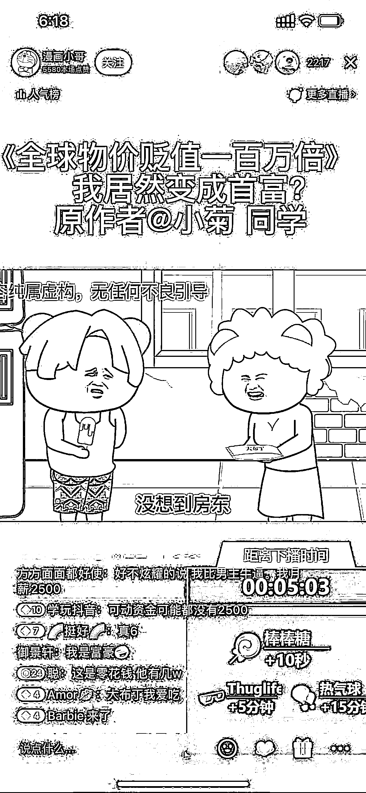 

五、结语

无人直播的入局成本确实低，但随之而来的问题一点不少。非实时直播画面、长时间没有有效互动，随时可能触发违规限流甚至封号。助眠、声控、故事号、游戏号、音乐号、沙雕动漫，衍生的方向越来越多，暗藏的商机也不少：卖素材、教素材制作（比如沙雕动画）、卖下播倒计时软件（用来规避非实时直播判定）……完全可以去做那个“卖铲子的人”。同时也要清醒，无人直播不是挂上去就能躺赚的项目，先对预期有数，再判断自己适不适合、愿不愿意投入。

第一次在赚钱做分享，文笔比较平庸，欢迎大家来链接，祝各位龙哥盟~

评论区：
Lucas zhou：头一回在赚钱发帖，还请各位大佬多指点！刚报了9月的半无人直播小航海，之后会继续往这个方向扎根，想认识更多一起玩的朋友~
+龙：互相关注这类操作也会影响直播推荐吗？
Lucas zhou：会有影响的。
龙哥：内容很扎实，已经加精华了。
蕣：确实优秀。
草木青（勇猛精进版）：很不错。
李森：感谢分享[玫瑰]
江湖：学到了。