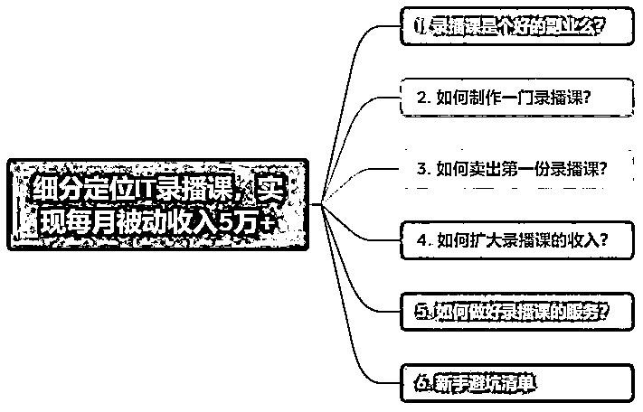
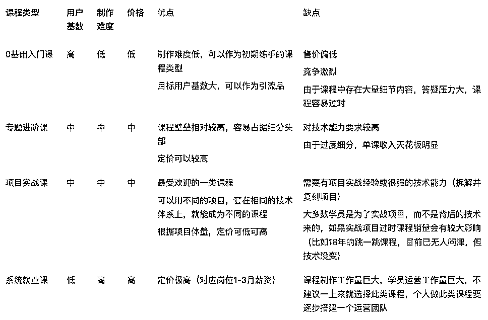
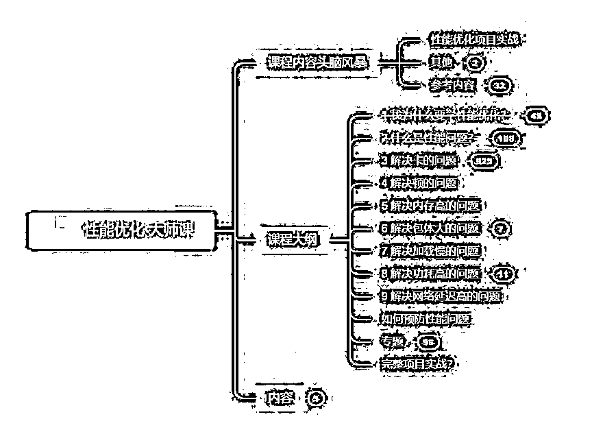
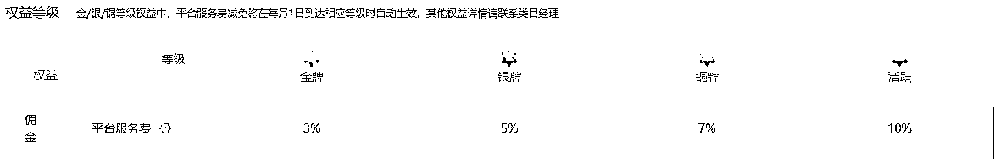
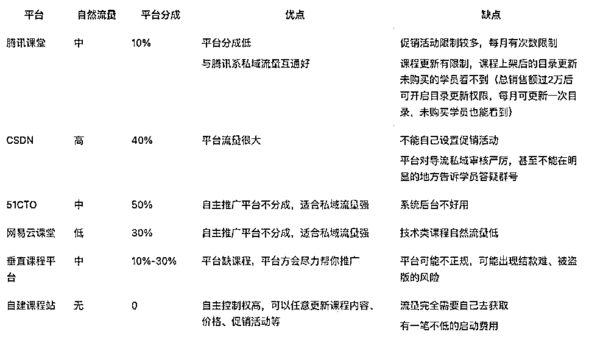
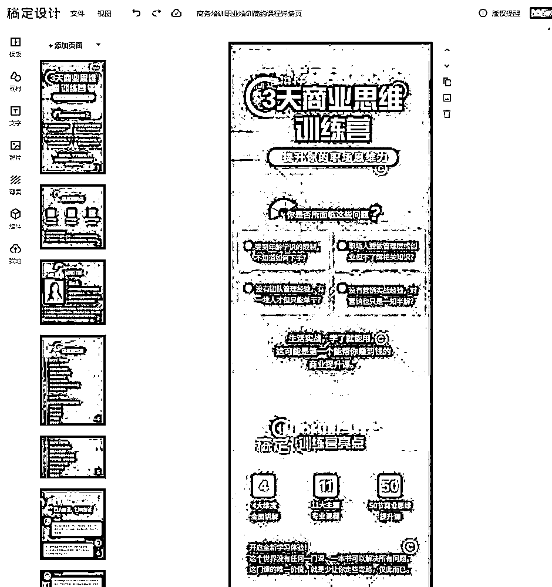

# 技术预录课：月流水 5W+ 怎么做

文/鱼丸（龙哥助理）

抖音商业 IP 大航海计划 2.0 已开营，部分圈友日程太满，无法全程跟课。于是「赚钱合伙人」栏目请到 @突围一只鹰，聊聊知识付费的另一条入口：提前录制、反复售卖的技术课程。

直播要买家迁就开课时间；预录内容不必，同一套内容能卖给多人，触达效率更高。垂类产品营收上限多在七位数，个人做仍划算。

他以 IT 细分课程为样本，拆解爆款从策划、上架到交付的完整链路。领域虽小，课程生产、成交、售后逻辑可迁移。若你想找时间利用率较高的副业，本文可参考。

目录

一、预录课程值不值得做副业？
二、课程如何从想法变成成品？
三、首单怎样打开？
四、营收如何放大？
五、交付服务怎样跟上？

我是突围一只鹰，程序员出身。2014 年创业，做过 App、软件外包，目前主营自媒体。

在技术预录课领域摸索四年多，既有热卖产品，也有零成交记录。现在月流水约五万元，峰值月份突破二十万元；也带过朋友用技术课程变现，表现最佳者年销达到六位数中后段。

全文约一万字，分享将围绕以下线索展开：

**—Part 1— 预录课程值不值得做副业？**

我衡量副业是否靠谱，看三条：收入空间能否在未来超过本职；能否与本职互相成就，即主业经验为副业供优势、副业影响力反哺主业；能否长期经营，产生积累和复利。

预录课程与这三条契合度较高：

1）同一套内容可以卖给多位买家，边际成本低。垂类产品营收上限多在七位数，个人做仍有赚头。
2）它能沉淀个人品牌，提升你在技术生态中的位置，也会让职场竞争更有底气。
3）教育需求长期存在，只要内容方向不跑偏，就能持续做。

对程序员或技术从业者而言，这条路尤其合适：多一条收入线，还能助推主业，甚至完成反超。

**问答：我是怎么入行的？**

本科毕业后一直写软件。平时在技术博客记录项目问题和新知识。常有人留言问基础操作，比如某功能入口在哪儿、某设置怎么改；也有人追问有没有配套视频。

起初我没在意，不认为这是机会。后来发现图文有短板：自己写作能力有限，有些描述不够准确；而我学新技能时也更愿意看视频。于是逐渐意识到视频课程的优势：图文只能挑重点讲，难免遗漏；视频能保留完整操作，后来者照步骤练习，能少走弯路。

2018 年初，我录了一个短课程，定价三十八元，上架腾讯课堂（平台抽成 10%）。反馈不错，前几个月每月能有一千多元进账。那时还幻想：做一百门，月入十万？现在看是想得太简单，原因后面说。

2018 年初到 2021 年底，我累计制作五十余门课程，在售二十门。依靠多个平台的自然曝光，月流水基本稳定在五万元上下。

**问答：授课者需要什么硬条件？**

门槛没想象中高。可以类比成给新同事讲解你负责的模块，再把内容打磨精炼。大致需要：

1）有一项熟悉的技术或项目。关键在熟，不必难度惊人。优秀高中生能教小学初中，所以不必先成为行业专家。也不是非得变成罗永浩才能直播带货。课程设计、自学项目、商业实战、专业系统课，都能做成产品。
2）表达正常。
3）会剪视频；不会也能学。成片要紧凑，别把未修剪素材直接上架，无关片段应删掉，替买家省时间。

看到这里，你大概能判断自己适不适合做预录课。下面进入第一门课的生产。

**—Part 2— 课程生产流程**

做爆款，先回答：买家为什么掏钱？你的内容必须帮学习者解决麻烦、完成工作、拿到更好的岗位、增加收入；他们赚到钱后，你从中分到一部分，课程才有持续优化的空间。让购课者高效掌握技能，进一步帮其解决问题、求职、晋升加薪——这条原则要常记。遇到岔路就回到这句话。

**第一步：定题**

2018 年初，第一门小课让我尝到甜头，于是计划猛做课程，一年冲一百门。我凭直觉定题、陆续上架，价格都压在两百元以内。结果后面三、四门卖得很差。另一个问题是产能：第一门虽然两三天录完，但前期准备耗时很久；一年做五十门都吃力。

产量上不去，只能往质量走。我复盘热卖课，发现两个原因：

1）借了热点。那门课讲🛰️跳一跳小游戏。后来几门既没有热点，也没注意市场已有同类内容，而对手还有销量与评价背书，我的课缺差异化，买家自然流向别人。
2）人群卡得准。当时算误打误撞，后来才明白，买这类小课的人里约八成是为了交课程设计；我的内容、难度与价格刚好贴合。

所以，预录课能否盈利、能否盈利更多，题目选择贡献超过一半。题目对了，后续省力。它是成败第一环，强调多少遍都不为过。

**一、四类内容形态**

先弄清四种课程产品：

1. 零基础入门课：面向新手，核心诉求是快速上手。知识点要拆细，否则后续答疑会压垮你。这个阶段，买家主要不是为视频买单，而是买一个能随时回答问题的老师。授课者技术背景不必很强，边学边卖也行；把官方图文教程用视频重演一遍，同样有人付费。缺点是门槛低、竞争密，B 站免费基础内容很多。机会在新兴技术：国内尚无系统入门材料时，早期从海外站点学习，再用中文重做，在垂直领域站稳，收入可不错。风险是早期技术变化快，双刃剑：没人做时你可迅速占位，但维护成本高；录制过程中技术可能升级，学习者照学出问题，答疑压力陡增。若想靠一门课长期被动进账，我不建议选这类。

2. 专题进阶课：比如《零基础入门 Excel》是入门课，《如何在 Excel 中使用 VBA》是专题进阶课。买家已有基础，想解决工作难题、增强竞争力、争取晋升加薪。大课客单价可以较高，但要求授课者技术底子强，对专题很熟。

3. 项目实战课：这类课有独特卖点：两门课技术点大体相同，只要换不同实战项目串起来，就能拆成两个产品卖。主要面向三类人：在校学生——项目当课程设计作业，内容不必多，重点不是讲原理，而是跟着视频能把项目做出来，对价格敏感；应届毕业生——项目当毕业设计或求职作品集，内容要相对完整，有难度，贴合最新职场技术方向，对价格不太敏感；求职者——项目要写进简历，内容完整，看起来像商业项目案例，有较多技术难点，能扛住面试官追问，对价格不敏感。

4. 系统就业课：面向应届生与求职者。目标是掌握技术达到岗位门槛，通过笔试面试找到工作。内容完整、系统化，既讲基础原理，也含实战项目；涵盖前三类，但不是简单堆砌，而要系统设计。

四类课程对比如下：

**二、定题原则**

我归纳四条：

1. 力出一孔：尽量集中火力做一个优质大课，例如项目实战或就业课（有信心可包就业）。为什么？买家对低价课和高价课的质量、服务期待差不多；低价课客服答疑成本不少，算总账未必盈利。五千元档的课，一方面减少精力分散，另一方面收入足以支撑你把内容和服务做厚。

2. 选题查重：题目初定后，务必去市场搜同类课。若有，就要想清楚差异点、竞争点：买家为什么选你而不是友商？答不上来，就放弃。

3. 强获得感：学完后，学习者能跟着做出实际案例，可用于学业、求职或晋升作品。这样才有获得感，不至于学完两手空空。

4. 蹭热点：尽量借当下热点获得曝光，但别为蹭而蹭，核心仍是内容。例如《原神》火，可做《原神渲染实战课》，核心还是渲染技术；拼多多火，可做《从 0 开始开发一个拼多多 App》，核心仍是 App 开发技术。技术是内核，项目是外壳，外壳可换，内核要稳。同时要避开太早期、变化太快的技术。那是双刃剑：早期无人做，你可快速占市场，但维护成本高，录制中技术可能变，学习者问题多，答疑压力大。

**三、定题流程**

1）按技术储备定大方向。比如擅长 Android，就先锁定 Android。
2）定位目标用户：课程卖给谁，解决什么问题（学生课程作业、毕业生就业、在职转行等），基本确定课程类型。
3）用数据驱动选题法，找出二十个关注度高的技术或项目作备选，依次执行第四至第七步。
4）在搜索引擎查是否已有类似课程。若有，且与目标用户冲突，排除。
5）评估主题技术范围是否在你能力圈内。是，选用；不是，进入下一步。
6）范围太大，评估能否缩到能力圈。比如讲不了《拼多多系统架构实战》，可改讲《拼多多 iOS App 开发实战》。能缩，选用；不能，下一步。
7）评估能否现学现卖。很多技术自学后录视频二次演绎效果很好，因为你能从初学者视角讲。能，选用；不能，放弃，回到第二步。

拿到题目后，就可作为内容设计题目。举几个例子：刚入门，可从初学者视角做零基础课，这种视角技术大牛很难做到；研究很深，适合专题进阶课；项目经验丰富，适合实战课；在技术岗位超过五年，适合系统就业课。

**问答：什么是数据驱动选题？**

找你想录课技术领域里规模最大的👸号，抓取最近一年推送数据，分析阅读量、点赞量、转发率最高的文章。程序员当然不手动扒，写爬虫。不熟爬虫，可用新榜、拓途数据的👸号回采服务：新榜贵些，拓途数据五百篇三十元；还嫌贵，去某宝搜“👸号回采”。同理，分析博客网站、课程平台数据，看当下热门，更看几年都热门的话题——这类技术关注度长期高，课程更不易过时。还有一个来源：找在线课程平台的类目经理，他们有一手实时数据，能给选题建议，参考价值大。

**四、题目验证**

定题后不要马上制作。要验证用户是否真感兴趣、会买，同时找种子用户。怎么做？

按题目写一篇相关图文教程，内容包含题目中的部分知识点。文末留 🐧 群号（XXX 技术交流 Q 群：1234567XX），发到 CSDN、博客园、知乎、简书等技术博客，也分享到你加入的技术群。感兴趣的人会加群。连续三天在群里讨论相关技术，第三天分享课程大纲，看反馈；第四天发布预售，一元意向金（上线后可抵 XXX 元）。如果入群到交定金的转化率超过两成，说明题目真有需求，可以制作。

题目验证就是用真实用户反馈确认不是一厢情愿，并积累种子用户。这用到精益创业的假设验证法，避免产品做出来才发现没人要。先做假设：项目成功有许多先决条件，这些条件就是假设，验证成立，项目才可能成功。再验证，成本从低到高：常识 < 数据分析 < 调研 < MVP。这个话题后续再详述。

**第二步：内容设计**

题目验证过，也有种子用户，就可以设计课程。先查资料、找对标，还是先写大纲？都是必要环节，但我觉得最先做的不是这些。

**一、先定价**

最开始是定价。你可能会诧异：什么都还没有，怎么定价？

定价不是收尾动作，而是产品设计的起点；价格一变，产品形态也会跟着变。

比如一瓶洗护产品，标价二十元和两百元，对应的产品方案会完全分叉：主卖点、包装、销售渠道都不同。所以选完题，结合能力先做初步价格预估。同一题目，做两百元级的小产品还是两千元级的大产品，设计一定不同。两百元级可能只含主题知识点，很少延伸，约十到二十小时；两千元级内容更丰富、系统化，还提供答疑、督学、直播加餐等增值服务。但记住，不同价位用户对质量和答疑的需求差别不大。有能力建议多做高价课：引流、服务成本几乎一样，高价课能让你更专心提升内容质量和服务。

如果对能卖多少钱没概念，可参考：

1）看同类型课程定价格范围，上架先用较低价格试验（早鸟价、首发价），后续逐步提价。
2）独有课程、差异化大且刚需，可定高价，甚至过万元。
3）按课程给学习者带来的收入增量定价，比如学完包就业八千元以上，可收一到三个月薪酬，即八千到两万四千元学费。

**二、大纲设计**

大纲设计和优化贯穿制作全程。初版可按以下步骤：

1）用思维导图（我用飞书文档），先不查资料，拍脑门列出题目要讲的内容点。
2）验证这些内容点能否支撑目标用户需求和课程定价（不确定就去课程平台搜，对标相近价位同类课）。
3）不能，就扩展内容点或增加实操案例。
4）细化大纲思维导图。有些实战课可直接拿思维导图录课，不必额外做 PPT。
5）开发大纲中的实战项目。

定价和大纲有初版后，可在种子用户群分享验证。

**三、课程制作**

一般包括：

1）PPT 制作。是否做 PPT 看内容：理论多，建议 PPT 图文搭配讲解；实战项目少讲原理、多操作，可直接用思维导图大纲串课。PPT 尽量别放二维码等，有些平台审核严，严禁站外导流。
2）配套实战项目开发。
3）几篇图文干货，用于图文平台推广。
4）几节试听课：为什么学？讲问题、技术背景、前景、学完收获（升职加薪等）。能得到什么？展示本节课直观最终成果，比如实战课最终成品。为什么跟你学？用一两节吸引人的课程内容。
5）后面是正常课程内容。

**四、录制**

录课所用技术版本尽量用最新稳定版，优先最新 LTS（长期支持）稳定版，因为企业常用 LTS，缺陷更少。用最新版还能保证课程寿命，不会因技术过时过早淘汰。

2）选稳定版更稳妥：底层组件和 SDK 不变来变去，教学质量自然稳得住，售后和答疑的麻烦也能少很多。

设备方面，不用追求多高级，顺手最重要。我自己用的这套供参考：

收音用罗技 H340 头戴耳麦；录屏开 OBS，偶尔开 Camtasia。Camtasia 录出来的文件体积偏大，比较吃硬盘，但它能边录边打点，卡壳的位置标一下，后期就很好剪。辅助工具方面，PointerFocus 做鼠标高亮，Carnac 把按键操作显示在屏幕上。剪辑仍然交给 Camtasia，如果 Pr 不熟练，它足够简单够用。从来没录过课的，建议先弄几条短视频扔到 B 站试试手感。

五、讲解

录制时心里要有“对象感”：镜头对面坐着一位学生，你正在一对一地辅导他。讲出来的东西必须前后咬合，逻辑不能断。

如果是图文内容，想补充的细节可以放在超链接里，用户有需要就自己点开看。

但视频是单向流动的，所以要在讲的过程中，把大多数学员可能不懂的地方顺手补上。补充别啰嗦，就说两件事：这是什么，想知道更多去哪查。

六、注意事项

录制中做好这几点，后期能省一大半功夫：

有意识收敛“嗯”“然后”这类口头词。

暂停键别客气，脑子空白或者没想好怎么表述，先停，理清思路再继续。

说错了立刻留痕。Camtasia 能在录的时候加标记；如果用别的软件，就拍一下手，剪辑时声波图上会出现一个尖刺，一眼能找到。

—Part 3— 录播课怎么卖出第一单？

课做完了，下一步是卖。

一、选平台

手头得先有一个能承载课程的站点，让用户完成“浏览—下单—学习”的完整闭环。

副业阶段，不建议自己搭网站（小鹅通、EduSoho、有赞这类 SaaS 也算自建）当主阵地。优先去公域平台，好处显而易见：

第一，前期不用掏太多工具费；
第二，找用户的成本大幅下降，代价是要分一部分抽成给平台——这钱得舍得花，专业的事让专业的人做，否则你自己会累趴下；
第三，哪怕你不做任何宣传，平台的自然流量和大促也能带来订单。自己建站的话，每一个流量都要自己去捞。

技术课常见的渠道有这么几个：

腾讯课堂（最初扣 10%，讲师等级升上去后抽成会降低）
CSDN（扣 40%）
51CTO（扣 50%，自己带量推广不扣）
网易云课堂（扣 50%，自己带量推广不扣）
你所在技术领域里做得大的平台（去谈）

各平台的入驻规则不同，基本都接受个人讲师（腾讯课堂门槛高一些），具体要求可以自己去申请页看。

我的建议是：高价课优先放腾讯课堂。一方面它和🛰️、🐧 生态天然打通，运营学员更方便；另一方面抽成低；再就是打款省事，每月自动打两次，不用手动提现。

腾讯课堂收益分级：

如果是低价引流课，分成就不用太在意，能多上一个平台就多上一个。

另外，别小看技术垂直类平台，它们手里的用户往往更精准。先放一两门低价课看数据，说不定有意外收获。但也要提防一些黑心平台不尊重版权、随便送课、不结算。

课程平台对比表：

二、封面和详情页

封面、详情页都建议做成图片。创客贴、稿定设计这些在线工具直接套模板就行。这俩东西相当于课的门面，是学员对产品的第一眼，必须认真弄。

所谓“认真弄”不是说堆满花花草草，而是让用户在一秒内找到他想要的答案。

好的详情页至少包含这些要素：

这门课解决什么问题
学完有什么效果
课程内容有哪些
为什么要跟着你学
亮出你的履历（讲师实力）
亮出学员反馈（评价、案例）
学习遇到问题怎么办（答疑、助教等保障）
再放一个限时优惠，能明显带转化。

三、第一单怎么来

产品备齐，进入销售环节。

课程一上架，先告诉付过定金的那批种子用户，让他们用优惠价购买，第一单基本就诞生了。

种子用户还能从朋友圈、🐧 群、博客里找。课上线了，记得发朋友圈；技术类 🐧 群不反感干货，把博客文章丢过去，文末加个钩子。客单价比较高的课，钩子要导向你的个人 🐧 或🛰️，能私聊追单，下单率会高不少。

—Part 4— 怎样让录播课赚更多？

二八法则放在这里很适用：20% 的课贡献 80% 的收入。想提高收入，先看一个公式：

销售额 = 流量 × 转化率 × 客单价 × 复购率

对着公式找突破口：

1）往流量上使劲。免费的路子有内容引流、社群运营、裂变、招推广员；付费的路子有投广告、找同行号主做推广。
2）往转化率上使劲。把封面、详情页、试听课打磨到位，让用户一眼感知到价值；再配合一对一的私聊追单。
3）往客单价上使劲。单门课卖得更贵，但前提是价值撑得住、用户愿意掏钱。
4）往复购率上使劲。录播课有个天然问题：学完就完了，几乎没人会再买一次。解决思路是扩充产品线，让学员有机会买下一门课；也可以做年费课或年费社群。

下面逐条展开。

一、流量怎么拉

当时我的课全靠平台自然流量，自己没做过任何推广。想扩大收入，第一件事就是补流量。

我把闲置几年的👸号翻了出来，每天写原创技术文。但那个领域实在窄，一天就涨几个粉。照这个速度，一年最多攒 3000 粉，再算转化率，每月也就多几千块的收入。

不行，还得去公域捞人。于是我把技术文章铺到 CSDN、简书、知乎以及垂直技术论坛，文末留钩子：👸号回复「xxx」领资料，把人导进号里。

各平台的审核尺度差别很大。CSDN 敢直接放钩子，知乎却非常敏感，我差点把号弄没。后来试出来，写“本文首发于 XXX 👸号”这行字能存活，但引流力度也弱了很多。

百度贴吧是我一直想啃的骨头。可那边审核极严，除了系统审核还有吧主盯着，有时候发纯干货都被莫名删帖，更别说留钩子。

有天照例费了好大劲发了帖子，发完顺手在吧里闲逛，看见一个热帖《收徒弟，想学游戏开发的进》。内容特别简单：加群 XXXXX，帖子下面留下 ID，群验证写贴吧 ID。

这帖几天就有几百条回复，每天都有新人留 ID，每有人回复就自动被顶到首页。我想这招我也能照搬，于是仿了一个，结果贴吧的流量太猛了——来的全是小白，对我而言精准得可怕，10 天就把一个 2000 人的 🐧 群加满了。后来吧主发现这是套路，把这类帖子全删了，但我的种子用户已经攒够了。

模仿永远是学习的第一步。看到值得学的案例，别只想，要动手试。

关于引流，我把试过的方法分成两类。

第一类：免费流量。

核心打法就四个字：干货＋钩子。但每个平台对钩子的容忍度不一样，还经常调整，得自己慢慢试探总结。

具体操作：

1）把干货文章发到各大技术博客。知乎、CSDN、简书的流量都很大，知乎尤其值得重点做；垂直社群流量一般，但用户准；贴吧则聚集了大量小白。

知乎能接受“本文首发于 XXX 👸号”这类钩子，🐧 群号也可以试试；
CSDN 能接受“👸号回复关键词获取资料”；
简书审核不稳定，偶尔也能用同样的写法；
垂直社群一般管得不严，具体看运营者；
贴吧对引流打击最狠，只能小心翼翼地往 🐧 群里引。

2）把试听课（挑干货最足的部分）发到视频网站，视频里和简介处都埋钩子。
3）精彩片段发到短视频站，个人主页介绍里留钩子。
4）在🛰️群、🐧 群里分享自己的干货文章（末尾带钩子），别一上来就发广告，很容易被踢。

第二类：付费流量。

1）找群主合作，在他的群里发广告，同时给他开分销权限，让他帮你卖。👸号主也可以这么谈。
2）投广告。这个坑比较深，我自己也不是很懂，建议单独去学付费投放。

二、转化率怎么提

流量问题缓过来以后，我开始搞转化。当时花了很多时间改封面、改介绍，收效不大。到 618 前后，想做一个促销活动刺激下单。

规则是这样的：底价秒杀，699 起步，每满 10 人就涨 100 元。
前 2 位购买的同学，发拼手气红包 200；第 3—5 位，200；第 6—9 位，还是 200；后面以此类推。

我怕有人看不懂规则，留了一个🛰️号当客服。结果有意思——真正拉起销量的不是活动规则，而是加了🛰️之后的一对一私聊追单，转化率做到了 70% 以上。

🛰️好友能被朋友圈、私聊反复触达，天然更容易成交，这也是现在“私域流量”被追捧的原因。高价课玩家，追单这步一定不能省。

关于促销，我提炼出几条原则：

不能让已经买过的用户觉得自己亏了；
就算降价，也要让用户花点时间成本去拿；
制造稀缺感，推着用户赶紧付款。

技术课面向的人群比较窄，砍价、关注、助力这类玩法拉来的大多是羊毛党，不适用。真正适合的活动有：

拼团
涨价秒杀（低价起，每卖一批涨一次）
推广分销（要推广员和新客户同时得利，推广员赚朋友钱心里才不别扭）
课程包（多门课打包打折）
抽奖（付费之后抽）

三、客单价怎么提

转化率理顺之后，我去解决客单价。做到这个阶段，我已经看清楚：垂直类的目标用户盘子太小，想靠录播课单独撑起一门生意，客单价非拉高不可。

但抬价不是拍脑袋涨钱。课程价值不变，涨价一定会伤转化，总收入甚至可能往下掉。

要提客单价，先调定位，改变用户的预期；再把课程内容做厚。

如果一门课只是“教会技能”“带做一个小项目”，那学员充其量涨了点竞争力，但最本质的需求没被接住：学生要交课程设计，毕业生要找工作，工作几年的人要跳槽。

举例来说，一个 99 元的实战小课，把目标从“讲透一个实战项目”换成“帮你顺利搞定毕业设计”，定价就可以直接冲到 999。

再进一步，如果能帮学员拿下工作，学费收他几个月的工资，用户也愿意——这是双赢。

四、复购率怎么提

研究复购的时候，我发现了一个早期产品设计的大坑：当时照着友商做了“终身包更新”。

终身本来就是个伪命题，你不可能真的一直交付下去。而且一旦承诺终身更新，这门课注定和复购绝缘。

所以，想让复购成立，先得让付费模式允许复购。我比较推荐两种设计：

第一种：课程回放长期有效（仅限于当前版本，不含以后新增内容），服务期定为 3 个月（答疑、督学都有时限，到期解散服务群，学员可以转入交流群），想继续服务就付费延长。

第二种：年费会员。一年内所有课程都能看，答疑等服务也覆盖一年。

另外，学员买过你一节课，后来再买你另一节课，这本身也算复购。所以要把产品线铺开：入门、进阶、高级、社群圈子，一层层接住他。

当然，最根本的办法还是靠内容和体验让学员变成你的粉丝。信任一旦建立，他以后需要什么课，第一时间想到的就是你。

—Part 5— 录播课的交付怎么做？

有学员付款了，别以为这就结束了——卖出去只是交付的开始。

还记得最开始那句话说吗？你的课要帮人解决困难、把活儿干得更好、找到好工作、挣到更多钱，然后你从他们多赚的钱里分走一部分，这样课才能做得长久。

所以，让学员又快又好地学会知识和技能只是基本盘，更进一步是帮他们解决真问题、拿下 Offer、升职加薪。

学员学习的过程中一定会冒出各种问题，能不能接得住，直接决定这门课的口碑。

一、答疑

技术课答疑特别关键。学员的问题五花八门，一个没处理好，差评就来了。而且技术类学员很少主动给好评，你要靠答疑把距离拉近，再引导他做评价。

目前看，答疑最好用 🐧 群：不用维护二维码，也不需要专门的人去拉群。但个人🛰️也建议加上——那是私域里最宝贵的触点。不过要记得：不要在🛰️上答疑，朋友圈只当曝光窗口。

学员群最好拆成两个：交流群给大家闲聊；答疑群只回答学习问题，禁止灌水。

怎么让答疑轻松点？三招：

把学员问过的问题全部沉淀到一个文档，当成课件发下去；
如果同一个问题很多人问，先怀疑是视频没讲清楚，要么在课件里补充解释，要么干脆重录；
在群里招助教，给钱最直接，也可以用就业推荐、核心群名额、课程优惠作为回报。

二、更新升级

技术课有个宿命：随着技术迭代，内容会过期。寿命短的几个月，长者一般不超过三年，除非是数据结构、算法这类底层课。

如果课程卖得一直不错，只是内容旧了，那就重录一遍。
如果销量上不去，别硬撑，放弃它，去找新的选题。

—Part 6— 新手避坑清单

1. 别急着自建课程站点

我很早就买过小鹅通，虽然平台分走的手续费少了（一年固定 2W），但每个流量都要自己掏，成本高得多。而且技术学员普遍爱用电脑端上课，小鹅通想开 PC 端得买旗舰版，一年又是 2W，体验还一般。算下来，真不如全放腾讯课堂。

2. 别做太便宜的课（引流课除外）

有句话说得好：同一个产品，不管标价多少，用户期待的服务都一样。所以定价一定要对准那些真正想学的人，价格本身就是一道筛选。

3. 别拿最新技术录课

技术太新，课程寿命大概率很短，答疑量也会爆炸。最新技术的视频只适合做免费的入门介绍，放 B 站引流，把观众引到👸号或群里，不适合做成付费课。

4. 别盲目追热点

技术圈的更新很快，一门课上架后，寿命通常是半年到几年，不是一劳永逸的“睡后收入”。追热点只会让寿命更短。想让课活得久，就去找那些常青的主题。要是课程本身能蹭上热点，那当然别客气，顺手蹭一把。

5. 个人讲师别贪多

课程越多，维护和答疑的压力就越大。一个人的精力是有限的，别把自己耗干。

6. 防盗版要前置

录播课的盗版，靠打官司很难解决，最好的办法是不让它发生。

盗版者拿走的通常只是视频和课件，拿不到配套服务。所以课程设计一开始就要让盗版资源无法独立走完学习流程，同时把课程的重心放到服务上——视频只是整个服务里的一小部分。

具体手段包括：

进答疑群必须验证订单（这条最关键）
进学员群也要验证订单
课件和资料只通过私聊或答疑群给
直播互动放进答疑群
课程搭配增值服务（分销、内推、抽奖、共学等）

有时候，这些小设计还能把盗版者“转化”成推广者——就像龙哥盟的精华帖，光拿一份帖子没用，真正觉得有价值的人，最后还是会进社群。

—结语—

以上就是录播课从制作、卖课到交付的完整攻略。特别感谢龙哥盟这个平台，以及技术圈的 @梁勇老师、@二两老师、@Sitin、@涛哥老师，给了我很多启发和帮助。对于技术人员普遍发怵的流量这件事，赚钱的精华帖、大航海、小航海都是很好的养料，千万别错过。

最后，文章中难免有不对的地方。如果你也对录播课有兴趣，欢迎找我聊聊。

P.S. 如果你想在龙哥盟专栏分享自己的经验和认知，点击链接 http://form.shengcaiyoushu.com/f/HA1G1g 填一下表单，我们会陆续邀请有赚钱经验和案例的嘉宾来做分享。已经填过的请忽略。

评论区：

龙哥助理：感谢老师分享，大家有问题欢迎在评论区留言～
看好你：干货满满，感谢突围老师分享！
突围一只鹰（旧号）：可以用数据驱动选题法挑几个适合你的录播课题目，发出来让大家提提意见。
老黄牛：干货[强]
苟有恒：大鹰太厉害了，真是干得不能再干的货！
浮生一梦半日凉：内容特别细致，谢谢老师。
蠢小二：突突突，全是干货，感谢！
向上的塔皮：太实用了，等疫情结束我要打印出来随时翻。