# 我把海外大师课搬进B站，顺便跑通了副业

（精华帖·143 赞）

作者：内森 Nathan｜2022-09-07

你大概在时间线上刷到过这类视频：库里拆解投篮细节、Chris Voss 讲谈判节奏、Anna Wintour 聊创造力与领导力——原版都是海外名师课，配上中文字幕后被搬进了B站。

这些最新的海外课程，怎么弄到手、又怎么赶时间译出来分享？下面这套复盘，讲的是我从零搭起一支志愿字幕组、把B站号做起来、并让商业化跑起来的全过程。

我叫内森，今年成了赚钱的一员。前四个月基本潜水，之前的重心放在B站大师课翻译和付费社群上。整篇分四块：字幕组管理、B站生态与入局建议、公域向私域导流、以及往后的打算，盼着能给你些参考。

先自我介绍一下：2016年本科毕业，上了两年多班，跑去澳洲念了研究生，2020年毕业回国，进了深圳一家互联网公司做产品运营。闲下来爱读书、学课、冥想，对跨界学习和内在成长这类事很上心。留学那阵子接触到 Masterclass，办了会员，课程学了不少，确实开了眼界。

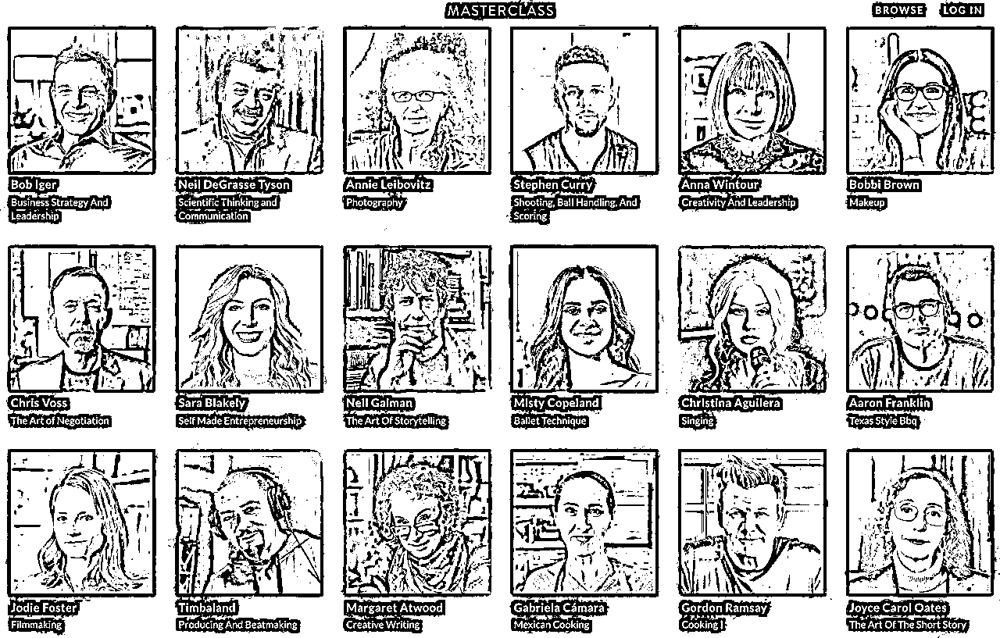

2020年疫情暴发，我人被困在国内，去澳洲读书的计划只能搁置。就在B站分享自己的日常，开了账号【内森の日常】，内容主要是读书学习、正念冥想、英语演讲，也会搬运些外网课程资源。粉丝一点点攒起来，同频的人也慢慢聚了过来。

再后来，在淘宝上无意间翻到大师课的盗版资源，买下来一看，视频和字幕文件居然挺齐全。我点开 Anna Wintour 那门课，看完很受触动，就趁着上学间隙把它从头到尾译了出来。

时尚女魔头 Anna Wintour 教创造力与领导力大师课（中英字幕）：
https://www.bilibili.com/video/BV1EZ4y1j7qx

译好的版本发到频道，伙伴们给了不少鼓励。打那以后，这个号就拐上了另一条路：以全球优质课程的中译内容打底，我的原创分享做补充，成了一个综合性的知识学习平台。

接下来两年里，先后有超过50位志愿者进过字幕组，帮着一块译大师课。我们总共译了400+小时、110套课程，是全球大师课中译覆盖最全的团队。与此同时，我招了运营伙伴，拉起一支20人队伍，正靠个人IP和付费共学社群往下推进商业化。

2021年7月，我正式决定试水商业化。到现在流水14万，扣掉字幕组奖励和必要运营开支10万，净利4万。本职还在互联网大厂，副业推进速度有限。希望这份分享能给你启发，也盼着将来遇到志同道合的伙伴，一起做点有价值的项目。

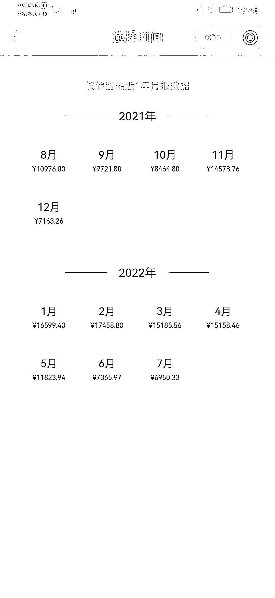

**一、字幕组从搭架子到跑起来**

**1.1 招募：把入口藏在课程里**

字幕组到底是干什么的？说白了，就是一帮对外语片有爱的爱好者，把片子译好，再用专门的软件压进画面里。他们因为喜欢某个作品，自愿来分享。

进我组的同学，整体素质都挺不错。我没专门去拉人，只是把招募信息塞进自己译的大师课里，之后便陆续有人找上门申请。

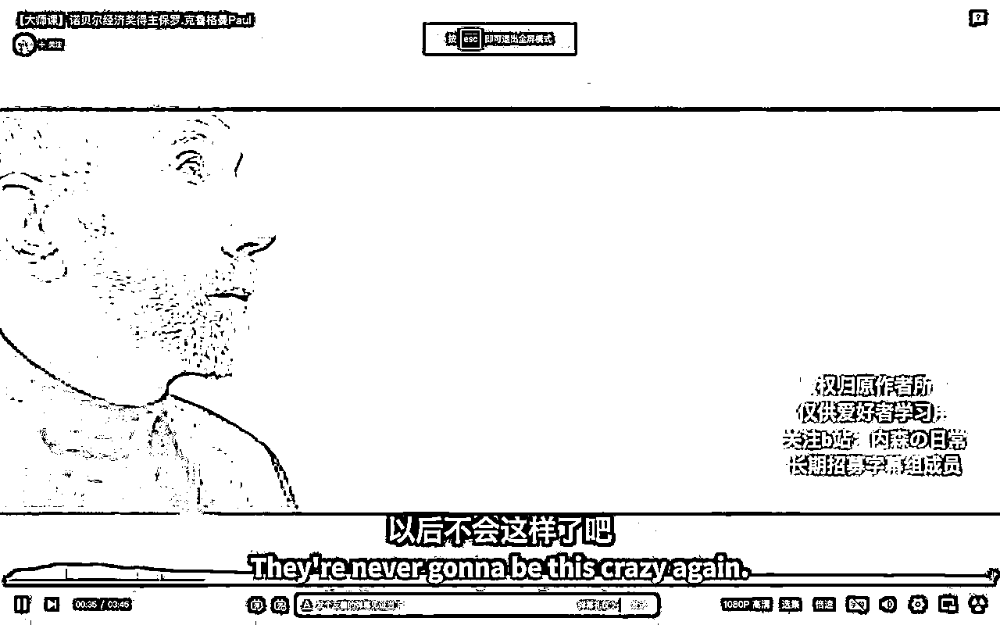

进组一共六步：先领试译任务；接着弄清组里的格式要求；再下载工具、学怎么用；然后做试译，交一份SRT格式文件；等反馈和审核结果；通过之后就算正式入组。

报名问卷在：
https://wj.qq.com/s2/6375668/c5cd/

试译指导文档：
https://knowlink.feishu.cn/docx/doxcn9TmNDBJgpiYmASwqyzkAfh

**1.2 翻译：三步走完一套课**

大师课本身自带原装英文字幕，这让整个流程快了不少。

第一步，机翻中文字幕。把英文字幕传上见外有道，用机器AI翻一遍，导出中英双语字幕。

第二步，人工精修。Mac 用 Subtitle Studio，Windows 用人人译世界；按组里的规范删掉多余标点，再逐句校对。格式细节都写在这份指南里：
https://knowlink.feishu.cn/docx/doxcn9TmNDBJgpiYmASwqyzkAfh

第三步，压制。按需要把水印和字幕压进去。早期用 submerger，所有压制都是我一个人干，时间长，常常整夜挂机。后来团队里来了有程序员背景的成员，帮我们搭出一套完整的压制流程，能批量生产和压制。

三步走完，一套大师课就出来了。人手安排上，翻译和校对是两个角色，一人翻一人校是最低配置，保证成品好懂、核心知识不出错。

拿我自己的速度来说，1小时课程要4到5小时全神贯注地翻；校对1小时课要1.5到3小时，看译文质量和对内容的熟悉程度。算下来，一门2小时的大师课，至少得8小时高强度翻译加3小时校对。

这么大的工作量，对个人主动性要求极高，我好几次都想撂挑子。怎么把字幕组成员的积极性调动起来，是个大课题。

**1.3 带人：靠愿景驱动，不靠老板架子**

管团队时，我把不少领导力方法带了进来：酬劳不多、主要靠热爱和愿景撑着，也得科学地驱动一支50人的志愿者队伍。

起步那会儿，我会尽量筛价值观同频的人进来，还让他们彼此认识、互相链接。字幕组不是纯干活的地方，它围绕大师课这个共同话题，是个帮人链接、助人成长的社群。要让每个人的“认知盈余”动起来，激发创造力和潜力，一块把目标完成。

认知盈余这个概念，出自克莱·舍基的书《认知盈余》：人们的时间、智慧、创造力和慷慨之心等盈余凑在一起，借技术手段聚拢，提高效率，从而促成创造与分享。这词2019年很火，马化腾给这本书写过序，也是不少互联网大平台的理论底子。

基于这套思路，我一直相信：优秀的年轻人有能力拿业余时间——原本刷短视频、打游戏的那些时间——共创出好的、有价值的内容产品。

所以我把共创写进了愿景：“跨界学习启发中国年轻人成长”，价值观定成“真诚助人，合作共创”。字幕组按社群的方式运转，后来慢慢长出了一些服务产品。

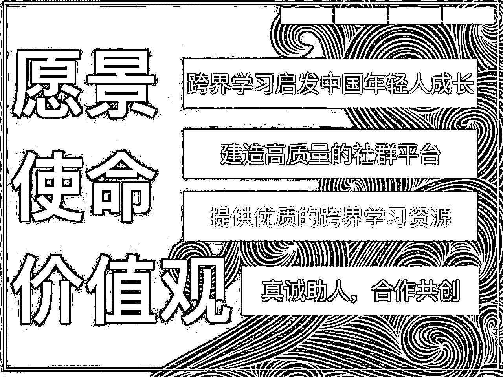

我会不断用愿景和价值观筛人：他们不吃简单功利那一套，助人利他之心很强。

当愿景和价值观足够清晰，频道的力量就出来了。很多用户看完我们译的大师课，看到的不只是一个搬运内容的号，更是一个有愿景、有目标的大平台，于是愿意加入进来出份力。

可光有愿景不够，科学管理、定期把人聚到一起很有必要，这能拉近成员关系、增强链接，让团队往一个方向使劲。

大师课的翻译是各翻各的，线上远程协作有好处也有麻烦：好处是各自独立完成，上下游不牵扯；麻烦是个人一拖延、生活一有变动，任务推进就慢下来。

从字幕组成立那天起，我就没把自己当老板，而是以引领者的身份和大家共创；只是我走得更靠前，有责任带着大家把活干好。

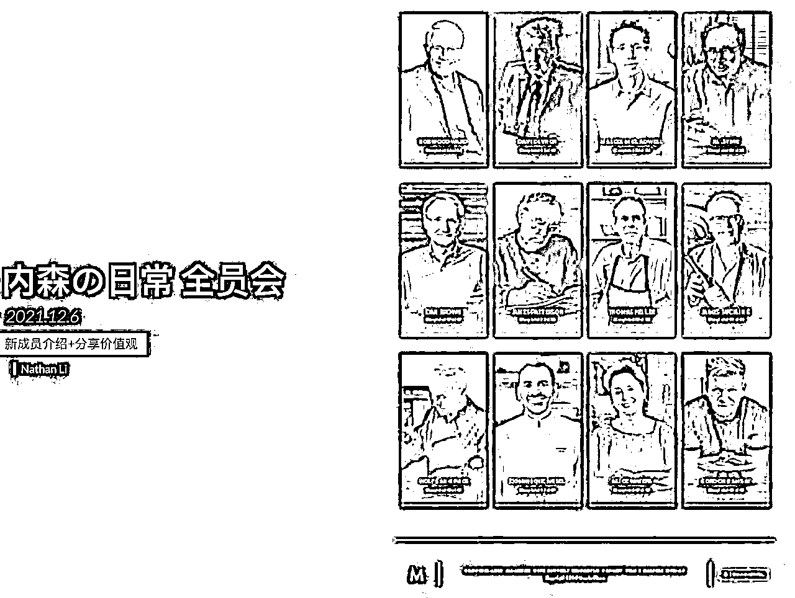

于是我把周会制度立了起来：每个周末开例会，帮大家理清翻译里的难点，聊聊翻译中的成长和收获。我很在意每个成员的成长，也关心他们生活上的变化，会和大家交流大师课里学到的东西。

例会开成了成长复盘会，大家一边翻一边学，还能互相链接、认识新朋友。成员背景五花八门：有海外留学生，有读工科却喜欢英语文学的，有自由职业者，还有高中生。

链接搭起来，字幕组就成了一个小社区；我要做的只是把社区的活动规则定好，让大家在这里培育自己的成长小树。

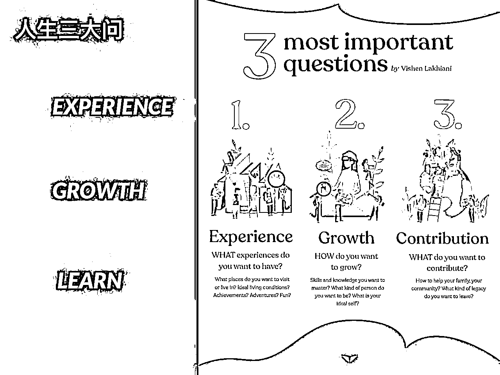

有例会，还得有阶段性目标。早期管理人员只有10个人，我能盯住每个人的进度；后来人多了，项目线也复杂，我开始用表格和工具记录进度。

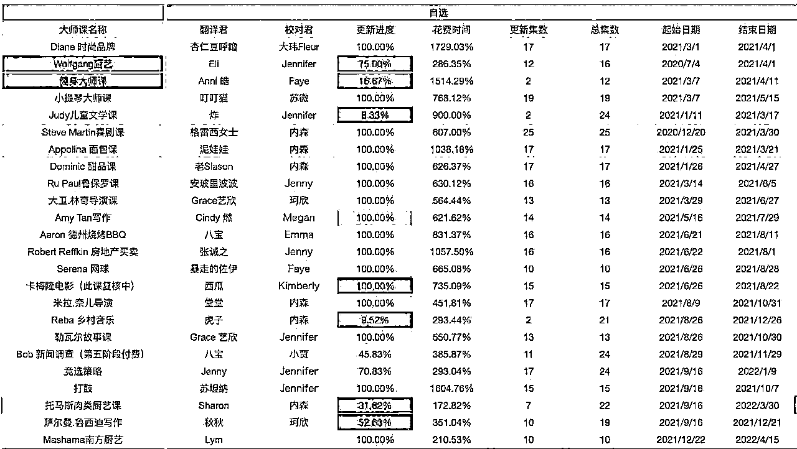

管理下来我发现，阶段性目标是个关键点。我会把课程划成第X阶段，挑出一部分精选课，鼓励大家从中认领翻译；同时定好合理的翻译校对周期，让成员两两配对、互相帮忙给反馈，把各做各的模式变成团队阶段性冲刺。

有了阶段目标，翻译速度也上来了。加入阶段翻译的同学，在可预期的2到3个月里会全力投入；不管是团队归属感还是目标使命感，都让凝聚力变强了。

我们也借这套阶段目标管理，慢慢长出一套新的游戏规则，让字幕组变成有趣好玩的生态，进来的人都能找到自己的成长路径。

**1.4 定规则：让奖励变成加速学习的工具**

到后期，字幕组也有了些收入路子，比如接翻译项目、做VIP付费社群。社群的内容后面再讲，这里先说说志愿者管理的奖励系统怎么加。

每个人都会落在“完成任务—拿到奖励—有所成长—继续挑战—完成更高任务—获得更高奖励”这个闭环里，不断成长，也愿意留下来接着玩。

所以我把字幕组分成了自选组和付费组。付费组译完能拿一定奖金，但时效性和准确性要求更高。每季度复盘会上，我会专门做点有仪式感的事，表彰拿到奖励的成员，让他们知道自己的贡献，也起到示范作用。

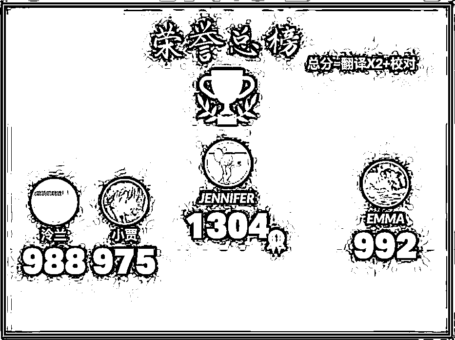

一套好的规则，能让组织按规则转起来，更好地完成目标。合理的奖励会鼓励成员提升自己、去挑战更难的活。

每次奖励我都用学习金的形式发，鼓励大家拿去买学习内容、继续提升。我心里清楚，现金奖励不会高，跟正常的翻译项目比价格很低。但换个角度，从共创和共同成长看，成员在翻译里能成长，能得到别人的校对反馈，还能练英语、满足学习爱好，都有收获。这时候额外的现金奖励就不只是翻译劳务费，而是面向未来、加速学习的好工具。

每个成员在这个模式下都有不同的提升，也通过例会分享交流收获，团队凝聚力明显好转，组员之间的深度链接也加强了。

在和字幕组深度链接、一起共创的过程中，后来那些内容栏目和社群产品也被孵化出来。某次会议的分享和总结，就启发我去做更大的社群服务。

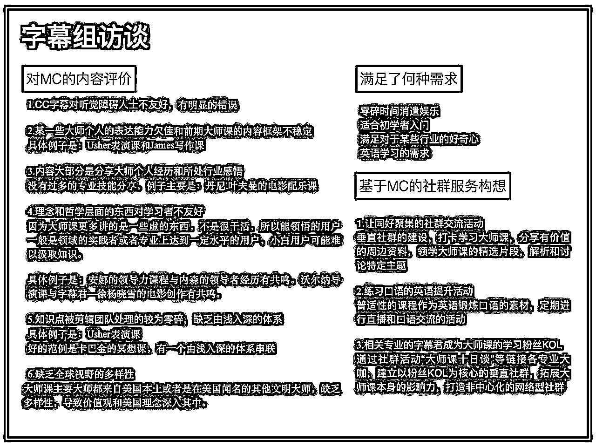

另外，我还添了一个内容栏目“大师课十日谈”，请优秀字幕组成员来分享翻译收获，并通过B站直播给频道拉流量。活动做了好几期，也同步邀请频道粉丝里的KOL来做分享，让大师课翻译项目变成一个综合型的分享交流活动。

【大师课十日谈】关于家装设计师 Kelly Wearstler 的分享会｜嘉宾：大玮 Fleur：
https://www.bilibili.com/video/BV1pU4y1p7BQ?zw&vd_source=26bbd5c99a86d984e07264d4c57d74e5

**二、先把B站看明白，再谈怎么入局**

**2.1 这里是年轻人的主场**

这一部分聊聊我对B站的看法，纯属主观感受。多年混迹知识区，攒了些体感，说出来供你参考。

B站是年轻人扎堆的地方。这里能看到新的Z世代，90后、00后玩梗、畅聊；在优秀作品和UP主带动下，形成一个弹幕的虚拟空间。

敢 杀 我 的 马？！：
https://www.bilibili.com/video/BV1yt4y1Q7SS?zw

B站真正要紧的，不是UP主多牛。记得有位财经UP主，分享自己月入千万、炒股怎么成功，这类“狂人”在B站并不受欢迎。不管他是不是真月入千万，平等和去魅都是这个社区的重要特质。

UP主不是高高在上的人设，不用贴高大上的标签，也没必要包装；做真实的自己，分享自己的思考和观点，做能让用户基于你的内容表达观点的事，这就够了。

怎么理解？B站最特别的功能是弹幕和三连。弹幕是一群人在异步时空里交流。UP主的视频内容重要吗？重要，但更重要的是它提供了一个虚拟抓手，让大家能在上面玩梗、分享，这就是B站的特殊之处。

三连是对UP主最大的尊重；“下次一定”“白嫖”这些词也都在B站流行。我一直把B站当自留地，甚至像个乌托邦：每个用户都保有最纯粹的好奇心，每个UP主分享热爱，用爱发电、无私奉献。这样的社区氛围，也让B站的商业化一直慢人一步。

**2.2 长内容照样有人看**

基于我做大师课分享的经验，总结几点B站知识区做内容的思考，仅供参考。

在B站做视频，和抖音、快手、📕不太一样：完播率可能没那么要紧。当前B站有大量中长视频，最新报告显示用户日均使用时长81分钟，这相当可观。

所以，把视频做长或做成合集，在B站是常态。我动不动就把10小时的大课按分P传到B站，会看到很多人先点赞收藏，再慢慢回来看完。这么长的视频还要追完播率，数据肯定不好看。

一个典型例子：我播放量最高的课程全是几个小时的大课，每门几十万播放，最高有150W。

**2.3 干货内容有人收藏**

如上图，频道里排第二的大师课是FBI首席谈判专家Chris Voss的课，仅次于篮球明星库里的课。主讲人不是什么大明星，在他所在领域也算小众，但课程干货足、非常落地实用，我翻译时收获很大。

看过这门课的同学，会在弹幕里说“厉害”“马上学会”“是这么回事”。我想表达的是，这是我发布内容里干货含量极高的一门课。

B站用户对学习和求知的渴望，远超很多人的想象。别拿不够实在的干货做成好看的视频，就以为能唬住用户。在B站，用户会花很多心思研究、分析你分享的内容，甚至会在评论区总结要点、写学习笔记，当“课代表”。

这也让B站再次成为年轻人口中的一所大学，很多人把它当学习平台用。可以看看2021百大UP主“取景框看世界”的视频，就知道知识区有多厉害。

我要在b站建所大学，送给每个大学迷茫的你！！！【框框的b站大学-导论】：
https://www.bilibili.com/video/BV1pv411T7rM

**2.4 有话题就有人讨论**

前面聊到，B站的内容其实是个载体，让用户能在上面自由分享。当你的内容围绕一个超级话题，或是圈层里重要的人物、讨论点，大家就会用弹幕在你的内容上讨论。

篮球大师课就是很好的例子。库里是篮球区的超级红人，看第一集弹幕，能看到很多追捧明星、玩梗的用户，比如“教练，我想学扣篮”。这本来不是库里篮球课里的内容，或者说不是他擅长的，但用户用幽默表达声音，让视频火了起来。

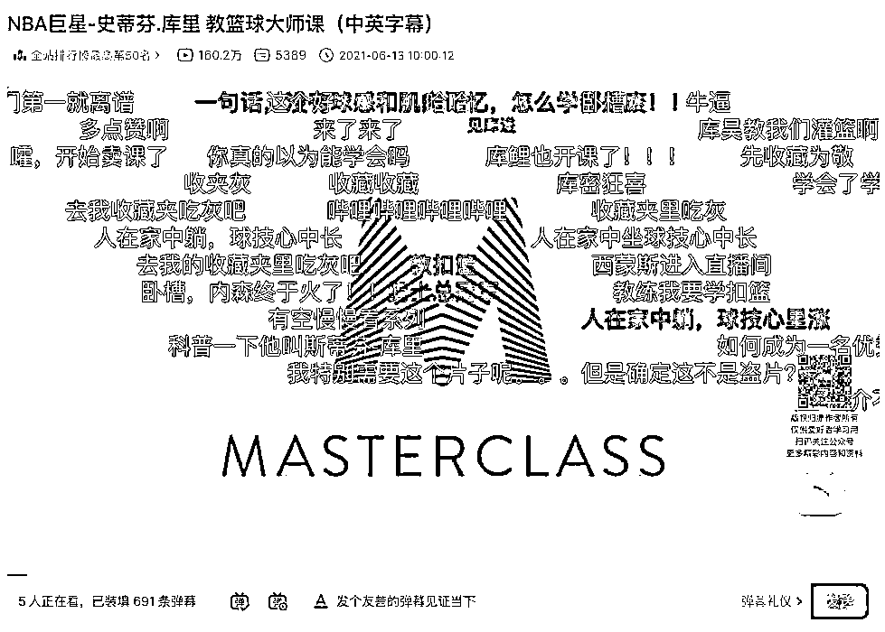

这里能看到一个由弹幕构成的虚拟空间。通过弹幕评论，视频发布后很长时间都能持续获得长尾流量。B站还有很强的推荐机制，一个视频紧接着会弹出其他视频推荐，这是其他平台没有的功能。

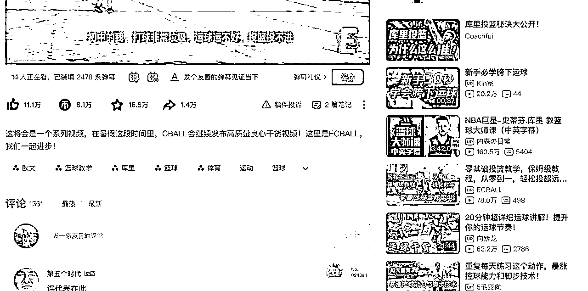

**2.5 给入局者的三条建议**

1.做真实的自己，和用户深度链接。别建构假大空的人设，用自己的热爱吸引同频伙伴。表达自己真正相信的观点，没有绝对对错，更多是真实展现自我。

2.把公域转私域做起来，让优质用户逐步沉淀到自己的私域。把B站当成商业化版图里的一座灯塔，吸引同频、热爱的人加入，释放出强烈信号。

3.理解B站生态，多看内容，感受弹幕、评论和玩梗氛围，融入各个圈层。别太在意个别用户的差评，持续做自己爱做且擅长的事；只有热爱和专注，才能走得长远。

**三、把B站公域流量引到私域**

**3.1 👸号承接**

在视频平台里，B站对比📕和抖音，对往私域引流最包容。

所以我刚开始做大师课翻译时，就已经在翻译水印里做引流，把流量往👸号沉淀。

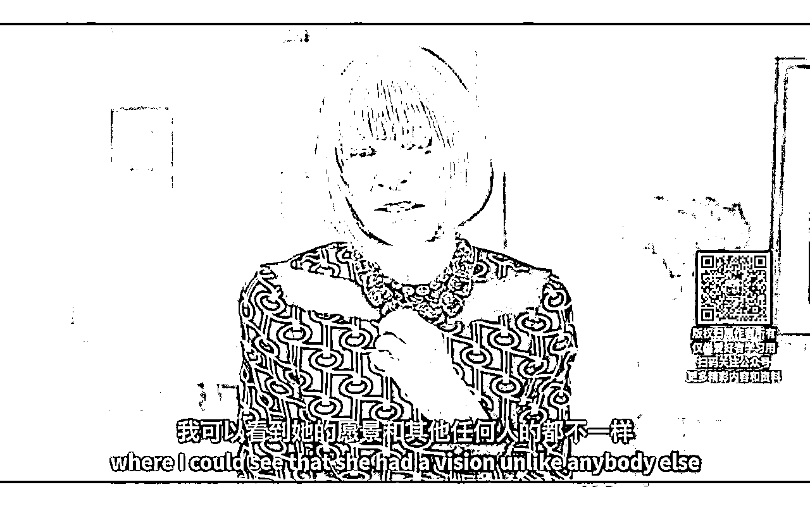

到现在，👸号有3.2万粉丝；对比B站24万流量，这个比例算高了。

第一步，我把大师课配套的英文原版PDF放到👸号后台回复里。用户看大师课时，如果想拿原版配套英文学习手册，就到👸号回复对应数字编号，系统会弹出文档下载链接。

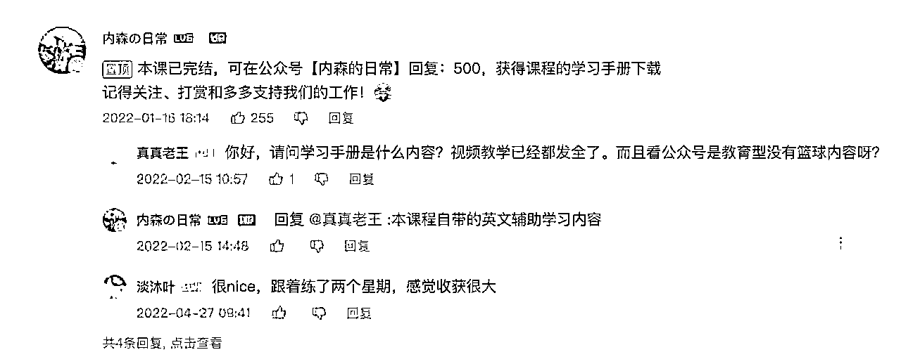
# 从视频到社群：我的私域转化复盘

我设计了一个承接动作：观众刷完视频后，会被引导到👸号领取配套手册；人一旦留在👸号里，后续转化就能顺势完成。

在我看来，👸号想单靠原创图文涨粉并不容易。我也不觉得自己是写作高手，写不出动辄十万加的大爆款；但我有一条更现实的路——把公域视频流量一步步导入👸号私域。

在👸号内，我会按用户圈层做区分，把他们分别导向不同的免费社群，再在后续完成转化。

**3.2 用免费社群做分层承接**

👸号起步阶段，我就搭了大师课粉丝群，想把喜欢这类课程的人聚在一起，还会用投票决定下一部翻译什么。现在这类群有4个。可免费群的问题是，每个人加入的动机不同：有人冲着篮球课，有人为了谈判、建筑或写作课。需求太分散，群里的讨论氛围始终不理想。

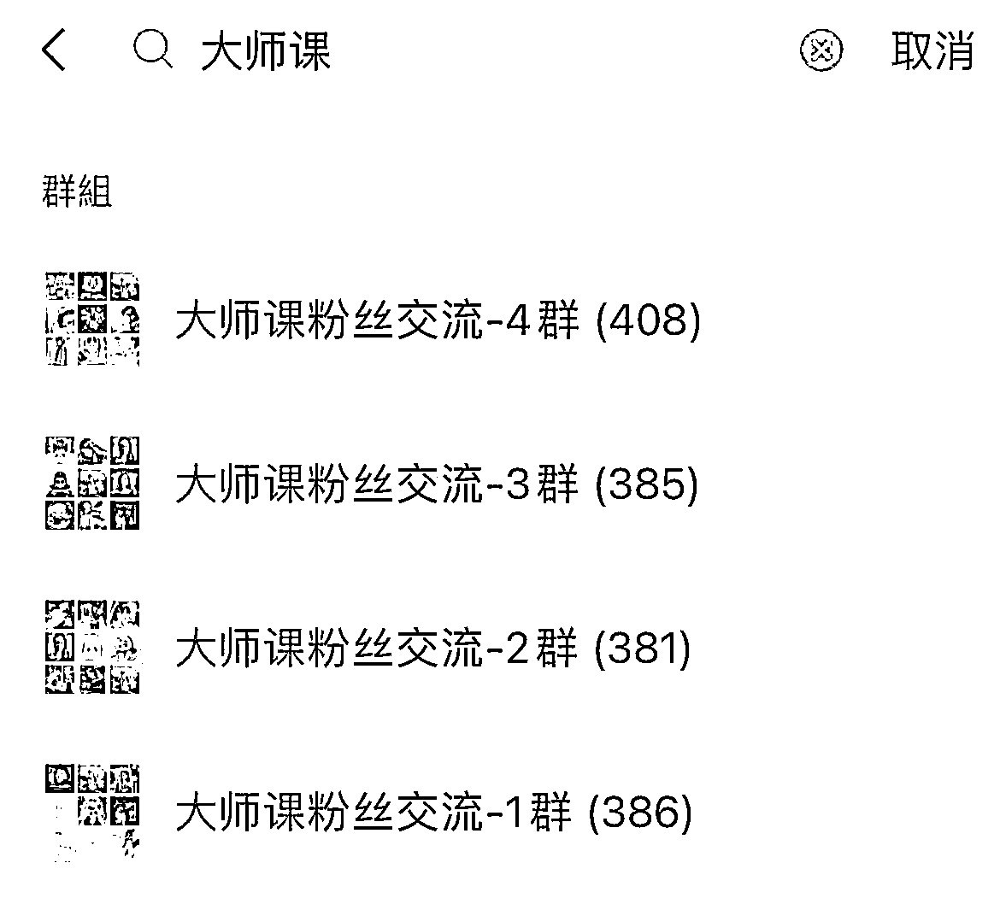

之后，我在大师课粉丝群的基础上做了读书俱乐部，相当于借课程这个入口横向扩展到阅读品类。读书俱乐部开了3个，攒下不少人气，进群方式也简单：填一份问卷就行。后来还做过裂变：把读书俱乐部海报发到朋友圈，集满10个赞即可入群。靠这些动作，早期积累了一批读书爱好者，也有出版社合作方来找我寄书、做分享。

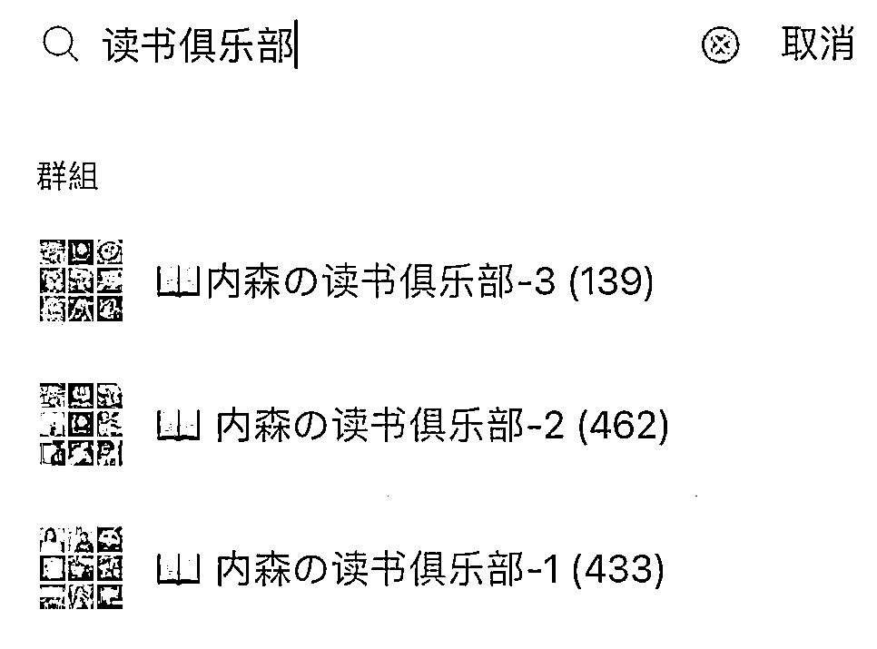

免费社群继续细分时，我又拆出一个英语群，定位是英语学习和打卡。群内要求尽量用英语交流，也要分享自己的学习收获。此前组织过英语圆桌论坛小组，还做了不少直播内容，服务喜欢英语的同学。这样大家既能学大师课，也能顺手得到英语学习的启发。

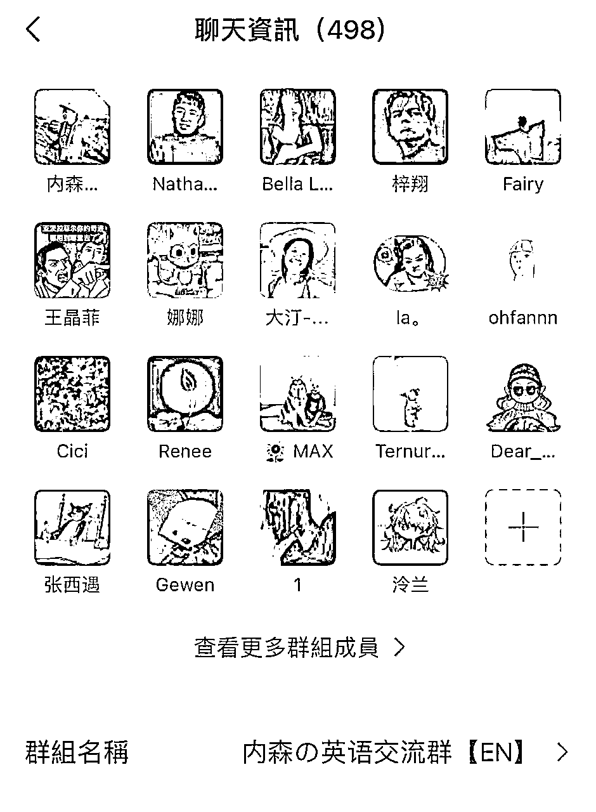

**3.3 付费VIP社群**

2021年7月，为了让字幕组能靠自身收入转起来——此前一直是我在贴钱——我决定尝试VIP付费社群。第一个付费群是商业群。我把大师课拆成10个垂直类别，并逐步把那些播放量不算高、但质量很好且偏小众的课程收进付费群。收费方式就是收入群费，同时提供交流打卡的社区空间和完整翻译内容，商业化模式由此起步。

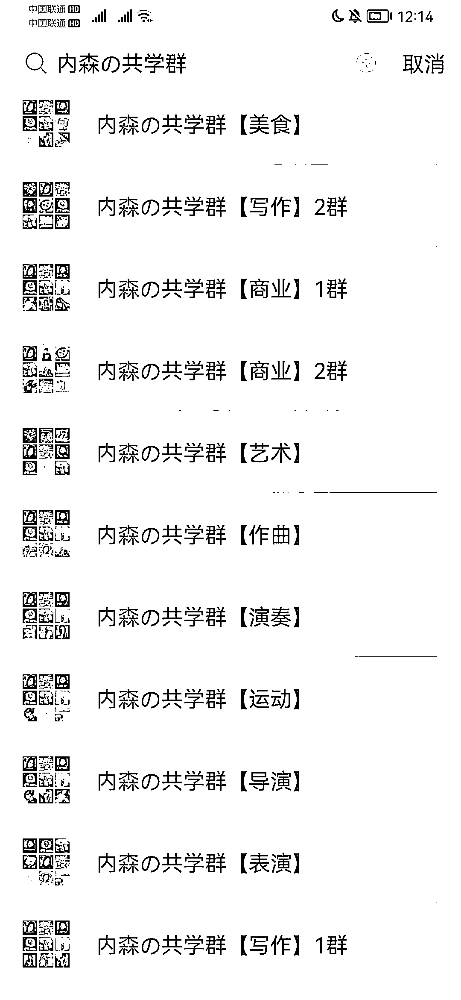

从免费转向收费时，掉粉和评论区负评都出现过，我那阵压力不小。尽管B站上也有其他UP主翻译大师课，但无论机翻还是人工翻，内容的深度和广度都没有完全超过我们的产出。因此我相信，付费这条路仍能得到用户支持。另一个原因是，只有适当商业化，这件事才能长期运转，让我的副业扩大规模、提高产能，也能帮到更多年轻人。

刚开始我不敢把客单价定高，甚至觉得收费很丢人。毕竟课程翻译带有搬运和盗版属性，拿它盈利让我很不舒服。正式收费前，我跟字幕组同学做了充分沟通，并得到他们的认可和支持。同时我承诺，会保证一定数量的大师课继续免费放在频道里，让字幕组的成果得到充分展示，而不是只服务于商业目的。

第一个共学群选了商业方向，因为这本身就是商业化动作，于是我把商业类大师课单独归类，开了第一个群。之后又陆续开出写作、运动、冥想、艺术、表演、导演等其余9个共学群，把用户逐步分流。

进群定价和涨价规则，我起初用了一个很简单的逻辑：人越多，价格越高。我相信进来的人越多，产生的连接和内容越丰富，社群价值也会水涨船高。但后来这个判断被现实推翻了：社群并非人越多越好，真正重要的是连接有多深。我也因此意识到，社群人数存在一个临界值，越过之后活跃度可能走平，甚至下滑。

第一个社群单价29元，每满100人涨10元。为了提升商业群价值，我还去谈过赞助，希望用更多资源把群的内在价值撑起来。

从商业群开始，我每月策划新的共学群，同时搭建打卡体系和内容规则。这个过程让我补了不少社群管理知识，付费社群的运营方法也慢慢成型。一年内，靠垂直付费社群，我沉淀了3200多位优质付费用户私域流量，累计变现14万元。

**四、关于未来的一些判断**

感谢你读到这里，也希望前面的复盘能给你一点启发。下面聊聊我对未来的思考。从翻译大师课开始，我积累了第一批粉丝，完成了私域沉淀，也认识了一群志同道合的伙伴。

**4.1 把个人IP锚定在内在成长**

在这个基础上，我开始向内追问：我真正擅长且热爱的事情是什么？答案不是翻译课程，也不是做字幕组，而是我的愿景——用跨界学习启发中国年轻人的内在成长。

很感谢龙哥盟，它拓宽了我的商业认知，也让我看到更大的格局，原来商业可能性不止一种。顺着赚钱的链接，我认识了花爷，加入花爷的IP项目，从0到1做个人IP，并把原创内容放到更重要的位置。

做大师课翻译期间，我一直关注另一个课程平台——Mindvalley心谷大学。它致力于把觉醒教育带给10亿人，是一个全球化线上学习平台。我从2014年起学习它的课程，也持续从中获得内在成长。

未来，我会以个人IP“内森师兄”为支点，帮助中国年轻人，尤其是职场人，探索职场自由与内在成长，并转型知识服务赛道，启发更多青年。

**4.2 用社群品牌连接知识同好**

原本的共学社群和大师课内容，会以一个独立品牌出现，也就是知链青年Knowlink——通过知识链接同好，跨界启发成长。

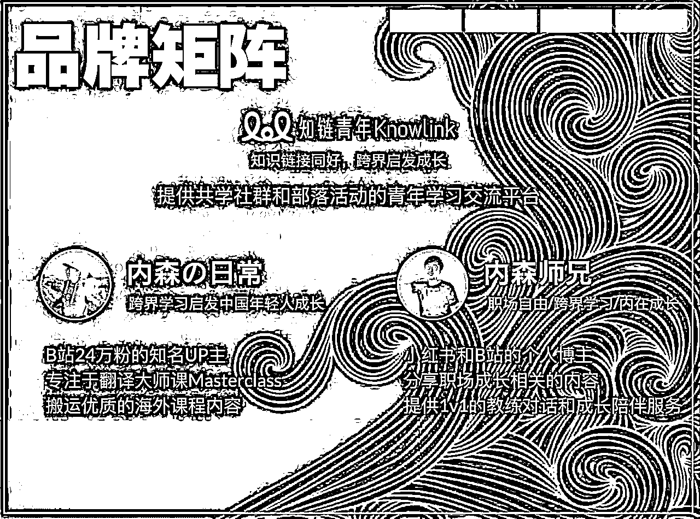

知链和内森师兄会按外在成长与内在成长来分工，形成双轮驱动。前者帮大家获得技术与能力上的提升，并通过社群产品服务增强影响力和利他力；后者提供内在成长的方法论，帮助提升自我认知，找到快速成长的方法。

由内到外，再让外部反馈回到内部，形成一个闭环，让每个人更自洽地成长，让改变真正发生。两个方向也对应不同生意：知链青年做流量型生意，扩大流量池，产出有价值的内容，在公域转私域的过程中持续提升影响力；内森师兄做复购型生意，通过不同训练营和1V1教练陪伴，帮用户梳理内在成长需求，促成改变、发掘潜力。

最后，版权始终是悬在我头顶的一把达摩克里斯之剑。新东方起步时也曾面对GRE试题的版权纠纷，这让我不断思考：怎样才能更稳妥地处理与Masterclass的关系。未来，我希望提升组织能力，扩大品牌影响力与个人能力，最终与Masterclass形成对等合作，成为其官方翻译和分销合作方，为优质大师课进入中国市场出一份力。

如果你看到这里，无论在做个人IP、社群服务、知识付费，还是教育创业，都欢迎和我交流。若这篇文章对你有启发，也欢迎在评论区留下你的思考；有表达不清的地方可以提问，我会尽量回复并改进。希望我们一起为中国新一代青年的成长做点事：用知识链接同好，跨界启发成长。

**留言区互动**

平凡小吴：从B站过来，关注加一～

内森Nathan：感谢关注🤝

nn：原来是在B站关注的UP主，还是星友！谢谢分享[爱心]

小夏：之前在👸号读过内森哥哥的分享[呲牙]

小夏：DJ好听

fung：花29元进群后能获得哪些连接？怎样和会员建立更深的连接？

田新一：太厉害了，想请教一下，收费社群具体提供什么服务？我目前也有一群爱好者，也想过做社群，但还没想清楚能提供什么服务，所以来请教。

Bluear：版权方面会有风险吗？