# 公考红海突围：小红书变现30W+的差异化打法

公考一年只开考一两轮，报名者却数以万计——这本身就说明，围绕它做知识付费，完全具备长期经营的基础。

那么，面对一片杀红了眼的公考赛道，普通人还有没有机会切进去？今天我想借自己的实操经历，给出几条能落地的路径。

知识付费的变现方式，说到底就两类：

一类是替别人卖产品。货不归你，卖多少钱、怎么卖也由上游说了算，你只充当渠道，话语权弱，拿到的回报也有限。

另一类是先自己学透，再拿去用、去验证，把跑通的方法沉淀下来，整理成体系，然后教给更多有需要的人。前期打磨周期确实长，但能做成长期生意，卖与不卖、定什么价都握在自己手里，利润天花板也更高。

我走的就是第二条路。

下面，我会把这套如何在这片红海里做出差异、在各大机构夹击中拿下30W+收入的全过程摊开来聊。

各位生财有术的朋友好，我叫哆啦，先后三次考上不同系统的体制内岗位，副业做「公考面试培训」知识付费。早期流量主要来自知乎，2022年4月起把重心挪到小红书，截至目前，这个平台累计给我带来了30W+收入。

这篇文章会围绕账号冷启动、精准引流、成交变现三个环节展开，希望能给同样在做知识付费、正卡在从0到1或从1到10阶段的朋友一些启发和能直接上手的方法。

## 一、小红书公考面试账号怎么做

我选定的细分方向是公考面试辅导与培训。不过即使你做的是别的领域也别担心——引流与变现的底层规律，放到哪个赛道都基本通用。

我的小红书闭环思路：

变现（公考面试培训）

** ↓**

引流（有面试需求的粉丝）

** ↓**

差异化（不断优化笔记内容）

** ↓**

转化（话术建立信任并成交）

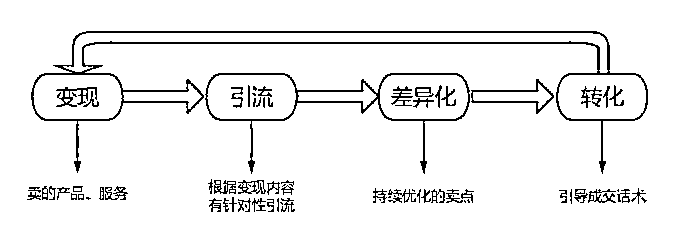

**1. 为什么锁定公考面试？**

**（1）先弄懂公考面试是什么**

无论公务员还是事业单位招录，流程通常拆成笔试、面试两块。

笔试内容以行测、申论、公基为主，过了这一关，才能按1:3的比例拿到面试入场券（这里的N多为3到5；若岗位只招一人，则笔试排名前3到5位的考生进入面试）。

所谓面试，就是让考生在限定时间内对给定题目作出回答，由考官现场评分，去掉一个最高分、一个最低分，剩余分数取平均，即为该考生的面试得分。

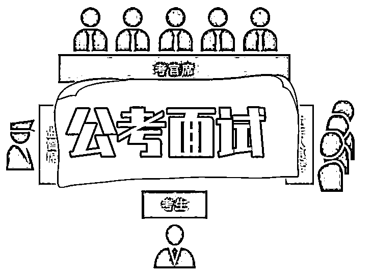

下面列几道面试题，方便大家感受：

**1. ** 年轻干部要修炼好“内功”，必须要坚持刀在石上磨，人在事上练。对此谈谈你的理解。

**2. ** 一项调查数据显示，未成年人互联网总体普及率高达98.1%。与之相伴的是，网络成瘾现象十分严峻。对此，请谈谈你的看法。

**3. ** 你是单位的一名新人，单位有个老同志总是看不惯你的工作风格，表面很和气，背地里却经常同其他同事说你的不是，导致同事们对你议论纷纷。对此，你怎么办？（**2**）我为什么押注这个方向？

**① 报考人群基数庞大**

除了国考、省考、事业单位统考这类大型招录，零散的考试机会同样不少。以2022年为例，受疫情影响，不少地区对事业单位人才引进做了简化处理——符合条件者免笔试，直接进入面试环节。

再往下看，省、市、县各级，以及疾控、医院等系统自行组织的招考多如牛毛。说得夸张一点，放眼全国，几乎周周都有、甚至天天都有体制内面试在进行。

**② 单价高，而且绕不开**

先说价格。市面上稍有名气的面试机构，课程动辄一万、两万起跳，线下班的定价把整个面试培训的价格带都抬了上去。更关键的是，面试和笔试不同——笔试有标准答案，买套网课自己刷题就能应付；面试没有标准答案，纯靠自学，提升非常有限。

这也给个人从业者留出了空间：按每人3000元计，每月招到十来个学员，月收入就能稳定站上3W。

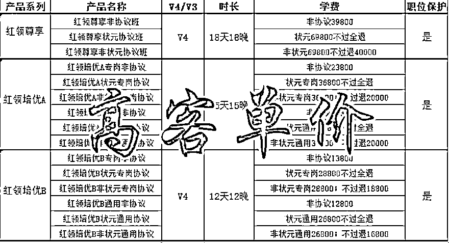

再说需求刚性。面试是上岸路上的最后一道关卡，闯过去就正式进入体制内。正因如此，无论是考生本人还是家长，都愿意掏钱，或者说不得不掏钱去报班。

**③ 我手里有实战经验**

我本人三次考进不同的体制内单位，也在机关里工作过多年。论笔试，我并不算强项；可只要进了面试，我每次都稳稳上岸。对于面试这件事，我积累了不少自己的心得和方法。

最开始，我是免费给考生做辅导的——单纯觉得这些上岸经验放着可惜，能用它帮到别人也挺好。后来发现这件事可以长期做下去，才转为收费模式。

**2. 账号冷启动**

回头看我这个账号的起步过程，大致可以分成三个阶段。

**（1）阶段一：只发面试真题**

我在小红书发布的第一批笔记，时间是2022年4月前后。当时我在微博上搜“面试”关键词，注意到大量公考机构每天都在搬运最新真题。我琢磨：能不能把这些题目整理成图片形式发出去？

说干就干，我找了款制图工具，把真题一张张做成图，同时铺到小红书、头条号、微博、公众号、知乎等渠道。一圈试下来，只有小红书的反馈最热烈，互动也最好，每天能收获几百到一两千的“小眼睛”。这种看得见的正向反馈，成了我持续更新真题的动力。

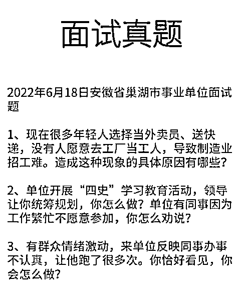

发真题的过程中，常有考生在评论区追问某道题该怎么答。我会认真拆解：这类题如何搭框架、可以从哪几个维度切入、具体怎么铺开。

可问题随之而来——小红书单条评论上限只有300字，而我的解析写得很长，只能拆成好几段发。时间大量耗在评论区回复上，投入产出比实在不划算。因此，这个阶段只维持了一周左右。

**（2）阶段二：真题搭配解析**

大约一周后，我开始研究同赛道的账号，发现那些粉丝体量大、赞藏数据好的博主，发的内容是真题解析和逐字稿。于是我立马跟进，把笔记形态从“纯真题”升级为“真题＋解析”。

调整之后效果明显好于从前，陆续有粉丝私信来问面试提升的事。这个阶段大概持续了两个月。

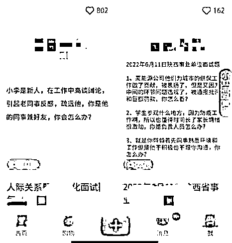

**（3）阶段三：专注解析**

继续做真题又暴露出新问题：每天流出的题目数量太多，评论区总有考生追着要答案。挨个回复吧，一道题少说也要花一二十分钟；不回复吧，又老有人问。越做越觉得这块内容像鸡肋，两个月后我干脆停掉真题，专心只做解析类笔记。

**3. 笔记怎么呈现**

我的解析统一采用图文形式。最初对标同行时，我其实没想通：为什么图文笔记能吸引这么多粉丝？后来一位学员点醒了我——图文中附有完整的作答逐字稿，而很多视频只是口播，没有文字稿可对照，图文看起来反而更清楚。下面分享几个做图文笔记的要点。

**（1）首图干净利落**

早期我很在意首图的“颜值”，一心想着把图片做得精致。但研究了一批爆款账号后我发现，人家的封面并没有太多花哨设计，重心全放在内容上。

我换位思考：如果我是考生，真正想看的无非是解题思路和作答逐字稿。想明白这一点，我就把首图改成了“白底黑字”的极简风格，不再雕琢形式，只服务于内容——这套做法一直用到现在。

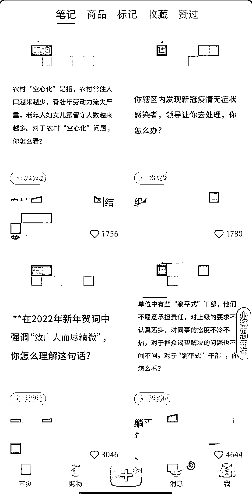

**（2）内容做出差异**

小红书上做面试辅导的同行不少，怎样才能让自己被看见？答案是把内容做得比同行更扎实，形成产品层面的差异。

先看和普通机构的区别。我手里有多次面试上岸的经历，也有体制内工作的积累，写出来的东西自然更贴近考生的真实痛点和难点。反观大多数机构，主要精力放在付费推流、买广告位上，对题目解析本身并不上心；再加上机构里的老师不少是短期培训速成的，肚子里干货有限，产出的笔记质量也就高不到哪去。

再看和同行的区别。有些同行也写解析，但基本止步于给出答案，思路推导和过程拆解往往省略。原因可能有两种：一是确实写不出更多干货，二是不愿在思路分析上耗时间。这样一来，考生从笔记里获得的“获得感”自然有限。

而我的图文笔记，在答案之外还会讲清楚一道题该怎么搭结构、答案是怎么一步步想到的。对考生而言，解题思路和方法，价值往往高于答案本身。

综合多位同行的长处之后，我把笔记打磨成这样的组合：解题思路＋思维导图＋作答参考。

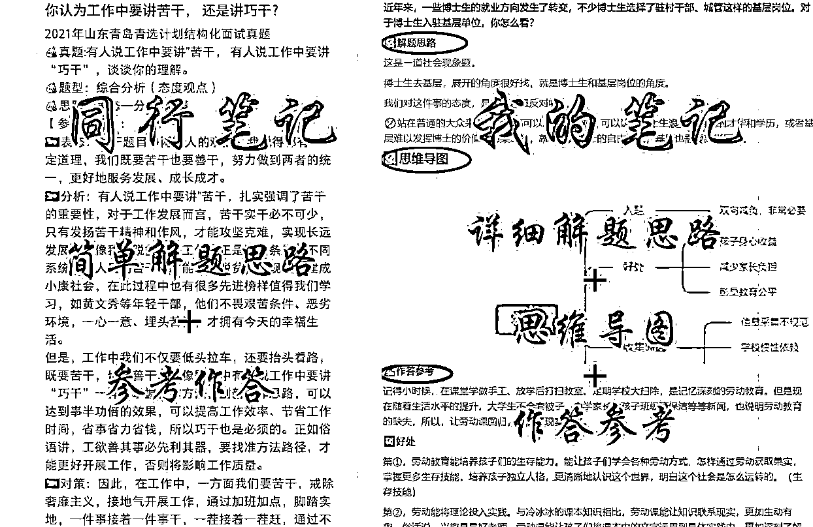

**4. 如何引来精准粉丝**

我的变现定位很明确——只做面试拔高。因此我要吸引的，就是那些有面试拔高需求的考生。

至于怎么让粉丝心甘情愿掏钱，说到底就一句话：先让他信任你。

**（1）用干货证明专业**

小红书笔记，是用户第一次对你建立信任的场所。所以每一篇解析我都认真对待，一篇像样的笔记通常要花半小时到一小时。通过持续输出干货，我的专业度才立得住。

与此同时，我也在借笔记质量的提升，不断拉大同竞争对手的差距。有人担心干货都抖出去了，粉丝就不来找我了——我并不怕。面试能力这东西本身就比较虚，文字能传达的往往只是一个大致方向；考生若想真正快速提高，还是得靠一对一沟通、交流、上课来解决。

就变现而言，前期在信任上投入的时间越足，后期成交就越顺。

**（2）把个人价值埋进笔记**

写笔记时，可以顺势把自己的经历带进去——比如入行几年、拿过哪些结果、帮多少人达成了什么目标。这样既输出了干货，又让用户看到你的实力，个人**IP**也就慢慢立起来了，自然更愿意主动私信。

比如我在解析里会穿插这类句子：

**1. ** “以前上课时，有学员问过我关于***的问题”

**2. ** “在体制内干活那会儿，我们并不会**”

**3. ** “我之前的学员正是用了这招，才***”

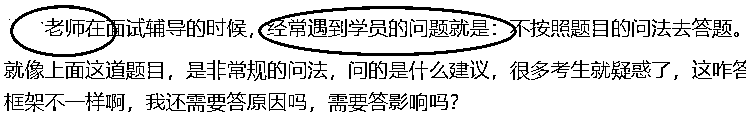

把个人形象自然地嵌进解析里，考生读着读着，脑海里就会浮现出一个清晰的画像：这位老师有授课经历、有体制内背景，带出来的学员成绩也拿得出手。

**（3）价值是吸引来的，不是推出去的**

这和谈恋爱有点像——知识价值的魅力来自“吸引”，而非“推销”。粉丝认可你的内容、恰好又有需求，自然会关注你、私信你。

反过来，你主动凑上去私信，性质就变成了推销，身价也就掉下来了。

因此，碰到粉丝在评论区说想咨询面试提升，我通常只在评论里回一句“小窗T我，滴滴我”来引导，很少主动去私信对方。

把价值通过图文、视频展示到位，等到他们真有需求，自己就会找过来。

**5. 回复模板化**

粉丝来咨询，往往很耗时间。小红书又没有电脑端，只能捧着手机一个字一个字敲，一忙起来根本招架不住。于是我提前把常见回复话术编辑好，有人问就直接发过去，省下大量沟通成本。

我用的工具是手机输入法自带的“常用语”功能：

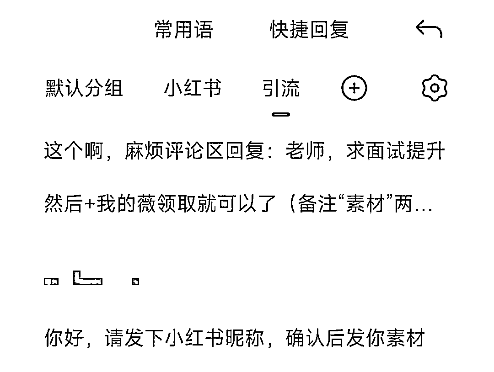

当粉丝私信要微信时，我没有采用一些圈友“把微信号做成图”的办法，而是分两条消息回复。第一条写：

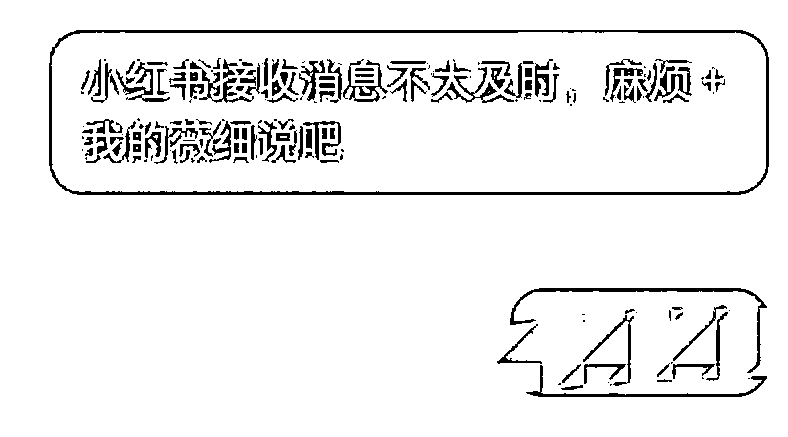

“小红书消息接收不太及时，麻烦+我的V细说”，第二条直接附上微信号。做成图片反而麻烦，这样发速度更快。按我每天大约10到20个咨询量来算，这种方式至今没出过岔子。

**6. 定价策略**

价格直接决定收入上限，客单价能提到多高，最终拼的是个人本事。

**（1）干货输出能力，决定你的报价**

小红书上有一批刚上岸的人在做陪练，套路通常是发篇笔记晒自己上岸，再配上几张微信辅导截图。

这类老师的定价普遍在几十块一小时，再高基本就没人问了。原因很简单：他们能提供的价值，无非是几张截图和一次上岸成绩，考生由此产生的信任感并不强，自然不肯出高价。考生选他们，图的主要是便宜。

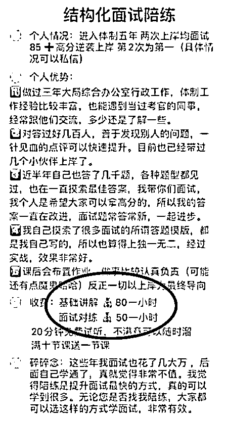

**（2）我的定价水平**

我最初也是几十块一小时，如今已经做到几百块一小时。

同样是做面试辅导，凭什么别人收几十，我能收几百？差别就在笔记里的价值输出。

打个比方：你是考生，想报个课，如果博主只会喊“我教得好、有能力、有经验、能帮你”，你会心甘情愿掏大几千去听吗？大概率不会。

可如果这位博主除了自夸，还实打实写出大量经验和干货，考生对他的价值判断就会清晰得多，转化起来自然更容易。

我之所以能收得比别人高，是因为我输出得比别人多。我不只是把履历摆出来给人看，而是花大量时间一篇篇写解析。学员正是通过这些解析认识我的能力，一旦产生提升需求，就会主动私信。

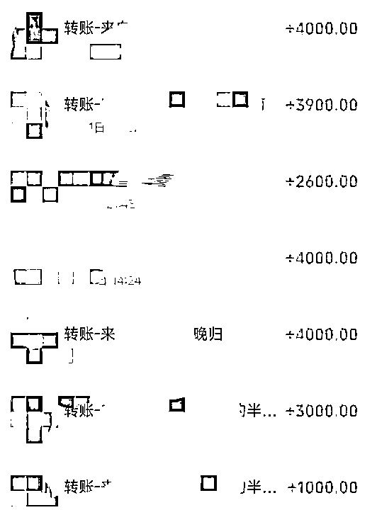

**（3）给价格做包装**

正是这一招，让我的私教课价格翻了好几倍。此前我的收费卡在每节300元左右，再往上学员就犹豫了，往往想先上一节看看。为了留住人，我也就按节卖了。可结果呢？我课上的干货太密，往往一两节就能帮学员明显拔高。问题随之而来：好不容易招来的学员，上完一两节就走了，投入产出比低得可怜。

后来我慢慢换了打法。学员问一节课多少钱时，我不再报单节价格，而是直接报整套拔高课的费用，并告诉对方“我这边只做完整的拔高课，一两节不单独约”。紧接着，我会讲清楚这套课的形式、价值，以及能帮他解决什么，让学员先了解、再认可我的能力。

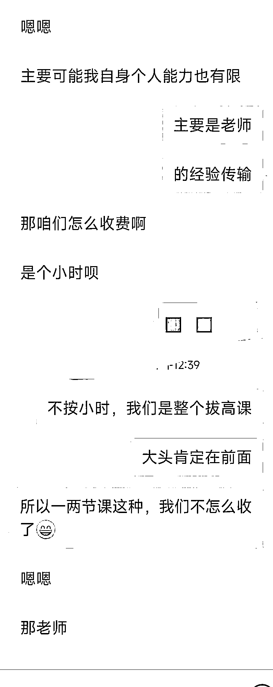

聊到这一步，如果学员相信我确实能帮他快速提升，他纠结的就不再是“上一节课花了多少钱”，而是“报了这个课，我的面试成绩能提高多少”。当然，话说回来，前提是我真有让学员短期拔高的本事，否则也没底气这么讲。

所以说，收入上涨甚至翻倍，很多时候就来自某个细节上的优化。

**（4）用多元供给接住不同需求**

面试考生的个性化需求五花八门。多数人会选择报班，但有些问题，报班根本解决不了。症结在于，不少线下机构的面试老师水平堪忧——他们绝大多数没在机关单位待过，很多是机构短期培训速成后，转头就来教考生。（不信可以搜搜“某公退费难”，就能大致感知这个行业师资的成色。）

正因为讲得不行，考生身上才积压了一堆问题，而这些恰恰就是需求所在：

**1. ** 在培训班学不到东西，自己练又提不上去的

**2. ** 答题没有自己解题框架的

**3. ** 答案空洞、需要提升质量的

**4. ** 临考前急需拔高，却找不到有经验老师的

这些需求，大机构很难覆盖。机构的面试班时间固定，报了名就得按它的排期上课；而我时间安排灵活，只要提前约好，上述个性化需求我基本都能接住。加上我的授课质量比机构更扎实，学员自然更愿意留在我这里。

有些需求也不是一开始就能预判的，而是在这个领域扎得够深之后，一点点被挖掘出来的。所以说，市场越大，细分的机会往往越多；谁能找准这些细缝里的需求，机会就归谁。

**（5）用复利思维放大运营**

学员一多，我一个人就教不过来了。于是我把原来清一色的“一对一”，拆成“小班＋一对一”两种形式。

我还从带过的上岸学员里培养了一位面试老师，跟我搭档合作。现在“一对一”基本交给这位老师去带，我则腾出时间写解析、带多人小班。

这里面藏着两层“复利”：一层是“人”的复利，一层是“时间”的复利。

**a.** 合作老师带来的是“人”的复利。我把大部分利润分给授课老师，自己只负责引流学员。表面看收入少了一块，但我不必再亲自上课，时间被大量释放出来。

**b.** 小班带来的是“时间”的复利。同样的时间段，一对一只能收一份钱；换成多人小班，就能同时收好几份。

**（6）持续试探和优化价格**

我目前的价格在4000元上下。说句实在话，按我的授课质量，考生在线下就算砸4W，也未必买得到同等水平的内容。

不过，不同粉丝对价格的接受度差异很大：有人觉得几节课就要好几千，实在太贵，超出预算；也有人觉得才几千块，比线下便宜太多，何况授课的是多次上岸的老师，干货满满，简直划算。

麻烦在于，和粉丝沟通时，我们往往摸不清对方的价格底线。

假如对方心理预期是大几千，你报3000，他几乎会立刻下单。

可要是对方预期只有1000，你报3000，成交概率就极低。

这就像薛定谔的猫——不打开盲盒，永远不知道粉丝的真实承受力。

客单价越高，成交率必然越低，所以要一边优化、一边抬价，慢慢去试探用户群的接受上限，找到转化更优的平衡点。

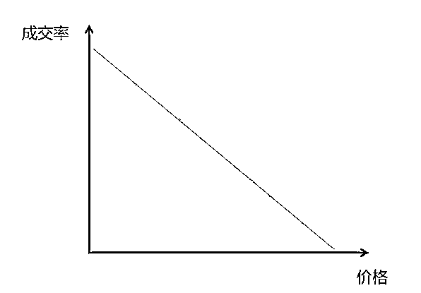

**7. 朋友圈怎么经营**

朋友圈同样是塑造人设的阵地，也是赢取粉丝信任的关键一环。我平时会在朋友圈发三类东西：面试解析笔记、解答学员问题的截图、学员上岸的截图，目的都是让粉丝持续感知到我的价值。具体来说：

（**1**）专业内容：把面试真题解析同步到公众号，再分享公众号里的解题链接，持续强化专业形象。

（**2**）价值内容：主要是解答学员疑问的微信截图，或是学员成功上岸的截图，这些都能间接证明我的实力。

（**3**）生活内容：偶尔发一点生活里的真实感受，让粉丝看到一个活生生的人，而不是一台只做面试培训的机器。

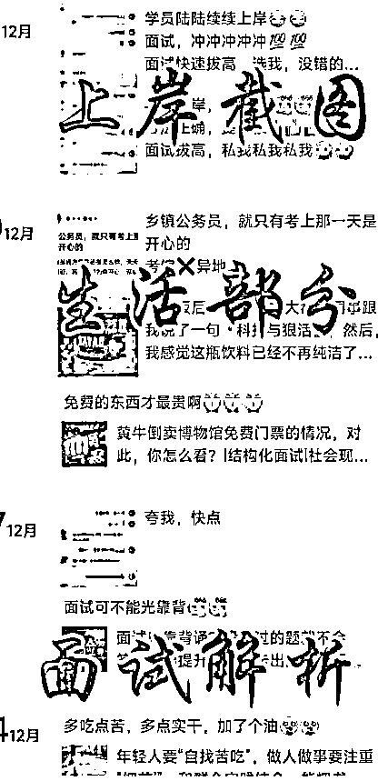

## 二、粉丝进了私域，怎么推进成交

**1. 分清粉丝类型，区别应对**

愿意加微信的粉丝，通常需求已经比较明确，这一步基本就是成交前的临门一脚。我的粉丝大致分两类：

**①** 来问价的

这类人一开口就是问价钱，本质是在比价——他们加了好几位老师，来回对比，价格是首要考量。

遇到这种情况，我会先把话题挪开，不急着报价，而是通过沟通让对方了解我的价值、我能带给他什么，帮他想清楚我和其他老师的差异在哪。

等这些聊透了，我再报价格和授课方式，此时用户对我了解更充分，转化率也会更高。

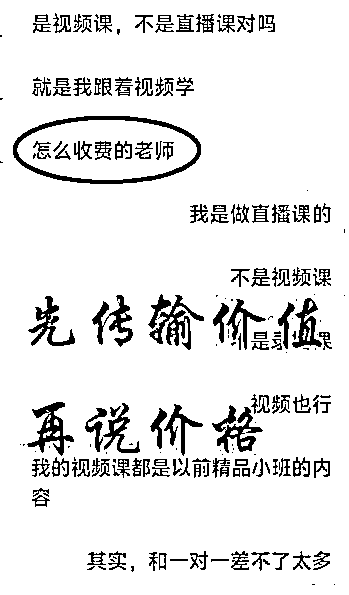

**②** 来问课的

这类人关心的是“你能帮我什么”。那我就直接点出他们在面试提升上可能踩的坑，一针见血戳到痛处，再顺着痛点讲我会怎么帮他解决。聊到这一步，只要价格大体能对上，基本就会在我这里报班。

整体来看，只要话术得当，来回聊个10到30句，成交就差不多了。

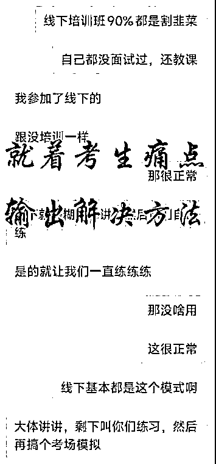

**2. 真诚比推销更管用**

有些机构会把课程包装成精美的图片，我不走这条路——图片一发出去，那股推销味儿就藏不住了。

# 信任在前，成交在后

我跟粉丝聊天，出发点始终是“把他的问题解决掉”。有些话术我早就存进输入法的快捷短语了，但我不会一口气全丢过去，而是拆成几条、按着节奏递过去，让他感觉像在跟真人闲聊。沟通越自然，粉丝才越愿意把信任交到你手上。

### 3. 约一次语音，把最后的信任聊下来

还有一类学员，他们清楚你有价值，却对课程到底管不管用存疑，想先“试听”一下再决定。这类人有个共性：必须先听到干货、确认你讲的东西有用，才肯掏钱。

我的做法很直接：约微信语音。面试试听课我没做过，原因不是偷懒——面试场景里学员的需求点太分散，一节试听课很难把效果直观呈现出来，考生的获得感也不强，打不中他真正的痛点。

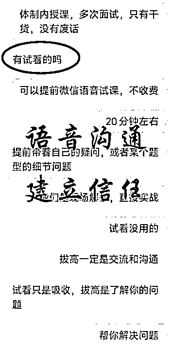

因此我会跟学员定个时间，用语音聊。先了解他之前的备考路径：自己啃书，还是报过线下班；是零基础，还是想再往上冲一冲。接着挑一道具体的面试题，当场拆给他看——这类题的框架怎么搭、内容怎么铺开，把能立刻用上的面试干货现场递过去。对方在很短的时间里确实拿到了东西，也直观感受到我的水平，聊到最后，成交往往就是水到渠成的事。

### 三、知识付费怎么选题

上面讲的是我做小红书的路子。圈友要是也想切知识付费，第一步绕不开赛道选择，下面说说我的看法和经验。

#### 1. 先想清楚怎么变现

做任何项目，第一步都得回答“怎么变现”——卖什么、提供什么服务，然后再倒推需要怎样的引流方式，这样每一步才有的放矢，所有细节都指向变现。

我做“公考面试培训”，切入点就是自己最拿手的部分：公考我考过好几回，经验攒了不少，做这块更得心应手。从擅长的方向切进去，变现的路子会自己冒出来很多。

#### 2. 在一个领域扎深

深耕的好处，是能在自己熟悉的行业里持续赚到钱。公考面试培训这个赛道卷得厉害：某公、某图、某笔这些大厂在做，地方上的中小机构在做，个人同行在做，连刚上岸的考生也来分一杯羹。竞争这么凶，是不是就该绕开？未必。

再拥挤的红海，里面也藏着细分空间。多数时候我们并不是去跟巨头抢食——量级差得远；只要能在整个行业的大盘子里切下一小块，就够活了。

在同一个领域蹲得越久，对赛道的理解就越透。同行再多，只要能做出差异化，收益就能持续。何况跑通一个赛道的底层逻辑是通用的——引流、转化、变现，这套东西一旦摸明白，哪怕眼下的赛道卷到不能做，换一条也能很快把号起起来。

#### 3. 边做边想，别只停在设想

选题时最常见的毛病是：想得太多，动手太少。总盼着把所有细节都推演清楚再出发，结果时间全耗在脑子里，真正落地的部分反而没动。方法一多、选项一多，又容易每个都想试，每个都只试个开头。

所以挑项目时不必反复纠结，也别把事情想得太复杂，蓝海红海更不是唯一尺子。脑子里推演一百遍，不动手就是零。先干起来，边做边调整。

### 四、新人怎么做知识付费

知识付费是能长久做的一条赛道。方向对了，沉淀越久越吃香，收入也水涨船高。玩法通常分两派：一派分销别人的知识产品，一派自己生产知识产品。

分销省事，不用花时间做产品，卖就行；但销售权、定价权、产品所有权都捏在别人手里，分销的人很被动，能拿到的收益也有限。自己生产则是先学、再用、再验证、再整理，把经验沉淀成体系，然后教给更多人——做产品耗时更长，但适合长期经营，销售权和定价权都握在自己手上，收益空间能拉到最大。我走的是后一条路。

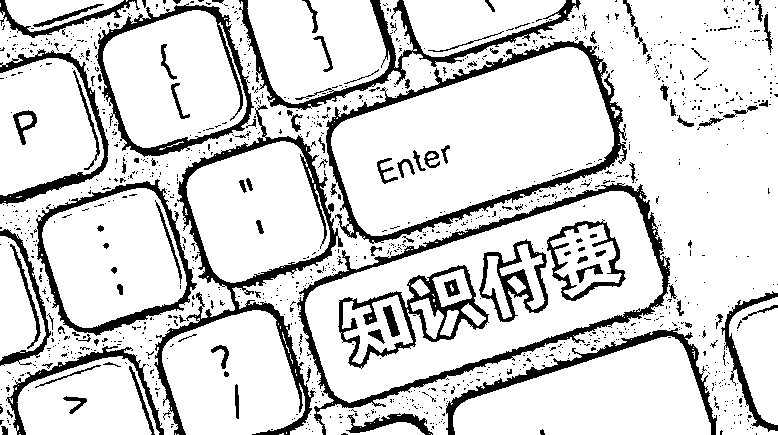

#### 1. 门槛没想象中高

知识付费的门槛其实不高，核心是做好向下兼容。不知道能做什么项目，我建议从自己的经历里找——那才是你最熟、最擅长的地盘。举几个例子：

①所学专业。专业通常是你投入时间最久的东西，等于现成的技能库。以计算机专业为例：

1. 编程底子好，可以教编程技巧、编程思路，也可以教怎么开发小程序、怎么做出实用小工具。
2. 剪辑软件玩得溜，像剪映、PR，可以教短视频制作、怎么让画面更抓人。
3. 办公软件用得熟，Excel、PPT 的常用技巧和快捷操作都能拿来讲。
4. 考过证书，比如计算机软考，别考完就丢一边，可以照着别人的教程翻录一套考证课，把知识点讲透。

②从事行业。干得久的行业里，可输出的知识同样很多。比如我在机关上班，就算不做面试培训，公文写作、笔试、面试、职场经验这些方向也能做。其他行业同理：先锁定一个领域，高认知的人吃中认知的市场，中认知吃低认知，低认知吃零认知——说到底就是知识付费的市场下沉。只要内容够优质，总有人愿意为它买单。

#### 2. 得真心愿意讲给别人听

干知识付费，得有点“想把东西传出去”的欲望，至少不能讨厌讲课。有些人天生坐不住讲台，硬挤进这行会很煎熬，浑身不得劲。天赋这东西每个人不一样：有人适合跑销售，有人适合钻科研，有人天生就是讲课的料。顺着自己擅长的那条路使劲，做知识付费才有内驱力。找到自己能输出的领域，扎下去，时间会给你回报。

#### 3. 几个绕不开的难点

##### （1）自己做得好，不等于教得好

拿考试打比方：让考上清北的人去中小学带课，未必比普通老师讲得明白。所以“自己考得好”和“学生考得好”是两套本事——前者靠个人天赋加苦功，后者靠把知识传递出去的能力。很多人自己做事很漂亮，一开口就说不清楚。

我刚开始讲面试，是免费陪进面的考生练。有时候心里明白是怎么回事，嘴上表达不出来；或者我讲完了，对方吸收得慢。后来我专门花时间打磨讲课这件事，琢磨怎么把知识点讲得让人一听就懂、一想就通。讲课能力说难也没多难，讲得多了，手感自然就来了。

##### （2）做出差异不容易

现在市面上能看到的知识付费课，大多拿“快速入门”“立竿见影”当钩子拉人下单。可真翻进去看，内容跟同类课程高度雷同，质量参差，值得听的干货没多少。用户真正在意的从来不是知识堆了多少，而是含金量——越稀缺、越优质、越有价值，越有人买账。

所以想给知识付费筑起护城河、做出差异，就得更专注地扎在一个领域里。时间一长，你对行业的理解和判断会更深，原本的小白也会慢慢长成这个细分领域的行家。

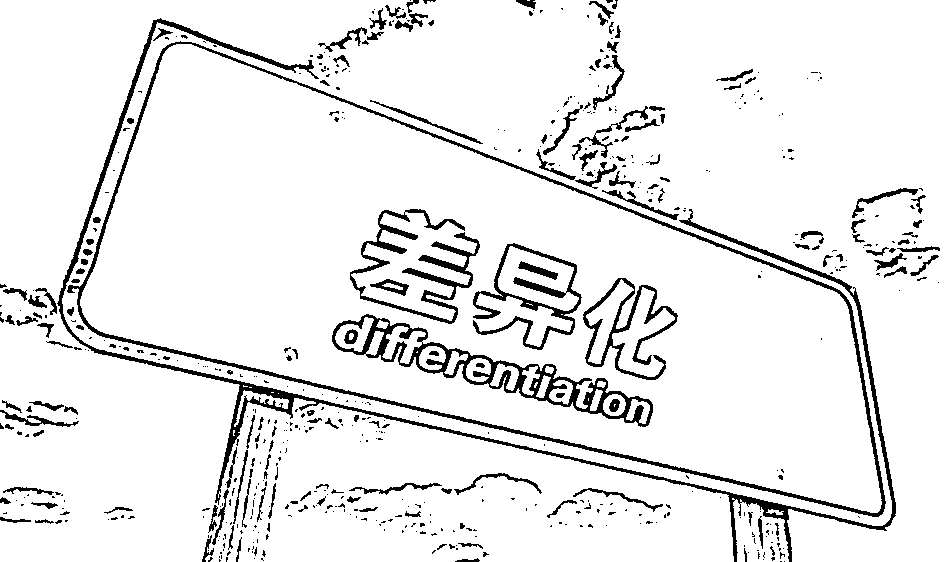

##### （3）复购率偏低

知识付费往往是一锤子买卖。它不像食品那种消耗品，吃完还能再买；用户付过一次费，这段关系常常就告一段落，想让他二次、三次掏钱，难度不小。所以只能不断往池子里引新学员。

##### （4）推广得持续做

不少人做课只顾埋头打磨内容，结果课上线了才发现没人买——问题出在引流的方式方法上。用户得先知道你的产品好，才会在你这里花钱。不论知识付费还是别的行业，持续引流都是必修课：

①付费引流：机构、团队用得最多，说白了就是投广告、买流量，拿 1 元课、9.9 元低价课把人吸进私域，再往高价课转化。这套打法适合有规模的团队，个人起步阶段不太合适。

②内容引流：靠持续输出有质量的文章、视频，让用户看见你能提供的价值，等他真有需求时，第一个想起的就是你。我主要走这条路，一分钱没投过，全靠自然流量把人吸过来。

说到底，哪个赛道都不轻松，都得在认知上慢慢积累。你了解得越深，能变现、能引流的口子就越多。

### 五、10 个知识付费经验

生财里关于小红书和知识付费的帖子很多，圈友反复讲过的我就不重复了，只挑我认为关键的几点说。

1. 尽量别做低客单价。高客单也好，低客单也罢，沟通成本一样跑不掉，而且低客单要耗的时间一点不比高客单少。能做高客单，就别往低客单里扎。

我写的面试解析和作答逐字稿，曾经也出过 PDF 版本，定价 19—39 元，私信来买的人确实不少，但每个都得单独回复，太占时间。一天卖出去十份二十份，抵不上我一节课的收入，人还累得够呛。后来卖资料引流这条路我基本停了。跟低客单相比，高客单省心得多：粉丝素质更高，变现也更厚。

2. 把付费资料这块引流做细。我的面试学员，多数是从小红书笔记摸到私信来的，也有一小撮是通过资料找上门的。所以把引流资料打磨好，也能多拓一批学员。不论免费还是付费资料，别只塞内容和联系方式，最好把“人设”也放进去——那些不是从小红书认识你的人，才能借这份资料完整地了解你。

我的付费资料就两块：面试真题解析 + 人设。

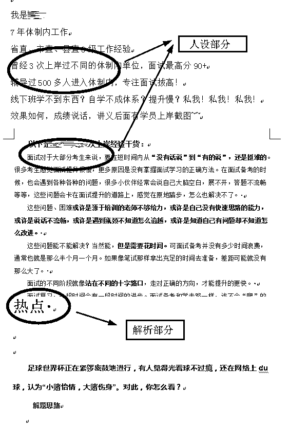

解析部分：把小红书上发的面试解析做成电子汇总版。小红书得一帖一帖翻，比较费劲，所以不少粉丝想要个合集。

人设部分：光有解析，粉丝看完就走，不会想到找你做提升。所以我会在资料里放能证明我价值的东西。

a. 自我介绍。把面试经历、上岸经历、工作经历写在首页，先把人立起来。
b. 我的面试提升方法论。整体讲讲提分的思路和方法、什么样的路径才真正有效、备考时间怎么分配、卡在瓶颈期怎么破，这类干货都放进去。
c. 上岸截图。用学员成绩给自己的授课成果做背书，把上岸的聊天记录截图贴出来，让粉丝形成一个念头：跟着他练，我也能上岸。

这些内容方向，跟我微信朋友圈大体是一套逻辑。

3. 变现是从 0 粉开始的。知识付费的本质，是找到有需求的人、把课卖给他。所以别迷粉丝量，要盯有需求的精准用户。我成交的第一个客户，是小红书刚做一周左右、粉丝才几十个的时候。当时我在评论区答了几道题的解析，就有人私信问面试怎么提升，我和她聊了一些短期提分的办法，聊着聊着就成交了，后来这位学员也顺利上岸。

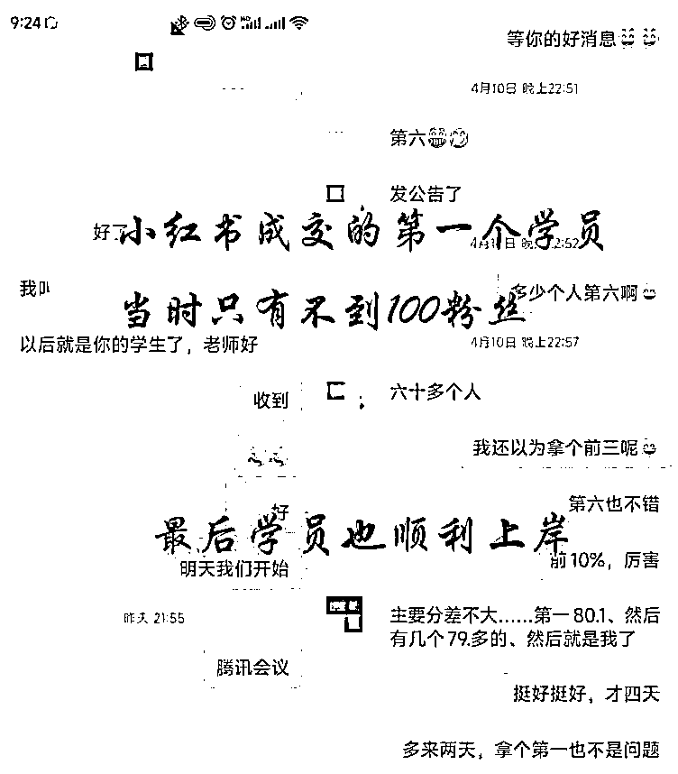

很多圈友默认“先把量做起来，再考虑变现”，这个顺序大概率是错的。我小红书有 4 万粉，但从实际经验看，真正愿意掏钱的更多是刚关注的新增粉丝。粉丝数对我而言更接近一个数字，实际价值有限。

4. 不会变现等于自嗨。所有环节都是奔着变现去的，没有变现口子，做得再多也是白费。前阵子有个做人民日报金句分享的小红书博主加我，账号将近 20 万粉，来问我变现的事。

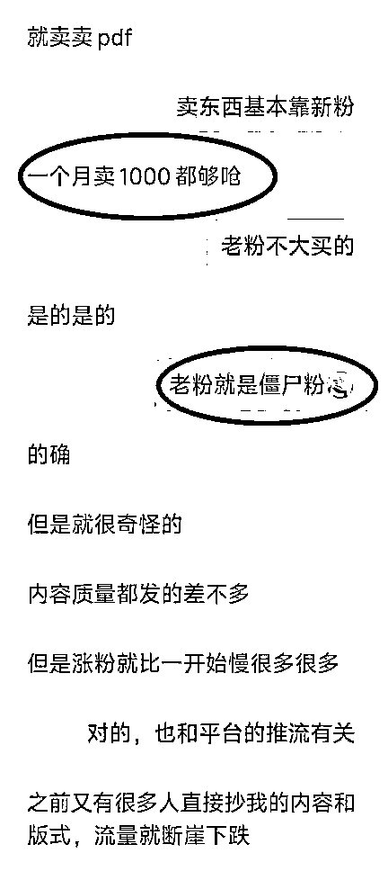

她说 20 万粉的号，一个月才收 1000 左右，你敢信？变现没打通，数据再漂亮也只是输了比赛。所以建议大家提前把变现结构搭好，别只盯浏览量、点赞量、收藏量，记住三个字：变现、变现、变现。

5. 干货都讲完了怎么办。不少圈友都问过：文章、视频里把干货全抖出去了，后面还讲什么？我给两个思路：

a. 讲一半，留一半。课程价值落在实操上，就多讲点理论；价值落在理论上，就挑某个理论点讲讲怎么落地。别想着一次讲干净。
b. 拆细节，一次只讲一个点。比如引流，这一期讲一个小方法，下一期讲一个小工具，再下一期讲一句好用的话术，拆成一个个小切口，可讲的内容就源源不断了。

6. 笔记搜不到怎么办。发出去 10 分钟内还没有小眼睛，多半是被审核拦下了，这时得手动申诉。路径：我 → 帮助与客服 → 笔记申诉。内容没问题的话，通常 0.5 到 1 小时就能过审。

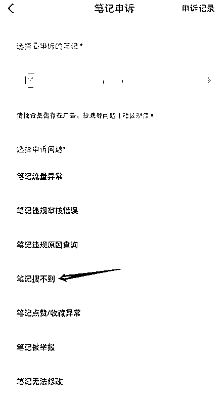

7. 要不要刷启动赞、藏？不用。笔记没有小眼睛，99% 是内容本身出了问题，刷赞藏救不回来。该琢磨的是怎么把内容质量提上去——没人点，多半是不够吸引人。

8. 要不要把所有敏感词都规避？不用。我的笔记篇幅偏长，图文加起来一两千字，发布时一般不做违禁词检测。那些检测网站把所有敏感词都标出来，真一个个替换掉，可读性会大打折扣。按我的经验，有一类内容坚决不能碰，比如涉政的，发了必然过不了。其他像极限词，只要不是高频出现，问题不大。某个词到底能不能发，自己多测几次就心里有数了。

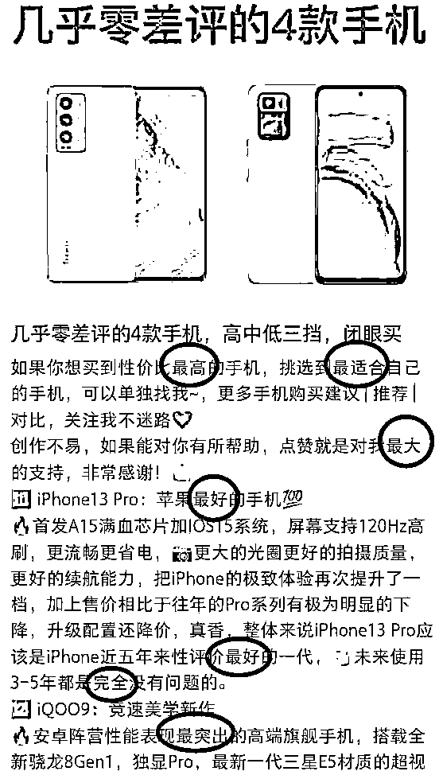

9. 定了领域之后，去模仿、对标同行——同行就是最好的老师。起步阶段别上太多分析方法，拿蝉妈妈这类工具看看同行怎么做视频、怎么做图文，照着复制、照着模仿。从这位同行身上学一点，从那位身上学一点，爆款的手感就慢慢出来了。记住：分析工具只是辅助，别让它反客为主。赛道定了、不知道从哪下手，就去研究同行。

10. 多请教、多链接。选题是这样，别的事也是这样，肯向人请教、肯主动链接，往往能事半功倍。常有的困境是：手里有变现渠道，却不知道怎么引流；或者人会引流了，又变不了现。这时候别硬扛，翻翻生财的文章，或者直接找大佬请教，有时候对方一句话就把你点醒了。闭门造车基本造不出东西，交流和请教很关键。比如我以前收的都是异地大额款，连续转账特别容易触发风控，我就去问别人怎么控，得到的答案是走千聊、小鹅通这类平台。找有同类经验的人聊，答案往往来得又快又准——这些坑很多人早就踩过了，问一句比自己摸索快得多。

### 六、一起“生财有术”

很感谢生财搭起这么一个创业者交流学习的场子。精华帖也好，航海也好，我在里面开拓了眼界，也捡到不少思路。

我也清楚自己眼下的问题：面试小班也好、一对一也好，只要我还困在“写解析、上讲台”这个角色里，本质上卖的就是自己的时间，这算不上好生意。但我还是愿意在这条路上继续深耕。接下来要优化的变现方向很明确——从出售时间逐步转向被动收入。所以这段时间我录了一套面试课程，正试着在抖音、视频号上推，手里有公考流量的朋友，欢迎来和我链接。

评论区：大俊认出我是原来的“朝夕老哥”，哆啦回他改了个名；芷蓝说这个太赞，亦仁说感谢分享、已加精华；陶学长刷了“6666”，又说公考每天能引 200 人，就是客单价偏低，学习了；亮菁菁说自己也备考，有机会进面就来找我；在海边表示感谢。

作者：卓卓子是我🎈
日期：2023-01-16

大家好，我是卓卓子，一名互联网产品经理，也是六期生财圈友。从没碰过知识付费，到杀进考公培训市场，三个人一共做出 32 万营收、14 万纯利。这篇复盘会从三块展开：一、广东省公务员考试的现状；二、怎么引流、怎么转化；三、提供哪些差异化服务。

好，我的分享到这儿，希望能给圈友们一点参考，咱们一起生财有术。