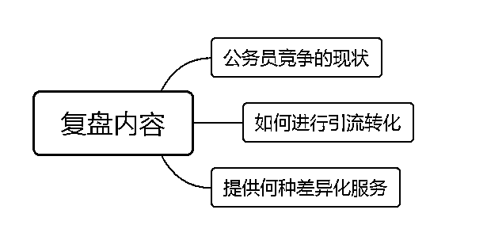
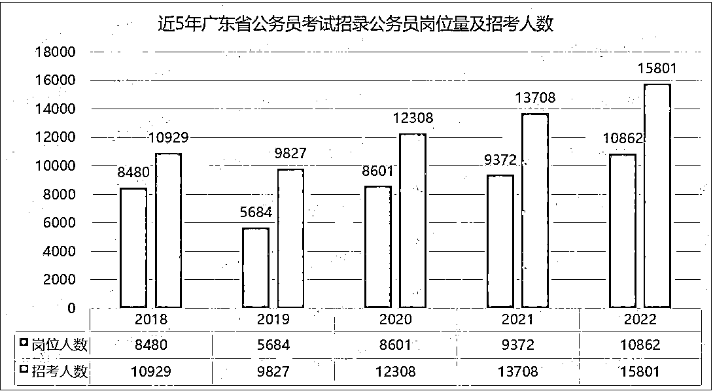
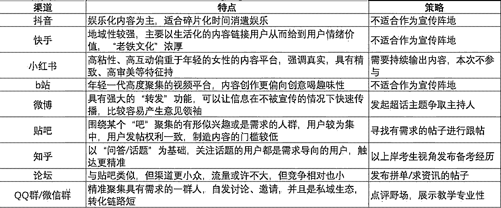
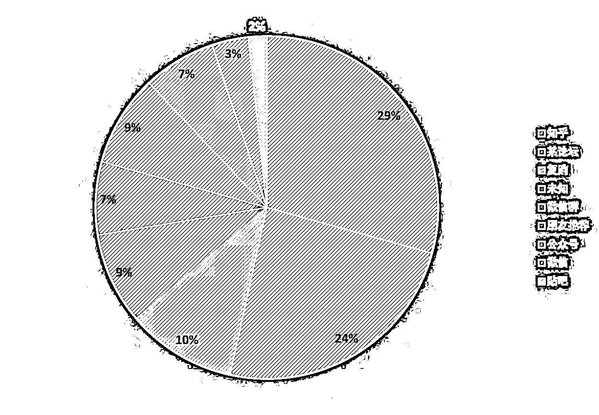
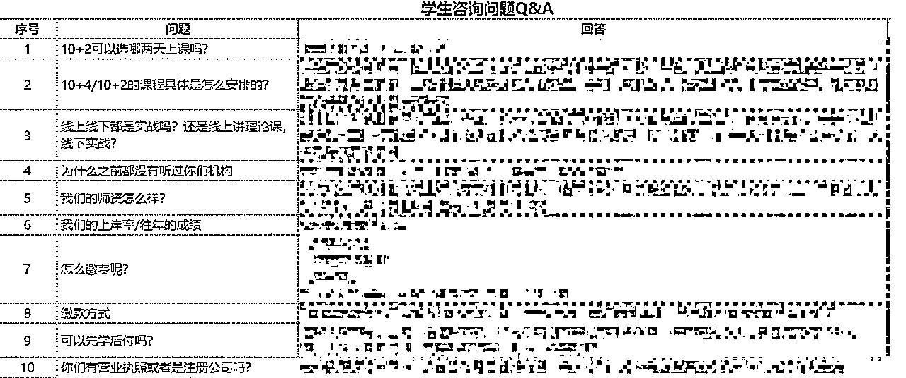
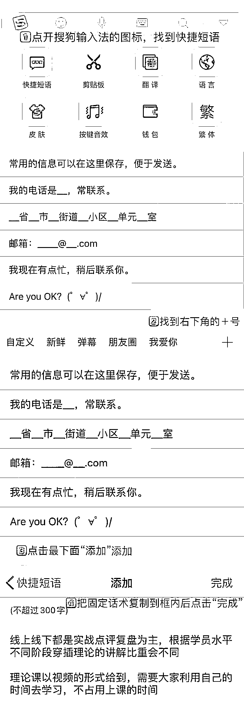
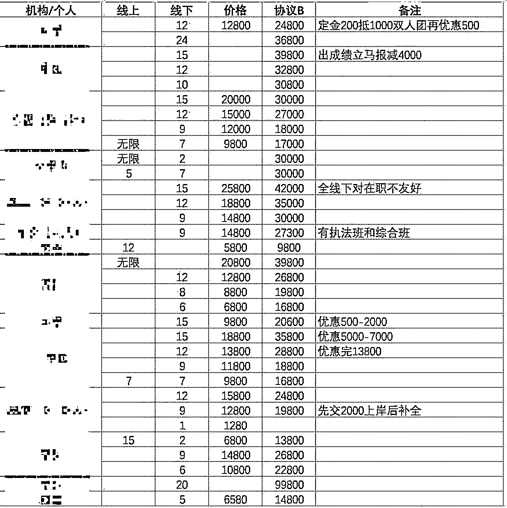
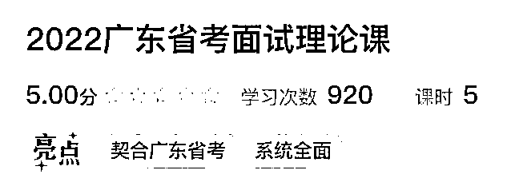
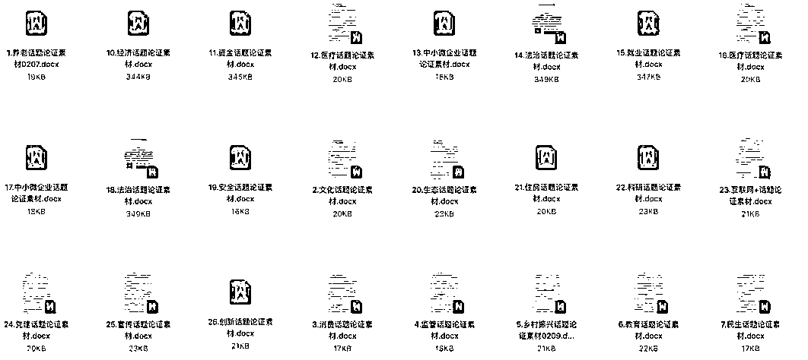
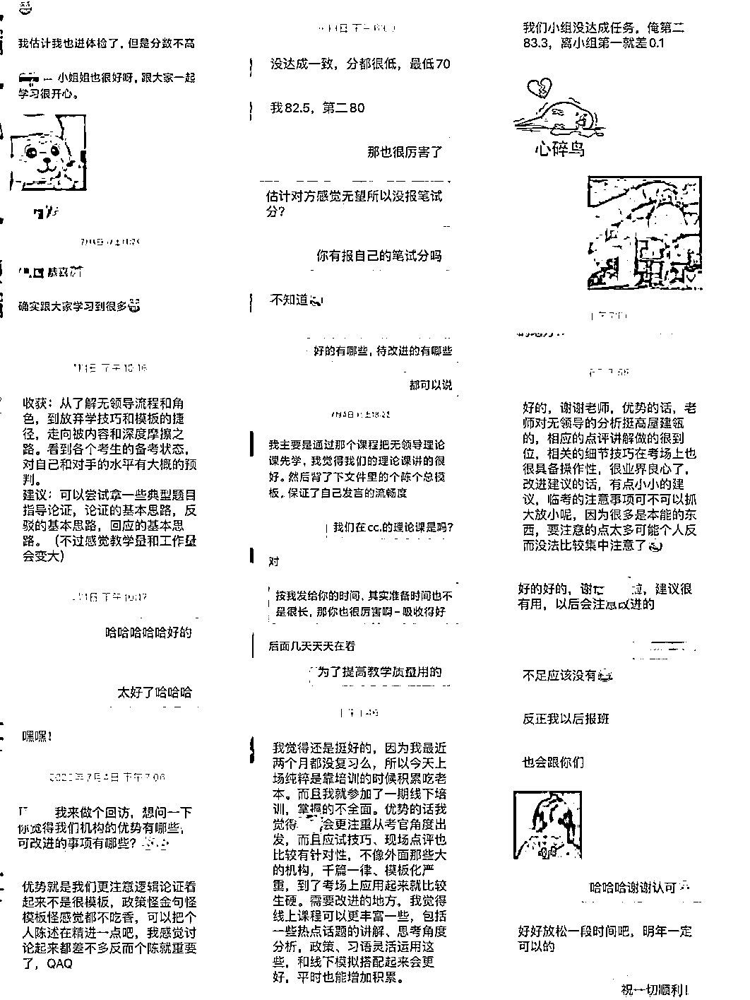

# 考公项目首战复盘：跑通闭环并拿下 10W+

大家好，我是赚钱圈友雨林。第一次在赚钱发帖，想把这套 2022 年跑通的考公项目完整拆一遍：为什么进场、怎么获客、如何成交、交付怎么做，以及踩过哪些坑，给同赛道或想合作的朋友一点参考。

**1. 广东公考赛道近况**

先看广东公考的基本盘。2018 到 2022 这五年，放出的岗位和录用人数整体往上走，其中 2020 至 2022 这三年平均每年涨 14.93%。最新 2023 年公告里，3846 个招录单位放出 12768 个职位，计划录用 18258 人，比前一年多 2457 人，同比提升 15.6%。

我们决定入局，主要看三点：一是疫情阶段大厂和中小企业承压，裁员、关停风险抬高，很多人把稳定编制放到择业首位；二是 1962—1972 年那波生育高峰带来的人口红利正在转为退休潮，当时每年新增两千多万人，从 2022 年起预计持续十年，虽然十四五会推进延迟退休，但岗位补位需求短期内大概率还会增加；三是广东的无领导面试仍在成长期，机构竞争格局没定，教学体系也有继续打磨的余地。

内容从来不是瓶颈，真正稀缺的是触达路径。正式投放前，我们先梳理手头渠道，并定下对应打法。

**2. 引流与转化怎么做**

**2.1 渠道怎么选**

📌先注册🛰️订阅号，配置关键词自动回复，发推文，在文末放客服号，把读者导到私域并邀请进备考群。
📌搭建备考群，把有意愿的考公人聚在一起，重复问题集中答复，省时省力。后来我们统计了最终报班学员的渠道来源。

按获客效果从高到低，下面把我们跑过的动作摊开讲⬇

**2.1.1.知乎**

执行方式：用已上岸身份写长帖，覆盖选岗、笔试、面试的备考路径，也会讨论要不要报班，并把市面机构拉横评。写的时候不踩谁，只摆优劣，同时把我们在价格、服务等考生更在意的点上做得更好的地方讲透。
考虑：上岸者视角更容易建立信任；不拉踩、只客观，让有需求的人自己判断。
跑出来：问答质量高，来的用户精准，付费意愿也强，后来不少付费学员来自这里。

**2.1.2.论坛**

执行：养多个号，模拟备考者发不同需求的帖子。比如拼团帖：“××机构眼下有拼单优惠，有没有考友一起？”再如求问帖：“有人听过××机构吗？看别的考友提过，不太懂，求科普。”发完后用其他号跟帖顶热度。路人通常不会写长评，所以跟帖字数压得很短，基本 20 字内。
考虑：让用户对机构产生好奇，在碎片信息里自己搜着了解。
跑出来：来的人多、盘子大，最后也有一部分成交，在来源里排第二。

**2.1.3.🐧群/🛰️群**

执行：搭精准圈子，把从订阅号和其他入口加了客服号的人拢到群里。先做两场公益实战点评，中途介绍课程产品，后段在群内推拼团和限时优惠。
考虑：1）用公益点评消除“想报班但不知道老师水平”的顾虑；2）产品直接在群内答疑，服务响应更快；3）拼团和优惠借助从众心理，让摇摆的人下单。
跑出来：有转化，也有人主动拉朋友进群，邀请者和被邀请者一起付费的比例不低。

**2.1.4.🧣**

执行：开考公相关超话话题，以考生身份聊备考心得，顺带问大家有没有机构推荐，再用小号留言把自家品牌带出来。
考虑：让用户自发转发，扩大曝光。
跑出来：头部玩家早把超话管理位占了，话题热度起不来。

**2.1.5.贴吧**

执行：搜别人求报班、求推荐、求面试经验的帖子，用非机构号直接留几个品牌名。参考话术：“我去过 AB 两家，A 老师不错但贵；B 性价比可以；朋友说 C 不太行。”
考虑：做轻量曝光。
跑出来：能带来转化，但占比偏低。

把人引到私域只是第一步，能不能成交才是分水岭。公告发布到正式面试之间窗口很短，考生做报班决定的时间有限，所以接触时既要显专业，也要抢时效。我们的办法是把高频问题整理成问答清单放进推文，再把标准回复设成快捷短语，有三个好处：1）对外口径统一；

**2.2 成交的关键动作**

**2.2.1.体现服务专业度**

2）用户能直接看到常见问题，减少“不好意思问、又怕被强推”的流失；3）回复更快。

报班少则几千、多则上万，应届生怕钱白花，对老师水平存疑很正常。于是我们把线上课开头 15 分钟剪成试听版，另配一段实战点评录音，让考生自己判断老师专不专业。

听完只有两种走向：成交或没成交。对没成交的人，我们在发出试听三天后跟进，问清卡点，再逐类回应：
1）线下时间排不开：少量异地或在职学员确实难协调；
2）价格犹豫：给出两人成团各减一部分的政策，这个动作让超过半数价格敏感用户转化，也带来更多成交；
3）对教学不满意：问清哪里要提升，有则改、无则勉，即使没成交也把服务做完整；
4）对效果没信心：客观讲课程能帮到什么、备考又有哪些局限，同时纠正“报班=上岸”的心态——报班不等于稳过，教与学要互相成就。试听后的回访很关键。

**2.2.2.让师资被看见**

1）对可能流失的用户，按顾虑逐条回应，争取再推进一步；2）记录流失原因，看后续产品能否迭代；3）让用户感受到服务是完整的，这次不成，下次还有机会。

**2.2.3.群内接龙拼团，限时推进**

加到🛰️的人分两类：只在群里的，和已加客服号的。
1）群内用户：群公告写明拼团截止时间，发起接龙，想报的接龙，两人成团各享优惠。这样省去自己找搭子的麻烦，也在群里造出多人报名的氛围，带动观望者下决心；
2）未进群用户：逐个问是否已报别家、有没有意向报我们。有意向的给限时政策，还要考虑的先备注；
3）开班前几天再回访之前犹豫的人，告知剩余名额，增加紧迫感。

推进过程中有销售技巧，但答疑始终要客观真诚。比如有学员说自己基础差、报班也没希望；也有人从各种角度质疑师资。这些都很正常，比起毫无波澜，有碰撞才有火花，也才有故事。

**2.2.4.真诚答疑，客观回应**

从获客到成交，我们不把签单当唯一目标。基础弱或完全没碰过无领导面试的小白，我们会如实说明培训能起什么作用，也会转述已报学员的真实反馈。遇到想速成的，我们甚至劝退：一是对用户负责，别把预期拉太高；二是对口碑与通过率负责。

我们还把市面上能找到的机构班型、个人班价格收集起来，反推更有竞争力的产品组合。

**# 3. 差异化服务如何设计**

**3.1 班型与定价**

**3.2 理论课的打磨**

无领导面试兴起时间不算长，各家线上课内容大差不差。我们本身有相关知识，为了搭体系，买了几家头部玩家的课，先把整体框架吃透。对平台上售卖的课程，我们会翻学员评价，从使用者角度找优缺点，说白了就是去粗取精，再搬进自己的课。

很多机构的线上课又长又重，配套资料几百个话题、十几万字，学员根本读不完。考公人的时间很贵，从出面试公告到正式面试周期短，把知识点拆碎、喂到嘴边才更重要。

**3.2.1.买口碑课，拆框架**

**3.2.2.看学员评价**

**3.2.3.提炼关键，做瘦身**

我们最终上线的理论课共 5 节，单节控制在 1.5 小时内，总时长比市面多数课程少至少三分之一。配套话题砍到 30 个必考项，每个话题按“是什么—为什么—怎么做”的固定结构带学员理解，案例压缩到一两句话，方便记忆。

1）开班前在群里办开营仪式，讲清每位老师分工，再做一次基础摸底；
2）群内发考场能直接用的表达模板，省去考生自己整理；
3）分阶段私聊学员，收集对理论课和实战点评的反馈，基础弱的给更多针对性建议；
4）线上或线下实战，老师的手写记录、课程录音都整理成资料包发给大家；
5）线下课中午备水果，下午容易困，提神；
6）考前给考场礼仪和着装建议，平时做心理疏导；
7）考后逐个问成绩，并收集对服务的意见。

**3.3 其他配套服务**

这些动作换来不少学员好评，也成为今年宣传的素材。第一次做这类项目，不可能一路顺风，转化和教学中也暴露出一些问题，比如：
1.班型与学员意愿匹配有偏差（纯线下周期太短、地点不合适、时间对不上、长班满员等）；
2.对机构了解不全，对师资没底（试听回访后没下文）；
3.协议班费用想分期或先学后付；
4.宣传准备时间紧，📕等渠道没铺到；
……
这些问题这次没解决好，导致一些咨询流失，也给今年指了方向。

# 【项目过程中遇到的困难】

回看整个项目，除了上面的拆解，还有几点个人体会：
1.要找合伙人，先把理想合伙人的画像写清楚，再按图去招，思路会顺很多；
2.想做自己的产品，先去做别人的用户，从对方没被满足的地方切进去，会容易些；
3.获客不一定要挤最大流量池，能触达精准人群更重要；
4.服务里最能打动人的，常常是别人忽略的小细节，这些细节会带来口碑和转介绍；
5.入场时机很关键，很多事等全部准备好就晚了，只能边做边改，才可能占先机、赚到钱。

# 【这次项目的一些心得】

以上就是我们 2022 年把考公项目跑通的实操记录，希望对大家有用。想在考公赛道深耕或合作的圈友，欢迎交流。

文末补记：作者雨林，日期 2023-03-24。评论区里，龙哥老师给这篇加了精华，并说这和他当年做考研资料的打法很像；也有圈友问师资来源，作者答“招募+自身条件”。感谢@梁靠谱 的鼓励、支持和宝贵建议，也感谢在醒谱大队收获的意外惊喜；感谢@走心小姐 带我进入龙哥盟，让我在平台和帖子里获得很多想法。