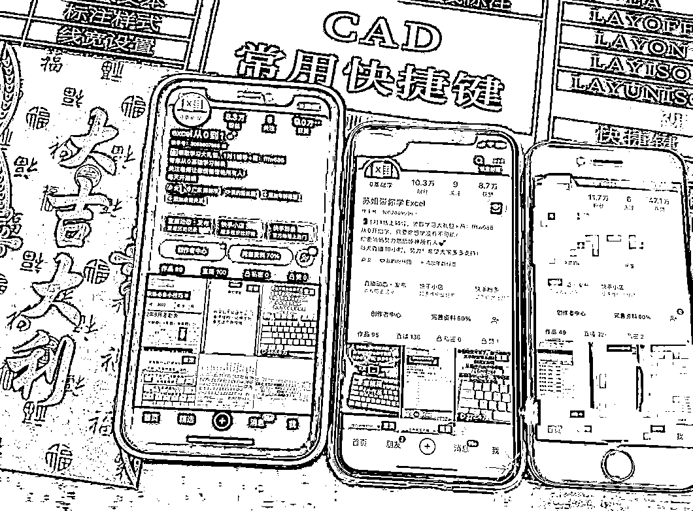

# 半年月入三万：无人直播、知识付费与私域怎么跑？

1：先说句真心话：这个社区对我的帮助很大。它像一台会主动筛创业内容的推荐器，打开就有刷不完的实操案例，我常常看着看着就忘了退出，认知也被推着升级。后来动手做项目，起点正是站内“风向标”里的一条启发。所以，我总觉得该回来交点作业。

2：动笔前我斗争了挺久：一旦公开，同行会变多，竞争也会更挤。可只吸收不产出，知识终究留不住，很快会从记忆里滑走。恰好我在这件事上跑出了一点结果，就把它当作在这里的首篇复盘。后面我也会继续记录，逼自己思考，别停下。

**一：半年跑出的结果（10 月开跑）**

目前全网关注者 60 万+，累计变现 20 万+：直播端 16 万+，私域端 4 万。

下面挑三个账号的截图：

完整拆解篇幅较长，放在飞书文档：https://sq065yn6aoy.feishu.cn/docx/KpMRdNVS1olPpoxAvZjcZJ0znRc

留言区：

Tango_lo：把垂直需求做深，也能跑出人物。

不困：这招有启发，换个元素拼一拼，说不定又能开出新路子🧭 我 10 月也入了快手无人直播这行，靠一点好运硬撑到今天。

雨林：🤝🤝🤝 共勉，继续往前。

lydia：这 20 万流水，是三个号合起来算的吗？

雨林：六个号合计。

lydia：谢谢！做无人直播，硬件怎么配？每个号都要独占一台电脑吗？

雨林：我花一千多配了台能多开的机器，同时带四五个号没问题；一般电脑两个号差不多。

蛋蛋。：有收获，银发人群那边似乎藏着需求。

文/峻昌小叔儿 2023 年 4 月 5 日