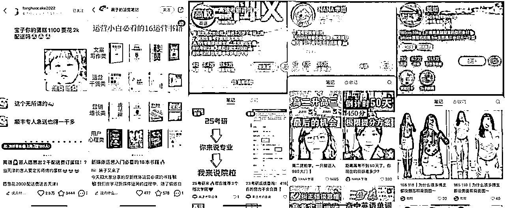
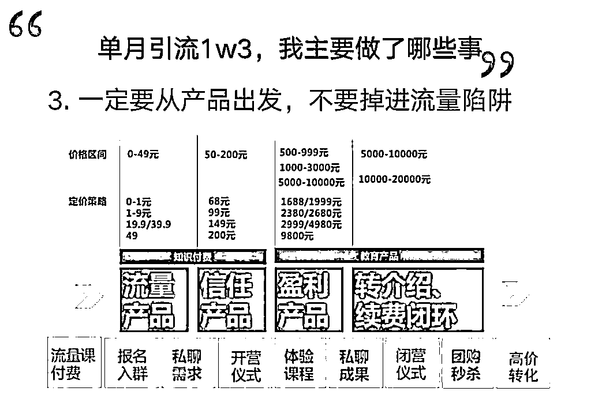
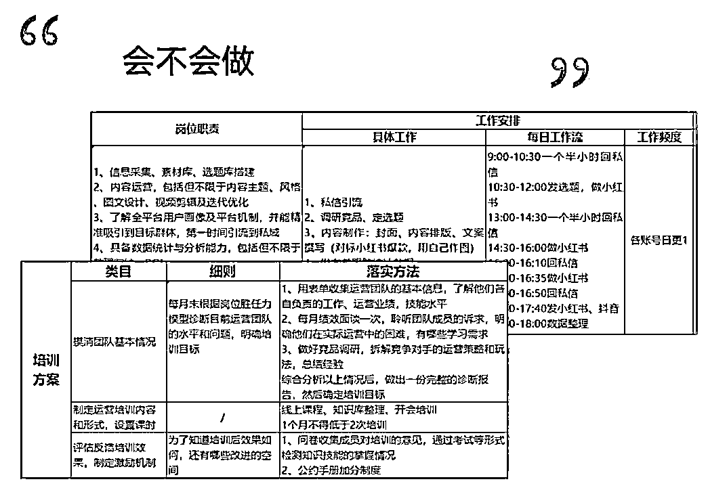
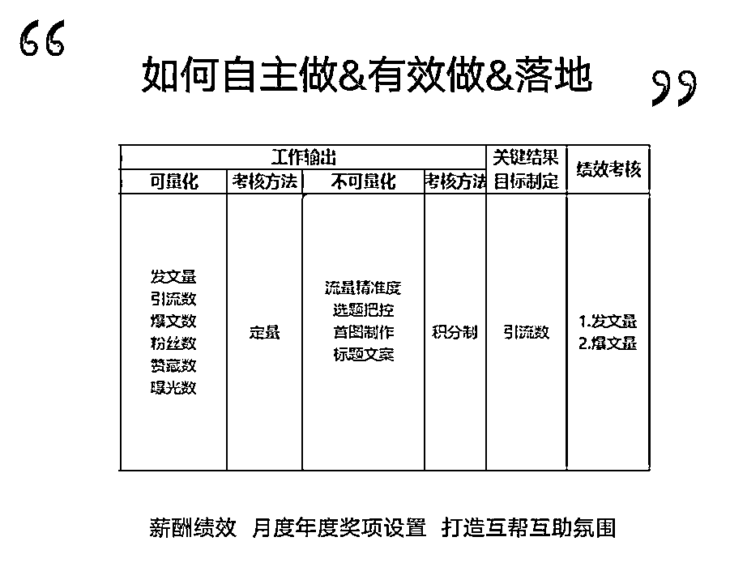
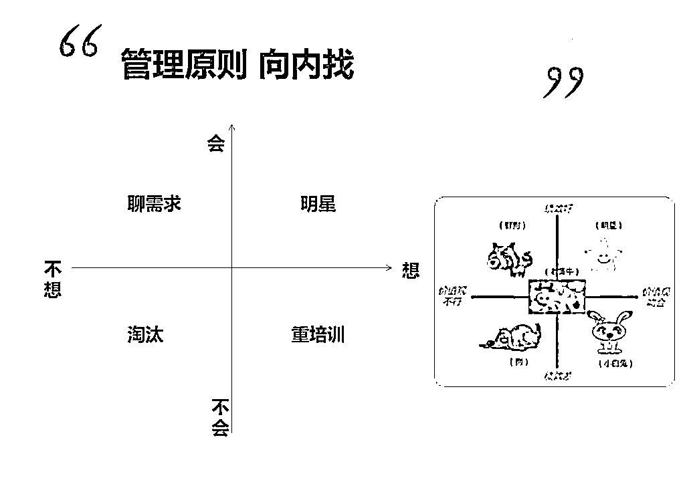
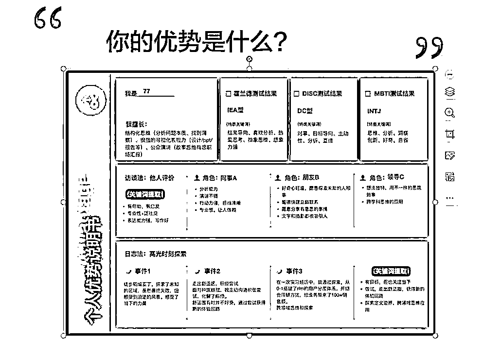
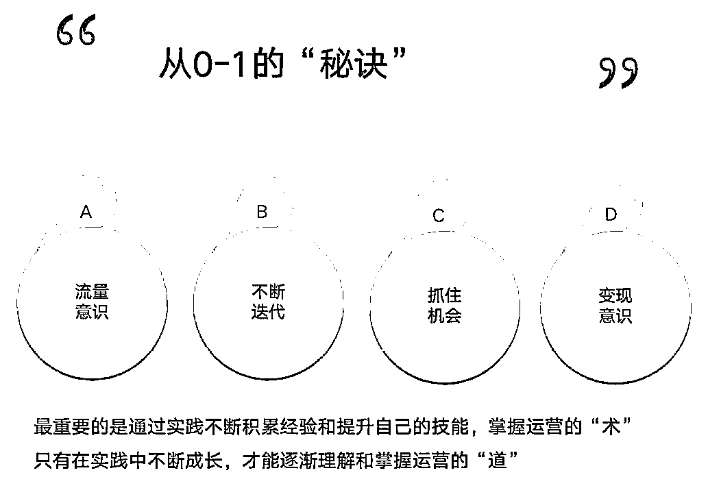
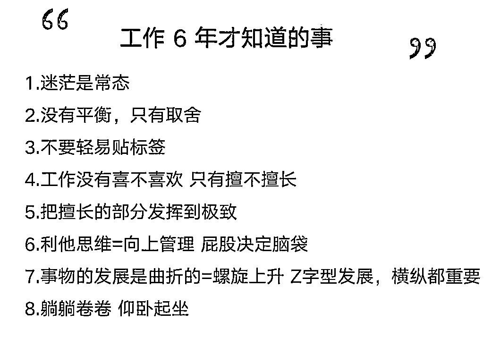

# 月引1.3万、年变现千万：小红书引流团队怎么打

这套团队做到小红书单月获客1.3万+，全年变现千万以上。拆开看，靠的不是某个爆款运气，而是节奏、账号矩阵、产品设计、私域转化和团队管理一起咬合。

先看节奏。以考研行业为例，2月出分、3月国家线，就是一年里最明显的流量窗口。平时这个赛道可能没什么声响，一到2、3月就冲上微博热搜。微博热搜常被当作行业升温的信号，所以账号不能等热度来了才动手，至少要提前两三个月把号养起来、把内容排好。真正费功夫的是热度到来前那两个月；等话题冲上榜单，团队主要做两件事：快速回复咨询、盯住表现突出的内容继续放大。哪怕你的行业看上去没有明显淡旺季，也要梳理出自己的波峰波谷。节奏清楚，工作才有章法；布局提前且判断准确，流量才接得住、变得了现。判断失准，进来的流量既难成交，规模也起不来。

## 2.账号矩阵别硬凑，分类先想清楚

做账号矩阵，不能为了矩阵而矩阵。注册10个号然后随便发，不叫矩阵。先回到产品：受众是谁？向往人群和势能人群分别是谁？他们有什么特点？常出现在哪些平台？爱看什么内容？

比如产品受众是40—50岁男性，这群人未必常刷小红书，更可能看头条、刷抖音，甚至把头条当搜索引擎。头条偏文字，抖音偏视频，平台本身就把内容形态分好了，矩阵方向也就清楚了。

账号还要分类。实战营里提过，可以从咨询类、晒单类、官方类、IP类、行业细分类去搭。

①晒单类：直接把和用户的聊天截图发到公域。一个标价1000元的蛋糕，配送费却写到2000元，围观心理一下就被勾起来。读者会冒出两个念头：这人怎么舍得花这笔钱；这蛋糕到底长什么样。借用户之口替产品背书，比自卖自夸更自然。

②咨询类：书单、清单、资料包这类汇总内容，比如“运营新人必读的16本书”，靠合集吸引人。

③官方类：公司做号可以配一个官方号，但通常要认证；个人做IP，不一定非要官方类。

④IP类：像“某学姐”这种强个人色彩账号，吸引力往往比机构号更强。用户刷小红书，本来就更愿意看具体的人。

⑤垂直细分类：比如身高165厘米、体重59公斤的穿搭分享者，内容只围绕这个身材区间，同体型用户自然愿意参考。

我的经验是，个人IP号和行业细分号更容易出结果，单纯资讯号相对弱。IP号和晒单号偏品牌曝光，平时咨询量未必大，可一旦来问，意向往往很明确。不同账号的信任基础和成交效率不一样，得站在用户角度实测。我们更像需求的承接者，而不是凭空制造需求的人。每月先想清楚KPI：这个月要涨粉还是获客？需要哪些账号、各做多少，矩阵就出来了。

账号矩阵本质上也是内部赛马，一条路走不通，另一条还能顶上。所有平台、所有类型都运营好当然理想，但抓住贡献最大的两成账号，往往能拿到八成结果，这已经很好了。

## 3.先定产品再谈流量，别被流量反噬

产品可以分成四类：引流品、裂变品、利润品、价值品。以在线教育为例。

①引流品：大约0—49元，用低价降低尝试门槛，信任尚未建立。K12常见的9.9元体验课，投入精力不少，但真正瞄着的是后续349元正价课。

②裂变品：50—200元，用户已有初步信任，愿意转介绍，价格也不至于让朋友犹豫太久。三人拼团、分销即时到账，会进一步增强推荐意愿。

③利润品：200—1000元区间，用户信任度较高，机构能从这里挣到钱，应重点做复购，把用户往更高阶产品带。

④闭环品：也叫价值品，客单价1000元以上，关系强绑定，用户不只是客户，还会变成口碑渠道，持续带来高净值人群。

四类产品不可能都做齐，但至少要有利润品和闭环品，也就是必须先有能赚钱的部分。前期可以加低价引流品，几十元甚至十元以下，用来筛出愿意付费的人。哪怕只掏一元，也比纯白嫖更接近成交。

做运营要会算账。目标是一个月赚10万元，先算成本，再拆到各类产品要卖多少，结合转化率反推需要多少线索。先定结果，再倒推动作，而不是手里有10个号就算能来多少流量、赚多少钱。这个顺序一定要转过来。

## 4.高客单成交：私域里把细节做透

①SOP话术先设计好。用户常见疑问也就十几二十个，先聊需求、摸预算、打标签，后续维护才戳得准。高客单靠养，不会加了好友就成交，转化路径设计决定成败。

②锁定意向人群。引来1.3万人，成交80多；剩下的人未必没需求，而是未必买得起。分层能极大节省时间，不同层级推不同产品。

③做好长期维护。客单过5000就值得沉下心维护；1万元以上产品，最快也要一个月，常见转化周期是一到三个月。

④人设就是信任。头像、签名、朋友圈、社群维护都在塑造信任。建议每天五条朋友圈，固定时段、固定栏目，配图要经得起看：用户没放大也能秒懂卖点。朋友圈同样是信息流，就像小红书一屏四篇笔记，你要让人先点你。

## 二、管理要接住战略，也要托住执行

管理先想清楚：重点管人还是管事？月、周、日的SOP怎么排？工作流、业务流、绩效、培训有没有章法？

### 1、先把“会不会做”解决掉

①工作流：从早上9点到晚上6点，新业务或新团队最好以半小时为颗粒度安排；路径跑通后可适当放宽。

②业务流：解决硬技能，包括平台规则、发文规范、爆款逻辑、获客方法。我每周带二十多人集体听课，课后必须交手写笔记和思考。

③培训：内部业务能力、跨部门沟通、公司认同、职场素养，四个方向一起补。别把人只当引流工具，成员也要在工作中获得成长和意义。

④学习氛围：运营要持续输入。培训后必须考核或抽查，因为团队更在意被检查的动作，口头安排未必上心。

### 2、再让团队愿意主动做

①薪酬绩效要留增长空间。既看可量化指标，也看关键动作；按发文量、爆文量给提成。目标定2000，做到2500或3000再给浮动奖金。奖励设阶梯，比如千条以内每个五毛、超过一千每个一元，具体按ROI定。

②月度奖和年度奖分开。专注引流、可复制的岗位用月度奖；特别出色又难替代的人，用年度奖、13薪或项目分红留人，别一上来就给公司合伙人身份，要逐步满足。

③打造互助氛围。早会公开昨日获客数据，做得好的点名表扬、请其复盘成文字发群，并把有效笔记链接同步。好的公开夸，差的私下指正。

### 3、用计划、执行和复盘保证效率

月度、周度、日度都要盘点工作饱和度。有人管5个号做精细内容，有人管10个号追热点，按账号类型和素材量定。小红书做久了速度会快，工作流最好半月更新一次，精力够就一周一更，否则划水空间会越来越大。能自己琢磨爆款的人很少，先把底线定清楚，再谈往上走。

### 4、让数据把动作压到地面

分平台、账号、内容、用户意向度做数据分析，再决定人力、成本和精力怎么投。培训计划按月、周、日排；每天汇总完成情况，用结果抽检过程。引流数据差，要么账号有问题，要么人有问题。曾有运营说照着对标账号抄，结果抄的是点赞不到10的内容，说明传达和执行之间有偏差。遇到问题先解决，别急着问责。

### 5、管理原则：先向内找原因

月初定规则、定打法，赏罚分明，用数据抓过程。结果不行，过程多半有问题。检查过程只看三个抓手：选题、主图、标题。

员工按“会不会做、想不想做”分四类：会做想做但支持没到位，管理者先反省；不会做也不想做，是态度问题，该优化就优化。明星要捧，物质上慷慨、精神上表扬；野狗要限制甚至清退；老黄牛可放心用，但容易随风倒；小白兔可以培训，常年老白兔则要清理，否则人效会被拖垮。一句话：明星要捧，野狗要限，老白兔要清，黄牛可放心用。培训、协同、饱和度都到位后，可以适度放养，用结果说话，做得越好越自由。

## 三、给0—3年运营人的成长清单

先问自己：了解自己吗？了解运营吗？行业变动下，护城河在哪里？

### 1、先看清自己的长板和短板

选赛道要先测试，认识自己也一样。霍兰德、MBTI可以试，朋友、领导、同事的评价也可以听，再回看自己的高光时刻和突破事件。别只从一个方向看自己，测试结果也不是定死的，不同阶段要重新判断。认识自己是为了取长补短，不是简单扬长避短。运营不能只会运营，还要懂产品、懂研发逻辑、懂销售转化，做流量时才戳得中痛点。

### 2、从0到1，靠这四个意识

①流量意识：流量是公司的根，没有用户就谈不上成交。内容与品宣重要，但只有口碑没有用户，赚不到钱。

②不断迭代：15、16年的公众号裂变，17、18年的抖音，22、23年的小红书，都是风口。站在风口上，猪都能飞，做流量更是如此。

③抓住机会：找工作未必能一眼判断哪条是核心业务线。公司和领导不错就先进来，做好本职，再观察核心业务、适合岗位和能力要求，沉下心学以致用、做出结果，让核心业务线领导先看到你。等岗位空缺，位置自然更容易轮到你。抓住机会的真义，是提前做好准备。

④变现意识：运营是产品和用户之间的纽带。吸引用户是为了卖出产品，不是为了吸引而吸引，所以要做分层、精准获客。运营不直接背销售业绩，但销售结果和运营动作息息相关。

### 3、工作6年后才懂的两件事

第1条：迷茫是常态。

刚工作会迷茫，做了1年、3年甚至6年也可能迷茫。迷茫时可以用丰田生产法，不断追问为什么。比如你掌握了一些运营技能却仍不自信，可能是引流几百几千，和同事几万相比显得少；可能是知道操作手法却无法复制；也可能是引流不能证明项目成果，项目最终看留存和转化。一个为什么问不出，就问第二个、第三个，挖到答案为止。是自己的问题就补，不是自己的问题就放过自己，想想真正能带来发展的是什么。

第7条：事物的发展是曲折的。

职场生涯也曲折。可以按“生涯四看”去想：向上看、向内看、左右看、向外看。向上看，是看企业内的晋升路径，比如运营专员到运营主管、经理、总监。先把路径看清，再决定当下该积累什么。

职业方向卡住了？先把视角拆开

方向不明时，不要急着随便选一条路。可以先把职业选择分成三个观察面：往深处走、横向试、向外分。看清之后，再做决定，很多纠结会松动。

往深处走，是在已有领域继续下钻，走行家路线。细分切口很多：运营就能拆成活动、内容、增长、产品、用户、社群等不同方向，选一个长期打磨即可。只是这条路很依赖热情，你对手头这件事有多喜爱，往往决定能走多远。

横向试，是换岗位、换职能去体验。例如原先做销售，后来想接触公司运营或市场公关。它有风险：顺利的话可能成为跨界创新者；不顺也可能中断在一条线上持续积累、不断精进的机会。

向外分，是本职之外把部分精力投向家庭或兴趣，形成多重身份。好处是工作之外多一份成就与幸福；难处在于副业与本职的协调并不轻松。

接着是第二个提醒：别追平衡，关键是选择。生活与工作如此，副业与本职也一样。把这几件事梳理、盘点后，人就不容易困在迷茫里，会知道自己下一步往哪个方向发力。

没有哪份差事是完美的，不可能百分百满足你所有要求。只要它大部分能给你最想得到的东西，就算得上是适合你的选择。所以别眼红他人加薪晋升，然后自己陷入痛苦。人人都有自己的节奏与盛放时点，把自己做好才最重要。

第三个提醒：别急着给自己下定义。做运营，更需要多线成长、多领域开花，拥有多重身份。

第四、第五件事：喜不喜欢并非首要，能不能做好才关键。你要想的是，怎样把擅长的部分由两成推向五成，这是接下来该做的事。也要让手头的事逐渐变成自己愿意投入的事，靠自驱与主动，而不是等公司安排岗位和任务，然后被动执行。坦白说，我对眼下这份差事同样谈不上热爱，可我仍会日日从中挖掘趣味。

第六件事：先利他，再学与上级同频。位置塑造视角——坐在管理席上的人，当然清楚一线同事收入有限；可一线同事若不投入足够工时、甚至长期加班，公司又很难顺利运行。所以要学着把立场换到管理者或老板一侧，去想：我怎样做，才能给上级和老板带来最大收益？这就是利他。所谓与上级同频，不是仰头去管上级，而是把思考方式代入上级与老板的立场，从他们的角度做事，看看能不能替他们化解难题。

最后：该停就停，该冲再冲。如果实在很累，就先停下来缓一缓，状态往往回升，期间也更容易冒出启发。比起在工位上死撑、忧心忡忡、状态越来越差，短暂休整往往带来更佳结果。

无论你是在小红书，还是在生活里，都希望越来越好。最后，再次谢谢我的贵人——无敌老师。

 

 

 

评论区：
万青：这波内容含金量很高，干货拉满[拳头][拳头]
夏汉九：从管理者视角把职场难题拆得很透，上班族与创业人都能借鉴。
周周Mia：进步速度惊人，短短三十天就有这样的成长。
Sherry💎谢无敌：这篇走实操路线，信息密度高，没有多余铺垫[呲牙]
大闵：内容扎实，受用了。
嗡嗡嗡起 JoyBoy：同为无敌老师门下弟子[呲牙]，老师确实厉害。
佳能：太强了。
佳能：初次留言，先前没找到文章入口，现补上飞书文档链接，便于大家查看：
https://v4y8yg9y6n.feishu.cn/docx/QRLidI7zHoJxWix3Dr1csKObnsc
撰文／理白；日期／2023-06-09

朋友圈自己出单：从0到1的五位数增收法

各位好，我是理白，生财龙珠圈的一员。这个月刚开始时，我收到官方邀约，以嘉宾身份在「朋友圈运营大航海」里做了一场主题为《朋友圈自动成交系统》的分享，把从零搭建朋友圈并推动成交的落地步骤讲给许多没有经验的朋友听。做教练那段时间，超过八成参与者开始坚持每天更新朋友圈，也常在打卡任务中提及我，感谢各位的支持。

在答疑的近千个问题里，我逐渐看到一个共同瓶颈：不少人手头项目、流量、产品都不少，偏偏卡在成交环节——进来几百个精准用户，最终买单的不足5%；微信里积攒了上万名有意向的人，却始终激不起他们的付费冲动。还有人内容做得深，但不擅长把实力呈现出来，只会反复贴成交记录和晒单，既占了朋友圈最该利用的版面，又增加封号隐患，甚至容易被用户屏蔽。