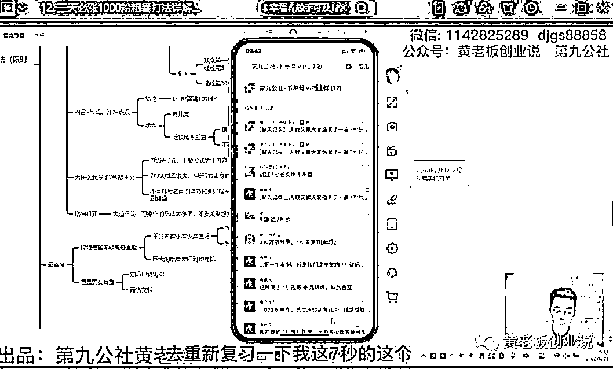
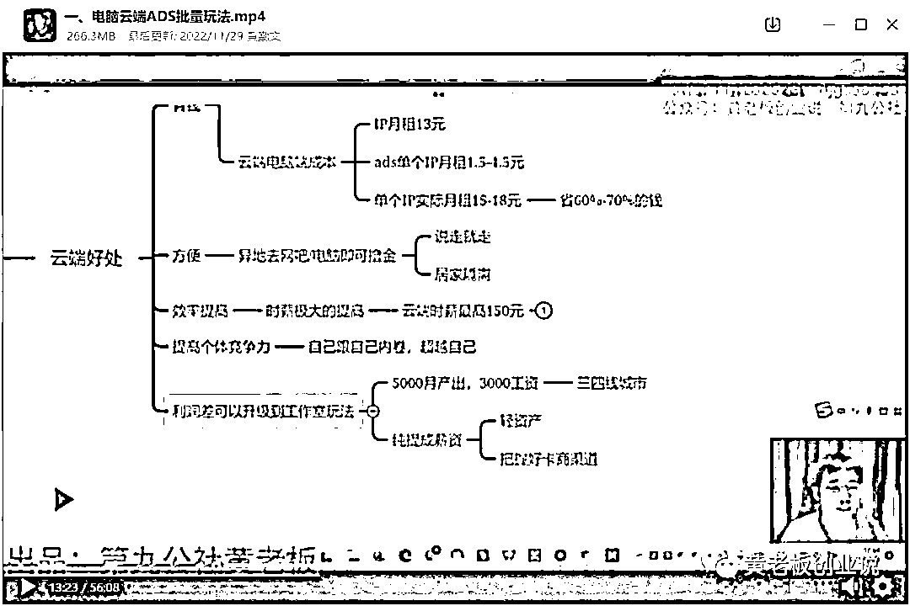
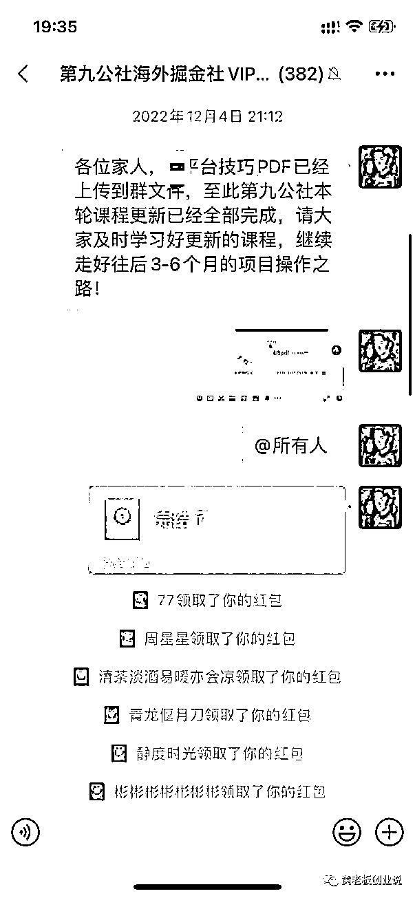
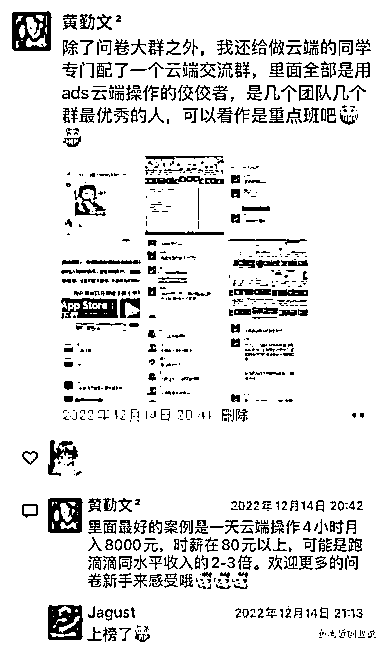
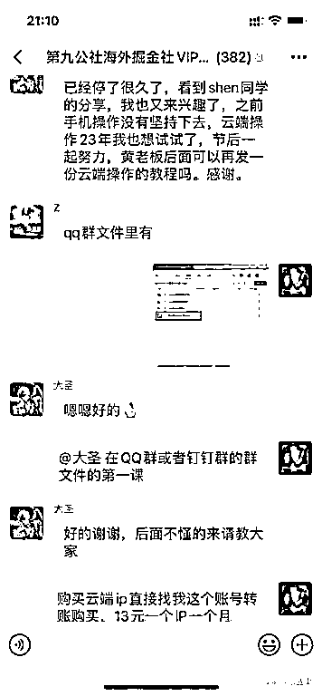
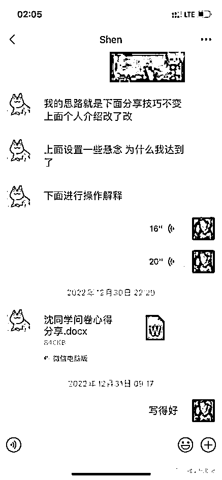
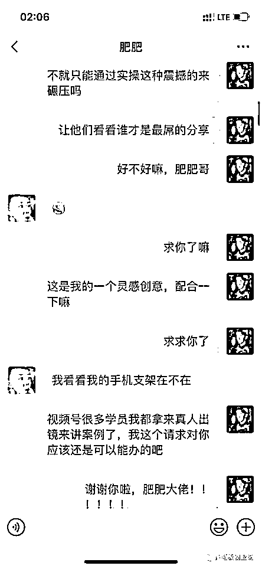
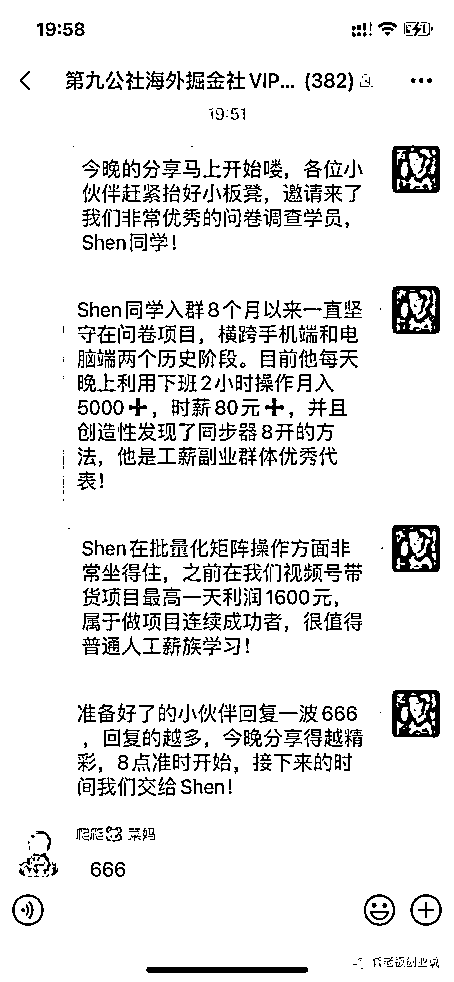
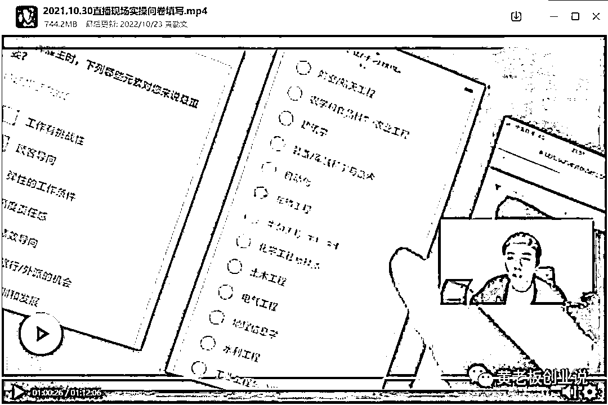

# 互联网培训怎么跑通？一份完整拆解

想在这个赛道拿到结果，绕不开三个问题：第一步怎么迈、后端怎么撑、规模怎么扩。下面把讲师成长、轻资产打法、后端服务、获客、人设、续费以及高频疑问，逐一拆开聊。

**1.** 先说成长：讲给别人听，是最快的进步方式

费曼学习法可以这么理解——把一件事讲到外行也能明白，会逼着你重新梳理自己的经验框架。每讲一次，认知就被重排一遍；次数多了，你自然成了行家。换句话说，输出本身就是输入。

**2.** 不压货、不重投，靠预付费跑起来

实体生意一开门就要压几十万本钱，风险全扛在自己肩上；培训不同，只要后端服务立得住、师资够硬，靠获客就能收费，毛利空间很大。而且学费往往先到账，活儿后干，跟理发店办卡是一个逻辑。

**3.** 一份能积累、也能当名片的事业

做培训越久越吃香，十年下来手里攒的是一批批精准付费用户。生意归根到底拼的是人，人脉池够深，跨行做事都顺手，连续成功的把握也更高。出去社交时，“我是做培训的”就是一张敲门砖，资源、合作更容易谈，形成正向飞轮。

## 二、培训行业的短板

入行前得先看清这个行业的毛病。

1. 从业门槛低，十个人里九个抱着捞一笔就走的心思。没学过职业规范，也不清楚自己该对用户负什么责，见钱就想收。
2. 掏钱的用户鉴别力不够。一个团队后端靠不靠得住都分不清，看到一张收益截图就敢交钱。
3. 剩下的不细说，圈内人都懂。

## 二、后端交付：五块拼图

我理解的“交付”，由五块组成：课程、🛰️群、老学员分享、直播连麦、兜底式解决。我们团队这五块都在跑。

一个能及格的后端，第1和第2块是标配；眼下的同行大多只做了第1块，剩下几块基本空缺。带队的时候，按自己情况加减即可。新人不必五项全上，但若真能全做齐、项目也跑通了，后端水平至少能打95分。

**1.** 课程：自己录，才叫原创

连课都不录，或者直接转发别人的，那就是明摆着收割。质量高低另说，有没有花心思做，用户一眼能看出来。

① 先搭框架，再开录

开录之前把大纲、课件理清楚，录制时卡壳就少，逻辑也顺。这一步大概占备课时间的一半。导图用Xmind足够。

② 敢露脸，路才宽

课程是你的作品，能出镜就出镜。连脸都不敢露的讲师，天花板很低。当然，若你本就想捞快钱，露脸反而留下把柄——如今人脸识别太厉害。

③ 设备不必贵

电脑录屏用班迪，手机投屏用傲软，会员在拼夕夕上买很便宜。开录前把声音、帧率调好，尽量一条过。投屏的样子是这样的：

④ 打上水印，留下署名

水印是原创的凭证。课程万一流出去，看到的人至少知道作者是谁，也可能顺着加🛰️、进社群。整套下来，课程页面的观感大致如此：

⑤ 把观众当零基础

讲课时千万别拿自己的认知去衡量听众。很多点你觉得是常识，学员却完全没概念——他们要是都懂，何必付费。把对方当成刚上幼儿园的孩子，学着白居易写诗的路子，往通俗里讲，目标是：只要听得懂中文，就能跟上你的课。啰嗦一点没关系，录播课能拖进度条，缺哪补哪，双方都省事。

⑥ 课不是录一次就完事

别指望一劳永逸。玩法通常一到三个月就要换一版；短视频带货这类行业，一个月更新好几次都正常。主动革自己的命，好过被同行革。持续迭代，始终站在玩法前沿。学员也会看到你频繁更新的动作，觉得这个老师靠谱，反过来更信任你，形成正循环。

**2.** 社群：规矩、氛围、价值观

① 先把红线划出来

群得有群的样子，规矩先立起来。底线三条：不谈政治、不沾黄赌毒。广告零容忍，初犯提醒、再犯警告、三犯请出。有想法先找群主或管理员报备，拿到授权再动，私下推销一律禁止。

② 别把群管成一言堂

有些团队管得太紧，半屏都是工作人员在说话，学员冒一句，官方回五句，群里就剩一个声音。规矩没写死的，不妨放手让群自己长；管理者松弛一点、自信一点，给话题留点发酵时间。学员自己聊起来，官方少下场，群才像个茶馆，信息量和价值自然就出来了。

③ 群也是有价值观的

每个社群都在向外传递某种取向。有的团队传递的是计较、抱怨、戾气；有的团队反复讲：凡事有解，方法比困难多；讲责任与担当；讲真诚利他、越分享越幸运。社群一旦有了规模和影响力，就该承担相应的社会责任，多引导向善、多散发正能量，让它成为大家歇脚的地方，有家的味道。很多时候，用户真正记住的不是你的产品，而是这个群传递的价值观。

④ 按需求开小灶

不同目的可以配不同群。比如我带的问卷调查项目，除了培训大群，还给买了云端IP、用电脑云端操作的学员单独开了交流群，针对性满足这部分人的需求，反馈相当好。做培训就要舍得加餐，让学员觉得值回票价，信任感自然上来。

**3**、请学员上台：标杆是最好的广告

培训老师最直接的任务，就是把学员带出结果、带出标杆。有仪式感地请学员分享，还能把群里潜水的人激活，让身边人的成绩去刺激更多人动手。真实案例积累起来，团队对外招商也更有底气，正循环就转起来了。

① 先帮嘉宾把稿子捋顺

嘉宾分享多是临场发挥，但大部分人没做过公开表达，抓不住重点：无关的反复讲，亮眼的成绩反倒漏了。名不正则言不顺，听众天然更信强者，所以得把嘉宾的实力托出来。

这些都需要带队老师这种老手来补位。最好请嘉宾先写初稿，你过一遍、改一改，把“节目效果”做到位。嘉宾讲得体面，自己也有面子。当然，请人上台本身是苦差事，得拿出哄女朋友的耐心和手腕，“连蒙带骗”把人家请来。真遇到不给面子的，也只能换人。

② 一场分享的完整流程

前一天在群里放风：什么时间、在哪儿、请了谁、讲什么，顺便把嘉宾捧一捧。当天开场前一小时开始倒计时，前十分钟做介绍、带节奏，让大家刷666、把队形拉起来。

分享结束，做总结、致谢，再开放提问，请嘉宾解答。说到底，请人分享是把官方带队者的信任和影响力，集中转交给台上的学员，把舞台让出去。层次高的人互相抬举，层次一般的人彼此较劲，层次低的人互相拆台；江湖靠的不是刀光剑影，是人情往来。

③ 红包要发，别寒酸

人家花时间精力来站台，红包必须给。金额看自身财力，但别抠门，一百块以下就别拿出手了，没意义。优秀学员分享是培训闭环里不可缺的一环，红包既是感谢，也是正反馈。做事之前先做人。

**4.** 直播连麦：加分项，不是必答题

课程、社群、嘉宾分享走完，学员95%的疑问其实已经消化了。直播连麦做不做都行，属于锦上添花。要做就真人出镜；不敢露脸，宁可不播，也别用花里胡哨的形式糊弄。现在没人在意你长什么样，大家在意的只有两点：你诚不诚恳，能不能解决问题。

连麦的重点不在答疑，而在“定心丸”和“形象款”——让学员感觉到老师愿意花时间陪聊、耐心疏导，这份陪伴本身就很打动人。所以直播别做成冷冰冰的问答，更像心理咨询和职业规划。

工具方面：钉钉、飞书、腾讯会议都能用。钉钉和腾讯会议现在收费了，钉钉一年9800元，腾讯会议超过300人收费，可以选飞书。最好把全程录下来，方便学员回看。

① 谁来播

通常是带队老师或助理。老师能亲自出镜最好，你是灵魂人物，也是定心丸。流程：开场寒暄—请学员代表连麦—现场答疑—总结收尾。

② 连麦的人要提前选

开播前在群里征集积极学员当连麦代表。为保证效果，先让他们把问题交上来过目：太水的问题会拖节奏，简单的直接私下回掉；有代表性、有价值的，才放进正式环节当案例讲。

③ 现场节奏要拿住

除了回应代表性问题，也要照顾其他学员的即时提问，控好时间，尽量讲得轻松有趣。

**5**、兜底服务：老师也是半个家长

① 干到最后，是保姆也是家长

别以为做培训只聊项目。带队老师更像灵魂人物：要会安慰人、会协调矛盾、会插科打诨、会带气氛、会引导三观。最核心的是解决问题的能力——学员有需求、有困难，你怎么保质保量地处理，让对方满意，这里考的是效率，也是情商、智商、逆商、财商。

所以做培训是一场独自扛责的修行，也是观察社会、理解人性、提升自我的好机会。全扛下来了，你本身也就成了个人物。

② 学会分活，只认结果

规模一上来，所有事都压在老师一个人身上不现实，精力有限，必须专业化分工。基础的、可复制的活交给员工和助理，老师腾出手去做不可替代的事：对外谈资源、付费学新知、前端拉新。

学员付费买的是什么？是问题被解决。至于具体谁来解决，并不重要。只要最终把事办成，什么路径都行——请老学员带新人、让助理顶上去、花钱买方案，红线之外都可试。小作坊有小作坊的打法，大团队有大团队的章法，按自己的实际情况来。

## 二、前端获客：把公域的人搬进🛰️

获客，就是去🛰️以外的平台把目标客户捞出来。路径两条：免费流量、付费流量。预算紧就先做免费，研究平台规则要花时间，但省下的都是纯利。规模上来、时间变贵之后，就花钱买量，算清ROI：比如拉一个人成本30元，他平均贡献60元利润，投产比就是1:2。持续买、持续成交，流量池才稳定。

很多人招不到人，招几个就卡住，最后项目黄了，根子就在没有稳定的流量入口，不知道怎么搞流量。

**1.** 免费流量：拼的是体力

说白了这是个体力活，不看学历、不看思维，看你能不能每天大量铺内容。数量优先于质量，量大出奇迹。在抖音、快手、📕这些公域平台，持续输出有价值的图文或短视频，内容本身就会带量，再把用户导进🛰️，变成自己的私域，平台拿不走，你可以反复触达。

想吸引创业粉，就发赚钱相关的内容；想吸引宝妈，就发教育相关的内容，逻辑一样。目前免费渠道里抖音最好，来的人质量也高。前期把免费流量做扎实，省下来的全是利润，适合新手。

**2.** 付费流量：有钱有经验再上

这条适合成熟团队，或者至少是有经验的个人玩家，因为要扛得住亏损。平台之间差异大，同一个平台不同号主也千差万别，需要大范围投放、反复测数据，有赚有赔。具体方法不展开，花钱去找有结果的人学，然后照做。方向对了，细节都是小问题。

## 三、个人IP：转化率的地基

个人IP就是个人品牌，海参哥、广东夫妇都是例子。它解决的核心问题是信任。为什么很多人想做培训却招不来人？因为没做人设，信任建立不起来。

有些人朋友圈天天刷项目，只发广告，不写内容、不显专业、不出镜，唯一的信息就是“今天又赚了多少”，观感和骗子没差；偶尔还发点抱怨和负能量，格局显得更小，信任再掉一截。

转化率更多取决于IP，而不是某个具体项目。IP成熟了，换什么项目都能卖；IP做砸了，项目再好也推不动。做好IP要抓四件事：内容输出、定位、后端变现、前端获客。多数人只做了“后端变现”这一件，平时不输出内容、不体现专业度，给别人留下的印象很淡，自然招不到人。

## 四、年费与复购：给服务设个期限

市面上做得专业的知识付费团队，大多采用年费制，樊登读书会、龙哥盟、比高研习社都是如此。永久服务很难持续：只收一次钱，后端又没有利益绑定和被动收益，组织撑不久，也没有复购。没有复购的产品，不值得投入。

所以我建议按三个月、半年或一年来定价，把服务周期量化。反过来想，不设期限、承诺永久，学员真有耐心一直做下去吗？不会。付费之后的新鲜劲通常只有三到六个月，能保持一年以上热情的极少。顺应人性，也放过自己，定好时间和价格，交付完成，彼此成全。

第二年的续费率，就是对第一年服务的打分：续费低，说明该优化；续费高，说明方向对，继续放大。普通人付费买互联网项目，图的是稳定的赚钱渠道加高质量的社群服务，只要需求被满足、价格合理，收费方式他们都能接受。

## 五、高频疑问解答

**1.** 课程被盗版了怎么办？

作为原创者，维权或不维权都行，没有对错，只看利弊。

① 先恭喜自己

发现课程被人盗卖，甚至有白嫖的人加你🛰️问问题——先别急，这说明你做出成绩了，至少在圈里有了一点声量。招的人少，课连被盗的资格都没有。

判断一个培训有没有影响力，有个土办法：去淘宝、拼夕夕、闲鱼搜自己的名字，看有没有人在卖你的东西。那些头部讲师，电商平台上一搜就是全套。他们为什么不去打假？难道盗版对他们毫无影响？没错，影响确实不大，而且两边的客群根本不是一批人。

买盗版的是哪类人？大多是白嫖党，不懂付费、不懂感恩，也很难做出成绩——课买回去往网盘一扔，图个心理满足。你听说过哪个大佬是靠看盗版课起来的吗？我没听过，你大概也没有。课程本身不产生结果，只有落地执行、跟老师持续沟通迭代，才有结果。反过来说，真有人看我的盗版课做出了成绩，我恭喜他——能从一堆白嫖者里杀出来，本身就是狠人。

以上是从学员角度看。盗版对你只有坏处吗？也有好处。一个品牌能做多大，不取决于你卖出多少产品，而取决于有多少人替你卖。同样，培训做得成不成功，不看你亲自招了多少学员，而看市面上有多少人替你推广。如果一堆人抢着卖你的东西，你还愁销路和曝光吗？影响力自己就出去了。

课程上打了水印、留了🛰️，课一流出去，就有人顺着加你、翻你朋友圈。高能量的朋友圈自带吸引力，说不定哪个白嫖党最后就成了付费客户。

② 我们试过，结果不划算

我们也打过假，最后不欢而散。钱没多赚，精力倒搭进去不少，耽误了更重要的事。这是个教训，后来就再没维权，随那些小镰刀折腾去。给别人留条路，自己的路也更宽，何乐不为。人各有各的乐子，我独爱修身，习以为常！

**2.** 同行来卷怎么办？

① 有对手，说明赛道是真的

尤其在国内，如果你的生意找不到一个同行，那才要警惕：这生意真能跑通吗？跑得通为什么没人做？就像去外地投资，先得摸清外地人在当地过得怎么样。北方有些城市，外地人基本被挤走，走的时候都是哭着走的——所谓“投资不过山海关”。

所以有同行跟你卷，别慌，卷赢他们就行。卷不赢，那就被卷，市场本来就是动态平衡的。竞争逼着你迭代，最后你会更强，站到新的高度。

② 别在背后说同行坏话。

**30天卖课60万：别踩同行，别割学员**

做销售也好，做知识付费也罢，最容易犯的错，就是靠说同行不行来显得自己行。就拿保险行业来说，客户问起另一家产品怎么样，大约八成的业务员会顺口点评，甚至踩上几脚。结果市场陷入恶性竞争，越做越乱，最后谁的日子都不好过。

互相打小报告、彼此揭短，只会让旁观者觉得双方都不体面，根本证明不了谁更优秀。而且一定要记住：你说同行的坏话，不是九成会传过去，而是百分之百会传到对方耳朵里，别抱侥幸。好消息难出门，坏消息传千里。

想让人看见你的实力，正确做法是把自身优势讲透，让客户自己去品味、去判断。反衬这一步应该由用户完成，而不是你亲自下场踩人。话到嘴边先分清该不该说：该表态时别沉默，不该开口时别多嘴，做人的基本盘就稳了。

以后客户再问某同行做得怎么样，别回答“他做得很差、很垃圾”，可以这样说：“他的情况我不了解，不方便评价，您自行判断就好。”

真正有格局的人不轻易树敌，因为他相信仁者无敌，走到最后，遇见的多是朋友和老师。贬低别人，往往暴露的是自己的仰望。

**3.** 学员要退费，先处理情绪再处理问题

①先弄明白他为什么想退：是交付本身出了问题，还是售前沟通有误会、宣传夸大，或者他个人遇到了难处；再判断他是真的走不下去，还是受挫后想倾诉、求帮助。若确属后端交付有漏洞，先反省自己：要么把交付闭环补齐，要么暂停招生，别硬做培训。

②能安抚就安抚。后端能跑通、也有成功学员，那么八成以上是对方遇到了坎儿，需要心态建设。你要给方案、给资源、给人脉，像保姆和心理医生一样耐心，甚至拿出哄伴侣的劲头，帮他尽快拿到正反馈、回到正轨。

③安抚引导后仍坚持无条件退款，就复盘售前：介绍里有没有“包退包赚”之类承诺。若明确写过“收费后不退”，退与不退都说得通，权责已经清楚；若承诺过包赚包退，那只能认账，规则对己不利也得兑现，不想爆雷就干脆退。若售前没说清、存在争议，比较稳妥的是退，当作带队老师买个教训，下次招生写明白，格局放大。

④按具体情况退款。争议大、冲突大，建议退，信任没了继续拉扯损失更大；实在不想全退，可协商退50%，或换项目免费做（退款+补项目）降低损失；全款最彻底，后续无纠纷。售后处理关系项目团队能否长久。市面上靠夸大诱饵收钱还能赚的团队不少，但钱能不能平稳落地另说；作恶多了可能要吐出来、交罚金甚至进去。割韭菜短期来钱，却会放大恶念，难以平稳落地和持久。君子爱财取之有道，赚钱既要有短期爆发力，也要有长期持续力，才能走得稳、走得远。

**4.** 学员多、提问多，忙到心累怎么办？

①课程尽量讲全，在课程阶段解决学员95%的问题，并引导他们去课程里查漏补缺；不知道知识点在哪，就截图圈位置。课程是长期内容沉淀，录一次可批量解决N个学员问题，等于省答疑时间。

②能群答别私聊。同一问题私聊是答一个，群答也是答，但群答顺带帮了其他有同样疑问的人，还能提前避免问题，信息传递效率最高。“偷懒”要讲技巧；涉及收入、岗位等隐私，仍要私下解决，不该省的事别省。

③让老学员带新学员。社群氛围和价值观养好，新人提问老学员会主动答，因为“好为人师”是老司机常见心理。发点小红包引导老人带新人、鼓励真诚利他，金额不大但正反馈很足，跟文章被读者打赏1元差不多。弱化官方角色，该放手就放手，让社群形成自动运转的发动机，让有价值的信息高效流动。培训卖到最后，卖的往往不是标品，而是社群圈子和信息差。

**5.** 做培训最后暴雷，问题出在哪？

培训后端交付是否安全，关键看三点：前端承诺是否兑现、退款是否及时、变现路径是否真正跑通。

①售前乱承诺、不筛人。咨询时，没有的不承诺，不保证人人赚钱，不虚夸数据，甚至把数据往小里说，降低对方预期；对资金短缺、不适合的人要敢劝退，减少双方风险。暴雷团队往往在售前把话说得天花乱坠，包赚、包回本、包XXX，案例全用最高水平，数字夸大几倍，把期望拉满，学员进来发现不是那回事，矛盾就来了。抖音海参哥风格有争议，但他不收穷人的钱，也不做保证承诺，所以还能稳定招商。

②售后拖着不退。售前没筛人，把不适合做项目、不适合花钱的人收进来，很容易有退款售后；金额小还好，金额大可能被发上网、对簿公堂，丑闻被放大。比如抖音小小如（张曼如）收了孕妇6万元，退款没处理好，最后公关危机，仍以退款收场。所以售前筛掉负债、眼高手低、急于求成、磨磨唧唧的人；售后该退果断退，承担责任。

③项目没跑通变现闭环。做培训，自己先完成0到1，再去复制1到100；自己都没跑通变现就招生，这是人品问题，不必多说。

六、后记

**1.** 普通人做生意，培训利润最高、也最赚钱。2019年我大二第一次组公司团队，商业模式不成熟、不够聚焦，三个业务并行：短视频带货、抖音培训、企业抖音号代运营。第一个必须做，自己有业绩才能带培训；第三个像抖音陈厂长那样，钱少事多，一个月收1万，要满足甲方各种要求，当时大学生对合同权责不敏感，辛苦一个月还得退钱，牵扯团队大量精力，少赚很多。结果把一个能赚100万的红利赛道，只赚了30万，对我来说是耻辱和重大失误。后来复盘，大学在抖音短视频行业的收入，一半来自抖音培训。如果早知道培训最赚钱，我会果断砍掉代运营，专注前端引流+后端培训交付。人永远赚不到认知之外的钱，哪怕只隔一层窗户纸，没捅破也会失败。

**2.** 知识付费本身是客观存在的大行业，跟直播带货、网红接广告一样。商业底层逻辑就是：你有需求，我正好专业。交易让双方都获得溢价：学员学到知识、赚到更多钱、省下时间，老师拿到合理学费，双方需求都满足，这是双赢的良性商业。合法商业行为只是社会分工不同，不存在对错好坏，不能说收钱盈利就是罪恶。这种受害者弱势视角，长期会阻碍自身发展。网上骂知识付费的人，很多是自己没能力做培训，想割韭菜都收不到学费，因为完不成信任传递，没人信他。这就像有人骂国外留学和生活的人，其实是因为自己没能力出去、没享受到更好生活。另一方面，偏见来自误会：行业里没职业素养道德的人太多，才造成不愉快和误会，让很多人对培训从业者产生偏见和抵制。

**3.** 有良性商业，也有恶性商业。比如带队老师团队不专业，恶意夸大宣传和承诺，却提供不了相应专业服务和培训，培训费提前收了又退不了，学生单方面受损，俗称割韭菜，后续维权又产生恶性行为，这不符合职业道德和商业本质。量变会质变，作恶到一定数量，可能学生集体维权、对簿公堂，严重者锒铛入狱，自食其果；市场终会平衡，作恶者终会反噬。

这提醒从业者：

**1.** 持续保持专业度，投入足够精力和资金，花时间研发项目，或花钱去外面学最新玩法，保持专业和时效。

**2.** 有职业素养和职业道德，不是什么钱都收。培训费是提前预支，收钱是责任承担的开始，不是交易结束；要心存敬畏，敬天地、敬众生、敬自己，小心才能驶得万年船。

**3.** 严格筛选人群。贷款、负债的人尽量不收，别赚穷人的钱；放下渡人思想，少做雪中送炭的美梦，多做锦上添花的事。学生赚钱是因为他自身能力强，培训只是锦上添花。拿该拿的钱，凭良心做好职责范围内的事；多输出、多利他，降低对反馈的期望。

愿天下没有割韭菜，愿市场经济最终惠及每一个用户！

评论区：

龙哥：感谢分享，已加精华。

作者：宋老师  
日期：2023-07-26

文章原标题：30天私域卖课60万，是怎样的体验？