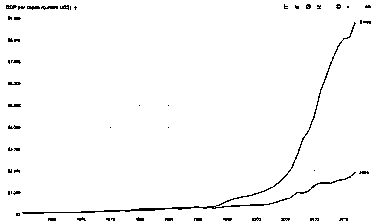
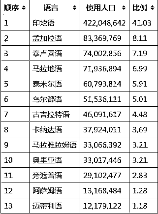

# 印度不是“十年前的中国”，这是一个两印应用市场操盘手的真话

一位长期做印度和印尼应用市场的操盘手，最近在生财有术分享了他在印度的真实观察。他叫肖翔峰，网名星火，做了7年产品，常驻北京，目前主攻海外业务。这篇文章整理了他的分享，想给准备出海印度的人提前避避坑。

**大环境：看起来很美，背后有落差**

印度人口超过13亿，但移动网民大约只有5亿，增量空间确实大。2016年Jio把4G资费打下来后，一年新增了上亿4G用户，预计2020年底4G用户会超4亿。而国内的移动渗透率早已超过60%，资本需要新故事，于是印度被视为“下一个中国”。

但印度并不是一个统一市场。这里有100多个民族，除印地语和英语外，通行语言还有24种，英语普及率只有15%。实际文盲率超过50%，会说不一定会写。商业价值和同一个中国统一市场完全不能比。经济上，十年前中国人均GDP是印度3倍，现在变成4倍，差距在拉大。基建也拖后腿：4G体验约等于3.5G，大城市移动中掉线常见；最好的列车时速只有120公里；德里到阿格拉的路是印度第一条高速，也是目前唯一一条。土地私有，拆迁成本极高。

**买量：红利不再，ROI难打正**

早期印度获客便宜，下载涨得快，现在价格上来了。ARPU只有0.005美元（概念值），ROI很难转正，大家只能先占坑再谈长期。

**本地化：抄中国爆款行不通**

印度的内容消费习惯和中国差异明显。比如资讯类产品，印度人没那么爱看新闻，能读英语/印地语文章的人也有限，短视频和图片反而更受欢迎。目前印度市场大多是中美产品的搬运，缺少本地原生创新，这也意味着机会。

**生态：设备中国造，规则美国定**

智能手机市场虽被中国厂商占据，但线上生态由美国主导：Android都是完整版Google全家桶，应用分发靠Google Play，社交是FB系，广告是FAN和AdMob。在印度做线上业务，等于在欧美规则下做事。用户的审美也偏向简洁欧美风，不喜欢中国式密集界面。

**人才：外包强，研发弱**

印度是IT外包大国，但本土互联网研发和管理人才稀缺。同等薪资下，一个中国运营能顶三个印度人，还要面对工会、工时等美国式管理负担。中资企业重金挖人，让本地人力市场越来越浮躁，薪资被快速推高。当然，本地团队依然有价值，关键是怎么用。

最后，星火表示自己仍在做产品，也有创业想法，先做副业。想深入交流可以加微信286741343，备注“生财有术”。

评论区里，亦仁说这些经验值几百万几千万；Jimi说务实；有人惊叹文盲率和语言复杂度；此岸问广告是不是唯一变现路径，星火说高端人群可以单独做，对标欧美。阿枫说，这跟印象中的印度完全不同。

 